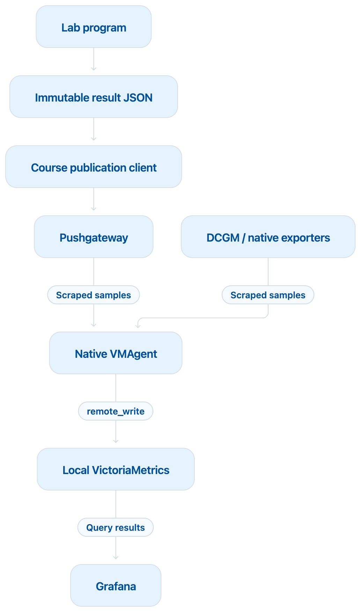

# Performance Engineering Courses

**[Explore the courses](https://nebius.github.io/nebius-ps-services/courses/index.html)**

The website introduces eight courses, an Advanced Labs collection, and one shared
Lab Guide, with a suggested reading order and direct links to every resource.
Soperator uses text and worked questions, GPU Performance Tools is a reference
without exercises, PyTorch for GPU Performance Engineering uses visual worked
examples without labs or practice, and Advanced Labs teaches through its practical guides.

Start with [Soperator](soperator/index.html), use the [Lab Guide](lab-guide.html)
to prepare for practice, then read [GPU Performance Tools](gpu-performance-tools/index.html)
and [PyTorch for GPU Performance Engineering](pytorch-gpu-performance-engineering/index.html)
before [GPU Fundamentals](gpu-fundamentals/index.html) and
[GPU Performance Optimization](gpu-optimizations/index.html). The tools course
introduces the commands and evidence used in practical labs. The three-hour PyTorch reading course
builds tensor-reading and optimization reasoning with small commented examples;
neither reading course needs a cluster. Continue with
[LLM Training](llm-training/index.html), [LLM Inference](llm-inference/index.html),
or [Custom CUDA Kernels](custom-cuda-kernels/index.html); these specializations
are independent. [Advanced Labs](advanced-gpu-communication/index.html)
owns the multi-GPU, multi-node experiments.

[Browse the courses catalog](index.html)

Each practical course provides complete lab sources, commands and a combined
Grafana dashboards, Small and Large results ZIP. Use the ZIP for comparison;
use `sync-labs.sh` to copy runnable sources to the cluster. This guide owns shared
setup, submission and access; each lab explains its experiment and results.

## How to set up the lab

[Read this guide online](https://nebius.github.io/nebius-ps-services/courses/lab-guide.html).

The browser edition is generated from this README and contains the same instructions.
**Workstation** means your computer; **Login node** means after SSH. Slurm allocates
GPU workers to execute workloads. Commands below use Bash and the default
`$HOME/courses` destination on the login node; adjust that path if you selected
another sync destination.

For a new environment, follow setup in order. If the cluster and tools are
already installed, [synchronize the sources](#synchronize-the-sources), prepare
only the runtimes you need, then [run a lab](#how-to-run-the-labs). Optional
Grafana publication needs its connection settings before preparation.

### Prepare your workstation

Install [uv](https://docs.astral.sh/uv/getting-started/installation/), Git, kubectl,
SSH and rsync. Install and configure the [Nebius CLI](https://docs.nebius.com/cli/install)
for your project. The login account needs SSH-key access and storage shared with
workers at the same path.

Clone the sources and install cxcli in its own Python 3.12 tool environment.
Editable installation uses this checkout's source. `update-shell` adds uv's command
directory to future shells; the PATH line enables it in this shell.

```bash
git clone https://github.com/nebius/nebius-ps-services.git
cd nebius-ps-services
uv tool install --python 3.12 --editable ./services/nebius-cxcli
uv tool update-shell
export PATH="$(uv tool dir --bin):$PATH"
nebius-cxcli --version
cd courses
export COURSES_ROOT="$PWD"
```

### Create or select Soperator

Soperator runs Slurm on Kubernetes. The five ordinary GPU courses use one full
H100 per allocation, with Multi-Instance GPU (MIG) partitioning disabled. Prepare
two one-H100 workers, or reuse the advanced cluster with one-GPU allocations. Advanced communication needs two eight-H100
SXM workers, local NVLink/NVSwitch and active InfiniBand. TCP/IP alone does not
qualify that route. Check quota and hardware availability before provisioning.

Run the wizard, then use its printed configuration path and exact target name.
Keep local monitoring and persistent `/data` storage for profiler reports.
`render` generates deployment artifacts; `deploy` applies the configuration.
For an existing prepared cluster, reuse its accepted configuration instead.

```bash
nebius-cxcli soperator create ./deployments
export CLUSTER_CONFIG='<absolute path to config.yaml>'
export CLUSTER_TARGET='<exact configured Soperator target>'
nebius-cxcli render "$CLUSTER_CONFIG"
nebius-cxcli deploy "$CLUSTER_CONFIG"
```

Save Kubernetes credentials to a private kubeconfig. Use this deployment's cluster
ID and select its context explicitly. Check the printed context before synchronization;
no-argument synchronization uses it to discover the login node.
See [Nebius cluster connections](https://docs.nebius.com/kubernetes/connect).

```bash
export KUBECONFIG='<absolute path to this cluster kubeconfig>'
nebius mk8s cluster get-credentials --id '<cluster ID>' --external --kubeconfig "$KUBECONFIG"
export CLUSTER_CONTEXT='<context for this cluster>'
kubectl config use-context "$CLUSTER_CONTEXT"
kubectl config current-context
```

### Install profiling and Grafana

**Workstation:** install the paired Nsight tools and private viewers before
monitoring changes or dashboard imports. Profiling installation requires an accepted
deployment matching the configuration and rendered state.

```bash
nebius-cxcli soperator profiling install "$CLUSTER_CONFIG" --target "$CLUSTER_TARGET" --interactive
```

First-time credentials use masked prompts. Valid credentials are reused automatically;
use `--no-interactive` when a rerun must require existing credentials. The installer
prints connection instructions. For later access, use the
[show commands](#browsing-grafana-and-nsight-profilers).

Review pending project changes before installing Grafana: this command saves
monitoring settings, regenerates artifacts and runs the **whole project deployment**.
It installs Grafana and Pushgateway and configures the native VMAgent results scrape.
Keep metrics storage **local**; **both** also supports course readback. Remote-only
storage is insufficient. Reuse an accepted installation if already configured.

```bash
nebius-cxcli grafana install --config "$CLUSTER_CONFIG" --target "$CLUSTER_TARGET" --pushgateway
```

### Import course dashboards

Connect using the [Grafana browsing instructions](#browsing-grafana-and-nsight-profilers).
In Grafana use **Dashboards → New → New folder** to create `course-gpu-fundamentals`,
or select its existing folder. Copy the UID from `/dashboards/f/<uid>/...` in the
address bar; the folder name is not its UID.

```bash
export COURSE='gpu-fundamentals'
export COURSE_GRAFANA_FOLDER_UID='<observed folder UID>'
cd "$COURSES_ROOT/$COURSE"
nebius-cxcli grafana import ./reference/grafana --recursive \
  --config "$CLUSTER_CONFIG" --target "$CLUSTER_TARGET" \
  --folder-uid "$COURSE_GRAFANA_FOLDER_UID"
```

In the wizard, select the installed local metrics datasource for
`course-soperator-metrics`. The import saves dashboard declarations in the deployment
project and installs them immediately. After syncing changed dashboards, repeat
the import with `--overwrite` for an intentional update. Open the imported dashboards to inspect their contents. Repeat for other
courses with a separate `course-<course-name>` folder. Publishing measured values
is a later step; empty panels do not prevent the first GPU check.

### Synchronize the sources

**Workstation:** synchronize the sources and open the login shell. Normal sync
ensures Python 3.12 and venv support in the Ubuntu 24.04 shared jail before
opening SSH. `--dry-run` and `--sync-only` do not install anything. Remote-only
results are preserved.

```bash
cd "$COURSES_ROOT"
kubectl config current-context
./sync-labs.sh
```

Use `./sync-labs.sh 'user@<login address>'` for another account or an explicit
endpoint. See `./sync-labs.sh --help` for SSH key, port and sync-only options.

After SSH opens, configure automatic publication below if you want Grafana results,
then continue with [Lab Preparation Scripts](#lab-preparation-scripts) on the login node.

### Configure automatic result publication

For automatic Grafana results, configure monitoring before running the lab
preparation scripts. This is optional: without these settings, setup succeeds
and labs save their results locally.

**Workstation, in a second terminal after synchronization:** the `regular-lab-setup.py monitoring`
action discovers and verifies
cxcli-owned monitoring services, datasource and routing. It installs nothing and
writes private connection settings and a verification receipt. Choose a persistent
lowercase learner identifier and a fresh output directory. Restore `COURSES_ROOT`,
`CLUSTER_CONFIG`, `CLUSTER_TARGET`, `KUBECONFIG` and `CLUSTER_CONTEXT` from your
setup notes in this new terminal before running the block.

```bash
export COURSE='gpu-fundamentals' # use the course you are preparing
cd "$COURSES_ROOT/$COURSE"
export COURSE_WORKSPACE='<persistent lowercase learner identifier>'
export COURSE_SETUP_DIR="$(dirname "$CLUSTER_CONFIG")/course-monitoring/$CLUSTER_TARGET"
uv venv --python 3.12 --seed "$HOME/.gpu-course-tools"
"$HOME/.gpu-course-tools/bin/pip" install -r tools/profiling-requirements.txt
"$HOME/.gpu-course-tools/bin/python" tools/regular-lab-setup.py monitoring \
  --config "$CLUSTER_CONFIG" --target "$CLUSTER_TARGET" \
  --kubeconfig "$KUBECONFIG" --context "$CLUSTER_CONTEXT" \
  --workspace "$COURSE_WORKSPACE" --output-dir "$COURSE_SETUP_DIR"
source "$COURSE_SETUP_DIR/laptop-environment.sh"
scp "$COURSE_SETUP_DIR/environment.sh" '<user>@<login address>:courses/.course-environment.sh'
```

Match the sync account and SSH key/port overrides. If installation changes,
rediscover into a fresh directory and replace the copied worker environment.
Keep connection files private.

**Login node:** run the appropriate [lab preparation script](#lab-preparation-scripts).
All five scripts initialize publication after successful preparation when these
settings are present; otherwise they report **unconfigured** and keep local results.
Initialization does not verify live Grafana health. If you copy settings later,
rerun the same preparation command with the same lab and variant selections.
Reruns preserve installations, publication identity, ordering and results;
invalid settings fail without resetting history.

## Lab Preparation Scripts

A **lab runtime** contains the Python environment, libraries, tools and model
files needed by a lab. Prepare it on the **login node** before submitting work;
jobs restore the saved runtime and never install dependencies.

Use the lookup below, then select the lab you intend to run. Regular preparation
covers 79 default labs; CUDA, communication, serving and Transformer Engine
preparation cover 13, 10, 7 and 1 respectively. These are software groups, not a
learning order or a guarantee that your hardware supports every lab.

### Find your course and lab number

Find the course and the number printed in the lab title. Follow its linked
preparation group for the command and prerequisites. Numbers identify existing
labs; they are not the lesson order. A range such as `01–05` includes both ends.

| Course | Lab numbers | Preparation group |
| --- | --- | --- |
| GPU Fundamentals | 01–05, 07–12 | [Regular labs](#regular-labs) |
| GPU Performance Optimization | 01–05, 07, 09–10, 12, 14–16, 19–20 | [Regular labs](#regular-labs) |
| LLM Training | 01–02, 05–07, 13–14, 21, 24–27, 30–32 | [Regular labs](#regular-labs) |
| LLM Training | 22 | [Transformer Engine lab](#transformer-engine-lab) |
| LLM Inference | 08–09, 16–18, 23–29, 32, 35–36 | [Regular labs](#regular-labs) |
| LLM Inference | 10–11, 15, 20, 30, 33–34 | [Serving labs](#serving-labs) |
| Custom CUDA Kernels | 01–13 | [CUDA labs](#cuda-labs) |
| Advanced Labs: Multi-GPUs Multi-Nodes communication optimization | 01–05, 08–09, 11–26, 28 | [Regular labs](#regular-labs) |
| Advanced Labs: Multi-GPUs Multi-Nodes communication optimization | 06–07, 10, 27, 29–34 | [Communication labs](#communication-labs) |

Soperator, GPU Performance Tools and PyTorch for GPU Performance Engineering are reading courses with no executable labs or preparation script of their own.
Shared preparation skips these reading profiles and creates job directories only
for practical courses.
The lookup covers all 110 default labs. For the optional CUDA container exercise,
Inference Lab 30's TensorRT-LLM variant, or Dynamo container preflight, follow
[Optional container exercises](#optional-container-exercises) after choosing that
activity in the lab. Default preparation does not include these containers.

### Before running preparation

Use the synchronized sources on the supported **Ubuntu 24.04 x86_64 login
node**, with Python 3.12 and storage shared with workers at the same path.
Normal `sync-labs.sh` prepares Python and opens SSH; `--sync-only` does neither.
Downloads and builds need network access and enough shared storage for packages,
model weights and temporary files. Missing selected operating-system packages
require root or passwordless sudo; otherwise ask the cluster owner to install them.

Preparation checks configured Slurm capacity without allocating workers. It
reports unsupported subsets as **skipped** and leaves unknown hardware unverified.
Installation or configuration errors return a nonzero exit status. **Setup
complete means software preparation, not a passed GPU, model, fabric or profiler
check.** Those checks run later in lab allocations. Drivers, Slurm, Nsight and
Grafana remain cluster-managed; native preparation needs no Apptainer containers.

### Choose one lab or preview the work

Choose `--lab <lab-id>`, `--launcher <filename.sbatch>` or `--all`. Lab IDs omit
the source extension; launcher names include `.sbatch`. Use a course-qualified
ID such as `custom-cuda-kernels/01_vector_add` if names overlap.

A specialized script with **no arguments lists supported labs and installs
nothing**. For example, list CUDA labs, preview Lab 01, then prepare it:

```bash
python3.12 "$HOME/courses/tools/cuda-lab-setup.py"
python3.12 "$HOME/courses/tools/cuda-lab-setup.py" --lab 01_vector_add --plan
python3.12 "$HOME/courses/tools/cuda-lab-setup.py" --lab 01_vector_add
```

`--plan` is read-only and performs no platform checks; it does not prove readiness.
Regular preparation also supports selectors and `--plan`, but **no arguments
prepares its whole group**. `--all` selects default experiments and excludes
optional containers. A standalone course copy uses its own `tools/` directory
and lists only its available labs.

Match preparation to the job's `--experiment`, `--profiler` and `--device`
selections; sanitizer experiments also need `--sanitizer`. For example:

```bash
python3.12 "$HOME/courses/tools/regular-lab-setup.py" \
  --lab gpu-fundamentals/01_cpu_gpu_crossover --profiler all
```

Here `--profiler all` prepares the supported diagnostic runtimes. It does not
run a capture or install unrelated optional experiments.

### Regular labs

Prepares ordinary Python experiments across the practical courses, including
24 Advanced Labs that need no specialized build. It installs isolated pinned
dependencies, PyTorch where required, shared publication tools and the fixed
Qwen2.5-0.5B model snapshot used by small-model exercises. `0.5B` means about
half a billion parameters.

**Login node — prepare the whole regular group:**

```bash
python3.12 "$HOME/courses/tools/regular-lab-setup.py"
```

All preparation groups create private result and log directories before Slurm
needs them. Reruns preserve existing files, tighten safe owned directories to
`0700`, and reject symlinks, foreign ownership or shared-write directories.
Regular preparation does not install specialized compilers or engines. Its
separate `monitoring` and `organize-history` actions are covered under
[publication setup](#configure-automatic-result-publication) and
[keeping results](#keep-existing-results).

### CUDA labs

Prepares all 13 Custom CUDA Kernels labs: a managed native CUDA toolkit,
build tools, Python support and pinned CUTLASS GPU linear-algebra sources.
It compiles selected CUDA C++ targets without GPU jobs and does not replace
the cluster driver or system CUDA.

```bash
python3.12 "$HOME/courses/tools/cuda-lab-setup.py" --all
```

Prefer `--lab` for one exercise. Rerun it after editing a kernel to rebuild;
correctness, device compatibility and sanitizer checks still run in the lab.
The optional container exercise needs its explicit selection below.

### Communication labs

Prepares 10 specialized Advanced Labs. Depending on the selection, it builds
fabric/bandwidth tools, NVIDIA Collective Communications Library (NCCL) tests,
NVIDIA Inference Xfer Library (NIXL), Megatron Bridge distributed-training tools,
or Dynamo distributed serving with its coordination services.

```bash
python3.12 "$HOME/courses/tools/communication-lab-setup.py" --all
```

Prefer `--lab` to avoid unrelated builds. Relevant Dynamo labs share one pinned
Qwen3-8B model snapshot, about eight billion parameters. Advanced experiments
need the two eight-H100 workers described above; a smaller cluster may produce
hardware skips. Software installation does not qualify InfiniBand, GPU transfer
paths or multi-node correctness.

### Serving labs

Prepares seven LLM Inference labs with native vLLM for model execution,
AIPerf where benchmarking requires it, and the required clients and model files.
The engine and benchmark tools use separate pinned environments; launchers choose
their executables and private caches automatically.

```bash
python3.12 "$HOME/courses/tools/serving-lab-setup.py" --all
```

Serving reuses regular preparation's Qwen2.5-0.5B snapshot; Lab 33 adds the 1.5B
model for speculative serving. Lab 16's metadata audit belongs to **regular**
preparation and needs Hub access at execution time, without downloading weights.
Server startup, warmup and request correctness are checked in the allocated job.
TensorRT-LLM is an optional container variant, not part of `--all`.

### Transformer Engine lab

Prepares Training Lab 22, `22_transformer_engine_fp8`, with an isolated
Transformer Engine/PyTorch runtime and its native CUDA build dependencies.
The lab compares floating-point 8-bit (FP8) execution with a higher-precision
reference; ordinary training labs keep their own environment.

```bash
python3.12 "$HOME/courses/tools/transformer-engine-lab-setup.py" --all
```

Run the lab afterward to verify hardware support, FP8 execution and numerical
agreement. Installation alone does not establish those results.

### Repeat or repair preparation

All five scripts share `.runtime` under the synchronized root: an installation
store, download/model cache and one setup lock. Run one preparation command at a
time. Valid completed components are reused, including shared model snapshots.

Rerun the relevant command after syncing changes, editing compiled source,
moving the checkout or repairing an interrupted installation. Existing results,
logs and other runtimes are preserved; no shell profile edits are needed.
If a job reports a missing or stale runtime, run the exact preparation command
in its error on the login node, then submit a new job.

Inspect the named log in `.runtime/setup-logs/` on failure. Package dependency
or repository conflicts need the cluster owner's repair; setup does not silently
downgrade libraries. Cancellation waits for an active system-package transaction
to finish before releasing the lock. Remove credentials and private addresses
before sharing an error excerpt.

### Optional container exercises

Prepare these only when following the corresponding optional exercise. They
are excluded from every `--all` invocation:

```bash
# CUDA container build-and-test teaching exercise
python3.12 "$HOME/courses/tools/cuda-lab-setup.py" --launcher build_and_test.sbatch
# TensorRT-LLM inference variant
python3.12 "$HOME/courses/tools/serving-lab-setup.py" --launcher 30_engine_profile.sbatch --experiment trtllm
# Dynamo container preflight
python3.12 "$HOME/courses/tools/communication-lab-setup.py" --launcher dynamo_disaggregated_preflight.sbatch
```

Only these selections prepare Apptainer and cached images. Image creation runs
on the login node without GPUs; jobs use the recorded immutable image identity.
Allow shared storage for uncompressed images. A privileged root Soperator jail
needs existing mount-namespace and chroot capabilities; a constrained jail needs
an administrator-provided supported session. Preparation grants no privileges.
Worker device isolation, nested-container support and profiler access still
require the optional lab's checks.

## How to run the labs

### Check basic GPU execution

**Login node:** inspect the partitions and request one GPU explicitly. An asterisk
marks the default partition; add `--partition=<name>` to `srun` or `sbatch` if
required by your site.

```bash
sinfo --format='%P %a %D %G'
srun --nodes=1 --ntasks=1 --gres=gpu:1 nvidia-smi
```

With regular preparation complete, submit the compatibility lab through its
normal launcher:

```bash
cd "$HOME/courses/gpu-fundamentals"
sbatch slurm/10_compatibility_stack.sbatch --workload small
```

Use the returned job ID and the [inspection steps below](#select-a-course-and-submit-a-job),
with `10_compatibility_stack` as the lab ID. The lab records PyTorch, driver,
CUDA build/compiler versions and supported GPU architectures, then checks a tiny
GPU tensor operation. Passing correctness establishes basic GPU execution in
that runtime; it does not qualify profilers, containers or the fabric.

`nvidia-smi` reports the driver's supported CUDA level; `nvcc --version` reports
the compiler toolkit, when installed; PyTorch has its own CUDA build version.
They need compatibility, not identical numbers. A prebuilt PyTorch wheel does
not require a compiler. Do not replace Soperator's CUDA/driver stack with a
generic toolkit install; see [NVIDIA compatibility](https://docs.nvidia.com/deploy/cuda-compatibility/minor-version-compatibility.html)
and [Soperator limitations](https://github.com/nebius/soperator/blob/main/docs/limitations.md).

### Select a course and submit a job

**Login node:** work from the course directory. Follow the course's learning
route; lab numbers identify files rather than prerequisite order.

```bash
export COURSE='gpu-fundamentals'
cd "$HOME/courses/$COURSE"
```

Each lab shows its complete source and normal/profiling submissions. Launchers
restore the prepared runtime; their `#SBATCH` directives select logs and reserve
the largest supported allocation. Each `srun` step uses its declared resources,
so some allocated GPUs can remain idle. Preparation creates log directories
before submission.

```bash
# Normal experiment: use its unprofiled measurements
sbatch slurm/01_cpu_gpu_crossover.sbatch --workload small
# Separate diagnostic run: supported Systems then Compute captures
sbatch slurm/01_cpu_gpu_crossover.sbatch --workload small --profiler all
```

`--workload small|large` chooses the lab's workload preset. `--profiler all`
runs supported diagnostic stages, **not the normal benchmark**; an inapplicable
profiler is recorded as skipped. Use `--profiler nsys` or `--profiler ncu` for a
single supported capture. Inspect the normal run before investigating it, then
repeat an unprofiled run to evaluate a change.

Each submission returns its own job ID. Submission is not completion: use
`squeue` for queue progress and `sacct` for job/step state and exit codes.
After the selected job finishes, inspect its summary:

```bash
JOB_ID='<job ID returned by sbatch>'
sacct -j "$JOB_ID" --format=JobID,State,ExitCode
cat "results/01_cpu_gpu_crossover/jobs/$JOB_ID/result.json"
```

Use the matching lab ID for another job. `result.json` records requested and
actual scope, stage outcomes, correctness, measurements, report paths and separate
publication status. Require successful scheduler completion **and** passing lab
checks. Missing or incomplete results are not a pass.

On failure, inspect `results/LAB/logs/JOB_ID.out` and `.err`, then the affected
stage under `results/LAB/jobs/JOB_ID/stages/STAGE/`. Keep those files and submit
a fresh job after repair. Original measurement JSON and native reports remain
in the stage directories; the combined summary and profiler timings are not
benchmark-publication inputs.

Use optional selections only where the lab documents them:

| Selection | Purpose |
| --- | --- |
| `--experiment trials` | Independent trials in the three capstones |
| `--experiment two-node` | Distributed-scaling variant |
| `--experiment aiperf` | Streaming-client benchmark |
| `--experiment trtllm` | Engine-profile container variant |
| `--experiment sanitizer --sanitizer memcheck` | CUDA check; alternatives are `racecheck`, `initcheck`, `synccheck`; cannot combine with Nsight |
| `--device cpu` or `--device cuda` | Learning/inference basics where supported |

Put program options after `--` when they overlap launcher options, and match
explicit device/topology choices to the capture. Fabric labs may also require
qualified `SERVER_HCA`/`CLIENT_HCA` interfaces or `TRAINING_REFERENCE`/`CONTEXT_REFERENCE`
checkpoints. Follow the owning lab: a checkpoint must come from its matching
`--reference-only` run and printed `final-weights.pt`, not arbitrary model weights.

### Keep existing results

New jobs use `results/LAB/jobs/JOB_ID/` and `results/LAB/logs/`; earlier results,
reports and published bundles remain unchanged. Optional history organization,
run from the course directory, makes verified copies without moving originals:

```bash
python3.12 tools/regular-lab-setup.py organize-history --course-root "$PWD"
```

Copies go under `results/history/`. The command reports unattributed files and
rejects conflicts. History never counts as evidence of a fresh run.

### Publish lab results

With [monitoring configured](#configure-automatic-result-publication) before
preparation, normal `sbatch` jobs publish eligible results automatically.
`publish_results.py` validates original records and sends declared metrics to
Pushgateway; VMAgent scrapes them into local VictoriaMetrics for Grafana.
Unprofiled benchmark timers measure the experiment; sampled GPU/node telemetry
provides context.



Arrows show data flow. VMAgent initiates scrapes; Grafana initiates queries.

The job's `result.json` records publication separately from execution. Missing
monitoring or failed publication does not invalidate a benchmark. Acknowledged
writes may appear later if readback was not confirmed. Set `COURSE_AUTO_PUBLISH=0`
in the submitted environment to disable automatic publication. All courses in
one prepared root share an installation identity and ordering state.

**Workstation, when checking monitoring:** `verify_monitoring.py` checks services
against the receipt, one healthy results scrape and fresh telemetry for all GPUs
on both workers. It opens temporary local forwards but installs or repairs
nothing. Restore the settings and course directory in a new terminal:

```bash
export COURSE_SETUP_DIR='<absolute setup directory>'
source "$COURSE_SETUP_DIR/laptop-environment.sh"
export COURSES_ROOT='<absolute checkout path>/courses'
export COURSE='gpu-fundamentals'
cd "$COURSES_ROOT/$COURSE"
"$HOME/.gpu-course-tools/bin/python" tools/verify_monitoring.py \
  --receipt "$COURSE_SETUP_DIR/monitoring.json" \
  --kubeconfig "$KUBECONFIG" --context "$CLUSTER_CONTEXT"
```

**Login node, to retry publication for a registered job:** select the matching
course, restore its runtime and use the exact original job ID.

```bash
cd "$HOME/courses/gpu-fundamentals"
source tools/course_env.sh 01_cpu_gpu_crossover --lab
"$COURSE_PUBLISH_PYTHON" tools/publish_results.py --lab 01_cpu_gpu_crossover --job JOB_ID
```

Retries preserve run order and cannot replace a newer successful result. Keep
the originals and private publication journal. Jobs from before initialization
cannot be replayed as new latest runs.

For a deliberate baseline/candidate selection, use two eligible original,
unprofiled JSON files from the same lab. The generation is `0` initially;
afterward use the reviewed current selection generation:

```bash
"$COURSE_PUBLISH_PYTHON" tools/publish_results.py --lab 01_cpu_gpu_crossover \
  --baseline '<original baseline JSON>' --candidate '<original candidate JSON>' \
  --expected-generation '<reviewed generation>'
```

Invalid comparisons, failed correctness and unqualified runtimes are rejected.
If delivery is uncertain, the configuration pauses publication while jobs keep
saving results. Do not delete state or repeatedly retry. An operator must stop
outstanding publishers and establish that queued requests have drained or been
cleared through the monitoring owner before using the reported key/generation:

```bash
"$COURSE_PUBLISH_PYTHON" tools/publish_results.py \
  --resume-publication KEY --expected-generation N --attest-quiescent
```

The flag records that operator attestation; metrics readback alone cannot prove
quiescence. Recovery revalidates the newest eligible saved candidate, and another
uncertain write keeps publication paused.

### Capture and qualify profiling

Before claiming usable profiling, qualify both workers in the actual execution
runtime. Nsight Systems (`nsys`) traces application activity; Nsight Compute
(`ncu`) collects kernel counters. A version check proves only availability.
`readiness.py` runs a tiny canary, captures Systems/Compute, checks matching
kernels, NVTX and counters, and prints JSON/report paths.

```bash
cd "$HOME/courses/gpu-fundamentals"
source tools/course_env.sh 10_compatibility_stack --lab
source /etc/profile.d/99-nsight.sh
srun --nodes=2 --ntasks=2 --ntasks-per-node=1 --gpus-per-task=1 \
  "$COURSE_PYTHON" tools/readiness.py --workload torch
```

Require one full GPU visible to each task. If an eight-GPU worker exposes other
devices to `nvidia-smi`, have the owner qualify device isolation;
`CUDA_VISIBLE_DEVICES` alone does not establish that boundary. Repeat the check
in each runtime you intend to profile. For native CUDA, prepare Lab 01, select
its runtime and use the CUDA canary, which compiles a tiny kernel with the
managed toolkit:

```bash
cd "$HOME/courses/custom-cuda-kernels"
source tools/course_env.sh 01_vector_add --lab
source /etc/profile.d/99-nsight.sh
srun --nodes=2 --ntasks=2 --ntasks-per-node=1 --gpus-per-task=1 \
  "$COURSE_PYTHON" tools/readiness.py --workload cuda
```

For native vLLM, prepare the serving lab and select its engine runtime so the
canary uses the engine's PyTorch and libraries:

```bash
cd "$HOME/courses/llm-inference"
source tools/course_env.sh 30_engine_profile --lab
source /etc/profile.d/99-nsight.sh
srun --nodes=2 --ntasks=2 --ntasks-per-node=1 --gpus-per-task=1 \
  "$COURSE_PYTHON" tools/readiness.py --workload torch
```

These checks qualify a tiny capture in the selected runtime, not a full model
service or every kernel. Save each pair of result paths before switching
runtimes and publish that pair from its owning course directory. Optional
container variants need their own runtime and capture checks from the owning
lab; native qualification does not qualify a container.

```bash
"$COURSE_PUBLISH_PYTHON" tools/publish_results.py --lab environment_readiness \
  --baseline "${WORKER_ONE_RESULT:?first worker JSON path}" \
  --candidate "${WORKER_TWO_RESULT:?second worker JSON path}" \
  --expected-generation "${COMPARISON_GENERATION:?0 initially; otherwise reviewed generation}"
```

Open **Environment readiness** and both workers' reports using the browsing steps.
Require matching canary kernels, NVTX, Compute counters and publication generation.

For profiler selection, native flags, NVTX regions and report interpretation,
use [GPU Performance Tools](gpu-performance-tools/index.html). A missing tool,
permission denial, timeout or missing/empty native report fails the stage and
stops later stages. Preserve the failed job's evidence, repair its runtime or
permissions through the owning preparation/administration path, then submit a
fresh job. Never treat a nonempty report alone as proof that it captured the
experiment's measured work.

### Check specialized runtimes in the labs

Run the appropriate [preparation script](#lab-preparation-scripts) first, then
follow the owning lab to establish that its runtime works on allocated hardware:

- [Inference serving](llm-inference/README.md#serving-runtime-preparation):
  native vLLM/AIPerf and pinned models; TensorRT-LLM is an optional container variant.
- [CUDA Lab 13](custom-cuda-kernels/reference/labs/13_h100_preflight.md):
  managed native toolkit, compiled SM90/SM90a binaries, CUTLASS and device checks.
- [Training Lab 22](llm-training/reference/labs/22_transformer_engine_fp8.md):
  isolated Transformer Engine and FP8 numerical checks.
- [Advanced runtime preparation](advanced-gpu-communication/README.md#runtime-preparation):
  fabric, collective and vendor runtime qualification.

### Optional agent-assisted runs

From the workstation's `courses/` directory, install the project-scoped skill:

```bash
npx --yes skills add ./skills/run-labs -a codex --yes
```

This optional command requires Node.js/npm. The first `--yes` skips npm's prompt;
the last skips the skill wizard. Do not add `--global`; use `-a claude-code` for
Claude. On a fully qualified environment, `$run-labs run --course gpu-fundamentals`
runs both workload presets and collects verified evidence. The
[run-labs skill](skills/run-labs/SKILL.md) validates prepared runtimes and owns recovery, resume and
lab-specific recipes. Use that workflow for campaign selection and recovery details.

## Browsing Grafana and Nsight Profilers

### Connect from your workstation

In each new workstation terminal, restore CLUSTER_CONFIG and CLUSTER_TARGET
from your setup notes, or source the generated laptop-environment.sh using its
absolute path after preparing publication. These commands
check the installed services and print their complete connection instructions:

```bash
nebius-cxcli grafana show --config "$CLUSTER_CONFIG" --target "$CLUSTER_TARGET"
nebius-cxcli soperator profiling show "$CLUSTER_CONFIG" --target "$CLUSTER_TARGET"
```

1. Copy each printed `kubectl port-forward` command into its own workstation
   terminal and keep it running: one for Grafana and one for each Nsight viewer.
   Keep the explicit cluster selection, loopback address and both HTTP/TURN port
   mappings supplied for each Nsight viewer.
2. In another terminal, run the printed password-retrieval commands. Grafana has
   its own credentials; the two Nsight viewers share the profiling password.
   Keep the displayed passwords private.
3. Open the browser URLs printed by cxcli. Use the printed Grafana username and
   the Nsight username chosen during installation (`admin` by default).

The `show` commands print instructions; they do not start forwards or display
passwords. They require access to the cluster and its credential Secrets. If a
service is unavailable, resolve the reported setup problem before continuing.
If a forward exits, rerun `show` and start its printed command again; forwarding
ends when the selected Pod terminates. See the
[kubectl port-forward reference](https://kubernetes.io/docs/reference/kubectl/generated/kubectl_port-forward/).

### Browse Grafana

Open **Dashboards → course-<course-name>**, then the lab dashboard or
**Environment readiness**. If missing, [import the current dashboards](#import-course-dashboards).
Select your workspace, course installation, workload and experiment configuration.

- **Latest results**: newest successful clean run for each supported configuration;
  independent trials remain separate.
- **Diagnostics and run status**: stage outcomes and declared diagnostic measurements.
- **Selected comparison**: the explicitly chosen baseline and candidate; check both
  correctness slots and the publication generation.

Check the source job and completion time, and set the telemetry window to its
experiment interval. Select GPU worker and local GPU index together. Configuration
suffixes identify nodes (`n`), tasks (`t`), GPUs per task (`g`), CPUs per task (`c`)
and, where applicable, workers per node (`w`). Sampled telemetry supplies context;
unprofiled measurements determine performance.

### Browse Nsight Compute and Systems

**Login node:** the capture prints the private report path. Copy only a selected
completed native report into the installed report submount. These copies are
readable by viewer users; original results and logs remain private.

```bash
(
set -eu
report='<absolute path to the selected completed report>'
if [ ! -f "$report" ] || [ -L "$report" ] || [ ! -s "$report" ]; then
  printf 'Select a nonempty regular report file.\n' >&2
  exit 1
fi
case "$report" in *.nsys-rep|*.ncu-rep) ;; *) exit 1 ;; esac
viewer_dir="$(mktemp -d /data/nsight-reports/course-view-XXXXXXXX)"
chmod 755 "$viewer_dir"
install -m 644 "$report" "$viewer_dir/$(basename "$report")"
sha256sum "$report" "$viewer_dir/$(basename "$report")"
printf 'Viewer directory: /mnt/reports/%s\n' "$(basename "$viewer_dir")"
)
```

Require identical hashes. `/data/nsight-reports` is the default producer root;
use the actual submount selected by installation. The viewer exposes it at
`/mnt/reports`. Finish report processing before opening its read-only copy.

Sign in to each printed Nsight URL with the installation username and shared
password obtained above.
In Compute, open the copied `.ncu-rep` under `/mnt/reports/<viewer-directory>`
and inspect the kernel and counters specified by the lab. In Systems, open the
copied `.nsys-rep`, expand the process tree, CUDA streams and NVTX rows, and zoom
to the measured interval. Follow the lab's inspection steps; initialization-only
activity does not establish that the experiment was captured.

© 2026 Nebius B.V. Free educational material under [Apache License 2.0](../LICENSE).
