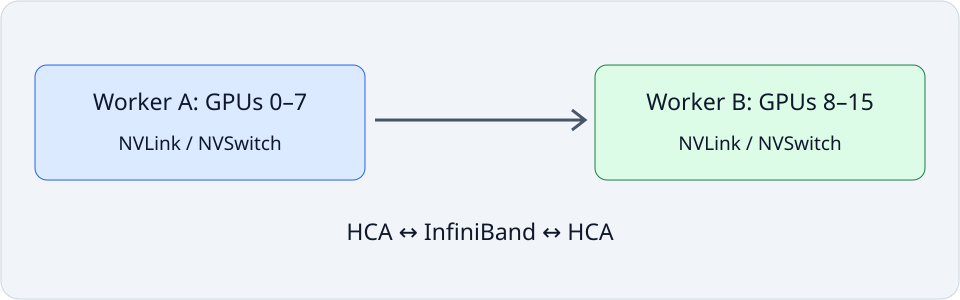

# Lab 01: Verify the GPU fabric and rank placement

A rank is one participating process, and its local rank chooses a GPU on its own node. This readiness check verifies rank placement, GPU links and a tiny all-reduce with a known sum.

## Diagram



## Run

```bash
# Normal execution
sbatch slurm/01_fabric_topology.sbatch --workload small

# Optional profiling
sbatch slurm/01_fabric_topology.sbatch --workload small --profiler all
```

## Check your results

```bash
sacct -j <JOB_ID> --format=JobID,State,ExitCode
cat results/01_fabric_topology/jobs/<JOB_ID>/result.json
```

Explain how the rank records, visible GPU links and known-sum result establish readiness for this allocation.
