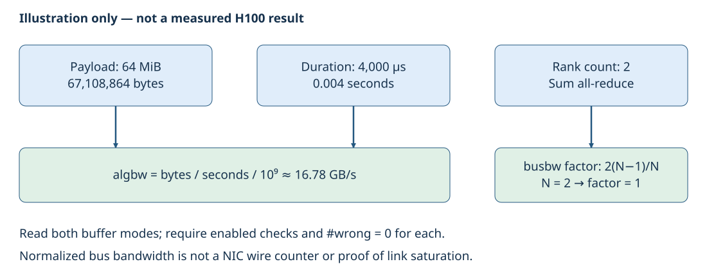

# Lab 09: Measure a two-node NCCL message-size curve

A communication problem can affect tiny synchronization messages differently from large tensors. This lab gives you a controlled way to see that difference before investigating a full training step.

## Diagram



## Run

```bash
# Normal execution
sbatch slurm/09_nccl_transport_sweep.sbatch --max-bytes 1048576 --workload small

# Optional profiling
sbatch slurm/09_nccl_transport_sweep.sbatch --max-bytes 1048576 --workload small --profiler all
```

## Check your results

```bash
sacct -j <JOB_ID> --format=JobID,State,ExitCode
cat results/09_nccl_transport_sweep/jobs/<JOB_ID>/result.json
```

You now have a reusable experiment structure: freeze the work, prove the selected path, vary one choice before communicator creation, check outputs and compare distributions.
