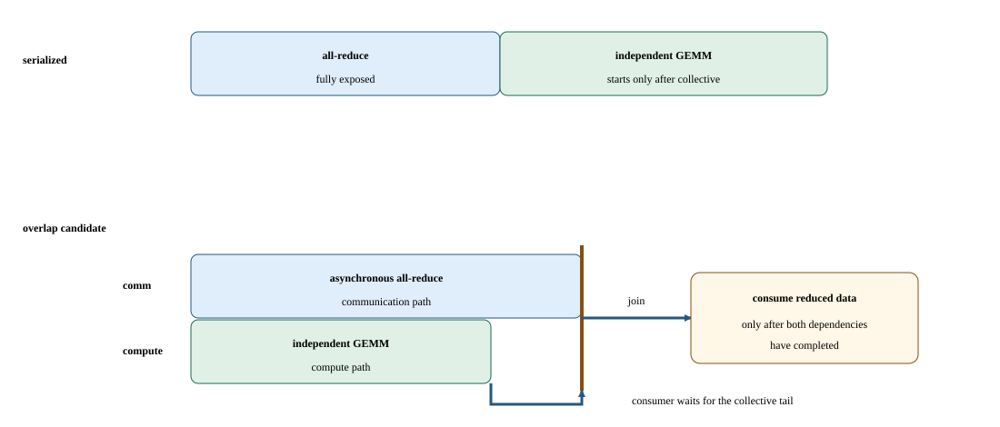

# Lab 13: Test whether communication can overlap independent compute

Communication is not automatically hidden just because an API is asynchronous. This lab compares serialized compute-plus-all-reduce with a schedule that permits the two independent tasks to overlap across two H100 nodes.

## Diagram



## Run

```bash
# Normal execution
sbatch slurm/13_collective_overlap.sbatch --workload small

# Optional profiling
sbatch slurm/13_collective_overlap.sbatch --workload small --profiler all
```

## Check your results

```bash
sacct -j <JOB_ID> --format=JobID,State,ExitCode
cat results/13_collective_overlap/jobs/<JOB_ID>/result.json
```

Overlap requires independence, timely submission, available resources, and an honest joined boundary.
