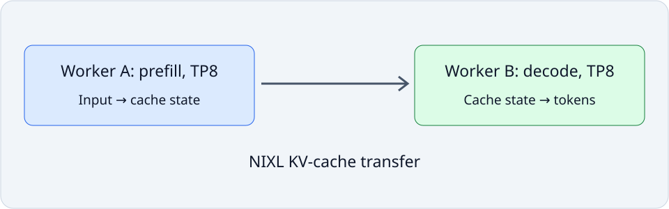

# Lab 32: Compare aggregated and disaggregated Dynamo serving

Prefill processes input tokens and creates the key/value cache; decode repeatedly generates new tokens using that cache. NVIDIA Dynamo can place these phases on different workers and transfer cache data through NIXL.

## Diagram



## Run

```bash
# Normal execution
sbatch slurm/32_dynamo_disaggregation.sbatch --workload small --layout aggregated

# Optional profiling
sbatch slurm/32_dynamo_disaggregation.sbatch --workload small --layout aggregated --profiler all
```

## Check your results

```bash
sacct -j <JOB_ID> --format=JobID,State,ExitCode
cat results/32_dynamo_disaggregation/jobs/<JOB_ID>/result.json
```

Explain what changed, which observation supports the mechanism, and which alternative explanation remains.
