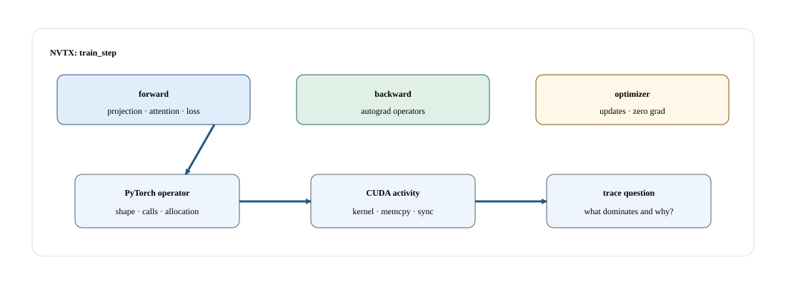
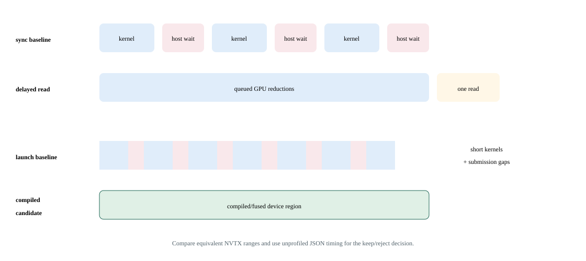

# Lab 07: Build a readable profiler map of a workload

A useful profile connects application regions to GPU activity so that you can explain a delay, not merely collect a large report. This lab provides labeled PyTorch and NVTX regions around a small tensor workload. Normal execution uses the built-in PyTorch collector; external captures disable it.

## Diagram





## Run

```bash
# Normal execution
sbatch slurm/07_profile_workload.sbatch --workload small --export-trace

# Optional profiling
sbatch slurm/07_profile_workload.sbatch --workload small --export-trace --profiler all
```

## Check your results

```bash
sacct -j <JOB_ID> --format=JobID,State,ExitCode
cat results/07_profile_workload/jobs/<JOB_ID>/result.json
```

Well-scoped ranges make profiles interpretable.
