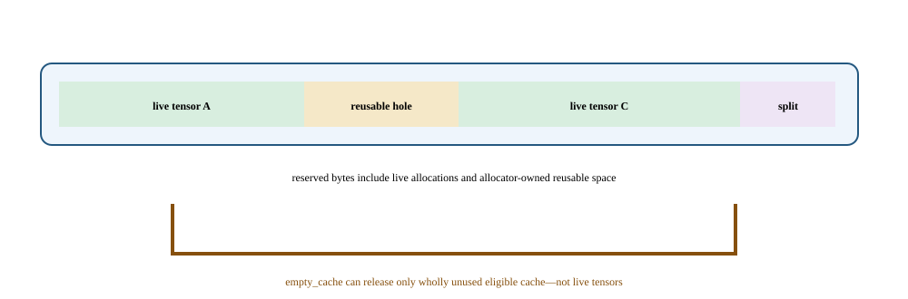

# Lab 12: Follow live, cached, and released GPU memory

Deleting a tensor does not necessarily return its memory reservation to the driver, and emptying the cache cannot free a live tensor. This lab makes those distinctions observable through a short allocation lifecycle.

## Diagram



## Run

```bash
# Normal execution
sbatch slurm/12_allocator_lifetime.sbatch --workload small

# Optional profiling
sbatch slurm/12_allocator_lifetime.sbatch --workload small --profiler all
```

## Check your results

```bash
sacct -j <JOB_ID> --format=JobID,State,ExitCode
cat results/12_allocator_lifetime/jobs/<JOB_ID>/result.json
```

Separate ownership from reservation before diagnosing memory problems.
