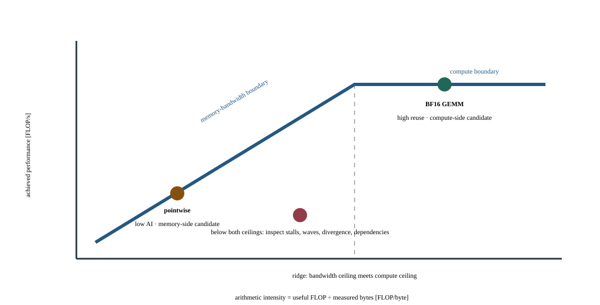

# Lab 14: Diagnose synchronization, launch, memory, and compute limits

This workshop supplies controlled examples of four bottleneck classes so you can practice choosing the right evidence. Instead of opening a profiler and guessing, you will select one case, compare baseline and candidate, and explain the causal change.

## Diagram



## Run

```bash
# Normal execution
sbatch slurm/14_profiler_bottlenecks.sbatch --workload small --case sync --mode baseline

# Optional profiling
sbatch slurm/14_profiler_bottlenecks.sbatch --workload small --case sync --mode baseline --profiler all
```

## Check your results

```bash
sacct -j <JOB_ID> --format=JobID,State,ExitCode
cat results/14_profiler_bottlenecks/jobs/<JOB_ID>/result.json
```

Write one hypothesis, one observed mechanism, and one bounded conclusion per case.
