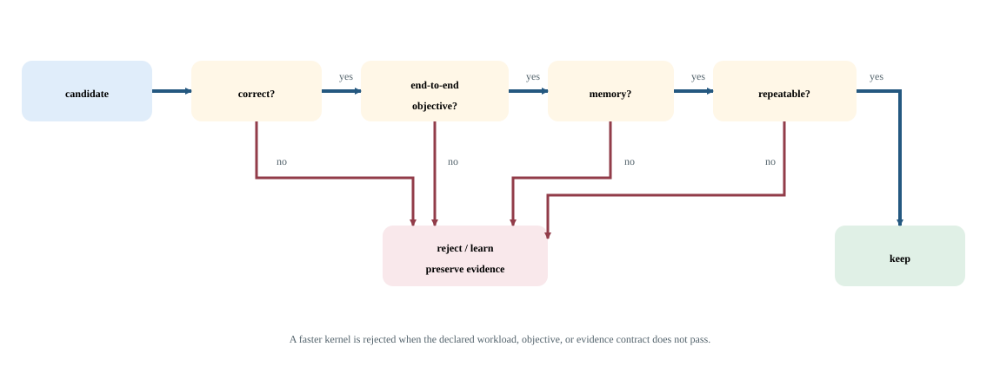

# Lab 16: Custom kernel decision making

Before maintaining custom GPU code, check whether a supported framework or library primitive already expresses the computation efficiently. This lab compares a composed matrix expression with a maintained PyTorch primitive.

## Diagram



## Run

```bash
# Normal execution
sbatch slurm/16_library_first_decision.sbatch --workload small

# Optional profiling
sbatch slurm/16_library_first_decision.sbatch --workload small --profiler all
```

## Check your results

```bash
sacct -j <JOB_ID> --format=JobID,State,ExitCode
cat results/16_library_first_decision/jobs/<JOB_ID>/result.json
```

Your deliverable is a justified choice among framework composition, library primitive, compilation, and custom implementation.
