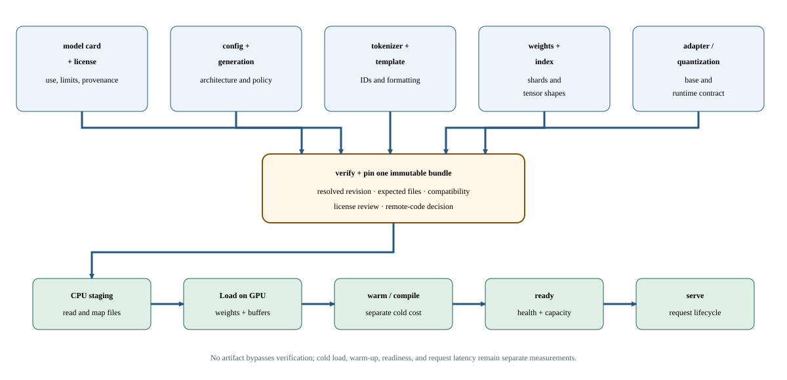

# Lab 16: Audit model, tokenizer, configuration, and license identity

A model name alone does not fully identify an inference workload. Weights, tokenizer, configuration, generation settings, and code-loading policy can all affect behavior.

## Diagram



## Run

```bash
# Normal execution
sbatch slurm/16_model_artifact_audit.sbatch --workload small

# Optional profiling
sbatch slurm/16_model_artifact_audit.sbatch --workload small --profiler all
```

## Check your results

```bash
sacct -j <JOB_ID> --format=JobID,State,ExitCode
cat results/16_model_artifact_audit/jobs/<JOB_ID>/result.json
```

Artifact identity is part of the experiment, not administrative trivia.
