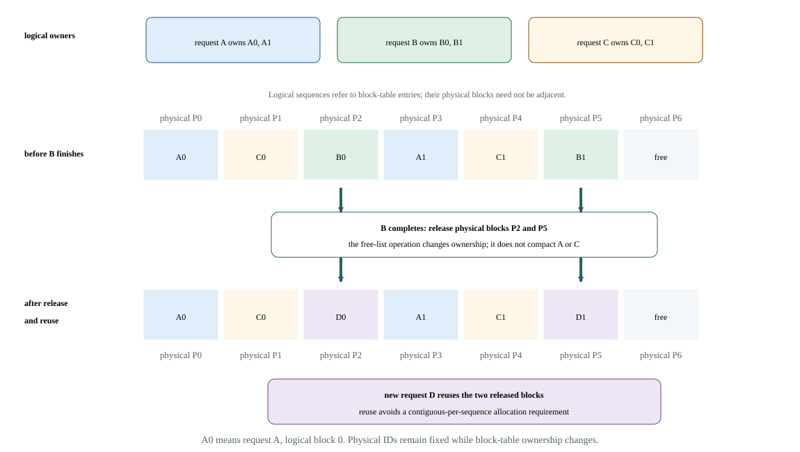

# Lab 27: Follow paged-cache allocation, growth, and recycling

Paged KV storage gives each request a logical block table that points to physical cache pages. This lab implements that ownership lifecycle in a deterministic Python model, including failed growth and page reuse.

## Diagram



## Run

```bash
# Normal execution
sbatch slurm/27_paged_kv.sbatch --workload small --block-tokens 16 --total-blocks 4

# Optional profiling
sbatch slurm/27_paged_kv.sbatch --workload small --block-tokens 16 --total-blocks 4 --profiler all
```

## Check your results

```bash
sacct -j <JOB_ID> --format=JobID,State,ExitCode
cat results/27_paged_kv/jobs/<JOB_ID>/result.json
```

Correct paging requires lifecycle invariants as well as capacity math.
