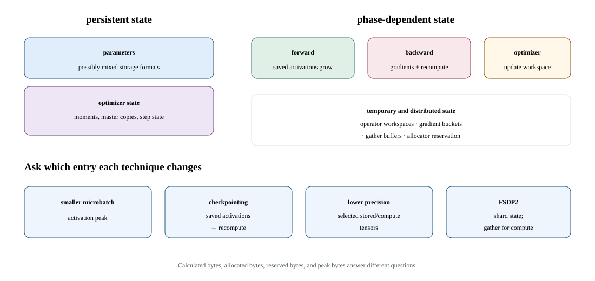

# Lab 21: Validate precision changes across a full training update

A precision change affects more than forward logits: gradients and optimizer updates can also change. This lab compares FP32, BF16, and scaled FP16 tiny-transformer steps from identical initial state and data.

## Diagram



## Run

```bash
# Normal execution
sbatch slurm/21_mixed_precision_training.sbatch --workload small

# Optional profiling
sbatch slurm/21_mixed_precision_training.sbatch --workload small --profiler all
```

## Check your results

```bash
sacct -j <JOB_ID> --format=JobID,State,ExitCode
cat results/21_mixed_precision_training/jobs/<JOB_ID>/result.json
```

Precision choices require explicit error, state-update, and performance evidence.
