# PyTorch for GPU Performance Engineering

Read PyTorch code and recognize the work it asks the GPU to do: calculate,
move data, use memory or wait. This foundation prepares you for
[GPU Fundamentals](../gpu-fundamentals/index.html) and later performance labs.

**Before you begin:** basic Python is enough. Reading needs no machine-learning
background, GPU or setup. Examples use small invented inputs; their outputs
illustrate calculations, not measured performance. Blocks marked **CUDA example**
need an NVIDIA GPU and compatible PyTorch environment only if you run them.

**Reading route:** lessons 1–7 cover tensors; 8–11 cover execution and models;
12–16 connect them to performance. Scan the definition, diagram and commented
example, then read the brief performance connection. Allow about three guided
hours; there are no labs or exercises. Experienced readers can start at
lesson 16 if they can already explain element-wise work, shared storage,
gradient modes and GPU completion.

**Notation:** bold monospace marks PyTorch APIs such as **`shape`** and
**`stride()`**. A stride is a layout property; **`stride()`** reads it. Ordinary
monospace marks example values and variables, such as `[2, 3]` and `x`.
Axis meanings such as sample and feature come from the application.

## 1. A tensor is data with a description

### Objective

Read a tensor's **`shape`**, **`dtype`**, **`device`** and element count.

### How it works

PyTorch is a library for computing with tensors. A tensor is a collection of
values arranged along dimensions, also called axes. A matrix has two axes:
rows and columns.

A tensor also has metadata: information describing its values. **`shape`**
lists the axis sizes, **`dtype`** describes how each value is stored, and
**`device`** tells you where the values live. The cards below describe the same
two-row, three-column tensor.

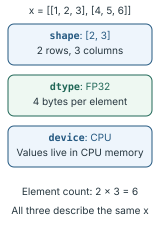

**`torch.tensor`** creates a tensor from supplied values; **`numel()`** counts
its elements.

```python
import torch  # Load the PyTorch library.

x = torch.tensor([[1., 2., 3.], [4., 5., 6.]])  # Create a tensor with two rows and three columns.
print(x.shape)  # Show the number of rows and columns.
print(x.dtype)  # Show the number format used for each value.
print(x.device)  # Show where the tensor is stored.
print(x.numel())  # Print the total number of elements in the tensor.
```

FP32 means 32-bit floating point, represented by **`torch.float32`**.
The CPU (central processing unit) runs Python. A GPU (graphics processing unit)
can run tensor calculations in parallel.

These examples use PyTorch's ordinary defaults: decimal values become FP32
tensors on the CPU. Integer sequences use **`torch.int64`**, a 64-bit integer
format. **`torch.ones`** and **`torch.zeros`** fill a requested shape with ones
or zeros; **`torch.arange`** creates an integer sequence, as lesson 2 shows.

#### Shape and random values

**`torch.rand`** and **`torch.randn`** both take axis sizes. They differ in how
they choose values:

- **`torch.rand`** samples uniformly from 0 up to, but excluding, 1.
- **`torch.randn`** samples a standard normal distribution: a bell-shaped
  distribution centered at 0, with standard deviation 1 (a measure of spread).
  Values can be negative or greater than 1.

The curves show where sampled values are more likely to fall. Both calls
still create the same number of rows and columns.

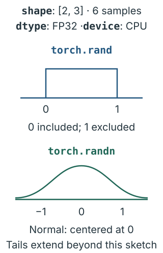

```python
# Create two rows of three random values from 0 up to, but not including, 1.
uniform = torch.rand(2, 3)
# Create the same shape with random values from a standard normal distribution.
normal = torch.randn(2, 3)
```

A small random sample need not average to zero. Later examples use fixed
values when the exact result matters.

**Performance connection:** element count times bytes per element gives the
tensor's data size. GPU memory capacity is how many bytes fit; memory bandwidth
is how many bytes can move per second. A tensor can fit in memory yet take
significant time to read and write.

### Mental model

Read the tensor's sizes, stored number format and location before its operations.

## 2. Dimensions are indexed axes with sizes

### Objective

Use grid, row and column indices to select values, and explain the shapes produced by slicing and reshaping.

### How it works

An axis is a dimension used to organize values. Its size counts the entries
along it. A **`shape`** lists these sizes in order. Here, `[2, 3, 4]` describes
two grids, each with three rows and four columns: `2 * 3 * 4 = 24` values.

An index is an integer that chooses an entry along an axis. The plural of
index is indices. Counting starts at zero, so index `0` chooses the first entry
and index `1` chooses the second. A grid is a table of values; a grid index is
the number used to choose one of those tables.

| Axis number | What its index chooses | Size | Available indices |
| --- | --- | --- | --- |
| 0 | A grid | 2 | `0`, `1` |
| 1 | A row in that grid | 3 | `0`, `1`, `2` |
| 2 | A column in that row | 4 | `0`, `1`, `2`, `3` |

Read the indices from left to right: grid, row, column. The highlighted cell
below contains the value `23`.

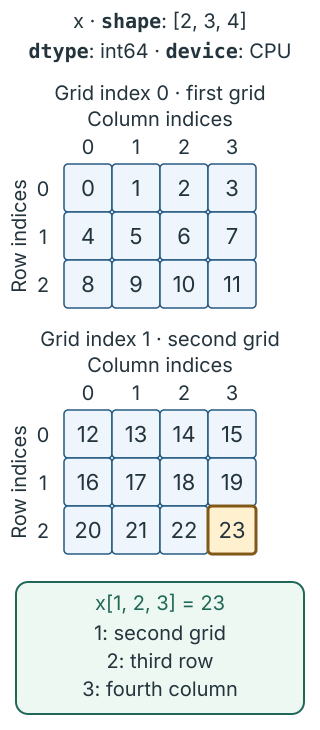

**`ndim`** reports the number of axes.

```python
import torch  # Load the PyTorch library.

# Arrange 0 through 23 into two grids of three rows and four columns.
x = torch.arange(24).reshape(2, 3, 4)
print(x.ndim)  # Count and print the axes: grid, row and column.
print(x[1, 2, 3])  # Select and print the second grid, third row, fourth column.
```

#### Selecting a grid, a row or one value

Each index narrows the selection. These examples continue with the same `x`:

| Expression | Selected result | Result shape |
| --- | --- | --- |
| `x[0]` | First grid: three rows of four values | `[3, 4]` |
| `x[0, 1]` | Second row of the first grid: `[4, 5, 6, 7]` | `[4]` |
| `x[0, 1, 2]` | Third value in that row: `6` | `[]` |

A matrix has two axes, a vector has one, and a scalar tensor holds one value
with zero axes. Their shapes above are `[3, 4]`, `[4]` and `[]`. A one-element
vector has **`shape`** `[1]`: one axis containing one value.

#### Keeping a group with a slice

A slice selects a range of entries and keeps their axis. `0:1` means start at
index `0` and stop just before index `1`, so it selects the first grid.

```python
print(x[0].shape)  # Select the first grid; show its row and column sizes.
print(x[0:1].shape)  # Select a group of one grid; keep and show all three axes.
```

Both results contain the first grid's twelve values. The arrows show how
indexing removes the grid axis while slicing keeps it.

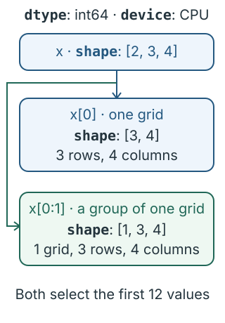

A colon `:` on its own selects every entry on that axis:

```python
print(x[:, :, 0])  # Select and print the first column from every row in every grid.
```

#### Giving the same values a new shape

**`reshape`** arranges the same values into new axis sizes while preserving
their reading order:

```python
flat = x.reshape(6, 4)  # Rearrange the same values into six rows of four columns.
print(flat.shape)  # Show the new row and column sizes.
```

Both shapes contain 24 values. Our application supplies the axis meanings: for
sensor data, `[2, 3, 4]` could mean two sensors, three readings per sensor and
four measurements per reading.

**Performance connection:** grouping the same values into a different shape
keeps the element count, but can change the work done by later operations.
Selecting a smaller region can reduce that work; the storage and copy rules
come in lesson 6.

### Mental model

Shape lists sizes. An index chooses an entry; a slice keeps a range; reshaping gives the same values a new arrangement.

## 3. Broadcasting reuses values across axes

### Objective

Explain how one bias row is added to every row of a matrix.

### How it works

Broadcasting allows compatible tensors with different shapes to participate
in element-wise operations without explicitly copying repeated values. An
element-wise operation acts on corresponding entries. Compare sizes from the
right: each pair must match, or one size must be 1. A missing leading dimension
behaves like size 1.

Adding a `[3]` bias to a `[2, 3]` matrix reuses the same three values for both
rows. A bias is simply an offset added to a value. The diagram shows each
column receiving its matching bias value.

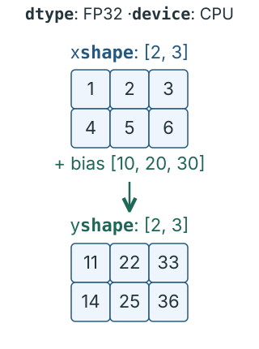

```python
import torch  # Load the PyTorch library.

x = torch.tensor([[1., 2., 3.], [4., 5., 6.]])  # Create two rows of three values.
bias = torch.tensor([10., 20., 30.])  # Create one offset for each column.
y = x + bias  # Add the same column offsets to each row.
print(y)  # Show the two rows after adding the offsets.
```

**Performance connection:** broadcasting reuses the bias without storing an
extra bias row. It saves repeated storage, but the addition still reads inputs,
performs six additions and stores six outputs. A small bias can therefore be
part of a much larger calculation.

### Mental model

Match sizes from the right, then reuse values along the missing or size-one axes.

## 4. Element-wise work and matrix multiplication differ

### Objective

Distinguish element-wise multiplication (`*`) from matrix multiplication (`@`).

### How it works

An element-wise operation acts on corresponding entries. For multiplication,
`*` multiplies each entry by its partner. Matrix multiplication, written `@`,
combines a row with a column: multiply matching entries, then add the products.

The diagram follows the first output value in each calculation. Only the
matrix product adds several products together.

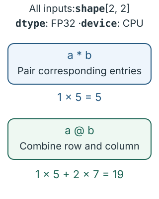

```python
import torch  # Load the PyTorch library.

a = torch.tensor([[1., 2.], [3., 4.]])  # Create the first two-by-two matrix.
b = torch.tensor([[5., 6.], [7., 8.]])  # Create the second two-by-two matrix.
print(a * b)  # Multiply matching entries and print the result.
print(a @ b)  # Multiply rows by columns, sum the products, and print the result.
```

For two matrices, the left column count must equal the right row count.
A `[2, 3]` matrix multiplied by a `[3, 4]` matrix produces `[2, 4]`: two
output rows and four output columns.

**Performance connection:** matrix multiplication combines many input values
per output and can reuse them. Element-wise multiplication does less arithmetic
per value read. This helps explain two common limits:

| Limit | Simple meaning | Typical example on large tensors |
| --- | --- | --- |
| Memory-bound | Reading and writing values limits speed more than arithmetic does | Element-wise multiplication: few calculations per value moved |
| Compute-bound | Doing the arithmetic limits speed more than moving values does | A large matrix multiplication that reuses inputs for many calculations |

Memory traffic is the bytes read and written. Reducing it can help memory-bound
work; faster arithmetic can help compute-bound work. These are hypotheses,
not labels guaranteed by an API.
Small operations can instead be limited by launch overhead: the time needed
to submit and start GPU work. The tiny example above teaches arithmetic, not
which limit a GPU will reach.

### Mental model

`*` pairs entries. `@` combines rows and columns.

## 5. Reductions remove information and axes

### Objective

Calculate one mean per row and explain what **`keepdim`** changes.

### How it works

A reduction combines multiple values into fewer values. Sum, mean and maximum
are examples.

- **`dim`**: Specifies which dimension to reduce.
- **`mean()`**: Calculates averages, reducing multiple values into fewer values.
- **`keepdim=True`**: Keeps the reduced dimension with size 1 instead of removing it.

In this matrix, dimension 0 is rows and dimension 1 is columns; `-1` means the
last dimension. The arrows show each row becoming its mean.

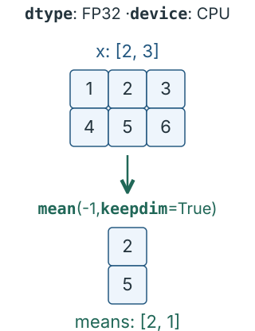

```python
import torch  # Load the PyTorch library.

x = torch.tensor([[1., 2., 3.], [4., 5., 6.]])  # Create two rows of three values.
print(x.mean(dim=1))  # Average across columns (dim 1); remove that axis.
means = x.mean(dim=1, keepdim=True)  # Average across columns; keep that axis with size 1.
print(x - means)  # Subtract each row's mean from every value in that row and print.
```

Without a **`dim`** argument, **`mean()`** combines every value into one scalar
tensor with shape `[]`.

**Performance connection:** a reduction can involve processing a large amount
of GPU data even when the output contains only one value. A large mean often
faces a memory-bandwidth limit: it must read every input for relatively little
arithmetic. Combining partial results also takes work, so output size alone
does not predict cost.

### Mental model

A reduction combines values. **`keepdim`** keeps the reduced axis in place for later broadcasting.

## 6. Views change interpretation; copies move values

### Objective

Use strides to explain shared storage, and distinguish a cheap view from a
layout copy that may help later GPU work.

### How it works

A view is a tensor that shares stored values with another tensor. A stride
is the number of stored elements to jump when moving one position along an
axis. **`stride()`** reports these steps; it neither moves nor copies values.
For a `[2, 3]` matrix stored row by row, strides `(3, 1)` mean three elements
to the next row and one to the next column. Strides count elements, not bytes.

**`transpose()`** swaps two axes. Here it changes the shape and strides while sharing
the original values. The arrows below connect both tensors to that storage.

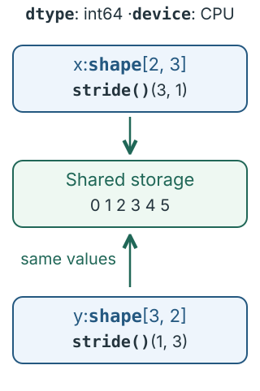

```python
import torch  # Load the PyTorch library.

x = torch.arange(6).reshape(2, 3)  # Arrange 0 through 5 into two rows of three columns.
y = x.transpose(0, 1)  # Swap rows and columns while sharing the stored values.
print(x.stride())  # Show storage steps for moving to the next row or column.
print(y.stride())  # Show the swapped storage steps after transposing.
```

The strides change from `(3, 1)` to `(1, 3)`. Reading a row of `y` now jumps
three storage positions between values. Changing a value through `y` also
changes the corresponding value in `x`.

Contiguous means values follow the tensor's logical order in the selected
memory layout. In the row-by-row layout used here, the transposed `y` is not
contiguous. **`contiguous()`** copies it into that layout; if a tensor already
has the requested layout, it returns that tensor without copying:

```python
z = y.contiguous()  # Copy the transposed values into row-by-row storage.
print(z.stride())  # Show the storage steps for the new row-by-row layout.
```

The copy stores `0, 3, 1, 4, 2, 5` in order. It has the same values and shape
as `y`, with strides `(2, 1)` and separate storage.

**`reshape()`** regroups values in their reading order; **`transpose()`** swaps
axes. For example, `x.reshape(3, -1)` gives shape `[3, 2]`: `-1` asks PyTorch
to calculate the missing size from the six values. A reshape shares storage
when possible and copies otherwise.

| Concept or API | Simple meaning | Copies data? |
| --- | --- | --- |
| View | Another way to access the same stored numbers | No |
| Stride / **`stride()`** | Steps along each axis / the method that reports them | No |
| **`transpose()`** | Swap two dimensions, such as rows and columns | No, in this example |
| Contiguous | Values follow the expected reading order for the chosen layout | A property, not a copying operation |
| **`contiguous()`** | Return a tensor in the requested contiguous layout | Only if needed |
| **`reshape()`** | Give values a new shape in their current reading order | Sometimes |

The method **`view()`** can also change shape without copying, but requires
compatible strides; it raises an error when the requested shape cannot share
the storage. **`reshape()`** can make a copy in that case.

**Performance connection:** a kernel is a function executed on the GPU. It
must find and read the stored values.

- Views and **`transpose()`** are cheap to create because they change metadata,
  without moving tensor values. **`reshape()`** is similarly cheap when it
  shares storage.
- Strides determine the addresses used by later operations. Nearby parallel
  reads are often more efficient than scattered reads, which matters for
  memory-bound work. A contiguous layout can help, depending on the kernel.
- **`contiguous()`** may help later operations, but its copy reads and writes
  the whole tensor, using GPU time, memory bandwidth and extra storage.
  Some kernels already handle transposed inputs efficiently; compare the
  copy plus later computation with computing directly on the view.

Creating a view does not remove the arithmetic in later compute-bound work.

### Mental model

Shape tells PyTorch how to interpret the numbers. Stride tells it where to find
them in memory. A view changes the interpretation without moving the numbers.

## 7. Dtype changes storage and numerical behavior

### Objective

Compare floating-point range, precision and storage, and explain when a smaller
**`dtype`** may help GPU performance.

### How it works

A **`dtype`** specifies how each tensor element is stored. Floating-point
formats represent numbers approximately. FP means floating point; the number
in FP32 or FP16 gives the total bits per value. BF16 means bfloat16, another
16-bit format.

Range is how large or small a nonzero number the format can represent.
Precision is how much detail it can retain. Each format below divides its bits
into three parts:

- One sign bit selects positive or negative.
- Exponent bits set the scale of the number, controlling its range.
- Fraction bits store detail within that scale. More fraction bits give finer
  precision at a similar magnitude.

#### Compare the formats

E4M3 means four exponent bits and three stored fraction bits; E5M2 and E2M1
use the same naming rule. The totals include the sign bit. Maximum finite value
means the largest positive number before any external scaling, excluding infinity.

| Format | Total bits | Exponent bits | Fraction bits | Maximum finite value |
| --- | --- | --- | --- | --- |
| FP64 | 64 | 11 | 52 | ≈ 1.80 × 10³⁰⁸ |
| FP32 | 32 | 8 | 23 | ≈ 3.40 × 10³⁸ |
| FP16 | 16 | 5 | 10 | 65,504 |
| BF16 | 16 | 8 | 7 | ≈ 3.39 × 10³⁸ |
| FP8 E4M3FN | 8 | 4 | 3 | 448 |
| FP8 E5M2 | 8 | 5 | 2 | 57,344 |
| FP4 E2M1 | 4 | 2 | 1 | 6 |

BF16 has nearly FP32's range but much less precision. Compared with FP16, it
trades three fraction bits for three exponent bits while using the same storage.
Likewise, E5M2 has a wider range than E4M3FN but less detail.

The exact maximum also depends on the format's encoding rules. E4M3 here is
the E4M3FN variant used by **`torch.float8_e4m3fn`**; other E4M3 variants can
have different limits. **`torch.float8_e5m2`** names the E5M2 row. The first
four rows use **`torch.float64`**, **`torch.float32`**, **`torch.float16`** and
**`torch.bfloat16`**, respectively.

#### Stored bits and scaling

Eight bits make one byte: FP64 uses eight bytes per value, FP32 four,
FP16/BF16 two, and FP8 one. Packed FP4 stores two values per byte.
These counts exclude extra scale data and storage overhead.

Scaling maps a small stored number to a larger or smaller working value:
`reconstructed value = stored value × scale`. For example, FP4's stored `6`
with scale `10` represents `60`. Scaling changes the covered range; it does
not add fraction bits. The scale must also be stored, often shared by a group
of values.

**`torch.float4_e2m1fn_x2`** stores two FP4 values in one byte. PyTorch's FP8
and FP4 types have limited operation and device support; useful arithmetic
needs a supported implementation. The example below uses ordinary FP32/BF16
tensors, where logical bytes equal element count times bytes per element.
The bars compare storage for the same six values; they do not show speed.

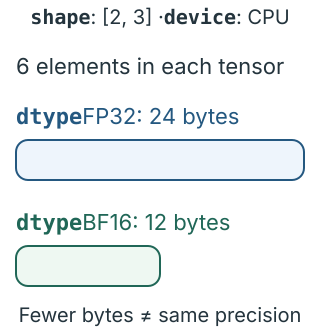

```python
import torch  # Load the PyTorch library.

x32 = torch.ones(2, 3, dtype=torch.float32)  # Create two rows of three ones in FP32.
x16 = x32.to(dtype=torch.bfloat16)  # Convert the values to BF16 in new storage.
# Count values, multiply by bytes per value, and print FP32 bytes.
print(x32.numel() * x32.element_size())
print(x16.numel() * x16.element_size())  # Calculate and print the bytes used by the BF16 values.
```

**`element_size`** returns bytes per element. **`to`** with a different dtype
converts values into new storage, which can round away detail. For example,
FP32 can distinguish `1.0001` from `1.0`; BF16 rounds both to `1.0`. Converting
back to FP32 cannot recover the lost difference.

**Performance connection:** fewer stored bits can reduce memory use and
traffic, helping memory-bound work. Compute-bound work benefits when the GPU
and kernel support faster arithmetic for that format. Conversion and scaling
add work and may need extra storage. Check numerical accuracy and measure the
whole path; half the bits does not guarantee half the runtime.

### Mental model

Choose a **`dtype`** that preserves the range and precision your calculation
needs. Fewer bits can reduce GPU memory traffic and speed up supported
operations; check that the results stay accurate enough and measure the full
calculation.

## 8. Device placement selects where work happens

### Objective

Trace values between CPU and GPU memory, and distinguish a CPU wait from a
dependency between GPU operations.

### How it works

The CPU runs Python; the GPU runs tensor calculations. CUDA is NVIDIA's GPU
computing platform. A tensor on a CUDA **`device`** uses the GPU for supported
operations. **`to`** with `"cuda"` copies a CPU tensor to the GPU and returns it.

CUDA work is usually asynchronous: Python can continue before the GPU finishes.
A stream is an ordered queue of GPU operations. In the same stream,
multiplication finishes before a following sum uses its result. One PyTorch
operation may use one or several kernels.

**`item()`** returns a one-element tensor's value as a Python number. For a CUDA
tensor, it waits for the result and copies that single value to CPU memory.
The original tensor stays on the GPU.

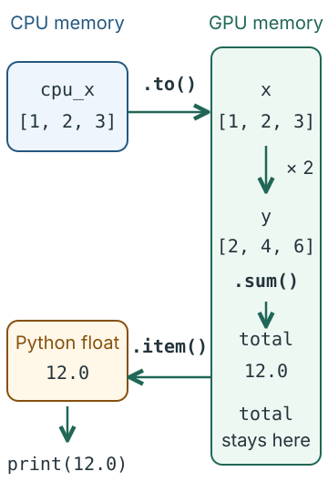

The columns show where values are stored. Python variable names and tensor
metadata are managed on the CPU, even when the tensor's values are on the GPU.

**CUDA example:**

```python
import torch  # Load the PyTorch library.

cpu_x = torch.tensor([1., 2., 3.])  # Create three values in CPU memory.
x = cpu_x.to("cuda")  # Copy the values to GPU memory and keep the returned tensor.
y = x * 2  # Double each value on the GPU.
total = y.sum()  # Add all values into a scalar tensor on the GPU.
value = total.item()  # Wait and copy the result into a Python float; total stays on the GPU.
print(value)  # Print the Python number 12.0, already in CPU memory.
```

Writing `print(total.item())` combines the last two steps: **`item()`** runs
before Python prints the returned number. Printing `total` directly also reads
GPU values for display and can require a wait; it leaves `total` on the GPU.

Keep operands on compatible devices. Reading **`shape`** or **`dtype`** uses
metadata on the CPU and does not copy tensor values back.

#### CPU waits and GPU dependencies

Synchronization makes work wait until a required operation finishes. Where the
wait happens matters:

- **`torch.cuda.synchronize()`** blocks the calling CPU thread until previously
  submitted GPU work in all streams on the current CUDA device finishes. A
  **`device`** argument selects another device.
- **`wait_stream()`**, as in `stream2.wait_stream(stream1)`, lets the calling CPU
  thread continue. Future work submitted to `stream2` waits for the work already
  submitted to `stream1` when the call was made.

These calls order completion; neither copies values to CPU memory. A dependency
is necessary when one operation needs another's result. Separate streams can
overlap independent work when hardware resources allow; overlap is not guaranteed.

**Performance connection:** aim to:

1. Let the CPU prepare or submit work while the GPU computes.
2. Read GPU results on the CPU only when needed, avoiding unnecessary waits.
3. Keep dependencies required for correctness; avoid ordering independent work
   unnecessarily.
4. Supply enough useful work to keep the GPU busy.

Repeated **`item()`** calls can pause submission and leave gaps between GPU
operations. Even a tiny scalar read can cost time through waiting, rather than
memory bandwidth or arithmetic being the limit. Measure the full workload.

### Mental model

Tensor values stay on their device until copied. Reading a GPU result on the CPU
requires a wait; a stream dependency can order GPU work while the CPU continues.

## 9. A model is a sequence of tensor operations

### Objective

Explain how a linear layer calculates all neuron outputs with matrix
multiplication, then trace those values and shapes through a small network.

### How it works

A model transforms input tensors into output tensors. An **`nn.Module`** groups
that computation and its state. Parameters are tensors the model can learn,
such as weights and biases. The forward pass is the calculation that produces
outputs from inputs.

A sample is one input example; a batch is a group of samples. A feature is one
numeric component of an input or output. Here `[2, 3, 4]` means two samples,
three positions per sample and four features per position.

#### One linear layer: multiply, then add bias

A linear layer has output units called neurons. Each computes a weighted sum
of its inputs plus a learned bias. In **`nn.Linear`**`(4, 2)`:

- **`in_features=4`** means each input vector has four features.
- **`out_features=2`** means the layer has two neurons, each producing one feature.

Each neuron uses all four inputs. The weights have shape `[2, 4]`: one row of
four weights per neuron. The bias has shape `[2]`: one bias per neuron. The
input's last size changes from 4 to 2; the other sizes stay the same.

For one input vector, call the inputs `x`, weights `W`, biases `b` and layer
outputs `y`. Draw `x` and `y` as columns, and the whole layer is `y = Wx + b`:
matrix multiplication followed by bias addition. Each row of `W` belongs to
one neuron; each column corresponds to one input feature. For example, w₂₃
is the weight connecting input 3 to neuron 2.

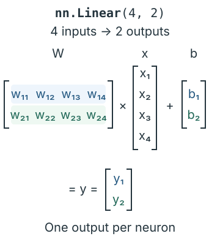

The first row calculates:

y₁ = w₁₁ × x₁ + w₁₂ × x₂ + w₁₃ × x₃ + w₁₄ × x₄ + b₁

The second row calculates y₂ using its own four weights and bias. Matrix
multiplication collects these weighted sums into one layer calculation.

For many inputs, put the input vectors in rows of a matrix `X`. PyTorch's
equivalent expression is `Y = X @ W.T + b`. Here `@` means matrix
multiplication and `W.T` swaps the weight matrix's rows and columns.
Our six input vectors form `[6, 4]`; multiplying by the transposed weights
`[4, 2]` gives `[6, 2]`. Add the same two biases to each row. Keeping the
original batch and position axes gives `[2, 3, 2]`.

#### Pass each layer's results to the next

ReLU (rectified linear unit) replaces negative values with zero and keeps
positive values. **`nn.ReLU`** applies it to each neuron output without changing
the shape. It is a separate operation with no learned weights or biases.

A neural network (NN) combines layers of these calculations. Its input layer
represents the supplied features, hidden layers produce intermediate features,
and the output layer produces the final result. Here the two-neuron layer is
hidden because its values, after ReLU, feed an output layer:
**`nn.Linear`**`(2, 1)` produces one output feature. The network is `4 → 2 → 1`.
Each linear layer has its own weights and biases: the first uses `[2, 4]`
and `[2]`; the second uses `[1, 2]` and `[1]`. The second layer applies the
same multiply-and-add rule to the two features it receives after ReLU.

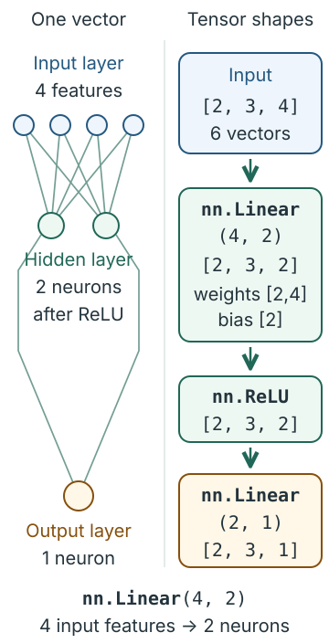

The left view follows one four-feature vector. The right view shows the same
network applied to all six vectors in `[2, 3, 4]`. Batch size and neuron count
describe different axes; all six vectors share the same learned weights.

**`nn.Sequential`** passes each module's output to the next in the listed order.

```python
import torch  # Load the PyTorch library.
from torch import nn  # Load the neural-network building blocks.

hidden = nn.Linear(4, 2)  # Give each of two hidden neurons all four input features.
output = nn.Linear(2, 1)  # Combine the two hidden features into one output feature.
model = nn.Sequential(hidden, nn.ReLU(), output)  # Apply hidden layer, ReLU, then output layer.
x = torch.ones(2, 3, 4)  # Create two samples, each with three positions and four features.
y = model(x)  # Apply the same network independently at each of the six positions.
print(y.shape)  # Print [2, 3, 1]: two samples, three positions and one output feature.
```

The first layer requires four input features; the next linear layer requires
the two features produced by the hidden layer. Output values depend on the
initially random weights and biases.

The final width depends on the task. This example produces one number per
position. A language model typically produces a score for each possible next
token, a unit of text such as a word or word piece. A separate selection step
chooses one token from those scores; one token does not mean one output neuron.

**Performance connection:** when inputs and parameters are on a GPU, the
matrix calculation is divided into smaller pieces processed in parallel.
One layer formula does not guarantee one GPU kernel. More input vectors mean
more arithmetic and output storage; more input features mean more weights
and arithmetic. Processing vectors together can reuse weights, increasing
arithmetic per byte read.
Small layers may be memory- or launch-bound; sufficiently large matrix work
can be compute-bound. ReLU does little arithmetic per value and is often
memory-bound on large tensors. The example above runs on the CPU by default.

### Mental model

Each linear layer multiplies its inputs by its own weights and adds its biases.
Its output features feed the next operation. Linear layers change the last
axis; ReLU keeps the shape. The task determines the final output size.

## 10. Training saves information for a backward pass

### Objective

Explain the forward, loss, backward and parameter-update steps of training.

### How it works

Training adjusts parameters to reduce a loss: a number that measures prediction
error. A gradient tells us how a small parameter change affects that loss.
Autograd (automatic differentiation) records calculations and uses them to
compute gradients during **`backward`**.

An optimizer updates parameters using those gradients. Stochastic gradient
descent (SGD) subtracts the gradient multiplied by a learning rate, the update's
scale. The diagram follows one weight from prediction to update.

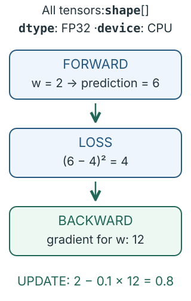

**`requires_grad=True`** enables gradient tracking for the weight.
**`torch.optim.SGD`** supplies the optimizer; **`zero_grad()`** clears old
gradients, **`grad`** stores the computed gradient, and **`step()`** updates
the weight.

```python
import torch  # Load the PyTorch library.

w = torch.tensor(2.0, requires_grad=True)  # Create a learnable weight and track its gradient.
optimizer = torch.optim.SGD([w], lr=0.1)  # Use SGD to update the weight with learning rate 0.1.
optimizer.zero_grad()  # Clear gradients left by any previous training step.
prediction = w * 3  # Multiply the weight by the input to make a prediction.
loss = (prediction - 4) ** 2  # Square the difference between the prediction and target.
loss.backward()  # Calculate the loss gradient and store it in w.grad.
optimizer.step()  # Subtract the gradient times the learning rate from the weight.
```

Here the gradient is `2 * (6 - 4) * 3 = 12`, so the updated weight is
`2 - 0.1 * 12 = 0.8`. Clear old gradients before each step because
**`backward`** adds to any gradients already present.

Activations are intermediate values from the forward pass. Autograd saves
some of them because the backward calculation needs them.

**Performance connection:** training adds backward computation and memory for
saved activations and gradients. Backward rereads saved values and writes
gradients; the optimizer reads gradients and updates parameters. Each stage
can have a different limit, and saved tensors also consume memory capacity.

### Mental model

Forward predicts; loss measures error; backward computes gradients; the optimizer updates parameters.

## 11. Switching from training to validation and inference

### Objective

Trace training, validation and inference, and explain which steps need known
answers, gradient recording and parameter updates.

### How it works

Training learns weights and biases from examples. Validation checks the model
on separate examples, often after each epoch: one pass through all training
batches. Final testing checks the chosen model on a held-out test dataset.
In supervised learning, all three datasets contain inputs and known answers,
called targets. The model receives the inputs; the loss function compares its
predictions with the targets. Only training uses that loss to update parameters.

Inference uses the trained model to predict outputs for new inputs. Correct
answers are usually unavailable, so this prediction step needs no loss.

Evaluation mode is the layer setting used for validation, testing and ordinary
inference. **`model.eval()`** prepares the layers for prediction;
it does not run a test or choose a dataset.

Dropout is an optional layer that helps reduce overfitting: fitting training
examples too closely to work well on new examples. **`nn.Dropout`** acts on
tensor values, with different behavior in the two model settings:

| Model setting | Dropout behavior |
| --- | --- |
| **`model.train()`** | Randomly zero some values to help training |
| **`model.eval()`** | Pass values through unchanged for prediction |

During training, dropout also rescales the retained values to compensate for
the dropped values. During ordinary inference, keep dropout inactive so the
model uses the learned features without randomly discarding some of them.

Gradient recording saves operations and values needed for backpropagation.
A parameter's **`requires_grad=True`** enables tracking for that weight or
bias; standard learnable layers set this by default. **`loss.backward()`**
later calculates the gradients that the optimizer uses to update parameters.

The two settings have different jobs: **`model.eval()`** prepares layer behavior
without changing gradient recording. **`torch.inference_mode()`** skips
recording inside its block, but does not turn off dropout. Use both for the
validation and inference examples below.

#### Train, then validate each epoch

Each training batch follows prediction → loss → backpropagation → gradients →
parameter update. After all training batches, check separate validation batches
without updating parameters. Arrows in the diagram show this order; start
training again for the next epoch.

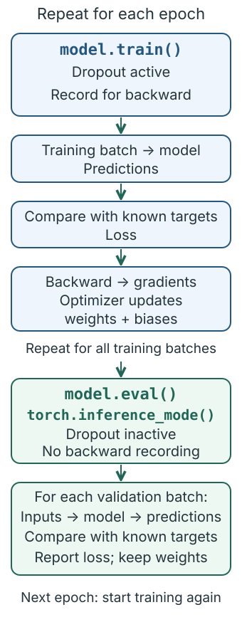

Assume `model`, `optimizer` and `loss_fn` are already prepared.
`training_batches` and `validation_batches` each provide `(inputs, targets)`
from their separate datasets; `num_epochs` sets how many training passes to run.
The example prints each validation batch's loss.

```python
import torch  # Load PyTorch for the gradient-recording context.

for epoch in range(num_epochs):  # Repeat training and validation for each epoch.
    model.train()  # Select training behavior, including active dropout.
    for inputs, targets in training_batches:  # Read a batch and its known answers.
        optimizer.zero_grad()  # Clear gradients from the previous batch.
        predictions = model(inputs)  # Predict and record calculations for backward.
        loss = loss_fn(predictions, targets)  # Compare predictions with known answers.
        loss.backward()  # Calculate gradients for the model's parameters.
        optimizer.step()  # Use gradients to update weights and biases.

    model.eval()  # Prepare the layers for validation: turn off dropout.
    with torch.inference_mode():  # Skip recording; validation needs no backward pass.
        for inputs, targets in validation_batches:  # Read separate validation examples.
            predictions = model(inputs)  # Predict using the current weights.
            loss = loss_fn(predictions, targets)  # Measure error against known answers.
            print(loss.item())  # Report this batch's loss without updating weights.
```

Outside the **`inference_mode()`** block, ordinary gradient recording resumes.
The next epoch's **`model.train()`** restores training layer behavior.
Final testing uses the same evaluation pattern on test batches after model
selection; keep those test examples out of training and model selection.

#### Predict on new inputs

Use the trained `model` with a batch called `new_inputs`. The arrows now stop
at predictions: there are no target answers, loss, backward pass or optimizer
update in this example. Dropout stays inactive and recording stays off.

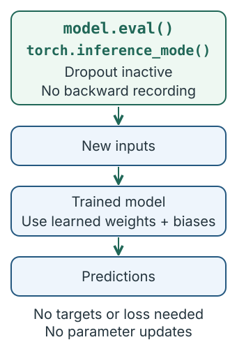

```python
import torch  # Load PyTorch for the gradient-recording context.

model.eval()  # Prepare the layers for prediction: turn off dropout.
with torch.inference_mode():  # Skip recording because no backward pass is needed.
    predictions = model(new_inputs)  # Predict outputs using the learned weights.
print(predictions)  # Use the predictions without changing weights or biases.
```

Use **`inference_mode()`** when these results will not enter later
gradient-tracked calculations. **`torch.no_grad()`** also skips backward
recording, with fewer restrictions on using results in later gradient-tracked
work. Both settings leave existing parameters' **`requires_grad`** flags unchanged.

**Performance connection:** skipping backward recording saves memory and
tracking work during validation and inference. The forward pass still reads
weights and performs arithmetic, so memory or compute can still limit it.

### Mental model

Training predicts, measures error and updates weights. Validation and testing
measure performance; inference produces predictions. **`eval()`** selects layer
behavior, while **`inference_mode()`** skips recording for backpropagation.

## 12. Transfers are part of the input pipeline

### Objective

Separate input preparation, copying to the GPU and model computation.

### How it works

An input pipeline prepares data and delivers it to a model. A batch prepared
in CPU memory must be copied to GPU memory before a CUDA model can use it.
This copy is called a host-to-device (H2D) transfer; host means CPU here.

The arrows show one batch moving through preparation, copying and computation.
The model needs the copy to finish before it can use the data.

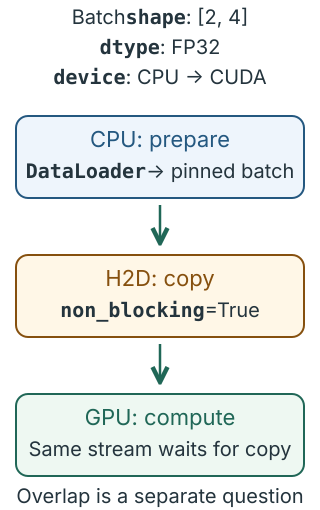

**CUDA example:**

```python
import torch  # Load the PyTorch library.
from torch import nn  # Load the neural-network building blocks.

# Create a linear layer, move its parameters to the GPU, and select evaluation.
model = nn.Linear(4, 2).to("cuda").eval()
cpu_batch = torch.ones(2, 4)  # Prepare two inputs with four features each on the CPU.
gpu_batch = cpu_batch.to("cuda")  # Copy the input batch to the GPU.
with torch.inference_mode():  # Disable gradient recording for the model call.
    output = model(gpu_batch)  # Compute two output features for each input on the GPU.
```

Keep results on the GPU while later GPU operations still need them, avoiding
unnecessary trips back to the CPU.

**Performance connection:** a model must wait for its next input. Preparing
batches uses CPU time; H2D copies use the CPU–GPU link; kernels use GPU memory
and arithmetic. If delivery is the slow stage, faster model arithmetic can
leave total latency nearly unchanged. Keeping reused data on the GPU avoids
paying for the same transfer again.

### Mental model

Prepare the batch, move it to the right device, then compute.

## 13. Live tensors and reserved memory are different

### Objective

Explain what PyTorch manages automatically and keep a matmul loop from retaining
unneeded GPU memory.

### How it works

PyTorch normally allocates and reuses GPU memory automatically. You control
which tensors remain needed and how much work fits at once. Later operations
or backpropagation may still need a completed calculation's inputs or outputs.

#### Why keep a memory pool?

An allocator supplies storage for tensors. PyTorch's usual CUDA caching
allocator reuses a suitable unused block or requests more memory from CUDA.
The pool grows as needed; creating one tensor does not reserve the entire GPU.

- Allocated memory holds live tensors: weights, inputs, outputs and other
  values still needed by the program.
- Reserved memory is the GPU memory held by the allocator. It includes live
  allocations and unused blocks kept for reuse.
- Cached capacity means those unused blocks. Spare space can come from a
  block larger than a request or from a tensor whose storage is no longer needed.

The cache is reusable GPU storage, not an extra hardware cache or saved
calculation results. For `y = x @ w`, PyTorch supplies storage for `y`, often
from a cached block. Operations can also need working space managed by PyTorch
or its libraries.

Keeping blocks avoids repeated CUDA allocation work and possible GPU waits.
The arrows show storage becoming live or reusable, not data copies. Areas are
schematic.

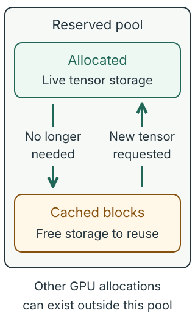

#### When is memory released?

Variables, lists, views and autograd's saved values can keep storage alive.
Local references normally disappear when a function returns; storage becomes
reusable when nothing still needs it. `del` removes one reference earlier,
without removing other references. A loop does not create a new Python scope,
so its last tensor variables survive the loop.

You do not need to free memory or synchronize after each matmul in ordinary
single-stream code. PyTorch and CUDA stream ordering make reuse safe. Reusable
storage usually stays in the reserved pool for the next allocation.

#### An everyday matmul batch pattern

**CUDA example:** keep weights across batches and use a helper to limit GPU
temporaries' lifetimes. Here the next consumer needs CPU predictions, so
**`cpu()`** copies them there; keep them on the GPU if the next operation needs
them there. **`torch.inference_mode()`** skips recording for backpropagation.

**`torch.cuda.memory_allocated()`** reports current tensor bytes;
**`torch.cuda.memory_reserved()`** reports allocator-held bytes. They describe
this process and device, not all GPU use.

```python
import torch  # Load PyTorch.

w = torch.ones(4, 2, device="cuda")  # Keep one weight matrix for all batches.

def predict_batch(cpu_x):  # Limit temporary tensor references to this function.
    with torch.inference_mode():  # Predict without recording for backpropagation.
        x = cpu_x.to("cuda")  # Allocate GPU storage and copy this input batch.
        y = x @ w  # Let PyTorch provide storage for the [8, 2] result.
        return y.cpu()  # Copy predictions to CPU before local GPU references disappear.

for _ in range(3):  # Process three batches without keeping their GPU outputs.
    cpu_x = torch.ones(8, 4)  # Supply eight input vectors from CPU memory.
    cpu_y = predict_batch(cpu_x)  # Receive CPU predictions; GPU temporaries can be reused.
    print(cpu_y.shape)  # Inspect this batch's [8, 2] output shape.

print(torch.cuda.memory_allocated())  # Live storage still includes w.
print(torch.cuda.memory_reserved())  # Cached blocks may remain for the next batch.
```

Weights stay live; reserved memory may stay high for reuse. Allocator and
library state affect the counters, so do not expect exact totals from just
the visible tensors.

#### Practical memory habits

- Keep only needed tensors. Appending GPU outputs to a growing list keeps their
  storage live. For logging, store a number such as **`loss.item()`**; when saved
  predictions belong on the CPU, use `y.detach().cpu()`. **`detach()`** alone
  shares the same storage and does not release GPU memory. Scalar readback and
  CPU copies can wait for the GPU; use them only when needed.
- During training, keep gradient recording on. Autograd normally releases saved
  intermediates after **`backward()`**; parameters, gradients and optimizer state
  remain. Clear old gradients with **`optimizer.zero_grad(set_to_none=True)`**
  before the next optimization step's backward work, except when deliberately
  accumulating gradients. Avoid **`retain_graph=True`** unless another backward
  pass through that graph is required.
- Start with a batch size that leaves room for outputs, operation working space
  and training state. **`torch.cuda.max_memory_allocated()`** reports the peak
  tensor allocation since program start or reset. Out of memory (OOM) means an allocation
  could not be satisfied: first check retained tensors and reduce the batch or
  problem size. Unused blocks can be fragmented, so their total is not necessarily
  one block large enough for a new tensor.
- Leave the cache enabled. **`torch.cuda.empty_cache()`** returns releasable unused
  blocks to CUDA, which can help another application use the GPU. It cannot free
  live tensors or make an oversized live workload fit. Use it for an occasional
  memory handoff, not after every matmul. The
  default allocator already tries reclaiming cached blocks on allocation failure.

**Performance connection:** removing unnecessary live tensors reduces memory
capacity pressure. Reusing cached blocks avoids allocation overhead. Neither
changes the bytes a matmul must read and write: memory-bound is a data-access
speed limit, while OOM is a capacity failure. Other GPU allocations, such as
CUDA context state, also exist outside this pool.

### Mental model

PyTorch manages memory blocks; your code controls tensor lifetimes. Keep what
the next step needs, release unneeded references, and let the allocator reuse
its cached storage.

## 14. Batching groups samples; vectorization processes the batch

### Objective

Separate forming a batch from computing on it, and compare a sample loop with
an equivalent whole-batch calculation.

### How it works

A sample is one input example. A batch is a group of samples processed together.
Batching forms that group; vectorization expresses the repeated calculation
as operations on a whole tensor instead of a Python loop over samples.

In `x * 2 + 1`, `x` is already a PyTorch tensor. PyTorch multiplies every element
by two, then adds one to every element. Python does not automatically split a
dataset into batches here. The scalar values `2` and `1` apply across the tensor
through broadcasting, as in lesson 3.

Below, each sample has two features. **`torch.stack()`** copies equally shaped
sample tensors into one tensor with a new axis. Stacking three `[2]` samples
creates `[3, 2]`: three samples, two features each. That is the explicit batch
formation step. If `x` was created directly from three rows with
**`torch.tensor()`**, those rows were already grouped when `x` was created.

Compare the two routes below. Arrows show data flow, not measured time. Both
examples run on the CPU and produce the same three rows in the same order.

<!-- comparison:start -->

#### Loop: one sample at a time

Run the calculation separately for each sample. Stack the finished results
only to display them as one matrix.

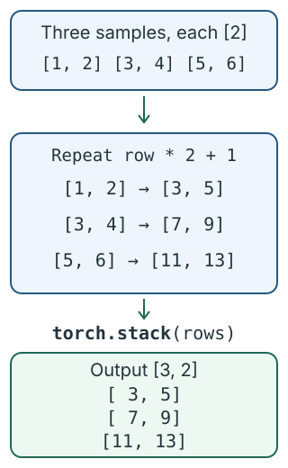

```python
import torch  # Load PyTorch.

a = torch.tensor([1., 2.])  # Create sample 1.
b = torch.tensor([3., 4.])  # Create sample 2.
c = torch.tensor([5., 6.])  # Create sample 3.

rows = []  # Collect the separate outputs.
for row in [a, b, c]:  # Visit one sample at a time.
    rows.append(row * 2 + 1)  # Compute this sample.
y = torch.stack(rows)  # Combine finished outputs.
print(y)  # Display the three output rows.
```

<!-- comparison:next -->

#### Batch: all three samples

Stack the inputs first. Apply the multiplication and addition to the whole
batch without a Python loop over samples.

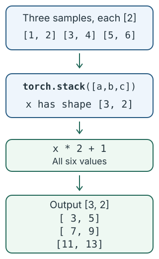

```python
import torch  # Load PyTorch.

a = torch.tensor([1., 2.])  # Create sample 1.
b = torch.tensor([3., 4.])  # Create sample 2.
c = torch.tensor([5., 6.])  # Create sample 3.

x = torch.stack([a, b, c])  # Form a [3, 2] batch.
y = x * 2 + 1  # Compute on all six values.
print(y)  # Display the three output rows.
```

<!-- comparison:end -->

Both print `[[3., 5.], [7., 9.], [11., 13.]]` as a tensor. In the batch route,
**`torch.stack()`** groups the inputs; `x * 2 + 1` computes on that existing
batch. The loop route groups only its finished outputs. The calculations are
equivalent because each sample's result is independent of the others.
A calculation that needs the previous sample's result cannot be replaced by
this independent-row pattern without changing the algorithm.

In typical training code, **`DataLoader`** is PyTorch's utility for loading
samples from a dataset. Setting **`batch_size`**, for example
`DataLoader(dataset, batch_size=32)`, lets it form batches automatically with
its standard batching behavior. The training loop then visits batches, and
`model(inputs)` processes the current batch. The last batch can be smaller.
Batching does not move tensors to a GPU; device placement is a separate step.

**Performance connection:** the loop requests a multiplication and addition
three times; the vectorized version requests each once for the whole batch.
On a GPU, this can reduce repeated Python overhead and kernel launches. The
expression still contains two operations; one line does not guarantee one
kernel or a speedup. Grouping also has a cost, and the same six input values
still need processing. Throughput is work completed per unit time; latency is
time to finish one request. Larger batches can improve throughput while using
more memory or making requests wait. Check equal results, then measure.

### Mental model

First group the samples into a batch. Then compute on the batch with tensor
operations. Forming the batch and calculating its results are separate steps.

## 15. Measure GPU time with CUDA events

### Objective

Explain how CUDA events, synchronization and warm-up help measure GPU work.

### How it works

CUDA operations are normally asynchronous: the CPU submits work to the GPU
and can continue running Python before the GPU finishes. A Python timer around
`y = x @ x` alone may therefore measure submission time, not completed GPU work.

A CUDA stream is an ordered queue of GPU work. A CUDA event is a marker you can
place in that queue. With timing enabled, two events let you measure the time
between the GPU reaching the start and end markers.

#### What each function does

| Function | What it does | Use here |
| --- | --- | --- |
| **`torch.cuda.Event()`** | Creates an event; set **`enable_timing=True`** for timestamps. Creation alone does not place it in a stream. | Prepare start and end markers. |
| **`event.record()`** | Places the event in the current CUDA stream. It does not wait for the GPU to reach it. | Mark the start or end of the work. |
| **`torch.cuda.synchronize()`** | Makes the calling CPU thread wait for previously submitted work in all streams on the current CUDA device. An optional device argument selects another device. | Wait for the work and both markers to finish. |
| **`start.elapsed_time(end)`** | Returns the time between the two completed events in milliseconds. | Read the measured GPU interval. |

Events can also coordinate streams. Here we use one stream and focus on timing.

#### Why warm up first?

GPU warm-up means running the same operation a few times before measuring it.
The aim is to reduce first-run effects when you want to measure repeated use:

- CUDA and libraries may need initialization; for example, the matrix library
  may load on its first call.
- Memory blocks and operation working space may need allocation.
- Some operations or configurations need kernel selection, compilation or
  other preparation. Ordinary matmul does not imply compiling a new kernel
  on every call.
- GPU clock speeds can change as the device becomes busy.

Some setup already happens when the input tensor is created. Warm up with the
same shapes, dtypes and operation you will measure. Five runs below illustrate
the pattern; they do not guarantee stable clocks or timings. Measuring the
first request is a different goal, so retain startup costs when that is what
matters.

#### A simple matrix-multiplication timer

**CUDA example:** create the inputs, warm up, then time one matrix product.
All recorded work below uses the same current stream and device.

```python
import torch  # Load PyTorch.

x = torch.randn(4096, 4096, device="cuda")  # Create the GPU input matrix.
start = torch.cuda.Event(enable_timing=True)  # Prepare a timed start marker.
end = torch.cuda.Event(enable_timing=True)  # Prepare a timed end marker.

for _ in range(5):  # Run five illustrative warm-up calculations.
    y = x @ x  # Warm up the same matrix multiplication.
torch.cuda.synchronize()  # Finish warm-up before starting the measurement.

start.record()  # Submit the start marker without waiting for it.
y = x @ x  # Submit the matrix multiplication.
end.record()  # Submit the end marker after the multiplication.
torch.cuda.synchronize()  # Wait until the device's submitted work finishes.

elapsed_ms = start.elapsed_time(end)  # Read the completed GPU interval in milliseconds.
print(f"GPU time: {elapsed_ms:.2f} ms")  # Display this measurement.
```

The first synchronization finishes warm-up. The second makes it safe to read
the elapsed time. The timer measures the interval between the GPU markers,
not how long the CPU spends inside **`torch.cuda.synchronize()`**.

The diagram follows the timed part only. Read each lane downward: arrows to
the GPU mean submission; the return arrow means the CPU's wait can finish.
The shaded GPU area covers the interval between the two timestamps.
The lanes show an example ordering, not durations or an exact overlap pattern.

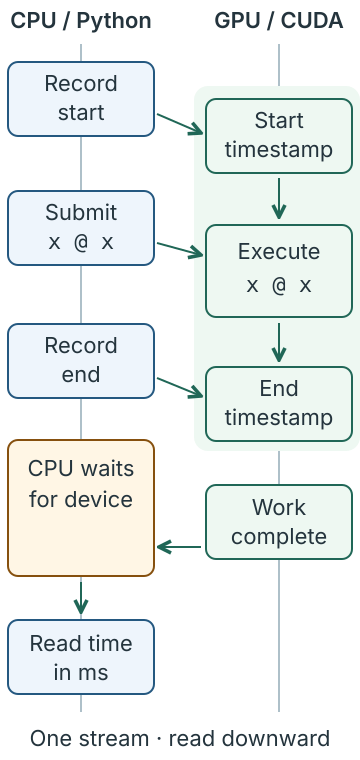

**`start.record()`** and **`end.record()`** place markers; they do not make the
CPU wait for GPU completion. **`torch.cuda.synchronize()`** is the explicit CPU
wait. For a narrower wait, **`end.synchronize()`** waits until the GPU reaches
that event, rather than waiting for unrelated work across the device.

#### What does the number include?

Input creation, warm-up and printing are outside the measured interval.
The interval can include GPU idle gaps while the CPU submits the work; it is
not necessarily the sum of kernel execution times. Other GPU activity can
also affect the result.

One measurement is illustrative. For a steadier comparison, repeat measurements
with the same shapes, dtypes and computation, and check correctness. You can
also place several identical calls between the markers and divide the elapsed
time by the call count to obtain an average.

**Performance connection:** GPU time measures one part of an application.
Total request latency also includes preparation, transfers and other work.
Use a wall-clock timer with completion included when that full duration is
your goal. A timer tells you how long; a profile helps explain why.

### Mental model

Warm up, mark the GPU interval, wait for completion, then read milliseconds.
CPU submission, GPU execution and CPU waiting are different parts of the flow.

## 16. torch.compile can combine GPU operations

### Objective

Explain how **`torch.compile()`** can combine GPU operations, and compare its
result with ordinary PyTorch execution.

### How it works

**`torch.compile()`** creates an optimized version of a PyTorch function or
model. It analyzes tensor operations and generates code for supported parts,
with the aim of making repeated execution faster. One useful GPU optimization
is kernel fusion.

#### Two operations, potentially one kernel

A GPU kernel is a function that runs on the GPU. Kernel fusion combines
multiple operations into one kernel. Consider these element-wise calculations
on a CUDA tensor `x`:

```python
a = x * 2  # Multiply every input value by two.
b = a + 3  # Add three to each multiplied value.
```

Ordinary PyTorch execution is called eager execution: operations run as Python
reaches them. For these two simple CUDA operations, it normally launches two
kernels:

1. Multiply: read `x`, multiply by 2, and write the intermediate tensor `a`.
2. Add: read `a`, add 3, and write the output tensor `b`.

The intermediate tensor lives in GPU global memory: the main GPU memory used
for tensor storage. With fusion, one kernel can read `x`, do both calculations
and write `b`. It avoids storing and rereading a full tensor `a` in global
memory; temporary values stay inside the calculation.

The boxes below show memory and computation; arrows show the flow of values.
The lower path is a possible fused implementation, not a measured result.

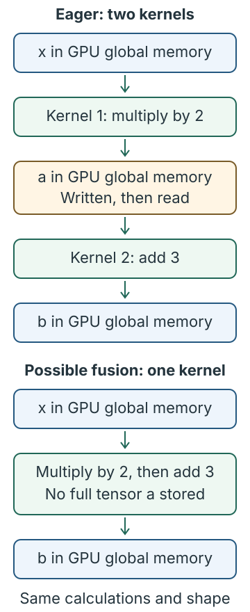

Fusion can save one kernel launch and the extra memory traffic for `a`.
The multiplication and addition still happen. Simply writing `b = x * 2 + 3`
on one Python line does not fuse them in ordinary eager execution.

#### A complete example

**CUDA example:** running this needs a compatible NVIDIA GPU, CUDA-enabled
PyTorch and a working compiler backend—the component that generates executable
code. Reading the example needs no setup.

**`torch.allclose()`** returns `True` when corresponding output values agree
within numerical tolerances: small allowed differences in floating-point
results.

```python
import torch  # Load PyTorch.

def my_function(x):  # Define the two calculations to optimize together.
    a = x * 2  # Multiply each input value by two.
    b = a + 3  # Add three to each multiplied value.
    return b  # Return the final tensor.

x = torch.randn(1024, 1024, device="cuda")  # Create a matrix on the GPU.
result1 = my_function(x)  # Calculate the ordinary eager result.
optimized_function = torch.compile(my_function)  # Create a callable optimized version.
result2 = optimized_function(x)  # Run it; the first call may compile code.
print(torch.allclose(result1, result2))  # Check agreement for this input; expect True.
```

Both versions calculate `x * 2 + 3` and return the same shape as `x`.
For example, an input value of `4` becomes `11`. The code checks agreement for
this input; it does not show whether fusion happened or how fast either
version ran.

#### Compilation takes time too

Create the optimized function once and reuse it. The first call can be slow
because compilation takes time. Later compatible calls can reuse the compiled
code; changed input shapes or other conditions can trigger compilation again.

**Performance connection:** fewer launches and less intermediate memory traffic
can help these simple operations, but fusion and speedup are not guaranteed.
Use lesson 15's warm-up and GPU timing method to compare repeated calls with
the same inputs, keeping the correctness check outside the timed region.
Measure first-call latency separately if startup time matters. To confirm the
kernel count, use a profiler: a tool that records the operations that ran.

### Mental model

**`torch.compile()`** can reorganize how the same calculation runs. Fusion can
save launches and intermediate memory traffic; check the result and measure
the benefit after accounting for compilation time.
