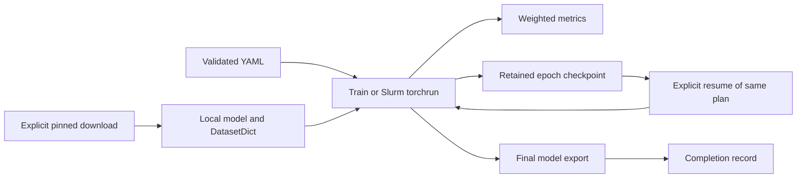

# Technical references

Technical sources reviewed on 2026-11-23. These links provide technical
context; no external documentation or illustrations are redistributed here.

| Decision | Primary evidence |
| --- | --- |
| Python 3.14 support | [PyTorch 2.10 release](https://pytorch.org/blog/pytorch-2-10-release-blog), [PyPI torch metadata](https://pypi.org/project/torch/) |
| DDP gradient averaging and collective ordering | [PyTorch DDP](https://docs.pytorch.org/docs/stable/notes/ddp.html) |
| AMP accumulation and skipped updates | [AMP examples](https://docs.pytorch.org/docs/stable/notes/amp_examples.html) |
| Restricted checkpoint loading and limits | [Serialization semantics](https://docs.pytorch.org/docs/stable/notes/serialization.html) |
| Local model loading and safetensors | [Transformers model API](https://huggingface.co/docs/transformers/main/en/main_classes/model) |
| Immutable download revisions | [Hub download guide](https://huggingface.co/docs/huggingface_hub/guides/download) |
| Lock freshness and selected indexes | [uv locking](https://docs.astral.sh/uv/concepts/projects/sync/), [uv PyTorch guide](https://docs.astral.sh/uv/guides/integration/pytorch/) |
| Slurm on Nebius and shared storage | [Soperator access](https://docs.nebius.com/slurm-soperator/clusters/connect), [Soperator architecture](https://docs.nebius.com/slurm-soperator/overview/architecture) |
| CUDA driver compatibility and licensing | [NVIDIA compatibility](https://docs.nvidia.com/deploy/cuda-compatibility/minor-version-compatibility.html), [CUDA EULA](https://docs.nvidia.com/cuda/eula/index.html) |

## Workflow

The application uses PyTorch DDP and Hugging Face model and dataset APIs.
Configuration, data preparation, training, checkpointing and asset acquisition
have explicit module boundaries with focused regression tests. Slurm provides
job scheduling; the application does not provision cloud infrastructure.
