# GitHub AI automation

A GitHub Actions controller for requested PR review, bounded repair, conflict
resolution, exact-candidate CI, PR-specific live tests, protected merge and
package releases. After enrollment, laptop skills dispatch to the same effect
owners as runners. The source ships **unactivated**: enrollment and effect
workflows are retained in [deployment templates](deployment/README.md), outside
installed Actions workflows. Ordinary protected merge and `$publish-release`
remain available. Local checks are not live qualification. The prepared merge
completion listener matches the broker workflow path independently of its run
title, then validates the original merge receipt before effects.

Use the [hosted rollout guide](docs/hosted-rollout.md) for image updates,
same-repository qualification, protected environment setup, canary permits and
the remaining deployment gates. No separate test repository is required.

Browse the [portable workflow guide](docs/workflow-guide.html) for the PR and
release flowcharts, decision branches and operating limits. Open the HTML file
directly in a browser; all assets are embedded and it works offline. It includes
section navigation, diagram zoom, text explanations and a complete print layout.
Printing uses A3 portrait to keep the long diagram labels readable.
The file can also be embedded in an iframe; restrictive parent policies may
disable optional controls while retaining the diagrams and explanations.

```mermaid
flowchart LR
  Request[New PR or manual PR number] --> Controller[Admit or resume active request]
  Controller --> Value[Purpose and usefulness]
  Value --> Review[Safe repairs then review and alignment]
  Review --> CI[Exact request, source, head and base CI]
  CI --> Live[Qualified Nebius live capability or PR waiver]
  Live --> Policy[Deterministic admission and shared state]
  Policy --> Merge[Protected merge-pr broker]
  Merge --> Result[Exact merged-result CI]
  Result --> Release[One release coordinator per package]
```



## Authority and isolation

- GitHub-hosted Ubuntu runners only. No App, PAT fallback or self-hosted runner.
- Agents see an exported source tree, trusted skill bundle and a scoped inference
  ticket. They receive no GitHub write token, cloud credential or durable-state key.
  The Responses relay holds the Token Factory key and allows one configured model.
- Inference, candidate execution and publication are separate processes/jobs.
  Candidate CI and release builders have read-only GitHub permissions and no
  environment secrets. The merge controller never runs candidate shell commands.
- Private regular Nebius Object Storage stores CAS leases, fencing, effect
  intents, waivers and evidence. There is no production local-lock fallback.
- Every merge binds repository/PR identity, head, base, source tree, trusted
  workflow revision, run/attempt, policy and skills hashes. A new commit requires
  qualification again. GitHub protections remain authoritative.
- Two repair attempts and a three-hour PR-operation deadline bound correction
  loops. An uncertain external mutation is reconciled before another attempt.
- Two durable evaluator slots bound model work. A separate supervisor observes
  execution, and a durable global reservation serializes live trials. Unknown
  or cancelling jobs retain their reservations until termination is observed.
  Recovery rechecks reservation ownership under both leases before cleanup.
- Control-plane changes remain open for maintainer review. Useful small changes
  qualify; no-benefit closure requires two independent complete assessments,
  current rationale and discussion, and no conflicting human review. Objective
  incorporation/duplicate proofs remain available. Uncertainty stays open.
- Forks receive a `source:fork` label and one updated comment with an origin
  notice. Fork merging defaults off. Enabling it never permits fork branch writes.
- Rename source and destination both count for protected paths, CI and releases.
  Tightened mode/flag restrictions also block previously prepared effects.

## Request lifecycle and gate order

1. Admit only a newly opened PR created in the current enabled admission epoch,
   or an authenticated manual request by PR number. New drafts wait for readiness.
   Old open PRs, terminal requests and historical events do not start automatically.
2. Check objective redundancy and concrete usefulness against the accepted base,
   complete three-dot contribution diff, PR explanation and human discussion.
   Small documentation, test, security or clarity improvements can be meaningful.
   Uncertain evidence leaves the PR open; no-benefit closure needs a blind second
   assessment and revalidation before and after the close effect.
3. For useful changes, require an up-to-date base. Same-repository conflicts may
   receive a localized repair preserving both parent intents: at most five
   agent-edited files and 200 changed non-marker lines, excluding clean base
   changes. Independent review/alignment and trusted focused checks must pass
   before publication. The hosted token cannot update fork branches. Substantial
   conflicts may use one attributed replacement PR under inherited adoption authority.
4. Run `review-pr`/`code-review`, compatibility assessment, and `align` with
   independent validation receipts. Required release fragments are added before
   qualification. Every published repair starts review of the new candidate.
5. Run exact-candidate CI, assess live applicability, then run a qualified live
   scenario or eligible existing waiver. Failed/intervened trials require diagnosis,
   bounded owner repair and fresh proof; they cannot be waived.
   Completed stages resume from evidence bound to the request, source, policy,
   runtime, skills, model and context; CI callbacks do not blindly repeat them.
6. Explain and leave open, explain and close under the narrow closure policy,
   or submit to the protected merge broker. Review-only requests cannot repair,
   close or merge. CI success alone never authorizes approval or merging.

An active request retains its original three-hour deadline and two-repair budget
across pushes and base updates. A workflow rerun cannot create a new request.
A terminal PR requires a fresh manual dispatch. A replacement campaign reuses its
existing PR when explicitly renewed through either parent or child; automatic
continuation never resets its limits. Recovery scans admitted records and narrow
completion obligations, not the open-PR backlog. Cleanup and release remain separate.
An accepted branch-update request remains pending until the expected merge head
is observed. Pending effects keep the request recoverable within its original
deadline and block successor requests until reconciled. A head/base or readiness
change during status-comment publication also leaves the request active for
reassessment instead of applying the previous candidate's terminal outcome.

## Configuration

Protected environments split credentials by job: `github-ai-automation` owns
state, `github-ai-evaluation` owns inference, `github-ai-live-test` owns scoped
live-test access, and `github-ai-image-publish` owns image publication. Restrict
each to the default branch. `github-ai-state-qualification` holds only the
separate qualification bucket credentials. Do not copy target values into Git, logs, prompts,
model context or artifacts. See the [environment matrix](docs/hosted-rollout.md#credential-placement).

| Environment secret | Purpose |
| --- | --- |
| `AI_AUTOMATION_TF_API_KEY` | Token Factory credential; enter the real key directly in GitHub |
| `AI_AUTOMATION_TEST_TENANT_ID` | Default test tenant |
| `AI_AUTOMATION_TEST_PROJECT_ID` | Default isolated test project |
| `AI_AUTOMATION_TEST_REGION` | Default test region |
| `AI_AUTOMATION_NEBIUS_CREDENTIALS` | Scoped non-interactive live capability credential |
| `AI_AUTOMATION_STATE_BUCKET` | Private regular Object Storage bucket |
| `AI_AUTOMATION_STATE_ENDPOINT` | Regional Object Storage endpoint |
| `AI_AUTOMATION_STATE_ACCESS_KEY_ID` | State-store access identity |
| `AI_AUTOMATION_STATE_SECRET_ACCESS_KEY` | State-store credential |

An empty or dummy API-key secret is not a useful placeholder. GitHub secret names
use letters, digits and underscores, and cannot begin with `GITHUB_`. The originally
suggested hyphenated key name is therefore not used.

### Repository automation controls

Set these non-secret controls as repository Actions variables under
**Settings → Secrets and variables → Actions → Variables**. Keep one repository
value per control; do not shadow them in the `github-ai-automation` environment.
This lets metadata intake, controllers and protected brokers use the same settings.

| Repository variable | Values | Default / initial rollout value |
| --- | --- | --- |
| `AI_AUTOMATION_PR_REVIEW` | `disabled`, `report`, `repair`, `merge` | `disabled` |
| `AI_AUTOMATION_RELEASE_PUBLISH` | `false`, `true` | `false` |
| `AI_AUTOMATION_MERGE_FORK_CONTRIBUTION` | `false`, `true` | `false` |
| `AI_AUTOMATION_IMAGE_PUBLISH` | `false`, `true` | `false` |
| `AI_AUTOMATION_CODEX_VERSION` | `latest`, exact npm version | `latest` |

The PR control selects the whole PR lifecycle: report, bounded repair, or merge
authority. Release publishing has its own independent switch. The fork switch
only adds eligibility within the PR mode and never bypasses another gate.

Workflow expressions such as `${{ vars.AI_AUTOMATION_PR_REVIEW || 'disabled' }}`
use the off value only when the variable is unset or empty. Merging this source
does not install the controller workflows or enroll the repository. A separately
authorized deployment must install and qualify the prepared templates first.
After that deployment, changing a GitHub variable affects subsequent runs.
Ordinary CI remains installed throughout.
Complete qualification before enabling; automatic PR intake also requires the
admission epoch described below.
[GitHub variable reference](https://docs.github.com/en/actions/reference/workflows-and-actions/variables).

Other runtime variables: `AI_AUTOMATION_REPOSITORY_ID`,
`TF_MODEL_REVIEW`, `TF_MODEL_FIX`, `AI_AUTOMATION_AGENT_IMAGE_REF` (qualified OCI
image pinned with `@sha256:...`), and informational `TF_BASE_URL`. The relay pins
the approved Token Factory endpoint in trusted source; changing a variable cannot
redirect its key. Kimi K3 is a candidate, not a qualified winner.
`AI_AUTOMATION_IMAGE_QUALIFICATION_RUN_ID` selects the image producer run.
The image workflow resolves the Codex selector to one exact version and SHA-512
integrity value before building; `uv.lock` pins Python dependencies.

`config/policy.json`, `config/skills.json`, `config/validation.json` and
`config/release-projects.json` are
trusted, versioned policy. The runtime policy exposes repair/time budgets and
live capabilities. Default-branch selection, controller identities, closure
proofs and the provider endpoint belong to their trusted implementations; they
are not additional policy-file switches. Unknown keys and invalid budgets fail
with `POLICY_INVALID`. Runtime variables enable stages; they do not rewrite
permissions or bypass policy. The prepared `deployment/ai-automation.json.template`,
installed as `.github/ai-automation.json` during activation, is the provider-neutral
skill enrollment contract. No personal auth hooks are installed on runners. During rollout, refresh laptop
skills from the same reviewed source revision before using their publication
entrypoints.

### Repository-wide fork merge setting

Set **`AI_AUTOMATION_MERGE_FORK_CONTRIBUTION`** as a repository Actions variable.
GitHub variable names use letters, digits and underscores, so the proposed
`merge-fork-contribution` becomes this canonical name.
[GitHub variable reference](https://docs.github.com/en/actions/reference/workflows-and-actions/variables).

- Missing or `false`: assess forks, label/comment, and allow proven authorized
  closure; never approve or merge them automatically.
- `true`: permit already-qualified, current-base forks through the same merge
  gates and protections. Conflicts, missing fragments and spec repairs require
  contributor changes. No App/PAT or cross-repository write credential is added.
- Values are exactly lowercase `true` or `false`; other values fail closed.

Keep one repository value; do not shadow it in an environment. Each request has
an immutable capability ceiling: changing false to true requires a new manual
request to gain fork merge eligibility. Newly evaluated privileged jobs apply
current restrictions. To stop immediately, disable the setting and cancel queued
and running controller/continuation/broker jobs; running jobs retain their
already-loaded variable snapshot.

Set **`AI_AUTOMATION_AUTOMATIC_SINCE`** to a fresh UTC ISO timestamp when enabling
or re-enabling automatic intake. Older PRs and drafts from older epochs are
manual-only. Before this schema rollout, disable intake, quiesce old writers and
reconcile pending effects and cleanup. A maintainer can then select
`retire-legacy` with the PR number in the Actions workflow; it verifies quiescence,
retains history and retires old state. It does not process the PR. Submit a fresh
manual `process` request afterward. Uncertain effects remain blocked for
reconciliation; retirement cannot discard them.

### Trusted validation profiles

`config/validation.json` holds reviewed check IDs, path globs, digest-pinned images, argument arrays and working directories. Checks run in a separate container
with no network, inference ticket, GitHub token or cloud/state credentials.
Structural Python/JSON checks are built in. The profile registry is intentionally
empty until project-specific focused suites and their images are qualified.
A model pass does not replace those checks: repairs requiring a missing focused
profile remain open with `FOCUSED_VALIDATION_UNAVAILABLE`. A profile image must be locally available or pullable by its immutable reference;
inability to run it is a blocking result.

**GitHub AI image** checks hourly, on trusted input changes, and by manual dispatch.
Automatic builds stay off until `AI_AUTOMATION_IMAGE_PUBLISH=true`; a manual run
can build and qualify while publication remains off. Changed Codex versions,
dependencies, runtime code or skills require a new build and real model/tool/
isolation qualification. A failed candidate never replaces the selected image.
The publisher preserves the qualified OCI digest, SBOM and provenance; a separate
job verifies anonymous GHCR pull. Package visibility must be configured public.
Select the successful run and immutable digest explicitly; no version-update PR
or automatic promotion occurs. Production selection retains verified receipts in
private state so Actions artifact expiry does not invalidate the active image.
Each PR pulls that digest instead of building another image. Image visibility
does not change the private automation-state bucket.

## PR lifecycle and issue completion

See [the lifecycle implementation](docs/pr-lifecycle.md) for status labels,
failed-test remediation, one replacement PR, manual continuation and independent
linked-issue closure. A closed PR never proves its issue is resolved. Completion
uses fresh issue scope/events and the exact merged result, with a verified explicit
fallback if native closure leaves a resolved issue open.
Each completion effect rechecks current capabilities and the exact canary permit;
retained completion does not extend an expired permit. Lost close responses are
reconciled by observation without sending a second close request.

## Manual PR requests and lifetime waivers

No laptop CLI is required. In GitHub Actions, open **GitHub AI automation**,
choose **Run workflow**, enter the PR number and select `review` or `process`.
Leave `request_id` empty; it is for internal continuations. The optional laptop
client provides the same request:

```bash
python3 skills/merge-pr/scripts/automation_client.py request 123 --operation review
python3 skills/merge-pr/scripts/automation_client.py request 123 --operation process
```

The Actions UI also accepts a PR number in **GitHub AI automation**. A review-only
request has no repair, closure or merge intent. Newly opened PRs enroll once;
subsequent events can resume only their still-active request.

`$create-pr --waive-live-test "Public-safe reason"` creates a draft, records the
waiver with the human creator's dispatch identity, waits for registration, then
marks it ready. The underlying client is:

```bash
python3 skills/merge-pr/scripts/automation_client.py waiver 123 --reason "Documentation-only exercise" --wait
python3 skills/merge-pr/scripts/automation_client.py waiver 123 --reason "Restore live testing" --revoke --wait
```

The waiver belongs to the immutable PR, persists across commits/reopenings and
ends only on explicit revocation. A label is not authority. It waives eligible
missing/inapplicable live validation; failed/intervened trials and known defects
remain blocking. CI, review, protections, current identity and cleanup still apply.
A failed/pending registration leaves a newly created PR draft.

## Live capability contract

The agent generates one small scenario specific to changed product behavior:
fixture requirements, product workload, independent assertions and a negative
control. Only a pinned, reviewed default-branch driver may execute cloud actions.
The driver must expose `Driver(context, store, lease, run_key)` with `reconcile`,
`preflight`, `provision`, `verify`, `cleanup` and `absent`. It journals every intent
before mutation, records accepted operations, validates target ancestry and
checks the lease before each write. The model cannot add a privileged driver.

`config/policy.json` intentionally has **no qualified live capabilities** yet.
Existing laptop VM trials do not qualify distributed runner execution. Until an
adapter and scoped credentials pass actual provisioning, product behavior,
interruption and independently observed cleanup tests, non-waived PRs remain
open with `LIVE_CAPABILITY_UNAVAILABLE`/`LIVE_TEST_NOT_PASSED`. Do not mark a driver
qualified from a unit test or an infrastructure-only smoke test.

**GitHub AI state qualification** separately checks real S3 conditional writes,
contention, fencing, known-object read denial, version history and exact owned
cleanup. Its production-credential guard only reads a pre-established harmless
sentinel; destructive trials use the qualification bucket. Storage evidence does
not qualify native VM behavior or GitHub effects.

A live trial has a 60-minute execution limit and an independent cleanup budget.
The recovery workflow resumes owned cleanup even when new automation is disabled.
Failed, interrupted or intervened evidence is retained and cannot become a pass.
A quota request requires a previously qualified request adapter; no unattended
quota-request API is assumed. Missing capacity remains unavailable.

## Package releases

The registry currently contains `vpngw` and `nebius-cxcli`, including cxcli's shared
module/catalog inputs, CLI settings, compatibility matrix and helper build script. Package changes need an immutable patch/minor/major fragment
in the original PR; see [release fragments](../release-notes/README.md). The agent
may propose a missing fragment, then the new head goes through qualification.
Docs/tests-only changes do not create releases. Unknown compatibility blocks a
version decision instead of silently choosing patch.

After protected merge and exact-result CI, release intake dispatches the shared
coordinator. It verifies the prior release's original hashes, reserves the next
version, creates one annotated tag, builds without write credentials and publishes
only original, verified assets. The release becomes public after asset verification.
Interrupted publication resumes the same reservation. Later verified requests
remain in durable state and are retried after that reservation completes; a new
source cannot replace a pending reservation. Existing assets must match the
original hashes. Requests already covered by a newer release are retired without
publishing an older source.

Local tag pushes, changelog
rollover and a separate release-preparation PR are retired for enrolled projects.
The reusable service workflows retain wheel identity and cxcli portable catalog
checks. GitHub's required-review settings can prevent an Actions-authored PR from
merging because the same bot cannot approve its own PR; it remains open rather
than bypassing protection.

## Development and deployment qualification

```bash
uv sync --locked
make all
```

Workflow validation requires all five candidate identity inputs and enforces
GitHub's current limit of 25 dispatch inputs, including release qualification.

See [architecture and research decisions](docs/architecture.md), canonical
[requirements](docs/requirements.md) and [design](docs/design.md).

Before enabling repair/merge/releases, qualify the exact runtime/model/skills/
policy combination against real hosted runs: multi-turn Responses/tool/schema
behavior, prompt injection and credential isolation, CAS contention and recovery,
PR updates/waiver revocation, live cleanup, protected merge and original-asset
release recovery. Run the rejection tests as well as the happy paths. Start with
the read-only **GitHub AI qualification** workflow, then exact permitted canaries.
`report` mode can post comments and labels; it is not read-only shadow mode.
Changing repository variables alone cannot bypass the durable rollout gate.
No provider, cloud, hosted merge or release qualification is claimed by this
source implementation. Publishing these files and supplying credentials are
separate deployment steps.
