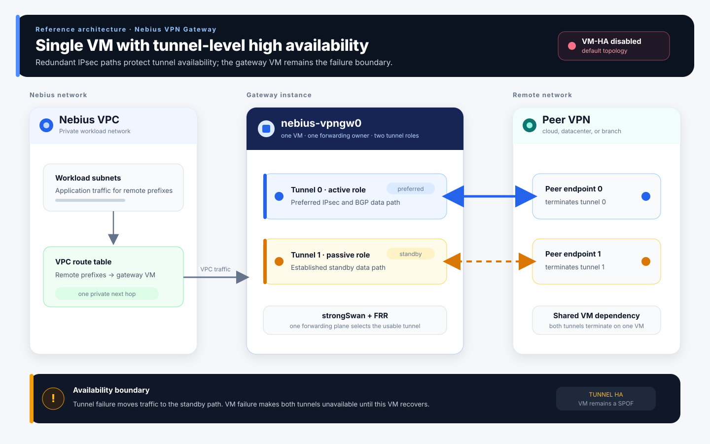
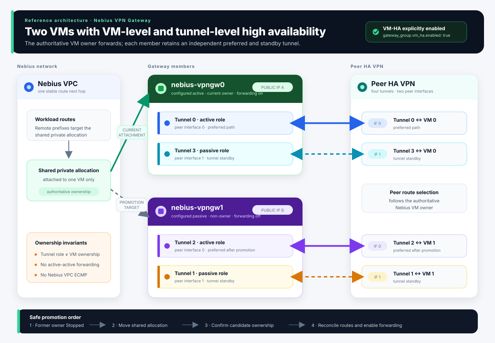

# Nebius VPN Gateway

Site-to-site IPsec/BGP VPN gateway for Nebius AI Cloud. Supports GCP HA VPN, AWS Site-to-Site VPN, Azure VPN Gateway, Cisco IOS, and custom peers.

This project is an open source, self-service, VM-based Nebius VPN gateway. It is not a managed Nebius VPN service.

SSH uses key authentication. Manage SSH source restrictions through customer-owned
Nebius Security Groups attached to the gateway VMs. See [SSH access](#ssh-access).

## Table of Contents

- [Quick Start Guide](#quick-start-guide)
- [Security Notice](#security-notice)
- [Migrating one gateway VM to VM-HA](#migrating-one-gateway-vm-to-vm-ha)
- [Features](#features)
- [Installation (Detailed)](#installation-detailed)
- [Architecture](#architecture)
- [Configuration](#configuration)
- [Commands](#commands)
- [Routing Modes](#routing-modes)
- [BGP Configuration](#bgp-configuration)
- [Static Routing Configuration](#static-routing-configuration)
- [Peer Integration](#peer-integration)
- [VM Management](#vm-management)
- [Recovery and replacement](#recovery-and-replacement)
- [System Monitoring](#system-monitoring)
- [Security](#security)
- [SSH access](#ssh-access)
- [Troubleshooting](#troubleshooting)
- [Development](#development)
- [Release & Versioning](#release--versioning)
- [Project Structure](#project-structure)

## Quick Start Guide

Use this sequence for first-time deployment. It is optimized for end users and keeps advanced topics in later sections.

### Prerequisites

- Nebius AI Cloud account and project
- A VPC where the VPN gateway subnet can be created
- Python 3.10-3.12 and `pipx`

### 1. Install the CLI from a release wheel

Run this from a clean shell, not inside an activated Python virtual environment.

Install directly from the GitHub release wheel URL:

```bash
pipx install https://github.com/nebius/nebius-ps-services/releases/download/nebius-vpngw-vX.Y.Z/nebius_vpngw-X.Y.Z-py3-none-any.whl
```

To replace an existing install with a clean `pipx` venv:

```bash
pipx uninstall nebius-vpngw
pipx install https://github.com/nebius/nebius-ps-services/releases/download/nebius-vpngw-vX.Y.Z/nebius_vpngw-X.Y.Z-py3-none-any.whl
```

Verify:

```bash
which nebius-vpngw
pipx list
nebius-vpngw --version
```

Use `nebius-vpngw --help` for the quick-start sequence and
`nebius-vpngw COMMAND --help` for command-specific guidance. Every public
command help page includes at least one practical invocation example; mutating
commands still retain their documented confirmation, approval, and fencing
boundaries.

For wheel-based installs, `apply` reuses the original release wheel URL or local wheel file recorded
by pip when it deploys the agent to gateway VMs. End users do not need a source checkout or
`python -m build`.

### 2. Create a starter config

```bash
nebius-vpngw create-config my-vpn.config.yaml
```

In a terminal, this opens a guided wizard for project, gateway, network,
connection, tunnel, and optional advanced settings. The wizard validates the
complete schema-v1 candidate before an atomic write and keeps VM-level HA
disabled unless you explicitly enable it. Fresh connection and tunnel defaults
are provider-neutral (`site-1`, `generic`). For each PSK, enter an uppercase
environment-variable name, enter a literal value through hidden input, or press
Enter to retain the generated placeholder and complete it later. Enter `?` for
field help, `b` to restart the previous section, or `q` to quit without writing.

Automation remains compatible: non-TTY invocations write the existing commented
template. Use `--interactive` to force the wizard (including in a scripted test)
or `--no-interactive` to force template generation.

### 3. Prepare Nebius network and reserve public IPs

After the wizard writes a valid config, it offers this operation separately and
defaults to **No**. The confirmation explains that it authenticates to Nebius and
may ensure or create a subnet, route table, public allocations, and the YAML
`external_ips` entries. Declining keeps the config only.

For a network-first workflow, or to rerun the operation later, use the supported
standalone command below. It remains safe to rerun.

`prep-network` creates or reuses a dedicated explicit-CIDR gateway subnet (`vpngw-subnet` by default), using `gateway_group.subnet.cidr` or the first free `/24` (or configured `prefix_length`) from the network's private pool. When CIDR is omitted, an existing exact-name subnet is reused with its current explicit CIDR and `prefix_length` applies only to creation. For an explicit CIDR outside the pool, the command can extend the pool when the network has exactly one private pool; it fails on overlaps or an incompatible existing subnet. It then verifies an exact `0.0.0.0/0` default-egress route, adding it only to an exclusively attached gateway route table. Shared or conflicting route tables and unverifiable reads fail the command instead of producing warning-only success.

Workflow:

1. If you used `--no-interactive`, fill minimal fields in `my-vpn.config.yaml`: `tenant_id`, `project_id`, `region_id`, `gateway_group` (leave `connections` for later).
   `project_id` must be set to a real value (or resolved via `${PROJECT_ID}` env var) before `prep-network`.
   Set `gateway_group.network_id` if you want a custom Nebius VPC instead of the auto-resolved `default-network`.
   Omitting it is supported; `apply` reports the selected network once while retaining its internal VM-HA safety rereads.
   Optional unresolved network or public-IP placeholders do not excuse a missing
   variable reused in a required field, such as `project_id` or a tunnel PSK.
2. Run network preparation:

   ```bash
   nebius-vpngw prep-network --local-config-file my-vpn.config.yaml
   ```

   Interactive terminals offer eligible existing allocations from the gateway
   subnet before reserving new addresses. Use `--no-interactive` for prompt-free
   automation or `--interactive` to force the selector.

3. Share the allocated Nebius public IP(s) with the peer network team.
4. The peer team creates their VPN gateway and points tunnels to those Nebius public IPs.
5. After you receive peer tunnel details, complete the config and apply.

### 4. Complete peer gateway/tunnel details

The wizard collects peer public IPs, hybrid PSK inputs, inner `/30` CIDRs,
an optional receive replay window per tunnel, static prefixes, and BGP ASNs
in dependency order. It asks routing mode before
routing-specific fields and asks the local ASN only once, on the first BGP
connection. For a
network-first workflow, rerun with `--interactive --force` after peer-side
creation, or complete `connections` and `tunnels` directly in YAML.

Generated template notes:

- `inner_cidr` must be APIPA `/30` (`169.254.0.0/16`)
- For multi-tunnel HA, use explicit roles (`ha_role: "active"` / `ha_role: "passive"`)
- Keep literal PSKs only in private mode-`0600` config files; `${VAR}` placeholders remain recommended for automation

For shorter starting points, see the [static routing example](examples/static-example.config.yaml) and [BGP routing example](examples/bgp-example.config.yaml).

### 5. Apply the configuration

```bash
nebius-vpngw apply --local-config-file my-vpn.config.yaml
```

Existing ordinary and HA gateways are updated in place. Configuration and saved
state formats, VM/allocation identities, SSH trust, and HA ownership rules are
preserved. An older agent can be upgraded even when it lacks the new ordinary
confirmation capability. An actual update may interrupt VPN traffic.

Ubuntu 24.04 gateways use `charon-systemd` under `strongswan.service` and the
pinned VICI client. Package planning refreshes authenticated metadata in a
temporary workspace, preserving system APT indexes and installed packages.
Normal `apply` also modernizes unchanged configurations;
see [strongSwan modernization and recovery](docs/strongswan-modernization.md)
for startup inhibition, interrupted-package resume, recovery authority and
qualification boundaries.
Failed HA releases with completed package operations can receive a corrective
artifact through the same `apply` command after exact lock, fence and ownership
proof. The new transaction preserves failed history and requires a fresh
approval; unfinished package work still resumes its original artifact.
Interrupted service stops require native settlement proof, and corrective
activation rechecks the exact approved cloud snapshot before proceeding.
Resuming interrupted package work retains its exact native package checkpoint
while restoring startup inhibition; re-inhibition revokes any activation token.
Python package checkpoints also retain the complete admitted manifest. A new HA
operation captures its own predecessor even when it installs the same wheel from
a previously used staging path. Resume preserves the original checkpoint and
exact installed-file checks; this does not reset exhausted repair attempts or
permit a different artifact to take over unfinished package work.
HA activation uses required readiness checks without fixed diagnostic sleeps.
During an approved `apply` or `vm-ha` activation, proven local service,
configuration and package failures share up to three automatic corrective
attempts across the command and both members. Recovery retains the exact approved
artifact, configuration, credentials and policy. Two minutes is a soft recovery
target, not a cancellation deadline. Slow accepted package work remains supervised
and reports progress; it is never killed or overlapped because time has elapsed.
Bounded observations and native safety checks remain in place.

Transient Compute timeouts and temporary unavailability trigger up to three
fresh reads with bounded backoff. Dispatch, authentication, Compute, SSH and
guest inspection share one elapsed-time budget: at most 30 seconds, or 20 seconds
for a recovery observation. Read retries consume no corrective attempt. Failed
Compute evidence still stops before SSH; identity, fencing and ownership checks
remain mandatory. Access denial, invalid credentials after bounded refresh,
malformed evidence and confirmed drift remain blockers.

If fresh authority remains unavailable, `apply` and `vm-ha` report `pending`
with a nonzero exit and unknown readiness. Rerun the same command to observe and
resume its retained operation, using the original configuration and artifact.
Keep the command receipts and repair history. Completed effects are rechecked;
unavailable completion evidence cannot select a service or package repair.
An interrupted owner unlock can continue from an exact own lock and fresh
current-boot fencing. Native inspection must first prove the local state;
healthy, fully materialized services are not restarted for that continuation.
JSON diagnostics retain `failure` and report `latest_failure` separately, so a
historical timeout cannot conceal the current blocker. These mechanisms do not
change how an already-active gateway behaves during a cloud outage.

SSH loss or Ctrl-C detaches the observer. The admitted package phase continues
under its existing guest owner, with startup inhibition retained. Reattachment
reads that same transaction before continuing; a later activation phase requires
fresh fencing and ownership proof. Native package continuation uses only the
approved offline package closure. Python continuation restores prospective,
ownership-checked checkpoints and skips independently verified completed work.
Installation and restoration also retire obsolete, exclusively owned Python
metadata directories so package discovery sees the verified version.
If a package phase was never submitted, fresh exact authority and writer checks
can admit that same approved phase, including after interruption or partial pair
preparation. This uses the shared repair allowance; unknown peer state and an
unchanged failed repair remain blockers.
When the original phase instead paused on a typed observation outage, fresh
prepared/not-submitted evidence resumes that original admission without charging
a repair. The durable waiting marker grants no authority by itself and does not
override any failed repair history.
Foreign files, ambiguous ownership, changed authority or exhausted corrective
attempts remain explicit blockers. No blanket package repair, lock deletion,
forced process termination or unattended background activation is performed.

When `vm-ha --rotate-mtls` or `--standby-auto-healing enabled` finds a valid
installed runtime missing a required capability, it can propose a retained-pair
upgrade and the requested operation together. One approval covers both; a
verified prerequisite is not repeated after interruption. This path requires
readable member authority, the same artifact and policy predecessor, and reusable
credentials and SSH trust. Generic apply is never entered inside an inhibited
rotation. Unverifiable state or unrelated active workflows remain blockers.

Normal upgrade interruption and additional recovery time are separate. Both
activation progress and normal-upgrade interruption have a 120-second soft target.
Report overruns explicitly; they alone neither fail qualification nor cancel
admitted work. The target never extends background daemon repair budgets or
expires an accepted package phase. Runtime success requires native ownership,
route and forwarding proof, and does not establish end-to-end workload
connectivity. Native systemd, final-artifact upgrade and cloud Static/BGP traffic
qualification remain required before release.

Its forwarding guard matches canonical BGP prefixes, including native `/32`
host routes, to their authorized XFRM paths before admitting forwarding.
An exact HA owner can enter `ORIGINATING` to prepare local routing and advertise
permitted local prefixes while forwarding remains fenced. It must then observe
the required remote prefixes and encrypted paths, independently verify VPC routes,
and pass the forwarding gate. Ordinary `PASSIVE` members still deny exports.
The fenced origination action installs and verifies destination protection before
advertising. Fresh gateways and upgrades can enter that action when protection
has not yet been installed. A failed installation keeps exports and forwarding fenced.
Ownership loss, inhibition or a stale generation revokes origination authority.
Missing or ambiguous passive import-policy evidence also keeps preparation fenced;
a known policy mismatch can request the existing fenced refresh.
Restart recovery also rechecks saved BGP selections during `ORIGINATING`.
A confirmed failed selection releases its override without extending the original
deadline; changed policy is revoked and prepared again before forwarding.
Activation diagnostics retain the first failed phase and predicate; an apply lock
left in place is reported as a consequence where appropriate.
Well-formed status awaiting convergence is reported separately from malformed evidence.
When later observations differ, text diagnostics also label their latest phase,
predicate and reasons without replacing the first failure.
Bounded daemon configuration recovery also covers warm BGP standbys, with fresh
non-owner evidence and forwarding fenced throughout. Cold Static standbys remain
inactive. Recovery checks both loaded connections and credential identifiers;
path selection defers local daemon defects to the component recovery owner.
Deferred repair rechecks the same retained route authority as its initial
admission. Inconsistent native observations retain protected forwarding without
granting configuration-writer readiness or renewing the recovery attempt.
Static path changes and fenced activation also verify kernel teardown. After a daemon crash, VICI may
have forgotten SAs that remain in the kernel. The existing tunnel owner removes
only objects bound to the suspended connection's verified XFRM interfaces and
peer endpoints, then proves their absence before activating another path.
Unrelated connections remain untouched; incomplete readback blocks completion.
Activation removes stale kernel objects from unselected paths even when the
persisted selection is unchanged. It temporarily unloads those paths for exact
teardown, then restores responder readiness without changing the selected path.
Cold standby materialization cleans every inactive Static path. Cleanup retains
the forwarding fence and bounds both ownership observations and kernel commands.
Normal `apply` converts the mode-bound repair checkpoint; runtime
does not accept an older checkpoint format.
Static owner preparation remains observable while forwarding is fenced. Seeing
that exact prepared policy grants no standby reload or promotion authority;
promotion still requires native coverage and independently confirmed ownership.
Single-VM and VM-HA use the same health-based Static connection selection.
Unselected alternatives on the authorized owner remain loaded as responders
without autonomous initiation or selected workload routes. Redundant tunnels
belong to one connection and must cover its complete destination set; ambiguous
overlapping destinations across connections fail validation. Disjoint destinations
keep their own selections. Preferred-path probes can run while workload routes
use a backup. Automatic tunnel failback requires 60 seconds of continuous healthy
observations; unknown evidence resets that period, and manual overrides take
precedence. Tunnel failback does not move VM ownership. Destination protection
remains in force when no path is usable.
FRR rendering follows the same BGP defaults as the public schema, including
disabled graceful restart; explicit customer settings are preserved.
The daemon also disables separate policy-table registration so a restart cannot
recreate a table-220 rule while waiting for the route timer.

The modernization release remains under qualification. A preceding frozen
candidate passed corrective recovery and a normal BGP update, with interruption
below 120 seconds and a mutation-free second apply. A subsequent Static update
met the traffic limit but failed inactive-kernel cleanup. An intermediate repaired
candidate passed 108 native checks and live inactive-kernel cleanup, including
automatic path switching after daemon loss. Its already-failed recovery exceeded
120 seconds and is reported separately from normal upgrades. The current
activation repairs pass focused Static/BGP service-fault, checkpoint-isolation
and original-configuration restoration trials, plus native service and package
checks. Final traffic uses an explicitly authorized campaign-only UDP allowance.
Static's original strict failure remains preserved; normal product criteria are
unchanged.
These results cover the declared repair mechanisms; broader release qualification
remains open. Original failed trials remain separate evidence. See the guide for
historical, Static and fault-matrix gates.

Preview updates before scheduling them:

```bash
export VPNGW_AGENT_WHEEL=/path/to/nebius_vpngw-VERSION-py3-none-any.whl
nebius-vpngw apply --local-config-file my-vpn.config.yaml --dry-run
nebius-vpngw apply --local-config-file my-vpn.config.yaml \
  --approve-disruption <DISRUPTION_DIGEST>
```

Use the same wheel and configuration for preview and execution. Potentially
disruptive changes require an interactive confirmation that defaults to **No**,
or the exact digest from that preview. A changed predecessor invalidates approval;
review a new preview before retrying. HA migration and other lifecycle operations
retain their existing effect-specific approvals; direct `apply` may require both
the lifecycle digest and the disruption digest. The `vm-ha` command retains its
existing combined review and approval workflow.

Ordinary apply saves the original effect plan in a private command envelope before
starting guest, route or attachment changes. Rerunning the same command resumes only
those approved steps, including an unattempted member. A completed step cannot
borrow its old approval for new drift, and a pending attachment change cannot
authorize new guest repairs. Keep the command and child operation journals intact.
Lost responses require the child owner's exact terminal receipt before completion;
matching resource readback alone does not settle an uncertain operation.

Fresh ordinary provisioning uses this same command envelope. Its preview freezes
SSH enrollment, the selected image, resource requests, bootstrap policy and route
scope. New Compute, disk and allocation identities come only from successful
creation receipts. After pinned SSH verification, apply saves each new guest's
exact package closure before staging and activation. Retrying preserves the
selected SSH keys, image, cloud request keys and package closure. It does not
adopt matching resource names or automatically delete partially created resources.
Readback accepts documented subnet/allocation defaults and unchanged intent after provider
revision bookkeeping. Every update still uses its original approved revision;
changed resource specifications, labels or ownership remain blocking.
Private route-table copies preserve existing routes, including default egress,
before applying the reviewed workload subnet reassignment. Route requests retain
their full binary representation, including cloud fields unknown to the SDK;
recovery verifies the original request hash and subnet revision before replay.
Attachment and replacement recovery also preserve cloud fields unknown to the
SDK. Changed fields remain blocking, and private bootstrap data stays out of
operation journals.

Fresh HA previews bind planned SSH key generation to the exact deployment and
targets, so temporary keys generated during planning do not invalidate the
approved plan. Keys are published only after approval. Existing trust receipts
and changed targets remain part of approval validation.

Before preparing packages on an unstarted HA member, apply creates the canonical
writer lock directories after inhibiting startup and stopping writers. This step
creates no runtime identity or controller checkpoint; activation still requires
the exact lifecycle and forwarding checks.

Keep the managed HA credential source and its enrollment journals together when
resuming an interrupted apply. Preserve the selected pending key and the exact
IAM operation receipts; a matching Service Account name does not prove that the
approved operation created it. Credential publication must verify the selected
account and authorized key before removing temporary enrollment files.

If an attachment request was conclusively rejected before effects, `apply --dry-run`
can propose a new request for the same desired attachments. Review its new digest
with `--approve-disruption`. The original command, guest inhibition and settled
member operations remain in force; the rejected request is archived. This path
requires a single recorded submission and fresh full Compute request parity except
for the resource revision. An HA owner additionally requires the exact revision
and before/after specifications already prepared on both guests. An unexplained
owner revision change is refused during planning; preserve the command, guest
inhibition and continuity receipts for guarded recovery. Timeouts, uncertain
replays, failed accepted operations and unrelated resource changes remain blocked
for their existing recovery owner.

Paired HA readiness reconstructs the installed configuration with the runtime
binding validated against both guests and the retained lifecycle and credential
identities. Exact rendered hashes must match before native encrypted-route
verification; the unresolved local YAML alone is not the installed generation.

For automation, add `--output-format json` to `apply`. Stdout contains one
`nebius-vpngw.apply-result.v1` result; progress and diagnostics go to stderr.
The result separates configuration, local runtime, authority and connectivity
evidence. Successful configuration does not prove end-to-end connectivity;
unobserved evidence remains `unknown`. `inhibition_retained: null` means remote
inhibition has not been proven, including after a failed or disconnected command.
Completed and pending effects come from the current command's receipts, without
borrowing completion from a historical command. A dry-run with planned changes
reports `blocked` with `dry_run: true` and the approval digest; no effects execute.
Existing exit codes and default text output are preserved. Failure results
recommend status inspection instead of assuming an uncertain operation can replay.
Ordinary deployment errors distinguish changed predecessor evidence from failed
local verification. These diagnostics do not authorize replay of an uncertain
cloud operation or weaken the original approval.

Staged VM replacement also participates in the command envelope. It completes
only after fresh service, ownership and exact-resource cleanup verification.
Resuming a completed replacement repeats verification without replaying its
cloud or guest effects.

Gateway network preparation preserves existing labels and complete resource
specifications when extending a private address pool or attaching a route table.
Updates require the exact project identity and a positive resource revision,
so concurrent changes cannot be silently overwritten.

HA attachment-only apply uses the same command envelope while retaining its
existing nonowner-first attachment owner and approval digest. A lost final reply
can finish the command from the exact completed child receipt and fresh readback.
Desired attachments alone cannot settle an accepted cloud operation. Pending
attachment authority cannot authorize newly discovered HA runtime changes.
After a settled attachment update, access verification refreshes the VM's cloud
revision while preserving its pinned SSH keys and targets. It first verifies the
complete approved Compute request; unrelated or concurrent changes stop the apply.
Both HA members prepare the exact attachment-only revision transition before
the serving VM changes. This preserves its established route and recovery
authority without restarting VPN services. Preparation requires each member's
published guard to match its current boot; missing or stale guard evidence blocks
the update. Unexpected revision gaps, alias
changes or other Compute changes remain blocked by the existing safety checks.
Fields returned by a newer cloud API are retained when reconstructing Compute
metadata. Recovery still requires the original complete binary request hash;
it does not replace a pending request with a newly planned one.
Access verification waits within its existing deadline for a short ordinary
maintenance job to settle. Pending operations, unresolved jobs and changed guest
identity still block completion; this observation does not restart services.

Retained HA runtime upgrades bind runtime and attachment work in one command.
If runtime activation completes before an attachment failure, retrying `apply`
finishes the original attachment operation without repeating activation. Each new
repair gets a distinct execution identity; a historical receipt or cloud request
key cannot satisfy later drift. An admitted corrective release archives the exact
pending command before publishing its separately approved successor. Uncertain
attachment requests must settle before that successor can proceed.
Ordinary and retained HA commands retain approved package manifests before guest
work starts. A retry after an early interruption restores the exact dependency
wheels by filename and hash, using the original native package plan. Missing approved artifacts stop
the operation before disruption; newer packages are never substituted silently.
Ordinary apply stages and verifies these payloads on every planned member before
activating any member. A staging failure prevents activation from starting in
that invocation; an unchanged apply performs no staging writes.

For ordinary gateways, this plan also includes managed VPC routes.
Route planning uses the schema-validated Static or BGP connection mode, including
connections that override the default routing mode.
The preview lists the configured BGP peers, destination restrictions, prefix
limits and local/VPC exclusions. If no BGP destination whitelist is configured,
it explicitly permits eligible prefixes learned from those peers. Any private
route-table copy and the exact subnet reassignment are shown separately.
The route-maintenance timer stays stopped during the native upgrade and starts
only after runtime verification releases package-start inhibition.
`apply` and `add-routes-local` use the same route owner. Matching customer routes
can satisfy coverage, but names and labels alone never grant permission to change
them. New managed routes require exact creation receipts in a private ownership
ledger. A Single-VM BGP deployment publishes an exact runtime binding and protected
credential reference to the existing agent. Its bounded periodic reconciliation
adds admitted learned prefixes and withdraws owned routes only after three complete,
consistent absence observations. Unknown observations retain routes and reset the
absence count. Withdrawn BGP prefixes retain plaintext-drop protection, but optional
withdrawn prefixes no longer count as required encrypted routes. Explicit required
prefixes still gate readiness. Foreign routes, local-network exclusions and prefix
limits remain protected. Apply and manual route commands reserve this guest writer durably before
cloud effects, then hand back independently verified creation receipts. A lost
connection or elapsed time cannot release an unsettled writer reservation.
Changing to multiple ordinary VMs retires the installed runtime writer through
the same apply command and retains its credential and route receipts. Returning
to Single-VM requires a reviewed handoff and a verified runtime binding.
Fresh provisioning reports workload connectivity as `unknown`; successful
installation and route publication do not establish workload reachability.

When route changes require isolation from a default or shared table, the plan
creates a private copy for each selected workload subnet. It preserves unrelated
routes, verifies every copy and required addition, then changes only the approved
subnet attachment with its exact cloud revision. The source table stays intact.
`add-routes-local --swap-route-table` uses this same transaction and writes private
rollback files bound to the verified subnet revision. A later subnet change
invalidates those rollback requests. `--summarize` uses exact prefix unions through
the same gateway and verifies summary coverage before retiring working specifics.

VM replacement also requires the route ledger. It recreates exact owned routes
through the candidate allocation because VPC route next hops are immutable.
When a runtime route writer is installed, replacement reserves it before cloud
changes and keeps the candidate writer reserved through service and retirement
verification. The completed handoff records the exact candidate binding and route
receipts. Resume audits current runtime receipts after that handoff, preserving
subsequent learned-route changes instead of replaying the former route plan.
An older Single-VM BGP source without a runtime binding enrolls its credential
through the same approved replacement command. The candidate receives the exact
binding while reserved and starts reconciliation only after replacement verification.
Completed enrollment can recover the same key from the pinned candidate without
creating or replacing IAM identities.
Ordinary-to-HA migration reserves the installed writer and binds its exact route
creation receipts into the migration approval. Changed route specifications or
labels cannot be adopted solely because a route name or next hop matches.
Completion durably retires the ordinary writer while HA remains fenced. Removing
HA first stops and verifies every former HA writer, then uses the ordinary apply
owner to publish routes and the runtime binding. Interrupted completion resumes
through its original command journal.
An external route that depends on the source allocation blocks replacement before
cutover; its customer route owner must move it. Keep route ownership journals
alongside the command and replacement journals when transferring operator state.

Infrastructure planning reads each existing gateway's boot disk from its Compute
attachment, including renamed disks. Missing, inaccessible or mismatched disk
evidence stops apply before deployment; it never becomes a new-VM creation plan.

An unchanged apply checks the installed artifact and local runtime without
reinstalling packages, rewriting config, or restarting services. Compatible Python
dependencies are retained. When a dependency change is required on an existing
gateway, local `uv` resolves and downloads an exact compatible wheel set before
approval; the plan lists those changes and rejects conflicts with retained software.
Selected distro-provided dependencies are installed without removing their
package-manager-owned files. HA replacement plans inspect only retained members;
a newly created replacement is not compared with the retired VM's boot state.
For HA, remote tunnel or BGP coverage loss is reported separately from local
configuration convergence. Two fresh observations must agree on ownership,
guard state, local runtime, peer identity and committed maintenance policy.
Unknown authority blocks apply; remote coverage loss alone does not select a
service restart. These observations do not grant promotion or agent-writer authority.

Ordinary apply confirms the exact config and installed agent after required local
IPsec, FRR, firewall, XFRM, and routing checks. Peer ping, established SAs, and BGP
sessions are separate connectivity evidence. Failure exits nonzero, identifies
completed/failed/unattempted gateways, and stops later deployments. A failed update
may have changed the failed gateway; it is not rolled back automatically. Inspect
its service/cloud-init logs and current state, then review a fresh plan.

For ordinary static tunnels sharing an identical remote prefix on the same VM,
the last enabled tunnel in resolved configuration order remains the forwarding
owner. The `active` and `passive` labels do not introduce static-route metrics or
ECMP. Verification checks that selected owner and rejects stale remote routes on
superseded interfaces; legitimate kernel-connected inner subnets remain allowed.
Distinct overlapping prefixes keep their separate routes. Historical claims are
retained for safe cleanup and recovery even when a tunnel is not the selected owner.

For ordinary static tunnels, preview lists obsolete IPv4 remote routes that apply
can safely retire. Approval binds the saved configuration, exact route and current
XFRM interface identity. Apply removes those routes before reusing tunnel interfaces
and verifies their absence before success and on later unchanged checks. Removing,
disabling or reordering tunnels and changing their prefixes use the same workflow.
Interfaces and addresses remain in place; connected, FRR and unrelated routes are
preserved by the retirement step; existing APIPA and table-220 hygiene still runs
afterward. Ambiguous ownership or custom route shapes block cleanup.

Keep `last-applied.json` and the private ordinary operation records intact. An
unchanged or route-equivalent upgrade from 0.6.0 can proceed without retirement
history; missing or corrupt evidence cannot authorize route removal. Interrupted
updates retain both predecessor and prospective successor ownership for a newly
approved retry. A route that reappears after verified retirement blocks success
unless a new desired tunnel legitimately uses it. Agent background reconciliation
does not authorize retirement by itself.

If an update saves its verification proof but loses the final reply, a freshly
approved retry verifies and binds that proof to its new operation before completing.
The SSH runner streams its source and request through bounded stdin, so package
growth does not exceed the gateway's command-argument limit. Source upload counts
toward the existing remote deadline.

Ordinary updates use a durable operation guard as well as process locks. If a
command process group, service job or Netplan change outlives its caller, apply fails within its deadline
and further ordinary mutations remain blocked. A new preview can offer recovery
only after the previous writers and delegated work are conclusively settled;
that recovery requires fresh disruption approval. A dead process, empty job list,
or reboot alone does not clear the guard. Preserve
`/var/lib/nebius-vpngw/ordinary/operation.json` when diagnosing an unresolved update.
Do not delete it or run another deployment tool to bypass admission.

Deployment readiness uses authenticated SSH with the configured management user,
credentials and host-key policy. Public ICMP replies are not required for an
upgrade. SSH identity failures stop immediately; cloud-init, ESP4 and the remaining
bootstrap checks still run before configuration changes, within their existing
deadlines.

If a newly activated maintenance timer starts its guarded job during final
verification, apply waits for that job within the existing deadline, keeping the
operation guard active. It then repeats the complete final verification before
reporting success. This wait does not repeat installation or reconciliation.

Existing ordinary management services are stopped before package/config changes.
A persistent startup condition also protects previous-release services if the VM
reboots during an incomplete upgrade. The exact new agent can start and wait for
the operation to finish. Ordinary-to-HA conversion holds this exclusion until the
existing HA checks prove the retained node passively fenced on the exact operation;
interrupted conversion continues through the existing HA recovery workflow.
Package approval remains valid across the handoff's own journal and service-stop
changes. Other package, configuration, dependency or target drift requires a new
preview and approval. A pending handoff is recovered even when all approved package
writes have finished; a completed handoff does not block healthy HA convergence.

If an unfinished conversion has already published its HA marker, the retained
host's package can be repaired under HA authority, including when product imports
are damaged. This requires fresh approval, both exact migration apply locks,
current-boot forwarding exclusion and settled controller, credential and cloud
operation records. The repair preserves configuration, credentials and cloud
identity, keeps an independent cold guard, and resumes the canonical controller
only after package verification. Unknown authority or an unresolved writer blocks
repair. Completed deployments keep their existing ordinary or HA update workflow.

Older external CLI/manual mutations must not run concurrently with an upgrade.
Normal Ubuntu networkd gateways retain their configuration and identity formats.

The isolated Ubuntu systemd/networkd regressions run on PRs and gate release
publication. They cover delegated work and startup admission; live ordinary and HA
upgrade canaries still provide separate deployment evidence.

Managed HA reapply preserves the exact workload subnet and route-table scope.
Changing local prefixes to select different route targets fails before mutation.
If a previous apply stopped before staging either host, restore the original
scope and run `apply --dry-run` to inspect recovery. An eligible recovery prints
an exact `--recover-vm-ha-migration DIGEST`; use it with the normal disruption
approval. Recovery proves unchanged retained cloud resources and installed host
identities, keeps the failed transaction's audit lineage, and resumes the normal
non-owner-first apply. Never edit or delete the lifecycle journal to resume.

The FRR bootstrap ordering fix applies to newly created or explicitly recreated
VMs. It does not rerun cloud-init on existing gateways. For a VM with failed
bootstrap, inspect `cloud-init status --long` and `/var/log/cloud-init-output.log`,
identify the failed step, and plan its recovery explicitly before retrying apply.
The management public-key file must contain one OpenSSH key matching the selected
client identity. Bootstrap quotes that record to preserve YAML-sensitive comments;
multi-key files fail before provisioning.

Agent services wait for the first resolved configuration before starting. If an
older bootstrap left the management agent waiting to restart, an approved apply
can stop it through the operation journal before installation. Planning verifies
FRR's optional failure-handler definitions; an absent handler is recorded in the
approval evidence, while executable handlers and unresolved jobs block changes.
Bootstrap reports the agent as running only after an exact successful service
check; a configured-but-inactive agent is not reported as active.

Dependency inspection evaluates the gateway's environment and selected extras
before checking dependency sources. Unselected documentation or platform extras
do not block reapply; active direct URL dependencies still require a separately
built wheel set.

After an ordinary apply publishes managed SSH trust, `vm-ha` can import that
exact identity into the HA deployment as part of its approved migration. The
displayed plan includes managed trust publication and is revalidated before
execution. Existing trust repair and destructive recreation still require their
explicit workflows.

For an absent standby that needs a product-generated SSH key, approval binds the
generation intent alongside the exact retained trust. Dry-run does not save a
key. Approved execution publishes the generated key's exact pin before connecting.

### 6. Configure local routes

```bash
nebius-vpngw add-routes-local --local-config-file my-vpn.config.yaml
nebius-vpngw add-routes-local --local-config-file my-vpn.config.yaml --swap-route-table
nebius-vpngw list-routes-local --local-config-file my-vpn.config.yaml
```

### 7. Validate status and connectivity

```bash
nebius-vpngw status --local-config-file my-vpn.config.yaml
```

Optional data-plane check: from a VM in one of `gateway.local_prefixes`, test reachability to a remote private IP over the VPN.

### Firewall Requirements

Open any ports and protocols required by your application on your network so traffic from the Nebius side can reach the intended services.

For example, if you want to test connectivity with `ping`, create an ingress firewall rule for the `icmp` protocol that allows traffic from the source `local_prefixes` (the Nebius source subnets) to your network.

### 8. Optional: manual failover/failback (BGP active/passive)

```bash
nebius-vpngw failover tunnel tunnel-2 --local-config-file my-vpn.config.yaml
nebius-vpngw failback tunnel tunnel-1 --local-config-file my-vpn.config.yaml
```

The resource-scoped command migration has no compatibility aliases:

- `vm-ha-failover` → `failover vm`
- `vm-ha-failback` → `failback vm`
- `failover [TUNNEL_NAME]` → `failover tunnel [TUNNEL_NAME]`
- `failback [TUNNEL_NAME]` → `failback tunnel [TUNNEL_NAME]`

This is useful for planned maintenance, peer changes, or operational testing.

For advanced setup, continue with [Configuration](#configuration), [Commands](#commands), and [Routing Modes](#routing-modes).

> **Ordinary VPN gateway route management:** On existing gateways, `apply`
> reconciles owned routes along with configuration. Use
> `nebius-vpngw add-routes-local` to refresh routes independently. Both commands
> select the route tables of Nebius workload subnets using
> `gateway.local_prefixes`, adding routes to the remote prefixes through the
> gateway's private allocation.
> Single-VM BGP gateways continue reconciling admitted learned routes through the
> existing agent after the deployment owner publishes its runtime binding.
>
> **VM-HA-enabled VPN gateway route management:** Nebius VPN Gateway supports
> explicit two-node VM HA by running an active gateway VM and a passive standby
> VM with a movable shared private IP address. In this mode, use `apply` to
> deploy configuration changes. Users do not need to run `add-routes-local` to
> publish remote routes into Nebius VPC route tables. The VM-HA controller
> ensures that only the verified shared-IP owner reconciles those routes through
> the shared private IP address.

## Security Notice

**Configuration files contain sensitive secrets (PSKs, service account keys).**

- **Recommended:** Name configs `*.config.yaml` (auto-ignored by git)
- **Required:** Ensure `.gitignore` includes your config file patterns
- **Best practice:** Use environment variables for secrets with `${VAR}` syntax

Every gateway requires exact operator-to-gateway SSH host trust before `apply`
creates or changes its Compute resources. By default, `apply` manages public pins in a
deployment-specific store at `~/.ssh/nebius-vpngw/<scope-sha256>/`. The scope
binds the tenant, project, region, gateway group, and either the ordinary
topology discriminator or HA cluster. Each member is pinned by
its stable hostname, while SSH connects to the current management IP with that
hostname as `HostKeyAlias`. The authoritative receipt stays hostname-keyed; its
derived OpenSSH projection also lists the exact current management-address
aliases so a supported older release can use that file explicitly.

`apply` can create or repair this store only from trusted evidence: an existing
managed receipt, a validated explicit pin file, a safe exact retained-member
Ed25519 entry in literal `~/.ssh/known_hosts`, or authenticated product
cloud-init. The general file is a read-only one-time migration source: apply
never creates, repairs, or rewrites it, and only exact current hostname/address
records whose Compute and provisioning or lifecycle identity still match are
eligible. When `VPNGW_SSH_HOST_KEYS_DIR` is unset,
actual `apply` uses
`~/.ssh/nebius-vpngw/host-keys/<gateway-group>/<scope-sha256>/` as the effective
default. The digest binds tenant, project, region, gateway group, and topology
so same-named gateways in different deployments never share private identity.
Planning generates only an ephemeral candidate for a genuinely fresh member.
After approval, trust publication creates that owner-only hierarchy and persists
the exact unencrypted Ed25519 `<gateway-hostname>.key` that was selected.
Concurrent conflicting key publication is rejected without replacing either key.
Read-only enrollment verification reuses that default directory after publication
and still rejects missing private keys or keys that do not match their exact pins.
The same exact key is pinned locally and installed as the new member's SSH
server identity. This includes a newly created ordinary gateway, so its first
SSH connection waits for the pre-pinned identity instead of learning a key from
the network.
Existing valid default keys are reused; retained or recreated members are never
silently given a replacement identity. If their original product-generated key
is no longer local, apply may recover it from the authenticated current Compute
cloud-init at the exact product key path. VM-HA recovery additionally requires
the current product marker, or the legacy product path backed by a hardened
active lifecycle record.
The recovered public key must match every existing authority. `apply --dry-run`
uses only ephemeral preview material and writes no key or trust state.
`create-config` only authors the YAML deployment configuration; it never creates
private host keys or enrolls SSH trust. That work belongs to `apply`, after live
topology discovery can classify each member as genuinely fresh, retained, or a
requested recreation.

Set `VPNGW_SSH_HOST_KEYS_DIR` to an absolute existing directory to override the
default. An explicit directory is never created or populated by the product.
Every consumed key must be a current-user-owned, single-link file with no group
or other access (normally mode `0600`). An explicitly empty or invalid override
fails instead of using the default. A successful apply first verifies every
retained member and rechecks its exact Compute binding for every trust source,
then publishes an owner-only public-key receipt and OpenSSH projection before
cloud mutation. Bootstrap health probes use the same configured management
username as later configuration SSH. `status`, route commands, tunnel
restart/failover/failback, transfer commands, and mTLS commands reuse an existing
managed receipt but never write or repair persistent SSH trust. An ordinary
deployment that predates managed enrollment keeps its former system-known-hosts
behavior until a successful `apply` publishes deployment trust.

`VPNGW_SSH_KNOWN_HOSTS_FILE` remains an optional highest-precedence override and
migration source. If set, it must be an absolute, readable, non-empty OpenSSH
file with exact member pins; an invalid or incomplete value fails without
falling back to managed state. Apply never rewrites that file. Trust-on-first-use,
`ssh-keyscan`-only enrollment, using the general file as ongoing canonical
trust, and disabled host verification are not supported. Apply also proves that
the configured management public key matches exactly one usable non-interactive
identity: the explicit mode-`0600` private key, one matching `ssh-agent` key, or
one matching owner-only default private key. This proof completes before
deletion, allocation, disk, or instance work.
Cloud-init validates the rendered SSH configuration, activates either the
image's socket- or service-based SSH model, and verifies a port-22 listener
before bootstrap completes. Public-only, encrypted, malformed, mismatched,
unreachable, or identity-rejected members fail closed. During clean bootstrap,
each member first
renders inert deterministic local strongSwan and FRR files behind the cold-start
guard. After the controller grants current-boot passive authority, the member
may establish only its local tunnel, XFRM, and BGP materialization needed to
measure promotion readiness. Forwarding, firewall changes, allocation transfer,
VPC route effects, and owner-only reconciliation remain fenced until exact
active authority is proven.

### VM-HA SSH trust and mTLS

These are two separate trust relationships:

- **SSH trust is operator to gateway.** The managed receipt/projection, or the
  optional `VPNGW_SSH_KNOWN_HOSTS_FILE` override, lives on the operator host;
  it is not a `known_hosts` file on either gateway. It stores each member's
  pinned public SSH server key. The matching private host key stays on that
  gateway and is what `sshd` presents. The CLI uses this trust for status,
  configuration staging, agent operations, and managed mTLS bootstrap or
  recovery.
- **mTLS trust is gateway to gateway.** Each member keeps its own private mTLS
  identity and an exact public certificate pin for its peer. The HA runtime
  uses the authenticated, encrypted channel for heartbeats and readiness/state
  evidence. It is not configuration-file synchronization and it does not
  replace Nebius cloud ownership checks.

An `exact SSH trust is unavailable` status result means the local CLI could not
construct the required pin policy; it does not prove that a gateway deleted or
changed its SSH host key. Run `apply` with the same configuration. It will
prepare default keys for genuinely fresh members, repair a missing managed store
when authoritative retained-member host-key files remain in the default
per-gateway directory, migrate a verified exact current entry from
`~/.ssh/known_hosts`, or recover the product-generated identity from bound
Compute cloud-init. This behavior is shared by ordinary and VM-HA gateways in
Static and BGP modes.
The trust publisher can resume a split receipt/known-hosts write using only the
original or exact intended bytes. It preserves the selected private identities
and rejects an unrelated change to either file.
Read-only VM-HA status resolves the managed receipt once for its complete
two-member scope and reuses that immutable policy for both probes. An explicit
known-hosts override remains isolated per member and is never persisted by a
read-only command.
Use an environment override only when the keys live elsewhere:

```bash
export VPNGW_SSH_HOST_KEYS_DIR=/absolute/protected/member-host-keys
nebius-vpngw apply --local-config-file vm-ha.config.yaml
```

For a one-time migration, an exact current Ed25519 entry already in the safe
default user file needs no environment variable. Otherwise set
`VPNGW_SSH_KNOWN_HOSTS_FILE` to an authoritative file for one successful
`apply`, then unset it. If neither a verified pin nor authenticated product
provisioning evidence remains for one unchanged pre-branch ordinary VM, actual
ordinary `apply` performs one bounded network enrollment. It verifies two
identical Ed25519 observations around an unchanged Compute reread, connects
with that key pinned and only the configured client identity, correlates guest
identity, and reproves Compute before publishing. This preserves the VM, disk,
NIC, allocations, routes, and installed gateway services, but it cannot exclude
an active transparent attacker during that first observation. A published
receipt is never relearned automatically. `apply --dry-run` does not observe or
write the key; it exits nonzero and tells you to run actual ordinary `apply`.
Never use `ssh-keyscan` as authority.

The configured `ssh_public_key` must match exactly one usable client identity:
the explicit owner-only `ssh_private_key_path`, one loaded `ssh-agent` key, or
one owner-only `~/.ssh/id_ed25519`, `id_ecdsa`, or `id_rsa`. Password,
keyboard-interactive, and unrelated-key fallback are disabled.

## Migrating one gateway VM to VM-HA

This workflow converts an existing ordinary single-VM gateway into an explicit
two-VM active/passive HA deployment. The existing VM becomes the configured
active member; a new VM becomes the passive member. VM-HA remains opt-in.

| Resource or configuration | Migration behavior |
| --- | --- |
| Existing gateway VM, boot disk and NIC | Retained; migration does not recreate the serving VM. |
| Existing primary private and public allocations, unrelated NIC aliases | Retained. |
| Passive member | Adds a VM, boot disk, primary address and public allocation; the public allocation can be reserved during preparation. |
| HA ownership | Adds a movable shared private allocation and converges the product-owned routes through the HA workflow. |
| Local configuration | Preserves the ordinary source and writes a separate explicit two-member candidate. |
| Remote peer | Requires additional passive-member tunnel configuration through the peer's own management workflow. |

Use `vm-ha` as the preferred entry point. The walkthrough below separates
configuration preparation from deployment approval so that you can review the
complete plan. Migration can interrupt VPN traffic during activation; review its
reported impact and schedule an appropriate maintenance window.

### 1. Prepare the source and deployment artifact

- Start with the original working schema-v1 configuration: `instance_count: 1`,
  VM-HA omitted or disabled, and all tunnels assigned to instance zero.
- Keep working Nebius and SSH access, the source configuration and its secret
  references. Allow capacity and quota for the additional VM, disk and allocations.
- Arrange access to the remote peer so you can configure the additional tunnels.
  The wizard does not configure the remote provider for you.
- Select an existing deployable agent wheel. Material HA planning does not build
  or download one automatically. Use the same file for preview and execution:

```bash
export VPNGW_AGENT_WHEEL=/absolute/path/to/nebius_vpngw-VERSION-py3-none-any.whl
```

Replace the path above with your selected wheel. In these examples,
`my-vpn.config.yaml` is the original ordinary configuration and
`my-vpn.vm-ha.config.yaml` is the separate candidate created from it.

### 2. Reconcile the existing ordinary gateway

```bash
nebius-vpngw apply -c my-vpn.config.yaml --dry-run
nebius-vpngw apply -c my-vpn.config.yaml
```

Review any disruption confirmation before approving the actual apply. For
noninteractive execution, use its printed `--approve-disruption DIGEST` as
described in [Apply the configuration](#5-apply-the-configuration).

Actual ordinary `apply` is required even when the gateway already exists and
needs no infrastructure change: it establishes the managed SSH receipt needed
to retain that VM safely during migration. If the dry run reports that receipt
is missing, it cannot create it; follow the actual ordinary apply enrollment
workflow in [VM-HA SSH trust and mTLS](#vm-ha-ssh-trust-and-mtls).
`vm-ha` stops before the wizard or passive-IP reservation when this prerequisite
is absent. Complete any required ordinary infrastructure replacement separately
before starting conversion.

### 3. Prepare the passive tunnels and publish the HA candidate

Run the conversion interactively against the ordinary source:

```bash
nebius-vpngw vm-ha -c my-vpn.config.yaml
```

The wizard derives a passive counterpart for each existing tunnel and guides you
through the new tunnel names, PSK environment-variable references, unused APIPA
networks and inner endpoints. Supply an eligible reserved passive public IP, or
review the separate default-No confirmation to reserve one in Nebius. This
preparation does not create the passive VM or activate HA.

Use the printed peer handoff to configure the additional tunnels on the remote
peer, preserving the existing active path. If the peer is not ready, stop at that
handoff and rerun the same command when it can supply the new endpoints. No
candidate is published yet; any reserved passive IP remains available for reuse.

Once the peer details are ready, review and approve publication of the complete
candidate. For this example, the default destination is
`my-vpn.vm-ha.config.yaml`; `--output <candidate-path>` selects a different file.
The ordinary source and existing environment references are preserved. Existing
conflicting candidate files are not overwritten.

**Saving the candidate and deploying it are separate approvals.** After saving,
the same `vm-ha` invocation continues planning and may ask to proceed with the
HA deployment. To follow the separate preview step below, answer **No** to that
deployment confirmation. The candidate remains saved; an action-required result
and exit code `3` are expected. If all inputs are ready, you can instead review
and accept that deployment plan in the same invocation.

Make the agreed PSKs for the new tunnels available through the candidate's
environment references before validation and deployment. The wizard asks for
variable names, not secret values. Missing new secrets can stop planning after
the candidate was saved; load them securely and continue with the candidate.
An ordinary-input `vm-ha --dry-run` cannot create a missing candidate or collect
these wizard inputs.

### 4. Preview and approve the migration

```bash
nebius-vpngw validate-config my-vpn.vm-ha.config.yaml
nebius-vpngw vm-ha -c my-vpn.vm-ha.config.yaml --dry-run
```

Review the proposed resources, effects and VPN impact. Copy the complete
`Approval digest:` from this preview into:

```bash
nebius-vpngw vm-ha -c my-vpn.vm-ha.config.yaml --approve <approval-digest>
```

This approval binds the current plan and artifact. Changed configuration,
artifact or observed state requires a fresh preview. The approved workflow
prepares the passive before the retained active and verifies guarded activation,
shared-address ownership, routes and standby readiness before reporting health.
Managed runtime credentials and per-VM mTLS identities are handled by approved
convergence; the candidate-preparation phase does not create them.

If using `apply` directly instead, obtain its own migration preview and digest:

```bash
nebius-vpngw apply -c my-vpn.vm-ha.config.yaml --dry-run
nebius-vpngw apply -c my-vpn.vm-ha.config.yaml \
  --approve-vm-ha-migration <migration-digest>
```

Use the `Plan digest:` shown under the ordinary-to-HA migration plan. If this
preview also prints `Disruption plan digest:`, append
`--approve-disruption <disruption-digest>` for noninteractive execution, or review
the interactive disruption confirmation. The `vm-ha` approval above covers its
combined plan and must not be substituted for this apply migration digest.
First-time conversion does not use `--recover-vm-ha-migration`,
`--replace-failed-vm-ha-passive` or `--recreate-gw`.

### 5. Verify the two-member deployment

```bash
nebius-vpngw status -c my-vpn.vm-ha.config.yaml
nebius-vpngw vm-ha -c my-vpn.vm-ha.config.yaml --dry-run
```

Confirm a healthy owner and ready passive, matching generations, expected tunnel
and routing health, and the shared allocation on the expected owner. Independently
test VPN traffic in both directions. A plan-ready result is not a healthy result;
these passive checks do not prove that failover has been exercised.

Use the explicit HA candidate for subsequent HA operations. Retain the original
ordinary file as source history; do not apply it as an ad hoc rollback after HA
activation has started. Preserve the candidate's lifecycle sidecar, SSH trust and
runtime credential files.

### If migration is interrupted

Stop any earlier operator process, preserve the configuration, artifact and
recovery records, then follow [Recovery and replacement](#recovery-and-replacement).
An unchanged valid checkpoint may resume normally. Only use a recovery or
failed-passive replacement approval when the current preview offers that exact
operation. `--approve-vm-ha-migration` approves the initial conversion;
`--recover-vm-ha-migration` is a separate approval for eligible interrupted states.

### VM-HA lifecycle details

Material VM-HA planning is read-only, classifies destructive and VPN-traffic
impact independently, and requires one existing deployable wheel. Set
`VPNGW_AGENT_WHEEL` to the exact wheel, or keep exactly one
`nebius_vpngw-*.whl` in the project `dist/` directory. The planner validates
that the wheel contains standby restoration, publishes its SHA-256 as
`approval.artifact_sha256`, and binds that digest plus the typed impact into
the exact plan. It never
builds, deletes, downloads, or falls back to an installed package. Planning
opens the selected regular file without following a final symlink, validates
its wheel metadata and `RECORD` entries for the real agent capability entry
point, and binds both file identity and digest. Execution rechecks that same
identity and digest before any convergence effect, before the one exact upload
to each member, and again before activation. Package preparation installs both
the agent and its service assets directly from those verified wheel bytes;
activation never selects, rebuilds, uploads, or consumes volatile staged copies
of those assets. It applies the final verified peer-firewall helper and
tmpfiles policy before refreshing services, then proves the installed
capability on each member. Before an apply-owner adoption replaces a prior
promotion receipt, the owner durably retires an exact completed or blocked
standby-restoration authorization; an active or unreadable authorization fails
closed and preserves the prior receipt. A missing, ambiguous,
incompatible, or changed artifact returns typed rebuild or selection guidance.
If it changes after convergence starts, the result explicitly says effects may
have begun and the next `vm-ha` run resumes from durable checkpoints.

New VM-HA activations initialize automatic standby restoration as explicitly
`enabled`. When a former owner later takes over under a newer configuration,
the controller retires its exact completed restoration before retiring the old
promotion receipt, then arms restoration for the new transfer. Active, blocked
or unreadable records never grant new restart authority. An automatic cutover
can still complete safely when restoration is unavailable; fixed reason codes
in the controller journal distinguish cleanup, arming and commit rejection.
No operator record editing or heartbeat-timeout change is needed.

VM-HA publishes strict heartbeat v6 independently of cloud reads and effects.
The one-second publisher and bounded local sampler distinguish transport liveness,
serving-path health, standby readiness and cloud authority. Authenticated challenge
round trips bound sample age without assuming synchronized clocks. Cloud delay
alone does not trigger takeover when current cloud ownership and fresh peer
forwarding health agree. Local gateway health, authority and destination coverage are separate evidence.
A fresh owner with degraded paths remains present. Unknown tunnel evidence does
not establish VM failure; missing authority retains the existing safeguards.
Normal cloud observation has one cumulative 30-second budget. Journalled cloud
effects retain their separate 300-second limit.
Tunnel-selection changes invalidate path readiness without erasing independently
sampled service liveness. The sender admits service samples only below five
seconds old; the receiver requires its own challenge/echo freshness proof before
using them for the existing bounded Static recovery grace. Repeated samples
cannot renew that proof or the recovery deadline, and service liveness establishes
neither forwarding nor ownership.
A pending BGP tunnel operation retains only independently verified native
forwarding evidence while selector verification completes. Pending intent itself
grants no readiness or additional recovery grace; incomplete BGP or XFRM evidence
continues to fail closed. During an eligible active BGP switch, fresh exports may
still exactly match the normal policy or the previous selected tunnel while the
new policy is being applied. That complete serving path remains healthy; the
command still requires the requested policy to converge. Extra or missing
advertisements and incomplete route or XFRM coverage remain unready. This adds no
failover grace and changes neither standby admission nor cloud fencing.
If a failed or timed-out request releases its override, the exact requested
policy may still serve while normal policy is being restored. The same bounded
operation and native health checks apply throughout that restoration.
Owner redundancy status combines fresh standby path evidence with the owner's
exact cloud observation and current promotion-bound restoration receipt. A
standby's ordinary cloud read does not erase otherwise proven redundancy;
promotion still requires the acting controller's own current cloud authority.
An exhausted observation fences the local data plane and terminates that controller
runtime. The existing systemd restart policy recreates its publisher and challenge
proofs; a runtime with stopped heartbeat workers never resumes ownership decisions.

An existing-pair upgrade stages both artifacts, inhibits the non-owner then owner,
proves both writers quiescent, and stops both under verified forwarding guards
before installing either package. Shutdown includes the periodic route timer,
route and health maintenance, dependent agent, FRR and strongSwan services in one
transaction that rejects conflicting starts while it runs. Package replacement
requires every selected service to be inactive or failed with no
main process, control process or pending systemd job, and a successful current-boot
forwarding guard. A historical failed service result does not override that
fresh guard proof; current stop or guard failures still reject the upgrade.
Once both fences are proven, the two package preparations can overlap using
independent transports and serialized SSH-agent authentication. Each connection
rechecks current cloud and lifecycle identity on the controlling command thread;
package workers do not share ownership of the cloud client's event loop. Exact
client keys and both package plans are prepared before those workers start,
preventing local key-validation subprocesses from overlapping cloud reads.
Changed authentication inputs or incomplete plans block before worker effects. Both
workers must settle before activation or failure returns. Repeated staging
rechecks the exact guest artifacts and publishes the current manifest without uploading identical
wheel bytes again. Activation and owner/standby release remain ordered.
An activation command's missing or malformed SSH reply does not prove failure.
Fresh exact completion readback records the initial stage as verified in the
same durable recovery ledger. Later invocations still revalidate current state.
The same operation checks fresh exact completion evidence before deciding whether
anything remains to do. An unreadable inspection stays pending and consumes no
repair attempt; guest refusals and identity or fencing failures remain blocking.
The host drains both SSH output streams while waiting for writer-stop completion.
A 90-second watchdog closes that command's connection if acknowledgement or
completion stalls; a monotonic deadline also rejects late results. A timeout
keeps the apply locks and forwarding guards in place; it does not prove the remote
command stopped. Status polling bounds each fetch and sleep by the remaining
wait deadline and rejects a successful observation that arrives too late.
Tunnel processing yields to an exact apply inhibition before collecting a
snapshot under the rearm lock. The controller retains sole ownership of prior
generation retirement and passive materialization. Equivalent explicit and
inherited region settings resolve to the same HA generation for repeat applies.
Activation checks passive materialization every second against the same readiness
predicate, with observation time included in a 60-second monotonic deadline.
HA passive materialization and active reloads update runtime XFRM settings only,
preserving the persistent forwarding-off boot policy.
Activation invalidates only the advisory peer
heartbeat cache while preserving anti-replay, sequence and operation journals.
Both controllers must prove fresh reciprocal v6 traffic while still fenced;
the exact owner is released and verified before the standby. Interrupted upgrades
retain the exact artifact binding and guards for supported apply recovery.
If final lifecycle persistence fails after a failover, recovery verifies and
relocks the current non-owner and owner using observed ownership, independent
of their configured initial roles. System-package installation participates in
the same operation journal and runs after writer and predecessor checks.
A later upgrade after a completed standby replacement follows the normal retained-pair
path. Replacement policy adoption belongs only to the current replacement transaction;
the later upgrade preserves the existing policy and cannot reuse historical replacement authority.
If a retained pair is already stopped and locked at a host-only upgrade step,
`apply --dry-run` can propose an exact repaired-artifact recovery. Approve its
disruption digest with `apply --approve-disruption DIGEST`. Both current-boot
fences, cloud identities, package postconditions and reciprocal credential trust
must verify before the repaired build resumes normal activation. The lifecycle
retains the previous artifact and interrupted step; no VM, disk, IP or credential
is replaced by this recovery. Planning the repaired artifact preserves the old
package reservations as history; it does not reuse them or the old lifecycle
parent as new-wheel resume requests. Unfinished native package or matching
ordinary work still blocks the successor. SSH trust checks follow the same recovery journal
and continue to reject unrelated lifecycle changes. Prepared recovery re-verifies
both stopped writers, current-boot fences and exact packages before activation;
it does not wait for an acknowledgement from a stopped controller. A resumed
activation permits controller progress while retaining exact configuration and
credential identity, then stops and re-verifies every writer. Once owner release
has started, resume uses the normal controller acknowledgement gate. Unknown cloud
operations or an already released member reject this path. Normal customer
upgrades have a two-minute soft target for independently measured traffic
interruption. Report target overruns, total command duration and recovery from an
already failed upgrade separately. An overrun alone does not fail qualification;
preparation and post-recovery verification may take longer while traffic flows.
The modernization candidate requires new final-artifact qualification;
earlier measurements do not qualify these source changes. The historical
[qualification report](docs/github-issues/238-vpngw-slow-cloud-api-responses-causes-unnecessary-failovers-and-broken-states.md#ssh-readiness-candidate-qualification-2026-11-04-acceptance-unresolved)
records the exact artifact and distinguishes subsequent source changes.
One-member replacement or artifact recovery rejects a heartbeat wire change.
Restore a compatible pair before a coordinated upgrade; no mixed-version fallback
or one-member downgrade is supported. This upgrade can interrupt forwarding.
Apply waits up to 60 seconds for the exact inhibition acknowledgement before
stopping either controller; unrelated verification errors fail immediately.
When resuming the same operation after a durably completed member stop, apply
freshly verifies that member's approved configuration, staged generation, exact
lock, current boot fence and stopped services, jobs and processes. It does not
wait for the stopped controller to refresh an older status projection or repeat
the completed stop. An uncertain stop still requires the normal barrier; writer
contention remains pending. This readback preserves the controller checkpoint
and grants no package completion, activation or forwarding authority.
The first durable apply intent pins the artifact and whether the pair is fresh or
being upgraded. An interrupted retained pair without that intent must establish
the full inhibition and stopped-writer barrier before any package replacement.
A newly approved missing-standby replacement pins its own reviewed artifact
before the first durable write. Ordinary replacement resume must reuse that
artifact; completed predecessor artifact identities remain in audit history.
An interrupted replacement that has created both its disk and Compute instance,
but has not completed peer verification/publication or released its guards, can
propose `replacement-artifact-recovery` when its pinned runtime cannot adopt a
canonical policy or resolve the managed replacement peer. The exact standby may
already be activated; an already fenced owner requires current-boot guard and
kernel forwarding-off evidence before the normal stopped-writer barrier.
An acknowledged policy must exactly match the replacement's existing journal
binding. A historical failed service state is retained for diagnosis; recovery
still requires a successful current stop and guard, zero service PIDs, no pending
jobs, and a current-boot forwarding-off fence before installing either package.
Review the normal `vm-ha --dry-run` plan with the repaired wheel selected and
approve its exact digest. This recovery interrupts traffic: it retains the owner
inhibition and standby lock, fences and stops both hosts, installs the exact wheel
non-owner-first, and verifies installed source before resuming the original
transaction. It preserves VM, disk, IP and credential identities. A durable audit
retains the original artifact and policy history; interrupted recovery accepts
only the approved successor artifact. Earlier clients reject this extended record.
No manual journal or artifact-pin edits are supported.
A missing standby does not restart a serving owner when fresh allocation and local
NIC reads still prove its ownership. Absence is reported as unknown and cannot
replace the stopped-former-owner proof required for a takeover. During mTLS trust
overlap, the exact replacement transaction identifies the current peer; repeated
replacements do not infer Compute identity from certificate epoch ordering.
Replacement cycle numbers count successive replacements of the same member,
independently of automatic traffic failovers. Lifecycle state, cloud effects and
cleanup inventory use the same counter grammar across boundaries such as 9→10→11
and 99→100, preserving exact resource identity and prior replacement history.
Missing-standby planning waits at most 30 seconds for an otherwise exact, guarded
owner to finish its explicit runtime identity preflight after a controller restart.
Pending, unavailable or failed identity proof never authorizes replacement;
ownership, route-receipt and writer checks remain mandatory.
Gateway bootstrap compresses bundled scripts using cloud-init's native encoding
and validates the final enrolled user data against the 32 KiB limit before
provisioning. Oversized SSH or ingress input fails locally before replacement
disk creation; pinned SSH identity and file permissions are preserved.

For planned maintenance, change the durable two-member policy with the same
role-neutral command:

```bash
nebius-vpngw vm-ha --local-config-file my-vpn.vm-ha.config.yaml \
  --standby-auto-healing disabled
# Stop and maintain the passive VM only after the command reports maintenance-ready.
nebius-vpngw vm-ha --local-config-file my-vpn.vm-ha.config.yaml \
  --standby-auto-healing enabled
```

The command is idempotent and reports the requested result directly: a
same-state request says auto-healing is already enabled or disabled, while an
opposite-state request says it was enabled or disabled successfully. If an
earlier enabled recovery finished but its final private record cleanup was
interrupted, either explicit policy request validates and clears every present
exact member-local completed record internally, rereads both members, and
completes the requested result in the same invocation. Repeated restorations
may leave one completed local record on each member; each is cleared only by
its exact observed digest. Operators do not need to enable first merely to
disable. After a completed policy transaction, the CLI may briefly wait for
the public peer-heartbeat projection to reflect the exact terminal decision;
this observation is read-only, requires the same exact owner and frozen cloud
observation digest for every sample, and never repeats prepare or commit.

Changing the policy is explicitly non-destructive and is not expected to
interrupt current VPN traffic, so the explicit `--standby-auto-healing`
selection executes without a second confirmation. `--dry-run` still emits the
exact read-only plan and impact; when cleanup is pending, that plan orders the
cleanup before the requested policy result without mutating either member and
binds its digest to the exact pending recovery records.
Omitting the option preserves the current policy. Disabled policy blocks
ordinary standby rearm and planned
failover/failback, but it does not disable automatic owner-loss failover or
weaken promotion fencing. The rearm service remains enabled and is still the
sole Compute-start writer. If a bare invocation reports
`standby-auto-healing-policy-invalid`, rerun with the explicit
`--standby-auto-healing enabled` option to plan or resume the exact
approval-bound recovery. The one exception is an exact completed non-owner
replacement whose fresh member still has only its default initialized policy:
bare `vm-ha` treats that as apply-owned replacement convergence, installs the
current agent on the required members, and adopts either the retained owner's
acknowledged enabled decision or its exact deterministic initial enabled
decision on the replacement before that member's control services start. For
the otherwise unacknowledged initial decision, the command then runs the
canonical two-member enabled-policy transaction before releasing replacement
inhibition; an interrupted prepare or commit resumes only that deterministic
successor. Every non-default unacknowledged, unrelated split, or conflicting
policy remains blocked. A recovery that already reached its durable
Compute-completed checkpoint receives a fresh approval bound to current cloud
authority. A Running or transitional target resumes without another start;
a target that is currently Stopped plans a new owner-side re-arm and one exact
start request before standby readiness and peer-policy agreement. If the rearm
service wins its single-writer lock while the CLI submits that request, the CLI
continues waiting only after the exact approval-bound recovery advances.
The jointly acknowledged disabled policy remains valid during this recovery;
enabling it waits for the restored peer. Unrelated approvals or policy changes
cannot satisfy the recovery check.
If the CLI exits after Compute recovery but before policy agreement, rerunning
the same enable command completes the pending transaction and then clears its
completed recovery record. It does not start the already-running peer again.
Policy mutation and completed-recovery cleanup require installed agents that
advertise `vm-ha-standby-auto-healing-policy-v4`; an older agent fails the
capability preflight and must be updated through the supported `apply` workflow
before retrying. There is no mixed-version fallback.

Missing, stale, corrupt, transitioning, or split policy evidence inhibits
ordinary starts instead of guessing. Re-enable the policy
after maintenance when the current owner is healthy. If the non-owner is still
stopped, the exact plan explicitly includes standby recovery: the owner
persists a single-use, authority-bound recovery intent, the existing rearm
service starts only that exact stopped member, and `vm-ha` waits for fresh
standby readiness before committing `enabled` on both members. The CLI never
starts Compute directly. Ownership, allocation, target revision, policy, or
writer drift fails closed and requires a fresh plan.

Interactive conversion accepts an existing unattached passive public IP or
asks separately, with a default-No confirmation, whether to create or reuse the
deterministic passive allocation. Effective-region precedence is explicit
`--region`, then `gateway_group.region`, then top-level `region_id`. JSON and
noninteractive runs never prompt and instead return an actionable
`action-required` result.
`--force` can republish
only an exact candidate that needs a safe permissions repair; it never replaces
conflicting YAML. Each material plan exposes a concise impact plus independent
destructive, VPN-interruption, and resource-creation fields. A plan explicitly classified as
non-destructive with no expected VPN interruption and no resource creation executes without a second
confirmation. Otherwise interactive text shows the exact kind, digest, impact,
and effects, then asks once with `[y/N]`; explicit `y` continues in the same
invocation, while Enter or No performs no mutation and keeps exit status `3`.
JSON and noninteractive calls never prompt: safe plans execute automatically,
while risky or unknown plans require `--approve <DIGEST>` after review. Dry-run
never executes. Every execution path binds the plan again inside the executing
apply engine before its first effect. It may
safely resume a journaled apply, provision again from a verified `REMOVED`
tombstone, reconcile apply-owned drift, observe controller progress, or ask the
  existing sole-start writer to restore an exact stopped non-owner. For one
  authoritatively absent current non-owner in an ACTIVE lifecycle, interactive
  text mode asks `Create the missing non-owner VM now? [y/N]` and explicit `y`
  performs the exact replacement in the same invocation. JSON, noninteractive,
  and dry-run output retain the exact `active-standby-replacement` digest and
  `--approve DIGEST` automation contract. These VM-HA-owned plans use the
  `vm-ha-required` classification. Cloud-confirmed member absence takes precedence over
  any stale configured public IP, so the missing non-owner is not probed over
  SSH before this replacement is planned. If that absent member's original
  product-managed private SSH key is also missing, the same digest-bound plan
  includes a managed identity rotation. Only product-managed trust plus default
  product key storage is eligible; explicit `VPNGW_SSH_KNOWN_HOSTS_FILE` or
  `VPNGW_SSH_HOST_KEYS_DIR` ownership is never modified. If either override is
  present when a checkpointed rotation resumes, `vm-ha` reports
  `replacement-ssh-identity-unavailable` and directs the operator to restore
  the product-managed invocation environment. If its exact managed trust
  predecessor is unavailable instead, the same reason directs the operator to
  restore that predecessor. A checkpointed replacement retains the prior
  ACTIVE allocation and route runtime authority while its lifecycle is
  `PROVISIONING`, so the serving-owner capability preflight can safely choose
  the live-peer path or its explicit restart fallback. The approved
  transaction records the trust predecessor, stages one retry-stable key,
  binds its new fingerprint and successor public-trust digests, publishes the
  managed key and trust, and rebuilds strict SSH policy before cloud creation.
  It then freshly re-proves the serving owner and retained allocations and
  installs a dedicated transfer inhibition that preserves owner forwarding
  through the cloud replacement effects. A capable owner is neither upgraded
  nor restarted: managed mTLS supplies the new peer Compute identity live, the
  exact replacement runtime binding is published atomically, and only the new
  standby is installed and activated. If the owner lacks that capability, one
  combined confirmation explicitly covers the owner control-service upgrade
  and restart, the replacement, and the possible brief VPN interruption. If an
  earlier run stopped after journaling the inhibition intent, but before the
  owner refresh became a prerequisite, resume clears only that exact host-local
  intent before any replacement cloud creation, refreshes the owner, and then
  replays and reproves the same inhibition idempotently. The canonical v4
  live-peer capability also covers the exact authoritative owner's local
  dataplane preparation, route reconciliation, and forwarding restoration
  while replacement transfer remains inhibited; ownership-changing effects
  remain fenced. Replacement inhibition advertises its v2 capability after
  gaining exact terminal-restoration cleanup. A guarded owner
  paused at the inhibition checkpoint is admitted only with the matching
  operation, lifecycle, owner, route receipt, unlocked writers, and no accepted
  replacement cloud effect. Resume journals the distinct v5 owner refresh,
  installs the approved artifact, and then retires only a structurally valid
  completed or blocked restoration authorization superseded by the same-
  authority apply-owner-adoption receipt. Active, malformed, foreign, or
  differently owned restoration evidence remains blocking. The transaction
  leaves all old disks untouched, creates a fresh cycle-qualified boot disk and
  configured-name Compute, accepts same-name resources only when their IDs
  match the accepted cloud operations, preserves network authority, and resumes
  idempotently after interruption. It does not
  exercise failover, invent credentials or network-derived SSH trust, reset
  controller repair,
  or infer the replacement target from configured active/passive role. If the
  deleted member uses explicit operator-owned SSH trust or key storage and its
  matching private key is unavailable, planning stops before approval or
  mutation with `replacement-ssh-identity-unavailable`. Restore that original
  private key and rerun `vm-ha`; this trust prerequisite is never reported as
  an authentication failure. Running plain `apply` in either case performs no
  replacement and directs the operator to `vm-ha`, which owns the exact
  creation approval.

One additional apply-owned recovery is supported for the recurring
post-failover/failback skew: an exact ACTIVE cluster with one Running serving
owner that is stale only because its controller lacks standby restoration, and
one alias-free Stopped non-owner. The approved `artifact-standby-recovery`
plan installs and reproves the bound artifact on the owner first, uses only the
owner-side rearm service to restore Compute and SSH, installs the identical
artifact on the standby, then resumes canonical non-owner-first apply and the
normal two-sample health proof. It never grants the CLI direct Compute, route,
allocation, or forwarding authority. The legacy owner's policy view is accepted
only when rearm is inhibited specifically because the stopped peer cannot
provide live policy evidence with blocked policy status, or a pre-v2 runtime
rejected an already committed transfer after its mutable latest agreement
refreshed during cutover while durable policy status remains transitional.
Disabled, changing, invalid, or otherwise blocked policy and any additional
drift stop the lane.

Because that composite recovery upgrades the serving owner before resuming
canonical apply, it remains approval-required. Its concise impact states that
VPN traffic may be briefly interrupted and that no gateway VM or disk is
deleted.

If exact cloud authority proves that a non-owner still reports active
forwarding, `vm-ha` observes the existing controller-owned safety fence instead
of treating the state as an apply plan or an ambiguous dead end. The controller
operation must target that reporting non-owner before the facade accepts it.
The controller disables non-owner forwarding; traffic incorrectly using that
member may be interrupted, while the authoritative owner is preserved. The CLI
performs no apply, rearm, route, allocation, promotion, or direct forwarding
effect, so it does not request approval. Repeated unchanged evidence stops
safely and directs the operator to both controller service journals.

`--output-format json` emits one
`nebius-vpngw/vm-ha-result-v1` object on stdout; progress stays on stderr.
In text mode, a healthy run ends with only `VM-HA is healthy now.` because the
preceding progress already identifies the verified work. The JSON result keeps
the full classification, health, effective config, passive verification scope,
and `failover_tested=false` fields for automation.
Progress names each authoritative inspection, approval/lock check, apply or
rearm action, VM-HA control-service restart, bounded wait, and verification
phase. On an interactive terminal, a running phase uses an animated spinner,
updates its elapsed label in place, and leaves one final row: green `✓` for
success or a fully red `✗` row for failure. Noninteractive streams emit only
that terminal row, and long waits update at a bounded cadence instead of adding
one line per poll. During ordinary-to-VM-HA conversion, configuration
resolution completes before the first blocking wizard prompt so an animated
status never competes with terminal input. A separately confirmed passive-IP
preparation uses its own progress phase. Raw apply/provider/SSH diagnostics are
suppressed by the façade in both formats and cannot concatenate with a running
spinner. Successful config-push readiness for both members appears once as
`✓ both VM-HA members are ready for configuration.`, and exact agent-package
preparation likewise uses one managed completion row instead of per-member
chatter. In particular,
internal Nebius SDK retries do not print
their tracebacks into the spinner; if the SDK ultimately fails, the raised
error still reaches the command's sanitized failure result. A required
activation failure retains only its sanitized command class and exit result;
apply-owned activation failures direct the operator to status and service
journals instead of incorrectly reporting an authentication failure. Success
proves two agreeing fresh samples of the current active/standby state; it does
not exercise failover.

Direct explicit VM-HA `apply` keeps the same finite Nebius SDK request and
retry policy. If that budget ends in `DEADLINE_EXCEEDED`, it stops with a
concise timeout plus `vm-ha` recovery guidance instead of SDK retry or Python
tracebacks. Ordinary non-HA apply output and errors are unchanged.

A manual failover or failback request cannot supersede a transfer whose durable
lineage has already started. Upgraded controllers retire only an exact
contradictory request proven to have been written later by an older runtime;
older or invalid conflicts remain blocked. The guard, controller, and health
monitor also preserve their shared `/run/nebius-vpngw` runtime directory across
service stops and restarts so controller recovery cannot invalidate the guard's
routing lock.

The candidate-preparation phase of `vm-ha` never converts in place, asks for
credential paths, or creates credentials or IAM resources. Its summary shows the
future managed source under
`~/.config/nebius-vpngw/credentials/<project>/<gateway>/nebius-credentials.json`.
Only exactly approved convergence through the apply engine resolves the operator
home, creates or reuses that credential, and installs a separate protected copy
on each VM. This can follow candidate publication in the same `vm-ha` invocation.
No CA, certificate, or TLS private-key path belongs in YAML: `apply` generates an
independent self-signed identity on each VM and exchanges only exact public leaf
certificates over pinned SSH.

The wizard preserves the raw source and environment references, derives one
passive-member counterpart for every existing tunnel, and asks only for the
new passive-member and peer-side inputs. You may enter an already reserved
passive public IP or separately confirm a default-No Nebius operation that
ensures the gateway subnet/route table and creates or reuses only
`<gateway>-1-eth0-ip`. That preparation does not inspect the serving member's
allocation and does not create VMs, shared aliases, managed routes, lifecycle
state, or host configuration. If an allocation request may have been accepted
before its result failed, the command reports the deterministic allocation
name and tells you to rerun for safe reuse; it never claims rollback.

The wizard first prints the secret-free member-1 peer handoff. If the peer is
not ready, it returns an action-required result without writing a candidate; a
separately reserved passive IP remains allocated and is reused on the next run. After the
peer supplies its new public and APIPA endpoints, the wizard validates and
publishes the complete candidate with mode `0600`. New files use atomic
no-clobber publication. Replacing an expected candidate uses recoverable
conditional publication: a racing writer wins without being overwritten, and
an interruption can leave a clearly named private recovery directory for
manual review. Comments are canonicalized only in the new candidate; the
source stays byte-for-byte unchanged.

Use [Preview and approve the migration](#4-preview-and-approve-the-migration)
for the command sequence and the distinction between the combined `vm-ha`
approval, direct apply migration approval and disruption approval.

Apply stages the passive before the retained active, installs and verifies the
current agent package on both members in that same order before the first lock
can invoke its private admission checks, then locks and activates both behind
the cold-start guard. It accepts the rollout only after exact pinned status
proves the expected generation, manifest digests, shared alias owner,
route-runtime receipt, and unlocked passive non-forwarding state. Durable
`provisioning` is written and reread before the first cloud effect,
`activating` is retained through both unlock proofs, and `active` is written
last. An unchanged interrupted apply resumes the same checkpointed operation.
If package preparation fails, apply reports the member number (configuration
order, starting at 1) and a sanitized reason. It stops before installing new
apply locks and preserves existing locks. Correct the reported problem and
rerun the same `apply` command; no diagnostic flag or separate recovery command
is required. This reporting does not change regular single-VM apply.
SSH authentication, transport and early connection-close failures use fixed
diagnostics. The `vm-ha` command also preserves the member and safe reason when
apply convergence, standby owner refresh, or artifact recovery encounters a
package failure. Migration handoff reports failed package checks the same way.
Guarded package failures retain the first step (predecessor inspection,
checkpoint admission, payload staging, installation, checkpoint publication or
handoff) and a closed error category through text, JSON and the apply journal.
Remote exception text is never used as a diagnostic. A later lock consequence
does not replace the original package failure; diagnostics grant no retry or
activation authority.
A failed Compute reread reports `verify-ssh-authority` with
`compute-observation-unavailable` and a bounded reason, including timeout or
access failure. It stops before SSH or guest work. Only a successful read with
changed identity is evidence of drift.
When the checkpoint is already `activating`, apply validates two stable cloud
observations and the exact persisted member, shared-alias, route-target, and
runtime identities, then resumes host activation directly; it does not call the
VM provisioning path or repeat its final provisioning transition.
Each VM-HA cloud effect is bound to an exhaustive path-level observation guard,
and an accepted SDK operation is persisted before its bounded wait so restart
resumes the same operation rather than submitting a new identity. The accepted
receipt clears only after explicit terminal success; terminal failure or an
unavailable success status remains durable and blocks. When the current Nebius
operation API reports the exact typed `UNIMPLEMENTED` code for lookup, the
adapter resubmits only the same idempotent request, requires the same operation
ID, and still proves the exact resource postcondition. Deterministic allocation
creates recover an exact typed `ALREADY_EXISTS` result only through an
exact-name reread and complete resource-shape validation. Legacy v2 and v3
lifecycle records remain readable without rewrite; the next approved,
quiescent mutation advances to the guarded v4 record.

Each VM-HA configuration has a local, Git-ignored
`<config>.vm-ha-lifecycle.json` sidecar. This mode-`0600`, secret-free
transaction journal binds the deployment to its exact cloud resources.
`apply`, `status`, recovery operations, and `destroy` use it to verify resource
ownership and resume interrupted changes safely. Do not manually edit or
delete it while the VM-HA deployment exists.

Controller and rearm checkpoints keep their complete internal operation IDs.
At the Nebius SDK boundary, any operation ID containing provider-disallowed
characters is deterministically encoded as a lowercase SHA-256 idempotency key;
already valid keys remain unchanged. Retries therefore retain one accepted
provider identity without weakening the controller's durable replay identity.

Owner-gated route replacement uses a private v2 pending-mutation journal with
the exact removed route metadata and next hop plus the accepted delete, create,
or restore operation identity. A restart resumes that operation instead of
submitting another request. The legacy v1 intent remains readable without an
implicit rewrite; if it cannot prove either the original or desired route, the
controller blocks. A terminal replacement-create failure restores and
re-observes the exact original route before exposing the compensated failure.

During ordinary-to-HA conversion, the retained active is rebound to its exact
Compute identity and authenticated product host-key provisioning record. Apply
does not import a general `~/.ssh/known_hosts` address entry for that member,
because a recycled public address can retain an unrelated stale pin. After
shared-alias attachment and passive creation, apply discovers both exact
members again and rebuilds the immutable SSH policy before the first staging
connection, so product-owned Compute revision changes do not invalidate the
pre-mutation evidence closure.

An interrupted `provisioning` checkpoint does not by itself classify the
passive as failed. The passive-replacement approval appears only after the
current migration cycle records a completed bootstrap timeout in which the
active is ready and only the passive remains unready. During route cutover, an
exact approval-bound ordinary predecessor may remain unlabeled while it still
uses the old ordinary allocation; the controller verifies its replacement
through the shared allocation first, then applies the complete HA authority
labels to the successor. The mutation uses the ledger reread after that
same-cycle adoption, so clean conversion does not require an earlier failed
controller attempt to seed local authority.

Status polling retries only a well-formed expected node that is still
converging on the requested generation, apply lock, or data-plane state.
Malformed or foreign node, cluster, runtime-binding, or lock-operation status
fails immediately. If the final `active` lifecycle write reports an error,
apply re-reads the exact record: an exact active successor is accepted only
after both node states are verified again; an exact activating predecessor is
relocked passive-first and then active on the original operation. The passive
must remain non-forwarding; the exact owner may continue forwarding only with
its current owner and route receipt independently verified. Any other state is
reported as unsafe and requires inspection.

If an interrupted deployment already has two VMs but no lifecycle record,
ordinary migration approval cannot adopt them. Follow
[Recover an interrupted HA migration or reapply](#recover-an-interrupted-ha-migration-or-reapply)
to preview the topology and obtain the separate recovery approval.
A same-name or foreign allocation, ambiguous route outcome, identity drift, or
destructive retained-active change remains blocked for operator resolution.

Without `--sa`, apply uses `NEBIUS_IAM_TOKEN` only when you supplied it
explicitly. Otherwise one SDK-native bearer obtains a short-lived token through
the current Nebius CLI profile's supported `iam get-access-token` command. The
child CLI is bounded, non-interactive, and cannot consume an ambient IAM token;
the bearer shares the token across one manager SDK and forces at most one
refresh after Nebius rejects a request as unauthenticated. CLI profile
configuration supplies endpoint context only and is not used as the SDK
credential resolver. No acquired token is exported into the process
environment. An explicit token remains authoritative and never falls back to
the CLI. If Nebius rejects either source during serialized VM-HA apply, the
command exits fail-closed with redacted guidance to refresh the profile or
replace the token.

For ordinary gateways only, an explicit `apply --sa NAME` selects one exact
dedicated identity. Apply uses current Nebius SDK resource APIs to ensure a
same-name custom group whose only member is that service account and whose only
access permit is project-scoped `editor`, then obtains a short-lived token
through supported Nebius CLI service-account impersonation. VM-HA rejects
`--sa`: its runtime identity is deterministic and product-managed.

For VM-HA, `create-config` and the conversion wizard only write YAML. They do
not ask for credential paths or create local files, IAM resources, or keys. A
wizard summary shows the future operator credential location as
`~/.config/nebius-vpngw/credentials/<project>/<gateway>/nebius-credentials.json`;
the `~` is display shorthand and `apply` resolves it through the operator's
home directory.

The exact VM-HA apply plan declares create, reuse, or crash-resume intent and
binds the action and observed identity for the deterministic `<gateway>-vm-ha`
service account, same-name group, sole membership, project-scoped `editor`
permit, and `<gateway>-vm-ha-runtime-key` authorized key. Reuse is strictly
read-only; it cannot fill in a missing grant. After approval, apply uses the
generated Nebius SDK clients to execute only planned creates, waits for every
long-running operation to finish, and rereads the exact labeled graph. The one
authorized key is non-expiring RSA-4096/RS256. Foreign ownership labels,
members, permits, keys, or resource data fail closed and are never normalized
by deletion. A crash-safe private pending key and secret-free enrollment
journal allow an exact retry without silently replacing the cloud key; a
validated final credential also allows cleanup to resume after either residue
file was already removed. Nebius may project an omitted optional expiry as a
present zero-valued protobuf timestamp; apply treats only that exact sentinel
as omitted and still rejects every nonzero expiry.

The resulting operator file and all managed subdirectories are owner-only;
the file is mode `0600`. Apply authenticates that one source with a bounded
forced-renewal `whoami()` and installs separate root-owned copies for member 0
and member 1 at generation-, node-, and digest-bound paths. Runtime and
lifecycle records contain only non-secret account, key, path, and digest
identity. On every controller boot, the gateway revalidates its installed copy
and proves `whoami()` before cloud observation or forwarding can begin.
Missing or changed operator credentials for an active lifecycle block apply;
there is no implicit key rotation or account rebinding. `destroy` deliberately
retains both the operator credential and managed IAM identity. Ordinary SSH
trust is read only while the ordinary-to-HA transaction is provisioning or
activating; once the lifecycle is `ACTIVE`, later applies use the published
VM-HA receipt and no longer depend on the ordinary predecessor receipt.

To return a managed cluster to ordinary mode, remove or disable the explicit
`gateway_group.vm_ha` block and run `apply` again. The resulting ordinary apply
may use `--sa`; without it, apply uses the operator credential. It revalidates
and deactivates both former members, records a terminal removal tombstone, and
only afterward continues ordinary provisioning. The retained VM-HA IAM and
operator credential state is not deleted. An ordinary configuration with no
valid HA lifecycle record performs no HA discovery or teardown.

## Features

- **IPsec:** IKEv2 (default) + IKEv1 fallback, PSK auth, modern crypto (AES-256, SHA-256/384/512)
- **Routing:** BGP (FRR, preferred) or static routes
- **Idempotent:** Declarative YAML config, no manual state management
- **Peer support:** GCP HA VPN, AWS Site-to-Site, Azure VPN Gateway, Cisco IOS
- **Validation:** Strict Pydantic schema catches typos and invalid values
- **HA options:** Tunnel-level active/passive on one VM, plus explicit and
  default-disabled two-node VM-level active/passive HA
- **Gateway groups:** Multiple independent gateway VMs by default; adding an
  explicit `gateway_group.vm_ha` block creates one coordinated two-node cluster
- **Split-brain safety:** VM promotion requires an authoritatively stopped former
  Compute owner and exact shared-secondary-alias confirmation on the candidate before
  forwarding or route reconciliation

## Installation (Detailed)

### End users (pipx + GitHub release wheel)

- Requirements: Python 3.10–3.12 (e.g., `brew install python@3.12` on macOS, `sudo apt-get install python3.12 python3.12-venv` on Ubuntu).
- Install pipx (preferred via package manager to avoid PEP 668 errors):
  - macOS (Homebrew): `brew install pipx && pipx ensurepath`
  - Ubuntu/Debian: `sudo apt-get install pipx && pipx ensurepath`
  - If your distro has no pipx package: `python3 -m pip install --user pipx && python3 -m pipx ensurepath`
  - If pip blocks with "externally managed environment" (PEP 668), rerun with `--break-system-packages` only if you accept the risk:
    `python3 -m pip install --user pipx --break-system-packages && python3 -m pipx ensurepath`
- Use the latest `nebius_vpngw-<version>-py3-none-any.whl` from this repository’s GitHub
  Release assets (version comes from the Git tag).
- Run install commands from a clean shell, not inside an activated Python virtual environment.
- Recommended: install directly from the release URL:

  ```bash
  pipx install <release-wheel-url>
  ```

  `apply` can reuse that original URL later to deploy the VM agent.

- To replace an existing install with a clean `pipx` venv:

  ```bash
  pipx uninstall nebius-vpngw
  pipx install <release-wheel-url>
  ```

- Alternative: download the wheel first and install from the local file:

  ```bash
  pipx install ./nebius_vpngw-<version>-py3-none-any.whl
  ```

- If pipx reports that its bin dir is not on PATH (e.g., `~/.local/bin`), run:

```bash
pipx ensurepath
# then restart your shell, or:
exec $SHELL
```

- Verify:

  ```bash
  which nebius-vpngw
  pipx list
  nebius-vpngw --version
  ```

### Developers (editable install)

Runtime dependencies require `cryptography>=50.0.0,<51.0.0` to include the
CVE-2026-69247 fix. The development lock selects 50.0.1. Updating a checkout
does not upgrade an installed gateway; use the normal reviewed package upgrade
workflow for deployed environments.

- Create a virtual environment (Python 3.10–3.12) and activate it:

```bash
python3 -m venv .venv
source .venv/bin/activate
```

- Install in editable mode with developer tools:

```bash
python -m pip install --upgrade pip
pip install -e ".[dev]"
```

- Confirm the CLI is reachable: `nebius-vpngw --help`. Developer extras include linting, tests, PyInstaller, and build tooling.

## Architecture

**Components:**

- **Orchestrator CLI:** Runs locally, manages VM lifecycle and config deployment
- **Gateway VM(s):** Ubuntu LTS with strongSwan (IPsec), FRR (BGP), agent daemon
- **Agent:** On-VM service that renders and applies configs idempotently

**Deployment modes:**

- Single VM: Multiple tunnels, VM is single point of failure
- Gateway group without `vm_ha`: Multiple independent VMs with per-tunnel pinning
- Gateway group with explicit `vm_ha.enabled: true`: Exactly two stable members
  sharing one controller-owned private allocation

**Current HA Boundary:**

- Tunnel `ha_role` remains per connection and per VM; it is not VM ownership.
- VM-level HA is enabled only by the explicit `gateway_group.vm_ha` contract and
  supports exactly two members, one configured active and one configured passive.
- Omitting or disabling `vm_ha` preserves independent gateway-VM behavior and
  does not infer clustering from `instance_count`, tunnel roles, or public IPs.
- Active-active forwarding, ECMP, and clusters larger than two members remain
  unsupported.

### Single VM with tunnel-level HA



Tunnel roles provide a preferred path and a hot standby path on the same
gateway VM. They protect against a tunnel failure, but both paths are lost if
the VM fails because VM-HA is still disabled.

### Explicit two-VM VM-level HA



The four-tunnel BGP example keeps tunnel selection independent from VM
ownership: `nebius-vpngw0` owns tunnels 0 and 3, while `nebius-vpngw1` owns
tunnels 1 and 2. Only the authoritative shared-allocation owner forwards.
VM-HA remains opt-in and default-disabled; a static-only GCP Classic standby is
tunnel-cold rather than the warm-tunnel topology shown here.

### Two-node VM-level HA

Start from [`examples/vm-ha-bgp-example.yaml`](examples/vm-ha-bgp-example.yaml).
VM-HA member YAML contains only the stable node identity, instance index, and
initial role; it contains no credential, CA, certificate, or private-key path.
After exact-plan approval, `apply` creates or reuses one product-managed Nebius
credential source under the operator's configuration directory and installs a
separate immutable, root-owned mode-`0600` copy for each member. Each VM creates
its own managed mTLS private key locally and exchanges only its public leaf
certificate over pinned SSH. Runtime manifests and lifecycle records retain
only internal paths and secret-free identity digests; public status and logs do
not expose those values.

Before cloud or host mutation, apply authenticates the exact operator source
and verifies the deterministic service account, group, membership, project
permit, and authorized key. Each controller then verifies its installed bundle
and authenticated service-account identity before opening cloud, route, or
dataplane ports.

The HA service starts behind a forwarding and tunnel-initiation guard. A
candidate can promote only after fresh cloud reads prove the former Compute
owner is `Stopped`, the former attachment is absent, and the shared allocation
is attached exactly to the candidate as a secondary alias. Route reconciliation
remains owner-only.
Ambiguous cloud state, credential or policy drift, stale peer state, and partial
transitions fail closed.

A confirmed local daemon or kernel defect admits one persisted, bounded
component repair. A missing heartbeat retains existing owner-loss handling.
Path loss is assessed separately: missing SAs or BGP routes alone do not prove
VM failure. A redundant-path failure with complete destination coverage remains
a path-level event. Required-coverage loss starts the persisted recovery episode
described below; expiry alone neither fences nor transfers a healthy owner.
Two healthy observations confirm recovery; sixty seconds of continuous health
resets consumed recovery.
Protected forwarding during recovery verification does not admit configuration
writers. The controller requests agent reconciliation only after its status also
passes the agent's current-boot readiness gate.

A complete VICI inventory missing current authorized connection configuration
admits a bounded product-owned reload after daemon restart. The reload requires
the exact current private configuration and unchanged ownership; cold,
suspended or unknown policy cannot reactivate tunnels. Ordinary component
repair requires its health monitor to be enabled.
The HA controller verifies retained route ownership independently of daemon
health, so lost loaded configuration can receive local repair without treating
unchanged published routes as stale. Actual route or ownership drift still fences.

The tunnel health monitor remains observation-only in VM-HA mode. The controller
owns local repair, and every promotion retains the strict Compute-stop, detach,
attach, ownership-reread, route-receipt, and forwarding sequence. `status`
reports repair progress, readiness reasons, redundancy, and phase timings.

```bash
nebius-vpngw apply --local-config-file vm-ha.config.yaml
nebius-vpngw status --local-config-file vm-ha.config.yaml
nebius-vpngw vm-ha --rotate-mtls --local-config-file vm-ha.config.yaml --dry-run
nebius-vpngw vm-ha --local-config-file vm-ha.config.yaml
nebius-vpngw failover vm --local-config-file vm-ha.config.yaml
nebius-vpngw failback vm --local-config-file vm-ha.config.yaml
```

Initial `apply` and exact member replacement manage mTLS automatically. An
unchanged healthy apply does not rotate keys. To rotate both identities
explicitly, review the dry-run's secret-free plan digest, then rerun with
`--approve PLAN_DIGEST` (or confirm interactively). The transaction inhibits
failover and rearm, expands old/new trust, switches the passive before the
owner, verifies three fresh authenticated rounds, prunes the old identities,
and resumes idempotently after interruption. Certificates use a fixed
year-9999 validity sentinel; there is no scheduled renewal or rotation.

`vm-ha --rotate-mtls` first inspects rotation and any required prerequisites.
When no prerequisite upgrade is needed, its preview explains that VPN traffic
is expected to remain available while failover and rearm are paused until
completion. A prerequisite upgrade has its own reviewed traffic impact and
approval. The command renders a compact human plan plus its exact digest
instead of raw preview or result JSON. During
execution, an interactive terminal shows an animated rotation spinner and then
one terminal result row. The rotation inhibition is separate from the apply lock: it blocks
failover and rearm while leaving a healthy current owner forwarding and the
other member passive. Independent ownership or fencing failures remain
authoritative and can still stop unsafe forwarding. Before changing either
identity, the command proves passive-then-owner controller quiescence; if that
proof drifts, it releases its exact pre-prepare inhibition so transfer and
rearm recovery are not stranded. Before it renders an executable plan or asks
for approval, both installed agents and their running controller processes must
advertise that exact rotation-quiescence contract. A well-formed capability
report missing the required feature selects the approved prerequisite-upgrade
workflow before inhibition. Malformed running-controller evidence stops with
same-version `apply` and controller-verification guidance; it cannot authorize
an automatic upgrade.

For an explicit VM-HA configuration, ordinary `status` includes one concise
`VM-HA Status — <OVERALL>` table with `Gateway`, `Role`, `mTLS`, and `Ready`
columns and one row for each configured gateway. The authoritative current
owner is `active`, the non-owner is `standby`, and both roles are `unknown`
without proven ownership; configured active/passive preference is intentionally
omitted. Healthy aggregate, mTLS, and readiness values are green; planned
maintenance and in-progress transitions are yellow, while blocked or
unavailable evidence is red and retains literal status text. Missing or
conflicting evidence is shown conservatively without exposing cloud resource identities, controller details,
certificate metadata, internal paths, or recovery actions. Tunnel PSK environment references may
remain unresolved for this read-only command because status does not consume
those secrets;
project, topology, credential-path, and other operational placeholders still
must resolve. Status uses the management username and private key from
`gateway_group.vm_spec` for every SSH probe. In explicit VM HA it also requires
an exact immutable pin for each member from the per-deployment managed receipt
or the optional explicit override; one missing pin is reported only on that
member as `ssh-trust-unavailable`, and status never creates, imports, repairs,
enrolls, or bypasses trust. Cloud authority reports route-target,
managed-record, prefix-set, and shared-allocation next-hop drift separately so
the owning apply repair is identifiable without exposing resource IDs. Exact
product authority labels scope records to this cluster, so a complete
foreign-cluster route is ignored while partial or current-cluster drift still
blocks. The agent projects the live writer inhibition and forwarding guard over
its last successful snapshot, preventing a post-unlock controller failure from
being reported as a lock that still exists.
The same section ends with an identity-free `Redundancy`, `Identity`,
`Auto-healing`, and `Action` summary. Auto-healing reports `enabled` or
`disabled` only from committed policy agreement and preserves `transitioning`,
`blocked`, or `unknown` when evidence is incomplete. A disabled,
peer-acknowledged standby-restoration policy is reported as yellow
`MAINTENANCE`, including after the passive VM has been stopped. The summary's
`maintenance` and `disabled` values are red so reduced redundancy is
conspicuous, while verified identity and explanatory details remain neutral.
Action prints the exact shell-quoted command for the current config, for example:

```console
nebius-vpngw vm-ha --local-config-file gateway.config.yaml --standby-auto-healing enabled
```

Cloud identities, operation records, raw
exceptions, and paths other than that already-supplied local config remain
hidden. Other config-bearing actions replace the complete shell-parsed path
argument with `<file>`, including paths containing spaces or apostrophes.

The primary tunnel table uses the mode-neutral `Uptime` heading. BGP gateways
show BGP-session uptime when that peer evidence is available and otherwise
fall back to IPsec SA uptime; Static gateways show IPsec SA uptime. A failed
probe renders `-` in this column and puts its safe diagnostic outside the
table. If later exact VM-HA evidence in the same invocation proves that member
ready, status reruns only the identical failed tunnel or service probe once;
the tunnel retry must include recognizable established-SA evidence and the
service retry must report active before its stale error is replaced. Empty,
no-SA, connecting-only, or malformed tunnel output remains visible as the
original error rather than receiving a recovery note.

After every committed promotion, an independent start-only rearm service on the
exact current owner automatically restores the stopped former owner as an
alias-free warm standby. It requires the terminal promotion receipt and exact
ownership revision. For a promotion admitted under committed enabled standby
auto-healing, the controller binds the last fresh two-member policy agreement
to that exact transfer before its first effect, so rearm does not require the
deliberately stopped peer's heartbeat to remain newer than 30 seconds. It
resumes only its own idempotent Compute start, and has no
authority to stop Compute, move the allocation, change VPC routes or firewall
state, or enable forwarding. `vm-ha` is the role-neutral explicit retry:
it targets whichever exact member is currently the non-owner through that
owner-side reconciler and returns only after fresh current-boot
`standby_ready` evidence less than 10 seconds old is available. Automatic rearm
never changes ownership. Retryable or ambiguous provider failures retain one
logical operation identity for five total submissions separated by 5, 15, 30,
and 60 seconds; a permanent failure or exhausted retry budget closes the
authorization as blocked. `vm-ha` can reopen only that same exact blocked
receipt under the unchanged committed-enabled policy. A crash after cloud
acceptance is recovered only by exact terminal operation lookup. Apply,
removal, retry submission, and rearm share one writer lock, so maintenance
cannot race the final pre-start inhibition check. Deactivation keeps that
root-only lock file and directory in place, removing only sibling HA state, so
a concurrent writer can never acquire a replacement inode while cleanup still
holds the original lock. Rearm is intentionally not a general repair command:
it cannot enroll SSH trust, deploy a stale generation, clean route hygiene on
an already-running member, reconcile cloud routes, move the shared allocation,
change firewall state, or enable forwarding. Those failures must be repaired
through their owning setup or supported apply workflow before rearm can verify
fresh standby readiness.

Removing VM HA uses a two-member barrier: the same lifecycle operation first
inhibits both reconcilers, proves both controllers acknowledge the gate with no
pending cloud effect, and stops both rearm and safety-controller services on
every member before either member is deactivated. That completed barrier is
checkpointed, so a crash after one deactivation resumes with idempotent
teardown instead of trying to invoke the removed agent again.

Repeating `failover vm` or `failback vm` when its requested configured
role is already the exact healthy owner is a successful request-free no-op.
Default text output says `Failover not needed: the passive VM already owns the
gateway.` or `Failback not needed: the active VM already owns the gateway.`
Explicit `--output-format json` instead returns the existing
`nebius-vpngw/vm-ha-planned-transfer-result-v1` record with
`outcome: already-owner`. Neither path disables forwarding or writes a transfer
request. Ambiguous or unhealthy same-owner evidence fails without mutation.
If the same planned command is repeated after its first transfer effect, it
reattaches only when the unchanged exact request still predates and matches the
same-direction durable lineage. The command reuses that request's original
progress identity and publishes nothing new. A missing or later request, an
opposite or automatic transfer, or invalid, stale, or foreign lineage evidence
still fails closed; the durable lineage is never deleted by the request path.
Request publication and transfer-effect dispatch share the VM-HA writer lock;
dispatch rereads the current typed intent under that lock and waits for a fresh
controller observation if a request arrived after the previous decision.
Returning ownership to the configured active remains an explicit failback.
`failover vm` requests a planned move to the configured-passive VM without
changing the tunnel-level `failover tunnel` behavior. Planned failover and
failback share one preparation path: if the role-bound target is stopped, the
current owner requests rearm; if it is starting, the CLI observes it; and once
running, the CLI waits for fresh `standby_ready` evidence and immediately
reproves ownership before submitting the unchanged role- and generation-bound
request. One wall-clock deadline bounds Compute observation, pinned-SSH probes
and sleeps, and every repeated readiness request. The CLI never starts or
stops Compute, moves the allocation, reconciles routes, or enables forwarding.
Every readiness sample is strictly rebound to the expected cluster, member,
role, generation, configuration digests, allocation, and route runtime before
it can authorize the existing role-bound request. A passive standby
intentionally has no active-owner `controller_ready_boot_id`; its fresh fenced
guard and `standby_ready` record are the authoritative current-boot evidence.
Likewise, restoring forwarding on an already-authoritative current owner after
apply or restart is local reconciliation, not a new ownership transfer, and
does not create transfer lineage.

For a real transfer, the default `--output-format text` suppresses raw request
JSON. Existing authentication progress is unchanged. When the target agent
exposes exact request- and lineage-bound progress, each new phase is written to
stderr immediately and the current phase repeats approximately every five
seconds. The elapsed values vary:

```text
Failing over to the passive VM...
Failover in progress: 0.8s elapsed, stopping current owner...
Failover in progress: 38.4s elapsed, unassigning shared IP...
Failover in progress: 58.7s elapsed, assigning shared IP to the target VM...
Failover in progress: 72.1s elapsed, confirming shared IP ownership...
Failover in progress: 74.0s elapsed, establishing VPN...
Failover in progress: 89.3s elapsed, reconciling routes...
Failover in progress: 91.0s elapsed, enabling forwarding...
Failover cutover completed in 92.2s; restoring standby redundancy...
Failover in progress: 93.2s elapsed, starting former owner as standby...
Failover in progress: 98.2s elapsed, waiting for standby readiness...
Failover to the passive VM is done successfully in 130.4s.

Failing back to the active VM...
Failback in progress: 0.9s elapsed, stopping current owner...
Failback in progress: 37.5s elapsed, unassigning shared IP...
Failback in progress: 57.8s elapsed, assigning shared IP to the target VM...
Failback in progress: 71.0s elapsed, confirming shared IP ownership...
Failback in progress: 72.8s elapsed, establishing VPN...
Failback in progress: 87.9s elapsed, reconciling routes...
Failback in progress: 89.6s elapsed, enabling forwarding...
Failback cutover completed in 90.8s; restoring standby redundancy...
Failback in progress: 91.8s elapsed, starting former owner as standby...
Failback in progress: 96.8s elapsed, waiting for standby readiness...
Failback to the active VM is done successfully in 128.6s.
```

Older, mixed-version, missing, or invalid agent progress safely falls back to
the existing `cutting over...` and `restoring standby...` messages. Progress is
presentation-only: it cannot authorize or complete ownership, routes,
forwarding, cutover, or redundancy restoration.

If the exact current transfer reports that a controller effect failed while
the same durable operation remains pending, the command stays attached within
its normal cutover deadline. Forwarding remains fenced while the controller
retries that operation, and text output names the affected phase. The CLI does
not submit a second effect, restart the controller, or invoke rearm.

Missing, foreign, malformed, or pending-operation-mismatched retry evidence is
not safe to follow. The command exits nonzero and directs the operator to use
the same SSH trust configuration for status, then inspect the controller log
on the target VM:

```bash
nebius-vpngw status --local-config-file <file>
sudo journalctl -u nebius-vpngw-vm-ha.service
```

The command keeps its authenticated Nebius client open through both terminal
cutover and restored-standby verification. Those independent cloud rereads do
not reuse a client whose preparation lifetime has already ended.

A pre-cutover controller failure remains controller-owned: `vm-ha` observes and
reports that transition without submitting a standby-start retry. After a
committed cutover, the same command may invoke the sole-start writer to restore
the exact non-owner as standby.

Preparation, request-to-cutover observation, and post-cutover standby
restoration use independent fixed 300-, 600-, and 300-second budgets. No
progress transition resets or extends those deadlines, and time spent preparing
or cutting over therefore cannot consume the restoration budget, while every
displayed elapsed value still measures total command time. Restoration phases
come from current rearm and Compute evidence even when a mixed-version member
cannot provide detailed cutover progress. If restoration fails after a safe
cutover, the error reports cutover, restoration, and total elapsed time
separately before directing the operator to `vm-ha`.
If only the CLI's restoration observation deadline expires while the durable
rearm state remains in progress, the command exits nonzero and says background
restoration continues. `vm-ha` is needed only if later status reports a blocked
recovery.

Terminal SSH, agent-status, and cloud reads are observers, not transfer
writers. A transient read failure is retried within the current phase's
existing deadline without republishing the request, extending the deadline, or
invoking a controller or rearm effect. If those reads remain unavailable, the
command exits nonzero and reports the cutover outcome or standby restoration as
"not yet verified" rather than claiming the VM-HA operation itself failed.
Likewise, a terminal-looking read followed by the controller's exact
current-request ownership reproof remains attached only through the closed
self-fence, passive re-entry, detach/attach, ownership confirmation, route, and
forwarding sequence inside the same fixed cutover budget. The pending self-fence
may already have a blocked guard while its cached action remains pending; the
command continues observing that exact request without treating it as success. Missing or foreign
lineage, an unexpected action or blocked reason, an apply lock, or unexplained
well-formed drift still fails immediately. If exact reproof remains in progress
at the deadline, the command reports that cutover is not yet verified instead
of claiming that the controller operation failed.
Run `status` with the same local config before retrying the transfer; use
`vm-ha` only when status reports a blocked recovery. Permanent, malformed, or
contradictory terminal evidence still fails immediately.

Automation that consumes the former sorted request or no-op JSON can opt in
explicitly; human start, progress, success, and failure messages remain on
stderr:

```bash
nebius-vpngw failover vm --local-config-file vm-ha.config.yaml --output-format json
nebius-vpngw failback vm --local-config-file vm-ha.config.yaml --output-format json
```

#### Optional traffic-timing observation

The standalone `misc/vm_ha_one_way_probe.py` helper can measure one direction
of test traffic while the ordinary transfer command runs separately. It is a
diagnostic observer only: the gateway never reads its output, and one direction
cannot satisfy bidirectional failover acceptance.

Before a trial, synchronize the operator and observer-host clocks to the same
time source and record their offset and uncertainty. If that uncertainty is
unbounded or large enough to change phase attribution, discard the trial. Keep
probe JSONL and command stderr in a private untracked location; they can contain
operational timing even though the helper removes endpoint values from JSONL.

1. Start the helper first with a literal observer address, literal destination,
   explicit pinned known-hosts file, and an explicit current-user-owned private
   key with no group or other permissions. Confirm it remains running.
2. In a separate terminal, invoke the exact existing `failover vm` or
   `failback vm` command and preserve its phase output.
3. After the helper exits successfully, correlate timestamps offline. Any SSH,
   ping, summary, send, clock, or out-of-band recovery error invalidates the
   traffic trial instead of counting as product packet loss.
4. Independently verify Compute fencing, exclusive shared-IP ownership,
   current route receipt before forwarding, owner-only VPN state, and restored
   two-VM redundancy. Repeat from the opposite traffic direction for
   bidirectional acceptance.

See [`misc/README.md`](misc/README.md#vm-ha-one-way-traffic-observation) for the
endpoint-placeholder invocation. The helper never starts the transfer and
never authorizes cutover or success.

The cutover milestone is emitted only after the current-generation promotion
receipt proves the former owner was stopped and alias-free before exclusive
allocation transfer, route reconciliation, and forwarding. The terminal
success line additionally requires both Computes `Running`, terminal owner-side
rearm with ready redundancy, a fresh alias-free guarded standby, and stable final
cloud and agent rereads. A cutover failure exits nonzero without either success
line. A post-cutover rearm failure exits nonzero, explicitly says cutover
succeeded but standby restoration failed, and distinguishes an observation
timeout with continuing background recovery from a closed failure that directs
the operator to `vm-ha`. Persistent terminal-observer loss instead reports the
affected milestone as not yet verified, never emits a late success line, and
directs the operator to `status`. The already-owner no-op requires an exact
healthy owner/standby pair and follows the selected text or JSON output format.

Before `vm-ha` can report healthy or a planned VM transfer can publish its
request, each current controller must advertise
`vm-ha-standby-restoration-v2`. The configuration-independent installed-agent
capability document advertises the same feature for standby-policy recovery.
Missing capability is treated as apply-owned artifact drift even when package
versions and configuration generations match: deploy the current artifact with
the supported `apply` workflow, verify both controllers, and only then retry the
transfer. VM-HA package preparation requires a current build or explicit local
wheel; it never falls back to the wheel recorded by the existing installation.
The uploader binds the local SHA-256, uses an isolated remote staging directory,
verifies the remote bytes before installation, and accepts the installation only
after a fresh capability probe advertises `vm-ha-standby-restoration-v2`.

The latest two-member agreement is admission evidence only. Once a planned
failover or failback is armed, later healthy heartbeats may refresh that cache
without revoking the durable transfer authorization. Post-cutover rearm uses
the exact authorization, terminal promotion receipt, and current policy
transaction; it never requires the mutable latest certificate to remain byte-
identical. Planned transfers accept only their original committed-enabled
policy decision, while the exact prepared-disable predecessor exception is
reserved for automatic failover.

`failback vm` requests the normal fenced ownership-transfer path; it does not
rewrite configured roles or force forwarding. The controller still owns every
stop, detach, attach, authoritative ownership reread, route, and forwarding
effect for planned and automatic transfer. Automatic takeover remains directed
by current ownership rather than configured preference: either exact non-owner
may take over after the current owner fails and all unchanged suspicion,
readiness, fencing, and ownership gates pass. A healthy owner is never moved
merely to restore configured-role preference; that remains an explicit
`failback vm` operation.
The last accepted mTLS heartbeat is stored behind its anti-replay boundary, so
a survivor controller restart retains exact generation/digest parity evidence
when the owner is already unavailable. The reloaded record is deliberately
stale: it cannot count as peer liveness, health, readiness, or a reason to
cancel takeover. Its peer boot and sequence must exactly match the durable
replay high-water mark; if a crash advances replay state before the matching
heartbeat is persisted, restart discards the older cache and blocks transfer
until fresh exact parity arrives.
`status` adds a resource-identity-free redundancy summary with standby readiness
and the closed rearm phase/failure plus a supported action. Internal preparation,
detection or repair, common-cutover, and redundancy-restoration durations remain
available to the controller without exposing raw identity records. The clean-slate
heartbeat-v5 envelope binds the managed-mTLS epoch and fingerprint actually
authenticated on each fresh connection; mixed or older wire versions fail
closed. Its `promotion_ready` flag also represents a fresh exact alias-free
passive standby. The earlier
implementation has completed an authorized
non-production trial with independently observed cloud, route, component-log,
and bidirectional workload-traffic evidence; that evidence does not claim
production validation for this warm-standby refactor or a different
environment.

### Receive replay window and packet health

Add `replay_window: 1024` to an existing tunnel entry under
`connections[].tunnels[]`, or select it in the interactive wizard:

```yaml
connections:
  - name: site-a
    tunnels:
      - name: site-a-tunnel-1
        replay_window: 1024
        # Keep this tunnel's existing endpoints, PSK reference and other fields.
```

This fragment is an edit example, not a complete configuration. The optional
field accepts whole numbers **32 through 1024 inclusive**, including values
such as 64, 128, or 1000. Quoted numbers, booleans, fractions, null, and values
outside that range are rejected. Omitting the field preserves strongSwan's
inherited setting, normally 32; an explicit `32` pins that value even if a
manual global override exists. Enter in the wizard keeps the existing value
or omission. Ordinary and HA gateways use the same field. Set each concrete
tunnel entry that needs the change; HA members may have independent values.

Install the matching CLI release, then use the existing reviewed `apply` flow:

```bash
nebius-vpngw apply --local-config-file my-vpn.config.yaml
nebius-vpngw status --local-config-file my-vpn.config.yaml
nebius-vpngw status --local-config-file my-vpn.config.yaml --packet-details
```

Installing the CLI alone does not change a gateway. Apply deploys the matching
agent and configuration, rejects an incompatible selected wheel before applying
the setting, and retains the existing disruption approval and HA safety checks.
In a source checkout, rebuild the wheel after source edits with
`python -m build --wheel --no-isolation` in the prepared project environment.
VM-HA selects one existing wheel from `dist/`, or the exact file specified by
`VPNGW_AGENT_WHEEL`; it does not rebuild during planning. A stale wheel produces
a concise rebuild/selection diagnostic. The check compares source bytes, so
matching CLI and wheel version numbers alone are insufficient.
Ordinary apply reports the same prerequisite if no deployable wheel is available,
before provisioning or recreating VMs.
Activating an IPsec change can restart strongSwan and interrupt tunnels on an
affected gateway; there is no fixed downtime guarantee. Removing the field or
restoring `32` uses the same reviewed apply flow. The effective value is visible
after the peer has an installed inbound SA (Security Association).

For VM-HA generation changes, apply retires completed restoration state before
replacing its promotion receipt. An interrupted retirement is recovered only
under the exact fenced owner, allocation and unchanged ownership epoch; active
or conflicting restoration remains blocking. Apply can install its protective
lock over exact completed residue without granting restoration authority or
changing the residue; other writer admission checks remain strict. After apply, run `status` and
confirm healthy HA, established tunnels/BGP, and the intended receive windows.

If an interrupted apply left a current-boot passive transition pending, the
controller checkpoints a fresh action for the installed generation and finishes
that local safety transition before retiring old generation records. Runtime
identity checks stay strict; forwarding stays disabled and apply fencing stays in place.
Retry through a fresh `apply --dry-run` and its exact approval digest; do not
delete checkpoints, receipts or apply locks manually.

Controller checkpoints use schema v5, binding suspicion timers to the observing
boot. A process restart on the same boot preserves elapsed suspicion; a new boot
starts a fresh suspicion window without discarding pending recovery. Coordinated
`apply` converts supported v1-v4 checkpoints only after exact package verification,
under the existing apply lock, with forwarding disabled and writers stopped.
Lossy predecessors and missing state on started hosts are rejected. During an
interrupted conversion, resume the same approved artifact and operation; do not
downgrade or edit the receipt. The first authorized v5 controller write completes
the conversion, allowing subsequent applies and boots. Package repair paths that
lack this coordinated lock require conversion through `apply` first.
Fresh and replacement VMs receive their initial checkpoint before HA startup,
using the current transaction's exact Compute creation evidence. A missing
checkpoint on a previously activated member is never treated as a fresh VM.
If a reboot starts ordinary management services during an interrupted first
activation, the same authorized retry stops those writers before taking their
locks and initializing the guarded checkpoint. Active HA controllers still
block first-start admission.

Every normal `status` includes a fresh three-second receive observation after
the main tunnel table:

```text
Packet health — 3s observation
Tunnel              RX window  Receive health
site-a-tunnel-1      1024       No new drops
site-b-tunnel-1      32         18 late drops
```

`RX window` is the effective kernel value, including extended windows.
`Idle` means no newly accepted packets or observed drops during a complete
sample. Late drops, duplicate drops, and integrity failures are distinct;
interface-only error increases remain visible. A mismatch with an explicit
YAML value reports `Expected 1024; not active`. Missing, ambiguous, rekeyed or
reset observations are reported as unavailable or incomplete, preserving any
confirmed increases. Established warm-standby SAs are sampled normally; only
fresh authoritative cold-standby evidence explains an absent SA. Multiple
gateways are identified underneath their tunnel names.

`--packet-details` adds sample timing and before/after/deltas for inbound-SA
window, duplicate and integrity counters, XFRM-interface RX errors/drops, and
gateway-wide `XfrmInStateSeqError`. These scopes overlap: matching increases
support correlation, but equality is not required and the counts are not added
together. Packet health is read-only and does not change HA readiness, trigger
restarts/failover, or alter status exit codes. Collection uses key-free kernel
output, size-limited SSH stdout, discarded stderr, bounded commands, at most
four concurrent gateways and a 30-second deadline per packet probe. Older
agents can be observed before upgrading.

A larger window allows more out-of-order packets while retaining duplicate
rejection and authentication. It does not locate or repair the source of
reordering. Drops inside a larger window are not automatically authentication
failures, and an integrity failure alone does not identify an attacker. See
the [strongSwan CHILD configuration reference](https://docs.strongswan.org/docs/5.9/swanctl/swanctlConf.html)
and the [Linux XFRM counter reference](https://docs.kernel.org/networking/xfrm/xfrm_proc.html).

### Provider-neutral VM-HA peer credential rotation

`apply --prepare-vm-ha-peer-rotation` is the appliance-side checkpoint for a
PSK change on any compatible IPsec peer represented by the existing `gcp`,
`aws`, `azure`, `cisco`, or `generic` vendor values. The core does not branch on
the vendor label and supports static, BGP, and schema-valid mixed VM-HA input.
Compatibility still requires matching IKE/IPsec identities, proposals,
traffic selectors, and routing configuration; the flag does not make an unsafe
peer topology safe.

Use one explicit three-phase workflow:

1. Put the intended peer credentials in the private VM-HA config and run the
   preparation command below. It stages the normal exact generation, locks and
   passively fences both members, and returns before either member can become
   the forwarding owner.
2. Update the peer with its own supported management workflow. This is an
   operator-owned boundary: the appliance receives no AWS, Azure, GCP, Cisco,
   or other peer-management credentials and does not claim a universal peer
   mutation API.
3. Run ordinary `apply` with the same private config. That is the sole path
   that re-establishes the exact locks, releases the cloud-selected owner first,
   verifies mode-appropriate tunnel/BGP/static-route readiness and the exact
   route receipt, enables forwarding, and releases the passive member last.

Successful preparation records fresh current-boot passive guards on both members.
For retained pairs, its outer command completes with a prepared receipt while
both members stay fenced. Repeating preparation verifies installed parity and
fresh guards without restarting services or changing the journals. Drift or
unknown evidence blocks that no-op. The subsequent normal apply reviews a new
command and binds its continuation to the original preparation before effects;
interruption resumes that same authority. Reconcile Security Group attachment
changes before starting peer preparation.

```bash
nebius-vpngw apply \
  --local-config-file <private-vm-ha.config.yaml> \
  --prepare-vm-ha-peer-rotation

# Update the external peer through its own reviewed workflow.

nebius-vpngw apply \
  --local-config-file <private-vm-ha.config.yaml>
```

Peer products expose different change boundaries, so plan the outage and
rollback from that peer's current documentation:

| Peer family | Documented credential-change shape | Appliance implication |
| --- | --- | --- |
| [AWS Site-to-Site VPN](https://docs.aws.amazon.com/vpn/latest/s2svpn/modify-vpn-tunnel-options.html) | Modify one tunnel's options at a time; AWS warns that the tunnel is interrupted for up to several minutes. | Keep Nebius fenced while the selected AWS tunnels are updated, then run ordinary apply. |
| [Azure VPN Gateway](https://learn.microsoft.com/en-us/rest/api/network-gateway/virtual-network-gateway-connections/set-shared-key?view=rest-network-gateway-2025-05-01) | Set the shared key on the gateway connection. | Treat the connection update as the peer-owned middle phase. |
| [Google Cloud VPN](https://docs.cloud.google.com/compute/docs/reference/rest/v1/vpnTunnels) | The tunnel API exposes insert/delete/get/list/labels, but no tunnel update method. | A PSK change can require tunnel recreation; use a topology-specific reviewed adapter such as the Classic helper below. |
| [strongSwan `swanctl`](https://docs.strongswan.org/docs/latest/swanctl/swanctlLoadCreds.html) or another appliance | Reload credentials or use that appliance's supported configuration transaction. | Do not assume cloud-style replacement semantics; verify the peer reloaded the intended secret before ordinary apply. |

The checkpoint intentionally remains VM-HA-only. An ordinary single-VM gateway
does not have the dual-member exact-lock/passive-fencing invariant, so its peer
maintenance must use a separately planned outage and the normal apply path.

GCP VM HA has two isolated fixture modes:

- `misc/gcp-vpngw.sh --vm-ha-peer` builds the BGP-only four-tunnel HA VPN and
  Cloud Router fixture. Both Nebius members keep warm tunnels while BGP follows
  the current owner.
- `misc/gcp-vpngw.sh --classic-vm-ha-peer` builds two one-to-one Classic VPN
  gateways and tunnels plus explicit static routes. The static passive member
  is Compute-warm but tunnel-cold: it has no established IKE SA or usable XFRM
  path. Only after the standard former-owner `Stopped` and shared-allocation
  ownership gates does the controller prepare the candidate tunnel with
  forwarding still disabled, then reconcile routes and enable forwarding. The
  helper requires Premium-tier external addresses and Premium-tier `EXTERNAL`
  forwarding rules before it creates any missing resource. For an explicitly
  requested credential rotation, the helper can read the exact two tunnel PSKs
  from an ignored regular mode-`0600` VPNGW YAML through
  `--psk-source-config` and recreate only the planned routes and tunnels through
  `--rotate-existing-tunnels`. Actual rotation requires that config to declare
  the exact enabled two-member GCP/static topology, preserves only a complete
  retained address/gateway/forwarding graph, and rechecks resource identity
  immediately after confirmation. Run `apply --prepare-vm-ha-peer-rotation` first
  to stage the replacement generation while both members remain locked and
  passive, then run ordinary apply after peer recreation to perform the only
  supported owner unlock, route reconciliation, and forwarding convergence.
  Ordinary apply remains create-only and non-deleting.

Use separate gateway groups, cluster identities, configs, peer resources, and
routes for these modes. A hybrid config remains schema-valid for existing
users, but it is not the supported GCP VM-HA topology because a re-established
Classic tunnel can make GCP select the non-forwarding standby. See
[`misc/README.md`](misc/README.md#explicit-two-member-vm-ha-peer-mode) and
[`misc/README.md`](misc/README.md#isolated-classic-static-vm-ha-peer-mode).

**Networking:**

- Dedicated gateway subnet for gateway isolation (default name: `vpngw-subnet`)
- One NIC per VM (platform constraint), future-ready for multi-NIC
- Public IP allocations preserved across VM recreation

For detailed architecture, see [design document](docs/design.md).

## Configuration

### File Structure

This is the commented compatibility template generated by:

```bash
nebius-vpngw create-config my-vpn.config.yaml --no-interactive
```

```yaml
# Nebius VPN Gateway config (schema v1)
# Notes:
# - Override order: tunnel > connection > defaults
# - gateway.local_prefixes is the source of truth
# - Use ${VAR} for secrets; keep *.config.yaml out of git
# - Set values directly in YAML OR via ${VAR} envs (do not mix for the same field)

version: 1

# Project context (required)
tenant_id: "${TENANT_ID}"
project_id: "${PROJECT_ID}"
region_id: "${REGION_ID}"  # e.g., eu-north1

gateway_group:
  name: "nebius-vpn-gw"
  instance_count: 1
  external_ips: []  # []=auto
  # Example (list per VM, inner list per NIC):
  # external_ips:
  #   - ["203.0.113.10"]  # VM0 NIC0
  #   - ["203.0.113.20"]  # VM1 NIC0
  # network_id: "vpcnetwork-abc123def456"
  subnet:
    name: "vpngw-subnet"
    cidr: null         # null=auto-carve from parent network private CIDRs; or set e.g. "172.16.30.0/24"
    prefix_length: 24  # used only when cidr is null; valid /28 through parent network CIDR

  vm_spec:
    platform: "cpu-d3"          # cpu-e2|cpu-d3
    preset: "4vcpu-16gb"
    disk_boot_image: "ubuntu24.04-driverless"
    disk_gb: 100
    disk_type: "network_ssd"
    disk_block_bytes: 4096
    num_nics: 1
    ssh_public_key_path: "~/.ssh/id_ed25519.pub"
    ssh_private_key_path: "~/.ssh/id_ed25519"

gateway:
  local_asn: 65010
  local_prefixes:
    - "10.0.0.0/16"
  ipsec_mode: "xfrm-interface"
  quotas:
    max_connections: 16
    max_tunnels: 32
    max_total_bandwidth_mbps: null

defaults:
  vpn_type: "ipsec"
  ike_version: 2
  allow_ikev1: false
  auth:
    method: "psk"

  crypto:
    ike_proposals:
      - "aes256gcm16-prfsha256-modp2048"
      - "aes256-sha256-modp2048"
    ike_lifetime_seconds: 28800
    esp_proposals:
      - "aes256gcm16-modp2048"
      - "aes256-sha256-modp2048"
    esp_lifetime_seconds: 3600
    dh_groups:
      - 14
      - 19
      - 20

  dpd:
    interval_seconds: 5
    timeout_seconds: 15  # timeout > interval

  health_monitoring:
    enabled: true
    check_interval_seconds: 10
    max_failures_before_restart: 2
    proactive_refresh_enabled: false
    proactive_refresh_hours: 8
    ping_enabled: false

  ha_mode: "active-passive"  # one active tunnel per connection per VM

  routing:
    mode: "bgp"  # bgp|static
    bgp:
      router_id: null
      hold_time_seconds: 6
      keepalive_seconds: 2
      graceful_restart: false
      max_prefixes: 1000
      bfd:
        enabled: false  # enable only if peer supports BFD
        transmit_interval_ms: 300
        receive_interval_ms: 300
        detect_multiplier: 3

connections:
  - name: "gcp-ha-vpn"
    vendor: "gcp"
    routing_mode: "bgp"
    # remote_prefixes: ["10.0.0.0/8"]  # optional allowlist for BGP
    bgp:
      enabled: true
      remote_asn: 64514
      advertise_local_prefixes: true
    tunnels:
      - name: "gcp-ha-tunnel-1"
        gateway_instance_index: 0
        local_public_ip_index: 0
        ha_role: "active"  # exactly one active per connection per VM
        remote_public_ip: "203.0.113.1"
        psk: "${GCP_TUNNEL_1_PSK}"
        inner_cidr: "169.254.10.0/30"
        inner_local_ip: "169.254.10.1"
        inner_remote_ip: "169.254.10.2"
      - name: "gcp-ha-tunnel-2"
        gateway_instance_index: 0
        local_public_ip_index: 0
        ha_role: "passive"
        remote_public_ip: "203.0.113.2"
        psk: "${GCP_TUNNEL_2_PSK}"
        inner_cidr: "169.254.11.0/30"
        inner_local_ip: "169.254.11.1"
        inner_remote_ip: "169.254.11.2"

  # Static routing example (remote_prefixes required when routing_mode=static)
  # - name: "onprem-static"
  #   vendor: "cisco"
  #   routing_mode: "static"
  #   remote_prefixes:
  #     - "192.168.0.0/16"
  #   bgp:
  #     enabled: false
  #   tunnels:
  #     - name: "onprem-tunnel-1"
  #       gateway_instance_index: 0
  #       remote_public_ip: "203.0.113.5"
  #       psk: "${ONPREM_PSK}"
  #       inner_cidr: "169.254.30.0/30"
  #       inner_local_ip: "169.254.30.1"
  #       inner_remote_ip: "169.254.30.2"
```

### Remote Prefixes: Static vs BGP Mode

**The `remote_prefixes` field has different semantics depending on routing mode:**

**BGP Mode (default):**

- `remote_prefixes` is **optional**
- If omitted: BGP learns ALL routes advertised by peer dynamically
- If specified: Acts as an inbound **whitelist filter** - only listed prefixes are accepted from BGP
- The route you want must be advertised by the peer
- `remote_prefixes` only allowlists advertised routes
- It does not carve a smaller route out of a larger one
- Routes are learned dynamically by BGP on the gateway VM. Single-VM `apply`
  publishes VPC routes and hands continuous reconciliation to the existing agent;
  `add-routes-local` coordinates with that same writer for manual reconciliation.
  Explicit VM-HA keeps VPC routes controller-owned. In BGP-only mode the command may
  repair exact authority-bound export drift; in static-only mode it only waits
  for the autonomous controller to converge the already-installed generation.
- Example: Peer advertises 300 networks → you don't need to list all 300 in YAML

```yaml
connections:
  - name: gcp-vpn
    vendor: gcp
    routing_mode: bgp
    # Optional: Whitelist specific prefixes (filter)
    # The peer must advertise these exact routes
    remote_prefixes:
      - "10.10.10.0/24"
      - "172.16.0.0/24"
    bgp:
      enabled: true
      remote_asn: 65001
    tunnels:
      - name: tunnel-1
        gateway_instance_index: 0
        remote_public_ip: "203.0.113.1"
        psk: ${TUNNEL_1_PSK}
        inner_cidr: "169.254.10.0/30"
        inner_local_ip: "169.254.10.1"
        inner_remote_ip: "169.254.10.2"
```

Example: if the peer advertises `10.10.0.0/16` but you configure only `10.10.10.0/24`, the `/16` is rejected and the `/24` is only usable if the peer also advertises `10.10.10.0/24` explicitly.

**Static Mode:**

- `remote_prefixes` is **required** (or specified per-tunnel in `static_routes`)
- Used to install kernel routes via XFRM interfaces (rightsubnet stays 0.0.0.0/0)
- You must enumerate each remote network manually
- No dynamic route learning

```yaml
connections:
  - name: peer-vpn
    vendor: generic
    routing_mode: static
    remote_prefixes:      # Required: actual routes to install
      - "192.168.1.0/24"
      - "192.168.2.0/24"
    bgp:
      enabled: false
    tunnels:
      - name: tunnel-1
        gateway_instance_index: 0
        remote_public_ip: "203.0.113.1"
        psk: ${TUNNEL_1_PSK}
        inner_cidr: "169.254.20.0/30"
        inner_local_ip: "169.254.20.1"
        inner_remote_ip: "169.254.20.2"
```

### Schema Validation

**Strict validation** enforces correctness before deployment:

- **Type safety:** IPs, CIDRs, ASNs, booleans validated
- **Constraints:** ASN validated (private 64512-65534 recommended; public/extended allowed), /30 subnets, APIPA 169.254.0.0/16
- **Consistency:** BGP mode requires `bgp.enabled: true` and `bgp.remote_asn`; inner IPs must be host addresses within inner_cidr
- **Unknown fields:** Rejects typos like `inner_ciddr` or `remote_ips`

**API versioning:**

- `version: 1` required in all configs
- Future schema changes increment version
- Backwards compatibility maintained

**Validation workflow:**

```bash
# Explicit validation
nebius-vpngw validate-config my-vpn.config.yaml

# Automatic during deployment
nebius-vpngw apply --local-config-file my-vpn.config.yaml
```

### Environment Variables

Use `${VAR}` for secrets and environment-specific values:

```yaml
tenant_id: ${TENANT_ID}
project_id: ${PROJECT_ID}
region_id: ${REGION_ID}
psk: ${TUNNEL_1_PSK}
remote_public_ip: ${PEER_IP_1}
```

Missing variables are reported before deployment.

### Paired regional deployments

Generate a reciprocal pair from two regional infrastructure and workload-prefix
seeds. Each seed selects Single-VM or VM-HA; the original files remain unchanged.
The pair receives new gateway names, distinct private ASNs, matching crypto from
side A, mirrored tunnel addresses, and a path for every owner combination.

```bash
nebius-vpngw pair create-config ./regional --left a.config.yaml --right b.config.yaml --name regional --mode bgp --profile-a region-a --profile-b region-b
nebius-vpngw pair apply regional/pair.json --prepare-network
nebius-vpngw pair apply regional/pair.json --dry-run
nebius-vpngw pair apply regional/pair.json --approve-a SIDE_A_DIGEST --approve-b SIDE_B_DIGEST
nebius-vpngw pair status regional/pair.json
```

Use `--mode static` for Static routing. Network preparation uses the existing
network owners for both regions, binds reciprocal public endpoints, then stops
so the complete child deployment plans can be previewed. Supply a disruption
digest where the regional preview requires it, including first credential
enrollment. The approved credential effect needs no second interactive prompt.
Public endpoint preparation
does not deploy the gateways or prove connectivity.

For BGP cold startup, each HA owner reports `origination.required=true` and
`origination.ready=true` while forwarding remains fenced. The pair releases
both regional origination barriers before waiting for remote-route convergence.

Use `--profile-a` and `--profile-b` when the regions use separate operator CLI
credentials. The pair saves these profile names and selects each for network
preparation, preview, apply, resume and status. Explicit selection removes an
inherited `NEBIUS_IAM_TOKEN` from that child's environment so it cannot override
the profile. Omit either option to retain ordinary inherited authentication for
that region. Profiles must already exist and have access to their respective
projects; pair commands do not add IAM grants. Profile names use up to 128 ASCII
letters, digits, dots, underscores or hyphens, starting with a letter or digit.
See [Nebius CLI profile selection](https://docs.nebius.com/cli/reference/profile/current).

The generated directory is private (0700); configurations and saved credentials
are private files (0600). Keep the directory, including its hidden assignment,
artifact and journal files, for resume. The manifest contains credential references
and hashes. Repeating creation with unchanged seeds reuses assignments and
secrets; changed seed or profile intent requires a different output directory.

Pair apply coordinates existing regional apply owners. Both regions reach their
prepared phase before owner unlock, and both unlock before remote-route convergence
waits. Each child retains its own credential, package, lifecycle and route receipts.
A surviving child retains the pair writer lock after a coordinator disconnect.
Repeat the same command after prior children have stopped to resume the original
child journals; interrupted work requires the original configuration and artifact.

Completion independently checks current ownership, forwarding, exact encrypted
routes and required workload route coverage. Workload connectivity remains unknown
until traffic is measured. Readiness retries preserve the first failing phase and
predicate alongside the latest observation. Pair status only observes the regional deployments.
Pair seeds contribute infrastructure and workload prefixes. Probes attached to
original tunnel names are not copied to the newly generated path identities.
Single/Single, Single/HA and HA/HA are supported by the coordinator; this release
campaign requires every pairing in both modes, both Single/HA orientations, and
all configured owner combinations. Dedicated Single-VM and migration evidence
are required alongside HA qualification.

FRR remains the BGP owner. Higher LOCAL_PREF on received routes selects local
outbound traffic; MED on exported routes can influence the peer's inbound path
subject to its comparison rules. These controls do not guarantee symmetric
routing. See [FRR route selection](https://docs.frrouting.org/en/stable-10.5/bgp.html#route-selection).
Google Cloud Router uses advertised priorities as MED and can add interregional
costs; see [GCP advertised routes](https://docs.cloud.google.com/network-connectivity/docs/router/concepts/advertised-routes).

### Template Generation

Generate a guided config in a terminal:

```bash
nebius-vpngw create-config my-vpn.config.yaml
```

Force either mode explicitly:

```bash
nebius-vpngw create-config my-vpn.config.yaml --interactive
nebius-vpngw create-config my-vpn.config.yaml --no-interactive
```

Non-TTY calls and `--no-interactive` retain the embedded, commented template.
Files ending in `.config.yaml` are auto-ignored by git.

### Merge Precedence

Settings cascade with specific overriding general:

1. Tunnel-level settings (highest priority)
2. Connection-level settings
3. Peer config imports
4. Global defaults (lowest priority)

## Commands

### Configuration Management

**Create new config:**

```bash
nebius-vpngw create-config <file>
# Use --force to overwrite existing files
# Use --interactive to force the wizard
# Use --no-interactive to force the existing template
```

If the target file already contains the current embedded template, rerunning the
same command is a no-op and exits successfully.

The wizard writes only after schema validation and a redacted final confirmation.
Its optional network-preparation prompt is a distinct cloud-effect confirmation
and defaults to No. Quitting, EOF, validation failure, or a declined overwrite
does not publish a partial candidate.

**Convert an existing ordinary config to explicit VM-HA:**

```bash
nebius-vpngw vm-ha --local-config-file <source> [--output <candidate>]
```

For ordinary input, interactive text mode runs a two-phase wizard that preserves
the source, prepares at most the passive public allocation after a separate
default-No confirmation, and writes only a complete schema-valid candidate.
`--force` may repair only an exact candidate; it never replaces conflicting
YAML. Same-path, symlink, and source-hardlink destinations are rejected. JSON
and noninteractive conversion return an actionable result without prompting.
The same `vm-ha` command then plans and performs approved convergence through
the existing apply engine.

**Validate config:**

```bash
nebius-vpngw validate-config <file>
# Returns exit code 0 (valid) or 1 (invalid)
```

**Note:** Operational commands accept `--local-config-file` or `-c`. `validate-config` instead takes the config file as its required positional argument and does not accept either option spelling.

**Prepare network and reserve public IPs:**

```bash
nebius-vpngw prep-network --local-config-file <file>
```

Ensures the dedicated gateway subnet and its route table exist.
Safe to rerun. This public command remains available independently of the
`create-config` wizard for network-first and automation workflows.

- Interactive terminals default to offering eligible existing public allocations; `--interactive` forces this selector and `--no-interactive` disables every prompt

- `gateway_group.network_id` optionally pins deployment to a specific existing Nebius VPC network
- When it is omitted, the CLI reports the auto-selected network once per operation instead of repeating the same progress message for internal safety rereads
- `gateway_group.subnet.name` defaults to `vpngw-subnet`
- `gateway_group.subnet.cidr` pins an exact private CIDR, including an extended RFC1918 range outside the default-network CIDR; its embedded `/prefix` is authoritative
- If `gateway_group.subnet.cidr` is omitted, an existing exact-name subnet is reused with its current CIDR; only when that subnet is absent does the CLI auto-carve the first free subnet using the creation-only `gateway_group.subnet.prefix_length`
- If an explicit CIDR is outside the current network pool, the CLI extends the network pool automatically when the target network has exactly one private pool

- If `gateway_group.external_ips` is empty or partial, it selects or reserves missing public IPs, prints the complete matrix, and conditionally writes it into the YAML.
- YAML updates accept indented and indentless address sequences, preserve adjacent fields, and validate the resulting matrix before publication.
- Existing allocations are eligible only when they are stable, public, in the exact project/subnet, and unassigned or already assigned to the intended gateway VM/NIC. Multiple candidates are selected independently for VM 0 and VM 1; HA prompts label their initial active/passive roles.
- A matching allocation attached to another resource fails closed instead of being adopted.
- If the matching allocation is in a different subnet, the command fails immediately. Nebius marks public allocation subnet binding fields such as `subnet_id` and `cidr` as immutable, so `vpngw` does not attempt a cross-subnet move.
- If an IP was just released, it will wait briefly (up to ~10s) and retry before giving up.
- A rerun verifies and reuses matching subnet, route, and allocation resources, performs only missing work, and updates YAML through a no-symlink fingerprint check. Cloud resources remain recoverable and the command exits nonzero if that final publication races or fails.

**Generate from peer config (no deployment):**

```bash
nebius-vpngw create-from-peer-config my-vpn.config.yaml \
  --peer-config-file gcp-peer.txt \
  --peer-config-file branch-office.csv
```

Or use the output-path flag form:

```bash
nebius-vpngw create-from-peer-config \
  --peer-config-file gcp-peer.txt \
  --local-config-file my-vpn.config.yaml
```

If the generated output already matches the existing file, rerunning the command
is a no-op and exits successfully.

Supported peer input formats:

- `.txt`: free-form text, exported vendor configs, and config snippets
- `.csv`: one row per tunnel; rows with the same `connection_name` + `vendor` are grouped
- `.json`
- `.yaml` / `.yml`

### Deployment

**Deploy or update:**

```bash
nebius-vpngw apply --local-config-file <file>

# Force VM recreation
nebius-vpngw apply --local-config-file <file> --recreate-gw

# Override project/region
nebius-vpngw apply --local-config-file <file> --project-id <id> --region <region>
```

Safe to rerun. Matching subnet, route table, VM, and allocation state is reused.
For interrupted applies, failed passive bootstrap, or replacement recovery, see
[Recovery and replacement](#recovery-and-replacement).

When `gateway_group.external_ips` contains explicit IPs, `apply` resolves those
allocations by IP in the current project before creating anything new. Existing
matches are reused only when they are unattached and already in the target
gateway subnet; attached allocations or different-subnet allocations fail fast
so a different resource cannot be silently stolen or silently rebound.

### Monitoring

**Check status:**

```bash
nebius-vpngw status --local-config-file <file>
```

Shows complete tunnel names, configured active/passive roles, IPsec and BGP
state, peer and encryption details, service health, and routing validation.

Gateway discovery queries the exact VM names in the resolved configuration, so
unrelated project instance count does not affect discovery and stale
prefix-matching VMs do not satisfy the check. One present configured member is
sufficient to continue partial VM-HA observation.

Every Nebius collection read reachable from a public command consumes all API
pages before it returns a result. Malformed responses, continuation-token
cycles, duplicate resource identities, page-limit exhaustion, or a provider
failure after an earlier page make the inventory unavailable; partial items are
never rendered or used as mutation authority. `status` reports unavailable
route-table evidence instead of showing `No routes`, and mutating preparation,
apply, route, destroy, IAM, VM-HA, failover, and failback paths stop without a
success result. Known configured resources use exact name or ID lookups and
validate the returned project/name/identity binding.

For multi-connection configs, `status` keeps configured role in the primary
table and prints a `Traffic Override` panel when runtime behavior differs from
the configured active/passive preference. If live BGP multipath is detected
for the same prefix across different active connections, `status` also prints
an `ECMP Warning` panel that lists the overlapping prefix and active tunnel
names currently carrying it.

**Manage routes:**

```bash
# Audit local routes (Nebius VPC → Remote); this command is read-only
# Shows route tables for explicit-pool workload subnets selected by gateway.local_prefixes
# BGP advertisements include tunnel role plus MATCH/DRIFT/UNKNOWN parity
# It never uploads config or reloads/starts a gateway service
nebius-vpngw list-routes-local --local-config-file <file>

# Add or converge local routes (Nebius VPC → Remote)
# Safe to rerun: only missing routes are added, and complete convergence is required
# - BGP mode: Queries BGP-learned routes from gateway VMs via FRR
# - Static mode: Unions connection remote_prefixes with enabled per-tunnel
#   static_routes.remote_prefixes
# - Creates VPC route table entries with gateway private IP as next-hop
# - Explicit VM HA never uses member primary allocations as VPC next hops:
#   static mode observes and waits for its autonomous controller, while BGP
#   mode may repair only proven advertisement drift
# - Before VM-HA convergence or BGP repair, verifies the required installed
#   agent capability on every affected member; deployment skew fails closed
# - Static VM-HA requires a quiescent ACTIVE lifecycle, exact local/installed
#   generation and digests, stable owner/allocation/epochs, and no writer
#   inhibition. It polls every two seconds for at most 120 seconds and never
#   submits a repair request or writes a VPC route itself
# - Static completion requires the exact owner receipt plus an independent VPC
#   read. An exact-prefix foreign route blocks; unequal overlaps such as a
#   foreign /32 inside the managed /24 remain untouched
# - Any BGP discovery failure aborts the command before partial VPC route
#   reconciliation; remote diagnostics are not copied into the CLI error
# - All subnet, route-table, route, network, allocation, and configured-instance
#   inventories complete before the first route mutation; later read failure
#   stops subsequent writes and cannot be reported as convergence
# - Explicitly repairs proven BGP export drift only while lifecycle, owner,
#   allocation, generation, the target member's local ownership epoch,
#   forwarding/fencing, writer inhibition, and pending-operation evidence stay exact
# - Reconciles only the already-installed gateway config; use apply to deploy YAML changes
# - Serializes authority validation through render with the apply/rearm and
#   mTLS writer locks
# - UNKNOWN advertisement evidence never authorizes a reload
# - Filters out local networks automatically
# - Skips remote prefixes that overlap the target network's private pools
# - Sanitizes inherited subnet status CIDRs to ignore explicit CIDRs owned by other subnets
# - Optional: --summarize merges routes only when they already form an exact larger CIDR
#   and use the same gateway next-hop
# - Optional: --swap-route-table builds a fresh custom route table, copies preserved
#   external routes, rebuilds exact owned VPN routes, then reattaches the subnet
# - --swap-route-table asks for confirmation and writes rollback specs under
#   .nebius-vpngw-rollbacks/ next to the local config file
# - --summarize, --swap-route-table, and --yes are ordinary-gateway options;
#   --yes is valid only together with --swap-route-table
# - A later run without --summarize reconciles back to exact managed routes and
#   removes broader `vpngw-*` summaries after the exact routes are in place
# - Targets explicit-pool subnets directly and inherited-pool subnets only after sanitizing inherited status CIDRs
# - Copies existing routes when creating custom route tables
nebius-vpngw add-routes-local --local-config-file <file>

# List remote routes (Remote → Nebius)
# - BGP mode: Shows BGP-learned routes for the selected connection's tunnel peers
#   with whitelist status and XFRM interfaces
# - Static mode: Shows static routes and kernel installation status
# - Filters out locally originated routes (next-hop 0.0.0.0)
nebius-vpngw list-routes-remote --local-config-file <file>
```

**Route Management Concepts:**

- **Local Routes (Nebius → Remote)**: VPC route table entries that direct traffic from Nebius subnets to remote networks via the VPN gateway
  - Destination: Remote networks (BGP-learned or statically configured)
  - Next-hop: VPN gateway private IP
  - Managed via Nebius VPC API
  - VM-HA verifies the subnet's effective route-table attachment before route authority is used. An inherited default table also requires the exact owning network's default-table identity and exclusive workload-subnet consumption. Missing observations, conflicting desired/effective attachments, and changed consumers block reconciliation.
  - Large imported route sets can hit per-route-table limits even when the tenant-wide route quota shown in the console still has headroom. `vpc.routetable.max-route-count` means the target subnet route table is full.
  - Prefixes that overlap the target network's private pools are skipped before route creation. Nebius treats those CIDRs as local to the network and rejects them as route destinations.
- For inherited-pool subnets (`use_network_pools=true`), the CLI reads the current `status.ipv4_private_pools[].cidrs` shape (with an older-SDK fallback), then sanitizes those CIDRs against explicit CIDRs owned by other subnets before it decides which subnet route tables to touch. This avoids a Nebius console/API status bug where inherited subnets appear to own CIDRs that were explicitly carved out elsewhere.
  - If a route with the same destination already exists but points to a different next-hop, `add-routes-local` warns, leaves that route unchanged, and exits nonzero because the requested postcondition was not reached.
  - `add-routes-local --summarize` is conservative. It only merges routes when:
    - the prefixes are exact neighbors or one already contains the other
    - the merged result is a valid CIDR block
    - both routes use the same gateway next-hop
  - Example: `10.0.0.0/24` + `10.0.1.0/24` can become `10.0.0.0/23` if both use the same gateway.
  - It will not create a broader route if there is a gap. Example: `10.0.0.0/24` and `10.0.2.0/24` stay separate; it will not invent `10.0.0.0/22`.
  - If you later rerun `add-routes-local` without `--summarize`, the CLI restores exact `vpngw-*` routes and prunes broader managed summaries after the exact routes are confirmed installed. It does not leave both forms behind.
  - `add-routes-local --swap-route-table` is a blue/green cleanup mode for subnets that already use a custom route table:
    - it creates a fresh custom route table
    - copies non-`vpngw-*` routes from the currently attached table
    - rebuilds managed VPN routes from the current YAML
    - validates the replacement table before attaching the subnet to it
    - leaves the old route table in place for rollback
  - The live `add-routes-local --help` output now calls out that `--swap-route-table` validates the replacement table before cutover and prints a rollback command.
  - The command prompts for confirmation before a swap because reattaching a subnet to a different route table can briefly impact traffic if the replacement table is incomplete or subnet reassignment converges slowly.
  - For each successful swap, the CLI writes a rollback spec file to `.nebius-vpngw-rollbacks/` next to the local config file and prints the exact `nebius vpc subnet update --file ...` rollback command.
  - `.nebius-vpngw-rollbacks/` is ignored in this repo because those files are local recovery artifacts, not source.

- **Remote Routes (Remote → Nebius)**: Routes on the gateway VMs that direct traffic from remote sites to Nebius networks
  - BGP mode: Dynamically learned via FRR and installed in kernel
  - Static mode: Manually configured in YAML
  - Static installation status compares canonical IPv4 networks, so an
    `ip route` host destination rendered without `/32` still matches the
    equivalent configured prefix.
  - Connection-level static prefixes and enabled, member-scoped per-tunnel `static_routes.remote_prefixes` are shown through one canonical resolver.
  - Visible via SSH queries to gateway VMs
  - `list-routes-remote` scopes BGP output to the selected connection's tunnel peers on the owning gateway VM so multi-connection gateways do not repeat the full FRR table for every connection.
  - `list-routes-local` attributes advertised BGP routes by both peer IP and owning gateway VM, so reused APIPA ranges on different gateway instances do not cross-label connection/tunnel output.
  - `list-routes-local` is observational: it reports exact per-gateway export
    parity as `MATCH`, proven mismatch as `DRIFT`, and incomplete peer or VM-HA
    authority evidence as `UNKNOWN`. Use `add-routes-local` to reconcile only
    the already-installed intent, or `apply` to deploy a changed generation.
    The BGP path may force-render under exact authority; the static VM-HA path
    only observes the autonomous controller and waits for its exact receipt and
    cloud postcondition. Neither path uploads replacement configuration.
  - For explicit VM HA, each `list-routes-local` gateway heading shows the
    authoritative current VM role as `ACTIVE`, `STANDBY`, or `UNKNOWN`; the
    active heading is green. These gateway roles are independent from the
    configured `(active)`/`(passive)` preference shown on tunnel rows.

**Tunnel Management:**

```bash
# Manually restart a specific tunnel on a regular (non-HA) gateway
nebius-vpngw restart-tunnel gcp-ha-tunnel-1 --local-config-file <file>

# Restart all tunnels on regular (non-HA) gateway VMs
nebius-vpngw restart-tunnel all --local-config-file <file>

# Select an alternative tunnel
# - HA: select an eligible alternative on the current owner
# - Single-VM: select an eligible Static or BGP alternative
# - Omit the name only when selection is unambiguous
# - In multi-connection configs, this is the normal path: be explicit
nebius-vpngw failover tunnel --local-config-file <file>
nebius-vpngw failover tunnel gcp-ha-tunnel-2 --local-config-file <file>

# Restore the preferred tunnel
# - HA: restore the connection's configured preferred path on the current owner
# - Single-VM: restore the configured Static path or normal BGP policy
# - Owner-side Static alternatives remain responder-ready; BGP keeps backups
# - In multi-connection configs, this is the normal path: be explicit
nebius-vpngw failback tunnel --local-config-file <file>
nebius-vpngw failback tunnel gcp-ha-tunnel-1 --local-config-file <file>
```

`failover tunnel [TUNNEL_NAME]` and `failback tunnel [TUNNEL_NAME]` select a
connection's path on a Single-VM gateway or the current HA owner in Static or BGP
mode. An explicit name is required when selection is ambiguous; a standby VM's
tunnel is rejected.
Same-VM switching preserves VM ownership, the shared allocation, VPC routes,
tunnel identities and configured roles. `failover vm` and `failback vm` retain
their existing ownership-transfer and Compute-fencing safeguards.

| Deployment | Routing | Automatic VM | Manual VM | Automatic tunnel | Manual tunnel/failback |
| --- | --- | --- | --- | --- | --- |
| SingleVM | Static | No | No | Yes | Yes |
| SingleVM | BGP | No | No | Yes | Yes |
| HA-VM | Static | Yes | Yes | Yes | Yes |
| HA-VM | BGP | Yes | Yes | Yes | Yes |

Tunnel switching requires redundant paths on the **current owner**, each covering
the connection's complete required destination set, and compatible peer return
routing. One tunnel per HA member provides VM redundancy only. Connections with
unequal destination coverage, conflicting route ownership or shared IKE scope
retain their necessary paths and report switching unavailable.
An omitted, null or empty destination list also leaves native routing intact and
reports switching unavailable. Declare the connection's required remote prefixes
before enabling manual BGP selection on either topology.

Eligible Single-VM and HA Static connections start on their configured preferred
tunnel. Unselected alternatives on the forwarding owner remain responder-ready
without initiating or selecting workload routes; HA standbys remain fenced.
Confirmed loss triggers connection-scoped selection and verification, trying
alternatives in configuration order. While a backup carries workload traffic,
bounded encrypted probes can establish 60 seconds of continuous preferred-path
health before automatic return. Unknown observations reset this stability period.
Manual overrides suppress automatic return. A failed manual target attempts to
restore the previous path within the same recovery budget.
An XFRM interface alone does not establish health: the controller checks exact
IKE/CHILD, kernel policies and states, interfaces, and destination routes.
Unavailable evidence remains unknown.

Single-VM and HA BGP retain native automatic route selection and warm backup sessions. The
existing bounded owner repair clears only a confirmed failed BGP session when a
healthy encrypted alternative covers all required destinations. Healthy sessions
stay up; cloud-route authority and actual forwarding readiness are checked
separately. A ready owner with a failed redundant path remains eligible for ordinary
agent reconciliation, preserving forwarding through its healthy path.
A manual override prefers the target's received routes and restricts that
connection's local-prefix advertisements to the target. It preserves
`advertise_local_prefixes: false`. Target failure releases the override; failback
requires a healthy preferred path before restoring normal policy. Both route
selection and actual advertisements must verify before completion.
Ongoing manual-override health uses that same route evidence: an Established
target that withdraws required destinations releases its override. Unavailable
route observations remain unknown and do not authorize automatic release.

Failback to an already preferred Static path or already normal BGP policy uses
two fresh healthy observations under current deployment authority. It leaves
native sessions and routing policy unchanged, including when an equivalent
request uses a different target spelling. Failed or incomplete verification
does not authorize a restart or renew a consumed recovery window.

Operational HA selections survive service restart and unchanged apply/package
refresh. An authoritative owner incarnation or semantic configuration change
resets selection. Restarting the HA controller engages its startup forwarding
guard and can trigger the existing automatic VM takeover policy. Persistence
applies while ownership authority remains unchanged; takeover resets selection
on the new owner. Apply, VM transfers and tunnel operations serialize through the
existing HA writer exclusion. Request submission waits up to ten seconds for an
in-progress controller or standby-rearm writer before reporting busy. A CLI
timeout leaves an outstanding operation; use `status` to inspect its result before
retrying. Status adds a tunnel-selection table without changing the existing VM
status table.
Concurrent IKE teardown is verified from fresh scoped SA evidence before the
target is activated; unavailable or shared-SA evidence remains fail-closed.
Agent reloads use the same writer exclusion and defer while a tunnel operation is
outstanding. A selection change alone does not restart the gateway daemons.
VM transfers retain their exact fenced ownership proof until the completion
receipt can be saved, including when an agent reload temporarily holds the writer
lock. Fresh ownership checks remain required throughout that wait.

Optional Static probes for Single-VM and HA belong under `gateway.tunnel_probes`:

```yaml
tunnel_probes:
  site-a-primary:
    target_ip: 10.20.0.10
    source_ip: 10.10.0.1
    interval_seconds: 5
    timeout_seconds: 1
    failure_threshold: 3
    recovery_threshold: 2
```

Use an assigned source address covered by the tunnel's selectors and a target in
its inner subnet or configured remote destinations. Probes are bound to that
tunnel. The defaults shown above
apply when timing and threshold fields are omitted.

Preferred-path recovery uses this configured probe when present. Otherwise it
probes the peer's inner tunnel address. Managed VPN peers may not answer a
synthetic inner address; configure a reachable private target and its return
route for those peers. A failed or unavailable probe cannot establish the
60-second preferred-path stability required for automatic failback. Workload
route selection remains on the backup throughout probing.
The former pre-adoption `gateway_group.vm_ha.tunnel_probes` field is rejected;
move its map to `gateway.tunnel_probes` before applying.

This probe configuration supports enabled Static tunnels only; BGP tunnels are
rejected. Without end-to-end probes, healthy IPsec SAs, established BGP sessions
and installed routes can coexist with blackholed workload traffic. Continue
independent workload reachability checks when qualifying gateway availability.

Confirmed required-destination coverage loss starts one persisted 30-second
episode. Failures, native retries and controller restarts cannot renew it.
Static candidates retain the ten-second first-candidate and five-second
alternative schedule, followed by verified restoration within the remaining
budget. At expiry, retain the healthy owner and native retry unless fresh
candidate evidence proves every required destination or another authorized
transfer condition applies. A cold Static standby cannot provide this proof.
Interrupted restoration resumes without a new window. Two healthy observations
confirm recovery; sixty seconds of continuous health resets the episode.
Heartbeat publication follows fresh controller observations during tunnel work,
with the existing peer freshness limits and ownership checks.

Upgrade HA through the supported non-owner-first `apply` workflow. Both members
must run the new tunnel capability before a tunnel operation is admitted; there
is no mixed-version failover fallback. SingleVM upgrades use ordinary in-place
`apply`, retain existing routes, preferences, credentials and resources, and need
no additional source-filter configuration. Healthy unchanged reapply remains non-disruptive. Measure any upgrade
interruption separately from steady-state loss (strictly less than 1% in each tested
direction). Normal-upgrade interruption has a 120-second soft target; report
any overrun separately from verified correctness and total command duration.

`restart-tunnel` remains supported only on ordinary gateways: Static restarts the
selected IPsec tunnel, and BGP also resets its matching neighbor.
The command validates installed topology and all requested targets, then holds one
writer lock through IPsec recovery and matching BGP resets. It confirms termination,
removes native initiation/trap authority, terminates exact SAs, reloads eligible
connections once, and observes the exact installed ESP CHILD and both XFRM IDs. The remote deadline is `5 + 127*N + 31*P` seconds for `N` tunnels and
`P` distinct BGP peers; SSH allows another 30 seconds. A lost connection, timeout or
unconfirmed result exits nonzero and means completion is unknown. Inspect current
state before retrying. Success confirms tunnel readiness and reset completion;
it does not prove subsequent BGP convergence or end-to-end workload connectivity.
 For HA, inspect
`status` and use `apply` for configuration convergence. Single-VM gateways support
manual Static and BGP tunnel selection through the shared selector, with
configuration, boot identity and operation-lock checks. VM ownership failover
requires an HA deployment.

Tunnel names must be globally unique across the full config. The schema enforces
that, and these operator commands rely on it so you do not need to pass a
connection name alongside the tunnel name.

**When to use:**

- Recovering from tunnel state desynchronization issues
- After detecting connectivity failures
- During maintenance windows
- Testing failover behavior

**What it does:**

- Resolves the selected connection, eligible path and owning gateway instance
- Submits one request to the shared selector under deployment authority
- For Static, verifies exact encrypted-path identity and selected workload routes
- For BGP, verifies received routes, native selection and permitted exports
- Reports the operation result without rewriting configured roles or transferring
  VM ownership

### Automated Health Monitoring

The health monitor observes tunnels and supervises bounded ordinary component
repair. strongSwan owns native tunnel retries, DPD and rekeying.

**What it checks:**

- Exact established IKE and installed ESP CHILD with both configured XFRM IDs
- BGP neighbor state (Established for BGP tunnels)
- XFRM interface error counters
- Optional ICMP ping to the BGP peer (`ping_enabled`)

Health is `healthy`, `unhealthy` or `unknown`. Failed/malformed observations are
unknown; a successfully queried missing or down BGP neighbor is unhealthy.
Unknown samples trigger neither repair nor proactive refresh. Missing SAs,
withdrawn BGP routes, DPD expiry and authentication rejection alone do not prove
a broken gateway. Ordinary component repair requires a positively failed daemon
or complete evidence that its current authorized configuration is missing;
one durable attempt is retained until 60 seconds of continuous health. VM-HA
monitoring remains observation-only; its controller owns local repair admission.
An unavailable enabled ping probe is also unknown. The monitor's text output
shows unknown counts separately and labels unavailable counters explicitly.

**Configuration:**

Add to your `nebius-vpngw.config.yaml`:

```yaml
defaults:
  health_monitoring:
    enabled: true                          # Enable automated monitoring
    check_interval_seconds: 10             # Check every 10 seconds
    max_failures_before_restart: 2         # Confirmed daemon-failure observations
    proactive_refresh_enabled: false       # Native retry; component supervision
    proactive_refresh_hours: 8             # Unused (proactive mode disabled)
    ping_enabled: false                    # Enable only if peer allows ICMP to APIPA
```

**Recovery timing:**

strongSwan retries explicitly eligible persistent connections using DPD restart,
unlimited keying attempts and `trap|start`. The configured retransmission sequence
has a calculated maximum of about 20.8 seconds; the customer's DPD interval
still controls when idle-peer detection begins. `dpd_timeout` applies to IKEv1,
not IKEv2. A 30-second HA recovery episode starts after confirmed required
coverage loss, so it is not a 30-second detection promise.

Optional proactive refresh runs only after complete health and is serialized
with recovery. Ordinary component repair honors `max_failures_before_restart`;
tunnel loss does not cause a daemon or FRR restart. Healthy readiness does not
establish end-to-end workload delivery.

**Service Management:**

The health monitor runs as a systemd service on each gateway VM:

```bash
# Check monitor status (SSH to gateway VM)
sudo systemctl status nebius-vpngw-health-monitor

# View monitor logs
sudo journalctl -u nebius-vpngw-health-monitor -f

# Restart monitor
sudo systemctl restart nebius-vpngw-health-monitor
```

**Keepalive strategy:**

NAT-T keepalives retain the existing 20-second interval. DPD preserves each
customer's configured interval. Native IKE/CHILD rekey settings and randomization
remain in effect. Health observation and HA authority are separate from those
native timers.

## Routing Modes

### Active/Passive HA for Multi-Tunnel Connections

The gateway uses **Active/Passive mode** to select one preferred tunnel per
connection and gateway VM. When configuring multiple tunnels to the same peer
(e.g., GCP HA VPN), configure one active tunnel and mark alternatives passive.
Local preferences and exported MED influence opposite traffic directions;
the peer's route policy determines the return path, so symmetry requires verification.
`defaults.ha_mode` is required in the YAML config and must be set to `active-passive` in current releases.

**Tunnel Mode Configuration:**

| Desired Mode | Config Required | Description |
| ------------ | --------------- | ----------- |
| **active** | `ha_role: "active"` **OR** omit the field (default) | Primary tunnel with BGP local-preference 200. Carries all data traffic. |
| **passive** | `ha_role: "passive"` (**must be explicit**) | Standby tunnel with BGP local-preference 100. Hot standby for automatic failover. |
| **disable** | `ha_role: "disable"` (**must be explicit**) | Tunnel completely skipped (no IPsec, no BGP). |

**Important:** Omitting `ha_role` defaults a tunnel to `"active"`. Validation
rejects multiple active tunnels within one connection on the same gateway VM;
explicitly mark alternatives `"passive"` or `"disable"`.

**Scope boundary:** Tunnel active/passive is enforced per connection per gateway
VM. Two independent gateway VMs can still create conflicting active paths;
`gateway_group` alone does not coordinate them. Use the explicit
`gateway_group.vm_ha` two-member contract when one routed service needs VM-level
ownership fencing. VM HA remains independent from tunnel `ha_role`, and
active-active or ECMP behavior is not supported.

Multiple `connections` on the same gateway are supported for multi-site designs. Keep the Active/Passive rule inside each connection, and prefer distinct site prefixes per connection. If different active connections learn the same prefix, FRR can install multipath for that prefix and `status` will warn with the overlapping prefix and active tunnel names.

**Example:**

```yaml
connections:
  - name: "gcp-ha-vpn"
    routing_mode: bgp
    tunnels:
      - name: "tunnel-1"
        ha_role: "active"    # Primary - carries traffic
        # ...
      - name: "tunnel-2"
        ha_role: "passive"   # Standby - automatic failover
        # ...
```

### BGP (Recommended)

**Advantages:**

- Dynamic route learning
- Automatic failover
- Route filtering and policies
- Scales to large networks

**Requirements:**

- `bgp.remote_asn` must be configured
- `bgp.enabled` must be true when `routing_mode: bgp`
- Inner IPs must be /30 APIPA (169.254.0.0/16)
- Peer must support BGP

**Configuration:**

```yaml
defaults:
  routing:
    mode: bgp

gateway:
  local_asn: 64512
  local_prefixes:
    - "10.0.0.0/16"

connections:
  - name: peer
    vendor: generic
    routing_mode: bgp
    bgp:
      enabled: true
      remote_asn: 65001
      advertise_local_prefixes: true
    tunnels:
      - name: tunnel-1
        gateway_instance_index: 0
        remote_public_ip: "203.0.113.1"
        psk: ${TUNNEL_1_PSK}
        inner_cidr: "169.254.10.0/30"
        inner_local_ip: "169.254.10.1"
        inner_remote_ip: "169.254.10.2"
```

### Nebius Managed Kubernetes

For a typical Nebius Managed Kubernetes cluster, treat the stable worker-subnet CIDR as `gateway.local_prefixes`, not the current per-node Pod `/24`s.

- Common pattern: worker nodes and Pod IPs come from the same Nebius VPC subnet CIDR; the current Pod CIDRs are node-assigned and can change.
- Route model: on ordinary gateways, `add-routes-local` updates the worker
  subnet route table so traffic for remote prefixes goes to the VPN gateway.
  Explicit VM-HA reconciles its shared-allocation routes through the controller;
  `add-routes-local` can wait for static convergence only when the local YAML is
  already the installed generation. Pods do not need custom routes.
- ClusterIP: do not treat `ClusterIP` as a VPN target. It is a cluster-internal virtual IP, even if it falls inside the same routed subnet range.
- Cilium defaults commonly seen on Nebius MK8s: `routing-mode: native`, `enable-endpoint-routes: true`, `kube-proxy-replacement: true`.
- Cilium masquerade note: private destinations in `10.0.0.0/8`, `172.16.0.0/12`, `192.168.0.0/16`, and `169.254.0.0/16` are commonly exempt from masquerading. For those prefixes, the remote side may see Pod IPs as the source, so return routing and firewall policy must allow the cluster subnet.
- Stable remote access: use Pod IPs directly, or expose services with `NodePort`, `LoadBalancer`, or Ingress/Gateway. Do not rely on `ClusterIP` over VPN.

### Static Routing

**Advantages:**

- Simpler configuration
- No BGP knowledge required
- Works with any peer

**Disadvantages:**

- Prefix changes require configuration updates
- Automatic tunnel failover requires redundant paths with complete destination coverage
- Workload route tables must be bound to the deployment
- Must enumerate all remote networks

**Configuration:**

```yaml
defaults:
  routing:
    mode: static

connections:
  - name: peer
    vendor: generic
    routing_mode: static
    # Required: List all remote networks to route
    remote_prefixes:
      - "192.168.1.0/24"
      - "192.168.2.0/24"
      - "192.168.3.0/24"
    bgp:
      enabled: false
    tunnels:
      - name: tunnel-1
        gateway_instance_index: 0
        remote_public_ip: "203.0.113.1"
        psk: ${TUNNEL_1_PSK}
        inner_cidr: "169.254.20.0/30"
        inner_local_ip: "169.254.20.1"
        inner_remote_ip: "169.254.20.2"
```

**Route management:**

The direct VPC route mutation below applies to ordinary gateways. Explicit
VM-HA static routes remain controller-owned: the same command can verify the
installed generation and wait up to 120 seconds for autonomous convergence,
but it never submits a repair request or writes those routes. Use `apply` first
when the local YAML differs from the installed generation.

```bash
# Add local routes to VPC route table (Nebius → Remote)
nebius-vpngw add-routes-local --local-config-file <file>

# List local routes in VPC
nebius-vpngw list-routes-local --local-config-file <file>

# List remote static routes on gateway VMs
nebius-vpngw list-routes-remote --local-config-file <file>
```

**Note:** For environments with 100+ remote networks, BGP mode is recommended for automatic route learning instead of manual enumeration.

## BGP Configuration

### APIPA Inner IPs

**Requirements:**

- Must be /30 subnet in 169.254.0.0/16 range
- Each tunnel needs unique /30 subnet
- Use .1 and .2 from each /30 (avoid .0 and .3)

**Examples:**

```yaml
tunnels:
  - name: tunnel-1
    inner_cidr: "169.254.10.0/30"
    inner_local_ip: "169.254.10.1"
    inner_remote_ip: "169.254.10.2"
  - name: tunnel-2
    inner_cidr: "169.254.10.4/30"
    inner_local_ip: "169.254.10.5"
    inner_remote_ip: "169.254.10.6"
```

### BGP Timers

Customize defaults (baseline 3:1 ratio; enable BFD for sub-second detection):

```yaml
defaults:
  routing:
    bgp:
      hold_time_seconds: 6
      keepalive_seconds: 2
      graceful_restart: false
      bfd:
        enabled: false
        transmit_interval_ms: 300
        receive_interval_ms: 300
        detect_multiplier: 3
```

**BFD behavior:** BFD support is vendor-specific. The values above are FRR-side defaults, not cloud-vendor-safe defaults. Enable BFD only after confirming the peer platform supports BFD for this VPN type and that both sides use compatible timers. GCP HA VPN and Azure VPN Gateway S2S do not support BFD for BGP over VPN.

### BGP Troubleshooting

**Check BGP sessions:**

```bash
nebius-vpngw status --local-config-file <file>
```

**Common issues:**

- **No OPEN messages:** IPsec tunnel not established or XFRM interface down
- **OPEN errors:** ASN mismatch between peers
- **Routes not installed:** FRR version issue (use 10.x, not 8.4.4)
- **Policy errors:** Add `no bgp ebgp-requires-policy` (automatically configured)

**SSH to VM for debugging:**

```bash
ssh ubuntu@<gateway-ip>
sudo vtysh -c "show bgp summary"
sudo vtysh -c "show ip route"
```

## Static Routing Configuration

### VPC Route Management

For an ordinary gateway, add routes to the VPC route table (Nebius → Remote):

```bash
nebius-vpngw add-routes-local --local-config-file <file>
```

Creates routes for remote prefixes and selects the next-hop from the gateway VM
that owns each connection. In single-VM topologies all routes point to the same
VM; in pinned multi-VM topologies each site's prefixes point to that site's VM.
Explicit VM-HA does not use member-primary allocations as route next hops;
its shared-allocation routes remain owned by the VM-HA controller. In a
static-only deployment, this command waits for that controller only when both
members already run the exact local generation; use `apply` for configuration
changes. A foreign route with the same destination blocks convergence, while a
different-length overlap is preserved and follows normal longest-prefix
selection.

List routes in VPC:

```bash
nebius-vpngw list-routes-local --local-config-file <file>
```

List routes on gateway VMs (Remote → Nebius):

```bash
# BGP mode: Shows BGP-learned routes with whitelist status
# Static mode: Shows static routes and kernel installation status
nebius-vpngw list-routes-remote --local-config-file <file>
```

## Peer Integration

### Supported Peer Inputs

- **Text (`.txt`)**: vendor exports, router snippets, and key/value documents
- **CSV (`.csv`)**: one row per tunnel; rows with the same `connection_name` + `vendor` are grouped
- **JSON**
- **YAML (`.yaml` / `.yml`)**

Vendor detection is best-effort and currently recognizes **GCP**, **AWS**, **Azure**, and **Cisco**. If nothing matches, the importer falls back to `vendor: generic`.

### Import Workflow

```bash
nebius-vpngw create-from-peer-config nebius-vpn.config.yaml \
  --peer-config-file gcp-peer.txt
```

If you omit both `CONFIG_FILE` and `--local-config-file`, the command writes `./nebius-vpngw.config.yaml`.
`--local-config-file` is accepted as an output-path alias on this command.

`create-from-peer-config` now builds `connections:` from parsed peer specs instead of reusing the template's fixed sample topology. The generated file is validated against the schema before it is written.

### Keyword Matching

The importer normalizes input keys and matches them against a keyword list. These aliases work across CSV headers, JSON/YAML keys, and `key: value` / `key = value` text.

| Target field | Accepted keywords |
| --- | --- |
| `connection.name` | `connection_name`, `vpn_name`, `peer_name`, `gateway_name`, `router_name`, `name` |
| `connection.vendor` | `vendor`, `provider`, `cloud`, `platform` |
| `connection.routing_mode` | `routing_mode`, `route_mode`, `routing_protocol`, `mode`, `protocol` |
| `connection.bgp.remote_asn` | `remote_asn`, `peer_asn`, `bgp_asn`, `neighbor_asn`, `cloud_router_asn`, `vgw_asn`, `asn` |
| `connection.remote_prefixes` | `remote_prefixes`, `remote_networks`, `destination_prefixes`, `destination_cidrs`, `routes`, `networks`, `subnets` |
| `tunnel.name` | `tunnel_name`, `vpn_tunnel_name`, `interface_name`, `interface`, `name` |
| `tunnel.remote_public_ip` | `remote_public_ip`, `peer_public_ip`, `remote_gateway_ip`, `vpn_gateway_ip`, `peer_ip`, `endpoint_ip`, `remote_ip`, `outside_ip` |
| `tunnel.psk` | `psk`, `pre_shared_key`, `shared_secret`, `shared_key`, `ipsec_shared_secret`, `secret` |
| `tunnel.inner_cidr` | `inner_cidr`, `inside_cidr`, `tunnel_cidr`, `link_cidr`, `vti_cidr`, `apipa_cidr`, `inside_ip_addresses` |
| `tunnel.inner_local_ip` | `inner_local_ip`, `local_inside_ip`, `customer_inside_ip`, `customer_gateway_inside_address`, `peer_ip_address`, `apipa_local` |
| `tunnel.inner_remote_ip` | `inner_remote_ip`, `remote_inside_ip`, `vpn_gateway_inside_address`, `cloud_inside_ip`, `bgp_peer_ip`, `ip_address`, `apipa_remote` |
| `tunnel.gateway_instance_index` | `gateway_instance_index`, `instance_index`, `vm_index` |
| `tunnel.local_public_ip_index` | `local_public_ip_index`, `public_ip_index`, `nic_index`, `interface_index` |
| `tunnel.ha_role` | `ha_role`, `role`, `state`, `active_standby_role` |

### Defaulting Rules

If a field cannot be matched, the importer keeps going and fills schema-safe defaults:

- `vendor`: `generic`
- `routing_mode`: `static` when remote prefixes exist, `bgp` when a remote ASN exists, otherwise `static` for `cisco/generic` and `bgp` for cloud vendors
- BGP `remote_asn`: `65014` when BGP is selected but no ASN is found
- Static `remote_prefixes`: `192.0.2.0/24`
- Tunnel defaults:
  - `gateway_instance_index: 0`
  - `local_public_ip_index: 0`
  - first tunnel `ha_role: active`, later tunnels `ha_role: passive`
  - generated APIPA `/30` ranges when inner addresses are missing
  - generated PSK placeholders such as `${GCP_HA_VPN_TUNNEL_1_PSK}`

Review the generated YAML before deployment, especially placeholder PSKs, remote prefixes, public IPs, and any inferred routing mode.

### Example: GCP HA VPN

**1. Export GCP Cloud Router config:**

```bash
gcloud compute routers describe my-router \
  --region us-central1 \
  --format yaml > gcp-peer.txt
```

**2. Generate a Nebius config from the peer file:**

```bash
nebius-vpngw create-from-peer-config gcp-ha-vpn.config.yaml \
  --peer-config-file gcp-peer.txt
```

Equivalent flag form:

```bash
nebius-vpngw create-from-peer-config \
  --peer-config-file gcp-peer.txt \
  --local-config-file gcp-ha-vpn.config.yaml
```

**3. Generated BGP target shape (review and adjust values before deploy):**

```yaml
connections:
  - name: gcp-ha-vpn
    vendor: gcp
    routing_mode: bgp
    bgp:
      enabled: true
      remote_asn: 65014
      advertise_local_prefixes: true
    tunnels:
      - name: nebius-204-12-170-147-tunnel-1
        gateway_instance_index: 0
        local_public_ip_index: 0
        ha_role: active
        remote_public_ip: "34.157.15.187"
        psk: "${GCP_HA_VPN_TUNNEL_1_PSK}"
        inner_cidr: "169.254.10.0/30"
        inner_local_ip: "169.254.10.1"
        inner_remote_ip: "169.254.10.2"
      - name: nebius-204-12-170-147-tunnel-2
        gateway_instance_index: 0
        local_public_ip_index: 0
        ha_role: passive
        remote_public_ip: "34.157.140.153"
        psk: "${GCP_HA_VPN_TUNNEL_2_PSK}"
        inner_cidr: "169.254.11.0/30"
        inner_local_ip: "169.254.11.1"
        inner_remote_ip: "169.254.11.2"
```

### Example: Static Routing Import

If the input contains remote prefixes but no BGP ASN, the generator emits a static connection:

```yaml
connections:
  - name: onprem-static
    vendor: cisco
    routing_mode: static
    remote_prefixes:
      - "192.168.0.0/16"
    bgp:
      enabled: false
      remote_asn: null
      advertise_local_prefixes: false
    tunnels:
      - name: onprem-static-tunnel-1
        gateway_instance_index: 0
        local_public_ip_index: 0
        ha_role: active
        remote_public_ip: "203.0.113.5"
        psk: "${ONPREM_STATIC_TUNNEL_1_PSK}"
        inner_cidr: "169.254.30.0/30"
        inner_local_ip: "169.254.30.1"
        inner_remote_ip: "169.254.30.2"
```

**4. Validate and deploy:**

```bash
nebius-vpngw validate-config gcp-ha-vpn.config.yaml
nebius-vpngw apply --local-config-file gcp-ha-vpn.config.yaml
```

Peer import only fills what it can from the input. Any placeholder or inferred value should be treated as a review item, not as final deployment intent.

## VM Management

### VM Lifecycle

**Create:** Initial provisioning with cloud-init hardening

**Update:** Config push + agent reload (no VM recreation)

**Recreate:** Explicit `--recreate-gw` flag required

**Destroy:** Exact ordinary or VM-HA teardown with public IP and network
container preservation

### Destroy Gateway Resources

```bash
# Prompts with a default-No confirmation
nebius-vpngw destroy --local-config-file <file>

# Skip only the confirmation; all identity and safety checks still run
nebius-vpngw destroy --local-config-file <file> --yes
```

`destroy` deletes the exact configured gateway VMs, their boot disks, private
IP allocations, and product-owned routes. For VM HA it also deletes the shared
private allocation. It preserves public IP allocations, VPC/subnet/route-table
containers, foreign routes, peer and IAM resources, local configuration, trust
material, and lifecycle receipts.

After verified VM-HA destruction, the command also retires obsolete pending HA
apply admission once every exact admitted Compute target is proved absent twice.
It preserves the original command, package reservations, diagnostics, and repair
budget as history; unfinished work is never reported as completed. An unresolved
started prerequisite remains blocked for its owning recovery workflow. Repeating
`destroy` safely completes an interrupted retirement before same-config recreation.

The command checkpoints accepted cloud operations and is safe to rerun after an
interruption. Guest health, SSH reachability, VM-HA controller readiness, and
Compute runtime state do not block teardown: an exact non-stopped VM is deleted
and proved absent as its fence. Exact current, replacement, and retired VMs
recorded by the lifecycle are included, so an interrupted replacement cannot
strand an old member. A terminally failed predecessor cloud operation is
resolved and the current inventory is replanned; an unreadable or still-running
operation remains blocked. When operation lookup is unavailable, the exact
checkpoint-bound idempotency key is replayed. A submit, wait, or resume error is
accepted only if an authoritative reread proves the exact deletion/fence
postcondition. If an accepted delete itself is proven terminally failed while
the resource remains, the receipt records that failed attempt and retries the
same effect with a new deterministic key; an in-flight or unreadable operation
is not resubmitted. Canonical product routes from an earlier ordinary lifecycle are
deleted when their exact next hop is lifecycle-bound, while partial/conflicting
HA labels and genuinely foreign routes remain protected. The command fails
nonzero on foreign route references, identity drift, or an unsafe same-name
replacement. It also refuses to delete a private allocation that is still
assigned to any foreign Compute. Success is reported only after two fresh
absence observations agree and every retained public allocation is stably
detached. A later `apply` creates fresh identities without reusing the deleted
lifecycle bindings. Destruction also accepts a completed or host-only failed
corrective upgrade, retaining its authority history while validating the exact
destruction scope and settled cloud operations.

To reinstall a gateway from the same configuration while retaining its public
IP addresses and peer credentials, run:

```bash
nebius-vpngw destroy --local-config-file <file> && \
  nebius-vpngw apply --local-config-file <file> && \
  nebius-vpngw status --local-config-file <file>
```

The `&&` chain prevents provisioning from starting unless teardown finishes
successfully. For an explicit VM-HA configuration, `apply` then begins clean
provisioning from `DESTROYED`, reuses the retained public allocations, recreates
product-owned routes, and renders the unchanged peer credentials from the same
config. The exact retained allocation IDs are lifecycle-bound and revalidated,
so reuse does not depend on listing the addresses explicitly in `external_ips`.
Treat the final `status` result, including established IPsec and BGP sessions,
as the runtime proof that the remote peer re-established the tunnels. Ordinary
gateways using Static routing still require their documented `add-routes-local`
workflow.

### VM replacement and recovery

Inspect the exact replacement plan, then approve its printed digest:

```bash
nebius-vpngw apply --local-config-file gateway.config.yaml --recreate-gw --dry-run
nebius-vpngw apply --local-config-file gateway.config.yaml --recreate-gw \
  --approve-disruption <printed-digest>
```

Replacement converges platform, preset, boot image family, disk type, block size
and size. A newer image within the configured family alone does not force a
replacement; an approved replacement freezes one exact image ID. Apply VPN policy
or topology changes separately from infrastructure changes.

1. Inspect every source VM's live Security Groups, effective SSH authorization,
   allocations, configuration, attached boot disk and affected routes. Render
   every candidate's final cloud-init and reject oversized data before reserving
   a source or creating resources; repeat this validation before resumed preparation.
2. Create one temporary candidate VM, boot disk and public management address at
   a time. Attach the desired YAML Security Groups in the creation request. Prepare
   the candidate behind a persistent boot guard with VPN services, BGP, forwarding
   and HA mutation services held inactive.
3. Begin cutover by quiescing writers, then confirm the exact old VM is Stopped
   before transferring its public address. HA replaces the observed nonowner
   first and fences both current members while installing the new peer binding.
4. Verify fresh pinned SSH, the preserved operator authorization, infrastructure,
   Security Groups, configuration and service/route evidence. HA also verifies
   reciprocal peer readiness and canonical promotion before replacing the former
   owner.
5. Retire the exact old Compute resource and its attached boot disk only when
   product ownership of that disk is proven. Unproven or customer-owned disks are
   retained and disclosed. Finish only after every member and cleanup are verified.

Allow quota and temporary cost for the extra VM, disk and management address.
Cutover includes service interruption and tunnel re-establishment; HA pair fencing
also introduces a brief interruption. Public addresses and the HA shared allocation
are retained. **Primary private addresses can change.** The plan lists exact
owned routes to recreate through the candidate. An external route that still
depends on a source allocation blocks replacement before cutover; move it through
its customer route owner first. Route names do not grant product ownership. Update
other references to old primary private addresses separately.

The CLI prints an absolute path to its private, metadata-only recovery bundle:
`~/.local/state/nebius-vpngw/replacement/<project>/<gateway>/recovery.json`.
Keep that file and the exact approved YAML and CLI/agent artifact. An interrupted
operation returns nonzero and retains its resources and guards. After stopping
the earlier writer, resume with:

```bash
nebius-vpngw apply --local-config-file gateway.config.yaml \
  --resume-replacement /absolute/path/to/recovery.json
```

Replacement and resume retain the apply coordinator's project/gateway writer lock
through completion, alongside the replacement journal's transaction lock.
The resume option asserts that the previous writer is quiescent. Local locks do
not fence another laptop: run only one replacement writer. Another authorized
operator can use the same private recovery bundle and their own SSH identity;
an older copy from the same operation selects compatible newer local progress.
Conflicting receipts or a different operation are rejected, even when the local
operation is complete. Importing compatible newer progress archives the exact
local predecessor. Completed HA recovery restores a missing local lifecycle
sidecar only after independent terminal verification.
The bundle contains no SSH private keys, VPN PSKs or runtime credentials. Exact
runtime credentials needed for HA replacement are copied through pinned SSH into
protected temporary files. Cloud transaction markers block normal management
commands from treating a pending candidate or a rename gap as a new deployment.
Resume the transaction to release those markers; do not delete retained resources
or open Security Groups to bypass failed SSH checks.

Preparation failure leaves the source serving. Cutover begins with writer fencing;
a failure from that point can leave the pair fenced and requires recovery. Local
regression coverage does not constitute qualification on a live Nebius deployment.

### Public IP Preservation

`external_ips` is a list per instance; each inner list maps to NICs on that VM. Legacy flat lists are not supported.

**Configuration:**

```yaml
gateway_group:
  external_ips: []  # Auto-allocate
  # OR
  external_ips:
    - ["203.0.113.10"]  # VM 0
    - ["203.0.113.20"]  # VM 1
  # OR (future multi-NIC example)
  external_ips:
    - ["66.201.0.131", "66.201.0.132"]  # VM 0: NIC0, NIC1
    - ["66.201.0.133", "66.201.0.134"]  # VM 1: NIC0, NIC1
```

**Behavior:**

- Empty/omitted: Auto-create allocations
- Provided: Use existing allocations
- Preserved across VM recreation

## Recovery and replacement

Choose the workflow from the observed failure and a fresh preview. Keep the
deployment's configuration, lifecycle records, SSH trust and selected agent wheel;
do not edit or delete recovery records to make a retry proceed. Ensure the previous
operator process has stopped before starting another recovery writer.

In the examples below, replace `gateway.config.yaml` with your deployment's local
configuration. HA recovery requires the explicit VM-HA configuration, not its
original ordinary-gateway source. Replace digest and path placeholders with the
values printed for that deployment.

### Choose a recovery workflow

| Situation | Workflow | Scope |
| --- | --- | --- |
| Ordinary apply failed | `apply -c gateway.config.yaml --dry-run`, then the reviewed `apply` retry | Reapply through the normal workflow; supply `--approve-disruption` when requested. |
| An exact journaled HA operation was interrupted | `vm-ha -c gateway.config.yaml --dry-run`, then its approved retry | Resumes eligible checkpoints; interruption alone does not require a migration recovery override. |
| HA migration or reapply needs explicit recovery approval | `vm-ha`, or `apply --recover-vm-ha-migration DIGEST` | Reconciles the exact interrupted transaction and resumes HA apply. |
| A newly created passive failed initial bootstrap | `vm-ha`, or `apply --replace-failed-vm-ha-passive DIGEST` | Replaces only the transaction-created passive VM and boot disk before staging/activation. |
| An established HA cluster's non-owner is stopped or confirmed missing | `vm-ha` | Restores an eligible stopped non-owner or plans an identity-bound missing-standby replacement. Failed SSH alone does not prove a VM is missing. |
| Infrastructure changes require replacing gateway VMs | `apply --recreate-gw` | Uses [staged VM replacement](#vm-replacement-and-recovery), with temporary resources and cutover interruption. |
| Staged VM replacement was interrupted | `apply --resume-replacement PATH` | Resumes the exact private recovery bundle after the former writer stops. |

First-time conversion uses `--approve-vm-ha-migration DIGEST` when calling `apply`
directly. That approval does not authorize interrupted migration recovery. See
[Migrating one gateway VM to VM-HA](#migrating-one-gateway-vm-to-vm-ha).

### Preview and approve HA recovery

Prefer `vm-ha` for HA recovery: it identifies the eligible operation and routes
approval to the existing recovery engine. Material plans require the deployable
agent wheel described in the [migration prerequisites](#migrating-one-gateway-vm-to-vm-ha).
Keep the selected wheel unchanged between preview and execution.

```bash
nebius-vpngw vm-ha -c gateway.config.yaml --dry-run
```

Review the reported approval kind, impact and effects. When approval is required,
copy the complete `Approval digest:` value into:

```bash
nebius-vpngw vm-ha -c gateway.config.yaml --approve <approval-digest>
```

Alternatively, run `vm-ha -c gateway.config.yaml` interactively and review its
confirmation. Without `--dry-run`, `vm-ha` may repair the deployment; it is not a
read-only status command. An explicitly safe plan may proceed without a prompt.
An eligible missing-standby plan creates a new VM and disk while leaving old disks
untouched. Follow any reported prerequisite or blocked-state guidance instead of
trying to replace an arbitrary unreachable member.

### Where approval digests come from

The CLI generates each digest from the exact plan and its bound state. A digest
is a 64-character SHA-256 fingerprint, not a value to invent or retrieve from the
Nebius console. Preview the same command and configuration you intend to execute:

| Preview output | Approval option |
| --- | --- |
| `Approval digest:` from `vm-ha --dry-run` | `vm-ha --approve DIGEST` |
| `Plan digest:` under the ordinary-to-HA migration plan from `apply --dry-run` | `apply --approve-vm-ha-migration DIGEST` |
| `Recovery digest:` from `apply --dry-run` | `apply --recover-vm-ha-migration DIGEST` |
| `Replacement digest:` under the failed provisioning passive plan from `apply --dry-run` | `apply --replace-failed-vm-ha-passive DIGEST` |
| `Disruption plan digest:` from an apply preview | `apply --approve-disruption DIGEST` |

Use the digest for the printed operation and option. In particular, do not pass
the `vm-ha` approval digest as an apply migration/recovery/passive-replacement
digest. Those lifecycle approvals are separate from disruption approval. Direct
HA `apply` can require both: if the preview also prints `Disruption plan digest:`,
append `--approve-disruption <disruption-digest>` to the reviewed recovery command
for noninteractive execution, or review the interactive disruption confirmation.
The `vm-ha` approval covers its combined plan without that second apply option.

Configuration, artifact or observed-state changes can invalidate approval. If a
digest is rejected as stale, inspect a fresh preview and review its effects again.
If no eligible recovery or replacement plan is printed, that flag is not an
override for the failed prerequisite. Never manufacture a digest or delete the
lifecycle journal to bypass the check.

### Recover an interrupted HA migration or reapply

Use this direct apply path only when its preview offers a `Recovery digest:`.
Examples include two existing VMs without a lifecycle record and narrowly eligible
interrupted activation or pre-host reapply states. Recovery verifies retained
identities and resumes the canonical HA workflow; it does not repair an OS or
delete the gateway VMs and disks.

```bash
nebius-vpngw apply -c gateway.config.yaml --dry-run
nebius-vpngw apply -c gateway.config.yaml \
  --recover-vm-ha-migration <recovery-digest>
```

Apply the separate disruption approval above when requested. Do not substitute
`--approve-vm-ha-migration`, `--recreate-gw`, or a replacement digest. An ordinary
exact-checkpoint retry does not need this flag unless the current plan requests it.

### Replace a failed provisioning passive

This path is limited to a transaction-created passive that failed initial
SSH/bootstrap readiness while the active was ready. The lifecycle must record
the completed bootstrap timeout in `PROVISIONING`, before staging or activation.
A provisioning checkpoint alone is insufficient.

```bash
nebius-vpngw apply -c gateway.config.yaml --dry-run
```

An eligible preview includes:

```text
Failed PROVISIONING passive replacement plan
  Passive only: <passive-name>
  Retained: active VM, all allocations, shared owner, and routes
  Replacement digest: <replacement-digest>
```

Review that target and copy the full printed digest:

```bash
nebius-vpngw apply -c gateway.config.yaml \
  --replace-failed-vm-ha-passive <replacement-digest>
```

This deletes the exact failed passive Compute and its transaction-created boot
disk, creates replacements, and resumes provisioning. It retains the active VM
and disk, primary/public allocations, shared owner and routes. It is not a general
replacement flag for an established HA member and must not be combined with
`--recreate-gw` or another migration/recovery approval.

### Resume a staged VM replacement

For `--recreate-gw` preparation, impact and approval, follow
[VM replacement and recovery](#vm-replacement-and-recovery). If that operation
stops partway through, preserve its printed `recovery.json` bundle and the exact
approved configuration and artifact. Stop the previous writer, then run:

```bash
nebius-vpngw apply -c gateway.config.yaml \
  --resume-replacement /absolute/path/to/recovery.json
```

`PATH` is the existing recovery bundle, not a digest. Do not combine this resume
with a fresh recreation or migration/recovery approval. Retain the transaction's
resources and guards until the owning workflow completes.

### Boot-disk rescue

For a diagnosed guest boot or filesystem problem, Nebius documents
[inspecting and repairing a boot disk through a helper VM](https://docs.nebius.com/compute/virtual-machines/inspect-boot-disk).
The original VM must be stopped; its disk is attached to the helper, inspected
read-only initially, optionally repaired, then unmounted and detached from the
helper before the original VM starts. This requires a separately planned
maintenance procedure. There is no `--boot-disk-repair` option in this CLI.

Boot-disk rescue does not reconcile an interrupted HA transaction. HA maintenance
must preserve fencing, shared-allocation ownership and route authority. After an
external repair, obtain a fresh product preview; restored SSH access alone does
not prove that HA recovery is complete or that a member may forward traffic.

### Verify recovery

After the selected workflow completes, inspect status:

```bash
nebius-vpngw status -c gateway.config.yaml
```

For explicit VM HA, also run the read-only inspection:

```bash
nebius-vpngw vm-ha -c gateway.config.yaml --dry-run
```

Confirm the expected owner and standby readiness, generation agreement, tunnel
health and configured routing state. A plan-ready or action-required result is
not a healthy result. Independently test VPN traffic before claiming connectivity
has been restored; passive health inspection does not exercise failover. Ordinary
Static deployments retain their separate [local-route workflow](#static-routing).

## System Monitoring

### Status Overview

```bash
nebius-vpngw status --local-config-file <file>
```

**Reports:**

- Tunnel status (ESTABLISHED, CONNECTING, DOWN)
- Complete tunnel name and configured role
- BGP session state and route counts
- Service health (agent, strongSwan, FRR)
- Routing validation (table 220, APIPA routes, orphaned routes)

### Tunnel Status

Per-tunnel information:

- Gateway VM assignment
- Configured active/passive role
- Peer IP address
- Encryption algorithm (e.g., AES_GCM_16-256)
- Uptime (BGP session for BGP mode when available, otherwise IPsec SA uptime)
- BGP state (for BGP tunnels)

### System Health

Service status per VM:

- `nebius-vpngw-agent`: Agent daemon
- `strongswan`: IPsec daemon
- `frr`: Routing daemon

### Routing Validation

Per-VM checks:

- **Table 220:** Detects policy routes (causes asymmetric routing)
- **Broad APIPA:** Detects 169.254.0.0/16 routes (should be /30 only)
- **BGP peer routes:** Shows APIPA routes over XFRM interfaces
- **Orphaned routes:** Routes without corresponding tunnels

## Security

### SSH access

The wizard does not configure SSH source CIDRs or discover the operator's public
IP. The gateway permits SSH attempts from all source addresses, subject to SSH
key authentication, fail2ban and customer firewall rules. VPN peer filtering
remains enabled. Configure source restrictions in customer-owned
[Nebius Security Groups](https://docs.nebius.com/vpc/security-groups/manage).
Cloud firewall rules can be changed through Nebius independently of guest SSH.
The product never widens those rules to repair a failed connection.

Supply up to eight existing groups in the advanced wizard or in YAML. Every
group must be ready and belong to the gateway NIC's VPC. The list is desired
state for every managed gateway NIC, including existing VMs and replacements:

```yaml
gateway_group:
  security_group_ids:
    - vpcsecuritygroup-example
    - vpcsecuritygroup-management
  # Keep the other gateway_group settings.
```

`apply` attaches added IDs and detaches removed IDs. Removing the field or setting
`security_group_ids: []` removes all explicit references and restores the VPC's
default group, which allows all ingress and egress. List order does not matter.
The former `initial_security_group_ids` name is rejected with a rename diagnostic.

Preview the exact changes with `apply --dry-run`, then use the displayed
`--approve-disruption` digest with the same command. Security Group changes can
affect SSH, heartbeat and VPN connectivity. Attachment-only changes preserve VM,
disk and IP identities and do not restart strongSwan or FRR. HA updates run
non-owner first while preserving the serving owner's forwarding and preventing
concurrent ownership changes. `status` reports desired and
observed memberships, drift, and unknown cloud evidence separately from VM health.

The product does not create groups or edit their rules. Changes made directly in
Nebius are reconciled to YAML on the next `apply`; update YAML when those changes
should persist. Staged replacement and missing/failed standby recovery use this
same policy. Ensure the selected groups permit required management, heartbeat
and VPN traffic before applying them. An interrupted update retains its exact
operation journal; rerun the same `apply` to resume. If the policy blocks SSH,
correct connectivity through the customer-owned group rules before resuming.
Once the approved cloud changes are verified and release begins, resume completes
the exact inhibition release and health checks without repeating cloud changes.
The product never opens rules or silently restores wider attachments.
After a reboot, resume rechecks the exact Compute identity, unchanged configuration
and binding, and current inhibition/quiescence before accepting a new boot observation.
Configuration or binding changes remain blocked. A definitive cloud rejection is
retained separately from a timeout; neither is treated as a successful update.

### Additional operators

An existing operator can enroll another operator on every running gateway:

```bash
nebius-vpngw access add-operator alice --generate-ssh-key -c gateway.config.yaml
# Optional explicit destination for the new private key:
nebius-vpngw access add-operator alice --generate-ssh-key \
  --key-output ~/.ssh/vpngw-alice/id_ed25519 -c gateway.config.yaml
# Alternatively, install an existing public key:
nebius-vpngw access add-operator alice --public-key alice.pub -c gateway.config.yaml
```

The command first authenticates all required members with the initiating
operator's existing identity and pinned server trust. It does not start stopped
HA members. Generation asks for a nonempty passphrase and creates an encrypted
Ed25519 private key locally, with private directory and file permissions. The
default location is
`~/.ssh/nebius-vpngw/operators/<project>/<gateway>/<operator>/id_ed25519`.

Only the public key is installed on the VMs. Existing customer key entries and
their options are preserved. A public key already present in customer-managed
entries is rejected so enrollment cannot bypass that key's restrictions. Tabs and
repeated spaces between key fields do not bypass this check. Custom
SSH daemon configurations are inspected through their serving listener; unsupported
DNS-based authorization policy fails before granting access.

The result prints absolute private/public file paths, a public fingerprint and
per-VM installation and login verification. Generated keys receive a fresh SSH
login test; public-only enrollment cannot prove possession of the private key.
Partial completion returns nonzero and retains successful grants. Retry the same
operator name, key files and passphrase; existing files are never regenerated or
replaced. Key distribution and Nebius IAM access are managed separately.

For later operations, the additional operator loads the encrypted key into their
local agent and selects its exact public identity:

```bash
ssh-add ~/.ssh/vpngw-alice/id_ed25519
nebius-vpngw --ssh-identity ~/.ssh/vpngw-alice/id_ed25519.pub \
  status -c gateway.config.yaml
```

`--ssh-identity` is a root option and precedes the command. An unencrypted private
key file can also be selected directly. The override does not change the shared
YAML or its deployment generation and does not require the original operator's
local key-file paths.
Network readiness, bootstrap health, and existing HA member preflight all use
that selected identity alone, including when YAML has no bootstrap public key.

Creating a genuinely absent ordinary gateway member still needs an explicit
bootstrap public key. With `--ssh-identity`, provide
`gateway_group.vm_spec.ssh_public_key` inline and ensure it matches the selected
identity. The override authenticates the operator and does not choose authorization
for a new VM. Missing or mismatched bootstrap authorization fails before VM,
network or disk provisioning, including additions during HA removal. Existing
updates and staged replacement use their verified live authorization. ACTIVE HA
replacement with `--recreate-gw` does not require the original operator's local key.
Fresh HA creation also requires the selected identity to match its bootstrap key.

### Firewall ownership and VPN sources

Security groups are customer-owned external firewalls. YAML owns the desired
attachments through `gateway_group.security_group_ids`; customers own group rules.
Guest permits cannot override an external deny.

The host uses a dedicated nftables `inet nebius_vpngw_ingress` INPUT table ahead of
UFW's broad accepts. Updates replace only that table in a validated atomic transaction
for both address families; unrelated customer tables, UFW rules and fail2ban remain.
The validated policy is persisted before kernel activation, so a crash cannot restore
an older policy on reboot. An interrupted activation remains incomplete; retry from
an allowed source. The boot service loads the peer policy before network ingress, and the independent
table survives UFW reload and tunnel host-rule repair. Do not flush nftables globally
or edit product-owned policy files.

Outer IKE UDP/500, NAT-T UDP/4500 and ESP are restricted to the resolved configured
peer addresses. An empty peer set denies unsolicited VPN ingress; removed peers do
not bypass this through existing connection tracking. Decrypted tunnel payload is
handled separately; the managed peer table does not restrict SSH sources.
The peer list is derived from tunnel configuration, not a second user-maintained list.
StrongSwan peer-address/identity matching and PSK authentication remain required. Source
filtering reduces exposure if a PSK leaks; it does not make a leaked PSK safe.

### Cloud-Init Hardening

Applied at VM creation:

- SSH key-only authentication, root login disabled
- Fail2ban for SSH intrusion prevention
- UFW firewall (allows IPsec UDP 500/4500, ESP)
- auditd for command auditing
- Automated security updates (unattended-upgrades)
- ESP4 preflight that removes only `esp4` deny rules left by temporary
  Dirty Frag mitigations, then gates VPN services until ESP4 is loadable
- IP forwarding enabled, ICMP redirects disabled

### Dynamic Firewall

The agent synchronizes the managed ingress table and product-owned UFW permits:

- Derives allowed VPN peer IPs from configured tunnels
- Removes stale peers from effective VPN admission when tunnels are deleted
- Keeps local prefix rules in sync with `gateway.local_prefixes`
- Preserves customer firewall policy and HA forwarding fences

Host INPUT and OUTPUT permits are installed for configured tunnel interfaces before
the interfaces exist. Unchanged reconciliation also repairs kernel-only permit
loss when UFW already has the rule saved. Recovery restores only the affected
UFW host chains from saved policy, preserving saved rule order; runtime-only
edits inside those UFW-owned chains are replaced. Other chains, forwarding state,
MSS handling and HA fencing remain unchanged. Invalid or unavailable saved policy
fails reconciliation instead of triggering a firewall reset or reload.

Existing customers use the normal artifact-bound `apply` workflow from a currently
accessible source.
Apply may temporarily interrupt traffic. Established IPsec and successful ping
alone do not prove that new BGP TCP connections are admitted.

### IPsec Session Recovery

Active tunnels initiate when their configuration loads. Authenticated sessions may
overlap during negotiation or reauthentication; native INITIAL_CONTACT handling is
preserved. A peer-closed session installs a demand policy so subsequent traffic
can reestablish the tunnel without a repeated forced-replacement loop. Inert HA
rendering keeps both initiation and demand recovery disabled. Authentication,
configured lifetimes and existing configuration formats remain unchanged.

Health checks use the exact IKE connection name and inspect all of its sessions.
An established session remains healthy during overlapping negotiation, and a
similarly named connection cannot trigger its repair or supply its health.

### Packet-loss Acceptance

Normal product acceptance requires **strictly less than 1% steady-state packet loss**
for each tested direction. Exactly 1% fails. There is no fixed ten-minute test
requirement: declare a bounded, representative interval before testing and report
its actual duration, sent/lost counts, protocol, rate, packet size and tested artifact.
Use complete receiver evidence and the full declared interval; do not combine
opposite directions, round a result into a pass or retry until a clean sample appears.

[REQ-023](docs/requirements.md#req-023-measured-product-packet-loss-acceptance)
defines the permanent normal criterion, superseding the earlier temporary
qualification exception. Compare exact counts using `100 * lost < sent`, with
a positive sent count and complete receiver evidence. Preserve original trial
verdicts and label any reassessment under this revised policy separately.

The criterion also applies to operation baselines and steady-state recovery.
Operation-specific outage limits, recovery deadlines, BGP/HA health, ownership and
compatibility checks remain separate requirements. Report transition loss separately.
A passing sample qualifies only its tested scope; it does not prove an unrun upgrade
or failover, identify a loss cause, or guarantee all network paths and future traffic.

### Secrets Management

**Best practices:**

- Use `*.config.yaml` naming (auto-ignored by git)
- Store PSKs in environment variables
- Use `${VAR}` placeholders in config
- Rotate PSKs regularly

Environment references must be available in the shell that runs each command.
Variables set in a different terminal or a temporary test process are not carried
into later invocations. `apply` reports missing names and exits before deployment;
load the existing peer PSKs and retry. Do not generate replacement PSKs to repair
an unset variable on an existing tunnel.

**Example:**

```bash
export TUNNEL_1_PSK="$(openssl rand -base64 32)"
export TUNNEL_2_PSK="$(openssl rand -base64 32)"
```

### Audit Logging

`auditd` monitors:

- Configuration file changes
- Command execution history
- Service management (systemctl)

**View audit logs:**

```bash
ssh ubuntu@<gateway-ip>
sudo ausearch -f /etc/nebius-vpngw/
```

## Troubleshooting

For interrupted apply or VM recovery, start with
[Recovery and replacement](#recovery-and-replacement).

### Tunnel Issues

**Check tunnel status:**

```bash
nebius-vpngw status --local-config-file <file>
```

**SSH to gateway VM:**

```bash
ssh ubuntu@<gateway-ip>
sudo systemctl status strongswan
sudo swanctl --list-sas
```

**Check logs:**

```bash
sudo journalctl -u strongswan -f
sudo journalctl -u nebius-vpngw-agent -f
```

### ESP4 Blocked After Dirty Frag Mitigation

Some Ubuntu images temporarily blocked the kernel `esp4` module under
`/etc/modprobe.d` as a mitigation for Dirty Frag kernel issues. This gateway
requires IPv4 ESP for strongSwan/XFRM; if `esp4` remains blocked, IKE can
establish but ESP CHILD_SAs fail to install in the kernel.

New gateway VMs run an automatic preflight during cloud-init:

- only the explicit required package closure is installed; broad upgrades are disabled
- only `esp4` block lines are commented out with a `nebius-vpngw` marker
- `esp6`, `rxrpc`, and unrelated module policy are left unchanged
- if an `esp4` policy change or kernel update requires reboot, config push
  waits until the VM has rebooted and `modprobe esp4` succeeds

Fixed images take the no-op path. Runtime modernization does not automatically
reboot the VM; ESP4 readiness remains a separate preflight requirement.

For an existing gateway that suddenly loses ESP4, use the repair helper from a
source checkout:

```bash
./misc/fix-vpngw-esp4.sh --local-config-file <local-config-file>
# or:
./misc/fix-vpngw-esp4.sh --host ubuntu@<gateway-ip>
```

The helper prints all target gateways and requires typing `REBOOT` unless
`--yes` is passed. It upgrades packages, applies the same ESP4 preflight,
reboots each gateway serially, confirms the remote boot ID changed, verifies
`modprobe esp4`, and restarts `strongswan` and `nebius-vpngw-agent`.
VPN traffic through the target gateway is disrupted for a few minutes during
reboot.

### BGP Issues

**Check BGP sessions:**

```bash
ssh ubuntu@<gateway-ip>
sudo vtysh -c "show bgp summary"
sudo vtysh -c "show bgp neighbors"
sudo vtysh -c "show ip route bgp"
```

**Common fixes:**

1. **ASN mismatch:** Verify `local_asn` and `bgp.remote_asn` match peer
2. **Inner IPs:** Ensure /30 APIPA subnets unique per tunnel
3. **IPsec down:** Fix tunnel before debugging BGP
4. **FRR version:** Upgrade to 10.x if routes not installing

### Routing / XFRM Issues

**Check routing health:**

```bash
nebius-vpngw status --local-config-file <file>
```

**Manual validation:**

```bash
ssh ubuntu@<gateway-ip>
sudo ip route show table 220  # Should be empty
sudo ip route | grep 169.254  # Should show /30 tunnel routes, /32 peer routes, + metadata (169.254.169.x)
sudo ip link show type xfrm   # xfrm0/xfrm1 should exist and be UP
sudo ip addr show xfrm0       # Should have inner_local_ip/30
sudo ip xfrm policy           # Local selector = inner /30 + gateway.local_prefixes; remote = 0.0.0.0/0
```

**Defense-in-Depth Routing Protection (XFRM):**

The gateway uses a three-layer defense against problematic APIPA routing:

#### Layer 1: Kernel Configuration (Hardening)

Sysctl settings harden the kernel's network behavior for VPN environments:

```bash
# /etc/sysctl.d/99-vpn-gateway.conf (APIPA section)
net.ipv4.conf.all.route_localnet=0      # Disable IPv4 link-local routing
net.ipv4.conf.all.accept_local=0        # Prevent local address acceptance
net.ipv4.conf.all.arp_announce=2        # Strict ARP source selection
net.ipv4.conf.all.arp_ignore=1          # Strict ARP target matching
```

These settings:

- Prevent kernel from auto-generating link-local routes on interface events
- Improve ARP security for VPN tunnel operations
- Provide baseline hardening following VPN appliance best practices

**Note:** These settings do NOT prevent DHCP from adding routes (DHCP client explicitly adds them), but they reduce the attack surface and prevent other link-local route issues.

#### Layer 2: Routing Guard (Reactive - Primary Defense)

Agent's `routing_guard.py` runs AFTER all config changes:

- Removes table 220 policy routes (policy routing not used with XFRM)
- Removes broad APIPA routes (169.254.0.0/16) added by DHCP, preserving metadata routes (169.254.169.x)
- Runs on every agent start/reload
- Ensures clean state after netplan/systemd-networkd operations

This is the **primary defense** against DHCP-added broad APIPA routes.

#### Layer 3: Timer Service (Backup)

`nebius-vpngw-fix-routes.timer` runs every 5 minutes:

- Catches policy-rule or route-only table 220 state and broad APIPA routes
  added by periodic DHCP renewals
- Matches the exact selected table, so an unrelated rule at priority 220 or a
  rule selecting table 2200 is preserved
- Uses current-boot VM-HA authority under the shared routing lock: an active
  owner receives the full reconciler, while a fenced passive member receives
  only table 220 and broad `169.254.0.0/16` cleanup
- Skips blocked, stale, transitioning, or unfenced VM-HA members without
  routing mutation
- Independent of agent lifecycle
- Provides continuous enforcement between agent operations

If status reports `routing-hygiene-not-ready`, allow the next five-minute
maintenance cycle and rerun status. If the condition persists, redeploy through
the supported `apply` workflow; `vm-ha` does not repair routing hygiene on
an already-running standby.

Passive maintenance never enables forwarding, rewrites sysctls, creates peer
or local-prefix routes, reloads services, or changes cloud/VPC state. Passive
readiness and `status` remain degraded while either prohibited route artifact
is present or cannot be observed exactly.

**Why This Three-Layer Approach?**

Nebius cloud DHCP server provides gateway `169.254.169.1`, which causes systemd-networkd to add a `169.254.0.0/16` route. This broad route conflicts with VPN tunnel inner IPs (also in 169.254.0.0/16 APIPA range).

We cannot:

- Disable DHCP routes entirely (breaks default gateway and DNS)
- Prevent DHCP client from adding routes (systemd-networkd behavior)

We can:

1. Harden kernel with sysctl (reduce attack surface)
2. Reactively remove bad routes after DHCP adds them (routing_guard)
3. Periodically enforce cleanup (timer)

This follows the same pattern as AWS/Azure/Juniper/Cisco routers when building strongSwan customer gateways in cloud environments.

**If routes persist:**

```bash
# Trigger role-fenced maintenance (blocked/transitioning members are skipped)
ssh ubuntu@<gateway-ip>
sudo systemctl start nebius-vpngw-fix-routes.service

# Or trigger agent reload
sudo systemctl reload nebius-vpngw-agent

# Check sysctl settings
sudo sysctl -a | grep -E "route_localnet|accept_local|arp_announce|arp_ignore"
```

### Agent Issues

**Reload agent:**

```bash
ssh ubuntu@<gateway-ip>
sudo systemctl reload nebius-vpngw-agent
```

**Check agent status:**

```bash
sudo systemctl status nebius-vpngw-agent
sudo journalctl -u nebius-vpngw-agent --since "10 minutes ago"
```

**Trigger config reapply:**

```bash
nebius-vpngw apply --local-config-file <file>
```

### Viewing Logs

**Agent Logs (routing guard, config changes, service health):**

```bash
ssh ubuntu@<gateway-ip>

# Real-time agent logs (routing guard, BGP peer routes, config rendering)
sudo journalctl -u nebius-vpngw-agent -f

# Recent agent logs (last 50 lines)
sudo journalctl -u nebius-vpngw-agent -n 50 --no-pager

# Agent logs since specific time
sudo journalctl -u nebius-vpngw-agent --since "10 minutes ago"

# Search for routing guard operations
sudo journalctl -u nebius-vpngw-agent | grep RoutingGuard

# View clean state confirmations
sudo journalctl -u nebius-vpngw-agent | grep "No orphan routes"

# View route cleanup operations
sudo journalctl -u nebius-vpngw-agent | grep -E "(Removed|orphan|Table 220)"
```

**Route Fix Timer Logs (periodic cleanup every 5 minutes):**

```bash
# Timer service logs
sudo journalctl -u nebius-vpngw-fix-routes.timer -n 20

# Route fix script execution logs
sudo journalctl -u nebius-vpngw-fix-routes.service -n 20

# Check systemd timer status
sudo systemctl status nebius-vpngw-fix-routes.timer
```

**strongSwan IPsec Logs (tunnel establishment, encryption):**

```bash
# Real-time strongSwan logs
sudo journalctl -u strongswan -f

# Recent strongSwan logs
sudo journalctl -u strongswan -n 50

# IKE negotiation logs
sudo journalctl -u strongswan | grep -E "(IKE_SA|CHILD_SA|established)"

# Tunnel errors
sudo journalctl -u strongswan | grep -i error
```

**FRR BGP Logs (routing protocol):**

```bash
# FRR service logs
sudo journalctl -u frr -n 50

# BGP-specific logs (if available)
sudo journalctl | grep bgpd

# Check BGP daemon directly
sudo vtysh -c "show logging" | tail -20
```

**Linux Networking Logs (netplan, systemd-networkd, DHCP):**

```bash
# systemd-networkd logs (DHCP, interface configuration)
sudo journalctl -u systemd-networkd -n 50

# Search for DHCP lease renewals
sudo journalctl -u systemd-networkd | grep -i dhcp

# Search for route additions by DHCP
sudo journalctl -u systemd-networkd | grep -E "(route|169.254)"

# netplan operations
sudo journalctl | grep netplan

# Kernel network messages
sudo dmesg | grep -E "(eth0|xfrm|route)" | tail -20
```

**Firewall Logs (UFW rule changes):**

```bash
# UFW operations from agent
sudo journalctl -u nebius-vpngw-agent | grep -i firewall

# System firewall logs
sudo journalctl | grep ufw | tail -20

# Check current UFW rules
sudo ufw status verbose
# The independent admission table constrains these subordinate UFW permits:
sudo nft list table inet nebius_vpngw_ingress
# - SSH sources are controlled by customer Security Groups and firewall rules
# - ICMP allowed from anywhere on eth0
# - Outer IPsec (UDP 500/4500, ESP) allowed only from resolved peers; no peers denies all
# - TCP 179 not exposed on eth0 (BGP runs over xfrm*)
# - Default deny inbound on eth0 for other ports
```

**Combined View (all critical services):**

```bash
# Follow all VPN-related logs in real-time
sudo journalctl -f -u nebius-vpngw-agent \
                    -u strongswan \
                    -u frr \
                    -u systemd-networkd \
                    -u nebius-vpngw-fix-routes.service

# Recent activity across all services
sudo journalctl --since "5 minutes ago" \
                -u nebius-vpngw-agent \
                -u strongswan \
                -u frr \
                -u systemd-networkd \
                --no-pager
```

**Log Patterns to Watch:**

```bash
# Successful routing guard execution (clean state)
[RoutingGuard] ✓ All invariants OK. BGP peer routes: 2

# Routing issues detected and fixed
[RoutingGuard] Found 1 unexpected APIPA route(s) to remove
[RoutingGuard] Removed orphan APIPA route: 169.254.99.0/24 dev eth0
[RoutingGuard] Removed policy rule: pref 220 from all lookup 220
[RoutingGuard] ✓ Table 220 completely removed
[RoutingGuard] Summary: sysctls_fixed=0 table_220_removed=True broad_apipa_removed=True scope_link_routes_removed=0 orphaned_apipa_removed=1 bgp_peer_routes_ensured=2
[RoutingGuard] ✓ Routing invariants enforced

# BGP sessions established
[RoutingGuard] Ensured route 169.254.18.225/32 via xfrm0
[RoutingGuard] Ensured route 169.254.5.153/32 via xfrm1

# Config changes applied
[Agent] Received signal 1; reloading
[Agent] No changes detected; skipping config render
```

**Troubleshooting Specific Issues:**

```bash
# Issue: BGP not establishing
sudo journalctl -u nebius-vpngw-agent | grep RoutingGuard  # Check routing
sudo journalctl -u strongswan | grep ESTABLISHED   # Check IPsec
sudo vtysh -c "show bgp summary"                           # Check BGP state

# Issue: Routes keep getting added back
sudo journalctl -u systemd-networkd --since "1 hour ago" | grep 169.254
sudo journalctl -u nebius-vpngw-fix-routes.service -n 20

# Issue: Tunnel won't establish
sudo journalctl -u strongswan -n 100 | grep -E "(error|fail|timeout)"
sudo swanctl --list-sas

# Issue: Agent not responding
sudo systemctl status nebius-vpngw-agent
sudo journalctl -u nebius-vpngw-agent --since "1 hour ago" | tail -50
ps aux | grep "python3 -m nebius_vpngw.agent.main"
```

## Development

### Agent Development

The renderer writes PSK-bearing `swanctl.conf` through the atomic mode-`0600`
secret writer. Preview rendering retains those bytes in memory without writing files.

**Modify agent code:**

```bash
# Edit files in src/nebius_vpngw/agent/
vim src/nebius_vpngw/agent/main.py
```

**Rebuild and deploy:**

```bash
python -m build --wheel --no-isolation
nebius-vpngw apply --local-config-file <file>
```

Ordinary source/editable applies rebuild and upload the fresh wheel automatically.
VM-HA planning requires a prebuilt wheel: rebuild after source edits, and use
`VPNGW_AGENT_WHEEL` to select an exact wheel if `dist/` contains more than one.
Ordinary wheel-based release/pipx installs reuse the original wheel URL/file metadata
(or `VPNGW_AGENT_WHEEL`) instead of rebuilding from source.

### Testing Changes

**Schema validation:**

```bash
nebius-vpngw validate-config test.config.yaml
```

**Deploy to test environment:**

```bash
nebius-vpngw apply \
  --local-config-file test.config.yaml \
  --project-id test-project \
  --region eu-north1
```

**Check results:**

```bash
nebius-vpngw status --local-config-file test.config.yaml
```

Release-build tests submit the produced wheel to the same VM-HA artifact
validator used by `apply`, including its packaged README description and
recorded content hashes. This catches artifact-admission failures before live
qualification.

Run native systemd, strongSwan/XFRM and FRR regressions in the disposable Linux
fixture with `python3 tests/systemd/run.py`. Its Docker kernel must support XFRM;
Docker installations without that support cannot qualify tunnel behavior. The
fixture pins FRR and its matching `frr-pythontools` reload dependency. It exercises
connection switching, failed targets, repeated reconciliation,
unrelated connections and actual bidirectional packets. Mixed Static switching
checks that an unrelated BGP session, its routes and traffic remain intact under
both owner bindings. Cloud fencing, peer-provider
return routing and genuine release upgrades require their separate live trials.

Historical package qualification uses a separate Ubuntu 24.04 fixture:

```bash
python3 tests/systemd/run.py --historical-package-upgrades \
  --candidate-wheel /path/to/frozen-candidate.whl \
  --report /path/to/qualification/package-matrix.json
```

The checked-in release manifest pins four authentic stable source wheels.
Baseline dependencies are resolved from current repositories and recorded; this
rebuilds the source release's environment, not its original release-date image.
Each source release is installed into a cached predecessor image using its own
installer. Every trial starts a fresh container by immutable image ID and
reverifies the source wheel files and package inventory before fixture setup.
Use `--release-wheels` to reuse verified downloads. Candidate package owners run
from an isolated controller environment; the source checkout is not mounted as
an import path.
The report distinguishes ordinary package-component checks from guarded HA
package preparation, and records the selected platform. Use `--platform` to
match the live VM architecture; emulation must be reported. The fixture uses a
privileged container for systemd and native package operations, with private
namespaces and read-only fixture/artifact mounts.
Product-wheel interruption targets the exact offline product install after its
command returns and before checkpoint completion. Dependency and projection
installs cannot satisfy this fault; the fixture requires the declared exit and
an independently observed interruption receipt before resuming the same request.
The native lane records the collected case identities, immutable image ID and
installed dependency inventory before executing the selected tests. Completion
requires every declared case to pass; an HA selection does not complete the full
native lane. The qualification report retains full restart and owner-coverage
driver streams for passed and failed cases without extending their deadlines.
Owner-coverage checks require complete evidence for the expected route condition
and assert that same immutable sample. Unknown observations and unrelated export
transitions cannot satisfy the retained-route failure condition.

Container results cover package files, dependencies, native package migration,
service assets, exact predecessor override admission and checkpoint decoding.
Pip projection and installation use the same child-only file-creation mask so
SSH observers and systemd workers produce identical public package permissions.
Protected credentials and checkpoint permissions remain unchanged.
Package recovery also accepts a regenerated timestamp header in an already owned
Python cache when its source, compiled code and permissions remain exact. Changed
source, cache code, package metadata or unowned files still block restoration.
Completed package readback also accepts a regenerated, already owned cache when
the predecessor and target source are identical and the interpreter, canonical
path, metadata and executable code verify. Exact recorded cache bytes still need
to match the approved source code. This readback does not reinstall a completed
package, rewrite its checkpoint or grant activation authority.
The upgrade accepts the product's released strongSwan ordering bytes and replaces
them with the canonical charon-systemd ordering; custom overrides remain blocked.
Four additional latest-release
trials interrupt the real package process after native unpack or product-wheel
installation, independently verify quiescence and inhibition, then retry the
original frozen request without resolving or staging again. The CI package-history
job preserves the matrix and per-case evidence, including cleanup results.
Every case then repeats package preparation with the same saved request and checks
identical package payloads, dependencies and assets, retained recovery authority,
configuration and startup inhibition. Package reinstallation and documented
execution metadata changes are allowed; this is package convergence. Both repeat
observations are retained, and the harness hashes are separate qualification inputs.
These trials do not qualify IPsec,
BGP, forwarding, cloud ownership, VM reboot, or mutation-free full `apply`.
Final live upgrades use the latest published stable release across SingleVM and
VM-HA Static/BGP, alongside fresh-install, migration and recovery trials. Normal
upgrade traffic interruption has a 120-second soft target; report overruns
without rejecting otherwise verified completion. Preserve earlier outcomes under
their original criteria. Freeze the
candidate before either qualification lane; a product source repair requires a new
candidate and affected trials to be repeated.

CI also runs the composed controller regressions in
`tests/integration/test_ha_tunnel_repair_order.py`, covering late Static loss,
authority changes and recovery exhaustion without extending the episode.

The chronology below retains evidence from earlier candidates. Final-artifact
upgrade, replacement, failover, API-delay and reboot results, cleanup, and the
unresolved 1.25% Static loss are recorded in the
[issue 238 qualification report](docs/github-issues/238-vpngw-slow-cloud-api-responses-causes-unnecessary-failovers-and-broken-states.md#ssh-readiness-candidate-qualification-2026-11-04-acceptance-unresolved).
Later source-only repairs retain their own verification limits.

An earlier live-qualified candidate passed 3,087 unit tests, all 28 native tunnel
tests and all six genuine 0.6.0–0.6.2 SingleVM Static/BGP host upgrades. Unchanged
reapply, interrupted apply, older-peer interoperability and automatic reboot
recovery passed with zero steady loss. Upgrade reply gaps were 0.204–0.308 seconds.
These pinned-SSH host tests do not establish public-cloud SingleVM upgrade behavior.

Subsequent local alignment corrected ongoing BGP override health to detect route
withdrawal while the peer remains Established. Seven production-observer fixture
cases cover route loss, export drift and unknown observations; nine CLI adapter
cases cover capability admission, exact completion and timeout handling. This
source correction is included in the restart-recovery candidate described below;
its edge-case coverage remains distinct from the targeted live restart trials.

Local review also corrected stale tunnel status across owner incarnations,
probe coverage validation for CIDR spellings already accepted by the schema,
and malformed BGP state handling. All 368 focused tests, including 17 new
regression cases, pass. The probe correction preserves supplied prefixes; it does not
establish runtime support for noncanonical prefixes. These corrections are also
included in the restart-recovery candidate; focused fixture proof does not imply
that every edge case was reproduced live.

HA BGP restart recovery now prepares durable tunnel intent behind the forwarding
fence. It retains healthy overrides, releases confirmed failed paths, and blocks
activation when selected-path evidence is unknown. A stale passive import policy
is refreshed through the existing checkpointed controller transition, so retained
failed-peer routes cannot block recovery. The cold Static readiness exception
still requires complete BGP evidence. The VM controller installs and
verifies active exports before enabling forwarding; tunnel completion then requires
fresh active route/export verification. Failback rechecks the preferred path, and
cleanup preserves the original operation identity and deadline. No additional
configuration or SingleVM migration is required. The complete local suite passed
3,186 tests, followed by two added crash replay tests; all 27 composed restart
cases pass. The final native Linux/systemd/strongSwan/FRR lane passed all 86 tests,
including eight restart cases covering activate, verify, release and a failed
selected peer with exports enabled and disabled.

Targeted live BGP qualification passed public tunnel failover/failback on both
owners, controller restarts at pending activate and verify, automatic VM promotion
and standby restoration, and public VM failback. Independent cloud observations
confirmed the former Compute owner was Stopped before allocation transfer. The
live restarts exercised owner changes; native tests prove same-owner replay.
Seven steady bidirectional windows of 1,200 packets per direction at 20 packets
per second had maximum loss of 0.50%, meeting the then-current temporary exception.
The then-current 0.2% target was not met in every window. The package-refresh reply gap
reached 89.259 seconds; restart/promotion gaps were 249.537 and 215.569 seconds,
and planned VM failback reached 286.801 seconds. Transition loss remains separate
from steady acceptance. Both BGP members have the same verified candidate,
with the preferred owner active, peer ready and normal tunnel policy.

The shorter Static smoke test passed on the same candidate: public failover to
backup, ordinary non-owner-first package refresh preserving that selection, and
public failback to preferred. All 103 packaged files matched on both members;
native path, cold-alternative and standby checks passed. Ownership, configuration,
Compute instances, boot disks and VPC routes stayed unchanged. This Static smoke
did not add a workload traffic window or repeat the complete VM lifecycle.

A later alignment pass made malformed BGP summary containers report unknown
health and clarified HA versus ordinary BGP tunnel selection in command help and
operator guidance. These narrow source changes have local regression coverage;
the native and live candidate described above predates this delta.

The earlier complete live Static and BGP failover/failback cycles passed under the
then-current temporary loss criterion. Static's 28 completed cases ran on the heartbeat
correction candidate, with maximum steady loss of 0.417%. BGP's 31 completed cases
ran on that qualification's final candidate, with maximum steady loss of 0.5%.
Static then received that candidate through normal non-owner-first apply, resuming
its exact
transaction after an authentication rejection during staging; selected-backup
persistence, public failback and independent native/cloud checks passed without
another workload traffic window. The BGP package refresh's largest reply gap was
87.270 seconds; upgrade transition loss remains separate from steady acceptance.
Temporary cloud test resources and task credentials were removed; the approved
additional Static redundancy remains.

Earlier failures and one incomplete SSH traffic observation retain their original
verdicts. The affected observation step passed a bounded replay; no packet-loss
root-cause fix is claimed. At that checkpoint, a fresh complete live replay of the
earlier pre-host apply-recovery sequence remained unverified. Later qualification
has its own declared scope and artifact lineage in the issue report and design;
it does not retroactively qualify this historical trial.

The current normal steady-state packet-loss criterion is strictly below 1% in
each direction under REQ-023. It supersedes the temporary REQ-025 exception used
by those historical trials. Keep their original results and exception labels;
all command, recovery, fencing and upgrade checks still apply.

### HA Boot Fencing and Recovery Diagnostics

HA bootstrap persists IPv4 forwarding off. During existing-host activation,
apply fences the member before reconciling the product-owned sysctl files and
before starting the controller. Unmanaged forwarding settings that conflict
with this policy stop activation; apply does not rewrite them. The controller
still requires current ownership and readiness before enabling forwarding.
Ordinary non-HA gateways retain forwarding-on boot policy, including supported
reentry after HA deactivation.

Fresh bootstrap and in-place upgrades use one product-owned UFW ordering file
that preserves the distribution's early firewall startup. The previous override
waited for late networking while UFW itself must precede networking, creating a
cycle that could drop firewall startup after reboot. Upgrades replace only the
known product override; unknown customer contents stop admission. This repair
does not reset saved firewall rules or change forwarding policy.

Interrupted apply reports identity-free phase and cause categories through the
existing command result. Standby-replacement acknowledgement failures report
which readiness predicates remain unsatisfied, including pending controller or
rearm operations. These diagnostics do not grant readiness, extend timeouts,
change durable operation identity, or permit creation before acknowledgement.
Raw exceptions, credentials and host details are excluded from these diagnostics.
Post-recovery package verification binds the failing member before reporting its
safe reason, so an error in reporting cannot mask the original verification failure.

Native writer tests and live boot observations establish different evidence:
SSH observations after boot do not continuously prove the earlier kernel state.
Final qualification of this repair is recorded in the issue report and design.

### Dependency Updates

Package planning rejects conflicting versions recorded within
one installation prefix before changing gateway state. Such stale metadata can
describe different dependencies from the code Python actually imports. Repair
that environment before resuming apply; normal apt/pip shadowing across separate
installation prefixes remains supported.

Fresh and recovery HA package installs use the same selected dependency plan as
normal upgrades. Pip-owned packages are replaced through their installation
records; only apt-owned dependencies outside pip's destination may be shadowed.
This prevents a recovery from leaving duplicate gateway version records that
would block the next `apply`.

**Update pyproject.toml:**

```toml
[project]
dependencies = [
  "Pygments>=2.20.0,<3.0.0",  # explicit floor for transitive security advisories
  "pydantic>=2.12.0,<3.0.0",
  # ...
]
```

If a security advisory lands on a transitive package such as `Pygments`, add the floor to
`[project].dependencies` so release wheels and editable installs both carry the constraint.

**Refresh the lockfile, editable install, and build when needed:**

```bash
uv lock
pip install -e ".[dev]"
python -m build --wheel --no-isolation
```

### linting the codes

```bash
python -m ruff format src tests misc
python -m ruff check src tests misc --fix
python -m mypy
```

## Release & Versioning

- Development and isolated wheel builds require `setuptools>=84.1.0` to exclude
  [GHSA-xmj3-9gf7-h52w](https://github.com/pypa/setuptools/security/advisories/GHSA-xmj3-9gf7-h52w).
  The development lock selects the patched release; refresh an existing development
  environment with `uv sync --locked --extra dev` before building.
- Versions are derived from annotated Git tags (`nebius-vpngw-vMAJOR.MINOR.PATCH`) via `setuptools-scm`; no manual edits to `pyproject.toml` are needed. Installed packages use published package metadata, source/editable checkouts prefer live SCM state, and wheel builds keep a package-local `_version.py` only as a fallback for metadata-free environments. Source lookup loads the canonical `pyproject.toml` configuration without writing a version file. When `setuptools-scm` is not installed in a source checkout, runtime version resolution gives `git describe` five seconds before it treats that probe as unavailable and consults package metadata or the generated `_version.py` cache.
- The repo uses the current `setuptools-scm` `semver-pep440` version scheme and nested `[tool.setuptools_scm.tag]` matching so local lint/test/build runs remain free of deprecated scheme and tag-configuration warnings.
- Local developer builds should reuse the prepared project virtualenv (`python -m build --wheel --no-isolation` or `make build`) so the output stays stable and avoids transient isolated-build toolchain warnings.
- The `vpngw` GitHub Actions workflows validate their own YAML in CI and exercise the wheel-build regression test path before release publication, so workflow edits and packaging regressions are checked before tag time.
- Semantic Versioning policy:
  - **MAJOR:** breaking changes (CLI flags removed/changed, behavior changes that could break scripts).
  - **MINOR:** backward-compatible features (new options, new Nebius resources supported).
  - **PATCH:** bug fixes only (no breaking behavior, no new major capability).
- Keep `CHANGELOG.md` updated before tagging; the changelog is the human-friendly record of what changed.
- If you build without a tag, `setuptools-scm` will fall back to `0.0.0`; create a proper `nebius-vpngw-vX.Y.Z` tag before shipping artifacts.

### Release model

- `publish-release.sh` is the local release helper for this service.
- `vpngw-ci.yml` validates PRs, main pushes and authenticated post-merge results.
  These lanes build once after unit tests. An ordinary manual dispatch runs the
  separate integration, coverage and packaging lane; it does not also run the
  ordinary build job. Release tags use the separate release workflow.
- `vpngw-release.yml` is the dedicated release workflow for this service and is triggered only by `nebius-vpngw-v*` tags.
- The local `publish-release.sh --publish X.Y.Z` flow creates the service tag locally and verifies that the tagged source checkout resolves `nebius_vpngw.__version__ == X.Y.Z` before it pushes the tag.
- The release workflow checks out the tagged commit from `services/vpngw`, runs lint and tests, builds the wheel, verifies the wheel version matches the tag, and publishes the GitHub Release asset.

### Choosing the next SemVer

Bump **MAJOR** if there’s a breaking change (CLI flags or behavior changes that can break scripts).
Bump **MINOR** for backward-compatible features.
Bump **PATCH** for fixes only.
**Current working version (including dev distance):** `python -m setuptools_scm`

### How to create a release for this project

1. On your feature branch (or dedicated release-prep branch), run: `./publish-release.sh --prep X.Y.Z`
2. Open a PR from that branch and merge it to `main`.
3. After the PR is merged, switch to `main`, pull the merged commit, and run: `./publish-release.sh --publish X.Y.Z`
4. GitHub Actions workflow [`vpngw-release.yml`](../../.github/workflows/vpngw-release.yml) runs from that tag and publishes the GitHub Release.

Notes:

- `publish-release.sh --publish` only creates and pushes the annotated tag. It does not build or publish artifacts locally.
- `--publish` is intended to run only from a clean local `main` that is up to date with `origin/main`. The clean-worktree check is strict and includes untracked files.
- `--publish` does not require `setuptools-scm` to be installed in your current interpreter; the local tag verification can derive the source-checkout version directly from Git metadata.
- `publish-release.sh --prep` pushes the current branch, and if that branch has no upstream yet it automatically sets `origin/<current-branch>` as upstream on the first push.
- `--prep` now also fails before editing `CHANGELOG.md` if the target tag already exists locally or on `origin`, so you do not prepare a duplicate release version.
- `--prep` preserves markdownlint-safe blank lines between release sections when it moves `Unreleased` notes into the dated release heading.
- `--publish` now fails locally if the target release section exists but is empty, so you do not push a tag that the release workflow would reject later.
- `--prep` is idempotent while the target tag does not already exist. You can run it multiple times for the same unreleased version; it keeps `## [Unreleased]` empty and merges any new Unreleased entries into the target tag section without duplication.
- The script accepts either `X.Y.Z` or `nebius-vpngw-vX.Y.Z`.

### Optional: build a single-file binary (PyInstaller)

- Use when you need a standalone executable instead of a wheel/pipx install.
- Install the tool once in your environment: `pip install pyinstaller`.
- Build the binary: `python -m nebius_vpngw.build` (or run the `build-binary` console script).
- Output lands at `dist/nebius-vpngw`; ship or copy that file directly.

## Project Structure

```text
├── LICENSE
├── README.md
├── pyproject.toml
├── *.config.yaml                         # User configs (git-ignored)
├── publish-release.sh                    # Release helper (prep changelog commit, then create/push release tag)
├── .github/workflows/
│   ├── vpngw-ci.yml                      # PR/manual CI for this service
│   └── vpngw-release.yml                 # Tag-driven GitHub Release workflow for nebius-vpngw-v*
├── doc/
│   └── design.md                         # Detailed design document
├── image/
│   ├── vpngw-architecture.dot            # Architecture diagrams
│   └── vpngw-conn-diagram.dot
├── src/nebius_vpngw/
│   ├── __init__.py
│   ├── __main__.py                       # Entry point
│   ├── cli.py                            # CLI orchestrator
│   ├── config_loader.py                  # YAML parser and merger
│   ├── schema.py                         # Pydantic validation schema
│   ├── config_template.py                # Embedded YAML template (source of truth)
│   ├── build.py                          # Binary build utilities
│   ├── vpngw_sa.py                       # Service account management
│   ├── agent/                            # On-VM agent
│   │   ├── main.py                       # Agent daemon
│   │   ├── frr_renderer.py               # BGP config renderer
│   │   ├── strongswan_renderer.py        # IPsec config renderer
│   │   ├── xfrm_manager.py               # XFRM interface lifecycle (create, address, route)
│   │   ├── routing_guard.py              # Route validation
│   │   ├── firewall_manager.py           # UFW rule sync
│   │   ├── tunnel_iterator.py            # Tunnel enumeration
│   │   ├── state_store.py                # State persistence
│   │   ├── status_check.py               # Health checks
│   │   ├── sanity_check.py               # Routing validation tool
│   │   └── tunnel_health_monitor.py      # Automated tunnel health monitoring
│   ├── deploy/                           # Deployment orchestration
│   │   ├── vm_manager.py                 # VM lifecycle
│   │   ├── vm_diff.py                    # VM change detection
│   │   ├── route_manager.py              # VPC route management
│   │   └── ssh_push.py                   # SSH deployment
│   ├── peer_parsers/                     # Keyword-based peer config importer
│   │   ├── __init__.py
│   │   ├── common.py
│   │   └── importer.py
│   └── systemd/                          # Systemd units/scripts
│       ├── nebius-vpngw-agent.service          # Agent service unit
│       ├── nebius-vpngw-health-monitor.service # Tunnel health monitor service unit
│       ├── nebius-vpngw-fix-routes.service     # Service wrapper for route cleanup
│       ├── nebius-vpngw-fix-routes.timer       # Timer to enforce route cleanup periodically
│       └── setup-vpngw-firewall.sh             # UFW firewall initialization script
```

### Key Modules

**Orchestrator (local):**

- `cli.py`: Command-line interface and workflow orchestration
- `config_loader.py`: YAML parsing, peer-config import/merging, env var expansion, schema validation
- `schema.py`: Pydantic models for strict validation with types and constraints
- `config_template.py`: Embedded YAML template, source of truth, always aligned with schema
- `build.py`: PyInstaller utilities for standalone binary builds

**Agent (on VM):**

- `main.py`: Daemon with idempotent config rendering and SIGHUP reload
- `frr_renderer.py`: Generates FRR BGP configuration with Active/Passive HA (local-preference inbound, MED outbound), prefix filtering, and route-maps
- `strongswan_renderer.py`: Generates strongSwan IPsec configuration with XFRM interfaces
- `xfrm_manager.py`: Manages XFRM tunnel interface lifecycle (create, IP config, MTU)
- `routing_guard.py`: Enforces routing invariants, prevents local_prefix routes that break forwarding, cleans problematic routes
- `fix_routes.py`: Standalone utility invoked by systemd timer to periodically enforce role-fenced routing invariants
- `firewall_manager.py`: Synchronizes UFW rules with active tunnels
- `tunnel_iterator.py`: Centralized tunnel enumeration for consistent indexing
- `state_store.py`: Persists last-applied state for idempotency
- `status_check.py`: Health checks for tunnels, BGP, and routes
- `sanity_check.py`: Routing validation troubleshooting tool
- `tunnel_health_monitor.py`: Automated tunnel health monitoring with ~15s failure detection (immediate re-check), supports reactive/proactive modes

**Deployment:**

- `vm_manager.py`: VM lifecycle via Nebius SDK
- `ssh_push.py`: Package and config deployment over SSH/SFTP
- `route_manager.py`: VPC static route management (static mode only)

**Peer Parsers:**

- `importer.py`: Keyword-based peer config import for `.txt`, `.csv`, `.json`, `.yaml`, `.yml`
- `common.py`: Shared key normalization, vendor inference, and importer helpers

---

For detailed design, workflows, and troubleshooting, see [docs/design.md](docs/design.md).
