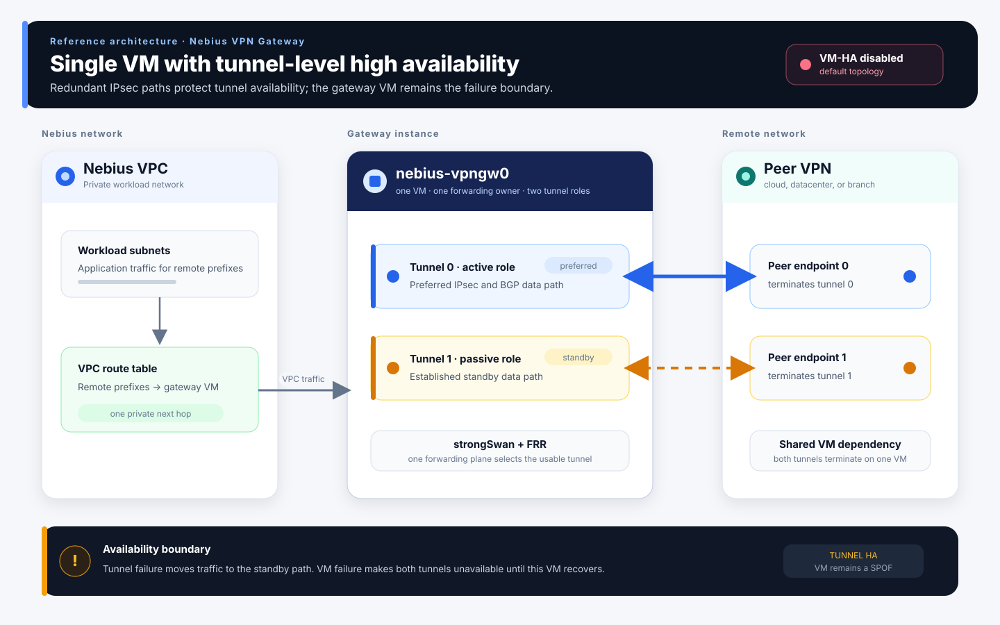
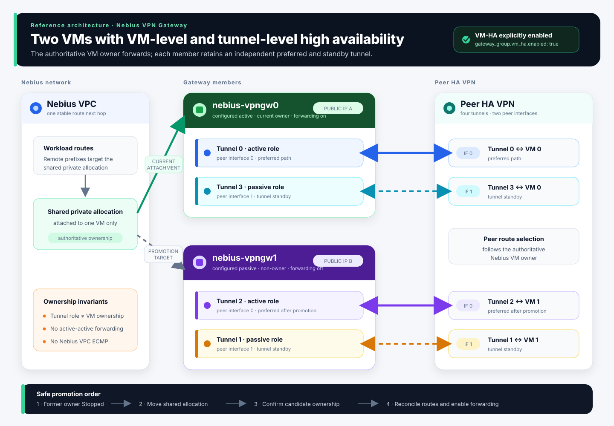

<!-- markdownlint-disable MD001 MD013 MD024 MD041 -->
<!-- maintain-project-specs:design:start schema=maintain-project-specs/design-v2 -->
<!-- markdownlint-disable-next-line MD013 -->
<!-- FEATURE: FEAT-001 reqs=REQ-001 status=ready delivery=implemented priority=P1 version=3 -->
### FEAT-001: Conservative brownfield Python-project hardening

#### Requirements Covered

- REQ-001: Migrated Task requirement.

#### Context Evidence

Migrated from a validated Task Implementer design record.

#### Design Details

Retain the existing PEP 621/setuptools-scm `src`-layout project and its current runtime dependencies, entrypoints, test lanes, Makefile, and CI workflows. Harden only proven gaps: bind direct Git fallback time, load runtime SCM state through one environment-backed configuration built from `pyproject.toml`, use nested tag configuration instead of deprecated `tag_regex` inputs, codify existing public packaging and developer-workflow invariants in focused tests, and ignore standard local-only tool output.

#### Selected Option

Retain the existing PEP 621/setuptools-scm `src`-layout project and its current runtime dependencies, entrypoints, test lanes, Makefile, and CI workflows. Harden only proven gaps: bind direct Git fallback time, load runtime SCM state through one environment-backed configuration built from `pyproject.toml`, use nested tag configuration instead of deprecated `tag_regex` inputs, codify existing public packaging and developer-workflow invariants in focused tests, and ignore standard local-only tool output.

For CVE-2026-69247, require `cryptography>=50.0.0,<51.0.0` in the package
metadata and refresh only that dependency in `uv.lock`. The prior `<50.0.0`
bound excludes the upstream security fix. Version 50 retains the project's
Python support range and X.509, EC, and RSA APIs. Validate the locked dependency,
managed identities, mutual TLS, credentials, and package boundaries locally;
installed gateways require a separately authorized upgrade.

For GHSA-xmj3-9gf7-h52w, require `setuptools>=84.1.0` in both the
development extra and isolated-build requirements, and refresh only setuptools
in `uv.lock` to 84.1.0. Verify lock freshness, an isolated locked development
install, runtime-version tests, and wheel build/install regressions. GitHub
alert closure requires a separate post-merge rescan and is not local proof.

#### Alternatives Considered

- Replacing the established project with the generic scaffold was rejected because the current project already implements the required structure and a rewrite would risk user-facing regressions.
- Raising Python versions, broader dependency changes beyond the scoped
  CVE-2026-69247 and GHSA-xmj3-9gf7-h52w fixes, adding repository-local
  pre-commit ownership, or broadly
  hardening systemd/runtime subprocesses was deferred because those changes
  require separate compatibility and operational evidence.

#### Implementation Boundaries

`runtime_version.py` owns source-checkout version discovery and must return the same successful versions while treating a timed-out direct Git probe as unavailable. Runtime SCM lookup reads the canonical project configuration, performs no version-file writes, and falls through to the existing direct Git, metadata, generated-file, and unknown sequence when unavailable. Project-contract tests inspect `pyproject.toml` and `Makefile` without importing cloud clients or mutating external state. `.gitignore` changes affect only untracked local artifacts. Runtime cloud, networking, systemd, CLI, schema, persistence, and release interfaces remain unchanged.

#### Test-First Success Criteria

- The migrated validation contract passes after implementation.

#### Validation Plan

Warning-strict runtime-version and wheel-build regressions pass, focused project-contract assertions bind the supported configuration, and the complete `make all` workflow passes Ruff, mypy, all 1,284 unit tests, and wheel construction without warnings.

#### Test Plan

Warning-strict runtime-version and wheel-build regressions pass, focused project-contract assertions bind the supported configuration, and the complete `make all` workflow passes Ruff, mypy, all 1,284 unit tests, and wheel construction without warnings.

#### Evaluation Plan

Evaluate the mapped requirements and recorded validation evidence.

#### Rollout And Rollback

Revert the bounded fallback and additive tests/ignore entries; no data, configuration, dependency, or upgrade migration is required.

#### Done Definition

The mapped requirements, validation, and evaluation all pass.

#### Implementation Evidence

- `runtime_version.py` bounds the direct `git describe` fallback at five seconds, catches timeout as an unavailable source, and preserves the existing resolver order and successful version parsing.
- Runtime SCM lookup uses the environment-backed current configuration model, reads nested tag matching from `pyproject.toml`, and explicitly suppresses version-file writes instead of passing deprecated programmatic fields. Build configuration explicitly retains the established source `_version.py` generation behavior.
- `test_python_project_contract.py` binds the supported Python range, public console scripts, `src` package discovery, systemd package data, SCM dependency/configuration/version-file/tag contract, and canonical Makefile targets. Runtime-version coverage proves the timeout path and rejects dependency deprecations.
- `.gitignore` excludes standard local coverage, tox, and nox output while preserving tracked source and public examples.
- `pyproject.toml` requires `cryptography>=50.0.0,<51.0.0`; `uv.lock` selects
  50.0.1. The release-wheel metadata regression enforces the same bounds.

- Both development and isolated-build setuptools requirements now exclude
  versions below 84.1.0; uv regenerated the lock at 84.1.0, changing only the
  setuptools record and matching project requirement metadata.

#### Verification Evidence

- GHSA-xmj3-9gf7-h52w local verification on 2026-11-04: lock freshness and
  isolated locked development installation passed on Python 3.12.16 with
  setuptools 84.1.0; pip reported no broken requirements. All 18 focused
  project-contract, runtime-version, and wheel build/install tests passed.
  Parsed manifest checks reject affected releases in both dependency roles;
  the installed and locked version lies outside the advisory range. The
  shared development environment, Windows exploit reproduction, other Python
  runtime lanes, and GitHub post-merge alert closure were not exercised.

- CVE-2026-69247 source verification on 2026-09-16: 136 focused TLS,
  managed-credential, package, SSH deployment, project-contract, and wheel
  metadata checks passed in an isolated locked Python 3.12 environment with
  cryptography 50.0.1. The prior manifest admits vulnerable 49.0.0 and excludes
  the fix; the repaired manifest rejects affected releases and admits 50.0.x.
  Only cryptography and the project's matching requirement metadata changed in
  the lock. Lock freshness, Ruff, Markdown lint, and canonical spec validation
  passed. Gateway upgrades, other Python runtime lanes, and GitHub alert closure
  were not exercised. Earlier hardening retains its prior delivery status.

<!-- /FEATURE: FEAT-001 -->

<!-- markdownlint-disable-next-line MD013 -->
<!-- FEATURE: FEAT-002 reqs=REQ-002 status=ready delivery=verified priority=P1 version=3 -->
### FEAT-002: Evidence-driven pytest feedback optimization

#### Requirements Covered

- REQ-002: Migrated Task requirement.

#### Context Evidence

Migrated from a validated Task Implementer design record.

#### Design Details

Freeze the current dirty non-candidate source identity, measure the isolated unit lane with task-owned cold caches and hard timeouts, and use pytest duration reporting to identify cumulative call cost. The seven-case VM-HA crash-replay test replaces its injected runtime sleeper with a no-op because the fixture's peer sends do not fail and listener-startup pacing is outside its contract; the existing dedicated retry test continues to assert the production delay schedule exactly. A later current-suite diagnostic identified a separate SDK-operation unit test that spent two seconds in real polling only while verifying bounded SDK keyword routing; that test now sets the injected production poll-interval constant to a minimal positive value locally, as required by the current SDK, while retaining the real SDK wait path and all assertions.

For the current 2,256-test suite, retain the same test-local pattern for four
newly measured cases: record rather than wait through SSH retry pacing in two
asset-selection tests while asserting the exact delay schedule; record rather
than wait through allocation-release pacing while preserving the second read,
failure, and zero-create proof; and stub only the unrelated public-IP lookup in
the private-allocation identity test while asserting that lookup still occurs.

#### Selected Option

Freeze the current dirty non-candidate source identity, measure the isolated unit lane with task-owned cold caches and hard timeouts, and use pytest duration reporting to identify cumulative call cost. The seven-case VM-HA crash-replay test replaces its injected runtime sleeper with a no-op because the fixture's peer sends do not fail and listener-startup pacing is outside its contract; the existing dedicated retry test continues to assert the production delay schedule exactly. A later current-suite diagnostic identified a separate SDK-operation unit test that spent two seconds in real polling only while verifying bounded SDK keyword routing; that test now sets the injected production poll-interval constant to a minimal positive value locally, as required by the current SDK, while retaining the real SDK wait path and all assertions.

Apply only those four test-local substitutions. Preserve the production SSH,
allocation-release, and SDK behavior, every remote command and cloud-read
attempt, the exact retry schedule as an assertion, and all existing behavioral
assertions.

#### Alternatives Considered

- Removing tests, weakening assertions, permanent reruns, marker-based under-selection, global plugin-autoload disabling, and unbounded `-n auto` adoption are rejected as displayed-runtime optimizations that can weaken correctness or predictability.
- New affected-test, sharding, or build-system dependencies are deferred unless the measured serial suite and existing xdist execution cannot meet the feedback objective.

#### Implementation Boundaries

Only `tests/unit/test_vm_ha_agent_runtime.py`,
`tests/unit/test_vm_manager_allocations.py`, and
`tests/unit/test_ssh_push.py` change. Production source, pytest
configuration, dependencies, public CLI/configuration/persistence behavior,
test selection, effect/restart execution, integration classification, network
blocking, serial debugging, coverage, CI, and full correctness lanes remain
unchanged. Listener, SDK waiter, SSH retry, allocation-release retry, remote
command, and cloud-read paths remain exercised; tests skip only real waiting
or unrelated SDK initialization and assert those interactions explicitly.

#### Test-First Success Criteria

- The exact four-test selection preserves four passes across at least five
  baseline and five candidate samples with the same interpreter, pytest
  plugins, configuration, cold-cache policy, and process timing method.
- The candidate asserts the SSH and allocation-release sleeper calls and the
  public-IP lookup count rather than bypassing those production branches.
- Full unit and integration selections, Ruff, mypy, diff integrity, canonical
  spec validation, and independent risk review pass.

#### Validation Plan

The original five cold-cache collection samples retained 682 unit tests with a 0.48-second median. Five like-for-like serial samples improved from a 4.07-second median (3.90-4.54 seconds) to 2.80 seconds (2.68-2.85 seconds), while every sample passed the same 682 tests; the focused seven-case median improved from 1.91 to 0.58 seconds. On the later 1,284-test suite, five process-level serial samples improved from a median of 8.98 seconds (8.89-9.24 seconds) to 7.03 seconds (6.83-7.30 seconds), and the focused SDK-operation test improved from 2.42 seconds (2.37-2.42 seconds) to 0.38 seconds (0.37-0.40 seconds).

On the current 2,256-test suite, startup and collection took 0.89 seconds of
wall time and were not the bottleneck. Five like-for-like samples of the exact
four-test lane improved from a 28.59-second median (28.42-29.23 seconds) to
0.46 seconds (0.45-0.48 seconds), with all four tests passing in every sample.
One complete instrumented unit run improved from 51.48 to 23.51 seconds with
all 2,256 tests passing; this single full-suite comparison is corroborative,
not a stable full-suite benchmark. Duration diagnostics, focused contracts,
Ruff, mypy, full project gates, and diff checks pass.

#### Test Plan

The original five cold-cache collection samples retained 682 unit tests with a 0.48-second median. Five like-for-like serial samples improved from a 4.07-second median (3.90-4.54 seconds) to 2.80 seconds (2.68-2.85 seconds), while every sample passed the same 682 tests; the focused seven-case median improved from 1.91 to 0.58 seconds. On the later 1,284-test suite, five process-level serial samples improved from a median of 8.98 seconds (8.89-9.24 seconds) to 7.03 seconds (6.83-7.30 seconds), and the focused SDK-operation test improved from 2.42 seconds (2.37-2.42 seconds) to 0.38 seconds (0.37-0.40 seconds).

For the current 2,256-test suite, collect the exact four node IDs from the two
changed files and run five baseline and five candidate process-level samples
with fresh task-owned caches. Then run duration diagnostics, the complete unit
and integration selections, Ruff, mypy, lock integrity, canonical spec
validation, Markdown lint, diff integrity, and independent changed-scope
review.

#### Evaluation Plan

Evaluate the mapped requirements and recorded validation evidence.

#### Rollout And Rollback

Revert only the focused test/configuration optimization if timing evidence is inconclusive or any selection, outcome, isolation, debugging, or compatibility invariant changes; no production or data migration is involved.

#### Done Definition

The mapped requirements, validation, and evaluation all pass.

#### Implementation Evidence

- The frozen non-candidate `test_vm_ha_agent_runtime.py` state was SHA-256 `9dd243b60fea4af7b8744715507eb1e67af5f5c4065500d9f47ff25ba718bbdc`; the measured candidate state, differing only by the focused sleeper patch and its explanatory comments, was SHA-256 `5ae0723ada32500fe41a17bdcd1cb0101daa1af9334357fa7c089e124400ff83`.
- The crash-replay test still constructs production-composed runtimes, starts and stops the peer listener, crashes after each effect, reconstructs runtime state, and proves ordered convergence; it skips only the real listener-startup pacing delay through the runtime's existing sleeper injection point.
- `test_default_service_runtime_retries_bounded_peer_send` remains the focused contract for three bounded send attempts and the exact `0.05`-second retry schedule.
- The frozen non-candidate `test_vm_manager_allocations.py` state was SHA-256 `5cc21ce1d32789cc55b296ce3476bf57dd80f9db82bb0645e390453c179c012c`; the current candidate state is SHA-256 `094a290b30d74491f1ef5e1165f294126f32b99953ef18ca6b46345b94332cf8`, with `vm_ha_cloud.py` unchanged at SHA-256 `f19f3b02c135bff8c6e56683a99060009cbd564f059db9fe68bbae2b2f66d66c`.
- The SDK-operation test still constructs a valid generated SDK operation wrapper, runs its real synchronous waiter, intercepts only the bounded internal update request, and asserts the exact request-keyword set; only its local poll interval is reduced to one microsecond.
- For the current optimization, the frozen non-candidate `test_ssh_push.py`
  state was SHA-256
  `8976815defb6d79de4e88b7ea6fbf2f83c2b8fb08db0144eebbca92e8497643b`;
  the candidate state is
  `717b031f6481ff3540392a230c72b031c476431eb1bffd215ce287d67d67fa1b`.
- The frozen non-candidate `test_vm_manager_allocations.py` state was
  SHA-256
  `33391d2c3b60a4a824e2e1feed63eb9fcef4847b54abb61323332558553e34ba`;
  the candidate state is
  `2e6600904f0c71e94c67bf64bb51bb3101c4783b77310f150bee9f26cf653d24`.
- The two SSH tests still execute every remote command and retry branch while
  recording and asserting their exact five-second sleep schedules. The
  allocation-release test preserves both inventory reads, the propagated
  failure, and zero-create proof while asserting its two-second sleep. The
  allocation-identity test skips only unrelated SDK initialization and asserts
  both public-IP lookup calls.
- No pytest configuration, fixture scope, marker, dependency, Makefile, CI, coverage, or production-code change was required.

#### Verification Evidence

- Five baseline samples of the exact four-test selection passed all four tests
  in 29.23, 28.75, 28.59, 28.42, and 28.58 seconds. Five candidate samples
  passed the same selection in 0.45, 0.48, 0.46, 0.46, and 0.47 seconds.
- A complete instrumented candidate unit run passed all 2,256 tests in 23.51
  seconds, and the normal complete unit lane passed all 2,256 tests in 22.80
  seconds. The isolated integration lane passed all 84 tests in 31.85 seconds.
- Ruff, mypy, lock integrity, canonical spec validation, Markdown lint, and
  diff-integrity checks passed.
- Independent changed-scope review found no correctness blocker and confirmed
  that the substitutions remain test-local, restore automatically, preserve
  production branches and effects, and strengthen timing-interaction
  assertions. The single full-suite comparison remains corroborative rather
  than a statistically stable benchmark.

<!-- /FEATURE: FEAT-002 -->

<!-- markdownlint-disable-next-line MD013 -->
<!-- FEATURE: FEAT-003 reqs=REQ-003 status=ready delivery=verified priority=P1 version=2 -->
### FEAT-003: Compatibility-preserving configuration wizard

#### Requirements Covered

- REQ-003: Migrated Task requirement.

#### Context Evidence

Migrated from a validated Task Implementer design record.

#### Design Details

The wizard has no SSH source allowlist or outgoing-public-IP detection.
Customer-owned desired Security Group references are optional; REQ-024 owns their
creation/replacement boundary.

Route `create-config CONFIG_FILE` to a small Typer/Rich wizard only when both terminal streams are interactive or `--interactive` is explicit; keep the existing template generator as the sole noninteractive and `--no-interactive` path. Seed fresh interactive candidates without the template's provider example, guide common fields in dependency order, expose advanced settings and VM-HA only through explicit choices, validate through the existing Pydantic model, and atomically replace the target only after redacted review and confirmation. A single hidden PSK field maps uppercase environment names to `${NAME}` and otherwise accepts a schema-valid literal. After a valid write, offer network preparation behind a separate default-No effect summary.

#### Selected Option

No guest SSH source filtering; preserve the deterministic wizard and VPN peer policy.

Route `create-config CONFIG_FILE` to a small Typer/Rich wizard only when both terminal streams are interactive or `--interactive` is explicit; keep the existing template generator as the sole noninteractive and `--no-interactive` path. Seed fresh interactive candidates without the template's provider example, guide common fields in dependency order, expose advanced settings and VM-HA only through explicit choices, validate through the existing Pydantic model, and atomically replace the target only after redacted review and confirmation. A single hidden PSK field maps uppercase environment names to `${NAME}` and otherwise accepts a schema-valid literal. After a valid write, offer network preparation behind a separate default-No effect summary.

#### Alternatives Considered

- Removing `prep-network` was rejected because it is a supported public command and remains necessary for operators who reserve Nebius-side addresses before peer details are available.
- Always prompting in non-TTY contexts was rejected because it would hang or break existing automation; requiring a resumable schema-invalid draft was rejected because it adds a second persisted lifecycle and unsafe overwrite/comment-preservation problems.
- Importing the full cxcli component wizard or adding `questionary` was rejected because existing Typer/Rich primitives cover the bounded prompts without a new runtime dependency.

#### Implementation Boundaries

A focused `config_wizard.py` owns provider-neutral defaults, prompt state, typed coercion, help/back/quit navigation, hybrid PSK classification, input-free validation errors, redacted summaries, schema validation, and stable YAML serialization; `cli.py` owns TTY/flag routing, existing-file policy, atomic publication, allocation selection, public output, and the final preparation confirmation. The shared preparation path freezes the source fingerprint, authenticates, converges a strict network foundation, optionally selects exact allocation identities, ensures the complete allocation matrix, and conditionally publishes only `external_ips`. `VMManager` owns authoritative Nebius reads, exact resource-shape checks, accepted-create reconciliation, default-route semantics, and postcondition rereads. `schema.py`, configuration version 1, apply/runtime code, and VM/tunnel HA policy remain authoritative.

#### Test-First Success Criteria

- The migrated validation contract passes after implementation.

#### Validation Plan

Add pure wizard-state tests, forced-interactive CLI transcripts for static, BGP, and explicit VM-HA candidates, byte-compatible non-TTY template regressions, hybrid-PSK and leakage tests, cancellation/overwrite tests, allocation-selector tests, strict subnet/route/allocation reconciliation and retry tests, conditional YAML-publication tests, real schema/CLI validation of generated files, CLI help checks, and full project gates.

#### Test Plan

Add pure wizard-state tests, forced-interactive CLI transcripts for static, BGP, and explicit VM-HA candidates, byte-compatible non-TTY template regressions, hybrid-PSK and leakage tests, cancellation/overwrite tests, allocation-selector tests, strict subnet/route/allocation reconciliation and retry tests, conditional YAML-publication tests, real schema/CLI validation of generated files, CLI help checks, and full project gates.

#### Evaluation Plan

Evaluate the mapped requirements and recorded validation evidence.

#### Rollout And Rollback

Remove the wizard module and interactive flags, route `create-config` directly to the retained template generator, and leave the shared preparation behavior in the standalone wrapper. No configuration, state, or cloud migration is required.

#### Done Definition

The mapped requirements, validation, and evaluation all pass.

#### Implementation Evidence

The 2026-11-04 optional-filtering revision is implemented in config_wizard.py,
public_ip.py and the CLI flags. Fresh candidates default No after the red lockout
warning. Yes allows editable IPv4/IPv6 inputs with one optional HTTPS IPv4 suggestion;
No and noninteractive creation never look it up. The completed list is tracked
independently from its effective policy so revisiting preserves explicit universal
CIDRs. Failed detection falls back to manual entry; interruption preserves the
existing destination. Review shows the effective source policy.

The following evidence describes the preceding wizard implementation; its older
counts and unchanged-template statement are historical, not this revision's proof.

- Implemented the focused `config_wizard.py` prompt/state owner, provider-neutral
  fresh defaults, routing-before-ASN flow, hidden hybrid PSK input, TTY and
  explicit-mode routing in `cli.py`, destination-fingerprint-guarded atomic
  publication, and one preparation service shared by the wizard handoff and
  public `prep-network` wrapper. Schema v1 and the noninteractive template remain
  unchanged; `prep-network` adds explicit interactive-mode overrides.
- Forced-interactive BGP, static, and explicit VM-HA transcripts produce
  schema-v1 candidates; non-TTY and `--no-interactive` output remains the exact
  embedded template. Focused tests cover typed reprompting, help/back/quit/EOF,
  overwrite and concurrent-writer preservation, hybrid-PSK redaction,
  separate preparation confirmation, existing-allocation selection,
  missing-project admission, convergent route/allocation behavior, and the
  cloud-success/YAML-failure boundary. Network preparation rejects malformed
  gateway/allocation shapes before authentication, binds automatic pool
  extension to the latest resource version while preserving observed CIDRs,
  and revalidates exact subnet/allocation identities after mutation.
- Final offline gates passed Ruff, mypy, 2,154 unit tests, 84 isolated
  integration tests, CLI help smoke, scoped secret-signature checks, and diff
  integrity. No live cloud preparation was invoked for this implementation.

#### Verification Evidence

The current 49 wizard/lookup tests pass, including default No with no lookup,
opt-in suggestion, explicit opt-out, manual validation, red warning, back navigation,
explicit universal-list preservation, interruption, malformed/nonpublic responses,
non-200 status, missing curl, bounded streaming reads and child cleanup. Read-only
review independently checked successful, oversized and stalled local children;
the watchdog ended the stalled child in approximately four seconds. The complete
unit lane passes 3,773 tests. Static/BGP/VM-HA generated configurations, CLI parameter
manifest/help, noninteractive template and peer-import cases pass. FEAT-022 records
the remaining local/native gates and proof limits.

Transport-option semantics were checked against the [curl manual](https://curl.se/docs/manpage.html)
and the endpoint against [ifconfig.me's CLI interface](https://ifconfig.me/).
No real public-IP discovery or cloud operation was needed for the test suite.

<!-- /FEATURE: FEAT-003 -->

<!-- markdownlint-disable-next-line MD013 -->
<!-- FEATURE: FEAT-004 reqs=REQ-004 status=superseded delivery=unassessed priority=P1 version=1 -->
### FEAT-004: Two-phase ordinary-to-VM-HA configuration wizard

#### Requirements Covered

- REQ-004: Migrated Task requirement.

#### Context Evidence

Migrated from a validated Task Implementer design record.

#### Design Details

Add a dedicated `configure-vm-ha` command that reads one admitted ordinary raw YAML document, derives an allowlisted two-member transform in memory, and uses a two-phase peer handoff. Phase one derives deterministic member-one topology, collects and preflights the two local mode-`0600` credential bundles before authentication, and either accepts a preallocated passive IP or, after a separate default-No confirmation, invokes a selected-index allocation seam for instance one only. It prints the incremental peer parameters and exits without a candidate until the peer is ready. Phase two collects the peer's remote endpoints, validates the complete candidate, presents a redacted summary, and conditionally publishes a new owner-only file without clobbering a racing writer. Existing apply remains the only migration discovery, approval, provisioning, activation, fencing, and recovery engine.

**Supersession:** FEAT-015 and TI-DES-022 define the current `vm-ha` command and managed-credential behavior. The credential prompts and preflight below are retained only as historical rationale and are not an active contract.

#### Selected Option

Add a dedicated `configure-vm-ha` command that reads one admitted ordinary raw YAML document, derives an allowlisted two-member transform in memory, and uses a two-phase peer handoff. Phase one derives deterministic member-one topology, collects and preflights the two local mode-`0600` credential bundles before authentication, and either accepts a preallocated passive IP or, after a separate default-No confirmation, invokes a selected-index allocation seam for instance one only. It prints the incremental peer parameters and exits without a candidate until the peer is ready. Phase two collects the peer's remote endpoints, validates the complete candidate, presents a redacted summary, and conditionally publishes a new owner-only file without clobbering a racing writer. Existing apply remains the only migration discovery, approval, provisioning, activation, fencing, and recovery engine.

#### Alternatives Considered

- Reusing `create-config` was rejected because it starts from a template and cannot prove preservation of an existing gateway configuration.
- Converting in place was rejected because interruption, peer delay, and comment normalization would make the customer's only configuration an unsafe transaction boundary.
- Saving a schema-invalid intermediate file was rejected because it creates a second draft lifecycle and permits accidental deployment of incomplete topology.
- Running broad `prep-network` was rejected because migration must not require, recreate, validate, or rewrite the serving member's attached public allocation.
- Mutating peer-provider resources or embedding deployment in the wizard was rejected because provider workflows vary and apply already owns the exact approved migration state machine.

#### Implementation Boundaries

`vm_ha_config_wizard.py` owns raw-document admission, a resolved derivation-only view, deterministic defaults, prompt state, credential preflight, member-one tunnel derivation, structural-diff allowlist, redacted review, and complete-candidate validation; `config_wizard.py` remains focused on initial config creation. `cli.py` owns command registration, TTY admission, source/destination identity and fingerprint checks, exit semantics, passive-reservation confirmation and handoff, and mode-`0600` no-clobber conditional publication with explicit recovery state. `deploy/vm_manager.py` exposes a narrow selected-index public-allocation helper reused by ordinary `prepare_network`; the conversion path passes only index one and never evaluates member zero. `schema.py`, `config_loader.py`, VM-HA apply, lifecycle, route, SSH, and controller code remain authoritative and are not given a second migration path. Raw YAML remains the persistence source; an expanded semantic view drives validation and new identity derivation but is never serialized over existing fields.

#### Test-First Success Criteria

- The migrated validation contract passes after implementation.

#### Validation Plan

Exercise ordinary admission and rejection, static/BGP and multi-connection transformation, one instance-one counterpart per existing tunnel, APIPA/name/PSK-reference uniqueness, placeholder preservation with environment sentinels present, structural allowlist failure, bounded redaction, peer-not-ready and cancellation paths, source/destination same-file and concurrent-write defenses, mode `0600`, exact-output idempotency, passive-only allocation reuse and rejection, real schema/config-loader/peer-merge acceptance, existing migration dry-run handoff, and unchanged `create-config`, `prep-network`, `validate-config`, apply, and default-disabled VM-HA behavior.

#### Test Plan

Exercise ordinary admission and rejection, static/BGP and multi-connection transformation, one instance-one counterpart per existing tunnel, APIPA/name/PSK-reference uniqueness, placeholder preservation with environment sentinels present, structural allowlist failure, bounded redaction, peer-not-ready and cancellation paths, source/destination same-file and concurrent-write defenses, mode `0600`, exact-output idempotency, passive-only allocation reuse and rejection, real schema/config-loader/peer-merge acceptance, existing migration dry-run handoff, and unchanged `create-config`, `prep-network`, `validate-config`, apply, and default-disabled VM-HA behavior.

#### Evaluation Plan

Evaluate the mapped requirements and recorded validation evidence.

#### Rollout And Rollback

Remove the additive command and selected-index helper while retaining the existing create wizard, public `prep-network`, schema, and apply behavior. Source configurations and successfully published candidates are ordinary schema-v1 YAML files; no hidden wizard state or live deployment mutation requires rollback.

#### Done Definition

The mapped requirements, validation, and evaluation all pass.

#### Implementation Evidence

- `vm_ha_config_wizard.py` implements raw/semantic-view separation, ordinary-source admission, deterministic collision-resistant member identities, credential-bundle preflight, counterpart tunnel prompting, structural allowlisting, redacted review, and complete-candidate validation without serializing expanded environment values.
- `cli.py` implements TTY admission, source and destination identity/fingerprint checks, a default-No passive reservation phase, secret-free handoff, and mode-`0600` no-clobber conditional publication with explicit recovery state. `VMManager.prepare_public_allocations` provides the selected-index seam and ordinary `prepare_network` retains its public behavior through that same internal path.
- Focused tests cover file races and recovery artifacts, credential mode/inode/TLS checks, typed and identity placeholders, long-name collision resistance, partial cloud-operation reporting and retry reuse, structural mutation rejection, and a generated candidate passed through real loading, peer merge, and the existing CLI migration dry-run. Ruff, mypy, all 1,015 unit tests, and all 46 integration tests passed offline; no live cloud readiness claim is made.

#### Verification Evidence

No independent verification evidence was recorded before migration.

<!-- /FEATURE: FEAT-004 -->

<!-- markdownlint-disable-next-line MD013 -->
<!-- FEATURE: FEAT-005 reqs=REQ-005 status=ready delivery=implemented priority=P1 version=1 -->
### FEAT-005: Canonical examples for the public CLI help surface

#### Requirements Covered

- REQ-005: Migrated Task requirement.

#### Context Evidence

Migrated from a validated Task Implementer design record.

#### Design Details

Define one immutable mapping from every public command name to one or more practical invocations, render those examples through Typer command epilogs, and add a concise quick-start epilog to the root application. Keep the existing callback docstrings as command descriptions and retain the stable workflow ordering. Declare `-c` beside `--local-config-file` on every operational command while keeping `create-config CONFIG_FILE` and `validate-config CONFIG_FILE` positional.

#### Selected Option

Define one immutable mapping from every public command name to one or more practical invocations, render those examples through Typer command epilogs, and add a concise quick-start epilog to the root application. Keep the existing callback docstrings as command descriptions and retain the stable workflow ordering. Declare `-c` beside `--local-config-file` on every operational command while keeping `create-config CONFIG_FILE` and `validate-config CONFIG_FILE` positional.

#### Alternatives Considered

- Duplicating example strings across 18 callback docstrings was rejected because it has no complete ownership check and makes drift or copy/paste errors harder to detect.
- Executing example commands in tests was rejected because several commands intentionally authenticate or mutate infrastructure; rendered syntax and existing behavioral tests provide the safe contract boundary.
- Adding a documentation generator or new runtime dependency was rejected because Typer already supports application and command epilogs.

#### Implementation Boundaries

`cli.py` owns the example registry, formatting helper, root epilog, command registration, and command-local option aliases. The examples retain the readable long spelling; both option names resolve to the same `local_config_file` callback value and do not alter default-path resolution, authentication, safety gates, or effects. No root configuration option or dual positional/option file syntax is registered. Unit tests introspect the rendered Click command tree, require exact parity with the registry, and verify each visible command's help contains its own invocation despite Rich line wrapping. README and CHANGELOG describe help discovery without duplicating the complete command reference.

#### Test-First Success Criteria

- The migrated validation contract passes after implementation.

#### Validation Plan

Render root help and all 18 public command help pages with a fixed terminal width; require `Usage`, `Examples`, command-specific invocation text, exact operational aliases, equivalent long/short parsing, and parse-time rejection of root or positional-command `-c`; retain focused option/help and command-order tests; then run Ruff, mypy, full unit and isolated integration suites, Markdown lint, security review, and diff checks.

#### Test Plan

Render root help and all 18 public command help pages with a fixed terminal width; require `Usage`, `Examples`, command-specific invocation text, exact operational aliases, equivalent long/short parsing, and parse-time rejection of root or positional-command `-c`; retain focused option/help and command-order tests; then run Ruff, mypy, full unit and isolated integration suites, Markdown lint, security review, and diff checks.

#### Evaluation Plan

Evaluate the mapped requirements and recorded validation evidence.

#### Rollout And Rollback

Remove the operational `-c` declarations and their focused contract coverage while preserving `--local-config-file`, then revert the aligned help and documentation wording. No configuration, data, cloud resource, or migration rollback is required.

#### Done Definition

The mapped requirements, validation, and evaluation all pass.

#### Implementation Evidence

- `cli.py` owns one immutable, workflow-ordered command-example mapping. The root application and every public command render examples through Typer epilogs, and the existing command order is derived from the same mapping.
- Unit coverage compares the mapping with both Typer registration order and the rendered visible Click command tree, then renders root help and every command help page with a fixed terminal width and verifies its exact normalized invocation text.
- Ruff and mypy passed, all 1,052 unit tests and 46 isolated integration tests passed, README and changelog Markdown lint passed, the canonical specifications validated, and changed-scope security and diff-integrity reviews found no execution or safety-gate change.

#### Verification Evidence

No independent verification evidence was recorded before migration.

<!-- /FEATURE: FEAT-005 -->

<!-- markdownlint-disable-next-line MD013 -->
<!-- FEATURE: FEAT-006 reqs=REQ-005,REQ-006,TI-REQ-009,TI-REQ-011 status=ready delivery=implemented priority=P1 version=1 -->
### FEAT-006: Resource-scoped failover and failback command groups

#### Requirements Covered

- REQ-005: Migrated Task requirement.
- REQ-006: Migrated Task requirement.
- TI-REQ-009: Migrated Task requirement.
- TI-REQ-011: Migrated Task requirement.

#### Context Evidence

Migrated from a validated Task Implementer design record.

#### Design Details

Register dedicated Typer subapplications for `failover` and `failback`, each configured to show help when invoked without a resource. Move the existing VM and tunnel callbacks onto `vm` and `tunnel` leaves rather than registering wrappers or duplicate root commands. Replace the flat example mapping with an immutable path-aware registry that owns root order, child order, group epilogs, and leaf epilogs; use a root command class that interleaves Typer groups with ordinary commands in the declared workflow order.

#### Selected Option

Register dedicated Typer subapplications for `failover` and `failback`, each configured to show help when invoked without a resource. Move the existing VM and tunnel callbacks onto `vm` and `tunnel` leaves rather than registering wrappers or duplicate root commands. Replace the flat example mapping with an immutable path-aware registry that owns root order, child order, group epilogs, and leaf epilogs; use a root command class that interleaves Typer groups with ordinary commands in the declared workflow order.

#### Alternatives Considered

- Keeping the four flat commands was rejected because it leaves one operation family split across resource-specific naming conventions.
- Retaining aliases or deprecation wrappers was rejected because the approved project policy is one fail-fast canonical path and the user explicitly requested a reduced command surface.
- A single callback with a manually parsed resource argument was rejected because Typer subapplications provide native per-resource help, validation, and completion without duplicating dispatch logic.

#### Implementation Boundaries

`cli.py` changes only command registration, help metadata, ordering, examples, and diagnostics that print an invocation. Existing callback bodies remain the canonical owners of configuration loading, tunnel selection, VM-HA planning, SSH, cloud, agent requests, prompts, and effects. The public parser accepts only `failover vm`, `failback vm`, `failover tunnel [TUNNEL_NAME]`, and `failback tunnel [TUNNEL_NAME]`; it has no aliases for the removed flat paths. Unit and integration tests recursively inspect the rendered Click tree and exercise nested routing plus parse-time rejection before mocked effect boundaries. README and the Unreleased changelog own the migration guidance; released history remains unchanged.

#### Test-First Success Criteria

- The migrated validation contract passes after implementation.

#### Validation Plan

First bind the recursive command tree, deterministic root and child order, all group/leaf help pages, path-aware registry parity, nested VM/tunnel callback routing, and zero-effect rejection for bare and removed paths. Then run existing VM-HA preflight/fencing and tunnel behavior tests, Ruff, mypy, full unit and isolated integration suites, Markdown lint, security review, canonical-spec validation, and diff checks.

#### Test Plan

First bind the recursive command tree, deterministic root and child order, all group/leaf help pages, path-aware registry parity, nested VM/tunnel callback routing, and zero-effect rejection for bare and removed paths. Then run existing VM-HA preflight/fencing and tunnel behavior tests, Ruff, mypy, full unit and isolated integration suites, Markdown lint, security review, canonical-spec validation, and diff checks.

#### Evaluation Plan

Evaluate the mapped requirements and recorded validation evidence.

#### Rollout And Rollback

Restore the four former flat registrations and flat example registry as one breaking-contract rollback. Do not retain parallel old/new routes or aliases. No configuration, persisted state, cloud resource, agent protocol, or live migration is involved.

#### Done Definition

The mapped requirements, validation, and evaluation all pass.

#### Implementation Evidence

- `cli.py` registers `failover` and `failback` as Typer subapplications and moves the existing VM and tunnel callbacks directly to `vm` and `tunnel` leaves. A path-aware immutable example registry and the shared workflow-order group class own root, group, and leaf help without registering shadow root callbacks.
- Unit coverage recursively compares the rendered command tree with the registry, verifies root and child order, renders every help page, routes nested VM requests through the existing preparation and operator boundaries, preserves request-free same-owner behavior, and rejects bare and removed paths before configuration access. Integration coverage independently exercises all group and leaf help paths plus old-path rejection.
- Ruff and mypy passed, all 1,065 unit tests and 58 isolated integration tests passed, selected changed-document Markdown lint and diff-integrity checks passed, and changed-scope security review found no new trust, credential, network, or mutation boundary. No live cloud or gateway command was executed.

#### Verification Evidence

No independent verification evidence was recorded before migration.

<!-- /FEATURE: FEAT-006 -->

<!-- markdownlint-disable-next-line MD013 -->
<!-- FEATURE: FEAT-007 reqs=REQ-005,REQ-007,TI-REQ-006,TI-REQ-011,TI-REQ-016 status=ready delivery=implemented priority=P1 version=1 -->
### FEAT-007: Authoritative integrated VM-HA status

#### Requirements Covered

- REQ-005: Migrated Task requirement.
- REQ-007: Migrated Task requirement.
- TI-REQ-006: Migrated Task requirement.
- TI-REQ-011: Migrated Task requirement.
- TI-REQ-016: Migrated Task requirement.

#### Context Evidence

Migrated from a validated Task Implementer design record.

#### Design Details

Remove the public `vm-ha-recover` callback and the duplicate private agent flag, retain private `--vm-ha-status` as the only agent read, and make ordinary `status` build one sanitized VM-HA projection from lifecycle state, structured cloud authority, two strictly validated member records, and the strict standby auto-healing policy. Cloud/lifecycle evidence chooses the owner; member reports corroborate it. A pure classifier produces `BLOCKED`, `UNKNOWN`, `TRANSITIONING`, `MAINTENANCE`, `DEGRADED`, or `HEALTHY` in that precedence. Render that aggregate in the title of one four-column member table and follow it with the closed identity-free `Redundancy`, `Identity`, `Auto-healing`, and `Action` values needed to distinguish enabled restoration, maintenance, expected transitions, and blocked or unavailable policy evidence. Rearm details remain internal classifier evidence. Project `Role` only from that authoritative current owner: `active` for the owner, `standby` for the other member, and `unknown` when no owner is proven; do not combine this runtime fact with configured preference.

**Gateway discovery:** Before SSH observation, `status` and the shared local-route preflight query each canonical configured Compute name directly instead of enumerating project instances. The first exact member permits observation to continue, including partial VM HA; only typed `NOT_FOUND` counts as absence, while provider failures and missing or inexact identities fail with a sanitized error. When every configured member is absent, each caller retains its existing guidance and exit contract.

#### Selected Option

Remove the public `vm-ha-recover` callback and the duplicate private agent flag, retain private `--vm-ha-status` as the only agent read, and make ordinary `status` build one sanitized VM-HA projection from lifecycle state, structured cloud authority, two strictly validated member records, and the strict standby auto-healing policy. Cloud/lifecycle evidence chooses the owner; member reports corroborate it. A pure classifier produces `BLOCKED`, `UNKNOWN`, `TRANSITIONING`, `MAINTENANCE`, `DEGRADED`, or `HEALTHY` in that precedence. Render that aggregate in the title of one four-column member table and follow it with the closed identity-free `Redundancy`, `Identity`, `Auto-healing`, and `Action` values needed to distinguish enabled restoration, maintenance, expected transitions, and blocked or unavailable policy evidence. Rearm details remain internal classifier evidence. Project `Role` only from that authoritative current owner: `active` for the owner, `standby` for the other member, and `unknown` when no owner is proven; do not combine this runtime fact with configured preference.

#### Alternatives Considered

- Renaming `vm-ha-recover` to `vm-ha-status` or `vm-ha-state` was rejected because it would preserve a second public status surface without adding authority or capability.
- Keeping a compatibility alias or focused `--vm-ha-only` view was rejected because the unpublished command has no migration requirement and the selected interface is one canonical status path.
- Trusting member-reported owner/readiness without cloud correlation was rejected because two mutually consistent stale members can still disagree with authoritative allocation ownership.

#### Implementation Boundaries

`cli.py` owns structured authority collection, complete display validation, conservative classification, and one `Gateway`/`Role`/`mTLS`/`Ready` renderer. The Role projection consumes only the already-proven authoritative owner identity; configured role remains validated internal evidence and is not a fallback label. One status SSH context carries the configured management username and private key into every subprocess. Product-managed trust is resolved once against the complete deployment member set and the resulting immutable policy is shared by the member probes; an explicit operator known-hosts override remains independently resolved per member so one missing override pin becomes only that member's sanitized unavailable evidence. No status path enrolls trust or permits a permissive fallback. Its status-only loader policy preserves exact unresolved tunnel-PSK environment references because no status branch consumes them, while `config_loader.py` continues to reject every unresolved non-PSK placeholder and leaves mutating callers on the strict path. With resolved PSKs, status retains full local generation comparison. With unresolved PSKs, the status validator instead requires each agent's generation to equal its configuration digest, requires exact generation/digest parity between both available members, and still compares the locally derivable static-route and BGP-policy digests; it never hashes placeholder text as if it were the deployed secret-bearing generation. It always materializes both configured members and converts missing transport or invalid status into sanitized availability evidence. Exact cloud route authority requires the same non-empty managed-prefix set once per route target, all through the shared allocation. Authenticated controller reasons remain behind a closed identity-free normalization boundary. Pending controller effects are transitional only when their generated identity names a configured member and their encoded action kind matches the reported state; this includes an authoritative owner entering passive mode. Starting rearm or an incomplete policy transaction is transitional, while a committed disabled policy with no accepted start is maintenance and terminal successful `running` rearm can participate in healthy evidence only when policy is enabled. The classifier derives the public Auto-healing value only from the already-validated two-member policy projection. For disabled maintenance, the existing shell-quoted config-bound rearm command becomes the exact enable Action; only that Action may disclose the current invocation's config path, while other config-bearing actions retain `<file>`. The renderer uses literal Rich text for all footer cells so path markup remains inert, neutral identity/role cells, green only for proven healthy aggregate/mTLS/readiness, yellow for maintenance and transitions, and red for blocked or unavailable semantic state. Raw payloads, exceptions, resource identities, revisions, generations, digests, locks, operations, epochs, fingerprints, timings, reasons, and recovery actions stay behind the projection boundary. Non-HA status and unrelated mutation paths remain unchanged.

#### Test-First Success Criteria

- The migrated validation contract passes after implementation.

#### Validation Plan

Unit-test the complete status-v1 validator and pure classifier across both ownership directions, including exact `active`/`standby` row reversal after ownership transfer and `unknown` roles without authority, plus expected and foreign locks, every controller/rearm state, cloud/member disagreement, missing or malformed evidence, standby-only unavailability, self-consistent unresolved-PSK generations, two-member generation parity, and non-secret digest mismatches. Exercise forced-color and no-color rendering to prove one aggregate title, exact four-column order, exactly two sanitized member rows, ordered `Redundancy`/`Identity`/`Auto-healing`/`Action` output, exact enabled/disabled policy values, the config-specific disabled-maintenance enable command, no configured-role suffixes, conservative readiness, identity/exception redaction, informational HA exits, fatal setup exits, no HA work for non-HA plans, and no mutation calls. Recursively prove the 17 executable operations plus two groups, parse-time rejection of removed public/private paths, and absence of replacement commands or focused flags, then run full project gates and changed-surface alignment.

#### Test Plan

Unit-test the complete status-v1 validator and pure classifier across both ownership directions, including exact `active`/`standby` row reversal after ownership transfer and `unknown` roles without authority, plus expected and foreign locks, every controller/rearm state, cloud/member disagreement, missing or malformed evidence, standby-only unavailability, self-consistent unresolved-PSK generations, two-member generation parity, and non-secret digest mismatches. Exercise forced-color and no-color rendering to prove one aggregate title, exact four-column order, exactly two sanitized member rows, ordered `Redundancy`/`Identity`/`Auto-healing`/`Action` output, exact enabled/disabled policy values, the config-specific disabled-maintenance enable command, no configured-role suffixes, conservative readiness, identity/exception redaction, informational HA exits, fatal setup exits, no HA work for non-HA plans, and no mutation calls. Recursively prove the 17 executable operations plus two groups, parse-time rejection of removed public/private paths, and absence of replacement commands or focused flags, then run full project gates and changed-surface alignment.

#### Evaluation Plan

Evaluate the mapped requirements and recorded validation evidence.

#### Rollout And Rollback

Restore the prior summary-plus-member renderer as one source change only if the approved concise layout is explicitly reversed. No configuration, persisted runtime record, cloud resource, or live deployment migration is involved.

#### Done Definition

The mapped requirements, validation, and evaluation all pass.

#### Implementation Evidence

- The 2026-08-28 Auto-healing footer refinement passed 44 focused status
  validator/classifier/renderer tests, all 16 standby auto-healing unit tests,
  Ruff, mypy across 54 source files, and all 1,876 unit tests. The isolated
  integration suite passed 83 of 84 tests; its sole failure is the pre-existing
  `vm-ha --help` assertion that expects `default-No`, outside this status
  presentation boundary. No live cloud or gateway command was run.
- The Role projection now maps only the authoritative owner identity to
  `active`, the other configured member to `standby`, and an absent owner to
  `unknown`. Configured role remains part of strict agent evidence validation
  but is not rendered as a suffix. Focused regressions proved both ownership
  directions, missing authority, missing standby evidence, and the exact
  failover table without changing classifier, readiness, mTLS, cloud, or
  mutation behavior. All focused, unit, integration, Ruff, and mypy gates
  passed offline.
- `cli.py` retains structured lifecycle/cloud authority, complete status-v1
  validation, two configured-member materialization, conservative overall
  classification, unresolved-PSK handling, and identity-safe normalization.
  Its public renderer now emits only one aggregate-titled
  `Gateway`/`Role`/`mTLS`/`Ready` table; neutral identity/role cells and explicit
  green/red semantic cells preserve readable no-color text without rendering
  controller details, certificate metadata, timings, reasons, or actions.
- Pure tests cover both owner directions, expected and foreign locks, every
  controller/rearm state, cloud/member conflict, missing standby evidence,
  complete multi-target route coverage, production-shaped pending repair and
  transfer states, terminal rearm, reason deduplication, timing rendering, and
  closed-allowlist identity redaction. Mocked ordinary-status tests prove the
  HA path uses only observation/status boundaries and that non-HA skips them. A
  real-loader regression proves exact unresolved PSK references, including a
  short `${PSK}` name, cross schema validation without weakening operational
  placeholders or literal-PSK length validation. Recursive
  command tests prove the 17 operations plus two groups and parse-time absence
  of the removed, replacement, and focused-view surfaces. Ruff and mypy
  passed, all 1,098 unit tests and 62 isolated integration tests passed, and no
  live cloud or gateway command was executed.
- Focused presentation tests prove exact headers, one row per configured
  member, healthy and non-good styles, conservative globally gated readiness,
  missing-member `unknown` values, no ANSI dependency in non-color output, and
  absence of the former summary/detail headers. Full validation passed 1,116
  unit and 69 isolated integration tests plus Ruff and mypy without live
  Nebius, SSH, service, route, or gateway access.
- The reconciled status projection now consumes strict standby auto-healing
  evidence, distinguishes peer-acknowledged disabled policy as yellow
  `MAINTENANCE`, keeps incomplete policy yellow `TRANSITIONING`, and blocks
  invalid or split evidence in red. The public summary exposes only
  `Redundancy`, `Identity`, and `Action`; the former `Rearm` row remains
  internal classifier evidence. Focused regressions cover maintenance both
  before and after the standby is stopped, split policy, exact action guidance,
  and semantic title colors without live gateway access.

#### Verification Evidence

No independent verification evidence was recorded before migration.

<!-- /FEATURE: FEAT-007 -->

<!-- markdownlint-disable-next-line MD013 -->
<!-- FEATURE: FEAT-008 reqs=REQ-008,TI-REQ-001,TI-REQ-002,TI-REQ-006,TI-REQ-008,TI-REQ-011 status=ready delivery=implemented priority=P1 version=1 -->
### FEAT-008: VM-local direct-pinned mTLS identity lifecycle

#### Requirements Covered

- REQ-008: Migrated Task requirement.
- TI-REQ-001: Migrated Task requirement.
- TI-REQ-002: Migrated Task requirement.
- TI-REQ-006: Migrated Task requirement.
- TI-REQ-008: Migrated Task requirement.
- TI-REQ-011: Migrated Task requirement.

#### Context Evidence

Migrated from a validated Task Implementer design record.

#### Design Details

Replace operator-supplied VM-HA CA/leaf/key bundles with one self-signed CA-false leaf generated independently on each VM. Exact-pinned management SSH is the enrollment and recovery authority: it invokes idempotent root-only node actions, returns only public certificate receipts, and cross-installs the peer leaf as an exact trust anchor. Keep mTLS identity generation independent from the VPN configuration generation, bootstrap it automatically during initial apply, regenerate only a fenced replacement member during apply, and reserve whole-cluster rotation for the explicit `vm-ha --rotate-mtls` transaction. Use a clean protocol-v2 peer envelope that binds a monotonic mTLS epoch to the certificate presented on that TLS connection.

**State and crypto:** Store identities, peer leaves, `active.json`, and transaction journals under the existing root-owned VM-HA state root using no-follow/no-clobber file creation, single-link checks, mode `0600`, file and directory fsync, and atomic rename. Each identity uses an unencrypted PKCS#8 ECDSA P-256 private key, random positive serial, SHA-256 self-signature, CA-false and digital-signature-only constraints, client/server EKUs, canonical node DNS and URI SANs, fixed `2000-01-01T00:00:00Z` `notBefore`, and `9999-12-31T23:59:59Z` `notAfter`. A receipt binds cluster, node, Compute identity, epoch, certificate/SPKI fingerprints, and operation identity; two member SPKIs must differ. Private key bytes never leave the node or enter status, manifests, logs, errors, or receipts.

**Enrollment and replacement:** Initial apply stages both exact node configurations, proves generation parity, installs and verifies the current agent package plus its cryptography/CFFI runtime on both members non-owner-first, and only then installs exact-generation apply locks in that same order. It writes one lock-bound owner-adoption declaration on the independently observed current owner, asks both nodes to generate identities, validates public receipts, and cross-installs direct peer leaves. It then activates non-owner-first under those locks, proves fresh bidirectional heartbeats, commits active snapshots, and only afterward releases the locks and enables the exact owner. Healthy reapply is a cryptographic no-op. Replacement first proves the former Compute stopped/absent and network-fenced; the survivor temporarily accepts old/new replacement leaves, the replacement trusts only the survivor's active leaf, and fresh epoch-bound handshakes precede commit and immediate old-leaf pruning. The survivor key remains unchanged.

**Rotation transaction:** `vm-ha --rotate-mtls` dispatches before ordinary facade conversion or convergence. It accepts the required local config plus the existing dry-run and exact approval options, retains human text output, and rejects candidate output, force, standby-policy, explicit-region, and JSON combinations before external effects. Its dry-run binds a secret-free plan digest to the exact config, lifecycle, cluster, members, Compute identities, owner/allocation observation, current epochs/fingerprints, target epoch, and ordered phases. Each mutation-free inspection first queries both fixed installed-agent capability documents over exact-pinned SSH and requires `vm-ha-mtls-rotation-quiescence-v1`; it then requires that same fixed feature in the exact current-generation status persisted by each running controller process. An absent command, malformed document, missing feature, restart-skewed controller, timeout, or transport failure stops before the plan/approval boundary and directs the operator to deploy this CLI's agent through `apply`. The command announces that passive-first overlap trust is designed to preserve VPN availability, renders only the operation kind, target epoch, member count, and exact plan digest, and uses the shared best-effort stderr progress reporter so a TTY sees an animated identity-free rotation row while noninteractive streams receive only its terminal row. After interactive confirmation or exact noninteractive approval, acquire the shared writer lock, install inhibition on the passive, and wait until that exact operation has passed through a controller observation with no pending controller, accepted cloud, or rearm effect and the former owner still Running. Install and prove the owner inhibition only after the passive barrier succeeds. Node-local controller transfer dispatch, rearm, apply locking, and inhibition installation serialize through `rearm.lock`; transfer dispatch re-reads both apply and mTLS inhibition while holding that lock and skips a stale decision without writing an effect receipt. Prepare both pending identities only after both barriers, expand trust to old/new, switch the passive local identity, switch the owner, independently reread active slots and served fingerprints, and require three consecutive fresh bidirectional epoch-bound heartbeats after connection draining before commit/prune. Before any new served leaf is observed the exact transaction may roll back; afterward it can only roll forward. Remote journals, not the CLI's last acknowledgement, decide recovery after any lost response or restart.

**Failure handling:** A pending exact transaction is resumed rather than replaced. An inhibition-only interruption is also rendered as resumable rotation. Installed-agent or running-controller skew fails at capability admission before any rotation write and has one canonical recovery: complete `apply` with the same local configuration and CLI version, verify both members and controller services, then retry; the CLI never interprets an older apply-lock projection as rotation inhibition. If topology or controller evidence drifts before any prepare may have begun, the CLI releases every exact inhibition it attempted and exits with retry guidance, so an already-authorized transfer can finish and rearm rather than being stranded. After prepare may have begun, failures retain inhibition for journal-based recovery. Fresh contexts disable session tickets/resumption and old connections are drained before pruning. The controller continues to enforce cloud-ownership fencing while rotation inhibition makes transfer gates fail closed without changing a healthy owner's active dataplane or the non-owner's passive dataplane; rearm reads the same inhibition directly. Both exact members may rebuild an unusable old mTLS pair entirely over strict SSH when both are Running and cloud ownership is unambiguous. Missing SSH trust, a stopped member, identity/topology drift, an unfenced former member, conflicting writer state, corrupt cross-node receipts, or inability to prove inhibition blocks with a closed status reason. `status` is observation-only; bare `vm-ha` delegates restoration to the internal sole Compute-start writer and only explicit `--rotate-mtls` grants the facade rotation authority.

#### Selected Option

Replace operator-supplied VM-HA CA/leaf/key bundles with one self-signed CA-false leaf generated independently on each VM. Exact-pinned management SSH is the enrollment and recovery authority: it invokes idempotent root-only node actions, returns only public certificate receipts, and cross-installs the peer leaf as an exact trust anchor. Keep mTLS identity generation independent from the VPN configuration generation, bootstrap it automatically during initial apply, regenerate only a fenced replacement member during apply, and reserve whole-cluster rotation for the explicit `vm-ha --rotate-mtls` transaction. Use a clean protocol-v2 peer envelope that binds a monotonic mTLS epoch to the certificate presented on that TLS connection.

#### Alternatives Considered

- An operator-managed CA, cloud CA, Vault, KMS, or shared CA key on either VM was rejected because the product must remain self-contained and a shared signer would let one compromised member mint the peer identity.
- Trust-on-first-use, permissive key scanning, or accepting the certificate presented on an unauthenticated channel was rejected because it creates a circular bootstrap and permits interception.
- A literal certificate without validity dates was rejected because X.509 requires them; the year-9999 sentinel expresses the selected no-maintenance policy.
- Physical simultaneous rotation was rejected because two independent machines cannot atomically switch together; pre-expanded overlap trust plus a journaled logical commit preserves authenticated compatibility across each phase.
- Automatic timed rotation was rejected because the requested default is set-and-forget operation and every rotation adds a distributed availability-sensitive transaction.

#### Implementation Boundaries

`schema.py`, loaders, and both wizards remove `credential_sources` and every public runtime-credential path; stale HA-only shapes fail fast without a compatibility reader. Apply alone derives and installs internal node-scoped runtime credential references. A new strict node-local mTLS state module owns ECDSA P-256 generation, X.509 profile validation, immutable object storage, atomic active snapshots, operation journals, and root-only internal actions. `agent/vm_ha/runtime.py` supplies a managed immutable credential snapshot for each fresh connection; the transport retains standard TLS certificate verification and additionally requires exact allowed DER fingerprints, DNS/URI identity, and epoch-to-fingerprint agreement. `ssh_push.py` owns public-receipt exchange and staged peer-pin installation without reading a private key. `agent/main.py` projects the strict apply lock and mTLS transfer inhibition as distinct controller inputs: only the apply lock can request dataplane fencing, while rotation inhibition blocks transfer/rearm admission and remains visible in the existing nested mTLS status; its fixed read-only capability document advertises the corresponding quiescence contract without loading configuration. `cli.py` owns exact cloud/SSH admission, including two-member installed-capability parity before approval, dry-run approval identity, passive-first orchestration, concise text presentation, progress rendering, status projection, and recovery/resume; it receives no route, allocation, forwarding, Compute-start, or SSH-enrollment authority.

#### Test-First Success Criteria

- The migrated validation contract passes after implementation.

#### Validation Plan

Direct-leaf/profile tests cover exact self-signature, CA-false usage, the year-9999 sentinel, distinct SPKIs, direct-pinned handshakes, and wrong-leaf rejection. State, SSH, apply, replacement, rotation, heartbeat-v2, status, CLI, schema, wizard, runtime, rearm, and package tests cover the product workflow and private-key non-export boundary. Controller regressions separately prove that rotation inhibition blocks new transfer effects while preserving active/passive dataplane modes and that true apply locks retain their existing fencing behavior. Presentation regressions prove concise non-JSON preview/completion text and best-effort interactive spinner cleanup. Offline on 2026-08-19, Ruff and mypy passed, all 1,094 unit tests and 63 isolated integration tests passed, 14 focused build/release tests passed, and README/changelog Markdown lint passed. Supported Python/OpenSSL CI lanes remain the portability gate; a live two-VM trial remains separately authorized and cannot be inferred from offline proof. On 2026-08-25 the availability/output refinement passed full Ruff, mypy across 52 source files, 1,627 unit tests, 79 isolated integration tests, changed-document lint, diff integrity, and a final independent no-blocker risk review. The composed regressions prove that inhibition and controller dispatch cannot cross, pre-prepare drift releases exact inhibition, and an inhibition-only interruption remains a visible resumable rotation. No live cloud, SSH, service, route, or gateway operation was performed. On 2026-08-29 the public-command consolidation retained the private rotation engine and placed only an early exclusive dispatcher in the `vm-ha` facade. Parser, option-manifest, applicability, bare-facade, digest-approval, interactive-confirmation, status-guidance, progress, release-build, and controller/rearm regressions passed alongside Ruff, mypy, all 1,925 unit tests, and all 84 isolated integration tests. Changed-scope documentation, security, alignment, and diff-integrity checks found no introduced blocker; no live target was contacted or mutated.

#### Test Plan

Direct-leaf/profile tests cover exact self-signature, CA-false usage, the year-9999 sentinel, distinct SPKIs, direct-pinned handshakes, and wrong-leaf rejection. State, SSH, apply, replacement, rotation, heartbeat-v2, status, CLI, schema, wizard, runtime, rearm, and package tests cover the product workflow and private-key non-export boundary. Controller regressions separately prove that rotation inhibition blocks new transfer effects while preserving active/passive dataplane modes and that true apply locks retain their existing fencing behavior. Presentation regressions prove concise non-JSON preview/completion text and best-effort interactive spinner cleanup. Offline on 2026-08-19, Ruff and mypy passed, all 1,094 unit tests and 63 isolated integration tests passed, 14 focused build/release tests passed, and README/changelog Markdown lint passed. Supported Python/OpenSSL CI lanes remain the portability gate; a live two-VM trial remains separately authorized and cannot be inferred from offline proof. On 2026-08-25 the availability/output refinement passed full Ruff, mypy across 52 source files, 1,627 unit tests, 79 isolated integration tests, changed-document lint, diff integrity, and a final independent no-blocker risk review. The composed regressions prove that inhibition and controller dispatch cannot cross, pre-prepare drift releases exact inhibition, and an inhibition-only interruption remains a visible resumable rotation. No live cloud, SSH, service, route, or gateway operation was performed. On 2026-08-29 the public-command consolidation retained the private rotation engine and placed only an early exclusive dispatcher in the `vm-ha` facade. Parser, option-manifest, applicability, bare-facade, digest-approval, interactive-confirmation, status-guidance, progress, release-build, and controller/rearm regressions passed alongside Ruff, mypy, all 1,925 unit tests, and all 84 isolated integration tests. Changed-scope documentation, security, alignment, and diff-integrity checks found no introduced blocker; no live target was contacted or mutated.

#### Evaluation Plan

Evaluate the mapped requirements and recorded validation evidence.

#### Rollout And Rollback

Before release, rollback is source-only: remove the clean-slate managed mTLS path and restore the prior unreleased VM-HA implementation as one coherent change. Do not ship both trust models or a format adapter. After an mTLS transaction begins, operational recovery uses only its recorded rollback-before-switch or roll-forward-after-switch rule; it never restores private keys from the operator laptop.

#### Done Definition

The mapped requirements, validation, and evaluation all pass.

#### Implementation Evidence

No implementation evidence was recorded in the canonical v1 record.

#### Verification Evidence

No independent verification evidence was recorded before migration.

<!-- /FEATURE: FEAT-008 -->

<!-- markdownlint-disable-next-line MD013 -->
<!-- FEATURE: FEAT-009 reqs=REQ-009 status=ready delivery=implemented priority=P1 version=1 -->
### FEAT-009: Once-per-apply network selection progress

#### Requirements Covered

- REQ-009: Migrated Task requirement.

#### Context Evidence

Migrated from a validated Task Implementer design record.

#### Design Details

Keep `_resolve_gateway_network` as the authoritative SDK-backed resolver on every call, but separate its user-facing selection notice from the read itself. VM-HA safety observations perform the same SDK lookups and validate the returned identity without rendering progress; the command's provisioning path requests presentation and the current `VMManager` emits each successful selection message only once. Render existing-instance discovery from the actual `recreate` mode instead of using unconditional recreation wording.

#### Selected Option

Keep `_resolve_gateway_network` as the authoritative SDK-backed resolver on every call, but separate its user-facing selection notice from the read itself. VM-HA safety observations perform the same SDK lookups and validate the returned identity without rendering progress; the command's provisioning path requests presentation and the current `VMManager` emits each successful selection message only once. Render existing-instance discovery from the actual `recreate` mode instead of using unconditional recreation wording.

#### Alternatives Considered

- Requiring `gateway_group.network_id` was rejected because omission is an intentional supported schema-v1 contract.
- Caching the resolved SDK objects or network identity was rejected because it could weaken the authoritative rereads used by VM-HA lifecycle validation.
- Removing all network-selection output was rejected because one concise decision remains useful when reviewing an apply.

#### Implementation Boundaries

`deploy/vm_manager.py` owns network discovery, per-manager informational-message deduplication, and existing-instance progress text. `schema.py` and `config_loader.py` retain the optional `gateway_group.network_id` contract and existing discovery precedence. The change affects human-readable progress only; configuration parsing, SDK read cardinality, cloud selection, mutation authority, and exit behavior remain unchanged.

#### Test-First Success Criteria

- The migrated validation contract passes after implementation.

#### Validation Plan

Direct resolver tests call implicit and explicit selection twice, assert the SDK is still read twice, and assert each successful decision message is emitted once. Existing-instance tests cover both `recreate=false` and `recreate=true`; schema and loader regressions prove omission remains valid.

#### Test Plan

Direct resolver tests call implicit and explicit selection twice, assert the SDK is still read twice, and assert each successful decision message is emitted once. Existing-instance tests cover both `recreate=false` and `recreate=true`; schema and loader regressions prove omission remains valid.

#### Evaluation Plan

Evaluate the mapped requirements and recorded validation evidence.

#### Rollout And Rollback

Remove the per-manager notice set and conditional wording; no configuration, cloud, persistence, or upgrade migration is involved.

#### Done Definition

The mapped requirements, validation, and evaluation all pass.

#### Implementation Evidence

- `_resolve_gateway_network` retains its SDK-backed read on every invocation but renders successful selection progress only when the provisioning caller requests it; per-manager message deduplication limits that requested output to one copy.
- Focused tests prove the safety caller remains silent, the provisioning caller requests progress, implicit and explicit selection output is once-only, SDK call cardinality is unchanged, schema placement remains current, optional placeholders still work, and existing-instance wording follows recreate mode.
- Offline validation passed all 1,115 unit tests, Ruff, mypy across 48 source files, diff integrity, and Markdown lint for the changed README and changelog. No live cloud, SSH, service, route, or gateway mutation was performed.

#### Verification Evidence

No independent verification evidence was recorded before migration.

<!-- /FEATURE: FEAT-009 -->

<!-- markdownlint-disable-next-line MD013 -->
<!-- FEATURE: FEAT-010 reqs=REQ-010 status=ready delivery=implemented priority=P1 version=1 -->
### FEAT-010: Complete tunnel names in a compact VPN status table

#### Requirements Covered

- REQ-010: Migrated Task requirement.

#### Context Evidence

Migrated from a validated Task Implementer design record.

#### Design Details

Keep the compact eight-column primary VPN status table and rename its last header from `BGP Uptime` to the mode-neutral `Uptime`. For BGP tunnels, prefer the established BGP-neighbor session uptime and retain the existing IPsec-SA fallback when BGP uptime is unavailable; for Static tunnels, render only the established IPsec-SA uptime. The value is never VM boot uptime. Buffer primary tunnel observations until later VM-HA evidence is available; when that evidence proves a member recovered during the same invocation, rerun the exact failed tunnel or service probe once. Replace a tunnel error only after the identical retry returns recognizable established-SA evidence, and replace a service error only after its expected active result.

#### Selected Option

Keep the compact eight-column primary VPN status table and rename its last header from `BGP Uptime` to the mode-neutral `Uptime`. For BGP tunnels, prefer the established BGP-neighbor session uptime and retain the existing IPsec-SA fallback when BGP uptime is unavailable; for Static tunnels, render only the established IPsec-SA uptime. The value is never VM boot uptime. Buffer primary tunnel observations until later VM-HA evidence is available; when that evidence proves a member recovered during the same invocation, rerun the exact failed tunnel or service probe once. Replace a tunnel error only after the identical retry returns recognizable established-SA evidence, and replace a service error only after its expected active result.

#### Alternatives Considered

- Removing the column without changing overflow was rejected because valid long names would still ellipsize on narrower terminals.
- A fixed Tunnel width or `no_wrap` was rejected because it would compress or truncate other operational fields and would not adapt to terminal width.
- Removing runtime override detection was rejected because it carries distinct operator information even when the redundant per-row value is absent.

#### Implementation Boundaries

`cli.py` retains configured-role, IPsec, BGP, peer, encryption, mode-aware uptime, service, routing, ECMP, and Traffic Override collection. Every preferred and fallback/error row emits the same eight-cell contract. Error rows render `-` in `Uptime`, keep sanitized diagnostic detail outside the cell, and cannot be cleared by a different health surface or by a zero-exit tunnel command whose output is empty, no-SA, connecting-only, or malformed. Only the Tunnel column uses folded overflow. The status command preserves section order and read-only exit behavior while reconciling observations from the same invocation.

#### Test-First Success Criteria

- The migrated validation contract passes after implementation.

#### Validation Plan

Render the pure table configuration with representative and 64-character names at wide and constrained console widths, assert exact headers and no ellipsis, exercise BGP-primary, BGP-fallback, Static-IPsec, and every error-row arity, and prove that only exact failed-probe success replaces stale evidence with one recovery note. Retain Traffic Override regressions and prove no cross-probe inference from VM-HA agent, routing, or cloud health. Run focused CLI tests followed by the full static, unit, integration, documentation, security, and alignment gates.

#### Test Plan

Render the pure table configuration with representative and 64-character names at wide and constrained console widths, assert exact headers and no ellipsis, exercise BGP-primary, BGP-fallback, Static-IPsec, and every error-row arity, and prove that only exact failed-probe success replaces stale evidence with one recovery note. Retain Traffic Override regressions and prove no cross-probe inference from VM-HA agent, routing, or cloud health. Run focused CLI tests followed by the full static, unit, integration, documentation, security, and alignment gates.

#### Evaluation Plan

Evaluate the mapped requirements and recorded validation evidence.

#### Rollout And Rollback

Restore the ninth column and matching row cells as one presentation-only source change; no configuration, state, cloud, or deployment migration is involved.

#### Done Definition

The mapped requirements, validation, and evaluation all pass.

#### Implementation Evidence

- `_vpn_gateway_status_table` owns the exact eight-column Rich table and gives
  only Tunnel folded overflow. Both StrongSwan parsers and every empty, timeout,
  parse-error, command-error, and exception branch now emit eight cells, while
  `_detect_connection_role_overrides` retains the existing runtime warning.
- Focused tests prove exact headers, lossless constrained-width rendering of a
  schema-valid 64-character name, no ellipsis, and retained Traffic Override
  behavior. An AST check proves all seven primary-table row sites have eight
  positional cells. Full Ruff, mypy, 1,116-unit, and 69-integration gates pass;
  no live cloud or gateway execution was required.
- The table's final header is now `Uptime`. A pure selector proves Static uses
  IPsec SA uptime, BGP prefers its session uptime, and unavailable BGP evidence
  falls back to the SA. Error rows retain eight cells and `-` uptime. Tunnel
  and service collection retain the exact failed command, admit one retry only
  after later same-invocation ready VM-HA evidence, and replace only the stale
  result produced by that identical successful probe with one recovery note.

#### Verification Evidence

No independent verification evidence was recorded before migration.

<!-- /FEATURE: FEAT-010 -->

<!-- markdownlint-disable-next-line MD013 -->
<!-- FEATURE: FEAT-011 reqs=REQ-011,TI-REQ-001,TI-REQ-002,TI-REQ-004,TI-REQ-005,TI-REQ-007 status=ready delivery=implemented priority=P1 version=6 -->
### FEAT-011: Owner-aware BGP export policy and observational route audit

#### Requirements Covered

- REQ-011: Migrated Task requirement.
- TI-REQ-001: Migrated Task requirement.
- TI-REQ-002: Migrated Task requirement.
- TI-REQ-004: Migrated Task requirement.
- TI-REQ-005: Migrated Task requirement.
- TI-REQ-007: Migrated Task requirement.

#### Context Evidence

Migrated from a validated Task Implementer design record.

#### Design Details

Accepted release amendment: introduce explicit ORIGINATING authority, separate
from PASSIVE and ACTIVE. The controller checks exact owner incarnation/allocation,
generation, writer exclusion and transfer-complete fencing before local routing
and FRR preparation, with forwarding still disabled. Only permitted local prefixes
may originate. Then require exact encrypted remote-prefix coverage, cloud route
reconciliation/readback and export verification before ACTIVE. Inhibition, lost
ownership or stale generation revokes preparation and restores deny-all fencing.
Extend action replay, guards, heartbeat, status and verification as one contract;
ordinary PASSIVE never grants exports. Preserve first failing activation phase
and predicate through unlock failures and lock reinstatement. Unavailable policy
evidence differs from malformed policy. Cover omitted/populated/missing required
prefixes, Established-but-fenced state, delayed Compute/VPC, reciprocal policy
staleness and interruptions around unlock. Missing or ambiguous passive import-policy
evidence makes the readiness sample incomplete and prevents origination preparation;
a known mismatched policy can request the existing fenced refresh. Historical
evidence below predates this amendment and does not verify the new preparation phase.

Destination protection installation belongs to the fenced origination action.
Initial admission and checkpoint replay retain exact owner, allocation, generation,
transfer, writer, service, complete-observation and hygiene checks, but do not
require the protection table to predate that action. The action installs and
verifies protection before local-prefix advertisements; installation failure
restores blocked exports and leaves forwarding disabled. Active readiness keeps
its existing protection checks.

A live upgrade diagnostic observed an unlocked passive owner blocked at
`origination-preparation-unready` with no protection ledger or kernel table.
The prior admission check prevented the action that creates them. New composed
startup tests, with and without advertised local prefixes, reproduce that cycle
before repair and activate through product-owned protection installation after
repair. Initial/replay authority and failed-install controls remain fail-closed.
Native missing-protection scenarios are added for both BGP variants; final frozen
artifact native and live qualification remain open. This new causal reproduction
does not establish the customer's historical activation cause.

Compile one explicit export decision per enabled BGP neighbor from connection policy plus runtime origination authority. Allowed peers share the normalized local-prefix list and retain their active/passive MED route-map; denied peers receive a common explicit deny-all route-map. Project both top-level `gateway` policy and resolved `connections` into the VM-HA controller view, then derive a peer-to-expected-prefix map from that same resolved node configuration and compare bounded Adj-RIB-Out evidence with a tri-state result so incomplete observation can never trigger repair. Passive and blocked transitions avoid a startup dependency on established sessions by accepting only the conjunction of an exact live peer set, empty Adj-RIB-Out for every already-established peer, and running FRR configuration that binds every expected peer exclusively to the exact deny-all map; ordinary readiness and audit remain `UNKNOWN` until all expected peers establish. A BGP policy with zero enabled peers still requires an empty live FRR peer set. Current VM-HA ownership remains a normalized projection of lifecycle, common owner/allocation/generation, each member's local Compute ownership epoch, forwarding, fencing, writer inhibition, pending-operation evidence, and local routing hygiene rather than configured role. Reuse the existing five-minute route-maintenance timer as the single periodic owner, but make its private admission and execution role-aware so a fenced passive receives only the narrow passive cleanup instead of the active route/sysctl reconciler. Preserve the advertisement audit's exact authority result through its post-read recheck and use only that stable snapshot to label route-listing gateway headings as active, standby, or unknown.

**Failure handling:** Missing peer output, malformed JSON, non-established expected sessions, an unexpected live peer, ambiguous ownership, lifecycle or member-local ownership-epoch transition, generation disagreement, forwarding/fencing disagreement, unavailable or inhibited writers, routing-lock failure, or unexpected operations produce `UNKNOWN`, proven `DRIFT`, or fail closed before an effect according to the evidence boundary. Listing reports but never repairs and downgrades mixed-time VM-HA observations and every corresponding gateway role to `UNKNOWN`. Explicit repair proceeds only from proven `DRIFT` under exact stable authority, refuses an absent, incomplete, stale, or concurrently inhibited on-node authority tuple, bypasses the unchanged-config short circuit without uploading configuration, and reports convergence only after every expected peer is re-observed exactly. Passive render, firewall, hygiene, export verification, or active pre-forward verification failure remains fenced and restores `BLOCKED` authority after re-proving deny-all; if that render cannot be proved, FRR is stopped until a required reload-or-restart reconcile succeeds.

#### Selected Option

Compile one explicit export decision per enabled BGP neighbor from connection policy plus runtime origination authority. Allowed peers share the normalized local-prefix list and retain their active/passive MED route-map; denied peers receive a common explicit deny-all route-map. Project both top-level `gateway` policy and resolved `connections` into the VM-HA controller view, then derive a peer-to-expected-prefix map from that same resolved node configuration and compare bounded Adj-RIB-Out evidence with a tri-state result so incomplete observation can never trigger repair. Passive and blocked transitions avoid a startup dependency on established sessions by accepting only the conjunction of an exact live peer set, empty Adj-RIB-Out for every already-established peer, and running FRR configuration that binds every expected peer exclusively to the exact deny-all map; ordinary readiness and audit remain `UNKNOWN` until all expected peers establish. A BGP policy with zero enabled peers still requires an empty live FRR peer set. Current VM-HA ownership remains a normalized projection of lifecycle, common owner/allocation/generation, each member's local Compute ownership epoch, forwarding, fencing, writer inhibition, pending-operation evidence, and local routing hygiene rather than configured role. Reuse the existing five-minute route-maintenance timer as the single periodic owner, but make its private admission and execution role-aware so a fenced passive receives only the narrow passive cleanup instead of the active route/sysctl reconciler. Preserve the advertisement audit's exact authority result through its post-read recheck and use only that stable snapshot to label route-listing gateway headings as active, standby, or unknown.

#### Alternatives Considered

- Omitting the outbound route-map when local origination is disabled was rejected because FRR can then export learned routes when `ebgp-requires-policy` is disabled.
- A single global allow/deny switch was rejected because mixed connections require different policies for different peers while BGP `network` statements remain process-wide.
- Treating missing advertised-route output as a match was rejected because absence of evidence cannot authorize a reload or a healthy status.
- Adding `--repair` to `list-routes-local` was rejected in favor of one observational list path and existing explicit mutating workflows.

#### Implementation Boundaries

`agent/frr_renderer.py` owns deterministic per-neighbor allow/deny rendering and no cloud authority. `agent/state_store.py` advances the render contract so an installed upgrade reapplies the policy, and a failed FRR activation prevents that render version from being persisted. `agent/main.py` projects the resolved top-level `gateway` and `connections` policy into the controller runtime without mutating the persisted or public format. `agent/vm_ha/runtime.py` derives expected exports from that complete resolved projection, omits disabled tunnels without skipping live peer observation, observes exact table-220 rule/route and broad-APIPA postconditions, incorporates mode-appropriate export and routing-hygiene parity into readiness, holds the routing lock across active preparation, exact verification, and forwarding, and durably invalidates an earlier same-boot materialization receipt before requesting a new agent reload so controller observation begins only after a fresh receipt and routing-lock handoff. `agent/routing_guard.py` owns role-aware periodic admission, rechecks the selected active or passive authority inside the existing routing lock, and keeps passive maintenance limited to table-220/broad-APIPA removal and conditional cache flush. `agent/fix_routes.py` selects that role-aware path for VM HA while preserving the ordinary reconciler. `agent/main.py` also exposes the matching private systemd condition and the existing forced reconcile; `nebius-vpngw-fix-routes.service` invokes only that condition before the periodic entrypoint. With `agent/routing_guard.py`, materialization remains one lock-held transaction whose firewall, FRR, table-220, and routing postconditions precede the receipt. `deploy/route_manager.py` owns pure advertisement inspection/comparison, the private stable audit result used by gateway headings, semantic role rendering, and explicit installed-config repair; `cli.py` detects rule-backed and route-only table-220 drift while keeping status and `list-routes-local` observational. Configuration deployment remains exclusively owned by `apply`. The original export-policy repair did not change public YAML or CLI contracts. The accepted origination amendment advances the private heartbeat and policy-status evidence together with controller states; no legacy readers or mixed-version path are introduced.

#### Test-First Success Criteria

- The migrated validation contract passes after implementation.

#### Validation Plan

Cover active allow-only and passive deny-all rendering, mixed connection policies, enabled and disabled-only tunnel sets, MED preservation, exact/extra/missing Adj-RIB-Out and unexpected live peers, both ownership directions, distinct valid member-local epochs, epoch transitions, incomplete or changing authority, active green and standby/unknown literal gateway headings, unchanged non-HA headings, apply/mTLS writer contention, non-mutating listing, installed-config-only drift repair, failed FRR activation persistence, receipt-last materialization, routing-lock contention, periodic passive recurrence after initial success, route-only table-220 and broad-APIPA cleanup, active/passive/blocked condition admission, no unrelated passive mutation, peer-route preservation, routing-hygiene readiness degradation/recovery, active pre-forward verification, four-column status classification/redaction, non-HA compatibility, and composed failover paths before full static, unit, integration, documentation, security, packaging, and alignment gates.

#### Test Plan

Cover active allow-only and passive deny-all rendering, mixed connection policies, enabled and disabled-only tunnel sets, MED preservation, exact/extra/missing Adj-RIB-Out and unexpected live peers, both ownership directions, distinct valid member-local epochs, epoch transitions, incomplete or changing authority, active green and standby/unknown literal gateway headings, unchanged non-HA headings, apply/mTLS writer contention, non-mutating listing, installed-config-only drift repair, failed FRR activation persistence, receipt-last materialization, routing-lock contention, periodic passive recurrence after initial success, route-only table-220 and broad-APIPA cleanup, active/passive/blocked condition admission, no unrelated passive mutation, peer-route preservation, routing-hygiene readiness degradation/recovery, active pre-forward verification, four-column status classification/redaction, non-HA compatibility, and composed failover paths before full static, unit, integration, documentation, security, packaging, and alignment gates.

#### Evaluation Plan

Evaluate the mapped requirements and recorded validation evidence.

#### Rollout And Rollback

Restore the previous artifact through the supported deployment workflow only if the owner loses its exact local advertisement, established/imported routes regress, forwarding/fencing changes, or VPC route/allocation state changes. Do not hand-edit FRR or restore the unsafe filterless passive behavior; keep the live target unchanged until a separately authorized non-production trial freezes owner and generation expectations.

#### Done Definition

The mapped requirements, validation, and evaluation all pass.

#### Implementation Evidence

The current release amendment is implemented in source: explicit ORIGINATING state, exact
export-policy readback, authority revocation, heartbeat/status evidence and
first-failure activation diagnostics are implemented with focused local tests.
Interrupted native activation and the historical customer cause remain unverified.
The inherited implementation/verification entries below describe the earlier
baseline and do not establish current release qualification.

- Every enabled peer now has one exact outbound allow or deny route-map, and
  the runtime compares normalized per-peer Adj-RIB-Out with mode-specific
  expectations. The shared routing lock spans active preparation through
  forwarding enablement; passive and blocked transitions prove empty exports,
  with stopped FRR as the retry-safe failure fallback.
- Renderer version 4 forces policy adoption after upgrade. Proven explicit
  repair uses the private authority-bound force-reconcile entrypoint against
  the installed configuration and holds the apply/rearm, mTLS-writer, and
  routing locks through the exact render, while `list-routes-local` calls only
  the tri-state audit. Focused safety tests,
  Ruff, mypy, full serial unit and isolated integration suites, changed-scope
  Markdown lint, CLI help, wheel build, security review, and a final no-blocker
  risk review passed without a live deployment.
- The existing route timer now uses one private role-aware condition and one
  lock-held dispatcher. Exact active and ordinary modes retain the full
  reconciler; exact current-boot passive mode with forwarding disabled invokes
  only table-220 and broad-APIPA cleanup; all ambiguous authority fails closed.
  Runtime and operator status observe both rules and route-only table-220 state,
  parse the selected table as an exact token without treating priority 220 or
  table 2200 as drift, reject failed reads, and degrade passive, cold-standby,
  transfer, promotion, heartbeat, and redundancy readiness until hygiene is
  restored. Status recommends the periodic owner and supported apply path, not
  the non-repairing rearm workflow. Focused
  safety regressions, Ruff, mypy, 1,335 unit tests, 69 isolated integration
  tests, wheel packaging, changed-scope documentation checks, security and
  alignment review, repaired final risk review, and diff integrity passed
  offline on 2026-08-21. No live deployment or gateway mutation was performed.
- Route listing now keeps a private structured audit result whose authority is
  present only when the same exact owner, generation, allocation, and member
  epochs survive the post-read recheck. Gateway headings consume that result
  directly: the owner is green `ACTIVE`, the other member is `STANDBY`, and an
  unavailable or changing result is `UNKNOWN`. The existing public audit method
  still returns its original hostname-to-state mapping, and non-VM-HA headings
  retain their prior markup. Focused ownership-direction, mixed-epoch,
  configured-tunnel-role, forced-color, compatibility, selection, and CLI
  route tests passed with Ruff, mypy, documentation, security, and diff checks;
  no live command, gateway, SSH, route, or cloud action was performed.

#### Verification Evidence

No independent verification evidence was recorded before migration.

<!-- /FEATURE: FEAT-011 -->

<!-- markdownlint-disable-next-line MD013 -->
<!-- FEATURE: FEAT-012 reqs=REQ-012,REQ-011,REQ-006,TI-REQ-001,TI-REQ-004,TI-REQ-005 status=ready delivery=implemented priority=P1 version=3 -->
### FEAT-012: Topology- and mode-aware CLI execution policy

FEAT-023 owns shared Single-VM/VM-HA Static/BGP tunnel selection. FEAT-035
owns durable runtime route handoff. This amendment preserves ordinary restart and
HA ownership-transfer boundaries. Historical implementation evidence below does
not qualify the new selection or runtime route lifecycle.

#### Requirements Covered

- REQ-012: Migrated Task requirement.
- REQ-011: Migrated Task requirement.
- REQ-006: Migrated Task requirement.
- TI-REQ-001: Migrated Task requirement.
- TI-REQ-004: Migrated Task requirement.
- TI-REQ-005: Migrated Task requirement.

#### Context Evidence

Migrated from a validated Task Implementer design record.

#### Design Details

Classify the resolved plan as ordinary or explicit VM HA and as static, BGP, or mixed, then evaluate one command applicability registry before any prompt, authentication, SSH, SDK mutation, or agent request. Keep public syntax unchanged. Tunnel restart/failover/failback callbacks translate only their applicability rejection into one plain action-specific stderr line and exit `1`; all supported execution and unrelated failures keep their existing boundaries. Rendered help distinguishes ordinary Static/BGP restart from shared Static/BGP tunnel selection across both topologies. Selection is dispatched to the ordinary boot/configuration adapter or the exact HA owner adapter. Route operations use a typed failure boundary and a canonical remote-prefix resolver. Ordinary `add-routes-local` retains the route planner, effect journal and independent readback; a generated runtime binding requires its durable guest writer reservation and handoff. VM-HA static-only uses a bounded installed-generation convergence waiter around the existing autonomous controller, without a route request or second writer. VM-HA BGP-only skips legacy VPC mutation and may force only exact proven Adj-RIB-Out drift after a read-only installed-agent capability handshake succeeds on every affected member; mixed VM-HA remains rejected.

**Control flow:** Static VM-HA admission proves `ACTIVE` lifecycle state without pending effects, exact local and two-node installed generation/digest parity, fixed route-runtime identity, pinned SSH trust, one stable owner/shared allocation/ownership epoch, and no writer inhibition. Initial route drift is admissible but freezes that authority. The waiter polls every two seconds for at most 120 seconds and accepts only the existing disable-active, enter-passive, reconcile-routes, and enable-active repair chain. Completion requires an exact owner receipt plus a fresh cloud reread showing every compiled static prefix exactly once per route target through the shared allocation and no extra current-cluster static routes. Exact foreign occupancy blocks; unequal foreign prefixes are preserved.

**Failure handling:** Unsupported topology/mode/flag combinations normally raise one Typer-native sanitized usage failure before effects. The tunnel restart/failover/failback leaves catch only their centralized applicability rejection, emit exactly one plain stderr guidance line, and exit `1` without a Typer usage panel, loading banner, generic error prefix, traceback, or success output. Every explicit VM-HA routing mode rejects unsupported direct restart with topology-first guidance. Restart states that tunnel recovery is controller-owned, points to `status` for health inspection, and identifies `apply` only as configuration convergence; it does not imply a manual restart equivalent. Failover/failback validate shared selection eligibility and exact authority, then submit one durable request. They do not use the VM ownership-transfer commands. Unsupported restart checks precede tunnel lookup; ordinary Static restart remains supported. Missing or changed VM-HA SSH trust, lifecycle drift, transport failure, capability absence, malformed JSON, installed-generation mismatch, writer inhibition, unrelated pending action, controller blockage, exact-prefix conflict, ambiguous cloud state, authority change, timeout, incomplete mutation, force-reconcile failure, or post-repair drift raises a typed route-management failure and prevents the completion banner. Local-only configuration changes direct the operator to `apply`. The capability probe discloses only a schema and fixed feature names; it does not load config or mutate state.

#### Selected Option

Classify the resolved plan as ordinary or explicit VM HA and as static, BGP, or mixed, then evaluate one command applicability registry before any prompt, authentication, SSH, SDK mutation, or agent request. Keep public syntax unchanged. Tunnel restart/failover/failback callbacks translate only their applicability rejection into one plain action-specific stderr line and exit `1`; all supported execution and unrelated failures keep their existing boundaries. Rendered help distinguishes ordinary Static/BGP restart from shared Static/BGP tunnel selection across both topologies. Selection is dispatched to the ordinary boot/configuration adapter or the exact HA owner adapter. Route operations use a typed failure boundary and a canonical remote-prefix resolver. Ordinary `add-routes-local` retains the route planner, effect journal and independent readback; a generated runtime binding requires its durable guest writer reservation and handoff. VM-HA static-only uses a bounded installed-generation convergence waiter around the existing autonomous controller, without a route request or second writer. VM-HA BGP-only skips legacy VPC mutation and may force only exact proven Adj-RIB-Out drift after a read-only installed-agent capability handshake succeeds on every affected member; mixed VM-HA remains rejected.

#### Alternatives Considered

- Teaching the legacy route target collector to pick one VM-HA member was rejected because member primary allocations are not the stable shared route next hop and laptop-side mutation would race the controller.
- Treating VM-HA static `add-routes-local` as a silent no-op was rejected because a successful exit would misrepresent route reconciliation.
- Adding a durable static-route repair request or invoking the controller route effect directly was rejected because the controller already reobserves and reconciles continuously; another request state or writer would add authority and replay complexity without improving convergence.
- Reusing the BGP advertisement authority projection unchanged was rejected because it requires an already-current route receipt and cannot represent the exact repair-in-progress state needed by a static convergence waiter.
- Attempting private agent flags and interpreting argparse failure afterward was rejected because route mutation may already have occurred and partial fleet skew would produce mixed state.
- Keeping print-and-return failures was rejected because callers and automation cannot distinguish convergence from partial or absent effects.

#### Implementation Boundaries

`cli.py` owns public command identity, flag legality, pre-effect applicability evaluation, success rendering, immutable VM-HA SSH trust, and dispatch before ordinary route mutation. `config_loader.py` owns normalized connection/tunnel remote-prefix resolution and the compiled logical static manifest. `deploy/route_manager.py` owns typed route outcomes, installed-agent capability observation, the read-only static repair-authority projection, bounded convergence polling, exact agent receipt validation, and independent cloud postconditions. `agent/main.py` advertises a fixed private controller-route-convergence capability without adding a mutating subcommand or request schema. VM-HA VPC route and shared-allocation mutation remain exclusively in the existing controller runtime and durable route ledger; ordinary route planning and effects remain in their existing owner, coordinated with the Single-VM runtime writer.

#### Test-First Success Criteria

- The migrated validation contract passes after implementation.

#### Validation Plan

Enumerate all executable leaves and relevant flags across the four configuration modes; assert zero external calls for rejected combinations; bind exact topology-first one-line stderr, empty stdout, and exit `1` for tunnel restart across VM-HA Static and VM-HA BGP with `all` and a named tunnel, and exercise both supported transfer verbs with named or default targets across all four modes; assert the absence of loading, usage, generic-error, and traceback noise; prove ordinary-Static restart executes IPsec reset without `vtysh`; bind public option/alias manifests and help exclusions; cover tunnel-only static prefixes and member-scoped listing; prove static no-op and controller convergence without legacy mutation; preserve unequal foreign overlap while blocking exact-prefix conflicts; verify capability, generation, lifecycle, lock, owner, allocation, epoch, receipt, and cloud-postcondition failures; and prove nonzero results without false completion. Run focused and complete static, unit, integration, documentation, packaging, security, and alignment gates.

#### Test Plan

Enumerate all executable leaves and relevant flags across the four configuration modes; assert zero external calls for rejected combinations; bind exact topology-first one-line stderr, empty stdout, and exit `1` for tunnel restart across VM-HA Static and VM-HA BGP with `all` and a named tunnel, and exercise both supported transfer verbs with named or default targets across all four modes; assert the absence of loading, usage, generic-error, and traceback noise; prove ordinary-Static restart executes IPsec reset without `vtysh`; bind public option/alias manifests and help exclusions; cover tunnel-only static prefixes and member-scoped listing; prove static no-op and controller convergence without legacy mutation; preserve unequal foreign overlap while blocking exact-prefix conflicts; verify capability, generation, lifecycle, lock, owner, allocation, epoch, receipt, and cloud-postcondition failures; and prove nonzero results without false completion. Run focused and complete static, unit, integration, documentation, packaging, security, and alignment gates.

#### Evaluation Plan

Evaluate the mapped requirements and recorded validation evidence.

#### Rollout And Rollback

Revert the applicability registry, capability document, strict route outcomes, and shared prefix resolver as one coherent source change. Do not restore VM-HA direct member-primary route writes or success-on-failure behavior; if the installed agent is older, leave the target unchanged and redeploy the previous complete supported artifact through `apply`.

#### Done Definition

The mapped requirements, validation, and evaluation all pass.

#### Implementation Evidence

Shared selection dispatch and diagnostics are implemented in the current working
candidate with focused local regressions. Runtime route deployment integration
is implemented in source; final-artifact qualification remains open. The following dated entries
describe the pre-amendment baseline only.

- `cli.py` owns an exact 18-leaf applicability registry, rejects VM-HA use of ordinary tunnel/destructive operations and static tunnel failover before effects, translates only tunnel-transfer applicability failures into one plain stderr line with exit `1`, preserves the public command/flag tree, and routes `add-routes-local` through topology-aware ordinary or controller-owned VM-HA behavior.
- `config_loader.py` supplies the canonical enabled/member-scoped static-prefix union; `route_manager.py` supplies typed route failures, read-only installed-agent capability preflight, exact authority-bound advertisement repair, and route postcondition enforcement; `agent/main.py` supplies the fixed private capability document without loading configuration.
- Static-only explicit VM-HA now proves the installed lifecycle, both member
  capabilities and statuses, stable owner/allocation/epoch authority, exact
  route receipt, and an independently reread cloud postcondition. The waiter
  freezes that authority, permits only the autonomous route-repair chain, and
  never exposes a repair request or direct route writer.
- Offline validation on 2026-08-23 passed Ruff, mypy, 1,451 unit tests, 70
  isolated integration tests, focused concurrency/receipt/overlap regressions,
  wheel construction, CLI help rendering, changed-scope Markdown and diff
  checks, and changed-scope code-quality and security review. No live cloud,
  SSH, gateway, or route mutation was performed.
- Offline tunnel-transfer UX validation on 2026-08-26 passed exact one-line
  stderr, empty-stdout, exit-1, and zero-effect regressions for both verbs
  across VM-HA Static and VM-HA BGP, with and without a tunnel name, plus the
  distinct ordinary-Static rejection; supported ordinary-BGP execution; both
  source-rendered help pages; Ruff; full mypy; 1,641 unit and 79 isolated
  integration tests; canonical-spec validation; changed-document Markdown
  lint; security and code-quality review; and diff integrity. The pre-existing
  design Markdown baseline remains non-green. No live cloud, SSH, gateway,
  route, or failover operation ran, and installed-artifact parity was not
  separately claimed.
- `restart-tunnel` now translates its centralized explicit-VM-HA rejection
  before the loading banner and all external-effect setup. Focused regressions
  bind the exact message across Static/BGP and `all`/named inputs, and preserve
  ordinary Static as an IPsec-only restart without FRR commands. Operator and
  design documentation now distinguish the inline scoped IPsec helper from a
  whole-agent restart and describe the BGP-only FRR reset accurately. The
  107-test focused matrix, 1,645 unit tests, 79 isolated integration tests,
  targeted Ruff, mypy across 49 source files, source CLI help,
  changed-document Markdown lint, changed-scope security/code review, and diff
  integrity passed. The pre-existing design Markdown baseline remains
  non-green. No live cloud, SSH, gateway, route, tunnel, or failover operation
  ran, and installed-artifact parity was not separately claimed.
- Source help metadata now identifies all three tunnel operator commands as
  supported only on regular gateways (non-HA). Failover and failback retain
  their BGP-only, non-Static contract, while restart retains both Static and
  BGP behavior. Unit command-tree assertions and integration help rendering
  bind the exact topology wording without changing execution paths.
- Offline validation on 2026-08-20 passed the complete four-mode command matrix, zero-effect rejection sentinels, public option/alias manifest, focused route, mixed-mode, SSH-trust, and agent tests, Ruff, mypy, 1,283 unit tests, 69 isolated integration tests, changed-scope Markdown lint, security and code-quality review, wheel build/inspection, CLI help smoke, and diff-integrity checks. Live installed-package parity and route convergence remain deployment acceptance work.

#### Verification Evidence

No independent verification evidence was recorded before migration.

<!-- /FEATURE: FEAT-012 -->

<!-- markdownlint-disable-next-line MD013 -->
<!-- FEATURE: FEAT-013 reqs=REQ-013,REQ-008,REQ-012,TI-REQ-006 status=ready delivery=implemented priority=P1 version=1 -->
### FEAT-013: Per-deployment managed gateway SSH trust

#### Requirements Covered

- REQ-013: Migrated Task requirement.
- REQ-008: Migrated Task requirement.
- REQ-012: Migrated Task requirement.
- TI-REQ-006: Migrated Task requirement.

#### Context Evidence

Migrated from a validated Task Implementer design record.

#### Design Details

Keep one operator trust-store engine under `~/.ssh/nebius-vpngw/<scope-sha256>/` for ordinary and VM-HA deployments. Bind the scope digest to canonical tenant, project, region, gateway-group, and either the fixed ordinary topology discriminator or the VM-HA cluster identity. Store one v2 stable-hostname receipt with closed per-member authority plus one derived exact-address OpenSSH projection; VM-HA is pre-adoption, so v1 has no reader. Keep `VPNGW_SSH_KNOWN_HOSTS_FILE` as the strict highest-precedence import/override. When it is unset and scoped public authority is missing for a retained member, let actual `apply` consult literal `~/.ssh/known_hosts` as a read-only one-time migration candidate, then authenticated product cloud-init. If neither source exists for one exact unchanged pre-branch ordinary VM, admit only the named `legacy-ordinary-network-enrollment-v1` transaction. It observes stable H1/cloud/H2, authenticates with H1 pinned and only the configured client identity, correlates guest and Compute identity, reproves cloud state, and publishes once. The accepted limitation is an active transparent attacker during that first observation; no retry may relearn a published member. When `VPNGW_SSH_HOST_KEYS_DIR` is absent, keep the private namespace at `~/.ssh/nebius-vpngw/host-keys/<gateway-group>/<scope-sha256>`; an explicit value still wins. Prepare a missing key only for a genuinely fresh member, install it through product cloud-init before first SSH, and use the stable member hostname as `HostKeyAlias` for every transport. The rotation exception remains limited to an approved, authoritatively absent current non-owner whose trust receipt and private-key namespace are both product-managed.

**Ordinary-to-HA refinement:** The ordinary source must first complete ordinary `apply`; `vm-ha` checks for its authority-bearing receipt before any prompt, candidate publication, or passive allocation reservation. Migration imports the retained active's exact pin into the HA receipt with the ordinary predecessor digest and a freshly proved Compute binding, and the desired receipt digest enters the public approval. After shared-alias attachment and passive creation, `cli.py` performs fresh exact member discovery and rebuilds the immutable policy with the same managed pins before any staging SSH; only the Compute revision closure changes. An explicit candidate cannot reconstruct its source path, so a missing predecessor returns generic `<ordinary-source>` guidance without effects.

**State and recovery:** The receipt binds schema, scope fields/digest, and exact raw public records for each stable member; private keys and credentials never enter it. The projection remains a reproducible compatibility cache. A general-known-hosts candidate is opened without symlink following, must be a current-user-owned single-link regular file without group or other write access, and is retained as an fd-derived content and identity snapshot. Only exact stable-hostname or exact configured/discovered-address records, including hashed forms, are considered; requested revoked records block, and unrelated records grant nothing. One raw Ed25519 candidate is bound to the exact Compute member plus independently validated lifecycle or provisioning evidence, proved through strict SSH, and re-read unchanged before import. Cloud recovery uses a bounded duplicate-rejecting YAML parser, accepts only the exact current product marker/path or the exact legacy path with a hardened active lifecycle binding, and requires the derived public key to match any existing pin. Fresh or recovered default private keys are installed create-exclusively, owner-only, single-link, and fsynced; explicit directories are never populated. Publication rechecks every authority source, commits the receipt before the projection, and never modifies the general or explicit files.

**Apply and migration flow:** Dry-run resolves a complete ephemeral policy for fresh members without creating directories and reports secret-free trust intent. If legacy network enrollment is required, it exits nonzero before observing a key. Actual apply discovers immutable members and tries explicit override, scoped receipt, safe default-known-hosts candidate, then authenticated cloud evidence. Only an unchanged non-destructive ordinary plan may enter legacy enrollment; afterward apply rebuilds strict policy, repeats the infrastructure diff, and atomically publishes receipt then projection before any cloud or host mutation. Every configured client public key is matched to exactly one explicit private key, agent key, or supported default private key; zero, ambiguous, insecure, encrypted, or mismatched identities fail. A fresh ordinary member receives its already-pinned product identity in cloud-init. Conversion imports the ordinary receipt rather than rescanning the retained active and uses the same strict-policy rebuild after Compute changes. Approved absent-non-owner rotation keeps its existing journaled publication order. Static and BGP modes share the flow; read-only consumers never import, enroll, repair, or persist.

**Failure handling and observability:** `status` retains member-isolated sanitized unavailability. A normal SSH transport refusal remains retryable inside the existing bounded bootstrap loop; host-key rejection is an identity failure and exits immediately. Plain `apply` never grants active-standby replacement authority and directs that state to `vm-ha`; `vm-ha --approve` enters the internal apply engine with the exact rotation-bound replacement digest. Explicit-source and client-key failures never fall back. A changed H1/H2 key, Compute signature, guest correlation, configuration diff, trust scope, authority, predecessor, or desired receipt digest fails before cloud creation. The enrollment warning names its active-MITM limitation without printing keys, fingerprints, addresses, local paths, cloud identities, or parser payloads. No path uses `ssh-keyscan`, global-file mutation, disabled verification, or network enrollment outside the named one-time ordinary exception.

#### Selected Option

Keep one operator trust-store engine under `~/.ssh/nebius-vpngw/<scope-sha256>/` for ordinary and VM-HA deployments. Bind the scope digest to canonical tenant, project, region, gateway-group, and either the fixed ordinary topology discriminator or the VM-HA cluster identity. Store one v2 stable-hostname receipt with closed per-member authority plus one derived exact-address OpenSSH projection; VM-HA is pre-adoption, so v1 has no reader. Keep `VPNGW_SSH_KNOWN_HOSTS_FILE` as the strict highest-precedence import/override. When it is unset and scoped public authority is missing for a retained member, let actual `apply` consult literal `~/.ssh/known_hosts` as a read-only one-time migration candidate, then authenticated product cloud-init. If neither source exists for one exact unchanged pre-branch ordinary VM, admit only the named `legacy-ordinary-network-enrollment-v1` transaction. It observes stable H1/cloud/H2, authenticates with H1 pinned and only the configured client identity, correlates guest and Compute identity, reproves cloud state, and publishes once. The accepted limitation is an active transparent attacker during that first observation; no retry may relearn a published member. When `VPNGW_SSH_HOST_KEYS_DIR` is absent, keep the private namespace at `~/.ssh/nebius-vpngw/host-keys/<gateway-group>/<scope-sha256>`; an explicit value still wins. Prepare a missing key only for a genuinely fresh member, install it through product cloud-init before first SSH, and use the stable member hostname as `HostKeyAlias` for every transport. The rotation exception remains limited to an approved, authoritatively absent current non-owner whose trust receipt and private-key namespace are both product-managed.

#### Alternatives Considered

- Defaulting directly to `~/.ssh/known_hosts` remains rejected because it shares ownership with unrelated SSH clients, follows recyclable addresses, and cannot safely own product repair or private identity. A bounded read-only one-time importer was selected instead so existing exact operator pins can migrate into the stable scoped authority without making the shared file canonical.
- One global product known-hosts file was rejected because address reuse and multiple deployments would share one collision and recovery domain.
- General network scanning, `ssh-keyscan`, and automatic key replacement remain rejected because they cannot prove gateway identity. The narrower named legacy ordinary exception was accepted only to preserve one exact unchanged pre-branch customer VM: it requires stable H1/cloud/H2 observations, strict configured-client authentication, guest-to-Compute correlation, a final cloud reproof, an explicit risk warning, and permanent one-time receipt authority.
- Making status repair the store was rejected because observation must remain non-intervening and member-isolated.

#### Implementation Boundaries

`deploy/ssh_policy.py` owns scope identity, v2 authority, deterministic default paths, selective default-known-hosts extraction, fresh-member key preparation, safe local path validation, immutable policy material, rotation staging, locking, compare-and-swap publication, and shared OpenSSH/Paramiko enforcement. `deploy/ssh_client_auth.py` resolves the configured public key to exactly one noninteractive explicit, agent, or supported default client identity and disables unrelated-key and password fallback. `deploy/ordinary_ssh_enrollment.py` owns the bounded H1/cloud/H2/guest/cloud observation protocol. `deploy/vm_manager.py` owns strict ordinary and VM-HA Compute discovery, immutable retained-member bindings, guest target construction, retained-member pin verification, product-key recovery, and ordinary-receipt rebinding for migration. `cli.py` supplies deployment scope and aliases, keeps dry-run and status free of persistent repair, serializes every actual apply by project/gateway, rejects recreation during enrollment, repeats change analysis and strict policy construction after enrollment, gates conversion, and carries the desired receipt digest into approval. The lifecycle journal retains absent-non-owner rotation authority. No YAML, public CLI flag, agent protocol, cloud resource, gateway filesystem path, or mTLS wire-format change is introduced.

#### Test-First Success Criteria

- The migrated validation contract passes after implementation.

#### Validation Plan

Unit-test ordinary and VM-HA scope derivation, explicit/default precedence, exact and hashed default-file lookup, selective malformed-line handling, revoked/conflicting/unsafe/changing candidates, receipt redaction, lifecycle and cloud-init parsing, private/public need separation, immutable snapshots, atomic crash and concurrency, stable hostname aliases, address changes, dry-run/status no-write semantics, retained/fresh/recreated recovery, fresh ordinary cloud-init injection, approved absent-non-owner rotation and retry, journal and trust-publication ordering before cloud creation, explicit override refusal, automatic and explicit migration, Static/BGP parity, identity-failure versus readiness-retry behavior, legacy ordinary fallback, and no-evidence rejection. Exercise apply ordering and every route/status/restart/failover/failback/mTLS/transfer consumer, then run Ruff, mypy, full unit/integration, Markdown, canonical-spec, security, alignment, packaging, and diff-integrity gates. Live use remains a separately approved non-production trial.

#### Test Plan

Unit-test ordinary and VM-HA scope derivation, explicit/default precedence, exact and hashed default-file lookup, selective malformed-line handling, revoked/conflicting/unsafe/changing candidates, receipt redaction, lifecycle and cloud-init parsing, private/public need separation, immutable snapshots, atomic crash and concurrency, stable hostname aliases, address changes, dry-run/status no-write semantics, retained/fresh/recreated recovery, fresh ordinary cloud-init injection, approved absent-non-owner rotation and retry, journal and trust-publication ordering before cloud creation, explicit override refusal, automatic and explicit migration, Static/BGP parity, identity-failure versus readiness-retry behavior, legacy ordinary fallback, and no-evidence rejection. Exercise apply ordering and every route/status/restart/failover/failback/mTLS/transfer consumer, then run Ruff, mypy, full unit/integration, Markdown, canonical-spec, security, alignment, packaging, and diff-integrity gates. Live use remains a separately approved non-production trial.

#### Evaluation Plan

Evaluate the mapped requirements and recorded validation evidence.

#### Rollout And Rollback

Older releases ignore the managed receipt and remain usable by pointing `VPNGW_SSH_KNOWN_HOSTS_FILE` at the generated projection, whose current address aliases are regression-tested with the former address-based lookup contract. Reverting the resolver/store does not mutate gateway, cloud, configuration, or mTLS state; retain the public-key-only local files for forward recovery rather than deleting them automatically.

#### Done Definition

The mapped requirements, validation, and evaluation all pass.

#### Implementation Evidence

- Offline validation on 2026-08-22 covers literal and hashed exact-pin import,
  immutable default-file rereads, current and lifecycle-bound legacy
  Compute/cloud-init recovery, bounded secret parsing, deferred private-key
  persistence, retained/fresh separation, Static/BGP shared-path behavior,
  fail-before-mutation ordering, and exact CI selection. The final `make check`
  passed Ruff, mypy across 48 source files, and all 1,397 unit tests; all 70
  isolated integration tests and the final wheel build/inspection also passed.
  Task-owned documentation changes have no Markdown diagnostics; unrelated
  existing `docs/design.md` diagnostics keep the repository-wide Markdown gate
  non-green. Focused security and code-quality review findings were corrected
  and revalidated. Installed-command and live gateway, SSH, or cloud validation
  remain separate acceptance work.
- On 2026-08-30 the absent-non-owner exception passed focused write-free plan,
  digest binding, explicit-override, unsafe-intent, stale-predecessor,
  interruption/retry, trust publication, and lifecycle ordering regressions.
  All 1,987 unit tests and 84 isolated integration tests passed with Ruff,
  mypy across 57 source files, VM-HA help rendering, changed-scope Markdown
  lint, and diff-integrity checks. No live gateway, trust-store, or cloud effect
  was executed.

#### Verification Evidence

No independent verification evidence was recorded before migration.

<!-- /FEATURE: FEAT-013 -->

<!-- markdownlint-disable-next-line MD013 -->
<!-- FEATURE: FEAT-014 reqs=REQ-014,REQ-012,TI-REQ-002,TI-REQ-003,TI-REQ-006 status=ready delivery=implemented priority=P1 version=1 -->
### FEAT-014: Provider-neutral fenced peer-credential rotation workflow

#### Requirements Covered

- REQ-014: Migrated Task requirement.
- REQ-012: Migrated Task requirement.
- TI-REQ-002: Migrated Task requirement.
- TI-REQ-003: Migrated Task requirement.
- TI-REQ-006: Migrated Task requirement.

#### Context Evidence

Migrated from a validated Task Implementer design record.

#### Design Details

Keep one additive `apply --prepare-vm-ha-peer-rotation` checkpoint inside the existing VM-HA apply transaction and remove routing mode from its admission policy. Treat the configured secret and enabled connection/tunnel graph as canonical regardless of `vendor`; stage and activate the exact generation under both apply locks, verify both members passively fenced, then return before the ordinary owner-unlock boundary. Let operators or optional provider adapters perform the external peer change, and require ordinary apply for the only supported unlock and mode-appropriate convergence path.

**Control and failure flow:** Preparation performs the same bootstrap, passive-first staging, exact locks, current-owner declaration, activation, locked-passive status proof, and mTLS finalization for static, BGP, or mixed VM-HA input. Any failure preserves the exact locks and exits nonzero. Success intentionally leaves both data planes passive until peer mutation finishes. Ordinary apply then recreates the lock transaction, unlocks only the cloud-selected owner, accepts only the existing complete active route receipt and mode-specific readiness, unlocks the passive last, and persists the existing terminal lifecycle state.

**Security and operations:** The core receives no peer-cloud credentials and never prints or transports peer secrets outside its existing protected configuration path. Provider documentation determines whether the peer update is in-place, per-tunnel disruptive, credential-reload based, or delete/recreate. Operators must plan the resulting outage and verify peer identity/topology before mutation. Non-VM-HA gateways remain outside this checkpoint because they do not have the two-member passive-lock invariant.

#### Selected Option

Keep one additive `apply --prepare-vm-ha-peer-rotation` checkpoint inside the existing VM-HA apply transaction and remove routing mode from its admission policy. Treat the configured secret and enabled connection/tunnel graph as canonical regardless of `vendor`; stage and activate the exact generation under both apply locks, verify both members passively fenced, then return before the ordinary owner-unlock boundary. Let operators or optional provider adapters perform the external peer change, and require ordinary apply for the only supported unlock and mode-appropriate convergence path.

#### Alternatives Considered

- Adding AWS, Azure, Cisco, and generic-device credentials or SDKs to the core was rejected because peer products expose incompatible mutation and outage semantics, expanding authority and secret-handling risk without improving the portable fence.
- Creating one provider plug-in interface that claims a universal rotate operation was rejected because in-place update, per-tunnel replacement, connection-wide update, and local credential reload do not share one trustworthy postcondition.
- Extending the checkpoint to ordinary single-VM gateways was rejected because they lack a second member and exact dual-lock passive state; a similarly named success would not provide the same safety invariant.

#### Implementation Boundaries

`cli.py` owns explicit-local-config admission, incompatible-flag rejection, the common fenced checkpoint, secret-free output, and ordinary continuation. The existing schema, renderers, VM-HA lifecycle, agent, strongSwan/FRR runtime, route receipts, and owner fencing remain authoritative and unchanged. Peer systems own their credential mutation semantics: an operator may use a cloud API, appliance CLI, credential reload, or tunnel replacement outside this process. `misc/gcp_vpngw_classic_vm_ha.py` remains a GCP/static fixture adapter with its existing narrow topology and mutation safeguards; it is not the appliance's provider abstraction.

#### Test-First Success Criteria

- The migrated validation contract passes after implementation.

#### Validation Plan

Parameterize admission over every supported vendor and static, BGP, and mixed routing; execute the full checkpoint trace for each routing shape; prove no lock clear or terminal active wait in preparation; prove ordinary apply clears owner then passive and reaches the existing route/forwarding postconditions; retain rejected implicit/non-HA/incompatible-flag tests and all GCP adapter tests; verify provider-neutral help and operator docs.

#### Test Plan

Parameterize admission over every supported vendor and static, BGP, and mixed routing; execute the full checkpoint trace for each routing shape; prove no lock clear or terminal active wait in preparation; prove ordinary apply clears owner then passive and reaches the existing route/forwarding postconditions; retain rejected implicit/non-HA/incompatible-flag tests and all GCP adapter tests; verify provider-neutral help and operator docs.

#### Evaluation Plan

Evaluate the mapped requirements and recorded validation evidence.

#### Rollout And Rollback

Stop using the additive flag and use ordinary apply. Reverting the widened admission restores the former static-only restriction without changing configuration, persistent formats, peer resources, default apply, VM-HA lifecycle state, or any provider adapter.

#### Done Definition

The mapped requirements, validation, and evaluation all pass.

#### Implementation Evidence

- Implemented by deleting routing-mode admission from the common VM-HA checkpoint while retaining explicit-local-config, two-member VM-HA, and incompatible-approval gates. No vendor branch, provider SDK, provider credential, schema change, persisted-format change, or alternate activation path was added.
- On 2026-08-23 the focused checkpoint oracle passed 21 tests across all supported vendor labels and static, BGP, and mixed routing, including idempotent repeated preparation, ordinary owner-first continuation, and direct fail-before-effects coverage for every incompatible approval flag. All 67 GCP adapter tests, 1,433 unit tests, and 70 isolated integration tests passed. Ruff, mypy across 48 source files, diff integrity, wheel construction, and exact source-to-wheel `cli.py` SHA-256 parity also passed.
- Changed-scope security and code-quality review found no blocking issue: external peer credentials remain operator- or adapter-owned, preparation still releases no lock, and ordinary apply remains the only owner-unlock and convergence path. Task-owned README, requirements, and changelog additions have no Markdown diagnostics; unrelated existing diagnostics elsewhere in this design document keep the repository-wide Markdown command non-green. Installed-command and live cross-vendor gateway trials remain separate acceptance evidence.

#### Verification Evidence

No independent verification evidence was recorded before migration.

<!-- /FEATURE: FEAT-014 -->

<!-- markdownlint-disable-next-line MD013 -->
<!-- FEATURE: FEAT-015 reqs=REQ-015,REQ-003,REQ-005,REQ-007,REQ-008,REQ-012,TI-REQ-011,TI-REQ-015 status=ready delivery=implemented priority=P1 version=1 -->
### FEAT-015: Canonical VM-HA facade and region-only CLI

#### Requirements Covered

- REQ-015: Migrated Task requirement.
- REQ-003: Migrated Task requirement.
- REQ-005: Migrated Task requirement.
- REQ-007: Migrated Task requirement.
- REQ-008: Migrated Task requirement.
- REQ-012: Migrated Task requirement.
- TI-REQ-011: Migrated Task requirement.
- TI-REQ-015: Migrated Task requirement.

#### Context Evidence

Migrated from a validated Task Implementer design record.

#### Design Details

Delete the three pre-adoption VM-HA Typer wrappers and make the existing `vm-ha` façade the only public entrypoint for conversion, convergence, verification, standby restoration, and explicit managed-mTLS rotation. Move the conversion wrapper's passive-only allocation callback and partial-effect reporting into the façade. Replace every public `--zone` option with `--region`, remove the internal zone abstraction, and resolve one effective Nebius region at the CLI boundary.

**Control and failure flow:** The effective region is explicit `--region`, then optional `gateway_group.region`, then top-level `region_id`; unresolved input at the selected authority fails before authentication without falling back to a lower-priority source. Interactive ordinary conversion keeps a separate default-No reservation prompt and fingerprints the source before reservation and publication. Reservation or publication failure reports that the deterministic passive allocation remains or may exist and can be reused; JSON and noninteractive paths never prompt or authenticate for missing conversion input. Existing HA input follows the façade's lock, approval, convergence, observation, rearm, and two-sample health paths.

**Documentation and compatibility:** README, help, canonical specs, and the Unreleased changelog present only `vm-ha`, `vm-ha --rotate-mtls`, and region examples such as `eu-north1`. No command or flag aliases, deprecation window, or public migration mapping are added. Existing persisted field names and schema version remain unchanged; the explicitly approved non-HA surface break is limited to the `--region` spelling.

#### Selected Option

Delete the three pre-adoption VM-HA Typer wrappers and make the existing `vm-ha` façade the only public entrypoint for conversion, convergence, verification, standby restoration, and explicit managed-mTLS rotation. Move the conversion wrapper's passive-only allocation callback and partial-effect reporting into the façade. Replace every public `--zone` option with `--region`, remove the internal zone abstraction, and resolve one effective Nebius region at the CLI boundary.

#### Alternatives Considered

- Keeping hidden or deprecated aliases was rejected because the VM-HA surface
  is pre-adoption and the approved contract requires one canonical path.
- Retaining an internal zone override while only renaming help was rejected
  because it would keep conflicting client and configuration authorities.
- Removing the internal rearm service was rejected because `vm-ha` must
  delegate to, rather than duplicate, the sole Compute-start writer.

#### Implementation Boundaries

`cli.py` owns the 16-leaf command tree, effective region resolution, conversion publication, passive reservation, apply/rearm delegation, exclusive rotation-mode validation, and sanitized results. The rotation handler dispatches before candidate resolution and reuses only `--local-config-file`, `--dry-run`, `--approve`, and text output; it does not enter ordinary convergence. `vm_ha_config_wizard.py` remains the conversion engine. `VMManager` consumes one resolved region and current project-scoped SDK requests; the obsolete legacy disk-zone argument is removed. `config_wizard.py`, `config_loader.py`, and `schema.py` retain the existing YAML keys but use region-only prompts, descriptions, and defaults. An explicit override replaces both raw region keys before environment expansion and validation; plan construction then materializes the resolved region into both in-memory keys so downstream identity consumers cannot diverge. The internal rearm module, service, records, locks, and sole-start-writer authority remain unchanged.

#### Test-First Success Criteria

- The migrated validation contract passes after implementation.

#### Validation Plan

Update exact command and flag manifests, zero-effect parser rejection, conversion/reservation/publication tests, rearm guidance, effective-region propagation, wizard transcripts, SDK construction, README examples, and stale-reference scans. Retain internal rearm/systemd/package suites, then run Ruff, mypy, full unit and integration suites, wheel inspection, Markdown lint, security/risk review, and alignment.

#### Test Plan

Update exact command and flag manifests, zero-effect parser rejection, conversion/reservation/publication tests, rearm guidance, effective-region propagation, wizard transcripts, SDK construction, README examples, and stale-reference scans. Retain internal rearm/systemd/package suites, then run Ruff, mypy, full unit and integration suites, wheel inspection, Markdown lint, security/risk review, and alignment.

#### Evaluation Plan

Evaluate the mapped requirements and recorded validation evidence.

#### Rollout And Rollback

Before live use, revert the source and documentation change as one coherent unit. After a material VM-HA effect, use the existing forward recovery authorities and never edit private lifecycle or rearm records.

#### Done Definition

The mapped requirements, validation, and evaluation all pass.

#### Implementation Evidence

- Removed the public Typer registrations, examples, applicability entries, and
  callbacks for the two pre-adoption commands. `vm-ha` now calls the existing
  passive-only reservation seam after its independent default-No confirmation,
  retains source and destination fingerprints, and returns closed partial-
  effect actions that guide deterministic reuse without resource identities.
- Renamed the five public location options to `--region`, added explicit/group/
  top-level precedence with unresolved-input failure, removed synthetic zone
  defaults and the wizard's second location prompt, renamed the manager's
  location input, and removed the obsolete legacy disk location argument.
  Explicit overrides are applied before placeholder accounting, and the
  resolved plan region is materialized into both retained in-memory fields for
  SDK, service-account, lifecycle, and SSH-trust consumers. Persisted
  `region_id` and `gateway_group.region` fields remain unchanged except when a
  new derived VM-HA candidate is published. The five public option help pages
  render one shared precedence statement, and `prep-network` uses the same
  loader-owned raw override as the other command paths.
- On 2026-08-26 the exact command/help/flag and conversion-region suites passed,
  including 28 focused region and network-preparation tests. All 1,657 unit
  tests and 80 isolated integration tests passed, as did Ruff, mypy across 52
  source files, and wheel construction. README, changelog, and requirements
  Markdown passed; pre-existing design-file first-heading and long-line
  diagnostics remain. No live cloud or gateway operation was performed.

#### Verification Evidence

No independent verification evidence was recorded before migration.

<!-- /FEATURE: FEAT-015 -->

<!-- markdownlint-disable-next-line MD013 -->
<!-- FEATURE: TI-DES-001 reqs=TI-REQ-001,TI-REQ-002 status=ready delivery=implemented priority=P1 version=1 -->
### TI-DES-001: Separate VM-HA domain and configuration contract

#### Requirements Covered

- TI-REQ-001: Migrated Task requirement.
- TI-REQ-002: Migrated Task requirement.

#### Context Evidence

Migrated from a validated Task Implementer design record.

#### Design Details

Add a default-disabled VM-HA block under the gateway-group contract, compile stable pre-provision cluster intent, then bind the provisioned shared allocation and authoritative node identities into secret-free node runtime manifests without changing the existing path when omitted.

#### Selected Option

Add a default-disabled VM-HA block under the gateway-group contract, compile stable pre-provision cluster intent, then bind the provisioned shared allocation and authoritative node identities into secret-free node runtime manifests without changing the existing path when omitted.

#### Alternatives Considered

- Reusing tunnel `ha_role` for VM ownership was rejected because tunnel selection is local to each VM and cannot express cloud fencing or shared allocation ownership.
- Inferring HA from `instance_count: 2` was rejected because existing multi-VM configurations are independent gateways and must remain unchanged.
- Supporting an arbitrary passive set was deferred because deterministic election and quorum semantics are not designed.

#### Implementation Boundaries

`schema.py`, `config_loader.py`, `config_template.py`, examples, and their focused tests own configuration validation and pre-provision intent; `config_loader.py` also owns the typed post-provision binding for the shared allocation ID, both Compute instance and NIC identities, peer endpoint and absolute credential references, route-runtime identity, generation, and digests. VM role remains distinct from tunnel `ha_role`, and credential bytes never enter the manifest.

#### Test-First Success Criteria

- The migrated validation contract passes after implementation.

#### Validation Plan

Compare existing configuration golden outputs byte-for-behavior, validate exactly two stable members, and reject ambiguous or unsupported topologies before side effects.

#### Test Plan

Compare existing configuration golden outputs byte-for-behavior, validate exactly two stable members, and reject ambiguous or unsupported topologies before side effects.

#### Evaluation Plan

Evaluate the mapped requirements and recorded validation evidence.

#### Rollout And Rollback

Revert the additive schema and resolved-plan records; no persisted migration or compatibility wrapper is introduced.

#### Done Definition

The mapped requirements, validation, and evaluation all pass.

#### Implementation Evidence

- `VPNGatewayConfig` keeps VM-level HA independent from tunnel `ha_role`, requires an explicit two-member topology, and preserves the existing per-instance plan when `vm_ha` is omitted or disabled.
- The resolved plan and post-provision binding carry stable cluster/node identities, the shared allocation and exact Compute/NIC identities, canonical route-table targets, generation and policy digests, peer endpoint, and absolute credential references without embedding credential bytes.
- Focused schema, loader, planning, template, and compatibility tests cover invalid topology, deterministic binding, and default-disabled behavior.

#### Verification Evidence

No independent verification evidence was recorded before migration.

<!-- /FEATURE: TI-DES-001 -->

<!-- markdownlint-disable-next-line MD013 -->
<!-- FEATURE: TI-DES-002 reqs=TI-REQ-002,TI-REQ-005 status=ready delivery=implemented priority=P1 version=1 -->
### TI-DES-002: Atomic generation store and authenticated peer state

#### Requirements Covered

- TI-REQ-002: Migrated Task requirement.
- TI-REQ-005: Migrated Task requirement.

#### Context Evidence

Migrated from a validated Task Implementer design record.

#### Design Details

Add a narrow VM-HA state package that writes immutable revision directories, validates canonical JSON and checksums, fsyncs files and directories, atomically advances committed pointers, and exchanges authenticated monotonic peer observations through a concrete mutually authenticated transport.

#### Selected Option

Add a narrow VM-HA state package that writes immutable revision directories, validates canonical JSON and checksums, fsyncs files and directories, atomically advances committed pointers, and exchanges authenticated monotonic peer observations through a concrete mutually authenticated transport.

#### Alternatives Considered

- Copying active-node files or runtime state was rejected because it creates a second configuration authority and cannot prove promotion compatibility.
- Using Object Storage or a new consensus service was rejected as unnecessary for the first fail-closed two-node design.
- Treating the append-only journal as consensus was rejected; it is recovery and audit evidence only.

#### Implementation Boundaries

The state package and `agent/state_store.py` own local durability; `agent/vm_ha/transport.py` owns bounded mTLS I/O, connects to the authoritative runtime private-IP endpoint, authenticates the TLS server against the stable configured node ID, and derives the peer node identity from the verified certificate URI SAN. A durable operation-and-generation apply lock is written and independently verified on both members before activation, blocks automatic failover through migration or update, survives crash and retry, and clears only after exact postconditions. Manifests carry only endpoint and credential-file references, and neither persistence nor transport may claim cloud ownership or decide promotion.

#### Test-First Success Criteria

- The migrated validation contract passes after implementation.

#### Validation Plan

Inject write, fsync, rename, truncation, restart, stale sequence, boot identity, authentication, and peer timeout failures.

#### Test Plan

Inject write, fsync, rename, truncation, restart, stale sequence, boot identity, authentication, and peer timeout failures.

#### Evaluation Plan

Evaluate the mapped requirements and recorded validation evidence.

#### Rollout And Rollback

Remove the additive state package and restore the prior state-store path before controller integration.

#### Done Definition

The mapped requirements, validation, and evaluation all pass.

#### Implementation Evidence

- The canonical operator configuration remains the only configuration source; the runtime persists immutable generations, atomic committed pointers, controller checkpoints, transition journals, and effect receipts.
- The concrete bounded mTLS transport separates the dynamic private-IP connect address from the stable node-ID TLS server identity, verifies the exact node URI identity, rejects stale boot identities and replayed heartbeat sequences, and never treats peer state as cloud authority.
- Credential bundles are staged as immutable generations and revalidated close to use for canonical path, restrictive ownership and permissions, no-follow inode identity, certificate/key/CA validity, peer identity, and renewable Nebius credentials-file content.

#### Verification Evidence

No independent verification evidence was recorded before migration.

<!-- /FEATURE: TI-DES-002 -->

<!-- markdownlint-disable-next-line MD013 -->
<!-- FEATURE: TI-DES-003 reqs=TI-REQ-003,TI-REQ-005 status=ready delivery=implemented priority=P1 version=1 -->
### TI-DES-003: Strict cloud fencing and shared-allocation ownership adapter

#### Requirements Covered

- TI-REQ-003: Migrated Task requirement.
- TI-REQ-005: Migrated Task requirement.

#### Context Evidence

Migrated from a validated Task Implementer design record.

#### Design Details

Give both members independent immutable primary private allocations and provision exactly one deterministic shared secondary private-alias allocation for an explicit VM-HA pair. Create the passive without changing the serving path, attach the alias additively only to the retained/configured active, and then stage and lock both members. Isolate Compute status plus exact alias detach, attach, and verification behind a strict adapter. Checkpoint before and after each idempotent side effect, bind every effect to an exhaustive normalized observation-path contract, persist accepted cloud-operation identities before bounded waits, and permit promotion success only after an authoritative stopped former owner and exact candidate ownership re-read.

#### Selected Option

Give both members independent immutable primary private allocations and provision exactly one deterministic shared secondary private-alias allocation for an explicit VM-HA pair. Create the passive without changing the serving path, attach the alias additively only to the retained/configured active, and then stage and lock both members. Isolate Compute status plus exact alias detach, attach, and verification behind a strict adapter. Checkpoint before and after each idempotent side effect, bind every effect to an exhaustive normalized observation-path contract, persist accepted cloud-operation identities before bounded waits, and permit promotion success only after an authoritative stopped former owner and exact candidate ownership re-read.

#### Alternatives Considered

- Promoting after missed heartbeats was rejected because a network partition cannot prove the former owner is unable to forward.
- Treating `Stopping`, `Error`, or an unavailable API as fenced was rejected because those observations do not prove the old data plane is inactive.
- Reusing broad SDK scaffold-mode fallback was rejected for fencing-critical calls because ambiguity must stop promotion.

#### Implementation Boundaries

`deploy/vm_manager.py` owns strict HA provisioning, stable double observations, the exhaustive effect registry, and the authoritative post-provision member/alias aggregate while preserving the retained active's Compute, disk, NIC, primary private, and public identities; its broad scaffold fallback remains available only to the ordinary non-HA path. `deploy/vm_ha_cloud.py` updates only `network_interfaces[].aliases`, preserves unrelated NIC state, journals the controller action and accepted SDK operation identities atomically, applies finite request/auth/retry/poll/overall deadlines, clears an accepted receipt only after explicit terminal success, and exposes typed stopped-state and alias operations plus a strict observation whose ownership revision is the exact attached candidate Compute `metadata.resource_version` read with the matching NIC alias. Allocation `resource_version` is not sufficient because assignment is status. Policy never imports SDK objects, and ordinary non-HA SDK calls retain their existing behavior.

#### Test-First Success Criteria

- The migrated validation contract passes after implementation.

#### Validation Plan

Use deterministic Compute and allocation fakes for every status, owner, API error, stale read, partial update, retry, and crash boundary.

#### Test Plan

Use deterministic Compute and allocation fakes for every status, owner, API error, stale read, partial update, retry, and crash boundary.

#### Evaluation Plan

Evaluate the mapped requirements and recorded validation evidence.

#### Rollout And Rollback

Revert the dedicated adapter before controller wiring; existing non-HA provisioning remains the canonical fallback only for non-fencing operations.

#### Done Definition

The mapped requirements, validation, and evaluation all pass.

#### Implementation Evidence

- Explicit VM HA provisions one deterministic shared secondary alias and binds both member instances, NICs, and the initial owner while every member retains its own immutable primary address; ordinary non-HA provisioning retains its existing independent allocations and fallback behavior.
- The runtime uses bounded SDK calls, re-proves exact project/network/subnet/route-table membership, and rejects unavailable, transitional, error, foreign, stale, or changing ownership observations.
- Lifecycle v4 stores the trusted normalized cloud observation, pending effect's complete permitted path set, and accepted SDK operation identity. Quiescent v2/v3/v4 reads remain byte-preserving; a pending legacy effect is not guessed or rewritten, and older binaries cannot operate after the first v4 mutation.
- Promotion checkpoints typed transfer continuity across stop, detach, attach, confirm, routes, and enable: attach action, allocation, former/candidate nodes, generation/digests, ownership incarnation, and strictly advancing pre/post candidate revisions. Forwarding remains blocked until the former owner is authoritatively `Stopped`, its attachment is absent, the allocation is attached exactly to the candidate, and the candidate revision advances and is independently re-read.

#### Verification Evidence

No independent verification evidence was recorded before migration.

<!-- /FEATURE: TI-DES-003 -->

<!-- markdownlint-disable-next-line MD013 -->
<!-- FEATURE: TI-DES-004 reqs=TI-REQ-004,TI-REQ-005 status=ready delivery=implemented priority=P1 version=1 -->
### TI-DES-004: Owner-gated static and BGP route reconciliation

#### Requirements Covered

- TI-REQ-004: Migrated Task requirement.
- TI-REQ-005: Migrated Task requirement.

#### Context Evidence

Migrated from a validated Task Implementer design record.

#### Design Details

Add a route-transition adapter that accepts already verified allocation ownership, renders static routes from the committed logical manifest, derives BGP readiness from the candidate's local FRR RIB, applies bounded takeover preservation and withdrawal rules, and persists a success receipt for the exact scheduled controller operation and complete reconciliation context.

#### Selected Option

Add a route-transition adapter that accepts already verified allocation ownership, renders static routes from the committed logical manifest, derives BGP readiness from the candidate's local FRR RIB, applies bounded takeover preservation and withdrawal rules, and persists a success receipt for the exact scheduled controller operation and complete reconciliation context.

#### Alternatives Considered

- Copying `ip route` or FRR RIB state from the active node was rejected because interface identities and learned reachability are node-local.
- Deleting all missing BGP routes immediately on promotion was rejected because normal convergence can transiently hide valid prefixes.
- Storing complete VPC route history locally was rejected because current VPC state plus committed static intent and local FRR truth are sufficient reconciliation inputs.

#### Implementation Boundaries

`deploy/route_manager.py` continues to own VPC route operations, leaves the existing serving routes unchanged until active authority is proven, and compensates a failed managed-route replacement by restoring the exact removed route before reporting failure. `deploy/vm_ha_routes.py` owns transition policy and the managed-route ledger but never fences or infers ownership. `deploy/vm_manager.py` carries exact approval-bound route IDs, canonical managed names, revisions, prefixes, parents, and shared-alias next hops in both members' runtime bindings. `agent/vm_ha/runtime.py` may materialize an absent local ledger from that binding only after an exact independent cloud reread; it also owns the private route-mutation journal: v1 remains byte-preserving on read, while v2 stores the normalized rollback snapshot, mutation phase, and accepted delete/create/restore operation before the bounded wait. Restart follows the persisted phase, resumes only the same cloud operation, and clears the journal only after an exact postcondition plus durable ledger update. The agent runtime may re-observe route completion only when the receipt matches the exact operation ID, owner, alias allocation, attached-candidate ownership revision, generation, policy digests, route-runtime identity, and controller ownership incarnation. A durable receipt remains valid after the former owner rejoins as a guarded passive only when current alias ownership and every other bound identity still match. FRR and XFRM remain node-local authorities.

#### Test-First Success Criteria

- The migrated validation contract passes after implementation.

#### Validation Plan

Exercise wrong-owner denial, static and BGP readiness, allocation next-hop preservation, hold-down, stability observations, withdrawals, retries, partial failures, and non-HA regressions.

#### Test Plan

Exercise wrong-owner denial, static and BGP readiness, allocation next-hop preservation, hold-down, stability observations, withdrawals, retries, partial failures, and non-HA regressions.

#### Evaluation Plan

Evaluate the mapped requirements and recorded validation evidence.

#### Rollout And Rollback

Revert the HA adapter and extensions; retain current conflicting-next-hop rejection for all non-HA configurations.

#### Done Definition

The mapped requirements, validation, and evaluation all pass.

#### Implementation Evidence

- Non-HA `_collect_remote_prefix_targets` retains its existing single-owner conflict checks.
- VM-HA planning expands committed logical intent across canonical exact route-table targets and fails the whole batch closed on foreign, undeclared, ambiguous, or changing targets before mutation.
- The concrete route runtime revalidates current cloud ownership and target membership, derives BGP readiness from current FRR/XFRM truth, applies bounded takeover preservation, and accepts only a freshly observed durable receipt bound to the complete controller operation and ownership context.

#### Verification Evidence

No independent verification evidence was recorded before migration.

<!-- /FEATURE: TI-DES-004 -->

<!-- markdownlint-disable-next-line MD013 -->
<!-- FEATURE: TI-DES-005 reqs=TI-REQ-003,TI-REQ-004,TI-REQ-005 status=ready delivery=implemented priority=P1 version=1 -->
### TI-DES-005: Pure fail-closed VM-HA controller

#### Requirements Covered

- TI-REQ-003: Migrated Task requirement.
- TI-REQ-004: Migrated Task requirement.
- TI-REQ-005: Migrated Task requirement.

#### Context Evidence

Migrated from a validated Task Implementer design record.

#### Design Details

Implement one deterministic controller over injected clock, versioned checkpoint persistence, peer, cloud, route, forwarding, and service-health ports, with an unconditional cold-start gate, a separate blocked-mode local-render authority, durable transfer continuity, and explicit normal, suspect, fencing, transfer, detach/reattach reproof, promotion, active, degraded, and blocked transitions. Local rendering establishes current-generation readiness but never grants active effects.

#### Selected Option

Implement one deterministic controller over injected clock, versioned checkpoint persistence, peer, cloud, route, forwarding, and service-health ports, with an unconditional cold-start gate, a separate blocked-mode local-render authority, durable transfer continuity, and explicit normal, suspect, fencing, transfer, detach/reattach reproof, promotion, active, degraded, and blocked transitions. Local rendering establishes current-generation readiness but never grants active effects.

#### Alternatives Considered

- Distributing policy across heartbeat, VM, route, and CLI callbacks was rejected because hidden temporal coupling would make recovery and split-brain reasoning unreliable.
- Requiring active or promotion readiness before materializing the local configuration needed to measure readiness was rejected because it creates a clean-bootstrap dependency cycle.
- Automatic failback was rejected because it adds an avoidable second ownership transfer during recovery.
- Allowing promotion with partial readiness was rejected; the safer outcome is a visible outage with an explicit blocked reason.

#### Implementation Boundaries

The boot guard blocks forwarding, cluster tunnel initiation, firewall mutation, route reconciliation, allocation transfer, and VPC effects before fresh authority exists. A narrow renderer may materialize and syntactically validate generation-owned strongSwan, FRR, and XFRM configuration while the guard remains blocked; the controller alone may enable a freshly proven passive or active data-plane mode, and adapters own typed observations and gated effects. After passive authority is durable and forwarding is fenced, passive preparation rebuilds UFW from the exact resolved peer set before routing hygiene, so bootstrap-wide IPsec rules cannot persist on the standby. Active preparation performs the same exact firewall rebuild before owner-only BGP origination and forwarding. The StrongSwan renderer owns only product-generated plugin settings: it removes the exact obsolete managed `xfrm_if.conf`, preserves a caller-owned file at that path, and disables StrongSwan's unrelated ClusterIP HA plugin while continuing to bind kernel XFRM interfaces through `if_id_in` and `if_id_out`.

#### Test-First Success Criteria

- The migrated validation contract passes after implementation.

#### Validation Plan

Use table-driven traces for healthy operation, clean two-node bootstrap, passive non-forwarding rendering, cold boot, process restart, automatic Compute recovery, stale passive, generation drift, heartbeat loss, dual suspicion, fencing failure, API outage, allocation races, route failure, and restart at every checkpoint. Negative controls must prove blocked rendering cannot enable forwarding or any cloud, firewall, tunnel-initiation, or route effect.

#### Test Plan

Use table-driven traces for healthy operation, clean two-node bootstrap, passive non-forwarding rendering, cold boot, process restart, automatic Compute recovery, stale passive, generation drift, heartbeat loss, dual suspicion, fencing failure, API outage, allocation races, route failure, and restart at every checkpoint. Negative controls must prove blocked rendering cannot enable forwarding or any cloud, firewall, tunnel-initiation, or route effect.

#### Evaluation Plan

Evaluate the mapped requirements and recorded validation evidence.

#### Rollout And Rollback

Remove the controller before CLI and service integration; additive lower-level ports remain inert while VM HA is disabled.

#### Done Definition

The mapped requirements, validation, and evaluation all pass.

#### Implementation Evidence

- `RecoverableController` implements deterministic suspicion, fencing, transfer, promotion, active, degraded, blocked, recovery, and manual-failback transitions over typed ports and durable checkpoints.
- Controller checkpoint v2 reads v1 without rewrite. Pending legacy attach can recover its starting revision, later legacy transfer states without durable continuity stay passive and re-enter through exact candidate detach/reattach, and stable pre-existing active state is retained without inventing transfer history.
- The VM-HA systemd unit establishes a current-boot blocked guard before releasing strongSwan, FRR, or the ordinary agent; failure, shutdown, stale readiness, or a durable active-state write failure restores the guard and rolls forwarding back.
- The production default factory composes the real cloud, peer, readiness, route, state, and effect ports only for an explicit VM-HA manifest. Omitted or disabled VM HA retains the existing non-HA service path.
- Focused preparation tests prove exact firewall reload precedes passive routing hygiene while forwarding is off. Renderer tests prove upgrade cleanup removes only the obsolete generated `xfrm_if` request, preserves caller-owned configuration, and emits the explicit unused-HA-plugin disablement; live startup had previously shown both warnings despite healthy kernel XFRM policies and established SAs.
- Live standby reboot exposed a bounded startup race in which systemd reported
  StrongSwan active before VICI accepted requests. The blocked guard now stops
  only the exact active StrongSwan unit when connection unloading is not yet
  observable, proves it inactive, and lets passive materialization restart it
  from the current generation. Renderer readiness now connects to the Unix
  socket instead of accepting a stale socket pathname.

#### Verification Evidence

No independent verification evidence was recorded before migration.

<!-- /FEATURE: TI-DES-005 -->

<!-- markdownlint-disable-next-line MD013 -->
<!-- FEATURE: TI-DES-006 reqs=TI-REQ-001,TI-REQ-002,TI-REQ-003,TI-REQ-004,TI-REQ-005,TI-REQ-006 status=ready delivery=implemented priority=P1 version=2 -->
### TI-DES-006: Passive-first apply and operator integration

#### Requirements Covered

- TI-REQ-001: Migrated Task requirement.
- TI-REQ-002: Migrated Task requirement.
- TI-REQ-003: Migrated Task requirement.
- TI-REQ-004: Migrated Task requirement.
- TI-REQ-005: Migrated Task requirement.
- TI-REQ-006: Migrated Task requirement.

#### Context Evidence

Migrated from a validated Task Implementer design record.

#### Design Details

Select a cluster-aware apply path only for explicit VM-HA configuration. First classify topology and render an exact desired/current-state mutation and rollback document; ordinary-to-HA conversion requires interactive confirmation or its exact `--approve-vm-ha-migration DIGEST`, interrupted recovery requires a non-interchangeable `--recover-vm-ha-migration DIGEST`, and `--dry-run` is read-only. Reobserve immediately before mutation, persist and reread `PROVISIONING`, retain the active and its immutable addresses, create the passive with its own primary plus one shared secondary alias, and validate each Compute create against the submitted disk, single NIC, project, subnet, primary/public allocations, and pre-existing aliases. If that newly created passive cannot pass the SSH/bootstrap gate before staging begins, render one domain-separated replacement digest over the lifecycle predecessor, original migration approval, desired generation, exact active/passive resource observations, preserved allocations, shared-alias owner, routes, and passive-only action list. The explicitly approved replacement appends intent and accepted-operation receipts, retires only the exact failed passive Compute and task-created disk, keeps historical bindings immutable, appends replacement bindings, and then resumes normal provisioning with the same allocations and corrected enrollment cloud-init. An interrupted `ACTIVATING` transaction that was externally restored to the exact configured-active owner uses a separate approval document binding the lifecycle predecessor and normalized current cloud observation; only an exact identity-preserving, host-effects-only case may append a replacement `PROVISIONING` successor and re-enter the canonical passive-first workflow. Stage passive then active, install and verify the current agent package on both members in that order before any lock-time private command can run, install both exact-generation apply locks, install one current-owner adoption declaration bound to the owner lock and authoritative runtime binding, and activate both behind the guard. When a same-observation retry inherits a later host-only activation effect from a pre-adoption apply, durably rewind only that incomplete host effect, preserve every cloud binding, lock, and completed effect, journal adoption, and then replay the interrupted verification; never rewind a cloud effect or accepted cloud operation. The agent combines that declaration with an independent exact cloud-owner read to discard only a redundant current-generation takeover lineage, establish controller ownership continuity while forwarding remains fenced, and later write an `apply-owner-adoption` terminal promotion receipt after current-generation route and forwarding proof. Before replacing a prior receipt, apply-owner adoption durably retires only an exact completed or blocked standby-restoration authorization proven against that prior receipt; an active, unreadable, or mismatched authorization fails closed and leaves the old receipt intact. The declaration cannot move the allocation, reconcile routes, or enable forwarding by itself. Keep `ACTIVATING` while releasing and proving the active's exact alias ownership and route receipt, then release and prove the passive unlocked and non-forwarding; write `ACTIVE` last. If that final write reports failure, accept only the exact `ACTIVE` successor after fresh node proof, or the exact `ACTIVATING` predecessor after passive-first then active relocking and verification; the passive must be non-forwarding while an already-active exact owner may continue forwarding only with the exact current route receipt. Unknown state is unsafe. Route timeouts resolve by exact reread and stable-key replay, and compensation restores the original only after terminal desired-create failure plus proof that the desired route is absent. Before reconciliation, the route runtime may retire a local ledger entry only when target-reverified, identical consecutive cloud listings prove the exact route identity absent; this changes local authority state only and never deletes a cloud route.

**Migration checkpoint refinement:** A `PROVISIONING` checkpoint is not passive-failure evidence. Only a cycle-specific completed bootstrap-timeout effect, written after final health reads prove the active ready and only the passive unready, unlocks the replacement preview. The route backend may also defer HA label synchronization only for the exact approval-bound ordinary predecessor whose current next hop is the recorded ordinary allocation. Planning durably adopts that predecessor, and reconciliation rereads the resulting ledger before its mutation closure so the first clean controller cycle has the same authority that produced the plan. After the verified reconciliation plan creates the shared-allocation successor, the runtime synchronizes the full authority labels before committing route state. Any other next-hop or identity mismatch remains blocking.

**Operator SDK authentication:** `cli.py` preserves an explicit `NEBIUS_IAM_TOKEN` as the selected static credential and otherwise leaves the token unset. IAM preflight and `VMManager` share one internal SDK factory for change analysis, provisioning, and strict postcondition observations: it passes an explicit token through `SDK(credentials=...)`, or passes an SDK-native bearer that obtains a short-lived token from the supported current-profile `nebius iam get-access-token` command, and identifies every channel with the stable `nebius-vpngw` user-agent prefix. An explicit endpoint is passed directly as the SDK domain. A selected profile is loaded only when its endpoint context is needed, so an explicit token with neither profile nor endpoint does not depend on a local CLI configuration file. Tokenless default-profile operation retains CLI endpoint discovery. The bearer runs without browser login, removes `NEBIUS_IAM_TOKEN` from the child environment, bounds acquisition, shares its cached token through a thread-safe event-loop-neutral refresh boundary, and allows one forced token refresh after a request-level `UNAUTHENTICATED`. No acquired token is exported or logged. `VMManager` reuses one SDK instance, and member discovery treats only typed `NOT_FOUND` as absence. `VMManager` is also the deterministic lifecycle owner for that cached SDK. The nine production command owners enter every manager through a command-local context stack; apply keeps its separate discovery and mutation managers nested so discovery remains available through the final deferred SSH-trust assertion. Exit marks a manager closed before calling `sync_close()` at most once. Closing without an SDK is inert, use after close is rejected, and a cleanup failure emits one fixed sanitized warning without changing a successful command result or masking a body exception.

**Direct SDK failure presentation:** The serialized VM-HA apply boundary installs the existing exact Nebius SDK retry-diagnostic filter only while the apply body executes and removes it on every exit. It walks the final exception chain for typed `DEADLINE_EXCEEDED` and `UNAUTHENTICATED`; those exact cases become sanitized fail-closed CLI exits with recovery or credential-refresh guidance. It neither restarts the SDK request budget nor catches unrelated provider, product, or ordinary non-HA failures.

#### Selected Option

Select a cluster-aware apply path only for explicit VM-HA configuration. First classify topology and render an exact desired/current-state mutation and rollback document; ordinary-to-HA conversion requires interactive confirmation or its exact `--approve-vm-ha-migration DIGEST`, interrupted recovery requires a non-interchangeable `--recover-vm-ha-migration DIGEST`, and `--dry-run` is read-only. Reobserve immediately before mutation, persist and reread `PROVISIONING`, retain the active and its immutable addresses, create the passive with its own primary plus one shared secondary alias, and validate each Compute create against the submitted disk, single NIC, project, subnet, primary/public allocations, and pre-existing aliases. If that newly created passive cannot pass the SSH/bootstrap gate before staging begins, render one domain-separated replacement digest over the lifecycle predecessor, original migration approval, desired generation, exact active/passive resource observations, preserved allocations, shared-alias owner, routes, and passive-only action list. The explicitly approved replacement appends intent and accepted-operation receipts, retires only the exact failed passive Compute and task-created disk, keeps historical bindings immutable, appends replacement bindings, and then resumes normal provisioning with the same allocations and corrected enrollment cloud-init. An interrupted `ACTIVATING` transaction that was externally restored to the exact configured-active owner uses a separate approval document binding the lifecycle predecessor and normalized current cloud observation; only an exact identity-preserving, host-effects-only case may append a replacement `PROVISIONING` successor and re-enter the canonical passive-first workflow. Stage passive then active, install and verify the current agent package on both members in that order before any lock-time private command can run, install both exact-generation apply locks, install one current-owner adoption declaration bound to the owner lock and authoritative runtime binding, and activate both behind the guard. When a same-observation retry inherits a later host-only activation effect from a pre-adoption apply, durably rewind only that incomplete host effect, preserve every cloud binding, lock, and completed effect, journal adoption, and then replay the interrupted verification; never rewind a cloud effect or accepted cloud operation. The agent combines that declaration with an independent exact cloud-owner read to discard only a redundant current-generation takeover lineage, establish controller ownership continuity while forwarding remains fenced, and later write an `apply-owner-adoption` terminal promotion receipt after current-generation route and forwarding proof. Before replacing a prior receipt, apply-owner adoption durably retires only an exact completed or blocked standby-restoration authorization proven against that prior receipt; an active, unreadable, or mismatched authorization fails closed and leaves the old receipt intact. The declaration cannot move the allocation, reconcile routes, or enable forwarding by itself. Keep `ACTIVATING` while releasing and proving the active's exact alias ownership and route receipt, then release and prove the passive unlocked and non-forwarding; write `ACTIVE` last. If that final write reports failure, accept only the exact `ACTIVE` successor after fresh node proof, or the exact `ACTIVATING` predecessor after passive-first then active relocking and verification; the passive must be non-forwarding while an already-active exact owner may continue forwarding only with the exact current route receipt. Unknown state is unsafe. Route timeouts resolve by exact reread and stable-key replay, and compensation restores the original only after terminal desired-create failure plus proof that the desired route is absent. Before reconciliation, the route runtime may retire a local ledger entry only when target-reverified, identical consecutive cloud listings prove the exact route identity absent; this changes local authority state only and never deletes a cloud route.

#### Alternatives Considered

- Active-first apply was rejected because a failed second-node stage would leave the serving node ahead and silently remove failover readiness.
- Trust-on-first-use, disabled host verification, and separate OpenSSH/Paramiko trust defaults were rejected because they make first deployment vulnerable to host substitution and produce path-dependent identity checks.
- Replacing existing commands or defaults was rejected because VM HA is additive and current users require supported behavior to remain stable.
- Unverified broad IAM grants were rejected; exact actions and role mappings must be documented before a live trial.

#### Implementation Boundaries

`cli.py` parses digest-bound migration, interrupted-migration recovery, externally fenced activation recovery, and failed-passive replacement approvals; performs topology classification and no-mutation previews; serializes explicit HA apply by canonical project and gateway; verifies only the retained active over SSH for the exact replacement lane while treating the passive as a new enrollment target; routes an unchanged exact v4 `ACTIVATING` retry to a dedicated non-provisioning recovery path; and admits the replacement recovery transaction only after exact desired-state, resource-binding, cloud-owner, alias, revision, pending-effect, and host-only-effect validation. Its approval envelope binds the lifecycle predecessor and embeds the trusted normalized cloud observation used by `VMManager` as the mutation precondition; legacy approvals without that observation retain their existing raw-digest check. For manual failback, `cli.py` reads the exact `ACTIVE` lifecycle and two-sided cloud state; when the configured-passive member is the running owner and the configured-active member is stopped and alias-free, it starts only that exact request target through `NebiusSDKCloudClient.start_instance` with a resource-revision-bound idempotency key, continuously reproves unchanged ownership, and waits for pinned SSH before issuing the existing on-node request. It performs no alias, route, or forwarding effect. Status convergence remains separate from malformed or foreign state, and one strict pinned-SSH policy covers staging, status, recovery, failback, locks, and deactivation. Ordinary apply with no valid lifecycle record never probes HA Compute, VPC, allocation, SSH, or runtime state. `deploy/vm_ha_lifecycle.py` owns the single fsynced v4 transaction, monotonic revision/predecessor CAS, fill-once historical and replacement bindings, path-level observation guards, accepted operation identity, strict byte-preserving v2/v3 reads with safe mutation-time successors, and the one structural `ACTIVATING`-to-`PROVISIONING` recovery successor. `deploy/vm_manager.py` owns exact retained-member preservation, cloud resource-version preconditions, shared-allocation shape/provenance validation, bounded stable HA rereads, exact Compute-create footprints, alias-only NIC mutation, and the dedicated failed-passive replacement method. It also emits only the exact route-authority label subset needed by status; complete foreign-cluster authority is ignored while partial or current-cluster drift remains blocking. The replacement method never calls the all-member recreation helper: it proves active/allocation/route invariance, deletes only the exact receipt-bound passive Compute and task-created disk, proves preserved allocations detached, recreates the passive with the same allocations and corrected enrollment cloud-init, and returns the normal runtime binding. The effective passive identity resolves to replacement bindings only after the matching retirement and replacement effects are complete. Unchanged activation-resume reconstruction still uses two stable observations plus the persisted allocation, members, route targets, and runtime binding and never calls `ensure_group`, provisioning finalization, or a second `ACTIVATING` transition. `deploy/route_manager.py` owns owner-gated reconciliation, stable idempotency identities, target-reverified stable absent-ledger retirement, outcome resolution, and separately keyed compensation. `deploy/ssh_push.py` owns atomic root-only apply locks and exact receipts; exact VM-HA package preparation installs verified service assets directly to final destinations, and activation consumes only those final assets while materializing the final tmpfiles policy. `agent/main.py` validates lock identity, strictly parses checkpoint types, uses strict checkpoint v5 with deployment-only predecessor conversion under FEAT-032, persists a secret-free blocked projection after an effect failure when possible, and overlays the live writer inhibition and guard mode on status reads. Supported ordinary customer contracts remain unchanged.

#### Test-First Success Criteria

- The migrated validation contract passes after implementation.

#### Validation Plan

Run lifecycle record integrity and transition-tamper tests; replacement approval, stale-digest, exact-resource, active/allocation/alias/route-preservation, crash-replay, and foreign-resource tests at every passive retirement and recreation boundary; default-disabled operator-permission and service-account ordering tests; current-marker, pre-marker, retained-member, ordinary, mixed, denied, and incoherent discovery tests; exact allocation and repeated identity revalidation tests; two-consecutive ordinary-apply idempotency tests; nested typed deadline, SDK retry-filter restoration, and ordinary-exception propagation tests; CLI, exact-pin SSH, deactivation, IAM, systemd, packaging, build, and release tests; and the non-HA golden plus offline two-node apply/status/recovery traces.

#### Test Plan

Run lifecycle record integrity and transition-tamper tests; replacement approval, stale-digest, exact-resource, active/allocation/alias/route-preservation, crash-replay, and foreign-resource tests at every passive retirement and recreation boundary; default-disabled operator-permission and service-account ordering tests; current-marker, pre-marker, retained-member, ordinary, mixed, denied, and incoherent discovery tests; exact allocation and repeated identity revalidation tests; two-consecutive ordinary-apply idempotency tests; nested typed deadline, SDK retry-filter restoration, and ordinary-exception propagation tests; CLI, exact-pin SSH, deactivation, IAM, systemd, packaging, build, and release tests; and the non-HA golden plus offline two-node apply/status/recovery traces.

#### Evaluation Plan

Evaluate the mapped requirements and recorded validation evidence.

#### Rollout And Rollback

Revert the integration layer; the schema remains inert when VM HA is omitted and no migration is required.

#### Done Definition

The mapped requirements, validation, and evaluation all pass.

#### Implementation Evidence

- Explicit VM HA now follows the provision-bind-stage-activate path, installs immutable credential bundles separately from secret-free manifests, verifies the current remote generation and guard/controller readiness, and aborts on the first critical remote failure.
- `status` and `failback vm` expose or use the same durable controller authority; manual failback is a fenced request, not a direct role or route rewrite.
- Live static failover exposed that the configured-active request target is
  normally stopped after promotion. The operator now starts only that exact
  alias-free Compute after proving the configured-passive member remains the
  running owner, rereads the same invariants throughout startup, and waits for
  pinned SSH before submitting the unchanged fenced failback intent.
- Removing VM HA chooses the requested service-account credential before lifecycle-bound discovery and performs no HA-specific discovery when no valid lifecycle exists. Exact recorded allocation, Compute, NIC, owner, route, and repeated identity proof precede deactivation.
- Whole-record lifecycle integrity binds status and identity, forbids cached reversal, checkpoints removal before mutation, and writes a terminal `REMOVED` tombstone only after both members verify non-HA. Rejected confirmation and partial evidence leave the pair untouched, while a second ordinary apply performs no teardown.
- The migration lifecycle is one v4 CAS transaction spanning `PROVISIONING`, `ACTIVATING`, `ACTIVE`, removal, and the `REMOVED` tombstone. It checkpoints service-account preparation, allocation and member provisioning, alias attachment, route/runtime binding, staging, locks, activation, and both unlock proofs; legacy v2/v3 records are read without mutation and only quiescent approved state receives a guarded v4 successor at the next effect.
- Live replay proved that creation of an unattached shared allocation adds an
  explicit `owner: null` observation leaf. The shared-allocation effect guard
  now permits that exact leaf while the existing allocation-shape validator
  still requires no owner; unrelated changes remain blocked. Guard failures
  report only unapproved observation path names, never cloud values, so an
  interrupted v4 checkpoint can be diagnosed and resumed without reset. A
  checkpoint written by the defective guard receives the same exact scalar-leaf
  allowance during read; an attached-owner object still normalizes to forbidden
  child paths and fails closed.
- The current Nebius operation service may return typed `UNIMPLEMENTED` for an
  accepted operation lookup. VM-HA cloud and route effects treat only that
  exact code as a lookup-capability boundary: they resubmit the same mutation
  with the persisted idempotency key, require the same operation ID, and still
  prove the exact resource postcondition before completing the journaled
  effect. Other lookup failures remain fatal.
- Exact typed `ALREADY_EXISTS` responses for deterministic private or public
  allocations are recoverable only through an exact-name reread and complete
  project, subnet, address, shape, state, and unattached-owner validation.
  SDK enum observations use their symbolic names, and a standalone allocation
  binding may be temporarily unobservable through the aggregate member view
  only before that member Compute exists; the following resource-specific SDK
  reread remains mandatory.
- Crash replay of an already completed lifecycle effect accepts only an exact
  persisted resource-binding match and closes the matching journal entry
  without reopening its consumed observation guard.
- Provisioning replay accepts only strictly advancing numeric Compute revisions
  when the exact Compute, NIC, allocation, address, and alias identities remain
  unchanged; rollback, nonnumeric revision, or identity drift still fails
  closed. SDK message cloning preserves nested and repeated fields for both
  supported generated-message representations and rejects unknown layouts.
- Fresh-member SSH enrollment now proves that the selected mode-`0600`
  management private key derives the configured public key before any cloud
  mutation. The rendered cloud-init validates `sshd`, resets failed SSH units,
  activates the image's socket- or service-based SSH model, and requires a
  live port-22 listener before bootstrap can complete.
- An interrupted `ACTIVATING` retry rebuilds its runtime view only after two identical authoritative observations and exact lifecycle/resource-binding checks, then re-enters host staging and verification without replaying any cloud provisioning effect.
- A separately approved, externally fenced activation recovery appends one digest-linked `PROVISIONING` successor only when both member identities and all cloud/runtime/route bindings remain exact, revisions only advance, the configured active alone owns the shared alias, no cloud operation is pending, and every incomplete activation effect is host-only. The supported retry then reused both Compute instances and allocations, staged and locked the standby first, released the exact configured active only after route reconciliation, released the passive last, and wrote `ACTIVE` after independent proof.
- Activation polling retries only well-formed same-node generation, apply-lock, and predicate staleness. Malformed/foreign status and foreign operation identities abort immediately, while final lifecycle-write ambiguity is resolved from exact record hashes and independent node proof.
- Live replay of an interrupted activation proved the owner lock was removed before route reconciliation failed on a cloud-absent local ledger identity. Stable absent-ledger retirement let the ordinary strict-pinned apply resume without a cloud route deletion; both lock releases, exact route authority, managed mTLS, owner forwarding, and standby readiness then converged. Live status projected the current writer state rather than the earlier successful snapshot and ignored a fully labeled route owned by another cluster.
- The deactivation path disables the agent, health monitor, route-fix timer/service, IPsec, and FRR on a retired member. The reviewed IAM mapping remains action-derived rather than accepting caller-selected broad roles.
- The composed production factory has offline restart coverage across every controller effect boundary; final cross-component acceptance and legacy golden coverage remain owned by TI-DES-007.

#### Verification Evidence

No independent verification evidence was recorded before migration.

<!-- /FEATURE: TI-DES-006 -->

<!-- markdownlint-disable-next-line MD013 -->
<!-- FEATURE: TI-DES-007 reqs=TI-REQ-001,TI-REQ-002,TI-REQ-003,TI-REQ-004,TI-REQ-005,TI-REQ-006 status=ready delivery=implemented priority=P1 version=1 -->
### TI-DES-007: Deterministic two-node safety and compatibility proof

#### Requirements Covered

- TI-REQ-001: Migrated Task requirement.
- TI-REQ-002: Migrated Task requirement.
- TI-REQ-003: Migrated Task requirement.
- TI-REQ-004: Migrated Task requirement.
- TI-REQ-005: Migrated Task requirement.
- TI-REQ-006: Migrated Task requirement.

#### Context Evidence

Migrated from a validated Task Implementer design record.

#### Design Details

Build composed offline tests with fake time, two agents, peer transport, filesystem faults, Compute, allocations, routes, FRR, XFRM, and forwarding, and retain a golden non-HA execution trace.

#### Selected Option

Build composed offline tests with fake time, two agents, peer transport, filesystem faults, Compute, allocations, routes, FRR, XFRM, and forwarding, and retain a golden non-HA execution trace.

#### Alternatives Considered

- Adapter unit tests alone were rejected because they cannot prove absence of forwarding or route cutover before fencing and ownership confirmation.
- Wall-clock and live-cloud tests were rejected for the implementation gate because they are non-deterministic and no environment mutation is authorized.
- Reporting offline proof as live readiness was rejected; a later trial must independently observe cloud and data-plane postconditions.

#### Implementation Boundaries

New integration tests own cross-component sequencing evidence; focused unit suites retain adapter and policy coverage; live validation remains a separately authorized product trial.

#### Test-First Success Criteria

- The migrated validation contract passes after implementation.

#### Validation Plan

Assert ordered traces and final state for retained-active ordinary-to-HA migration, alias-only NIC updates, clean two-node bootstrap, passive blocked rendering, both-member apply locks, route-replacement compensation, normal failover, stale passive, cloud ambiguity, path-level unrelated drift, accepted-operation restart, crash before/after attach confirmation, conservative legacy checkpoint reproof, typed stale/foreign status, final `ACTIVE` write ambiguity and passive-first relocking, hold-down, resynchronization, manual failback, lifecycle-bound removal, SSH trust and identity mismatch handling, and omitted VM-HA behavior. Keep these safety-critical composed cases and the canonical all-source mypy gate selected by the ordinary automated CI path; keep build jobs mutually exclusive so each lane builds once.

#### Test Plan

Assert ordered traces and final state for retained-active ordinary-to-HA migration, alias-only NIC updates, clean two-node bootstrap, passive blocked rendering, both-member apply locks, route-replacement compensation, normal failover, stale passive, cloud ambiguity, path-level unrelated drift, accepted-operation restart, crash before/after attach confirmation, conservative legacy checkpoint reproof, typed stale/foreign status, final `ACTIVE` write ambiguity and passive-first relocking, hold-down, resynchronization, manual failback, lifecycle-bound removal, SSH trust and identity mismatch handling, and omitted VM-HA behavior. Keep these safety-critical composed cases and the canonical all-source mypy gate selected by the ordinary automated CI path; keep build jobs mutually exclusive so each lane builds once.

#### Evaluation Plan

Evaluate the mapped requirements and recorded validation evidence.

#### Rollout And Rollback

Remove only new test fixtures when all dependent implementation is reverted; never weaken negative safety expectations to retain a feature path.

#### Done Definition

The mapped requirements, validation, and evaluation all pass.

#### Implementation Evidence

- Deterministic two-node tests cover normal operation, heartbeat loss, stale generation parity, fencing failure, cloud outage, route hold-down, resynchronization, and manual failback using fake time and shared cloud truth.
- Crash injection after each takeover effect plus checkpoint persistence failure proves restart resumes the same operation without duplicating effects or enabling forwarding before exact ownership and route completion.
- Omitted and explicitly disabled VM HA retain the ordinary plan, while instance count and public-allocation shape do not infer VM HA. This completes the offline acceptance gate only; live readiness still requires a separately authorized non-production trial.

#### Verification Evidence

No independent verification evidence was recorded before migration.

<!-- /FEATURE: TI-DES-007 -->

<!-- markdownlint-disable-next-line MD013 -->
<!-- FEATURE: TI-DES-008 reqs=TI-REQ-007 status=ready delivery=implemented priority=P1 version=1 -->
### TI-DES-008: Isolated GCP fixture and live VM-HA acceptance workflow

#### Requirements Covered

- TI-REQ-007: Migrated Task requirement.

#### Context Evidence

Migrated from a validated Task Implementer design record.

#### Design Details

Extend the existing GCP helper with an explicit, additive VM-HA mode that plans one regional HA VPN gateway, one Cloud Router, two Nebius peer public IPs, and four tunnel/BGP sessions. Keep the existing mode byte-for-byte compatible at its public boundary. Freeze and validate the fixture before declaring a product trial, run the source candidate through its digest-approved HA migration path, and use cloud and host reads independent of the product status renderer for acceptance.

#### Selected Option

Extend the existing GCP helper with an explicit, additive VM-HA mode that plans one regional HA VPN gateway, one Cloud Router, two Nebius peer public IPs, and four tunnel/BGP sessions. Keep the existing mode byte-for-byte compatible at its public boundary. Freeze and validate the fixture before declaring a product trial, run the source candidate through its digest-approved HA migration path, and use cloud and host reads independent of the product status renderer for acceptance.

#### Alternatives Considered

- Keeping two regional GCP HA VPN gateways was rejected because the selected multi-VM topology requires one regional HA gateway and four tunnels to the two Nebius peers.
- Using only two total tunnels was rejected because it does not exercise both GCP HA interfaces against both Nebius members or the requested member-level preference groups.
- Treating one GCP advertised-route priority as a bidirectional active/passive control was rejected because Cloud Router advertised priority affects routes sent toward Nebius; routes learned by GCP use their received BGP attributes.
- Externally stopping the active Compute instance as the failover stimulus was rejected for the clean product trial because it pre-satisfies the controller's required fencing transition. Stopping the active product controller service preserves the guarded data plane while allowing the peer to own the stop, transfer, and promotion chain.

#### Implementation Boundaries

`misc/gcp-vpngw.sh` owns idempotent GCP fixture planning/apply/status and emits product configuration fragments without secrets; deterministic fake-`gcloud` tests own its API-call contract. GCP external VPN gateway resources are peer representations and do not alter the one-regional-HA-gateway invariant. `cli.py status` owns an additive VM-HA authority panel while retaining ordinary output. `agent/main.py` emits one structured secret-free start/completion/failure event around each controller effect, using monotonic duration and durable operation identity without exception text or cloud payloads. The existing lifecycle, cloud adapter, controller, route manager, and SSH staging boundaries remain authoritative for product-owned migration, fencing, alias transfer, route reconciliation, and failback. An opt-in runbook owns declarations, fixture checkpoints, independent observations, recovery classification, concurrent component journals, workload-VM ping sequence accounting, and rollback steps.

#### Test-First Success Criteria

- The migrated validation contract passes after implementation.

#### Validation Plan

Prove the legacy two-tunnel helper trace, the explicit four-tunnel plan, reversed peer-interface mappings required by the current GCP API shape, unique link-local ranges, active/passive advertised priorities, idempotent reruns, incompatible-resource rejection, and read-only status behavior. After offline gates, inventory the live resource graph, create the fixture additively, run a clean steady-state trial, trigger automatic failover through the product service boundary, and run manual failback separately. Verify former-owner `Stopped`, exact candidate alias ownership and Compute revision, owner-only forwarding, stable Nebius route next hops, GCP route preference, and bidirectional traffic at each terminal state.

#### Test Plan

Prove the legacy two-tunnel helper trace, the explicit four-tunnel plan, reversed peer-interface mappings required by the current GCP API shape, unique link-local ranges, active/passive advertised priorities, idempotent reruns, incompatible-resource rejection, and read-only status behavior. After offline gates, inventory the live resource graph, create the fixture additively, run a clean steady-state trial, trigger automatic failover through the product service boundary, and run manual failback separately. Verify former-owner `Stopped`, exact candidate alias ownership and Compute revision, owner-only forwarding, stable Nebius route next hops, GCP route preference, and bidirectional traffic at each terminal state.

#### Evaluation Plan

Evaluate the mapped requirements and recorded validation evidence.

#### Rollout And Rollback

Preserve the pre-trial resource inventory and config, stop at any ambiguous ownership or resource-shape observation, restore the last independently proven active owner through the supported fenced workflow, and remove only exact task-created GCP peer/tunnel/router-interface/BGP resources after dependency checks. Do not delete a second named resource until its regional-gateway versus external-peer type and dependents are known.

#### Done Definition

The mapped requirements, validation, and evaluation all pass.

#### Implementation Evidence

- The GCP helper now delegates explicit VM-HA planning to a typed planner that
  preserves the legacy two-tunnel mode while adding exact four-tunnel topology,
  member-grouped advertised priorities, distinct link-local ranges, strict
  existing-resource validation, non-mutating status and dry-run behavior, and
  anonymous inherited-file-descriptor transport for environment-backed PSKs.
- VM-HA apply preflights all four PSKs before the first GCP mutation. For an
  explicit migration, `--psk-source-config` can reuse exactly four secrets from
  one private, regular, non-symlink VPNGW YAML file, selects the exact named
  connection and tunnels independent of YAML order, and removes the complete
  secret set from every `gcloud` child environment. Secret values never enter
  the process argument list or output; the helper fails on unsafe permissions,
  environment/source ambiguity, malformed topology, or identity drift.
- Generated GCP resource names preserve their distinguishing suffixes at the
  63-character limit. Existing regional gateways, tunnels, router interfaces,
  and BGP peers are adopted only after exact interface, IKEv2, ASN, priority,
  address, and binding validation; malformed observations fail as bounded
  helper errors rather than tracebacks or partial adoption.
- Ordinary status preserves its non-HA path and adds persisted lifecycle plus
  independently read Compute, NIC, shared-alias, and route authority for managed
  VM-HA gateways. Missing shared-alias routes block route-authority proof.
- Automatic and manual transfer effects now emit bounded structured lifecycle
  events for start, completion, and failure. Successful events record
  monotonic elapsed time; failure events expose only the error type so
  credentials, cloud values, and tunnel secrets cannot enter the journal.
- Deterministic fake-`gcloud` and focused status tests pass together with 812
  unit tests, 29 integration tests, Ruff, mypy, Bash syntax, ShellCheck, workflow
  parsing, wheel build, and diff-integrity checks.
- The authorized non-production fixture converged with one GCP regional HA VPN
  gateway, one Cloud Router, four established dynamic tunnels, four established
  BGP sessions with member-grouped priorities `0,100,100,0`, and one retained
  Classic gateway with two established static tunnels. The exact obsolete
  second regional gateway dependency set was removed only after inventory and
  dependency checks.
- A supported two-node apply produced one generation-identical active owner and
  one non-forwarding passive member. Independent cloud reads proved the shared
  alias and both managed Nebius VPC routes belonged only to the active Compute;
  host reads proved forwarding `1/0`, exact peer-only mTLS firewall rules, and
  established IPsec/BGP state on both members.
- The clean BGP automatic-failover trial restored five sustained workload-VM
  replies after 177.020 seconds GCP-to-Nebius and 176.890 seconds
  Nebius-to-GCP, losing 833 and 817 probes respectively at 5 Hz. The separate
  supported manual-failback trial restored five sustained replies after about
  181 seconds in each direction, losing 852 and 836 probes. Both trials proved
  the former Compute `Stopped`, exact alias transfer and re-read, route receipt,
  then forwarding in that order; intervened recovery attempts were excluded.
- The clean static automatic-failover trial used real workload VMs and the
  retained Classic fixture. It restored five sustained replies after 171.914
  seconds GCP-to-Nebius and 171.884 seconds Nebius-to-GCP, losing 815 and 799
  probes respectively at 5 Hz, then delivered 959 further replies in each
  direction without another loss. Independent route reads proved the exact
  Classic XFRM path and shared-alias Nebius route authority.
- Final failback left the configured-active member as the exact running owner
  and the configured-passive member running in passive mode. A controlled
  passive reboot under the VICI readiness fix produced no stale-socket guarded
  error and two simultaneous 400-packet workload probes completed with zero
  loss. The retained 0600 operator YAML contains only environment-backed PSK
  references backed by a separate private 0600 credential bundle.

#### Verification Evidence

No independent verification evidence was recorded before migration.

<!-- /FEATURE: TI-DES-008 -->

<!-- markdownlint-disable-next-line MD013 -->
<!-- FEATURE: TI-DES-009 reqs=TI-REQ-006,TI-REQ-007 status=ready delivery=implemented priority=P1 version=1 -->
### TI-DES-009: Current Nebius runtime identity enrollment

#### Requirements Covered

- TI-REQ-006: Migrated Task requirement.
- TI-REQ-007: Migrated Task requirement.

#### Context Evidence

Migrated from a validated Task Implementer design record.

#### Design Details

Keep `apply --sa NAME` as the explicit ordinary-gateway identity-selection boundary and use the pinned SDK's generated service clients. VM-HA rejects `--sa` and delegates deterministic account, group, permit, and authorized-key enrollment to its managed-credential design. Both paths require the service account to be the dedicated group's only member and the group to have exactly one project `editor` permit. A short-lived token is obtained through supported Nebius CLI service-account impersonation with captured output, a finite timeout, and no token logging or persistence.

#### Selected Option

Keep `apply --sa NAME` as the explicit ordinary-gateway identity-selection boundary and use the pinned SDK's generated service clients. VM-HA rejects `--sa` and delegates deterministic account, group, permit, and authorized-key enrollment to its managed-credential design. Both paths require the service account to be the dedicated group's only member and the group to have exactly one project `editor` permit. A short-lived token is obtained through supported Nebius CLI service-account impersonation with captured output, a finite timeout, and no token logging or persistence.

#### Alternatives Considered

- Renaming only the role allowlist was rejected because the existing implementation also calls a legacy `client.iam()` facade and token-creation method absent from the pinned SDK.
- Keeping permissive non-HA fallback was rejected because an explicit `--sa` would claim one identity while silently performing the operation with broader ambient credentials.
- Creating an authorized key from ordinary `--sa` was rejected because that option needs only a short-lived impersonated operator token. VM-HA authorized-key creation belongs exclusively to its separately approved managed-credential plan.
- Automatically deleting foreign group members or extra permits was rejected because normalization must not turn an ordinary apply into an unapproved IAM revocation workflow.

#### Implementation Boundaries

`vpngw_sa.py` owns exact IAM discovery, idempotent creation, operation waits, complete paginated membership/permit rereads, ownership-label validation when requested, closed role validation, and token capture. `cli.py` treats an explicit `--sa` as authoritative only for ordinary apply and rejects it for VM-HA before managed-credential inspection or mutation. Generated `ServiceAccountServiceClient`, `GroupServiceClient`, `GroupMembershipServiceClient`, and `AccessPermitServiceClient` calls are the only account/group/permit mutation path. The current Nebius permission model, not caller input, fixes the reviewed role to plain project-scoped `editor`; nonexistent `compute.editor`, `vpc.editor`, and `roles/editor` spellings are invalid.

#### Test-First Success Criteria

- The migrated validation contract passes after implementation.

#### Validation Plan

Unit-test existing and create paths with SDK-shaped fakes, paginated exact rereads, idempotent operation waits, role/resource/member drift, ambiguous or unavailable lookup, CLI timeout/nonzero/empty-token handling, token secrecy, and ordinary plus VM-HA no-fallback behavior. Independently inventory the authorized non-production project before and after normalization, prove exactly one project permit and one authorized key, then use the runtime identity in the clean live trials.

#### Test Plan

Unit-test existing and create paths with SDK-shaped fakes, paginated exact rereads, idempotent operation waits, role/resource/member drift, ambiguous or unavailable lookup, CLI timeout/nonzero/empty-token handling, token secrecy, and ordinary plus VM-HA no-fallback behavior. Independently inventory the authorized non-production project before and after normalization, prove exactly one project permit and one authorized key, then use the runtime identity in the clean live trials.

#### Evaluation Plan

Evaluate the mapped requirements and recorded validation evidence.

#### Rollout And Rollback

Stop before cloud mutation on any enrollment ambiguity. For the authorized fixture, restore only the previously inventoried exact permits if rollback is required; never delete a service account, group, membership, key, or unrelated permit as an implicit application rollback.

#### Done Definition

The mapped requirements, validation, and evaluation all pass.

#### Implementation Evidence

- Live role and access-permit probes in the authorized non-production project proved that project-level `editor` covers the required Compute and VPC mutations, while permits scoped directly to the route table and VPC network are unsupported.
- The pinned `nebius` Python SDK exposes generated IAM service clients and service-account credential readers but no `client.iam()` facade or `create_for_service_account` token method. The installed Nebius CLI exposes service-account impersonation as the supported short-lived operator-token boundary.
- The dedicated runtime service account, same-name group, sole membership, and
  exactly one authorized key exist in the fixture. Its permissions were
  normalized to one project-scoped `editor` permit, and read-only CLI
  impersonation successfully listed project instances. The source now uses the
  current generated SDK clients, exact paginated rereads, current role spelling,
  supported CLI impersonation, and fail-closed explicit `--sa`; 83 focused IAM
  and CLI tests plus targeted Ruff and mypy pass. The authorized live apply,
  failover, failback, and final status reads used this runtime identity without
  an ambient-credential fallback.

#### Verification Evidence

No independent verification evidence was recorded before migration.

<!-- /FEATURE: TI-DES-009 -->

<!-- markdownlint-disable-next-line MD013 -->
<!-- FEATURE: TI-DES-010 reqs=TI-REQ-005,TI-REQ-006,TI-REQ-008 status=ready delivery=implemented priority=P1 version=3 -->
### TI-DES-010: Owner-bound repair-before-promote controller lane

#### Requirements Covered

- TI-REQ-005: Migrated Task requirement.
- TI-REQ-006: Migrated Task requirement.
- TI-REQ-008: Migrated Task requirement.

#### Context Evidence

Migrated from a validated Task Implementer design record.

#### Design Details

Extend the pure VM-HA policy with explicit `DEGRADED_PATH`, `REPAIRING`, `REPAIR_EXHAUSTED`, and unsafe-local-authority outcomes. A fresh unhealthy owner receives one persisted monotonic five-second repair attempt only while fresh local and cloud observations bind the same cluster, allocation, owner revision, generation, boot, route authority, and initial failure fingerprint. Reserve the final second for a verified forwarding fence, require two complete healthy observations for success, and retain the consumed attempt until sixty seconds of continuous health or a new authoritative ownership incarnation. Complete required forwarding coverage and every current readiness gate define that health; a confirmed-down redundant BGP path alone cannot clear its healthy observations. Repair exhaustion does not authorize promotion: the passive still performs the existing strict Compute-stop and allocation-transfer sequence.

#### Selected Option

Extend the pure VM-HA policy with explicit `DEGRADED_PATH`, `REPAIRING`, `REPAIR_EXHAUSTED`, and unsafe-local-authority outcomes. A fresh unhealthy owner receives one persisted monotonic five-second repair attempt only while fresh local and cloud observations bind the same cluster, allocation, owner revision, generation, boot, route authority, and initial failure fingerprint. Reserve the final second for a verified forwarding fence, require two complete healthy observations for success, and retain the consumed attempt until sixty seconds of continuous health or a new authoritative ownership incarnation. Complete required forwarding coverage and every current readiness gate define that health; a confirmed-down redundant BGP path alone cannot clear its healthy observations. Repair exhaustion does not authorize promotion: the passive still performs the existing strict Compute-stop and allocation-transfer sequence.

#### Alternatives Considered

- Immediate VM promotion for every unhealthy service was rejected because a local FRR, StrongSwan, XFRM, or forwarding repair can finish well before the existing cloud fencing and allocation-transfer path and because a common remote-side failure may leave the candidate equally unready.
- Repeated or component-specific long repair loops were rejected because they can mask flapping, race fencing, and indefinitely postpone a required transfer.
- Extending heartbeat v1 or adding a second repair report was rejected because local repair does not need remote authority; the existing authenticated health flags let a recovered owner cancel suspicion while mixed-version peers retain conservative fencing.
- Keeping the legacy tunnel monitor as an independent VM-HA repair writer was rejected because concurrent restarts defeat one-attempt accounting and can mutate tunnel state after the controller has fenced.
- Adding a three- or four-second systemd watchdog was rejected because it cannot distinguish a wedged local repair from a legitimate longer cloud fencing or allocation operation owned by the same process. Emergency local fencing remains direct and bounded; controller-hang watchdog separation requires a dedicated process boundary.

#### Implementation Boundaries

`agent/vm_ha_controller.py` owns pure classification, repair admission, the immutable five-second deadline, flapping, candidate-readiness, and transition policy. `agent/vm_ha/runtime.py` owns the single bounded node-local repair port, canonical owner re-enable path, and an emergency forwarding fence that deliberately bypasses the ordinary routing lock; it never performs cloud or VPC-route effects. Heartbeat v1 remains unchanged: its existing service, route, and promotion-readiness flags distinguish a fresh unhealthy peer from a missing heartbeat without making repair state remote authority. `agent/main.py` owns checkpoint-v5 persistence with deployment-only v1-v4 conversion under FEAT-032, remaining-budget command bounds, state-sensitive evaluation cadence, status, and structured effect timing. In VM-HA mode the tunnel monitor is observer-only; non-HA monitoring and explicit manual restart behavior are unchanged. The existing systemd stop and `ExecStopPost` guard remains authoritative for process shutdown. A short systemd watchdog is intentionally absent because the same controller also executes legitimate cloud operations that can exceed the local repair deadline.

#### Test-First Success Criteria

- The migrated validation contract passes after implementation.

#### Validation Plan

Injected monotonic clocks and bounded command runners prove one-attempt persistence, the four-second repair cutoff plus one-second fence reserve, a final deadline check after nominal command success, two-sample recovery, sixty seconds of continuous-health reset, fingerprint-churn/flapping behavior, direct emergency fencing without the routing lock, XFRM-before-BGP repair selection, and deployment-only v1-v4 to v5 conversion under FEAT-032. Prefix-aware readiness proves that one missing redundant BGP session remains forwarding only when all required prefixes retain learned and usable-XFRM coverage; loss of the sole usable path blocks readiness. Controller and composed two-node tests retain the strict stopped-former-owner transfer chain and prove that repair effects have no cloud or VPC-route authority. The focused controller, runtime, route, checkpoint, monitor, CLI, and composed failover matrix passes offline; the repair fault matrix has not yet been remeasured live.

#### Test Plan

Injected monotonic clocks and bounded command runners prove one-attempt persistence, the four-second repair cutoff plus one-second fence reserve, a final deadline check after nominal command success, two-sample recovery, sixty seconds of continuous-health reset, fingerprint-churn/flapping behavior, direct emergency fencing without the routing lock, XFRM-before-BGP repair selection, and deployment-only v1-v4 to v5 conversion under FEAT-032. Prefix-aware readiness proves that one missing redundant BGP session remains forwarding only when all required prefixes retain learned and usable-XFRM coverage; loss of the sole usable path blocks readiness. Controller and composed two-node tests retain the strict stopped-former-owner transfer chain and prove that repair effects have no cloud or VPC-route authority. The focused controller, runtime, route, checkpoint, monitor, CLI, and composed failover matrix passes offline; the repair fault matrix has not yet been remeasured live.

#### Evaluation Plan

Evaluate the mapped requirements and recorded validation evidence.

#### Rollout And Rollback

Disable the repair branch and restore the former controller cadence without changing heartbeat v1, the strict Compute-stop transfer chain, allocation identity, route receipts, or forwarding guards. Checkpoint readers retain v1-v3 migration; a consumed v4 repair attempt remains fail-closed until the current owner is re-observed. Non-HA monitoring and public commands require no rollback.

#### Done Definition

The mapped requirements, validation, and evaluation all pass.

#### Implementation Evidence

- The controller persists `RepairAttempt` and the repair action before execution, consumes an exact effect receipt, and never renews its original deadline. The runtime bounds each repair command to the remaining pre-fence budget, rejects nominal success observed after the cutoff, and directly disables and verifies forwarding on failure or timeout. Structured effect events retain the secret-free attempt identity, failure fingerprint, healthy-observation count, and remaining time, while public status reduces that evidence to aggregate and member readiness semantics. BGP readiness now uses required-prefix and usable-XFRM coverage rather than demanding every configured neighbor, and the VM-HA tunnel monitor is observer-only for both resolved and operator-facing config shapes. The final offline gates pass with 826 unit and 29 integration tests plus Ruff, mypy, changed-document Markdown, diff, and secret-signature checks; no new live latency or packet-loss claim is made for this optimization.

#### Verification Evidence

No independent verification evidence was recorded before migration.

<!-- /FEATURE: TI-DES-010 -->

<!-- markdownlint-disable-next-line MD013 -->
<!-- FEATURE: TI-DES-011 reqs=TI-REQ-007,TI-REQ-009 status=superseded delivery=unassessed priority=P1 version=1 -->
### TI-DES-011: Role-bound planned VM ownership transfer

#### Requirements Covered

- TI-REQ-007: Migrated Task requirement.
- TI-REQ-009: Migrated Task requirement.

#### Context Evidence

Migrated from a validated Task Implementer design record.

#### Design Details

Add a distinct `vm-ha-failover` command whose operator-side preflight proves the exact configured-active owner and running alias-free configured passive, then writes a private planned-transfer request only on the configured passive. Feed that request into the existing pure controller transfer intent so it bypasses only fresh-peer suppression and suspicion timing while reusing the complete automatic failover effect chain.

#### Selected Option

Add a distinct `vm-ha-failover` command whose operator-side preflight proves the exact configured-active owner and running alias-free configured passive, then writes a private planned-transfer request only on the configured passive. Feed that request into the existing pure controller transfer intent so it bypasses only fresh-peer suppression and suspicion timing while reusing the complete automatic failover effect chain.

#### Alternatives Considered

- Reusing tunnel-level `failover` was rejected because it does not transfer VM ownership and would conflate two supported public contracts.
- Stopping the active Compute directly from the CLI was rejected because it would bypass the controller-owned fenced transition and contaminate the product proof.
- Reusing the failback request on the opposite role was rejected because distinct role-bound schemas make stale or confused operator intent fail closed.

#### Implementation Boundaries

`cli.py` owns exact lifecycle/member/cloud preflight, pinned SSH targeting, response schema and identity checks, and passive-only command routing. `agent/main.py` owns strict request persistence, role/generation validation, conflict rejection, runtime snapshot wiring, and request consumption only after exact local ownership. `agent/vm_ha_controller.py` owns role-confusion rejection and the single manual-transfer policy input; all former-owner Compute stop, allocation transfer, ownership confirmation, route reconciliation, and forwarding actions remain in their existing authoritative adapters.

#### Test-First Success Criteria

- The migrated validation contract passes after implementation.

#### Validation Plan

Unit tests cover accepted and rejected preflight shapes, exact request identity, conflicting intents, role confusion, post-promotion consumption, and healthy-peer bypass. A composed two-node test requires the exact canonical takeover effect order. Full unit/integration, Ruff, mypy, CLI-help, diff-integrity, and changed-scope security gates complete the offline proof; the live trial supplies independent workload and cloud postconditions.

#### Test Plan

Unit tests cover accepted and rejected preflight shapes, exact request identity, conflicting intents, role confusion, post-promotion consumption, and healthy-peer bypass. A composed two-node test requires the exact canonical takeover effect order. Full unit/integration, Ruff, mypy, CLI-help, diff-integrity, and changed-scope security gates complete the offline proof; the live trial supplies independent workload and cloud postconditions.

#### Evaluation Plan

Evaluate the mapped requirements and recorded validation evidence.

#### Rollout And Rollback

Remove the additive public command, request file, and manual-failover snapshot input. The unchanged automatic failover and manual failback paths continue to use the canonical controller and no persisted configuration or lifecycle format changes.

#### Done Definition

The mapped requirements, validation, and evaluation all pass.

#### Implementation Evidence

- The additive command and private request were deployed through the supported VM-HA apply workflow. A clean planned failover restored five sustained replies after 21.864 seconds GCP-to-Nebius and 22.052 seconds Nebius-to-GCP, losing 67 probes in each direction at 5 Hz. Independent postconditions proved the former Compute stopped, exact candidate attachment and ownership re-read, reconciled routes, owner-only forwarding, and no apply lock.
- The separate existing `vm-ha-failback` workflow restored five sustained replies after 242.218 and 242.275 seconds, losing 860 and 844 probes respectively. Those times include safe startup and pinned SSH readiness of the stopped configured-active request target before the controller transfer.
- A separate automatic-failover trial stopped only the active product controller service. It restored five sustained replies after 155.992 and 156.125 seconds, losing 751 and 737 probes respectively, while independently proving the same stopped-former-owner and exact ownership chain.

#### Verification Evidence

No independent verification evidence was recorded before migration.

<!-- /FEATURE: TI-DES-011 -->

<!-- markdownlint-disable-next-line MD013 -->
<!-- FEATURE: TI-DES-012 reqs=TI-REQ-007,TI-REQ-010 status=superseded delivery=unassessed priority=P1 version=1 -->
### TI-DES-012: Exact configured-passive standby rearm

#### Requirements Covered

- TI-REQ-007: Migrated Task requirement.
- TI-REQ-010: Migrated Task requirement.

#### Context Evidence

Migrated from a validated Task Implementer design record.

#### Design Details

Add a separate `vm-ha-rearm` command that starts only the exact stopped, alias-free configured passive while continuously proving the configured active remains the running exact shared-allocation owner. After pinned SSH readiness, poll the existing non-bypassing recovery/status path until the configured passive is a normal non-owner with passive data plane and no apply lock.

#### Selected Option

Add a separate `vm-ha-rearm` command that starts only the exact stopped, alias-free configured passive while continuously proving the configured active remains the running exact shared-allocation owner. After pinned SSH readiness, poll the existing non-bypassing recovery/status path until the configured passive is a normal non-owner with passive data plane and no apply lock.

#### Alternatives Considered

- Using ordinary `apply` was rejected because its pre-mutation pinned-SSH trust check correctly fails when an existing managed member is stopped, so it cannot safely serve as the standby-start owner.
- Automatically starting the former owner as part of failback completion was rejected because failback's safety contract terminally proves the former owner stopped; re-arming is a separate, explicit availability action.
- Starting a passive without exact active-owner and alias-free observations was rejected because it could revive an ambiguous or dual-authority topology.

#### Implementation Boundaries

`cli.py` owns lifecycle/member binding, allocation/attachment/Compute observations, revision-bound start idempotency, owner continuity checks, pinned SSH, passive-only status polling, and terminal classification. `NebiusSDKCloudClient.start_instance` is the only permitted mutation. The controller, cloud transfer adapter, route manager, and forwarding port are observers only for rearm and receive no new authority.

#### Test-First Success Criteria

- The migrated validation contract passes after implementation.

#### Validation Plan

Unit tests prove exact stopped-passive startup, stable operation identity, pinned SSH, and rejection of a foreign owner before start. CLI help and the full changed-scope gates cover registration and wiring. The live command restored the stopped configured passive after final failback, after which authoritative status showed configured-active ownership, the passive reported `normal`/`passive`, and both workload directions completed 10 of 10 probes with zero loss.

#### Test Plan

Unit tests prove exact stopped-passive startup, stable operation identity, pinned SSH, and rejection of a foreign owner before start. CLI help and the full changed-scope gates cover registration and wiring. The live command restored the stopped configured passive after final failback, after which authoritative status showed configured-active ownership, the passive reported `normal`/`passive`, and both workload directions completed 10 of 10 probes with zero loss.

#### Evaluation Plan

Evaluate the mapped requirements and recorded validation evidence.

#### Rollout And Rollback

Remove the additive command and helper. Existing transfer behavior is unchanged; operators would again need a separately supported standby-start workflow before automatic failover readiness can be claimed.

#### Done Definition

The mapped requirements, validation, and evaluation all pass.

#### Implementation Evidence

- The live `vm-ha-rearm` command started only the stopped configured passive, preserved the configured active as the exact allocation owner throughout startup, and converged to `normal` controller state with passive data-plane mode, no local ownership, and no apply lock. Final independent traffic probes completed 10 of 10 packets in both directions with zero loss.

#### Verification Evidence

No independent verification evidence was recorded before migration.

<!-- /FEATURE: TI-DES-012 -->

<!-- markdownlint-disable-next-line MD013 -->
<!-- FEATURE: TI-DES-013 reqs=TI-REQ-003,TI-REQ-004,TI-REQ-005,TI-REQ-006,TI-REQ-007,TI-REQ-009,TI-REQ-011 status=ready delivery=implemented priority=P1 version=2 -->
### TI-DES-013: Typed transfer lineage and independent warm-standby restoration

#### Requirements Covered

- TI-REQ-003: Migrated Task requirement.
- TI-REQ-004: Migrated Task requirement.
- TI-REQ-005: Migrated Task requirement.
- TI-REQ-006: Migrated Task requirement.
- TI-REQ-007: Migrated Task requirement.
- TI-REQ-009: Migrated Task requirement.
- TI-REQ-011: Migrated Task requirement.

#### Context Evidence

Migrated from a validated Task Implementer design record.

#### Design Details

Replace controller request booleans with a typed `TransferIntent` for planned failover, planned failback, or automatic failover. Keep planned intents role-bound, but make automatic owner-loss admission role-neutral: the exact non-owner survivor is the candidate and the observed exact owner is the former owner regardless of their configured preference. Keep automatic suspicion cancellable until the first accepted external effect, then persist that exact identity lineage through terminal recovery while the existing checkpoint, pending action, and transfer continuity continue to drive the canonical stop/detach/attach/confirm/routes/forwarding engine. Persist the last accepted mTLS heartbeat behind its monotonic anti-replay boundary and reload it after controller-process restart with no receive timestamp, making it parity evidence but never fresh peer evidence. Persist a separate terminal promotion receipt only after every ownership, route, forwarding, request-consumption, pending-effect, and apply-lock postcondition is durable. Run a separate systemd rearm reconciler on both members; the exact stable owner uses the matching receipt to start only the stopped non-owner and establish one revision-bound, replayable logical operation. Make repeated transfers to an already-owning healthy role explicit no-ops; finalize retained accepted-start journals from exact operation status; consume each retry before its one logical attempt; serialize rearm, apply, and removal inhibition on one lock; poll standby convergence under one deadline; and make heartbeat-v1 promotion readiness valid for exact passive standby as well as the active owner.

**Provider idempotency boundary:** `deploy/vm_ha_cloud.py` retains the complete action operation ID in checkpoints and accepted-operation records. Its common request-metadata helper passes `[A-Za-z0-9-]+` action IDs unchanged and maps every other complete UTF-8 ID to deterministic lowercase SHA-256 hex before setting `x-idempotency-key`. Stop, start, alias attach, alias detach, and the accepted-operation replay fallback therefore share one provider-valid key without changing controller identity or any persisted schema.

**Provider-key validation:** Prove valid-key byte identity, deterministic and distinct invalid-key encoding, omitted metadata without an action ID, every cloud-mutation caller, and replay fallback with the original journal identity.

#### Selected Option

Replace controller request booleans with a typed `TransferIntent` for planned failover, planned failback, or automatic failover. Keep planned intents role-bound, but make automatic owner-loss admission role-neutral: the exact non-owner survivor is the candidate and the observed exact owner is the former owner regardless of their configured preference. Keep automatic suspicion cancellable until the first accepted external effect, then persist that exact identity lineage through terminal recovery while the existing checkpoint, pending action, and transfer continuity continue to drive the canonical stop/detach/attach/confirm/routes/forwarding engine. Persist the last accepted mTLS heartbeat behind its monotonic anti-replay boundary and reload it after controller-process restart with no receive timestamp, making it parity evidence but never fresh peer evidence. Persist a separate terminal promotion receipt only after every ownership, route, forwarding, request-consumption, pending-effect, and apply-lock postcondition is durable. Run a separate systemd rearm reconciler on both members; the exact stable owner uses the matching receipt to start only the stopped non-owner and establish one revision-bound, replayable logical operation. Make repeated transfers to an already-owning healthy role explicit no-ops; finalize retained accepted-start journals from exact operation status; consume each retry before its one logical attempt; serialize rearm, apply, and removal inhibition on one lock; poll standby convergence under one deadline; and make heartbeat-v1 promotion readiness valid for exact passive standby as well as the active owner.

#### Alternatives Considered

- Starting Compute directly from CLI-side `vm-ha` orchestration or planned-failback preparation was rejected because multiple start writers cannot provide one replayable operation journal or safe automatic restoration.
- Making rearm a controller dependency was rejected because standby availability must not reduce the safety controller's ability to fence, remain guarded, or report failure.
- Inferring promotion completion from current cloud topology was rejected because topology cannot prove route completion, forwarding durability, request consumption, or absence of pending effects and locks.
- Proactively moving ownership back to the configured active merely to restore preference was rejected because it adds a second failure-sensitive transfer and violates the explicit planned-failback contract. This does not prevent the configured-active survivor from taking over when the configured-passive current owner itself fails.

#### Implementation Boundaries

`agent/vm_ha_controller.py` owns typed intent validation, role-neutral automatic admission, pre-effect cancellation, post-effect stickiness, and cutover policy without changing action order. `agent/main.py` and strict private state modules own exact former-owner/candidate transfer-lineage validation, promotion, rearm request/checkpoint/journal/status, passive-ready serialization, and production wiring of one generation store for both anti-replay and accepted-heartbeat evidence while retaining the existing automatic intent value, heartbeat v1, lifecycle v4, strict checkpoint-v5 reads and deployment-only v1-v4 conversion under FEAT-032, and private record versions. `agent/vm_ha/store.py` checksum-wraps the last accepted heartbeat and rejects it unless its exact peer boot and sequence remain covered by replay state; `agent/vm_ha/runtime.py` reloads that record with `received_at=None`, so liveness and health gates remain stale after restart. Manual request parsing remains configured-role-bound. The rearm cloud port exposes exact journal inspection and read-only terminal finalization separately from Compute start. A shared standard-library `fcntl` helper delivered through pinned SSH owns apply/removal inhibition transitions without depending on target `flock` availability or the newly installed package version. Removal phases every member through exact-operation inhibition, controller acknowledgement with no pending journal, and stopped rearm/controller services before the first deactivation; the lifecycle then checkpoints this global barrier so a partial retry skips unavailable agents and resumes idempotent deactivation. Deactivation preserves its root-only state directory and lock inode while clearing every sibling state entry under that same lock. `cli.py` returns a typed preparation result, emits an identity-free already-owner outcome without writing a request, strictly validates each planned-status identity and runtime binding, and applies one wall-clock deadline to Compute polling, bounded pinned-SSH probes and sleeps, and every repeated readiness read before rendering the existing redundancy panel. Its planned-transfer command boundary catches preparation and observation failures before they reach Typer, emits one fixed journal-guidance diagnostic without formatting exception text, and replaces remote agent stdout/stderr with the same closed guidance; JSON stdout remains request-record-only. The internal rearm service remains the only Compute-start writer; `vm-ha` delegates to it without granting stop, allocation, route, firewall, or forwarding authority.

#### Test-First Success Criteria

- The migrated validation contract passes after implementation.

#### Validation Plan

Parameterize transfer policy and composed crash tests over both configured-role ownership directions and all intent kinds; prove automatic admission when either exact owner is stale or stopped, cancellation before effects, exact former/candidate lineage, stickiness after effects, request consumption, and that no rearm start can precede promotion commitment. Include an already-stopped former owner whose exact shared attachment remains present, and prove the trace skips only the redundant stop before detach/attach/confirm/routes/forwarding. Restart the survivor after its peer becomes unavailable and prove the replay-covered cached heartbeat preserves parity without becoming fresh; missing, malformed, wrong-lineage, or retired-boot cache state must block. Inject rearm crashes and concurrency around request intake, owner checks, Compute states, accepted operation persistence/replay, revision changes, apply/removal locks, service inhibition, corrupt files, running-target adoption, and standby evidence. Retain strict v5 checkpoint reads with deployment-only v1-v4 conversion under FEAT-032, mixed-version fail-closed behavior, disabled/non-HA goldens, package and systemd isolation, CLI/help, Ruff, mypy, full unit/integration, wheel, security, and changed-scope alignment gates. A clean live reverse-direction external-stop trial must independently prove exact allocation movement, owner-only forwarding and tunnel state, route convergence, workload recovery, and guarded standby restoration; incident recovery is not acceptance evidence.

#### Test Plan

Parameterize transfer policy and composed crash tests over both configured-role ownership directions and all intent kinds; prove automatic admission when either exact owner is stale or stopped, cancellation before effects, exact former/candidate lineage, stickiness after effects, request consumption, and that no rearm start can precede promotion commitment. Include an already-stopped former owner whose exact shared attachment remains present, and prove the trace skips only the redundant stop before detach/attach/confirm/routes/forwarding. Restart the survivor after its peer becomes unavailable and prove the replay-covered cached heartbeat preserves parity without becoming fresh; missing, malformed, wrong-lineage, or retired-boot cache state must block. Inject rearm crashes and concurrency around request intake, owner checks, Compute states, accepted operation persistence/replay, revision changes, apply/removal locks, service inhibition, corrupt files, running-target adoption, and standby evidence. Retain strict v5 checkpoint reads with deployment-only v1-v4 conversion under FEAT-032, mixed-version fail-closed behavior, disabled/non-HA goldens, package and systemd isolation, CLI/help, Ruff, mypy, full unit/integration, wheel, security, and changed-scope alignment gates. A clean live reverse-direction external-stop trial must independently prove exact allocation movement, owner-only forwarding and tunnel state, route convergence, workload recovery, and guarded standby restoration; incident recovery is not acceptance evidence.

#### Evaluation Plan

Evaluate the mapped requirements and recorded validation evidence.

#### Rollout And Rollback

Stop and disable the independent rearm unit before rolling back the package. The safety controller remains independent and retains its existing strict transfer chain; older binaries ignore no changed public schema because new lineage, promotion, rearm, and standby files are private versioned records. Planned transfers then require the formerly supported explicit configured-role preparation path until the new package is restored.

#### Done Definition

The mapped requirements, validation, and evaluation all pass.

#### Implementation Evidence

- `agent/vm_ha_controller.py` now admits one typed transfer intent and preserves cancellable pre-effect automatic suspicion while a durable lineage makes every post-effect replay sticky. The existing checkpoint, pending action, transfer-continuity, and ordered stop/detach/attach/confirm/routes/forwarding engine remain the execution authority.
- Automatic admission and lineage are current-owner-directed rather than
  configured-passive-only. Planned failover and failback remain role-bound,
  while either exact non-owner may enter the unchanged automatic engine after
  suspicion and safety admission. `AtomicGenerationStore` checksum-persists
  the last mTLS-authenticated heartbeat behind its replay boundary, and the
  runtime reloads it without a receive timestamp so controller restart retains
  parity but never fresh peer evidence.
- `agent/main.py` records strict transfer lineage before the first accepted cutover effect and replaces the local terminal promotion receipt only after request consumption, exact stopped-former/owner/route/forwarding proof, no pending effect, and no apply lock. A separate strict current-boot standby record is invalidated by the cold-start guard and binds passive data plane, exact generation and digests, non-ownership, route/XFRM readiness, and clear locks.
- Operator reads of that standby record use the controller monotonic clock and fail closed when its evidence is from the future or is at least 10 seconds old, so a stopped controller cannot leave same-boot readiness valid indefinitely.
- `agent/vm_ha_rearm.py` and `nebius-vpngw-vm-ha-rearm.service` form the independent sole-start-writer bulkhead. The stable owner must match both the receipt and its current ownership revision; stopped revisions receive one deterministic operation identity, accepted operations resume, running alias-free targets are adopted, and drift, ambiguous states, corrupt records, writer contention, apply/removal activity, or explicit inhibition report a safe blocked state. The safety controller has no dependency on this unit.
- Exact terminal OperationService lookup now compare-clears a retained accepted-start journal even for a matching earlier promotion or an already-adopted `running` checkpoint; unavailable, failed, unbound, or changed journals never resubmit or clear. Explicit retry requests are durably consumed before their one logical attempt, so a service restart cannot replay definite failure authority.
- Final verification passed 1,513 unit tests, 77 integration tests, 362 focused
  VM-HA tests, full-source mypy, targeted Ruff, wheel packaging, and
  diff-integrity checks. The supported apply workflow deployed the exact
  generation to both static test members. A live automatic reverse-direction
  transfer then moved ownership from the configured-passive owner to the
  configured-active survivor through exact stopped-owner fencing, detach,
  attach, confirmation, tunnel, route, and forwarding effects; the first
  accepted automatic effect through active forwarding took 171.8 seconds.
  Automatic rearm returned the former owner, and final status proved a healthy
  active/standby pair with ready redundancy. Workload traffic was not accepted
  because the optional observer VM was unavailable to the pinned test
  identities.
- `cli.py` contains one role-neutral preparation path for both planned directions and explicit rearm. It submits owner-side retry intent instead of starting Compute, waits for Running, pinned SSH, and fresh strict standby evidence, then rereads exact owner and target state before the unchanged role-bound transfer request. It deliberately does not enroll SSH trust, deploy a generation, clean local route hygiene, reconcile cloud routes, move the allocation, alter firewall state, or enable forwarding. Operator status composes exact member records into one identity-free VM-HA section and directs those failures to their owning setup or apply workflow.
- Live parity validation repaired two contract-restoring edge cases:
  current-owner `ENABLE_ACTIVE` reconciliation with no transfer intent now
  returns without manufacturing lineage, while a planned passive standby
  requires a fresh passive guard and intentionally absent active-owner
  `controller_ready_boot_id`. Both configured roles have focused regression
  coverage.
- A current live trial against a hybrid peer fixture proved the strict transfer
  and traffic-recovery chain, then failed steady-state acceptance after
  automatic rearm. Packet capture and independent GCP route inspection showed
  a configured-role Classic VPN static route sending both requests and replies
  to the non-forwarding standby even though the HA VPN and Cloud Router BGP
  view correctly followed the current owner. The configured-active owner was
  restored with zero-loss bidirectional probes. This hybrid static-route
  topology is not accepted as the role-neutral GCP warm-standby target; the
  supported target remains the four-tunnel HA VPN and Cloud Router topology.
- `ssh_push.py` serializes apply, retry, rearm, and removal through the same `fcntl` lock and retains that exact inode across deactivation. Ordinary HA removal now gates and drains both members before either is deactivated, persists the completed barrier, and resumes partial teardown without replaying agent commands on a member whose HA runtime is already gone. Package data, systemd contract tests, and wheel tests install, enable, independently verify, remove, and package the rearm unit. Focused controller, agent-runtime, rearm, CLI, deployment, systemd, and wheel tests plus Ruff and mypy pass offline. No new live failover timing or packet-loss claim is made; the clean-trial acceptance matrix remains separately authorized.

#### Verification Evidence

No independent verification evidence was recorded before migration.

<!-- /FEATURE: TI-DES-013 -->

<!-- markdownlint-disable-next-line MD013 -->
<!-- FEATURE: TI-DES-014 reqs=TI-REQ-003,TI-REQ-004,TI-REQ-005,TI-REQ-006,TI-REQ-009,TI-REQ-011,TI-REQ-012 status=ready delivery=implemented priority=P1 version=1 -->
### TI-DES-014: Owner-only Classic tunnel lifecycle for isolated static VM HA

#### Requirements Covered

- TI-REQ-003: Migrated Task requirement.
- TI-REQ-004: Migrated Task requirement.
- TI-REQ-005: Migrated Task requirement.
- TI-REQ-006: Migrated Task requirement.
- TI-REQ-009: Migrated Task requirement.
- TI-REQ-011: Migrated Task requirement.
- TI-REQ-012: Migrated Task requirement.

#### Context Evidence

Migrated from a validated Task Implementer design record.

#### Design Details

Keep BGP VM HA on the existing warm-tunnel path. Detect the exact static-only runtime from its committed non-empty static manifest and empty BGP-policy manifest, without adding a YAML flag or changing mixed-mode validation. In static-only passive mode, retain the running Compute, committed generation, services, firewall, passive route hygiene, and forwarding fence while unloading and terminating every IKE SA. Add one durable candidate-data-plane preparation action after candidate ownership confirmation and before route reconciliation; it reloads the exact committed strongSwan configuration while forwarding remains disabled. Final route and forwarding gates continue to require fresh established-IKE, usable XFRM/static prefixes, exact ownership, current route receipt, and no apply lock.

#### Selected Option

Keep BGP VM HA on the existing warm-tunnel path. Detect the exact static-only runtime from its committed non-empty static manifest and empty BGP-policy manifest, without adding a YAML flag or changing mixed-mode validation. In static-only passive mode, retain the running Compute, committed generation, services, firewall, passive route hygiene, and forwarding fence while unloading and terminating every IKE SA. Add one durable candidate-data-plane preparation action after candidate ownership confirmation and before route reconciliation; it reloads the exact committed strongSwan configuration while forwarding remains disabled. Final route and forwarding gates continue to require fresh established-IKE, usable XFRM/static prefixes, exact ownership, current route receipt, and no apply lock.

#### Alternatives Considered

- Keeping both Classic tunnels established with different priorities was rejected because GCP resumes the lower-numbered configured-role route when that tunnel returns, even if its VM is the non-forwarding standby.
- Keeping both Classic tunnels established with equal priorities was rejected because GCP uses ECMP across established same-destination, same-priority tunnel routes.
- Updating GCP routes from a gateway VM was rejected because it adds cross-cloud credentials, permissions, and an external route writer to the safety-critical ownership boundary.
- Leaving the former owner stopped permanently was rejected because it does not satisfy guarded role-neutral Compute redundancy or clean failback preparation.

#### Implementation Boundaries

`agent/vm_ha/runtime.py` owns static-only classification, tunnel suspension, cold-standby readiness, bounded tunnel activation, and post-activation observation. `agent/vm_ha_controller.py` owns the new checkpointed action order and separates transfer admission from final route readiness without weakening the stop/detach/attach/confirm/routes/forwarding sequence. `agent/main.py` and status evidence distinguish a static cold tunnel from BGP warm readiness while retaining public commands and private record compatibility. A dedicated `misc` Classic helper owns GCP target gateways, addresses, forwarding rules, tunnels, and explicit routes; it does not enter the product runtime. The two ignored operator configs own distinct live resource identities and environment-backed PSK references.

#### Test-First Success Criteria

- The migrated validation contract passes after implementation.

#### Validation Plan

Controller and composed crash tests prove no static tunnel activation before the former owner is stopped and candidate ownership is confirmed, and no route or forwarding effect before fresh local tunnel readiness. Runtime tests cover passive unload/termination, idempotent cold rearm, bounded and failed activation, BGP unchanged behavior, and exact static-only classification. Fake-`gcloud` tests cover two Classic paths, explicit routes, secret-safe transport, idempotency, and incompatible-resource rejection. Clean non-production steady-state, planned failover/rearm, planned failback/rearm, and automatic failover/rearm trials independently proved the same ownership and effect order, one owner-aligned IKE SA, retained GCP graph completeness, successful workload request/reply traffic, and BGP-fixture non-interference.

#### Test Plan

Controller and composed crash tests prove no static tunnel activation before the former owner is stopped and candidate ownership is confirmed, and no route or forwarding effect before fresh local tunnel readiness. Runtime tests cover passive unload/termination, idempotent cold rearm, bounded and failed activation, BGP unchanged behavior, and exact static-only classification. Fake-`gcloud` tests cover two Classic paths, explicit routes, secret-safe transport, idempotency, and incompatible-resource rejection. Clean non-production steady-state, planned failover/rearm, planned failback/rearm, and automatic failover/rearm trials independently proved the same ownership and effect order, one owner-aligned IKE SA, retained GCP graph completeness, successful workload request/reply traffic, and BGP-fixture non-interference.

#### Evaluation Plan

Evaluate the mapped requirements and recorded validation evidence.

#### Rollout And Rollback

Stop before live mutation if the Classic helper cannot prove a fully isolated resource graph. A source rollback removes the static-only preparation action and tunnel-cold classification while preserving the existing BGP path and public record readers; such a rollback restores static VM HA to explicitly unsupported warm-standby status. Live recovery uses only the supported fenced transfer back to the last independently proven owner and never deletes the retained review fixtures.

#### Done Definition

The mapped requirements, validation, and evaluation all pass.

#### Implementation Evidence

- The retained hybrid live trial localized the static failure to GCP Classic
  route selection after automatic rearm: both Classic IKE SAs were established,
  so the configured-role route returned to the non-forwarding standby while the
  independent HA VPN/BGP path continued to follow the current owner.
- Existing runtime inspection confirms that blocked mode already unloads
  strongSwan connections, while the current passive path reloads all
  connections. The selected change therefore extends the existing guarded
  data-plane boundary rather than introducing a second tunnel manager.
- `runtime.py` now classifies only a non-empty static manifest with an empty BGP
  manifest as tunnel-cold, terminates passive IKE state, observes zero standby
  SAs, and prepares the candidate while forwarding remains disabled.
  `vm_ha_controller.py` checkpoints that preparation only after exact stopped
  former-owner and shared-allocation confirmation and still gates routes and
  forwarding on full local readiness and the current route receipt.
- Agent and CLI status distinguish cold from warm standby evidence without
  changing the heartbeat-v1 or planned-status record schema. BGP and mixed-mode
  runtimes remain on their prior warm path.
- The dedicated Classic helper plans two target gateways, addresses, forwarding
  rule sets, tunnels, and explicit routes without Cloud Router or BGP resources;
  focused tests cover graph isolation, idempotency, incompatible resource
  rejection, preflighted secrets, anonymous-descriptor transport, and entrypoint
  delegation.
- The private BGP config resolves to one BGP-only connection with four tunnels;
  the separate private Classic config resolves to one static-only connection
  with two tunnels and distinct gateway, subnet, cluster, member, allocation,
  and peer identities. The retained Classic helper reports both paths and all
  explicit routes present without creating Cloud Router or BGP resources.
- Initial steady state and clean planned failover, planned failback, and
  automatic failover trials each observed the former Compute owner `Stopped`
  before detach, exact candidate ownership before tunnel preparation, a fresh
  route receipt before forwarding, exactly one owner-aligned Classic IKE SA,
  and a running tunnel-cold standby after rearm. The final workload probe
  completed five request/reply exchanges with zero loss.
- Live deployment also exposed and repaired exact-source defects: certificate
  URI identity is preflighted before mutation; baseline owner reconciliation
  does not manufacture transfer lineage; a promoted current owner recovers
  only from a terminal receipt for the unchanged ownership epoch; stale
  pre-reboot status fails closed against the actual current boot; and a cold
  standby's zero-SA status is rendered intentionally. The obsolete hybrid
  static route was withdrawn through supported BGP-only apply before the
  isolated static route was admitted.
- Final independent status showed the static pair with exact cloud/route
  authority, one active owner, one cold standby, and clear apply locks. The
  separate BGP fixture retained four established IPsec/BGP tunnels, exact
  owner/standby authority, and healthy routing. Both fixtures and all private
  operator configuration remain in place for review.

#### Verification Evidence

No independent verification evidence was recorded before migration.

<!-- /FEATURE: TI-DES-014 -->

<!-- markdownlint-disable-next-line MD013 -->
<!-- FEATURE: TI-DES-015 reqs=TI-REQ-012 status=ready delivery=implemented priority=P1 version=1 -->
### TI-DES-015: Explicit Classic tunnel credential rotation

#### Requirements Covered

- TI-REQ-012: Migrated Task requirement.

#### Context Evidence

Migrated from a validated Task Implementer design record.

#### Design Details

Keep BGP VM HA and the static runtime ownership path unchanged. Extend only the isolated Classic fixture helper with two explicit operator inputs: `--psk-source-config` reuses the existing private-config loader contract for exactly two named Classic tunnels, and `--rotate-existing-tunnels` converts compatible present tunnel and route records into an intentional recreate plan. Before mutation, require the retained address/gateway/forwarding graph, bind the private config to an enabled two-member GCP/static topology, and resolve both secrets. Immediately after approval, re-read the complete planned graph and compare immutable resource identity plus contract-relevant bindings. During rotation, remove all planned routes, remove only present planned tunnels, recreate both tunnels through anonymous descriptor-backed secret flags, and restore routes only after both tunnel creates succeed.

#### Selected Option

Keep BGP VM HA and the static runtime ownership path unchanged. Extend only the isolated Classic fixture helper with two explicit operator inputs: `--psk-source-config` reuses the existing private-config loader contract for exactly two named Classic tunnels, and `--rotate-existing-tunnels` converts compatible present tunnel and route records into an intentional recreate plan. Before mutation, require the retained address/gateway/forwarding graph, bind the private config to an enabled two-member GCP/static topology, and resolve both secrets. Immediately after approval, re-read the complete planned graph and compare immutable resource identity plus contract-relevant bindings. During rotation, remove all planned routes, remove only present planned tunnels, recreate both tunnels through anonymous descriptor-backed secret flags, and restore routes only after both tunnel creates succeed.

#### Alternatives Considered

- Keeping environment variables as the only PSK input was rejected because the
  retained ignored operator config already provides a stricter named,
  mode-`0600` secret boundary and avoids shell-session secret setup.
- Replacing the entire Classic fixture was rejected because rotation requires
  only tunnel and route recreation; preserving addresses, target gateways, and
  forwarding rules limits scope and keeps peer identities stable.
- Implicit recreation during ordinary apply was rejected because destructive
  credential rotation requires an explicit operator action and confirmation.

#### Implementation Boundaries

`agent/vm_ha/runtime.py`, `agent/vm_ha_controller.py`, public `nebius-vpngw` commands, schemas, and records remain unchanged. `misc/gcp_vpngw_classic_vm_ha.py` owns private YAML validation, VM-HA/topology and secret resolution, retained-resource admission, confirmation-time identity binding, explicit delete/recreate ordering, redacted errors, retry semantics, and final graph verification; `misc/gcp-vpngw.sh --classic-vm-ha-peer` remains the delegating entrypoint. The ignored mode-`0600` Classic config owns the literal peer secrets and the authoritative VM-HA declaration, static prefixes, member endpoints, tunnel bindings, and inner links checked before rotation, while committed documentation and tests use placeholders only.

#### Test-First Success Criteria

- The migrated validation contract passes after implementation.

#### Validation Plan

Existing controller/runtime and Classic graph tests remain green. New fake-`gcloud` tests prove strict private-file topology and permissions, enabled two-member GCP/static identity, environment/source mutual exclusion, no secret in argv/output/child environment, ordinary apply non-deletion, read-only preview/status behavior, retained-graph preflight, post-confirmation identity-drift rejection, route-before-tunnel deletion, both-tunnels-before-any-route creation, cleanup after delete/create/final-verification failures, and retry convergence without a routed partial graph. Live execution requires a frozen non-production target, explicit credential/deletion authorization, a redacted dry-run, peer configuration update, and independent postconditions for exact resource bindings, current-owner IKE, route selection, and traffic.

#### Test Plan

Existing controller/runtime and Classic graph tests remain green. New fake-`gcloud` tests prove strict private-file topology and permissions, enabled two-member GCP/static identity, environment/source mutual exclusion, no secret in argv/output/child environment, ordinary apply non-deletion, read-only preview/status behavior, retained-graph preflight, post-confirmation identity-drift rejection, route-before-tunnel deletion, both-tunnels-before-any-route creation, cleanup after delete/create/final-verification failures, and retry convergence without a routed partial graph. Live execution requires a frozen non-production target, explicit credential/deletion authorization, a redacted dry-run, peer configuration update, and independent postconditions for exact resource bindings, current-owner IKE, route selection, and traffic.

#### Evaluation Plan

Evaluate the mapped requirements and recorded validation evidence.

#### Rollout And Rollback

Omit the rotation flag to retain the prior idempotent create-only behavior. If rotation stops after deletion, rerun the same explicit command with the unchanged private config to reconstruct missing tunnels and routes; addresses, target gateways, and forwarding rules remain untouched. Source rollback removes the two additive helper flags and rotation branch without changing the runtime or configuration schema.

#### Done Definition

The mapped requirements, validation, and evaluation all pass.

#### Implementation Evidence

- `misc/gcp_vpngw_classic_vm_ha.py` now accepts a regular, non-symlink,
  mode-`0600` private VPNGW config containing literal PSKs for exactly the two
  planned tunnel names. The reader opens with no-follow semantics and compares
  inspected and opened inode identity before consuming secrets, closing the
  path-swap window. It rejects PSK environment references and ambiguous
  source selection, rejects helper arguments that drift from the config's
  static prefixes, member endpoints, tunnel bindings, inner links, or observed
  GCP peer addresses, scrubs planned secret variables from child processes,
  and passes secrets to `gcloud` through anonymous descriptors.
- Explicit rotation preflights the complete graph and both secrets, deletes
  planned routes before planned tunnels, recreates both tunnels before restoring
  routes, and leaves ordinary apply create-only. It requires every retained
  address, target gateway, and forwarding rule to exist, rechecks resource
  identity after confirmation, and accepts missing planned tunnels or routes
  only as retry state. If any later delete, reconstruction, or final verification
  step fails, fail-closed cleanup removes every observed planned route and
  refuses to report a retryable state unless all planned routes are proven
  absent. Its dry-run renders the same mutation order without reading secrets or
  changing resources.
- Focused Classic and BGP helper tests, Ruff, mypy, Bash, ShellCheck,
  changed-document Markdown, canonical spec, and diff-integrity checks pass.
  An authorized isolated recovery completed preparation, peer recreation, and
  ordinary apply, then independently proved owner-only XFRM traffic and a
  tunnel-cold standby. The later confirmation-drift and failure-injection
  hardening is offline-proven only. Independent inventory found older route
  records outside the helper's planned names; cleanup of those retained records
  was outside the authorization and remains separate from the converged planned
  graph.

#### Verification Evidence

No independent verification evidence was recorded before migration.

<!-- /FEATURE: TI-DES-015 -->

<!-- markdownlint-disable-next-line MD013 -->
<!-- FEATURE: TI-DES-016 reqs=TI-REQ-012 status=ready delivery=implemented priority=P1 version=1 -->
### TI-DES-016: GCP Classic use of the fenced peer-rotation checkpoint

#### Requirements Covered

- TI-REQ-012: Migrated Task requirement.

#### Context Evidence

Migrated from a validated Task Implementer design record.

#### Design Details

Add `--prepare-vm-ha-peer-rotation` to the existing public `apply` command. Reuse the canonical VM-HA apply sequence through bootstrap, config staging, exact-generation apply-lock installation, declared-owner adoption, package/config activation, and passive locked-state verification. In preparation mode, return success at that checkpoint without clearing the owner lock or asking the controller to establish IKE, reconcile routes, or enable forwarding. After the separately authorized GCP Classic helper recreates the planned tunnels with the same private config, an ordinary `apply` repeats the canonical exact-generation fencing and performs the existing owner-only release and readiness chain.

**Failure and recovery:** Any failure before the checkpoint follows the existing fail-closed apply behavior and leaves exact locks in place when they were installed. Successful preparation intentionally leaves both nodes passive and locked; rerunning preparation is idempotent for the same config, and ordinary apply is the sole supported continuation after peer recreation. A failed GCP recreation is retried with the unchanged private config while Nebius remains fenced. No timeout or authentication failure is reclassified as success.

#### Selected Option

Add `--prepare-vm-ha-peer-rotation` to the existing public `apply` command. Reuse the canonical VM-HA apply sequence through bootstrap, config staging, exact-generation apply-lock installation, declared-owner adoption, package/config activation, and passive locked-state verification. In preparation mode, return success at that checkpoint without clearing the owner lock or asking the controller to establish IKE, reconcile routes, or enable forwarding. After the separately authorized GCP Classic helper recreates the planned tunnels with the same private config, an ordinary `apply` repeats the canonical exact-generation fencing and performs the existing owner-only release and readiness chain.

#### Alternatives Considered

- Treating the existing IKE-authentication timeout as a successful checkpoint
  was rejected because it makes an unrelated failure indistinguishable from a
  deliberate workflow transition.
- Rotating GCP first was rejected because the Nebius replacement configuration
  would not yet have a successful fenced staging checkpoint, increasing outage
  risk if a separate bootstrap or activation failure followed.
- Giving the CLI GCP credentials, or having the GCP helper invoke the CLI, was
  rejected because it couples cloud authorities and creates a larger crash and
  secret-handling boundary.

#### Implementation Boundaries

The GCP Classic adapter requires an explicit local config resolving to its static-only two-member VM-HA deployment, while the core additive option follows FEAT-014 and does not inspect vendor or routing mode. The CLI remains the Nebius staging and fencing owner. The Classic helper remains the only GCP credential and mutation owner, and does not invoke `nebius-vpngw`; gateway VMs never receive GCP credentials. No config schema, persisted record, agent, controller, status, or default apply behavior changes.

#### Test-First Success Criteria

- The migrated validation contract passes after implementation.

#### Validation Plan

Unit tests prove pre-effect admission, ordinary apply compatibility, zero owner-lock clears and zero terminal status wait in preparation mode, exact locked-passive verification, failure lock retention, secret-free output, and ordinary-apply continuation. Existing helper tests retain complete-graph, route-first deletion, both-tunnels-before-route, secret transport, and retry oracles. Live recovery and a clean product trial remain separate evidence lineages.

#### Test Plan

Unit tests prove pre-effect admission, ordinary apply compatibility, zero owner-lock clears and zero terminal status wait in preparation mode, exact locked-passive verification, failure lock retention, secret-free output, and ordinary-apply continuation. Existing helper tests retain complete-graph, route-first deletion, both-tunnels-before-route, secret transport, and retry oracles. Live recovery and a clean product trial remain separate evidence lineages.

#### Evaluation Plan

Evaluate the mapped requirements and recorded validation evidence.

#### Rollout And Rollback

Stop using the additive option and run ordinary apply. Source rollback removes only its admission and checkpoint branch; default apply, private config, GCP helper, records, and runtime behavior are unchanged.

#### Done Definition

The mapped requirements, validation, and evaluation all pass.

#### Implementation Evidence

- `src/nebius_vpngw/cli.py` admits the additive option only for an explicitly
  supplied two-member VM-HA config, independently of its vendor and routing
  mode, rejects incompatible recovery and migration approvals before effects, and returns only after both exact
  apply locks and passive-state observations are verified. Repeated preparation
  resumes the same lifecycle without clearing either lock; ordinary apply keeps
  the existing unlock and convergence path.
- Focused CLI tests prove admission, idempotent preparation, zero lock clears,
  exact passive fencing, and unchanged ordinary apply behavior. The full unit,
  integration-command, Ruff, mypy, help, security, documentation, and
  diff-integrity gates pass.
- An authorized isolated recovery ran preparation against both members, rebuilt
  and installed the current wheel, recreated the peer tunnels, and completed
  ordinary apply. Independent status, installed-source hashes, service logs,
  routing observations, and packet counters proved one healthy forwarding
  owner and one unlocked tunnel-cold standby. This recovery evidence does not
  replace the separate clean failover and failback trials required by
  TI-REQ-012.

#### Verification Evidence

No independent verification evidence was recorded before migration.

<!-- /FEATURE: TI-DES-016 -->

<!-- markdownlint-disable-next-line MD013 -->
<!-- FEATURE: TI-DES-017 reqs=TI-REQ-009,TI-REQ-011 status=ready delivery=implemented priority=P1 version=1 -->
### TI-DES-017: Terminal planned-transfer completion and operator progress

#### Requirements Covered

- TI-REQ-009: Migrated Task requirement.
- TI-REQ-011: Migrated Task requirement.

#### Context Evidence

Migrated from a validated Task Implementer design record.

#### Design Details

Replace the two request-and-return public callbacks with one role-neutral planned-transfer runner. Preserve the existing preparation and exact request writers, then wait within the same bounded command deadline for a newly committed target promotion and independently stable cloud ownership. Measure command duration with the monotonic clock. Render the exact role-specific start, bounded elapsed-time progress, and terminal success messages to stderr; preserve the existing request or already-owner JSON exactly on stdout.

**Control and failure flow:** Preparation still proves one exact owner and fresh target standby before the role-bound request is written. The target command then polls validated status until the new promotion receipt matches the current owner, ownership epoch, generation, route operation, request intent, stopped former owner, exclusive candidate attachment, active data plane, and clear lock/effect state. A fresh cloud read must independently prove the same target owner, former owner `Stopped` and alias-free, and exclusive candidate attachment; a final status read must remain exact. Private reader wrappers translate only read-safe agent timeouts/transport loss and typed retryable or ambiguous cloud-read failures into a closed observation-source category. The shared wait treats that category as no proof yet, remembers it only while it is the latest blocking observation, and retries through its existing phase loop without a second request or effect. Permanent or malformed evidence and well-formed drift bypass that retry path and fail immediately. Exhaustion before cutover raises a typed unverified-outcome result; exhaustion after cutover raises a typed unverified-restoration result with the frozen cutover and elapsed durations. Both render sanitized nonzero guidance instead of claiming product failure. The monotonic clock is checked again after every terminal read sequence so a late successful read cannot cross its phase deadline and authorize cutover or terminal success.

**Compatibility and operations:** Existing stdout JSON, request schemas, command names, exit-zero already-owner behavior, configuration, lifecycle, controller checkpoints, and effect records remain unchanged. Human progress moves to stderr so the request and already-owner JSON bytes remain unchanged; longstanding authentication progress is outside this new output surface. The synchronous wait observes the controller-owned transition and gains no direct stop, allocation, route, firewall, or forwarding authority.

#### Selected Option

Replace the two request-and-return public callbacks with one role-neutral planned-transfer runner. Preserve the existing preparation and exact request writers, then wait within the same bounded command deadline for a newly committed target promotion and independently stable cloud ownership. Measure command duration with the monotonic clock. Render the exact role-specific start, bounded elapsed-time progress, and terminal success messages to stderr; preserve the existing request or already-owner JSON exactly on stdout.

#### Alternatives Considered

- Printing human progress on stdout was rejected because it would break
  consumers that decode the current request and already-owner records as one
  JSON object.
- Declaring success from active status alone was rejected because the durable
  promotion receipt is committed only after request consumption and every
  terminal ownership, route, forwarding, lock, and pending-effect gate.
- Moving the allocation or polling only the cloud from the CLI was rejected
  because it would bypass or under-prove the controller-owned fenced workflow.

#### Implementation Boundaries

`cli.py` owns the shared public workflow, deadline, polling, output channels, and final cloud re-read. The private `--vm-ha-status` response adds only a strict identity-free `promotion_committed` projection derived from the existing durable promotion receipt and the same current status snapshot; it does not expose resource identities or create a new request, status, or persisted schema. The agent, controller, cloud adapter, route reconciler, forwarding port, and automatic rearm retain their existing ownership and effect order.

#### Test-First Success Criteria

- The migrated validation contract passes after implementation.

#### Validation Plan

Parameterize failover and failback over exact start/progress/ success text, injected monotonic duration, unchanged stdout JSON, committed receipt ordering, one-shot and persistent observation loss at every status and cloud read, post-read deadline crossing, sanitized unverified-outcome and unverified-restoration diagnostics, transitional status, timeout, permanent foreign receipt/cloud evidence, well-formed drift, and already-owner no-op. Retain the composed stop/detach/attach/ confirm/routes/forwarding tests and promotion-receipt terminal-gate matrix. A clean live replay requires an upgraded installed package, the supported public command as the only transition writer, and independent cloud, route, forwarding, and former-owner postconditions.

#### Test Plan

Parameterize failover and failback over exact start/progress/ success text, injected monotonic duration, unchanged stdout JSON, committed receipt ordering, one-shot and persistent observation loss at every status and cloud read, post-read deadline crossing, sanitized unverified-outcome and unverified-restoration diagnostics, transitional status, timeout, permanent foreign receipt/cloud evidence, well-formed drift, and already-owner no-op. Retain the composed stop/detach/attach/ confirm/routes/forwarding tests and promotion-receipt terminal-gate matrix. A clean live replay requires an upgraded installed package, the supported public command as the only transition writer, and independent cloud, route, forwarding, and former-owner postconditions.

#### Evaluation Plan

Evaluate the mapped requirements and recorded validation evidence.

#### Rollout And Rollback

Revert the shared runner, status projection, and tests together. The durable requests and controller transition remain valid, but the CLI returns to request-acceptance-only behavior; no persisted-state migration or live rollback is required.

#### Done Definition

The mapped requirements, validation, and evaluation all pass.

#### Implementation Evidence

- `agent/main.py` now projects `promotion_committed` only when the exact
  current-generation receipt, ownership epoch, route operation, current local
  owner, active forwarding readiness, clear apply lock, and clear controller
  effect agree. The same module repairs generation rollover by retiring an
  exact local prior-generation receipt only at the first explicit transfer
  effect while cloud truth still proves the peer is the running exclusive
  owner and no lineage or effect exists; every neighboring case remains
  fail-closed.
- `cli.py` now routes both public VM transfer callbacks through one terminal
  runner. It retains the preparation deadline, validates the committed target
  status and route receipt, independently rereads exclusive cloud ownership and
  the stopped former owner, rereads final status, and emits exact start,
  five-second elapsed progress, failure, and success text on stderr while
  retaining the request or no-op JSON bytes and existing authentication output.
- Focused runtime and CLI suites cover prior-generation retirement and its
  fail-closed neighbors, receipt projection, both role directions, exact
  stdout/stderr, progress duration, blocked-controller failure, timeout, and
  independent terminal cloud proof. All 1,471 unit tests and all 70 isolated
  integration tests pass, as do repository-wide Ruff, mypy, both public CLI
  help paths, and changed-scope diff hygiene. Live replay remains separately
  authorized because the observed deployment is an unconfirmed live target.

#### Verification Evidence

No independent verification evidence was recorded before migration.

<!-- /FEATURE: TI-DES-017 -->

<!-- markdownlint-disable-next-line MD013 -->
<!-- FEATURE: TI-DES-018 reqs=TI-REQ-009,TI-REQ-011,TI-REQ-012 status=superseded delivery=unassessed priority=P1 version=1 -->
### TI-DES-018: Terminal redundancy restoration and observable rearm progress

#### Requirements Covered

- TI-REQ-009: Migrated Task requirement.
- TI-REQ-011: Migrated Task requirement.
- TI-REQ-012: Migrated Task requirement.

#### Context Evidence

Migrated from a validated Task Implementer design record.

#### Design Details

Preserve the canonical stopped-former cutover and the owner-side rearm service as the sole Compute-start writer, but treat them as two explicit milestones of one planned transfer. The CLI first proves and reports committed service cutover, then observes automatic rearm until the former owner is again a running, alias-free, guarded standby. Terminal failover or failback success therefore means both service ownership and VM redundancy are restored, while a post-cutover rearm problem is reported as safe partial completion rather than an ambiguous transfer failure.

**Control and failure flow:** Preparation first distinguishes an exact healthy already-owner no-op from a real transfer. For a real transfer, the start line is emitted immediately before request submission; subsequent progress names `cutting over` or `restoring standby` and uses total monotonic elapsed time beginning at command execution. Cutover is accepted only through TI-DES-017's promotion receipt, which proves the former owner was stopped before attachment transfer, plus active controller, route, forwarding, exclusive-allocation, and final reread gates that tolerate automatic rearm already progressing. Restoration begins from that frozen result and accepts only terminal owner rearm, both Computes `Running`, exact owner attachment, alias-free standby, fresh standby readiness, and stable final rereads. A restoration timeout or closed rearm failure preserves the serving owner, exits nonzero, states that cutover succeeded, and directs the operator to the existing role-neutral `vm-ha` retry. It never moves the allocation, starts a VM, changes routes, enables forwarding, or performs automatic failback from the CLI.

#### Selected Option

Preserve the canonical stopped-former cutover and the owner-side rearm service as the sole Compute-start writer, but treat them as two explicit milestones of one planned transfer. The CLI first proves and reports committed service cutover, then observes automatic rearm until the former owner is again a running, alias-free, guarded standby. Terminal failover or failback success therefore means both service ownership and VM redundancy are restored, while a post-cutover rearm problem is reported as safe partial completion rather than an ambiguous transfer failure.

#### Alternatives Considered

- Starting the former owner from the CLI was rejected because it would create
  a second Compute-start writer and split replay authority from the durable
  owner-side rearm checkpoint and cloud-operation journal.
- Keeping cutover-only success and documenting a later status check was
  rejected because it reproduces the observed false-terminal workflow and
  leaves automation unable to distinguish service restoration from full HA
  restoration.
- Keeping rearm diagnostics computed but hidden was rejected because a safely
  serving owner with a stopped standby otherwise looks like an unexplained SSH
  or controller failure during the expected restoration window.

#### Implementation Boundaries

`cli.py` owns phase-labelled monotonic progress, one bounded total command deadline across preparation, cutover, and restoration, independent final cloud and agent reads, exact human stderr text, and unchanged request/no-op record construction for the presentation policy now owned by TI-DES-019. Existing private status fields `promotion_committed`, `rearm_phase`, `redundancy_ready`, standby readiness, and phase durations supply observation only; no public or persisted schema changes. `agent/vm_ha_rearm.py` remains the sole start writer and keeps a definite start failure durably blocked for explicit retry without terminating its long-running reconciler. The public status renderer keeps the existing four-column member table and adds only the already-computed identity-free `Redundancy`, `Rearm`, and `Action` projection.

#### Test-First Success Criteria

- The migrated validation contract passes after implementation.

#### Validation Plan

Parameterize both ownership directions over both progress phases, exact requested start/success text and selected output stream, cutover success followed by running/adopted rearm, transitional polling, blocked rearm, restoration timeout, cloud drift, and final status drift. Maintain focused sole-writer rearm coverage in both ownership directions and terminal observer coverage that requires both members Running, plus renderer coverage for restoring, blocked, and healthy rearm summaries. Run focused and full unit/integration, Ruff, mypy, systemd, package, documentation, security, alignment, and clean test-environment live failover/failback trials without manual VM starts.

#### Test Plan

Parameterize both ownership directions over both progress phases, exact requested start/success text and selected output stream, cutover success followed by running/adopted rearm, transitional polling, blocked rearm, restoration timeout, cloud drift, and final status drift. Maintain focused sole-writer rearm coverage in both ownership directions and terminal observer coverage that requires both members Running, plus renderer coverage for restoring, blocked, and healthy rearm summaries. Run focused and full unit/integration, Ruff, mypy, systemd, package, documentation, security, alignment, and clean test-environment live failover/failback trials without manual VM starts.

#### Evaluation Plan

Evaluate the mapped requirements and recorded validation evidence.

#### Rollout And Rollback

Revert the observer, compact status summary, and rearm loop hardening together. The canonical controller cutover and private records remain valid, but the CLI returns to cutover-only success and operators lose terminal redundancy proof; no cloud or persisted-state migration is needed.

#### Done Definition

The mapped requirements, validation, and evaluation all pass.

#### Implementation Evidence

- `cli.py` now observes separate cutover and redundancy-restoration milestones,
  preserves request and no-op record construction, emits exact role-specific
  elapsed
  progress on stderr, sanitizes retry guidance, and requires stable owner,
  cloud, and returned-standby rereads before success. It also renders the
  identity-free redundancy/rearm/action summary and admits every canonical
  controller state. `agent/main.py` prevents a prior receipt's structurally
  valid rearm status from blocking observation of a new promotion, while
  `agent/vm_ha_rearm.py` keeps a definite start failure durably blocked without
  terminating the independent reconciler.
- Focused terminal-observer, renderer, status-binding, rearm, and no-op
  regressions passed with Ruff, mypy, the full 1,474-test unit suite, the
  70-test integration suite, CLI help, wheel build, changed-scope documentation,
  security, alignment, and diff-integrity gates.
- The first candidate replay exposed a legitimate `ownership-transfer` state
  missing from the observer's closed state set. A second replay exposed missing
  generation digests in terminal route-receipt validation. Both controller
  transfers remained safely fenced and autonomously restored redundancy, but
  those observer-invalid trials are not acceptance evidence. After both fixes,
  a clean planned static failover completed cutover in 216.5 seconds and full
  redundancy in 271.9 seconds, and a clean planned static failback completed
  them in 207.1 and 261.4 seconds. Independent postconditions after each proved
  both Computes and services running, exact single allocation ownership,
  owner-only tunnel/forwarding, healthy routes, one guarded alias-free
  tunnel-cold standby, terminal rearm, and ready redundancy. No manual VM start,
  restart, or recovery occurred. The broader repeated live acceptance matrix
  remains outstanding.

#### Verification Evidence

No independent verification evidence was recorded before migration.

<!-- /FEATURE: TI-DES-018 -->

<!-- markdownlint-disable-next-line MD013 -->
<!-- FEATURE: TI-DES-019 reqs=TI-REQ-011 status=ready delivery=implemented priority=P1 version=1 -->
### TI-DES-019: Human-first planned-transfer output

#### Requirements Covered

- TI-REQ-011: Migrated Task requirement.

#### Context Evidence

Migrated from a validated Task Implementer design record.

#### Design Details

Add one typed `--output-format text|json` option to both `failover vm` and `failback vm`, default it to `text`, and pass the parsed value into their existing shared planned-transfer runner. Text mode emits only the established human workflow on stderr, with a role-specific sentence for an already-owner no-op. Explicit JSON mode writes the exact former sorted request or no-op record to stdout so automation has one deliberate migration path. The existing progress formatter changes only its presentation grammar from a parenthesized phase to `, <phase>...`.

**Control and failure flow:** The shared runner determines whether the target is already the exact healthy owner before request submission. In text mode that no-op reports `Failover not needed: the passive VM already owns the gateway.` or `Failback not needed: the active VM already owns the gateway.` and returns without a request. In JSON mode it emits the prior no-op record unchanged. A real transfer still emits its start line immediately before request submission; only JSON mode then writes the validated request record to stdout. Observation continues through cutover and standby restoration with exact `<Operation> in progress: <elapsed>s elapsed, <phase>...` lines. If observation later fails, JSON mode retains the already-emitted request record and both modes retain the existing nonzero exit and stderr diagnostics.

#### Selected Option

Add one typed `--output-format text|json` option to both `failover vm` and `failback vm`, default it to `text`, and pass the parsed value into their existing shared planned-transfer runner. Text mode emits only the established human workflow on stderr, with a role-specific sentence for an already-owner no-op. Explicit JSON mode writes the exact former sorted request or no-op record to stdout so automation has one deliberate migration path. The existing progress formatter changes only its presentation grammar from a parenthesized phase to `, <phase>...`.

#### Alternatives Considered

- Removing JSON output entirely was rejected because it would strand existing
  automation without an explicit machine-readable migration path.
- Selecting output from TTY detection was rejected because redirected and
  orchestrated executions would have context-dependent contracts.
- Moving request JSON to stderr was rejected because it would mix structured
  records with human progress and break the established machine stream.

#### Implementation Boundaries

`cli.py` owns option parsing and stream presentation. Request construction and validation, controller and agent behavior, schemas and persisted records, transfer fencing, ownership and forwarding gates, the sole rearm start writer, timeout and partial-completion semantics, and exit status remain unchanged. Invalid format values are rejected by the CLI parser before configuration loading, authentication, or request preparation. Human output remains on stderr in both formats; stdout is empty in text mode and contains only the legacy-compatible record in JSON mode.

#### Test-First Success Criteria

- The migrated validation contract passes after implementation.

#### Validation Plan

Cover both operations in default text and explicit JSON modes, real-transfer success and post-submission failure, already-owner no-op, cutting-over and restoring-standby progress, exact stdout/stderr separation, help rendering, and invalid-format rejection before effects. Run focused CLI tests, Ruff, mypy, full unit/integration, package, documentation, security, alignment, and one authorized clean test-environment failover/failback replay.

#### Test Plan

Cover both operations in default text and explicit JSON modes, real-transfer success and post-submission failure, already-owner no-op, cutting-over and restoring-standby progress, exact stdout/stderr separation, help rendering, and invalid-format rejection before effects. Run focused CLI tests, Ruff, mypy, full unit/integration, package, documentation, security, alignment, and one authorized clean test-environment failover/failback replay.

#### Evaluation Plan

Evaluate the mapped requirements and recorded validation evidence.

#### Rollout And Rollback

Revert the option and presentation branch to make the validated request/no-op record unconditional on stdout, and restore the parenthesized phase grammar. No config, request schema, persisted state, cloud resource, or controller migration is required.

#### Done Definition

The mapped requirements, validation, and evaluation all pass.

#### Implementation Evidence

- `cli.py` now parses one enum-backed option on both VM transfer commands and
  keeps one shared emission branch. Default text suppresses request/no-op JSON,
  explicit JSON preserves the prior sorted record path, and the progress
  formatter emits the comma-separated ellipsis grammar without touching the
  controller, cloud, route, forwarding, or rearm paths. Focused tests cover
  both directions, both formats, no-op, success, post-submission and partial
  failure, both progress phases, help, and invalid pre-effect parsing.
- Ruff and mypy passed, all 1,485 unit tests and 70 integration tests passed,
  both public help paths rendered the optional enum with default text, changed
  Markdown passed, and the source distribution and wheel built successfully.
  Changed-scope code, security, and alignment review found no blocking issue.
  On the retained non-production static fixture, the deployed candidate
  completed a clean default-text failback with cutover at 217.9 seconds and
  full redundancy at 294.3 seconds, then a clean default-text failover with
  cutover at 224.0 seconds and full redundancy at 286.7 seconds. Neither
  command emitted raw JSON; independent status after each proved both Computes
  and services running, healthy routes, exact configured-role ownership, a
  guarded standby, terminal rearm, and ready redundancy.

#### Verification Evidence

No independent verification evidence was recorded before migration.

<!-- /FEATURE: TI-DES-019 -->

<!-- markdownlint-disable-next-line MD013 -->
<!-- FEATURE: TI-DES-020 reqs=TI-REQ-011,TI-REQ-012,TI-REQ-013 status=ready delivery=implemented priority=P1 version=1 -->
### TI-DES-020: Lineage-bound transfer progress and observer-only traffic timing

#### Requirements Covered

- TI-REQ-011: Migrated Task requirement.
- TI-REQ-012: Migrated Task requirement.
- TI-REQ-013: Migrated Task requirement.

#### Context Evidence

Migrated from a validated Task Implementer design record.

#### Design Details

Keep the controller's existing checkpoint and postcondition engine as the only transfer authority, and add a separate strict `transfer-progress-v1` presentation record around each accepted transfer effect. The effect adapter writes an attempting transition only after the pending action is durable, then writes completion only after the next authoritative snapshot proves that exact action's postcondition. The agent composes a validated, sanitized, optional progress projection into private status. The CLI renders every unseen transition immediately and repeats the current phase every five seconds, while missing or invalid progress uses the existing coarse `cutting over` or `restoring standby` text. For an exact current request whose latest transition is `effect-failed`, the CLI waits through the controller's already-owned retry only when the status checkpoint still publishes the identical operation as pending; it reports the fenced retry and remains bounded by the unchanged cutover deadline. A generic opt-in `misc` helper drives only a declared one-way workload probe while the operator runs the existing public transfer command separately; its traffic evidence never enters agent or CLI authority.

**Control and failure flow:** Progress records bind cluster, generation/digests, candidate/former identities, allocation, boot, ownership incarnation, request fingerprint, lineage first operation, action operation, sequence, closed phase/state, and timing. A bounded history preserves fast phases across polling. A stale same-generation request, opposite intent, boot change, ownership reproof, generation change, apply/removal boundary, or terminal promotion invalidates the prior projection. Invalid presentation evidence is omitted and logged without changing controller evaluation. The CLI accepts only exact current-transfer progress; otherwise it remains truthful at the coarse phase. A coarse `controller-step-failed` block remains terminal to the CLI unless the latest exact progress transition is `effect-failed` and its operation ID exactly equals the controller's current pending-operation ID. That conjunction proves only that the long-running guarded controller retains retry ownership, so the CLI continues observing until retry progress, terminal proof, or deadline; it never turns presentation data into effect authority. Every other block fails immediately and directs the operator to run public status with the same SSH trust configuration and inspect the controller unit journal. Forwarding is described as `enabling` only after former-owner `Stopped`, detach/attach, exact ownership confirmation, VPN/XFRM readiness, and route receipt have already been authoritatively proved. Promotion and terminal redundancy still require their existing stable rereads.

**Traffic evidence:** The standalone helper requires one current-user-owned private identity with no group or other permissions, uses fixed fail-closed SSH options with ambient identities disabled, and runs a fixed remote 5 Hz Linux ping command. Source timestamps plus a complete terminal summary define the transmitted sequence domain; unique replies, exact missing sequences, and the first five-consecutive-reply recovery after final loss are emitted as endpoint-free JSONL. Interrupted SSH, any remote stderr, timeout, ping send/runtime errors, a missing or inconsistent summary, or malformed/localized output invalidates the run and emits no partial JSONL. The helper does not invoke or observe the public command, so trial analysis correlates its timestamps with separately captured product output only after a recorded clock-offset/uncertainty gate. A one-way result is labelled diagnostic and cannot satisfy TI-REQ-011 or TI-REQ-012 bidirectional acceptance.

**Performance policy:** Collect at least five comparable clean samples before changing latency behavior. Optimize only a dominant proven local delay, such as a redundant local sleep or duplicate post-operation observation, while retaining the same bounded deadline and fresh authoritative reread. Do not parallelize or skip Compute stop, allocation detach/attach, ownership confirmation, tunnel/XFRM readiness, route receipt, or forwarding gates. If provider operation or genuine IKE time dominates, retain it and report the measured boundary instead of weakening the product.

#### Selected Option

Keep the controller's existing checkpoint and postcondition engine as the only transfer authority, and add a separate strict `transfer-progress-v1` presentation record around each accepted transfer effect. The effect adapter writes an attempting transition only after the pending action is durable, then writes completion only after the next authoritative snapshot proves that exact action's postcondition. The agent composes a validated, sanitized, optional progress projection into private status. The CLI renders every unseen transition immediately and repeats the current phase every five seconds, while missing or invalid progress uses the existing coarse `cutting over` or `restoring standby` text. For an exact current request whose latest transition is `effect-failed`, the CLI waits through the controller's already-owned retry only when the status checkpoint still publishes the identical operation as pending; it reports the fenced retry and remains bounded by the unchanged cutover deadline. A generic opt-in `misc` helper drives only a declared one-way workload probe while the operator runs the existing public transfer command separately; its traffic evidence never enters agent or CLI authority.

#### Alternatives Considered

- Using workload ping as the forwarding gate was rejected because traffic cannot prove pre-forwarding safety and an external test VM must not become gateway authority or a product dependency.
- Deriving an in-flight phase only from the ordinary status file was rejected because the controller currently publishes status after a synchronous effect returns and would therefore label long cloud operations late.
- Letting the controller and rearm service update one shared progress file was rejected because it would create multiple writers; rearm retains its separate strict status and the CLI performs a read-only merge.
- Optimizing the static tunnel by preloading the non-owner was rejected because GCP Classic can select any established configured tunnel and the supported topology requires owner-only IKE.

#### Implementation Boundaries

`agent/main.py` owns the atomic progress store, strict identity validation, bounded transition history, effect start/failure recording, postcondition completion, and additive private-status projection. It binds planned requests by a domain-separated digest of the unchanged strict request record and binds automatic transfer to existing lineage without changing request, lineage, checkpoint, promotion, or rearm schemas. `cli.py` owns the closed action-to-human-phase mapping, exact target-role wording, phase deduplication, periodic repetition, coarse fallback, exact retry observation, bounded wait, and identity-free operator guidance. The CLI does not retry an effect, restart the controller, invoke rearm, or change controller/checkpoint/progress schemas. The rearm status remains separately owned and supplies only the starting-standby and waiting-for-readiness presentation phases. The `misc` helper owns exact-identity strict SSH, probe parsing, and private evidence output; it launches only the declared probe and never invokes or reads the product command. No environment-specific endpoint or credential is committed.

#### Test-First Success Criteria

- The migrated validation contract passes after implementation.

#### Validation Plan

Focused tests cover exact request fingerprinting, strict transition ordering and effect-failure recovery, pending-checkpoint status projection, terminal/apply suppression, checkpoint/observer/effect order, sanitized effect failure, immediate role-specific phase changes, exact same-operation retry through terminal cutover and restoration, foreign-request and pending-operation mismatch rejection, coarse mixed-version fallback after previously valid fine evidence, text/JSON behavior, timeout and partial completion. Deterministic helper tests cover complete summary parsing, exact loss and five-reply recovery, fixed exact-identity SSH arguments, literal-address and bounded-count admission, private-key permissions, ping send/runtime error rejection, and no partial JSONL on SSH or remote-stderr failure. Run broader offline gates before any separately authorized live replay.

#### Test Plan

Focused tests cover exact request fingerprinting, strict transition ordering and effect-failure recovery, pending-checkpoint status projection, terminal/apply suppression, checkpoint/observer/effect order, sanitized effect failure, immediate role-specific phase changes, exact same-operation retry through terminal cutover and restoration, foreign-request and pending-operation mismatch rejection, coarse mixed-version fallback after previously valid fine evidence, text/JSON behavior, timeout and partial completion. Deterministic helper tests cover complete summary parsing, exact loss and five-reply recovery, fixed exact-identity SSH arguments, literal-address and bounded-count admission, private-key permissions, ping send/runtime error rejection, and no partial JSONL on SSH or remote-stderr failure. Run broader offline gates before any separately authorized live replay.

#### Evaluation Plan

Evaluate the mapped requirements and recorded validation evidence.

#### Rollout And Rollback

Remove the optional private projection, fine-phase renderer, and diagnostic helper together. The unchanged controller, request, checkpoint, promotion, rearm, CLI terminal observer, and coarse progress path continue safely without persisted-state migration.

#### Done Definition

The mapped requirements, validation, and evaluation all pass.

#### Implementation Evidence

- `agent/vm_ha/progress.py` now owns the strict v1 record, domain-separated
  planned-request fingerprint, bounded history, and transition validation.
  `RecoverableController` exposes a checkpointed decision observation seam;
  `agent/main.py` uses it to close a phase only from the existing exact
  postcondition, projects only current-boot/checkpoint-bound evidence, and
  treats every progress failure as presentation-only. `cli.py` validates the
  exact request lineage, renders the closed phase vocabulary immediately,
  drops stale fine evidence back to coarse output, and preserves terminal
  authority. Terminal/apply status suppresses stale progress projection. The
  standalone `misc` helper requires an exact private identity and rejects SSH
  stderr and ping runtime errors without partial output. Focused VM-HA tests,
  Ruff, and mypy passed offline; live cloud and traffic evidence remains
  pending.
- On 2026-08-25, `cli.py` was aligned with the controller's existing durable
  retry boundary. It consumes strict progress before a coarse blocked decision
  and continues only when request/runtime identity, latest `effect-failed`
  action, encoded boot/action, and current pending operation all agree. One
  composed CLI regression proves failure, same-operation retry, terminal
  cutover, and standby restoration; negative cases cover foreign, unowned, and
  mislabeled evidence plus the bounded deadline. Ruff, full mypy, 1,548 unit
  tests, 78 integration tests, and exact-wheel packaging passed offline. No
  installed or live failover claim is made.

#### Verification Evidence

No independent verification evidence was recorded before migration.

<!-- /FEATURE: TI-DES-020 -->

<!-- markdownlint-disable-next-line MD013 -->
<!-- FEATURE: TI-DES-021 reqs=TI-REQ-011,TI-REQ-013 status=ready delivery=implemented priority=P1 version=1 -->
### TI-DES-021: Independent transfer phase budgets and shutdown-safe rearm

#### Requirements Covered

- TI-REQ-011: Migrated Task requirement.
- TI-REQ-013: Migrated Task requirement.

#### Context Evidence

Migrated from a validated Task Implementer design record.

#### Design Details

Keep the existing canonical transfer and terminal postconditions, but replace the one shared wall-clock deadline with three fixed budgets owned by their actual phases: preparation, request-to-cutover, and committed-cutover-to-restored-redundancy. Continue to render total monotonic elapsed time for the operator. Merge restoration presentation from the independent rearm status even when strict cutover progress is absent, and publish receipt-bound `starting` state before the sole rearm writer enters its synchronous idempotent Compute-start call. Make controller runtime state live for the complete controller service lifetime and remove the FRR/network ordering cycle without letting FRR start before the cold-start guard and controller.

**Control and failure flow:** Preparation may consume its full bounded interval without reducing the cutover interval. A fresh cutover deadline begins only after exact request submission succeeds. The public transfer command owns one authenticated manager lifetime across preparation and every terminal cloud reread; nested helpers join that outer lifetime instead of returning an observer backed by a closed SDK. When the promotion receipt and stable cutover rereads succeed, a fresh restoration deadline begins and the CLI immediately selects `starting former owner as standby`, `waiting for standby readiness`, or the coarse restoration fallback from current safe evidence. Transient terminal reader loss never resets either phase deadline; if it remains the latest blocker at expiry, the CLI reports the corresponding milestone as not yet verified while preserving exit `1`, frozen cutover timing when available, and background-continuation guidance. A restoration timeout with valid nonterminal evidence reports cutover, restoration, and total elapsed values separately. Rearm durably records `starting`, then submits or resumes the same idempotent operation; a crash can replay that operation, and a definite provider failure still becomes the existing durable blocked state. Controller-owned runtime state remains writable through shutdown, and moving the controller's guarded readiness boundary before the network target removes the observed network/FRR ordering cycle while retaining cold-start forwarding and advertisement gates.

**Reliability, security, and observability:** No later budget can authorize an earlier phase or extend a controller/cloud operation. Progress remains presentation-only and identity-free. No new secret, credential, public schema, cloud permission, start/stop writer, route writer, or forwarding writer is introduced. Existing structured effect duration events remain the source for cutover attribution; closed rearm phase/reason and service state remain the restoration evidence. Apply must deploy the exact wheel and new unit assets to both members before fine cutover progress is expected.

**Rollout:** Ordinary `apply` upgrades both test members with the exact wheel and systemd assets, then the retained non-production fixture runs one clean transfer in each direction. Stop if either safety ordering or terminal evidence regresses.

#### Selected Option

Keep the existing canonical transfer and terminal postconditions, but replace the one shared wall-clock deadline with three fixed budgets owned by their actual phases: preparation, request-to-cutover, and committed-cutover-to-restored-redundancy. Continue to render total monotonic elapsed time for the operator. Merge restoration presentation from the independent rearm status even when strict cutover progress is absent, and publish receipt-bound `starting` state before the sole rearm writer enters its synchronous idempotent Compute-start call. Make controller runtime state live for the complete controller service lifetime and remove the FRR/network ordering cycle without letting FRR start before the cold-start guard and controller.

#### Alternatives Considered

- Raising the one command-wide timeout was rejected because preparation and
  cutover could still consume restoration time and the reported restoration
  duration would remain false.
- Starting the former owner from the CLI or controller was rejected because it
  would violate the independent sole-start-writer and operation-journal
  boundary.
- Removing controller-before-FRR ordering was rejected because a stale active
  FRR configuration could advertise before current-boot authority. Replacing
  the vendor FRR unit was rejected as distribution-coupled. Live verification
  also proved that an empty dependency assignment in a drop-in does not remove
  the vendor `Before=network.target` edge. Moving the controller's already
  guarded, retry-capable readiness boundary before the network target preserves
  the safety dependency and removes the cycle without replacing FRR packaging.

#### Implementation Boundaries

`cli.py` owns distinct preparation, cutover, and restoration deadlines, total-elapsed rendering, restoration-elapsed error accounting, and a pure restoration-phase mapper that does not depend on `transfer-progress-v1`. The public commands, options, stdout JSON, request records, exit codes, controller actions, and terminal predicates remain unchanged. `agent/vm_ha_rearm.py` remains the only Compute-start writer and writes the existing `starting` checkpoint/status before the provider call; the accepted-operation journal and stable operation identity remain replay authority. `nebius-vpngw-vm-ha.service` declares the same `RuntimeDirectory=nebius-vpngw` used by its guard so `ExecStopPost` never depends on another unit's directory lifetime. The controller starts after the cold-start guard but no longer orders itself after `network-online.target`: its existing `Type=notify` boundary is reached only after local guard/runtime composition, while unavailable cloud or peer observations continue retrying with forwarding fenced. The generic VM-HA drop-in therefore keeps FRR after the ready controller and guard, while the vendor FRR-before-network ordering remains intact in an acyclic graph.

#### Test-First Success Criteria

- The migrated validation contract passes after implementation.

#### Validation Plan

Add injected-clock tests proving a long preparation still gets a full cutover budget and a 242-second cutover still gets a full restoration budget. Parameterize failover/failback, exact/missing progress, and rearm phases so mixed-version cutover fallback cannot suppress detailed restoration. Add rearm tests proving `starting` is durable before a blocking provider call and crash replay keeps one operation identity. Add package and systemd contract tests for controller runtime-directory ownership, its early guarded readiness boundary, removal cleanup, and an acyclic effective ordering graph. Run focused tests, Ruff, mypy, full unit/integration, wheel checks, and separately authorized clean static failover/failback replays with exact deployed-capability, service, journal, cloud, route, forwarding, and final redundancy verification.

#### Test Plan

Add injected-clock tests proving a long preparation still gets a full cutover budget and a 242-second cutover still gets a full restoration budget. Parameterize failover/failback, exact/missing progress, and rearm phases so mixed-version cutover fallback cannot suppress detailed restoration. Add rearm tests proving `starting` is durable before a blocking provider call and crash replay keeps one operation identity. Add package and systemd contract tests for controller runtime-directory ownership, its early guarded readiness boundary, removal cleanup, and an acyclic effective ordering graph. Run focused tests, Ruff, mypy, full unit/integration, wheel checks, and separately authorized clean static failover/failback replays with exact deployed-capability, service, journal, cloud, route, forwarding, and final redundancy verification.

#### Evaluation Plan

Evaluate the mapped requirements and recorded validation evidence.

#### Rollout And Rollback

Restore the prior CLI/rearm/unit assets together. Private record schemas and cloud state require no migration, but the prior shared deadline and coarse restoration behavior return.

#### Done Definition

The mapped requirements, validation, and evaluation all pass.

#### Implementation Evidence

- Pre-implementation live evidence on the retained non-production static
  fixture proved that cutover used 242.2 seconds of the shared 300.7-second
  command window, while owner-side rearm completed its Compute start about 41
  seconds after promotion and the returned controller reached guarded passive
  readiness about 33 seconds later. Both members then converged to healthy
  redundancy without manual intervention. Exact pinned SSH also proved both
  deployed members lacked the new progress module despite carrying the same
  development version string, so coarse cutover output was the expected
  mixed-version fallback. Journals independently showed controller shutdown
  losing `/run/nebius-vpngw` and the FRR/network ordering cycle.
- Implementation added independent phase budgets and elapsed accounting in the
  CLI, restoration phases independent of cutover-progress support, durable
  pre-call `starting` rearm status, controller-owned runtime state, and the
  early guarded controller readiness boundary. A first live deployment proved
  that an empty dependency assignment in a drop-in could not remove the vendor
  FRR-before-network edge; that invalid design attempt was rejected before a
  transfer trial and replaced with the implemented controller-ordering repair.
  The final candidate passed 1,507 unit tests, 70 integration tests, full mypy,
  Ruff, and wheel packaging. Exact deployment plus `systemd-analyze verify`
  passed on both members. A clean failover displayed every cutover phase,
  committed at 213.8 seconds, displayed both restoration phases, and restored
  redundancy at 270.1 seconds. Clean failback did the same at 210.7 and 261.2
  seconds. Independent status after each trial proved both Computes and
  services running, exact owner/standby readiness, healthy routes, and ready
  redundancy; current-boot controller/FRR journals remained free of the prior
  ordering-cycle and runtime-directory failures.

#### Verification Evidence

No independent verification evidence was recorded before migration.

<!-- /FEATURE: TI-DES-021 -->

<!-- markdownlint-disable-next-line MD013 -->
<!-- FEATURE: TI-DES-022 reqs=TI-REQ-006,TI-REQ-014 status=ready delivery=implemented priority=P1 version=1 -->
### TI-DES-022: Attested VM-HA runtime credential binding

#### Requirements Covered

- TI-REQ-006: Migrated Task requirement.
- TI-REQ-014: Migrated Task requirement.

#### Context Evidence

Migrated from a validated Task Implementer design record.

#### Design Details

Remove operator credential paths from public VM-HA YAML and derive one source at `~/.config/nebius-vpngw/credentials/<project>/<gateway>/nebius-credentials.json`. Wizards display that literal shorthand but do not resolve it, create directories, or provision IAM. Apply resolves `Path.home()`, rejects `--sa`, and includes secret-free resource-by-resource `create`, `reuse`, or crash-resume intent and reused resource identities in the exact VM-HA plan. Only after approval does it reconcile the deterministic `<gateway>-vm-ha` account/group and `<gateway>-vm-ha-runtime-key`, publish the operator source, and install separate protected copies on the two members.

**Enrollment:** `vm_ha_managed_credentials.py` owns deterministic bounded names, product ownership labels, read-only local/IAM inspection, RSA-4096/RS256 key generation, generated-SDK authorized-key reconciliation, and atomic private publication. The dedicated group must contain only the managed service account and exactly one project `editor` permit; the account must contain exactly one matching non-expiring authorized key. Collisions, foreign labels/data, extra members, permits, or keys fail closed and are never deleted. An owner-only pending private key plus secret-free journal survives interruption; exact matching cloud state resumes. Unpaired state without a final credential blocks; after final publication, either one-file cleanup residue may be validated and removed on retry.

**Startup and status:** The systemd preflight runs after the current-boot guard, performs the bounded identity proof, and atomically records a root-owned secret-free attestation bound to boot ID, cluster, node, generation, manifest and binding digests, canonical credential path, file digest, service-account ID, and authorized-key ID. The controller may consume that proof exactly once only when it is no more than 60 seconds old and carries the same systemd `INVOCATION_ID`; consumption replaces its private scope so a repeated call, service restart, direct controller launch, or rearm process performs a fresh online proof. Production startup first replaces any older identity record with a closed pending state, converts an explicit legacy binding to migration-required before installed-bundle validation, and bounds the installed credential read to the same 1 MiB limit as source preflight. A failure therefore cannot leave stale verified status, returns nonzero, and leaves forwarding fenced; systemd owns retry. Ordinary runtime SDK calls retain automatic token renewal, so no periodic `whoami()` loop is added. Status exposes only the additive closed state and reason, never identifiers, paths, digests, SDK payloads, or exception text.

**Lifecycle and rotation:** A fresh apply creates an identity-bound transaction and stages non-owner-first. Provisioning, activating, or active lifecycle state must carry the complete exact account, key, and two-node digest binding. Missing operator credentials, a different account/key, source drift, partial bindings, pending effects, or ambiguous ownership stop before product cloud mutation. There is no compatibility adoption, automatic rotation, account rebinding, or VM-HA `--sa` escape hatch. Destroy retains both the operator source and managed IAM resources.

**Security and failure handling:** Validate no-follow regular single-link files, current-user ownership, exact permissions, protected parent directories, stable bytes, nonempty JSON, canonical paths, and digests before parsing identity. Revalidate the approved source before any IAM effect and reconcile reuse without mutation. Never overwrite a racing final credential. Bind request/auth/retry and operation timeouts, wait for terminal SDK operations, and force synchronous renewal. Always close SDK clients. Collapse failures to a closed vocabulary and never emit key material or provider exception text. Identity proof authorizes neither promotion nor permissions by itself; every stopped-owner, allocation, route-receipt, and forwarding gate remains unchanged.

#### Selected Option

Remove operator credential paths from public VM-HA YAML and derive one source at `~/.config/nebius-vpngw/credentials/<project>/<gateway>/nebius-credentials.json`. Wizards display that literal shorthand but do not resolve it, create directories, or provision IAM. Apply resolves `Path.home()`, rejects `--sa`, and includes secret-free resource-by-resource `create`, `reuse`, or crash-resume intent and reused resource identities in the exact VM-HA plan. Only after approval does it reconcile the deterministic `<gateway>-vm-ha` account/group and `<gateway>-vm-ha-runtime-key`, publish the operator source, and install separate protected copies on the two members.

#### Alternatives Considered

- Instance-attached service-account identity was deferred because it requires a
  separate Compute/IAM contract and live capability proof.
- Per-member public credential paths were rejected because both controllers use
  one IAM identity and per-member inputs invite accidental account/key drift.
- A wizard credential-preparation prompt was rejected because wizard execution
  is configuration authoring only; all credential effects belong to approved
  apply.
- Trusting credential JSON identifiers without `whoami()` was rejected because
  it cannot prove the key is accepted, current, or bound to the authenticated
  profile.
- Periodic `whoami()` was rejected because immutable bundle verification plus
  ordinary renewable SDK calls already fail closed, while an extra loop adds
  control-plane load and a second runtime health signal.
- Allowing one authorized key per member was rejected because one renewable key
  and shared digest make staged generation identity deterministic.

#### Implementation Boundaries

`vm_ha_credentials.py` owns strict source inspection, SDK authentication, closed error classification, and immutable two-node projections that require one path and digest. `cli.py` performs read-only inspection before approval, binds every IAM create/reuse action and reused identity into approval, refuses missing credentials for an active lifecycle, executes enrollment after approval, and passes the resulting short-lived token to the cloud manager. `vm_manager.py` builds the final runtime binding with distinct canonical generation/node install paths and one shared credential digest. `ssh_push.py` rereads the single source for each member and stages exact identity-bound receipts. `vm_ha_lifecycle.py` and the apply operation ID bind only the secret-free account, key, and digest identities. `agent/vm_ha/runtime.py` verifies each installed copy before creating cloud, route, or dataplane ports.

#### Test-First Success Criteria

- The migrated validation contract passes after implementation.

#### Validation Plan

Unit-test credential parsing and secure-file rejection, all whoami profile variants and timeout/failure classes, deterministic names and display paths, wizard non-effects, dry-run/decline non-effects, exact IAM/key per-resource create/reuse, terminal SDK operation waits, source-drift pre-effect rejection, cleanup crash resumption, atomic no-clobber publication, protected directories, shared-source parity, `--sa` rejection, pre-effect ordering, operation/lifecycle binding, staging TOCTOU, startup/direct-start attestation, and additive safe status. Run focused integration, Ruff, mypy, packaging, full project gates, and changed-scope security review before a positive-path live enrollment/apply.

#### Test Plan

Unit-test credential parsing and secure-file rejection, all whoami profile variants and timeout/failure classes, deterministic names and display paths, wizard non-effects, dry-run/decline non-effects, exact IAM/key per-resource create/reuse, terminal SDK operation waits, source-drift pre-effect rejection, cleanup crash resumption, atomic no-clobber publication, protected directories, shared-source parity, `--sa` rejection, pre-effect ordering, operation/lifecycle binding, staging TOCTOU, startup/direct-start attestation, and additive safe status. Run focused integration, Ruff, mypy, packaging, full project gates, and changed-scope security review before a positive-path live enrollment/apply.

#### Evaluation Plan

Evaluate the mapped requirements and recorded validation evidence.

#### Rollout And Rollback

Before an identity-bound apply, source rollback is coherent and requires reverting the verifier, binding fields, staging receipts, startup gate, status projection, and tests together. After deployment, rollback uses the prior complete supported wheel through ordinary apply; never hand-edit installed credentials, lifecycle bindings, or attestations.

#### Done Definition

The mapped requirements, validation, and evaluation all pass.

#### Implementation Evidence

- `vm_ha_managed_credentials.py` and `vm_ha_credentials.py` own managed
  enrollment, bounded no-follow private-file reads, credential parsing,
  forced-renewal `whoami`, exact shared-source two-node identity proof, and
  lifecycle resource bindings. Public schema and both wizards contain no
  credential path; runtime bindings retain only internal installed paths.
- Apply binds read-only resource actions and reused identities before approval,
  performs only those actions afterward, waits for terminal IAM operations, and
  passes the verified source through passive-first staging. Staging rechecks
  file metadata, bytes, digest, and declared identity before each installation.
  Focused regressions cover delayed and failed operations, reuse without
  privilege mutation, source replacement between planning and execution,
  final-publication races, and recovery from interrupted residue cleanup.
- Runtime startup now rejects legacy or partial production bindings before SDK
  or cloud construction, verifies exact bounded installed credential identity,
  and consumes only one recent exact same-systemd-invocation preflight. New
  service starts, direct controller launches, and rearm prove `whoami()` again;
  every startup replaces stale identity status with a closed pending state
  before parsing. Main controller and rearm share the same identity-gated SDK,
  while status emits only the closed identity summary.
- On 2026-09-02, all 2,193 unit tests and all 84 integration tests passed,
  together with repository-wide Ruff, mypy across 59 source files, source
  compilation, Markdown validation, and a wheel build that includes the
  managed-credential module. This evidence is offline only: no live cloud/IAM
  enrollment or two-member activation was executed for this revised contract;
  earlier VM-HA trials do not prove it.

#### Verification Evidence

No independent verification evidence was recorded before migration.

<!-- /FEATURE: TI-DES-022 -->

<!-- markdownlint-disable-next-line MD013 -->
<!-- FEATURE: TI-DES-023 reqs=TI-REQ-003,TI-REQ-004,TI-REQ-005,TI-REQ-006,TI-REQ-008,TI-REQ-011,TI-REQ-014,TI-REQ-015 status=ready delivery=implemented priority=P1 version=1 -->
### TI-DES-023: Idempotent VM-HA convergence facade

#### Requirements Covered

- TI-REQ-003: Migrated Task requirement.
- TI-REQ-004: Migrated Task requirement.
- TI-REQ-005: Migrated Task requirement.
- TI-REQ-006: Migrated Task requirement.
- TI-REQ-008: Migrated Task requirement.
- TI-REQ-011: Migrated Task requirement.
- TI-REQ-014: Migrated Task requirement.
- TI-REQ-015: Migrated Task requirement.

#### Context Evidence

Migrated from a validated Task Implementer design record.

#### Design Details

Add one top-level `vm-ha` façade with a pure typed planner and stable result model. The façade normalizes ordinary input through the existing allowlisted conversion engine, obtains a strict authoritative snapshot, classifies exactly one next action, delegates effects to the canonical conversion/apply/controller/rearm owner, and reinspects. It never invokes Typer handlers, scrapes presentation output, starts a second writer, or runs a latent failover drill.

**Planning and execution:** Each invocation computes a sanitized authority digest from the effective config, lifecycle snapshot, exact cloud revisions, locks, controller/rearm state, proposed effects, and a closed typed impact record. That record independently classifies destructive action, possible VPN interruption, and cloud-resource creation and supplies one concise public sentence; safety is never inferred from effect-name strings or from the existing gateway-recreation boolean. Read-only planning and prompts hold no writer lock. Immediately before the selected effect, the façade acquires the canonical gateway/project mutation lock once, rereads and reclassifies, validates the approval domain and digest, invokes the lock-aware typed engine that owns the complete classified repair, releases the lock, and reinspects. It performs at most one writer-owned mutation per invocation. Unchanged retries resume from durable owner checkpoints without duplicating work, and health is reported only after the selected engine's postconditions are independently re-observed. Controller-owned transition observation is capped at three samples and rejects a repeated `(overall, action, authority_digest)` as no progress.

**Classification:** Ordinary input without an exact candidate is either a conversion plan or `needs-input`; an exact candidate is reused. Explicit HA state classifies as provisioning/resume, healthy no-op, stopped exact non-owner rearm, controller-owned repair/routing observation, apply-owned drift, approval-required replacement, external-prerequisite guidance, or a fail-closed ambiguous/foreign/writer-conflict state. Rearm remains the sole Compute-start writer and controller repair retains its consumed attempt. Typed planner, controller, apply, and rearm stops are projected to their closed sanitized reason and owner-correct action; only an actually unknown defect uses the generic safe-failure result. Exact-cloud replacement planning distinguishes an unavailable original private SSH identity from operator or provider authentication. Product-managed trust and default key storage add a rotation action to the exact replacement approval; explicit operator-owned sources still emit `replacement-ssh-identity-unavailable`, tell the operator to restore the key matching the retained pin, and stop before approval or effects. Exact-cloud evidence that a non-owner still reports active forwarding is projected as controller-owned safety fencing, including the controller's exact `blocked:disable-active` pending operation targeting the reporting non-owner. The facade only observes the existing controller under the bounded progress/repeated-state guard; it never runs apply, rearm, route, allocation, promotion, or direct data-plane effects for this state. If the controller does not fence the non-owner within the observation budget, the result remains blocked and points to both controller service journals.

**Approval model:** One public `--approve` option carries a digest, but the planner retains closed noninterchangeable approval kinds and one typed impact record per plan. The record owns a concise sentence plus independent destructive, VPN-interruption, and resource-creation booleans; any true or unknown risk requires approval, while only an explicitly false/false/false plan is safe to execute automatically. Each apply-plan digest binds the exact effect list, impact record, and current authorities. The safe standby-policy impact is invariant for its closed policy kind and is revalidated with the exact transaction under the mutation lock. A state, effect, or apply-plan impact change invalidates the digest. Existing apply migration, recovery, and failed-provisioning passive- replacement approval domains are reused without translation. A distinct `active-standby-replacement` domain admits one quiescent ACTIVE lifecycle only when shared-allocation ownership proves the missing member is the current non-owner, independent of configured role. Cloud normalization records that exact absent node before member inspection; collection ignores a stale configured public IP and performs no SSH status probe for that node. Its exact-digest transaction preserves owner, allocation, routes, forwarding, roles, node IDs, and retained member allocations; freshly re-proves those authorities before installing a dedicated capability-gated, operation-bound transfer inhibition on the owner; and creates the configured-name Compute on a deterministic cycle-qualified fresh disk. A capable owner consumes the replacement peer Compute identity live from the highest exact managed-mTLS peer epoch, while the transaction atomically commits the same identity into the staged owner runtime binding without reloading owner services. The regular path therefore installs and activates only the new standby and declares no expected VPN interruption. An owner that lacks either the live-peer replacement capability or current replacement-inhibition capability selects a distinct digest-bound plan that first upgrades and restarts its control services; only that combined fallback declares a possible brief VPN interruption. Once installed, the inhibition blocks transfer/rearm writers without applying the dataplane-fencing semantics of `apply.lock`, so the serving owner remains active during cloud replacement effects. The canonical v4 capability additionally proves that the exact authoritative owner's `PREPARE_CANDIDATE_DATAPLANE`, `RECONCILE_ROUTES`, and `ENABLE_ACTIVE` recovery chain remains admissible under standby-replacement inhibition while all ownership-changing effects stay fenced. Generic mTLS inhibition still cannot admit candidate preparation or route mutation. A guarded owner already paused at the inhibition checkpoint is admitted only when the operation-bound lifecycle, absent-target cloud frontier, exact owner/route receipt, unlocked writers, and absence of any accepted replacement cloud effect all agree. The transaction journals a distinct v5 owner refresh, installs the approved artifact, and replays the same inhibition before cloud creation. Under the existing rearm writer lock, that v2 inhibitor may retire only a strictly parsed completed or blocked restoration authorization whose immutable authority matches a current apply-owner-adoption receipt; active, malformed, foreign, and differently owned records remain blocking. If the absent target's managed private key is missing, the approval also binds its hostname, old fingerprint, trust scope, storage ownership, and predecessor trust digests. After durable authorization and before cloud creation, lifecycle effects stage a retry-stable key, bind its new fingerprint and successor public-trust digests, publish managed trust, and rebuild strict SSH policy. Accepted cloud-operation result IDs are the only authority for adopting a same-name disk or Compute after a lost acknowledgement. Retired Compute and disk IDs are append-only private audit bindings. Old disks are never queried for contents, selected, adopted, reused, or deleted. After durable authorization, retries resume the same operation without another approval; a durable release receipt makes owner-inhibition release idempotent.

**Interactive approval:** In text mode only, when stdin/stdout are terminals and a risk-classified plan requires approval without `--approve` or `--dry-run`, the facade renders a sanitized review block with the digest-bound concise impact and prompts once with default No. An active-standby replacement uses the simpler `Create the missing non-owner VM now? [y/N]` prompt and hides its digest and artifact identity; explicit `y` continues the same invocation. The fallback prompt names the combined serving-owner upgrade/restart and its traffic risk. For artifact standby recovery the message warns that upgrading the serving owner may briefly interrupt VPN traffic and states that no gateway VM or disk is deleted. Explicit acceptance supplies the already-rendered digest to the same lock, replan, equality check, and engine gate used by `--approve`; it is not a second execution path. Refusal performs no effect, retains the plan for recovery, adds `operator-declined-approval`, and exits `3`. An explicitly safe plan skips confirmation in interactive, JSON, and noninteractive modes but still uses the same lock-bound replan, artifact identity check, engine, and terminal health proof. Dry-run never executes. JSON and noninteractive calls never read confirmation input and return action-required for every risky or unknown-impact plan without an exact digest.

**Failure and resume:** Owner-inhibition acknowledgement polls only the agent's typed temporary-not-ready exit for 60 seconds at one-second intervals, which spans one complete 30-second cloud-read deadline and controller retry. Permanent identity, capability, or evidence failures are not retried. A timeout remains on the durable inhibition checkpoint and projects the exact `standby-replacement-inhibition-not-ready` reason, so a later `vm-ha` rerun resumes without replaying accepted cloud effects.

**Persistence:** The façade adds no public persisted state or schema. It reuses the current lifecycle, target apply lock, controller state, and rearm request owners. Active-standby replacement adds append-only private lifecycle audit bindings, the existing v4 transaction/effect journal, and strict root-only owner transfer-inhibition and release-receipt records. Those records bind the exact cluster, node, generation, and approved operation and are not an apply lock or a second public workflow. The approved private-state clean-break permission is not exercised because command consolidation and region terminology require no persisted-format change. Existing strict private readers and the sole-start-writer rearm service remain canonical.

**Health and presentation:** Strict inspection is separate from the existing display-oriented `status` path. Terminal health requires two complete fresh samples one second apart that agree across config, lifecycle, cloud, generation, identity, mTLS, controller, routes, forwarding, tunnel/routing mode, and standby readiness. The result says `passive-current-state-v1`/`failover_tested=false`; it never converts passive evidence into a failover-tested claim. Those explicit fields remain in the stable JSON result; the healthy text headline makes no failover-test claim and omits the redundant classification, health, config, and verification rows. Public reasons use a closed sanitized vocabulary and never expose identifiers, digests, paths other than the operator-supplied/effective config, provider payloads, or raw exceptions.

**Progress presentation:** A private typed reporter emits fixed phase/status events to stderr around authoritative inspection, planning, lock and approval checks, transaction/provisioning work, each configuration or managed-service action, owner/non-owner verification, controller observation, rearm, and terminal health proof. The existing raw apply/provider capture remains in place. Event semantics remain truthful: `started` precedes the actual call, `waiting` carries only bounded elapsed time, and `completed` follows its successful checkpoint. The reporter owns presentation cardinality. On an interactive terminal it owns one Rich status spinner for the current started/waiting phase, updates its elapsed label in place, stops it before terminal output, and resumes an unfinished outer phase after a nested phase ends. On a noninteractive stream it suppresses nonterminal events. Each phase then leaves exactly one terminal row: a green `✓` for success or a fully red `✗` row for failure, including one failure closure for every interrupted nested phase. Poll payloads are never streamed, and progress never becomes an authority source or a field in the stable result schema. The reporter's Rich live display does not proxy process stdout or stderr: the VM-HA façade's existing raw-output capture remains the sole presentation boundary even when a nested phase stops and the unfinished outer spinner is resumed. State-specific completion labels replace active gerunds with concise completed outcomes. Config-push readiness emits one terminal success only after both members pass the existing cloud-init and ESP4 gate; it does not claim that the optional pre-push package verification was complete. A dedicated exact-package phase replaces per-member package-preparation chatter. Shared VM-manager, SSH-push, and ordinary `apply` writers are not changed; typed exceptions still reach the existing sanitized VM-HA failure projection.

**Provider retry presentation:** While the managed progress reporter is active, it installs and later removes one exact logger filter for `nebius.aio.request`. The filter drops only diagnostic records that explicitly say a failed request attempt will be retried, covering the installed and current SDK wordings. All other records propagate normally, and the final request exception still reaches the command classifier. This keeps transient retry tracebacks out of the spinner without changing SDK retries, deadlines, logging configuration, or cloud authority.

**Failure projection:** The canonical apply engine retains effect ownership and fail-fast behavior. Its SSH adapter captures the PTY command channel once, preserves a bounded sanitized command class and exit result, and does not catch and erase its own detailed activation failure. The façade distinguishes a `typer.Exit` caused by that apply-owned failure from an exit originating at authentication, so the former reports safe convergence and status/journal guidance rather than instructing the operator to repair credentials.

**Runtime recovery:** Manual failover/failback request entrypoints serialize the final no-lineage recheck and request publication with the existing VM-HA writer lock. Transfer-effect dispatch holds the same lock while rereading the current typed intent and effect-started state; if either differs from the snapshot that produced the action, dispatch skips the stale action so the controller must observe again before checkpoint replay. A started planned transfer may return only its unchanged exact identity-valid request when that request has the same direction and predates the matching durable lineage, allowing the CLI to reuse its original progress fingerprint and observe controller-owned recovery without publishing again. Missing requests, later requests, opposite or automatic intents, and invalid, stale, or foreign evidence still reject. The controller keeps the earlier durable lineage authoritative and durably removes only a contradictory, identity-valid request whose timestamp proves it was admitted later by an older runtime; earlier or invalid conflicts still stop the controller. The guard, controller, and health monitor share `/run/nebius-vpngw`, so all three systemd units use `RuntimeDirectoryPreserve=yes`; one unit stopping or auto-restarting cannot remove the routing lock from another unit's hardened mount namespace.

#### Replacement counter repair

HA-LIFECYCLE-002 is a proven pre-existing parser defect: `[2-9][0-9]*` omits 10-19 and later ranges beginning with 1. Use one canonical ASCII decimal-at-least-two pattern `(?:[2-9]|[1-9][0-9]+)` in approval discovery, effective resource selection, Compute-create observation guards, VM-manager effect recognition and teardown resource inventory. All consumers share the lifecycle-owned grammar; retained-resource authority and exact-member checks remain unchanged. Preserve unsuffixed first-cycle identities, all v4 serialization and append-only audit history. No migration, alias, additional cloud writer or new public interface is introduced. Prove red/green boundary tests, persisted 1-through-11 replacements and composed CLI/accepted-operation resume, including artifact drift and foreign-resource rejection. Implementation and final-candidate evidence are pending.

#### Selected Option

Add one top-level `vm-ha` façade with a pure typed planner and stable result model. The façade normalizes ordinary input through the existing allowlisted conversion engine, obtains a strict authoritative snapshot, classifies exactly one next action, delegates effects to the canonical conversion/apply/controller/rearm owner, and reinspects. It never invokes Typer handlers, scrapes presentation output, starts a second writer, or runs a latent failover drill.

#### Alternatives Considered

- An `ensure` subcommand was rejected because the desired public surface is one
  idempotent operation rather than a command group.
- Calling another public CLI handler from `vm-ha` was rejected because it
  would duplicate parsing, output, locks, and failure semantics instead of
  preserving one effect owner.
- Automatically running failover as verification was rejected because it is a
  material availability action and passive health cannot prove the transfer
  path was exercised.
- Treating `has_destructive_changes=false` or parsing effect strings as a safe
  auto-execution signal was rejected because gateway recreation and VPN traffic
  interruption are independent risks. Keeping blanket confirmation for every
  material effect was also rejected because it adds no safety once a typed plan
  positively proves non-destructive, traffic-neutral execution.
- A private lifecycle clean break was authorized but not used: this façade
  persists no new state, and deleting strict private readers would create an
  unrelated recovery risk.

#### Implementation Boundaries

`vm-ha` requires `--local-config-file` and accepts `--output`, `--force`, `--region`, `--dry-run`, `--approve DIGEST`, and `--output-format text|json`. JSON emits one versioned result document on stdout. Text retains concise progress and an actionable terminal summary; a healthy result is only `VM-HA is healthy now.`, while non-healthy results keep the context required for recovery. Interactive ordinary conversion closes configuration-resolution progress before transferring terminal ownership to the blocking wizard; the separately confirmed passive-IP preparation opens and closes a dedicated progress phase while the wizard remains effect owner. Closed outcome and classification enums own the documented exit mapping. FEAT-015 makes this facade the only public setup and rearm entrypoint while preserving the internal conversion and rearm effect owners.

#### Test-First Success Criteria

- The migrated validation contract passes after implementation.

#### Validation Plan

Runtime regressions cover unchanged exact-request reuse without republication, later or conflicting evidence rejection, lineage appearing while a request writer waits, and planned failback/failover intent appearing after a controller decision but before effect dispatch. Focused planner/model/CLI tests cover ordinary conversion, passive-only reservation, candidate reuse and publication safety, region propagation, healthy no-op, dry-run, controller observation, rearm, typed apply planning/execution, approval mismatch, interactive approval acceptance/refusal/interruption, noninteractive and JSON no-prompt behavior, ordered progress, redaction, interruption, result stability, JSON stdout purity, no-follow file reads, and lifecycle/cloud digest changes. Command matrices, examples, and integration smoke coverage are updated. Reuse conversion, apply, status, controller, and rearm regressions to prove no duplicate writer or weakened gate. Then run Ruff, mypy, full tests, packaging, security review, and changed-scope alignment. Installed parity and live convergence remain separate authorization and evidence boundaries.

#### Test Plan

Runtime regressions cover unchanged exact-request reuse without republication, later or conflicting evidence rejection, lineage appearing while a request writer waits, and planned failback/failover intent appearing after a controller decision but before effect dispatch. Focused planner/model/CLI tests cover ordinary conversion, passive-only reservation, candidate reuse and publication safety, region propagation, healthy no-op, dry-run, controller observation, rearm, typed apply planning/execution, approval mismatch, interactive approval acceptance/refusal/interruption, noninteractive and JSON no-prompt behavior, ordered progress, redaction, interruption, result stability, JSON stdout purity, no-follow file reads, and lifecycle/cloud digest changes. Command matrices, examples, and integration smoke coverage are updated. Reuse conversion, apply, status, controller, and rearm regressions to prove no duplicate writer or weakened gate. Then run Ruff, mypy, full tests, packaging, security review, and changed-scope alignment. Installed parity and live convergence remain separate authorization and evidence boundaries.

#### Evaluation Plan

Evaluate the mapped requirements and recorded validation evidence.

#### Rollout And Rollback

Before live use, rollback is a coherent source and documentation reversion. After a material VM-HA effect, rollback uses the canonical forward recovery transaction and never edits lifecycle journals manually.

#### Done Definition

The mapped requirements, validation, and evaluation all pass.

#### Implementation Evidence

- `src/nebius_vpngw/vm_ha_command.py` owns the closed result schema and exit
  mapping. `src/nebius_vpngw/cli.py` owns the command, strict status
  snapshot, deterministic candidate handling, typed stop-before-mutation apply
  boundary, lock-bound exact rearm, bounded controller observation, and
  two-sample terminal proof. FEAT-015 owns the final public-command cleanup.
- Agent-wheel selection and validation now raise one closed artifact problem
  type. The façade maps missing, ambiguous, incompatible, and changed artifacts
  to an `external-prerequisite` result with an exact rebuild or selection
  action, while retaining redaction and zero effects during planning. The
  validator opens one no-follow regular-file identity, verifies the project
  wheel metadata, `RECORD` hashes, and the actual capability-reporting entry
  point, then binds that identity and digest into approval. Execution rechecks
  before the first convergence effect and every upload. A later artifact change
  is phase-aware: it reports that effects may have started and directs an
  idempotent checkpoint resume. Apply-owned exits are not relabeled as
  authentication failures. Unknown failures remain on the generic safe-failure
  boundary.
- The healthy text renderer now returns only `VM-HA is healthy now.` after
  progress. Its exact regression keeps actions and all passive verification
  fields in JSON, while the shared non-healthy renderer remains unchanged.
- Ruff, mypy across 52 source files, 1,604 unit tests, 79 integration tests,
  focused command/status/apply regressions, CLI/help smoke checks, and a wheel
  build with content inspection passed on 2026-08-25. Alignment regressions
  additionally proved exact-candidate-only force, same-invocation apply-plan
  binding, raw engine-output suppression, and canonical provisioning from a
  verified removed tombstone. Interactive matrix coverage proved acceptance,
  refusal, interruption, explicit-approval and dry-run no-prompt behavior, and
  JSON stdout purity. Presentation-only callbacks on the existing reachability,
  pinned-SSH, bootstrap, rearm, and agent-status loops proved bounded elapsed
  output without making progress authoritative. Security review verified
  fail-closed SSH/file handling, redacted errors, existing mutation owners, and
  no new secret, IAM, route, forwarding, or dependency boundary. Installed
  parity and live cloud/gateway convergence were not exercised.
  Follow-up regressions proved terminal-only noninteractive progress,
  in-place terminal rendering with fully colored success and failure rows,
  bounded secret-free PTY failure classification, and typed separation of
  apply-owned activation exits from authentication exits.
  A separately authorized live static VM-HA recovery captured the first
  controller and guard failures before restart, deployed the repaired wheel and
  systemd units to both members, completed the exact `vm-ha` resume transaction,
  and completed a second direct `apply`. Independent current-boot status and
  systemd checks proved a healthy exact owner, passive standby, preserved
  runtime directories, and zero controller restarts after activation. No
  failover drill was run.
  The presentation refinement then passed 50 focused VM-HA command tests,
  Ruff, mypy across 52 source files, 1,612 unit tests, 79 integration tests,
  wheel construction, and a read-only interactive `vm-ha --dry-run` against
  the retained healthy deployment. The live TTY proved the Rich spinner-to-
  green-row path, while deterministic ERROR-plus-exception tests covered both
  installed and current SDK retry messages, logger-filter restoration, and the
  preserved red/nonzero terminal-error path. No gateway mutation or failover
  occurred in that presentation trial.
  The 2026-08-28 capture repair used a failing stream-identity regression to
  prove that the prior Rich status could replace process streams, then passed
  after moving the spinner to a non-proxying Rich live display. Nested-phase
  coverage proved the facade capture remains authoritative and emits one
  completed row each for two-member config-push readiness, exact package
  preparation, and the approved transaction. The 703-test affected VM-HA
  matrix, Ruff format/check, mypy, CLI help, and an isolated wheel build passed.
  Existing
  Markdown heading and long-line debt remains outside this refinement;
  installed-package parity, live convergence, and failover remain unverified.

#### Verification Evidence

No independent verification evidence was recorded before migration.

<!-- /FEATURE: TI-DES-023 -->

<!-- markdownlint-disable-next-line MD013 -->
<!-- FEATURE: TI-DES-024 reqs=TI-REQ-003,TI-REQ-008,TI-REQ-011,TI-REQ-016 status=ready delivery=implemented priority=P1 version=1 -->
### TI-DES-024: Transactional standby auto-healing maintenance policy

#### Requirements Covered

- TI-REQ-003: Migrated Task requirement.
- TI-REQ-008: Migrated Task requirement.
- TI-REQ-011: Migrated Task requirement.
- TI-REQ-016: Migrated Task requirement.

#### Context Evidence

Migrated from a validated Task Implementer design record.

#### Design Details

Replace the unreleased private v1 policy with one strict `standby-auto-healing-policy-v2` record in the existing VM-HA runtime authority. The public `vm-ha` façade accepts only `--standby-auto-healing enabled|disabled`; omission leaves policy unchanged, and the first successful VM-HA activation writes an explicit enabled policy. The managed rearm service remains installed and running, but the policy gate prevents it from accepting an ordinary stopped-standby start while maintenance is committed. A separate single-use owner-local recovery intent may authorize only the exact start needed to complete an approved policy transaction; rearm remains the only Compute-start writer.

**Control flow:** The CLI validates capability, lifecycle, cloud authority, exact member set, generation, apply/removal writers, mTLS, rearm/controller effects, and current policy before planning. A digest-bound approval covers the exact next effects. The deterministic member coordinator prepares first, the peer prepares second and commits first, and the coordinator commits last. Prepare compares the exact mutually acknowledged committed predecessor; an incomplete transaction can resume only its own desired state and operation. Missing-non-owner replacement has one additional apply-owned path: after reading the retained owner's exact acknowledged committed-enabled record, or its exact deterministic initial committed-enabled record whose acknowledgement was lost with the absent member, the CLI binds that record to the replacement's exact apply lock, the exact pending apply-owned managed-mTLS transaction when one exists, and the separately absent or matching rotation inhibition. The fresh member may adopt it only while its local record is still the deterministic default initializer. Adoption runs after config installation and before guard, controller, or rearm service restart, is idempotent after a lost response, and is re-proved on both members before replacement inhibition release or ACTIVE lifecycle completion. When the adopted owner decision was the unacknowledged deterministic initializer, the CLI immediately runs the ordinary two-member enabled-policy transaction with that decision as predecessor, so both members reach a fresh mutually acknowledged terminal decision. Its deterministic prepare and commit phases are the only additional lineage admitted after interruption. An arbitrary split, disabled owner, active recovery, missing or mismatched lock, non-default unacknowledged record, non-default local record, or changed peer decision remains blocked. The CLI rereads complete authority after its local lock and before every cross-node mutation, while each remote mutation repeats writer and predecessor checks under `rearm.lock`. Every reader requires exact committed agreement before allowing an ordinary standby start or planned ownership transfer.

**Offline maintenance exit:** When the exact non-owner is alias-free, `Stopped`, and unreachable, the CLI plans from cloud/lifecycle authority plus either the reachable owner's jointly acknowledged disabled decision or a strictly missing generation-bound owner record. For the missing-record case it predicts the canonical initialization operation from exact cluster, generation, and member identities; approval explicitly covers idempotent owner initialization before recovery and restored-peer initialization after readiness. The owner receipt must reproduce the predicted operation before the CLI can arm recovery, and the restored peer must reproduce it before terminal agreement. Corrupt, stale, foreign, prepared, or conflicting state has no bootstrap path. Approval arms the owner-local recovery intent under `rearm.lock`; rearm atomically binds it to its existing checkpoint/journal, marks it consumed before the provider call, and starts only the exact target. CLI then waits for Running, pinned SSH, current-boot identity, passive dataplane readiness, and accepted-operation quiescence before beginning or resuming the normal two-member transaction. A failed explicit rearm-request RPC is treated only as an ambiguous dispatch, never as success: the CLI may continue its bounded Compute wait solely when the same approval-bound recovery is already `CONSUMED` or `COMPLETED` and the exact current owner independently reports rearm `starting` or `running` with no failure reason. While Compute still reads `Stopped`, both proofs are refreshed; missing, stale, blocked, or contradictory evidence fails closed. Recovery clears only after enabled terminal agreement. If the post-arm authority observation aborts before rearm accepts the work, the owner removes only the exact approval-bound `ARMED` intent; a consumed intent is never cancelled. Authority or target drift before start performs no effect and requires a new plan; an already accepted provider operation is finalized but never repeated or compensated.

**Accepted-start barrier:** Rearm remains the sole Compute-start writer. It reads policy immediately before accepting work while holding `rearm.lock`, records the accepted operation, and rechecks policy before the cloud start call. Disable reports `maintenance-ready` only when both members have committed and no accepted start remains. It does not cancel or misreport an already accepted start; the transaction waits for that operation to reach a terminal state.

**Writer exclusion and availability:** Policy and recovery mutations reject an apply/removal lock, mTLS inhibition, foreign accepted rearm work, pending or accepted controller effect, lifecycle or ownership drift, and conflicting policy/recovery state while holding the shared node-local writer lock. Apply, replacement, removal, and mTLS admission symmetrically reject a prepared policy or active recovery intent. The CLI-local apply lock remains an optimization only; remote compare-and-swap state serializes operators on different hosts. No long-lived policy inhibition is added to automatic controller dispatch. Automatic owner-loss transfer remains safety-authoritative; if it races with a policy step, the next authority check halts policy convergence in a safe resumable state and a fresh approval is required under the new authority.

**Lifecycle and failure policy:** Apply initializes enabled and preserves the current committed choice across idempotent reapply. Member replacement rebinds the policy only inside the canonical replacement transaction. Removal clears policy and recovery only after the existing removal barrier. Pending or split policy state blocks apply-owned drift repair, replacement, ordinary rearm, and planned failover/failback. Automatic owner-loss failover remains safety-authoritative and is not disabled by standby maintenance policy. Before that local initialization, activation durably requests an exact generation-bound reset and eagerly discards only the last accepted advisory peer heartbeat while retaining its monotonic replay boundary. The new service process consumes that request at the shared systemd preflight or controller runtime-construction boundary, after systemd has stopped the old writer and before strict peer-state loading, deleting any older-schema cache recreated in the intervening window. This clean-breaks an older private heartbeat schema without reading or migrating it and forces fresh authenticated peer evidence. Initialization returns an action-specific local commit receipt and never converts that successful mutation into failure by projecting unrelated peer-heartbeat, recovery, or promotion evidence; the full status action keeps its strict fail-closed projection. Recovery uses only another canonical policy command and an exact new approval when authority changed; operators never edit records directly.

**CLI and presentation:** Enum parsing occurs before authentication and effects. The flag composes with existing `--dry-run`, `--approve`, and output modes, and rejects conflicting force/output combinations using existing result and approval boundaries. Ordinary `vm-ha` without the flag cannot start a stopped standby while disabled and returns maintenance guidance. Public status classifies a proven committed disabled state as yellow `MAINTENANCE`, an incomplete transaction as yellow `TRANSITIONING`, and missing, corrupt, stale, or split policy as red `BLOCKED`. The public summary rows are `Redundancy`, `Identity`, and `Action`; no public `Rearm` row remains.

#### Selected Option

Replace the unreleased private v1 policy with one strict `standby-auto-healing-policy-v2` record in the existing VM-HA runtime authority. The public `vm-ha` façade accepts only `--standby-auto-healing enabled|disabled`; omission leaves policy unchanged, and the first successful VM-HA activation writes an explicit enabled policy. The managed rearm service remains installed and running, but the policy gate prevents it from accepting an ordinary stopped-standby start while maintenance is committed. A separate single-use owner-local recovery intent may authorize only the exact start needed to complete an approved policy transaction; rearm remains the only Compute-start writer.

#### Alternatives Considered

- Stopping or disabling the rearm systemd service was rejected because it
  creates member-local split state, weakens monitoring, and bypasses the sole
  writer's accepted-start barrier.
- A YAML or environment setting was rejected because maintenance is a runtime
  cluster decision that requires two-member agreement rather than deployment
  configuration drift.
- An owner-local boolean was rejected because a failover or restart could make
  stale local state authoritative and boot the standby unexpectedly.

#### Implementation Boundaries

Each member persists an atomic policy projection bound to cluster identity, lifecycle generation, configured member identities, desired value, transaction identifier, deterministic coordinator, committed predecessor digest, phase, peer acknowledgement, and bounded timestamps. The transaction identifier is durable across retries; the public approval digest separately binds the current lifecycle, owner, allocation, Compute revisions, writer/effect evidence, and ordered material actions. The owner-local recovery intent additionally binds that approval, the exact promotion receipt and ownership epoch, stopped target identity and revision, policy transaction and predecessor, and the rearm operation that consumes it. Private mutations use the v3 request contract and require the installed `vm-ha-standby-auto-healing-policy-v4` capability. The persisted policy and private status projections remain v2; older installed agents fail admission without a mixed-version fallback. The same sanitized projection is included in private status and heartbeat evidence. Missing, malformed, stale, split, consumed, or mixed-version evidence is never interpreted as enabled. There is no v1 reader, migration, YAML option, environment override, compatibility alias, or systemd enable/disable path.

#### Test-First Success Criteria

- The migrated validation contract passes after implementation.

#### Validation Plan

Offline coverage proves the strict v2 policy and recovery stores, authority-independent transaction identity, deterministic coordinator-first prepare and coordinator-last commit order, predecessor conflict rejection, single-use recovery consumption, stale stopped-revision rejection, rearm retry/crash resume, accepted-start finalization, planned-transfer rejection, symmetric mTLS/apply/removal exclusion, capability shape, status classification, exact failed-probe reconciliation, mode-neutral uptime, and the unchanged automatic owner-loss path. Ruff, mypy, complete unit and integration suites, wheel packaging, help, security, documentation, and diff-integrity checks are the terminal offline gates. Installed parity, service restart behavior, and live maintenance trials remain separate authorization and evidence boundaries.

#### Test Plan

Offline coverage proves the strict v2 policy and recovery stores, authority-independent transaction identity, deterministic coordinator-first prepare and coordinator-last commit order, predecessor conflict rejection, single-use recovery consumption, stale stopped-revision rejection, rearm retry/crash resume, accepted-start finalization, planned-transfer rejection, symmetric mTLS/apply/removal exclusion, capability shape, status classification, exact failed-probe reconciliation, mode-neutral uptime, and the unchanged automatic owner-loss path. Ruff, mypy, complete unit and integration suites, wheel packaging, help, security, documentation, and diff-integrity checks are the terminal offline gates. Installed parity, service restart behavior, and live maintenance trials remain separate authorization and evidence boundaries.

#### Evaluation Plan

Evaluate the mapped requirements and recorded validation evidence.

#### Rollout And Rollback

Before adoption, rollback is a coherent source, unit, and private v2 state-format reversion; no v1 compatibility reader is retained. After a policy has been written, recovery is a forward `--standby-auto-healing enabled` transaction followed by canonical `vm-ha`; never remove the service or hand-edit policy records.

#### Done Definition

The mapped requirements, validation, and evaluation all pass.

#### Implementation Evidence

- `agent/vm_ha/auto_healing.py` owns the strict atomic policy schema,
  generation/member/operation/predecessor-bound decision digest, deterministic
  explicit enabled initialization, coordinator-ordered prepare/commit
  validation, the single-use recovery record, heartbeat agreement, and
  fail-closed projection. `agent/main.py` exposes only the private v3 mutation
  capability-gated status/mutation protocol under `rearm.lock`, binds recovery
  to the exact promotion receipt and target revision, includes only sanitized
  policy state in ordinary agent status, and rejects planned failover/failback
  unless enabled peer agreement is fresh.
- `agent/vm_ha_rearm.py` keeps the sole-start-writer boundary, finishes an
  already accepted start without cancellation, and rechecks local plus fresh
  authenticated peer policy under the writer lock immediately before any
  ordinary cloud start. For an approved maintenance exit it consumes the exact
  owner-local recovery before the provider call, binds it to the stable rearm
  operation, and completes it only after Running evidence. Runtime heartbeat v3
  carries only closed policy state and its digest. Deployment
  initializes/rebinds policy before starting rearm services; the existing
  removal barrier still owns state cleanup.
- `cli.py` adds only the canonical `--standby-auto-healing enabled|disabled`
  option, installed v3 capability admission, stable transaction identity,
  separately authority-bound approval, deterministic coordinator CAS,
  accepted-start quiescence, terminal two-member agreement, and a fresh
  authority guard before every remote CAS write. When only the exact disabled
  owner is reachable, or when that exact owner has no generation-bound record,
  it plans the corresponding recovery without interpreting missing state as
  enabled. The missing-state branch validates the private initialization
  receipt against its predicted transaction, then initializes the restored
  peer idempotently before agreement. Both branches arm recovery before
  invoking the canonical
  target-preparation path, cancels only an exact unconsumed intent if the
  post-arm observation aborts, waits for fresh standby readiness, resumes the
  same transaction, and clears only a completed recovery after enabled
  agreement. A later explicit non-dry-run enabled or disabled request first
  revalidates every present exact member-local completed recovery if final
  cleanup was interrupted, rereads both members after cleanup, and only then
  classifies the requested state or derives a new transaction. Repeated
  restorations may leave one completed local record on each member. The
  validator therefore requires both committed enabled policy records to agree
  exactly, then accepts each recovery only when its policy digest matches
  either the current committed decision used by a same-operation arm or that
  decision's predecessor used by a maintenance-exit arm. Cleanup accepts either
  current fresh agreement or both committed records' durable mutual
  acknowledgement and sends one full observed recovery-record digest to each
  member that owns a completed record. Each agent compare-and-clears only that
  exact record under `rearm.lock`, and the CLI requires every requested record
  to be absent on the authoritative reread, so a changed same-operation
  replacement remains untouched. Cleanup failure leaves the requested policy
  transition unstarted and reports a bounded maintenance-policy blocker; it
  never tells the operator to enable first merely to expose housekeeping.
  Dry-run performs no cleanup and renders one ordered plan containing the exact
  cleanup prerequisite and requested same-state or opposite-state outcome. Its
  approval digest additionally binds the pre-cleanup authority, sorted exact
  recovery digests, and ordered prerequisite effects. An explicit stale or
  clean-state `--approve` value is rejected before cleanup. The normal
  post-recovery transaction uses the same per-record cleanup path.
  After the direct mutation path returns exact terminal two-member agreement,
  the CLI performs a bounded read-only public-status observation only when the
  first projection is blocked solely by
  `standby-auto-healing-policy-invalid`, cloud authority remains exact, the
  owner is unchanged, and the cloud observation digest equals the value frozen
  before the policy transaction. The observer validates that owner and digest
  before accepting every sample, including an otherwise terminal projection.
  This permits the authenticated peer heartbeat carrying the new enabled
  decision to reach both public projections without replaying prepare or
  commit. Any additional reason, authority drift, or observation exhaustion
  returns the ordinary fail-closed result.
  `vm_ha_command.py` maps the four terminal policy action codes to concise
  human headlines: already enabled, already disabled, enabled successfully, or
  disabled successfully. Generic healthy convergence output and the structured
  v1 result schema remain unchanged; internal cleanup action codes stay out of
  the human headline. Omission preserves policy,
  conversion output/force combinations are rejected, and invalid enum values
  fail during parsing.
- `_render_vm_ha_status` keeps Redundancy, Identity, and Auto-healing in the
  compact summary table but emits Action as a standalone `soft_wrap` line. The
  Value column deliberately has no column-level style: the renderer constructs
  each second-column value as literal Rich text with an explicit cell style and
  uses red only for the exact `Redundancy=maintenance` and
  `Auto-healing=disabled` pairs; Identity, other summary values, and all detail
  cells retain their neutral presentation. The
  disabled-maintenance enable command therefore remains byte-complete and
  copy/pasteable even when its shell-quoted config path exceeds terminal width;
  non-maintenance actions are parsed with shell semantics and reconstruct the
  command after replacing the complete config argument with `<file>`, so
  spaces, apostrophes, brackets, and narrow output cannot disclose path
  fragments.
- Apply lock installation, removal inhibition, and mTLS inhibition call the
  same fail-closed policy/recovery quiescence check while holding `rearm.lock`.
  Apply first installs and verifies the current package on both members
  non-owner-first, before either lock invokes that current private check; a
  partial package failure therefore leaves both locks absent and activation
  untouched.
  Automatic controller dispatch has no corresponding persistent policy gate,
  so owner-loss safety remains authoritative and a racing policy command must
  re-plan after authority changes.
- Offline unit and composed-integration coverage exercises default and rebound
  policy, corrupt state, foreign peer acknowledgement, exact CAS order,
  operation replay, owner-local recovery consumption and revision drift,
  rearm's immediate policy recheck, accepted-start finalization,
  planned-transfer rejection, writer exclusion, maintenance/split rendering,
  uptime selection, private v3 capability shape, and unchanged automatic
  failover/fencing paths. Status buffers transient service diagnostics through
  the exact-probe reconciliation pass, so a successful same-service retry
  suppresses stale startup detail while a genuine failure retains its
  diagnostic; a tunnel retry additionally requires recognizable established-SA
  evidence. Terminal offline validation passed 229 focused tests, 1,688 unit
  tests, 83 integration tests, Ruff, mypy across 50 source files, wheel
  construction, CLI/agent help checks, scoped diff integrity, and changed-line
  security review. Follow-up alignment added public policy-command coverage,
  exact completed-recovery cleanup retry and no-effect/transition guards, then
  passed `make check` with 1,701 unit tests and mypy across 53 source files,
  all 83 integration tests, and fresh wheel/help, spec, diff, and security
  checks. Repository-wide Markdown format checking still reports the
  pre-existing first-heading and long-line baseline outside this task-owned
  section. At that checkpoint, installed parity, service restart behavior, and
  a live maintenance cycle remained unverified.
  Follow-up completed-recovery cleanup hardening passed 165 focused tests, all
  1,880 unit tests, and the 83 composed integration tests outside the known
  unrelated `default-No` help-fixture mismatch. At that checkpoint, installed
  v3 parity and a live cleanup/disable cycle remained unverified.
  Final remediation coverage proved multi-member cleanup, combined-plan digest
  separation, stale-approval rejection before cleanup, terminal-only policy
  headlines, bounded authority-frozen stale-projection observation, and
  narrow-terminal structural Action redaction. Ruff, mypy, all 1,915 unit
  tests, and all 84 integration tests passed. A live reachable HA cycle
  verified successful disable and enable,
  both same-state messages, the complete disabled-status enable command, and a
  final healthy enabled status. The other supplied configuration remained
  read-only on its existing exact-SSH-trust prerequisite; failover was not
  exercised.

#### Verification Evidence

No independent verification evidence was recorded before migration.

<!-- /FEATURE: TI-DES-024 -->

<!-- markdownlint-disable-next-line MD013 -->
<!-- FEATURE: TI-DES-025 reqs=TI-REQ-011,TI-REQ-015,TI-REQ-016,TI-REQ-017 status=ready delivery=implemented priority=P1 version=1 -->
### TI-DES-025: Transfer-bound automatic standby restoration authorization

#### Requirements Covered

- TI-REQ-011: Migrated Task requirement.
- TI-REQ-015: Migrated Task requirement.
- TI-REQ-016: Migrated Task requirement.
- TI-REQ-017: Migrated Task requirement.

#### Context Evidence

Migrated from a validated Task Implementer design record.

#### Design Details

**Prior-generation reverse promotion repair:** under the existing `rearm.lock`,
use the strict first-effect topology admission before any retirement. While the
old receipt still exists, load and validate its completed restoration, require
its exact configured cluster, candidate, peer and allocation, and retire that
exact authorization through the existing durable store. Then remove the prior
receipt and continue current-generation arm, lineage, effect and receipt commit.
Do not clear armed, active, blocked, malformed or foreign state. Catch only
restoration-validation and I/O failures from this optional cleanup; retain the
existing automatic-promotion availability boundary and mandatory transfer-write
failure behavior. Emit only fixed, identity-free transition reason codes for
cleanup or automatic restoration rejection. No new persisted schema, heartbeat
TTL, public flag, compatibility reader or start writer is introduced.

Regression coverage must reproduce completed residue in both roles and both
first effects, then prove receipt commit and sole-writer rearm after peer
heartbeat expiry. Exercise interrupted retirement, receipt removal, arming,
lineage and commit, exact identity/policy/topology rejection, and optional versus
required I/O failures. This repair is implemented with 28 new regression cases. The isolated foundation
passed all 2,800 unit tests, Ruff, mypy across 78 source files and wheel build.
The combined foundation and firewall artifact subsequently passed all 38
privileged Linux systemd tests. Native HA creation established healthy redundancy
and BGP, but its first failover trial failed the zero-loss baseline before any
transfer action. The prior-generation restoration reproducer therefore remains
unverified live; historical verification below does not qualify this repair.

Add a separate strict `standby-restoration-authorization-v1` authority rather than extending the heartbeat TTL or overloading the maintenance-only auto-healing recovery record. A replay-bound enabled-policy agreement certificate is captured while both members still agree. Planned transfer request admission records that certificate under `rearm.lock`; automatic transfer dispatch captures it and arms authorization immediately before the first effect. The existing rearm service consumes only the exact committed authorization and remains the sole Compute-start writer. The mutable latest-agreement file is admission evidence only: after authorization is armed, a later fresh heartbeat may update that cache but cannot revoke or replace the exact accepted transfer authority.

**Artifact approval and recovery boundary:** `cli.py` adds one private `artifact-standby-recovery` apply-plan kind and one immutable local artifact descriptor carrying a regular-file path, SHA-256, source class, and verified capability set. The public result remains `nebius-vpngw/vm-ha-result-v1`; artifact-changing approval objects add `artifact_sha256`, and the internal command-approval domain advances to v2. Read-only planning selects only an explicit override or one unambiguous existing non-fallback local wheel and never builds or deletes artifacts. Replanning under `VMHAApplyLock` rehashes the same file, and the apply engine receives that descriptor rather than selecting or rebuilding a wheel. The private remote staging directory preserves the validated wheel basename so pip receives a valid wheel filename; exact-byte hashing and shell quoting remain independent of that name. Package preparation also installs service assets directly from the remotely rehashed wheel. Staged activation requires the same immutable descriptor, rechecks it locally, and performs no second build, selection, package upload, or local-source asset copy.

**Artifact-first control flow:** a recovery-only inspector may accept one raw owner status that satisfies every ordinary identity, generation, lifecycle, allocation, route, forwarding, policy, lock, and pending-operation invariant except the required restoration capability. That evidence never becomes healthy or transfer authority. The pre-upgrade owner's exact blocked-policy projection is accepted only when rearm is inhibited specifically for either unavailable stopped-peer policy evidence or the known v1 latest-certificate replacement defect, peer agreement and accepted-start are both false, and the runtime evidence proves a bound committed-enabled local policy. The stopped-peer case requires blocked policy status; the certificate-replacement case requires transitional policy status, which distinguishes it from a real current-policy change. When cloud authority simultaneously proves the owner Running and the alias-free non-owner Stopped, the executor installs and proves the approved artifact on the owner, refreshes the guard, controller, and rearm services without configuration, allocation, route, or forwarding effects, then strictly reproves the owner. It reuses the existing owner-side rearm request and cloud/SSH wait only through exact-pinned SSH readiness; the stale peer is not required to advertise the new capability before installation. With both members reachable, canonical apply resumes after accepting transitional policy state only when the sole rearm writer owns the accepted start. All other policy or transition states fail closed. Canonical apply receives the same descriptor and retains its ordinary non-owner-first staging, package, lock, activation, and terminal two-sample verification order. Additional drift or a crash requires a fresh plan from current journals and authority; recovery is forward-only and never downgrades the serving owner.

**Transfer ordering:** `agent/main.py` verifies planned ARMED evidence or late-arms automatic evidence in the existing transfer-effect callback before the handler. It never uses transfer-progress state. The terminal promotion path writes and rereads the promotion receipt first, then advances the exact authorization to `COMMITTED` before leaving the shared writer boundary; a restart may repair only an exact receipt-plus-`ARMED` pair. Apply-owner adoption is explicitly excluded. Manual request, effect dispatch, receipt commit, rearm, apply/removal, mTLS, policy, and replacement admission retain the existing stable-inode writer lock.

**Rearm ordering and retries:** `agent/vm_ha_rearm.py`, controller status, and explicit retry use one shared local-policy-to-authorization predicate. Every source accepts exact committed-enabled operation and decision identity. Only a committed automatic-failover authorization may additionally survive an exact prepared-disable race whose predecessor is the accepted enabled-policy digest; prepared enable, committed disabled, another predecessor, and planned transfer variants fail closed. Rearm validates the exact active authorization without rereading the mutable latest-agreement cache, then bypasses only peer-heartbeat age. It writes the existing `start-requested` checkpoint, advances authorization to `START_ACCEPTED`, writes `starting`, and then calls the existing journaled SDK start with the same logical operation. Retryable and ambiguous failures retain that operation and schedule five total submissions at 5, 15, 30, and 60-second gaps; permanent failure blocks immediately and final transient exhaustion records `automatic-retry-exhausted`. Accepted cloud operations are finalized before any resubmission. Running Compute advances through `RUNNING` to `AWAITING_STANDBY`; the owner controller advances to `COMPLETED` only from current promotion receipt plus fresh exact redundancy evidence, or to `BLOCKED` after the independent 300-second readiness deadline.

**Operator workflow:** The existing planned CLI restoration deadline is an observation budget and never cancellation authority. Timeout remains nonzero but says durable background retries continue. `vm-ha` joins an active authorization and, only for an exact inert `BLOCKED` record under committed enabled policy, renders and executes the existing approval-bound recovery path as a new `operator-restoration` authorization. Missing, corrupt, disabled, or split policy continues through the explicit `--standby-auto-healing enabled` transaction. Conversion, JSON result, public status rows, default-No confirmation, and exit classes remain unchanged.

**Capability admission:** `agent/main.py` advertises `vm-ha-standby-restoration-v2` in both its configuration-independent private capability document and every current controller status, including blocked status. `cli.py` requires that controller capability whenever an active lifecycle runtime binding is validated, so ordinary status projection marks an older installed runtime as `agent-status-stale`; `vm-ha` consequently plans apply-owned convergence instead of reporting healthy. The private standby-policy action probe requires the fixed feature as well as the v2 policy capability. Planned preparation reuses the same status validator and therefore stops before publishing a failover/failback request or admitting any external transfer effect. Version strings and configuration-generation parity are deliberately insufficient because editable and previously built artifacts may share them. Package preparation resolves only a current build, explicit override, or other non-fallback local artifact, binds its SHA-256, uploads it below a fresh mode-0700 temporary directory, verifies the remote bytes before installation, and runs the configuration-independent capability document in a fresh process before emitting its package receipt. An artifact recorded by the existing installation is not eligible as a VM-HA convergence fallback. One canonical exported capability constant is shared by runtime advertisement, CLI status admission, local wheel inspection, upload receipt, and fresh remote proof, so a v1-only wheel is rejected before approval.

**Concurrency and failure policy:** Active phases inhibit competing writers. `COMPLETED` is inert; `BLOCKED` carries no automatic effect authority and is disposable only through exact current-authority recovery. A partially prepared disable does not revoke an already armed automatic restoration when promotion wins; the policy operation replans after redundancy is restored. If a terminal automatic promotion cannot commit its exact restoration authority, the same writer lock durably discards that unusable authorization so the terminal receipt remains authoritative and restoration is disabled. The equivalent planned-transfer failure propagates and retains lineage. Restoration and policy failures cross the durable status boundary only as a closed identity-free reason code shared with the CLI allowlist; exception messages remain internal and never become `rearm_reason`. The generic `controller-reported-condition` projection is reserved for malformed, foreign, or unknown evidence. Transition-only structured logs publish phase, attempt, and closed reason without resource identities, raw exceptions, or loop spam.

#### Selected Option

Add a separate strict `standby-restoration-authorization-v1` authority rather than extending the heartbeat TTL or overloading the maintenance-only auto-healing recovery record. A replay-bound enabled-policy agreement certificate is captured while both members still agree. Planned transfer request admission records that certificate under `rearm.lock`; automatic transfer dispatch captures it and arms authorization immediately before the first effect. The existing rearm service consumes only the exact committed authorization and remains the sole Compute-start writer. The mutable latest-agreement file is admission evidence only: after authorization is armed, a later fresh heartbeat may update that cache but cannot revoke or replace the exact accepted transfer authority.

#### Alternatives Considered

- Extending the heartbeat TTL was rejected because it would turn stale peer
  liveness into general authority and would still fail on longer cutovers.
- Reusing `AutoHealingRecoveryRecord` was rejected because that record is an
  operator-approved maintenance-policy exception, not transfer authority.
- Having the planned CLI invoke a fresh retry after cutover was rejected because
  CLI lifetime is not durable and would duplicate the sole-start-writer path.

#### Implementation Boundaries

`agent/vm_ha/restoration.py` owns strict atomic certificate and authorization records. The certificate binds cluster, members, generation, policy decision, accepted peer boot/sequence, mTLS epoch and fingerprint, and replay-covered heartbeat digest. The authorization binds source (`planned-failover`, `planned-failback`, `automatic-failover`, or `operator-restoration`), optional request fingerprint, candidate/former-owner identities, first operation, allocation, generation and required digests, policy and certificate digests, promotion receipt when committed, rearm operation and stopped revision when accepted, durable attempt count/next-attempt time, standby deadline, terminal reason, and timestamps. Exact-key parsing rejects any partial, foreign, mixed, or corrupt record. The existing authorization schema and identity payload remain unchanged because their immutable policy operation, decision, certificate, transfer, and promotion bindings are sufficient after admission; no reader, migration, or parallel persisted format is added. `agent/vm_ha/promotion_receipt.py` owns the existing v1 receipt identity: SHA-256 over the unchanged canonical JSON encoding of allocation, first operation, generation, intent, owner, ownership epoch, and route operation. The promotion writer uses that one helper for planned and automatic transfer plus apply-owner adoption, preserving existing receipt IDs byte-for-byte. At authorization commit, the restoration store rereads the durable receipt, recomputes its ID from the authorization's first operation and the receipt's immutable original intent, and compares every duplicated cluster, member, ownership, generation, digest, allocation, epoch, and route field before leaving `ARMED`. Every load after `ARMED` repeats the same durable proof; missing, unreadable, malformed, foreign, or mismatched receipt evidence fails closed. Operator restart may change authorization source to `operator-restoration`, so proof never compares that mutable source to receipt intent. Apply-owner adoption remains ineligible for restoration.

#### Test-First Success Criteria

- The migrated validation contract passes after implementation.

#### Validation Plan

Add focused strict-store and transition tests, production-wired rearm tests with heartbeat age greater than 30 seconds, both planned directions, latest-certificate replacement after arming, automatic policy matrices including the exact prepared-disable race, receipt/auth crash ordering, typed provider retry and idempotency, CLI timeout/background continuation, `vm-ha` recovery, status projection, systemd packaging, Ruff, mypy, complete unit/integration suites, wheel/help, security, and diff checks. A repaired wheel must be deployed through supported non-owner-first `apply` before separately authorized clean live planned and automatic trials.

#### Test Plan

Add focused strict-store and transition tests, production-wired rearm tests with heartbeat age greater than 30 seconds, both planned directions, latest-certificate replacement after arming, automatic policy matrices including the exact prepared-disable race, receipt/auth crash ordering, typed provider retry and idempotency, CLI timeout/background continuation, `vm-ha` recovery, status projection, systemd packaging, Ruff, mypy, complete unit/integration suites, wheel/help, security, and diff checks. A repaired wheel must be deployed through supported non-owner-first `apply` before separately authorized clean live planned and automatic trials.

#### Evaluation Plan

Evaluate the mapped requirements and recorded validation evidence.

#### Rollout And Rollback

Before adoption, revert the new source, private records, tests, and documentation together. Do not hand-edit an authorization or widen heartbeat freshness. After a record exists, recover forward with the matching current `vm-ha` workflow or a coherent package rollback while the serving owner stays fenced and authoritative.

#### Done Definition

The mapped requirements, validation, and evaluation all pass.

#### Implementation Evidence

- `agent/vm_ha/restoration.py` implements the exact-key agreement and
  authorization stores, monotonic transfer/start/readiness transitions, bounded
  retry schedule, terminal blocking, operator-owned restart, and shared-writer
  quiescence. `agent/main.py` refreshes authenticated agreement while both
  members are available, arms planned/automatic transfer authority before the
  first effect, commits it after the terminal promotion receipt under
  `rearm.lock`, and completes or blocks it only from exact current redundancy
  evidence while holding that same writer lock.
  `agent/vm_ha_rearm.py` revalidates the receipt, durable authorization and
  current policy through the shared predicate, allocation owner, alias
  absence, stopped revision, and competing writers; it no longer rereads the
  mutable latest-agreement cache after arming, bypasses only heartbeat age,
  persists attempts before provider calls, classifies typed failures, and
  retains one logical start operation. An exact already-running alias-free
  target adopts committed authorization through the accepted and running
  phases without issuing a Compute start, but only after revalidating any
  same-receipt checkpoint's peer and derived operation identity.
  Maintenance-policy recovery admission
  maps invalid, stale/foreign, unavailable-policy, and changed-policy failures
  to one canonical closed reason enum shared with CLI status normalization;
  raw policy exceptions remain internal. Status projection and explicit retry
  call the same restoration predicate.
- Focused offline verification covers strict persistence and corrupt state,
  receipt commit, five-attempt timing/exhaustion, independent standby
  readiness, expired-heartbeat restoration, and latest-agreement replacement
  in both planned directions through the production sole-writer Compute start
  and exact restoration completion. They also cover automatic-only
  prepared-disable admission, exact operator recovery, existing rearm behavior,
  observation-only transitional Compute state, automatic
  promotion with unusable restoration evidence, controller
  request/lineage/receipt behavior, and CLI partial-completion guidance. The
  focused gates passed 630 tests, including artifact v1 rejection, exact
  readiness completion/mismatch/timeout, and a controller
  failover-then-failback cycle whose fixture restoration is explicitly named
  rather than presented as the production rearm path. Final offline gates
  passed Ruff,
  mypy across 54 source files, all 1,798 unit tests, and all 84 integration
  tests including release-wheel capability proof. Installed-wheel parity and a
  clean live gateway transfer trial remain separately authorized and are not
  claimed by this implementation evidence.
- A live stale-runtime negative control proved that both the local CLI and the
  installed VM reported `0.5.10.dev123` while the VM lacked the restoration
  module, durable authorization file, and exact bypass. Capability regressions
  bind that missing feature to stale/apply-owned status before transfer, while
  current controller and fixed-agent documents advertise the feature. A fresh
  deployment and clean failover replay remain separate live proof.

#### Verification Evidence

No independent verification evidence was recorded before migration.

<!-- /FEATURE: TI-DES-025 -->

<!-- markdownlint-disable-next-line MD013 -->
<!-- FEATURE: TI-DES-026 reqs=TI-REQ-011,TI-REQ-013 status=ready delivery=implemented priority=P1 version=1 -->
### TI-DES-026: Reproof-aware planned-transfer terminal observation

#### Requirements Covered

- TI-REQ-011: Migrated Task requirement.
- TI-REQ-013: Migrated Task requirement.

#### Context Evidence

Migrated from a validated Task Implementer design record.

#### Design Details

Keep the controller's existing self-fencing and canonical ownership-reproof engine unchanged. Refine only the planned-command terminal observer so one exact current-request reproof is continued as bounded convergence rather than collapsed into a generic operation failure. Replace the terminal context's shared timeout with fixed 600-second cutover and 300-second restoration budgets; preparation retains its independent 300-second budget. Fine progress may corroborate the current request and runtime lineage, but never resets or extends a deadline.

**Control and failure flow:** Before rejecting a blocked target, the CLI admits only the two exact ownership-proof-loss reasons with the candidate-local disable/passive bridge or subsequent exact reproof action. After a terminal-looking status followed by independent cloud disagreement, it takes one fresh validated target read and continues only when that read proves the same closed reproof. The final status reread uses the same rule. Every unrelated blocked reason, wrong action, missing or foreign fingerprint, boot/runtime/member mismatch, apply lock, malformed record, permanent reader failure, or unexplained well-formed drift remains immediate. Exact status/cloud/status proof is still the sole cutover milestone. If validated reproof remains the latest blocker at the fixed cutover deadline, the CLI exits nonzero with identity-free not-yet-verified guidance; a late read can never authorize success, and restoration starts a fresh fixed deadline only after cutover is frozen.

#### Selected Option

Keep the controller's existing self-fencing and canonical ownership-reproof engine unchanged. Refine only the planned-command terminal observer so one exact current-request reproof is continued as bounded convergence rather than collapsed into a generic operation failure. Replace the terminal context's shared timeout with fixed 600-second cutover and 300-second restoration budgets; preparation retains its independent 300-second budget. Fine progress may corroborate the current request and runtime lineage, but never resets or extends a deadline.

#### Alternatives Considered

- Retrying every well-formed drift was rejected because unrelated permanent or
  foreign states must remain fail-fast.
- Extending the deadline from fine progress was rejected because optional
  presentation evidence must not grow operational lifetime.
- Changing the controller was rejected because live evidence proved its
  self-fencing and ownership reproof completed safely.

#### Implementation Boundaries

`cli.py` owns a private reproof predicate, the three terminal-race decisions, fixed deadlines, and one sanitized cutover-not-yet-verified result. The predicate accepts only already-validated current-runtime status with the submitted request fingerprint, `promotion_committed=false`, no apply lock, and the closed candidate-local sequence of proof-loss self-fencing, passive re-entry, `detach-candidate-for-reproof`, attach, ownership confirmation, optional tunnel preparation, route reconciliation, and forwarding enablement. It authorizes continued observation only. Public commands, flags, JSON bytes, exit codes, request/progress/checkpoint schemas, controller, rearm, cloud, route, forwarding, and persisted-state ownership remain unchanged.

#### Test-First Success Criteria

- The migrated validation contract passes after implementation.

#### Validation Plan

Reproduce the live apparent-activation, self-fence, passive, detach-for-reproof, attach, confirm, route, enable, terminal promotion, and restored-standby sequence with an injected monotonic clock. Cover the blocked, cloud-mismatch, and final-agent-reread races; both role directions; text and JSON output; the 600-second absolute deadline; the independent restoration deadline; late proof; repeated progress; and permanent, malformed, foreign, wrong-action, apply-lock, and unrelated-block controls. Run focused CLI/controller tests, composed integration, Ruff, mypy, complete offline gates, packaging/help, security, alignment, and diff integrity.

#### Test Plan

Reproduce the live apparent-activation, self-fence, passive, detach-for-reproof, attach, confirm, route, enable, terminal promotion, and restored-standby sequence with an injected monotonic clock. Cover the blocked, cloud-mismatch, and final-agent-reread races; both role directions; text and JSON output; the 600-second absolute deadline; the independent restoration deadline; late proof; repeated progress; and permanent, malformed, foreign, wrong-action, apply-lock, and unrelated-block controls. Run focused CLI/controller tests, composed integration, Ruff, mypy, complete offline gates, packaging/help, security, alignment, and diff integrity.

#### Evaluation Plan

Evaluate the mapped requirements and recorded validation evidence.

#### Rollout And Rollback

Revert the private observer predicate, split terminal budgets, typed incomplete result, and matching tests/docs together. The unchanged controller continues to fail closed; never compensate by weakening ownership, route, or forwarding proof.

#### Done Definition

The mapped requirements, validation, and evaluation all pass.

#### Implementation Evidence

- `src/nebius_vpngw/cli.py` now owns the private exact-reproof predicate,
  distinct request/cutover/restoration budgets, fixed-deadline observer loop,
  and sanitized cutover-not-yet-verified result. Controller, rearm, progress,
  request, checkpoint, cloud-effect, route, and forwarding owners are
  unchanged.
- Focused unit coverage reproduces the cloud-reread and final-agent-reread races
  in both configured-role directions, proves foreign and unsafe evidence stays
  closed, proves fine progress cannot extend the deadline, and preserves text
  and JSON output semantics. Offline quality gates and a clean live replay are
  recorded separately; no live replay is claimed by this implementation.

#### Verification Evidence

The native projected-guard regression failed on the prior predicate in both
transfer directions. The repair admits blocked guard mode only for the existing
exact request-bound pending disable action. All 12 focused reproof cases pass,
including unsafe-evidence rejection and unchanged absolute deadlines. Full source
validation passes 2,843 unit tests, Ruff, mypy and wheel build. The diagnostic
command failure remains failed despite later autonomous recovery. A subsequent
artifact passed separately declared failover, failback, generation apply and
controller-stop restoration trials with the frozen workload gates. The later
ordinary-completion artifact, identified by wheel digest prefix `6cededc1d90f`,
also passed all four isolated HA trials with the original traffic gates and exact
source verification. The existing cross-cloud VPN matrix remains unqualified
because its pre-apply baseline lost a reply before the candidate was deployed.

<!-- /FEATURE: TI-DES-026 -->

<!-- markdownlint-disable-next-line MD013 -->
<!-- FEATURE: TI-DES-027 reqs=REQ-012,REQ-016,TI-REQ-006 status=ready delivery=implemented priority=P1 version=3 -->
### TI-DES-027: Identity-bound topology-aware destruction

#### Requirements Covered

- REQ-012: Migrated Task requirement.
- REQ-016: Migrated Task requirement.
- TI-REQ-006: Migrated Task requirement.

#### Context Evidence

Migrated from a validated Task Implementer design record.

#### Design Details

A new destruction operation is validated before corrective-release dispatch,
following the prepared-replacement guard. Retained corrective authority is
predecessor history, not a request to start another corrective upgrade. Exact
scope, identity, retained resource bindings, predecessor compare-and-swap,
revision, and settled cloud-operation checks still belong to the destruction
validator. Completed and host-only failed corrective upgrades may therefore
enter the same canonical destruction workflow as other approved predecessors.

Replace the ordinary-only best-effort loop with one immutable `DestroyPlan` and ordered coordinator shared by ordinary and explicit VM-HA gateways. Every invocation holds the canonical project/gateway writer lock. Ordinary gateways persist an owner-controlled config-adjacent receipt; VM-HA gateways start a v4 `destruction` transaction and finish in the explicit `DESTROYED` state.

**Authority and scope:** Resolve only configured Compute and allocation names and bind every selected cloud ID and revision before effects. VM-HA additionally requires current lifecycle bindings. Routes with HA authority labels require the complete exact label set. An unlabeled route is eligible only when its name exactly matches the canonical ordinary `vpngw-<destination>` product name and its next hop is an exact lifecycle-bound private allocation. This admits product routes surviving an ordinary-to-HA lifecycle without treating an arbitrary `vpngw-` prefix as authority. Partial/conflicting labels, noncanonical names, foreign allocations, public allocations, foreign routes, VPC/subnet/route-table containers, peer/IAM resources, local configuration, trust material, and receipts remain outside delete authority.

**Control and failure flow:** Resolve any predecessor accepted cloud operation first. A terminal failure releases the predecessor checkpoint just like terminal success, without pretending it created or deleted a resource; an exact returned resource ID is admitted into the fresh inventory in either case, while an unreadable or nonterminal operation remains blocked. Fail closed on an unrecorded guarded effect, resource drift, same-name replacement, or new unplanned route reference. Teardown uses the immutable destroy plan itself as its approval observation and never depends on a member public address, SSH, guest service, or controller response. Current, replacement, and retired lifecycle-bound Compute IDs are independently read, name-bound, and added to the immutable plan. Already-stopped Compute is fenced; every other exact member is deleted and proved absent as the fence before managed routes are removed. Any remaining stopped Compute, boot disks, and private allocations then follow dependency order, checkpointing each accepted operation before waiting. If generic operation lookup is unsupported, the coordinator replays the same durable effect idempotency key and accepts only the same operation identity. A submit, wait, or resume exception is accepted only when a fresh exact read proves the effect postcondition. A destroy-owned operation proven terminally failed while that postcondition remains false is durably appended to the ordinary v2 receipt or to sequence-qualified VM-HA lifecycle audit bindings. The still-pending effect then derives a new deterministic attempt key; an ambiguous or in-flight operation cannot take this path. Reprove every private allocation is authoritatively detached immediately before delete submission; a foreign Compute assignment is never adopted. Typed `NOT_FOUND` is idempotent only for the exact bound identity. Closed phase-specific destroy reason codes distinguish predecessor resume, Compute fence/delete, route/disk/allocation deletion, terminal verification, authority conflict, and unexpected operation failure without rendering provider details. Two fresh agreeing absence reads precede the terminal receipt; each read also requires every retained public allocation to retain its exact identity and report stable detached ownership. A completed ordinary receipt may begin a new operation only for newly bound identities; a terminal VM-HA lifecycle may begin only a clean resource-empty provisioning successor. That successor carries the exact retained public allocation IDs as the only predecessor cloud-resource bindings, so provisioning can reprove and reuse them even when `external_ips` was omitted; every deleted cloud identity remains excluded.

**Interfaces:** `cli.py` keeps the existing `destroy` options, default-No prompt, and `--yes/-y`, but admits both topologies and prints success only after the coordinator returns verified. `deploy/destroy.py` owns plans, receipts, SDK classification, ordering, replay, and verification. `deploy/vm_ha_lifecycle.py` owns the `destruction` approval kind, `DESTROYED` terminal state, exact destruction successor, and clean terminal reprovision successor. No alias, compatibility reader, dry-run, or approval digest mode is added.

After terminal HA destruction and fresh stable absence verification, the same
owner retires pending HA command admission under the gateway and command locks.
It validates the complete command scope and member, attachment, and package
reservation targets, then independently proves each admitted Compute ID absent
in two observations. Older destroyed incarnations may be observed by exact ID;
these reads grant no extra deletion authority. Unavailable evidence, conflicting
targets, unknown child owners, and started non-runtime prerequisites block
retirement. Planned prerequisites have not started; verified prerequisites retain
their existing receipts.

Retirement archives the exact command bytes, publishes an execution-bound receipt
linked to the destruction lifecycle, then clears current admission through the
existing compare-and-swap publisher. It never marks unfinished effects successful
or removes reservations, diagnostics, child journals, or recovery budgets. Both
new destruction and terminal reruns use this path, so interruption between
terminal destruction and admission retirement remains resumable. A subsequent
apply receives a new execution identity. Public CLI and persisted command and
lifecycle formats are unchanged.

#### Selected Option

Replace the ordinary-only best-effort loop with one immutable `DestroyPlan` and ordered coordinator shared by ordinary and explicit VM-HA gateways. Every invocation holds the canonical project/gateway writer lock. Ordinary gateways persist an owner-controlled config-adjacent receipt; VM-HA gateways start a v4 `destruction` transaction and finish in the explicit `DESTROYED` state.

#### Alternatives Considered

- No alternative was recorded in the canonical v1 record.

#### Implementation Boundaries

The canonical v1 record's authority, control, and interface boundaries are preserved in Design Details.

#### Test-First Success Criteria

- The migrated validation contract passes after implementation.

#### Validation Plan

Cover plan serialization, ordered effects, foreign-route and identity blockers, accepted-operation resume, receipt hardening, terminal rerun and recreation, retained-public-allocation detachment, every authoritative VM-HA source state, `DESTROYED` reprovision without config mutation or deleted cloud bindings, explicit and implicit public-IP reuse, static/BGP command admission, prompt/help contracts, Ruff, mypy, unit/integration gates, packaging, alignment, and security review. Live cloud destruction remains separately authorization-gated.

#### Test Plan

Cover plan serialization, ordered effects, foreign-route and identity blockers, accepted-operation resume, receipt hardening, terminal rerun and recreation, retained-public-allocation detachment, every authoritative VM-HA source state, `DESTROYED` reprovision without config mutation or deleted cloud bindings, explicit and implicit public-IP reuse, static/BGP command admission, prompt/help contracts, Ruff, mypy, unit/integration gates, packaging, alignment, and security review. Live cloud destruction remains separately authorization-gated.

#### Evaluation Plan

Evaluate the mapped requirements and recorded validation evidence.

#### Rollout And Rollback

Before an accepted delete, preserve the checkpoint and rerun after correcting the blocker. Once effects begin, rollback never recreates or re-adopts resources automatically; the same command completes exact teardown, and a later `apply` starts a fresh provisioning transaction.  ## Task Implementer Design Change Log  - 2026-09-01: Tightened TI-DES-027 terminal proof so retained public allocations must be stably detached before success. Clean reprovision now carries and reproves only those retained public IDs, including when `external_ips` is omitted, with direct `DESTROYED`-to-apply convergence coverage. - 2026-09-01: Removed guest/controller readiness and STOPPED-only admission from TI-DES-027. Exact non-stopped Compute deletion is now the fence, and canonical unlabeled product routes to lifecycle-bound private allocations join exact HA-labeled routes in the delete plan; partial/conflicting labels and foreign identities remain blocking. Destroy failures now expose only closed safe reason codes. Current, replacement, and retired lifecycle Compute identities are all exact teardown targets; terminal failed predecessor operations release their checkpoint, unsupported operation lookup replays the bound idempotency key, errors after an effect complete only from the exact postcondition, and a destroy-owned terminal failure advances through durable sequence-qualified attempt history instead of deadlocking its accepted-operation checkpoint. - 2026-08-31: Implemented TI-DES-027 as the single identity-bound ordinary and VM-HA destroy path with durable operation replay, dependency-ordered deletion, retained public/VPC authority, stable terminal absence proof, and clean post-destroy reprovisioning. - 2026-08-30: Hardened TI-DES-025 by extracting the byte-stable v1 promotion receipt identity and requiring every committed-or-later restoration authorization to reprove its exact durable receipt. Reconciled TI-DES-006 so every production `VMManager` owner deterministically closes its single reused SDK, while nested apply keeps discovery authority alive through deferred SSH trust proof. Ruff source roots are aligned across local, pull-request, and release gates without changing mypy or shell-check scope. - 2026-08-29: Refined FEAT-008 and FEAT-015 so the canonical `vm-ha` facade dispatches the existing managed-mTLS transaction only when `--rotate-mtls` is explicit. Rotation is validated as an exclusive text-mode action before conversion or convergence, the old Typer command is deleted without an alias, and all cryptographic, inhibition, approval, and recovery owners stay unchanged. - 2026-08-29: Refined TI-DES-024 after live commands proved the explicit enable-first cleanup workflow remained user-visible. Exact completed-recovery cleanup now precedes either requested policy state, is followed by a fresh two-member read before classification or planning, and remains fail-closed on changed evidence. The text renderer maps same-state and completed opposite-state action codes to clear outcomes without changing JSON v1. - 2026-08-29: Refined TI-DES-024 after bounded live inspection found a valid completed local recovery on each member, using both writer-valid policy bindings. Cleanup now validates the agreeing committed policy once, clears every present record through its own digest CAS, and binds combined-plan approval to pre-cleanup authority, sorted recovery digests, and ordered prerequisite effects before any record can be cleared. - 2026-08-29: Refined TI-DES-024 after live disable/enable verification found the public enabled projection could lag an exact terminal direct transaction and the disabled Action table cell ellipsized its command. The CLI now waits read-only only for that exact stale-policy projection under stable authority, and status renders the complete maintenance command on a standalone soft-wrapped line. - 2026-08-29: Hardened TI-DES-024 after final risk review. The stale-projection observer now freezes and validates both exact owner and cloud observation digest before accepting even a terminal sample, and non-maintenance Action redaction structurally replaces the shell-parsed config token without exposing suffixes from complex quoted paths. - 2026-08-29: Refined TI-DES-024's summary rendering so only the exact `Redundancy=maintenance` and `Auto-healing=disabled` second-column values become red; the status model, details, Action, and structured output are unaffected. - 2026-08-29: Reconciled TI-DES-006 around one operator SDK factory. Explicit tokens are passed directly as credentials; tokenless apply uses an SDK-native bearer backed by bounded, non-interactive current-profile CLI token acquisition and one forced refresh after `UNAUTHENTICATED`; and CLI config is retained only for endpoint context. Strict member discovery treats only typed `NOT_FOUND` as absence while preserving typed authentication failure for sanitized CLI presentation. - 2026-08-28: Implemented TI-DES-026 at the private CLI observer boundary. Exact current-request ownership reproof can now converge inside a fixed 600-second cutover budget, preparation and restoration retain independent 300-second budgets, and exhausted exact reproof reports an unverified cutover without weakening the strict status/cloud/status milestone or changing any controller-owned effect. - 2026-08-28: Added planned TI-DES-026 after live journals proved that the controller safely re-entered the exact planned transfer through ownership reproof while the CLI aborted the observer. The selected repair is CLI-only, uses fixed 300/600/300-second phase budgets, retains strict terminal proof, and keeps all controller/effect authority unchanged. - 2026-08-28: Implemented the TI-DES-017 and TI-DES-021 terminal-observer boundary after durable live state disproved the CLI's generic failback-failed classification. Read-safe agent/cloud observation loss now retries within the unchanged phase deadline and terminates as sanitized unverified evidence; permanent drift remains immediate, late reads cannot authorize success, and the controller, rearm, cloud-effect, route, and forwarding owners are unchanged. Focused every-read transient and persistent coverage, stable text/JSON diagnostics, full unit, Ruff, and mypy gates passed offline; the integration suite passed 83 tests and retained one unrelated dirty-worktree `vm-ha --help` assertion failure. Installed and live replay proof remains a separate boundary. - 2026-08-28: Refined TI-DES-023 at the presentation boundary. Rich live rendering no longer proxies stdout/stderr around the façade's raw-output capture, completion rows use completed-state wording, and two-member config-push readiness plus exact agent-package preparation each produce one managed success row without changing shared apply/provider writers. - 2026-08-28: Refined TI-DES-023 with an apply-plan digest-bound typed impact record and a closed-kind safe policy impact that separates destructive action from possible VPN interruption. Risky or unknown plans retain exact approval and default-No interaction; only an explicitly non-destructive, traffic-neutral plan auto-executes through the unchanged lock, replan, artifact, engine, and health-proof path. The artifact standby recovery impact now warns concisely about possible VPN interruption while stating that no gateway VM or disk is deleted. Exact active-non-owner evidence now enters bounded observation of the controller-owned forwarding fence instead of the ambiguous-state dead end; the CLI gains no mutation authority and stops with journal guidance on repeated state. - 2026-08-28: Implemented the TI-DES-025 reopened repair. Post-arm rearm no longer compares against the mutable latest agreement, rearm/status/retry use one authorization-policy predicate, only automatic failover admits the exact prepared-disable predecessor, capability proof is canonicalized at v2, and closed restoration reason codes replace raw status exception text. Focused regressions cover certificate replacement in both transfer directions and a complete planned failover-then-failback redundancy cycle. Operator retry additionally requires the current committed-enabled policy before it changes the blocked authorization source, preventing a prepared-disable automatic exception from becoming a self-invalidating operator retry. - 2026-08-28: Aligned TI-DES-025 verification and status evidence. The both-direction agreement-refresh regression now runs through the production rearm start and exact terminal completion writer, and maintenance-policy recovery admission projects only canonical closed reason codes. TI-REQ-017 now states the automatic-only prepared-disable predecessor exception already implemented by the shared predicate. - 2026-08-28: Reopened TI-DES-025 after a live failback committed cutover but immediately blocked standby restoration. Source sequencing showed that the controller could replace the singleton latest-agreement certificate after an authorization had bound the preceding certificate, while rearm incorrectly treated that cache movement as authority drift. The selected repair makes the committed authorization self-contained, shares exact policy admission across rearm/status/retry, advances the installed capability to v2, and replaces raw restoration exception projection with closed reason codes. - 2026-08-28: Refined TI-DES-025 with a v2 artifact-bound approval envelope and one exact artifact-first recovery transaction before canonical apply. The recovery-only validator skips only the missing restoration capability; owner package/service proof precedes sole-writer rearm, the stopped peer is waited only through pinned SSH, and the unchanged apply engine then deploys the same bytes non-owner-first and proves two fresh healthy samples. - 2026-08-27: Added planned TI-DES-025 for replay-bound enabled-policy agreement, transfer-bound single-use restoration authority, receipt-first commit ordering, typed durable rearm retries, background continuation, and canonical `vm-ha` operator recovery. - 2026-08-27: Implemented TI-DES-025 with strict private agreement and authorization records, receipt-bound sole-writer rearm, bounded typed retry, terminal redundancy evidence, background continuation, and exact `vm-ha` blocked recovery; offline verification remains distinct from installed and live gateway proof. - 2026-08-27: Added installed-runtime capability admission to TI-DES-025 after the live gateway exposed same-version artifact skew. Missing standby restoration support now becomes apply-owned drift before a healthy `vm-ha` result or planned transfer request. - 2026-08-27: Reconciled TI-DES-013 after bounded live status and controller journals proved an automatic transfer was durably fenced at `stop-former-owner`: the internal colon-delimited controller operation ID was passed unchanged as a Nebius idempotency key, and the API rejected its character set on every retry. The SDK boundary now deterministically encodes only provider-invalid keys while retaining the original durable action identity. All 1,722 unit tests, 83 integration tests, Ruff, and mypy passed; deployment and a clean live recovery replay remain separately unverified. - 2026-08-27: Reconciled TI-DES-023 runtime recovery after the supplied failback retry exposed unconditional started-lineage rejection. Exact same-direction retries now reuse only the unchanged identity-valid initiating request and original fingerprint. Request publication and effect dispatch use the existing writer lock, and dispatch revalidates the typed intent so a post-decision request forces a fresh observation instead of contradictory lineage. A negative control reproduced that race before the fix; 1,715 unit tests, 83 integration tests, Ruff, mypy, CLI help, and diff integrity passed. Installed parity and a clean live failback remain unverified. - 2026-08-27: Refined and implemented TI-DES-023's presentation boundary so healthy text mode ends with one headline after progress, while JSON remains the complete stable passive-current-state result and non-healthy text retains recovery context. Focused command, Ruff, and mypy validation passed. - 2026-08-27: Reconciled VM-HA activation after reproducing a checksum-valid heartbeat-v2 cache failing the new heartbeat-v3 reader only after local policy initialization had committed. Activation now records an exact generation-bound reset under the existing writer lock; the new service process consumes it during systemd preflight/controller runtime construction after the old writer stops and before strict peer-state loading, removing even a cache recreated in that window while preserving anti-replay state. Initialization returns a local receipt and strict status parsing remains unchanged. Focused policy, store, activation, controller-start, and runtime regressions passed; live gateway inspection remains blocked by the current session's explicit incomplete known-hosts override. - 2026-08-27: Reconciled TI-DES-006, FEAT-008, and TI-DES-024 after proving that lock admission called a new installed-agent flag before apply deployed the package that supplied it. Apply now proves both current packages non-owner-first before the first exact-generation lock; a partial package failure attempts no new lock, preserves any pre-existing lock, and activates neither staged configuration. - 2026-08-27: Refined TI-DES-006 so the serialized direct VM-HA apply boundary reuses the exact scoped SDK retry-record filter and maps only a typed exhausted deadline to one sanitized nonzero exit. The finite SDK policy, cloud authority, and ordinary non-HA exception path remain unchanged. - 2026-08-27: Implemented the TI-DES-006 direct-apply boundary with explicit typed-cause traversal, guaranteed logger-filter removal, and negative coverage that preserves implicit unrelated failures. Focused CLI, route-observation, lifecycle, Ruff, and mypy checks passed; no live apply was replayed. - 2026-08-27: Implemented and offline-aligned TI-DES-024's private v2 predecessor CAS, deterministic coordinator ordering, per-write authority guards, exact cancellation of unconsumed pre-start recovery, owner-local single-use maintenance-exit recovery, rearm-only Compute start, and symmetric apply/removal/mTLS writer fencing. Terminal offline gates passed; installed parity and live maintenance proof remain separate authorization boundaries. - 2026-08-27: Selected the owner-mediated single-use recovery intent and deterministic predecessor-bound v2 policy transaction. The design now makes remote writer admission authoritative across concurrent clients, preserves rearm as the sole Compute-start writer, and lets automatic owner-loss transfer win races without a persistent policy inhibition. - 2026-08-26: Alignment reopened TI-DES-024 after proving that stopped-member re-enable has no executable two-member path and policy mutation is not yet excluded from concurrent apply/removal/mTLS/controller authority changes. The verification record now distinguishes current offline coverage from the required transaction, concurrency, deployment, and exact-probe regressions. - 2026-08-26: Implemented TI-DES-024 and reconciled FEAT-007/FEAT-010 with the strict two-member policy, sole-writer start inhibition, planned-transfer gate, maintenance/transition/blocked presentation, mode-neutral uptime, and exact failed-probe retry boundary. Validation remained offline; no live cloud, SSH, service, or gateway effect was performed. - 2026-08-26: Added planned TI-DES-024 for the strict two-member standby auto-healing maintenance policy, accepted-start barrier, lifecycle preservation, fail-closed status projection, and mode-neutral reconciled `Uptime` presentation.  - 2026-08-25: Added planned TI-DES-023 for the additive `vm-ha` convergence façade, strict typed inspection/planning, bounded owner-delegated healing, domain-bound approval, passive two-sample terminal proof, and one canonical private lifecycle format while preserving the existing public setup and rearm commands for this tranche. - 2026-08-25: Implemented and reconciled TI-DES-023. The façade performs one writer-owned action per invocation, observes controller work for at most three samples, and reuses existing conversion, apply, rearm, and persistence owners. It intentionally leaves active-lifecycle member replacement action-required because the durable replacement engine is scoped to failed provisioning; the authorized private-schema clean break was not needed. - 2026-08-25: Aligned TI-DES-023 so the exact public apply plan is rederived and checked inside the executing engine before effects, raw engine diagnostics stay behind the typed presentation boundary, conflicting candidates remain immutable under `--force`, and a verified `REMOVED` tombstone re-enters the canonical provisioning transaction. - 2026-08-25: Reconciled TI-DES-023 progress and failure projection so each phase leaves one terminal row, failed rows render fully red, PTY activation errors retain only a bounded safe class and exit result, and apply-owned activation exits no longer produce authentication recovery guidance. - 2026-08-25: Refined TI-DES-023 before implementation with one default-No interactive approval adapter over the existing digest-bound execution gate and one private typed stderr progress channel covering action-level healing, managed-service work, bounded waits, and verification without exposing raw engine output or changing the stable result schema. - 2026-08-25: Implemented and aligned the TI-DES-023 interaction adapter and progress channel. The single accept path retains the lock/replan/engine equality gate; refusal remains effect-free. Fixed phase labels and presentation-only poll callbacks now report service, apply, rearm, and verification work with bounded elapsed updates while raw execution output and the stable result schema remain unchanged. - 2026-08-25: Reconciled TI-DES-023 after live activation evidence. The manual request boundary now rejects a started durable lineage and the controller recovers only a provably later exact conflict. All systemd units sharing the VM-HA runtime directory preserve it across stop/restart cycles, closing the controller-crash/guard-start race without changing promotion authority. - 2026-08-25: Refined TI-DES-023 so interactive progress uses a real Rich status spinner and an exact, restored SDK logger filter removes only retriable request tracebacks from that managed row. Terminal provider exceptions, SDK retry/deadline policy, and authoritative health checks remain unchanged. - 2026-08-25: Implemented and reconciled the TI-DES-023 spinner and retry-log adapter. Deterministic lifecycle and command regressions plus the full static, unit, integration, and packaging gates passed, and one read-only interactive healthy replay proved the live spinner-to-check transition without changing cloud or gateway state. - 2026-08-25: Refined and implemented TI-DES-020 so the CLI observes the controller's existing guarded durable retry instead of treating every coarse `controller-step-failed` projection as terminal. Exact request/runtime, operation, boot, and action agreement permits only a bounded observer wait; missing or mismatched presentation evidence stays fail-fast. The controller, checkpoint, progress schema, fencing chain, rearm owner, and terminal proof are unchanged. - 2026-08-24: Added planned TI-DES-022 for bounded apply/startup `whoami`, exact service-account/key and per-node digest binding, staging TOCTOU rejection, additive identity-safe status, and ordinary-apply upgrade/key rotation without changing the public YAML or creating a second auth path. - 2026-08-24: Implemented TI-DES-022 across pre-effect apply verification, immutable lifecycle/runtime binding, staging reproof, current-boot startup attestation, shared controller/rearm SDK construction, and identity-safe status. Full offline gates and one ordinary live apply passed on the retained non-production static HA pair with healthy two-node redundancy afterward. - 2026-08-24: Alignment closed boot-wide attestation reuse by binding one-time reuse to a recent exact systemd invocation, forcing new starts, direct launches, and rearm online again, bounding installed credential reads, and replacing stale identity status before any production startup parse.  - 2026-08-24: Reopened TI-DES-013 after live evidence proved automatic admission and durable lineage were still configured-passive-only. The selected design makes owner-loss takeover and automatic lineage role-neutral while retaining role-bound manual requests, the existing private intent/schema versions, strict stopped-owner and exact-attachment gates, the canonical action engine, and post-promotion rearm. Incident recovery also proved controller restart erased in-memory parity evidence; the selected design now persists the last accepted heartbeat behind its anti-replay boundary and reloads it as stale parity evidence only.  - 2026-08-24: Implemented TI-DES-021 with independent phase budgets, truthful restoration phases, durable pre-call rearm status, controller-owned runtime state, and an acyclic early guarded controller readiness boundary. Exact deployment, systemd verification, one clean failover, and one clean failback passed on the retained static test fixture. - 2026-08-24: Added planned TI-DES-021 after live service/journal evidence proved shared deadline depletion, restoration-phase coupling, late rearm status publication, and controller shutdown/runtime-directory failures. The selected repair preserves every fencing and sole-writer boundary while separating phase budgets and fixing VM-HA service lifetime and FRR ordering.  - 2026-08-24: Added planned TI-DES-020 for strict lineage-bound transfer phase projection, role-specific CLI progress, and an external observer-only traffic timing helper that cannot influence promotion or forwarding authority. - 2026-08-24: Implemented TI-DES-020 with postcondition-closed private progress, exact additive status projection, immediate/five-second CLI phase rendering with coarse fallback, and a standalone strict-SSH diagnostic probe.  - 2026-08-24: Implemented TI-DES-019 with one enum-backed optional format, default human stderr output, exact explicit-JSON compatibility, role-specific no-op text, and comma-separated ellipsis progress. Full offline gates and one clean live static transfer in each direction passed with terminal redundancy.  - 2026-08-24: Added planned TI-DES-019 for optional human-first transfer output, exact explicit-JSON compatibility, pre-effect format validation, and the comma-separated ellipsis progress grammar without changing VM-HA control or safety behavior.  - 2026-08-24: Implemented TI-DES-018 with two-milestone terminal observation, exact phase-aware elapsed output, stable both-running postconditions, visible identity-free rearm status, stale-receipt projection, and non-terminating blocked rearm. One clean static failover and failback proved the final candidate live; the full repeated acceptance matrix remains open.  - 2026-08-24: Added planned TI-DES-018 after live owner-side state proved that failback cutover committed before automatic rearm started the stopped former owner and restored it about 32 seconds later. The selected workflow preserves the sole-start-writer boundary, waits for full redundancy, reports phase-specific partial completion, and renders only the closed rearm summary.  - 2026-08-24: Implemented TI-DES-017 with exact prior-generation receipt retirement at fresh planned-transfer admission, identity-free committed promotion status, a shared synchronous failover/failback runner, independent cloud and final-status proof, and exact stderr elapsed-time messages while preserving stdout JSON. - 2026-08-24: Added planned TI-DES-017 for compatibility-safe terminal failover/failback waits, monotonic progress on stderr, exact stdout JSON, and success gated by a committed promotion receipt plus independent cloud ownership proof.  - 2026-08-22: Implemented TI-DES-016, an explicit static-only apply preparation checkpoint that leaves both members exact-generation locked and passive before operator-owned GCP Classic tunnel recreation. Ordinary apply retains the only route and forwarding convergence path. TI-DES-015 now also requires retained infrastructure, enabled VM-HA/GCP topology binding, confirmation-time identity revalidation, and fail-closed route cleanup across the whole mutation transaction.  - 2026-08-21: Implemented TI-DES-015 explicit Classic credential rotation. The isolated helper now preflights a private mode-`0600` two-secret config, deletes only planned routes and tunnels, recreates both tunnels before restoring routes, and retains ordinary create-only behavior plus the rest of the review fixture. The explicit preparation, peer recreation, and ordinary apply recovery sequence has since completed in the isolated non-production fixture.  - 2026-08-17: Live-validated TI-DES-014 in the isolated non-production fixture. Steady state, both planned ownership directions, automatic failover, and all rearm paths passed the frozen stop/ownership/tunnel/route/forwarding order; traffic and BGP non-interference checks passed, causal live defects were repaired at their source boundaries, and review resources were retained.  - 2026-08-17: Implemented TI-DES-014 offline. Static-only passive runtimes now prove a tunnel-cold state and the controller performs one checkpointed, ownership-fenced candidate preparation before routes. Added the isolated Classic helper and focused regression coverage; live fixture and acceptance evidence remain pending.  - 2026-08-17: Added planned TI-DES-014 for an isolated static-only GCP Classic fixture and owner-only IKE lifecycle. The passive remains Compute-warm but tunnel-cold; a new checkpointed preparation effect runs only after ownership confirmation and before routes or forwarding, while BGP behavior remains unchanged.  - 2026-08-17: Reconciled TI-DES-013 after live parity validation repaired current-owner activation lineage and passive planned-status admission, then localized a rejected hybrid Classic static-route rearm trial and restored the configured-active steady state. - 2026-08-17: Reconciled TI-DES-013 after removal-safety alignment added a two-member inhibition and quiescence barrier, stopped both mutation writers everywhere before deactivation, checkpointed that barrier for partial teardown replay, and made planned status reads enforce the complete runtime binding before request admission. - 2026-08-17: Reconciled TI-DES-013 after final alignment: deactivation now retains the stable writer-lock inode while clearing sibling state, and one deadline bounds Compute observation, pinned-SSH probes and sleeps, and every planned-readiness subprocess call. - 2026-08-17: Reopened TI-DES-013 to repair same-owner request admission, accepted-start journal finalization, one-shot retries, shared apply/removal exclusion, bounded readiness polling, and passive heartbeat redundancy semantics while preserving the public and persisted-version boundaries. - 2026-08-17: Marked TI-DES-013 implemented after typed sticky lineage, terminal receipt replacement, ownership-revision-bound automatic rearm, strict current-boot standby evidence, shared planned preparation, independent systemd/package lifecycle, and additive redundancy reporting passed focused offline tests. Live symmetry and packet-loss acceptance remains separate. - 2026-08-17: Superseded TI-DES-011 and TI-DES-012 with planned TI-DES-013, separating typed sticky transfer lineage and terminal promotion commitment from an independent role-neutral sole-start-writer rearm service, shared planned preparation, fresh standby evidence, and additive redundancy status. - 2026-08-17: Added implemented TI-DES-011 and TI-DES-012 for the planned passive-targeted VM ownership request and exact standby rearm paths. Live planned failover, failback, automatic failover, final recovery, and bidirectional traffic evidence all preserved the strict ownership chain. - 2026-08-17: Added planned TI-DES-010 for deterministic repair-before-promote: one owner-bound five-second attempt, prefix-aware classification, sole repair writer, and unchanged authoritative Compute-stop transfer safety. Marked it implemented after checkpoint, runtime, routing, monitor, CLI, and composed failover tests passed; retained heartbeat v1 and the existing systemd stop guard, and rejected a short watchdog on the combined local/cloud process. - 2026-08-17: Marked TI-DES-008 and TI-DES-009 implemented after clean BGP and static workload trials, supported manual failback, independent cloud/route postconditions, passive cold-reboot validation, exact runtime-identity use, and retained secret-reference-only configuration all passed. - 2026-08-17: Reconciled TI-DES-006 so manual-failback request preparation re-reads exact allocation and attachment ownership after pinned SSH readiness before it can submit the controller request. - 2026-08-17: Reconciled TI-DES-005 with the live-proven StrongSwan/VICI boot race fix: exact blocked-mode service stop and connected-socket readiness preserve the cold-start fence without transient guarded failures. - 2026-08-17: Reconciled TI-DES-006 with the live-proven manual-failback request-target startup boundary and its exact ownership, alias, idempotency, and pinned-SSH guards. - 2026-08-17: Reconciled TI-DES-005 and TI-DES-006 with exact post-authority standby firewall preparation, StrongSwan plugin-warning cleanup, the implemented externally fenced activation-recovery successor, approval-bound normalized cloud observation, and canonical passive-first replay without weakening the unchanged `ACTIVATING` retry path. - 2026-08-16: Added planned TI-DES-009 after live diagnosis proved that the former role allowlist and `client.iam()` scaffold do not match the current Nebius IAM or pinned SDK. The selected boundary uses exact generated-service enrollment, one project `editor` permit, separate one-key runtime credentials, supported CLI impersonation, and fail-closed explicit `--sa` semantics. - 2026-08-16: Reconciled TI-DES-008 after implementing and validating the additive four-tunnel helper, secret-safe GCP invocation, fail-closed resource inspection, and authoritative VM-HA status. Live fixture migration, second-node creation, failover, and failback remain pending clean trials. - 2026-08-16: Added planned TI-DES-008 for an additive four-tunnel GCP multi-VM fixture, authoritative VM-HA status, isolated clean product trials, and independent steady-state, failover, and failback evidence. - 2026-08-16: Reconciled the post-implementation safety review into lifecycle v4 path guards and accepted-operation recovery, checkpoint-v2 transfer continuity and v1 reproof, typed status convergence, exact final-activation recovery with passive-first compensation, bounded HA-only SDK operations, exact Compute-create footprint validation, strict checkpoint parsing, and canonical CI type/build gates without changing the opt-in public surface. - 2026-08-15: Closed the migration transaction-ordering review by replacing lifecycle rebinding with one revisioned v3 CAS transaction, exact desired/current approval plus isolated recovery digests, fill-once cloud identity checkpoints, stable-key route outcome resolution, and `ACTIVE`-last passive proof while retaining v2 reads and the ordinary path. - 2026-08-15: Reopened TI-DES-002, TI-DES-003, TI-DES-004, TI-DES-006, and TI-DES-007 for the customer migration correction: replace primary-IP mutation with a movable secondary alias, add verified apply locks and digest-bound approval, preserve the retained gateway, require exact route completion with compensating replacement rollback, and remove HA probes from ordinary apply. - 2026-08-14: Reconciled TI-DES-006 after the final compatibility correction: added the status-bound lifecycle record, service-account-first ordinary discovery, exact-pinned pre-sidecar runtime adoption, repeated cloud and identity proof, removal checkpoint, and verified idempotent tombstone. - 2026-08-14: Reconciled TI-DES-006 after HA-removal review: durable two-member discovery and strict identity recheck now precede complete deactivation, abort paths leave the cluster untouched, retired product mutation services are disabled and verified, and ordinary mutation starts only after terminal non-HA proof. - 2026-08-14: Marked TI-DES-005 through TI-DES-007 implemented after the retained serial correction passed 557 offline unit and integration tests, Ruff, mypy, diff integrity, and combined correctness and security review. - 2026-08-14: Reopened TI-DES-005 through TI-DES-007 after integration review to separate blocked local rendering from active data-plane effects, establish one fail-fast pinned SSH trust policy shared by OpenSSH and Paramiko before provisioning, and select the composed bootstrap/trust proof in ordinary CI. - 2026-08-13: Marked TI-DES-001 through TI-DES-006 implemented after the retained correction chain closed authoritative runtime binding, immutable credential installation, exact route targets, strict cloud fencing, current-truth route receipts, cold-start guard closure, production factory composition, guarded operator actions, and default-disabled compatibility. TI-DES-007 remains planned until the final composed acceptance wave completes. - 2026-08-12: Reconciled TI-DES-001 through TI-DES-006 after retained integration review: added the post-provision runtime-binding phase, strict shared allocation provisioning, Compute resource revision as ownership epoch, concrete mTLS and route-receipt ownership, complete controller composition, guard closure across all forwarding writers, verified activation/deactivation, and IAM allowlist boundaries. - 2026-08-11: Added TI-DES-001 through TI-DES-007 for additive two-node VM-level active/passive HA.  ## Core Design Change Log  - 2026-08-28: Refined FEAT-007 at the public status projection boundary. The footer now carries the validated standby auto-healing state after Identity, and committed disabled maintenance exposes the existing shell-quoted config-bound enable action without widening agent, policy, cloud, or mutation authority.  - 2026-08-26: Refined FEAT-012's help metadata and rendered-help coverage so restart, tunnel failover, and tunnel failback explicitly identify regular gateways (non-HA), while retaining restart's Static/BGP support and the transfer commands' BGP-only contract.  - 2026-08-25: Refined FEAT-008 to separate mTLS transfer inhibition from the dataplane-fencing apply lock, require exact controller-processed inhibition, serialize transfer dispatch against inhibition, clean up pre-prepare drift, preserve the healthy active/passive dataplanes during rotation, and replace raw preview/result JSON with concise text plus shared spinner progress.  - 2026-08-23: Implemented FEAT-014: the core VM-HA preparation checkpoint is provider- and routing-neutral, peer mutation remains operator or adapter owned, and ordinary apply remains the sole owner-unlock and convergence path.  - 2026-08-22: Implemented FEAT-013's hybrid retained-member recovery path: actual apply selectively imports an exact verified default-known-hosts Ed25519 pin, falls back to exact product cloud-init when public or private authority requires it, binds all evidence to the current Compute/lifecycle identity, and publishes only after strict SSH plus bounded unchanged-source rereads. A lifecycle-recorded Compute identity remains retained even when that member is temporarily absent from discovery, preventing implicit key rotation during interrupted replacement.  - 2026-08-21: Refined FEAT-013 so the SSH policy resolver uses the validated deployment scope to select a deployment-scoped private host-key directory under the SSH product root when the explicit environment value is absent, without mutating process state or weakening exact-key validation.  - 2026-08-21: Corrected FEAT-013's default private-key lifecycle: actual apply owns a namespaced `~/.ssh/nebius-vpngw/host-keys/<gateway-group>/<scope-sha256>` hierarchy and may prepare missing keys only for fresh members; retained identity recovery stays authoritative and fail-closed, explicit directories remain operator-owned, and dry-run remains write-free.  - 2026-08-21: Implemented FEAT-011 presentation behavior so one private stable audit result supplies both advertisement parity and authoritative gateway role headings; active is green, standby and unknown remain explicit, and non-VM-HA output and the public audit return contract are unchanged.  - 2026-08-21: Completed FEAT-011's periodic passive routing-hygiene path with role-aware systemd admission, lock-held authority rechecks, exact passive mutation bounds, recurring enforcement, exact table-token parsing that preserves unrelated rules, and fail-closed readiness/status observation with owning-workflow remediation without changing public CLI, configuration, heartbeat, or persisted-state schemas.  - 2026-08-21: Revalidated FEAT-002 on the current 1,284-test suite and removed a test-only two-second SDK polling delay while preserving the real SDK wait/update path, exact assertions, selection, outcomes, configuration, and production behavior.  - 2026-08-21: Reconciled FEAT-001 after the warning-free setuptools-scm migration centralized runtime configuration, nested tag matching, explicit build-time source version-file behavior, dependency/lock bounds, and focused warning-strict regressions; the full `make all` workflow passed.  - 2026-08-23: Completed FEAT-012's static-only explicit VM-HA convergence waiter with exact installed-generation authority, both-member controller capability, autonomous repair-chain observation, receipt-plus-cloud postconditions, bounded polling, and unequal-overlap preservation without a second route writer or request. - 2026-08-20: Implemented FEAT-012 with centralized command applicability, canonical static-prefix resolution, read-only installed-agent capability preflight, controller-owned VM-HA route handling, typed fail-before-success route operations, and complete offline matrix validation.  - 2026-08-20: Added planned FEAT-011 for per-neighbor allow/deny export rendering, mode-aware Adj-RIB-Out readiness, receipt-last passive cleanup, exact-authority tri-state audit, and separation of route inspection from repair. - 2026-08-20: Marked the FEAT-007 Role correction implemented after the authoritative `active`/`standby`/`unknown` projection passed negative-control, focused, full-suite, static, documentation, security, and alignment checks. - 2026-08-20: Reopened FEAT-007 to derive the public Role cell only from authoritative current ownership and remove the misleading configured-role suffix. - 2026-08-20: Reopened FEAT-007 to replace summary-plus-member VM-HA rendering with one conservative four-column table while retaining authoritative classification and redaction. - 2026-08-20: Added planned FEAT-010 for a compact primary VPN status table with complete folded tunnel names and preserved Traffic Override detection. - 2026-08-20: Marked the FEAT-007 presentation revision and FEAT-010 implemented after exact table-shape, semantic color, unavailable-member, long-name, row-arity, full static, unit, integration, documentation, security, alignment, and diff-integrity checks passed without live execution. - 2026-08-20: Marked FEAT-009 implemented after separating provisioning progress from authoritative VM-HA network rereads, adding recreate-aware VM discovery text, and passing focused and complete offline validation without a live gateway trial. - 2026-08-19: Added planned FEAT-008 for clean-slate VM-local self-signed identities, exact peer-leaf enrollment over pinned SSH, automatic bootstrap and replacement, explicit crash-safe dual rotation, and epoch-bound peer protocol v2 without an external CA or HA compatibility path. - 2026-08-19: Marked FEAT-008 implemented after direct-pinned managed identities, apply bootstrap/replacement, passive-first explicit rotation, heartbeat v2, secret-free status, complete offline suites, static checks, and package tests passed without a live gateway trial.  - 2026-08-19: Marked FEAT-007 implemented after structured authority, complete display validation, conservative classification, identity-safe rendering, hard parser removal, and complete offline test suites passed. - 2026-08-19: Added planned FEAT-007 for hard removal of the unpublished recovery read, structured cloud/member correlation, strict status-v1 display validation, conservative HA classification, sanitized summary-plus-member rendering, and unchanged read-only/non-HA boundaries.  - 2026-08-18: Marked FEAT-006 implemented after the path-aware Typer groups, unchanged leaf routing, zero-effect old-path rejection, migration guidance, and complete offline validation passed. - 2026-08-18: Added planned FEAT-006 for native `failover` and `failback` subapplications, VM/tunnel leaves, path-aware help ordering, no-alias parser rejection, unchanged callback bodies, and explicit migration guidance. - 2026-08-18: Marked FEAT-005 implemented after all 18 public commands and the root help rendered canonical tested examples with no execution-path or safety-gate change. - 2026-08-18: Added FEAT-005 for a canonical example registry, Typer root and command epilogs, complete rendered-help coverage, and aligned user documentation without changing execution behavior. - 2026-08-18: Marked FEAT-004 implemented after offline verification of the dedicated conversion module, credential preflight, semantic placeholder handling, passive-only allocation seam, no-clobber publication and recovery boundary, and real migration dry-run handoff. - 2026-08-18: Added FEAT-004 for an additive two-phase `configure-vm-ha` wizard, raw-YAML allowlisted conversion, safe candidate publication, passive-only allocation preparation, and handoff to the existing approved apply engine. - 2026-08-18: Added FEAT-003 for the TTY-default wizard, exact noninteractive compatibility path, in-memory validation and atomic write, secret-reference/redaction policy, explicit VM-HA gating, and optional confirmed reuse of standalone network preparation. - 2026-08-16: Marked FEAT-002 implemented after a test-only sleeper injection removed unrelated real retry delays from the seven-case crash-replay matrix, reducing the five-sample serial unit median by about 31% with all 682 outcomes preserved. - 2026-08-16: Added FEAT-002 for measured, like-for-like pytest optimization with preserved selection, isolation, diagnostics, and correctness gates. - 2026-08-16: Marked FEAT-001 implemented after adding the bounded direct Git version probe, focused Python-project contract tests, and local artifact hygiene without changing runtime or public interfaces. - 2026-08-16: Added FEAT-001 for an additive, compatibility-preserving Python-project hardening pass over version discovery, regression contracts, and local artifact hygiene.

#### Done Definition

The mapped requirements, validation, and evaluation all pass.

#### Implementation Evidence

`deploy/vm_ha_lifecycle.py` dispatches an explicit new destruction operation
before interpreting retained corrective authority. The prepared-replacement
exclusion remains first; no lifecycle format, public interface, or cleanup
scope changes.

#### Verification Evidence

Local regressions reproduce rejection of completed and host-only failed
corrective predecessors before the repair, then prove exact destruction
publication and rejection of dropped or changed authority history. The focused
corrective, lifecycle, destruction, and prepared-replacement suite passes 270
cases. An isolated replay of the exact failed live predecessor also succeeds
while both original journals remain unchanged. This is local causal evidence;
frozen-artifact installed and live destruction qualification remain open.

The pending-command retirement regression fails against the preceding frozen
implementation and passes with the destruction-owned repair. Focused tests cover
exact old-target absence, unavailable or changing evidence, immutable history,
new execution identity, and interruption at each retirement publication boundary.
These are local checks; live destruction, recreation, and upgrade qualification
against the next frozen artifact remain open.

<!-- /FEATURE: TI-DES-027 -->
<!-- markdownlint-disable-next-line MD013 -->
<!-- FEATURE: FEAT-016 reqs=REQ-017 status=ready delivery=implemented priority=P0 version=2 -->
### FEAT-016: One bounded pagination boundary for every command

#### Requirements Covered

- REQ-017: Complete fail-closed Nebius collection discovery.

#### Context Evidence

The command audit found a mix of first-page-only reads, locally duplicated
pagination loops, and exact-name discovery. In particular, the ordinary route
writer could interpret a failed inventory as empty and mutate from incomplete
evidence, while status and several VM-HA preparation paths could miss resources
located on later pages.

#### Design Details

Add one internal synchronous pagination module that accepts a page callback,
waits either SDK waitables or immediate raw-stub responses, requires a present
iterable item field and a string continuation token, retains items only in a
private buffer, rejects token cycles and stable-identity duplication, and
returns only after the terminal empty token. Bound collection traversal to
1,000 pages and use fixed internal context labels for sanitized failures.

Callers construct every request from the supplied page token so existing
parent IDs, network IDs, filters, page sizes, and VM-HA retry parameters remain
identical on every page. Known configured instances and other resources use
the current generated exact-name or exact-ID APIs and validate the returned
identity instead of scanning an account-wide collection.

Read-only rendering receives only complete tuples. Mutation workflows separate
inventory from execution: every collection that can influence a plan is read
before the first provider effect, and a read failure after a previously
accepted effect aborts later effects without claiming completion. The command
contract and persisted data formats remain unchanged.

#### Selected Option

Centralize pagination mechanics and error taxonomy in one internal module,
then migrate every production collection consumer to it while keeping resource
selection and authorization at their current domain owners.

#### Alternatives Considered

- Keep independent loops in each manager. Rejected because bounds, malformed
  response checks, duplicate handling, and error behavior would continue to
  diverge.
- Depend on larger page sizes. Rejected because page size is only a request and
  never proves that the provider returned a complete collection.
- Convert all exact-name lookups to list scans. Rejected because it broadens
  reads and weakens identity validation for configured resources.

#### Implementation Boundaries

The helper owns only synchronous page traversal, response-shape validation,
cycle and duplicate detection, and sanitized pagination errors. VM, VPC, IAM,
route, destroy, and VM-HA modules retain their selection, authority, locking,
retry, and effect semantics. No low-level SDK replacement or public interface
change is included.

#### Test-First Success Criteria

- TDD-001: The helper returns ordered items across multiple pages and preserves
  caller request arguments on every invocation.
- TDD-002: Cycle, page-bound, malformed items, malformed token, duplicate
  identity, and second-page provider failure tests return no inventory and only
  a fixed safe-context error.
- TDD-003: A later-page resource or conflict changes the affected command's
  classification before any effect, and exact-name mismatches fail closed.
- TDD-004: Status never renders unavailable route evidence as an empty table,
  and an ordinary route mutation never converts a list failure into an empty
  route set.
- TDD-005: A command-to-collection audit accounts for every public leaf and all
  focused, full-suite, static, documentation, and packaging gates pass.

#### Validation Plan

Run the helper tests first, then focused tests for CLI status and preflight,
ordinary route selection and mutation ordering, network preparation, apply,
destroy, IAM, VM-HA identity and route backends, and VM failover/failback.
Finally run complete unit and integration suites, Ruff, mypy, help and package
checks, Markdown validation, changed-scope review, and alignment.

#### Test Plan

Use fake SDK clients with token-indexed pages and explicit effect spies. Include
empty first pages followed by matches, duplicate stable IDs on different pages,
cycles that do not immediately repeat the current token, missing and scalar
item fields, non-string tokens, and an exception after a successful first page.
Exercise both SDK waitables and immediate raw-stub responses.

#### Evaluation Plan

Review the final call-site inventory and require each collection consumer to
use the shared helper or an exact lookup. Correlate tests with REQ-017's
acceptance and negative criteria and keep offline, installed-package, and live
cloud evidence as separate proof levels.

#### Rollout And Rollback

This is an internal fail-closed correction with no migration. Roll back the
focused code and documentation changes together if validation finds a command
regression; do not restore any first-page-only or best-effort mutation path.

#### Done Definition

All reachable Nebius collection reads are complete or exact, every public
command leaf is accounted for, no partial inventory can authorize an effect or
false status, and the focused and repository quality gates pass.

#### Implementation Evidence

- `nebius_pagination.py` owns one bounded synchronous collector for SDK
  waitables and immediate responses. It validates item and token shape,
  buffers complete tuples, rejects token cycles, page-bound exhaustion, and
  duplicate stable identities, and exposes only a fixed safe-context error.
- Every production Nebius list call in the CLI, IAM, VM, route, destroy,
  managed-credential, and former-VM-HA allocation paths now executes through
  that collector. Known configured names use exact reads with typed
  `NOT_FOUND` classification and returned ID, name, parent, and relevant
  network validation.
- Read-only status and local-route rendering wait for complete inventories.
  Ordinary route mutation preflights all decision-relevant collections before
  its first effect, and a failed post-write refresh stops later effects and
  prevents completion.
- A source-level AST guard rejects collection calls outside the collector, and
  a command-tree assertion binds all 16 public command leaves covered by the
  pagination audit.

#### Verification Evidence

- Offline validation on 2026-09-03 passed 2,247 unit tests, 84 isolated
  integration tests, Ruff across `src`, `tests`, and `misc`, mypy across 59
  source files, `uv lock --check`, the 26-test canonical-spec skill suite,
  changed-scope Markdown lint, diff integrity, and focused package/help tests
  included by the integration suite.
- An independent read-only final risk review found no remaining code-level
  pagination blocker after confirming typed IAM absence, atomic read-only
  route rendering, destroy parent binding, sanitized malformed-response
  failures, mutation ordering, VM-HA retry parameters, the list-call guard,
  and the 16-leaf command inventory.
- These checks prove source behavior only. No installed-gateway parity, live
  cloud inventory, SSH, route mutation, credential mutation, failover, or
  failback operation was performed.

<!-- /FEATURE: FEAT-016 -->
<!-- markdownlint-disable-next-line MD013 -->
<!-- FEATURE: FEAT-017 reqs=REQ-018 status=ready delivery=implemented priority=P0 version=3 -->
### FEAT-017: Compatible, serialized, agent-confirmed apply

#### Requirements Covered

- REQ-018: Apply compatible gateway updates with exact confirmation.

#### Context Evidence

Issue 190 identified a facade request passed to a raw gRPC serializer. PR 179
also identified FRR account ordering and ordinary apply false success; its
pagination and disk-discovery changes were superseded by current code. The
baseline apply reinstalled packages and could finish after SSH failures.

#### Design Details

Use the generated raw metadata request at the raw stub. Stage FRR daemons as
root outside `/etc/frr`, install from the existing channel, then install the
final file with FRR ownership before startup. Generated required shell steps
propagate failure; ESP4 deferred startup and optional maintenance remain.

Ordinary deployment has inspect, plan, approve, execute, and verify boundaries.
Bind a canonical digest to exact targets, predecessor observations, config and
wheel bytes, dependency decisions, and service/network effects. A healthy
no-op verifies without mutation. Unknown or changed runtime is potentially
disruptive. Interactive approval defaults to No; automation supplies
`apply --approve-disruption DIGEST`. Recheck under a process-lifetime deployment
lock before installation or publication. Preserve compatible dependencies.
Install only selected dependency wheels with the shared distro-aware installer:
shadow a distribution lacking an uninstall record only when it is outside pip's
destination directories; replace pip-owned distributions normally. HA package
preflight uses a typed HA-specific package contract, omits fresh/replaced members
using the existing lifecycle enrollment set, and retains exact immutable predecessor
checks on every retained member independently of ordinary runtime admission. Fresh/recovery
HA installation without a preflight plan retains its existing package path.
Package preparation uses a typed error for its own fixed diagnostics and closed
remote-failure categories. The CLI projects that reason with the configuration-order member number;
unknown exceptions receive a fixed safe category. This restores actionable
errors without changing package admission, single-VM dispatch, locking, approval,
installation, activation, or recovery behavior.

Use one synchronous private `--ordinary-apply` action, with a fresh request ID,
raw config SHA256 and boot ID. Under the routing lock, validate one snapshot,
reject HA, reconcile ordinary owned state strictly, verify it, then save the
existing state format. Emit one bounded terminal JSON receipt; suppress helper
output and expose safe stages/codes, never command or config bytes.
Previous agents first take the approved package upgrade path. A management
service being active is insufficient confirmation.

The serialized remote transaction stages and validates inputs, quiesces the
management agent when mutation is necessary, publishes atomically under the
routing lock, invokes reconciliation, starts the agent, and verifies again.
Reconciliation has a 300-second budget within a 600-second transaction and
630-second client deadline; terminate descendants before releasing locks.
Failures stop later targets and report completed/failed/unattempted work.
If an activated maintenance timer dispatches its guarded job during final
verification, retain the operation guard and wait for admitted manager work or
brief routing-lock contention within the original transaction deadline. Release
the routing lock while waiting for jobs. After either wait, obtain a fresh agent
receipt and repeat the complete final artifact, runtime and route proof before
completing the journal. Do not replay installation or reconciliation. Ownership
drift, observation errors and deadline expiry still fail closed.
HA retains its staged-receipt and controller-owned activation branches, with
disruption approval composed with existing effect-bound lifecycle approval.

#### Selected Option

Extend existing artifact, SSH, renderer and lock owners. Add synchronous
ordinary confirmation without a persistent request queue or config migration.

#### Alternatives Considered

Service-active or upload-only success cannot prove configuration acceptance.
A daemon mailbox adds another persisted protocol. Blind package reinstall
breaks idempotency. Merging the old PR would restore obsolete paths.

#### Implementation Boundaries

Deploy owns artifact planning, approval, transaction and receipt validation.
Agent owns local ordinary reconciliation and observation. Existing HA owners
retain all promotion, fencing, routing and lifecycle authority.

#### Test-First Success Criteria

- Reproduce serializer and bootstrap failures, and ordinary false success, before
fixing them. Prove no gateway effects on no-op or absent, declined or stale
approval; prove exact request/boot/config receipts and timeout cleanup.

#### Validation Plan

Focused regressions precede full unit/integration, Ruff, mypy, packaging, CLI
help and documentation alignment. Install built wheels outside the checkout
with SDK 0.3.18, 0.3.40 and 0.3.101. Preserve composed HA tests.

#### Test Plan

Use shell command stubs, real protobuf serialization and bounded subprocess
and SSH fakes. Include runtime drift, partial multi-target failure, prior-agent
capability absence, unchanged dependencies and stale approval races.

#### Evaluation Plan

Record source and wheel evidence separately; live ordinary and HA upgrades
need separate authorization and cannot be claimed from offline evidence.

#### Rollout And Rollback

Upgrade existing agents through the approved in-place path. Do not rerun
cloud-init or recreate failed gateways automatically. On failure stop, report
the failed stage, preserve state for inspection, and require a fresh plan.
No automatic rollback or downgrade is included.

#### Done Definition

Required local and wheel gates pass, docs agree with behavior, and all remaining
live validation limits are reported explicitly.

#### Implementation Evidence

Implemented raw protobuf lookup and required bootstrap/provisioning gates in
the existing managers. Ordinary deployment uses `ordinary_apply.py` for artifact
and dependency planning, `ordinary_remote.py` for the serialized transaction,
and `agent/ordinary.py` with `local_commands.py` for exact local confirmation.
The standalone binary includes the runner source needed for previous-agent
upgrades. Existing renderer entry points retain HA activation behavior. CLI approval and
no-op paths preserve existing identities and state schemas; HA continues through
its existing lifecycle/controller owners. README and Unreleased notes document
upgrade approval, unchanged verification, partial failures, and bootstrap recovery.

#### Verification Evidence

Offline unit tests cover real raw-stub serialization, generated bootstrap failures,
release 0.6.0 state/capability compatibility, approved upgrade and no-op transactions,
stale approval, artifact/permission/dependency races, local invariants, descendant
cleanup, and HA no-op/authority regressions. All 2,357 unit tests passed, as did 83
integration checks; the remaining frozen-binary check passed separately in an
isolated environment with the declared PyInstaller dependency. Ruff, mypy,
shell checks and Markdown checks passed. The built wheel passed installed-origin
serializer, exact package-byte, capability and CLI-help checks with SDK 0.3.18,
0.3.40 and 0.3.101. Linux-target dependency resolution and wheel integrity were
checked with the real resolver. These are local/offline and installed-package
results; CI and live ordinary/HA gateway upgrade trials have not been run.

The subsequent alignment review repaired HA retired-member predecessor binding
(`ALIGN-HA-001`) and distro dependency installation (`ALIGN-DEP-001`). An isolated
pip regression reproduces the missing-RECORD failure and verifies effective
imports, preservation of distro files, and removal of obsolete pip metadata.
The alignment pass passed all 2,364 unit tests and 84 integration tests, including
wheel construction and isolated dependency installation. Ruff, mypy across 66
source files, shell and Markdown checks, and specification validation passed.
The current wheel matches the alignment-changed runtime files. Frozen-binary
and SDK-matrix checks were not repeated in this pass; their earlier results
remain separate historical evidence.

The approved `ALIGN-JOB-001` remediation is implemented. The shared standard-library
`ordinary_operations.py` owns durable admission, typed systemd calls, process and
job records, action-specific success checks, and networkd convergence. Both the
streamed transaction and installed agent use it. Ordinary management units and
known bootstrap overrides remove implicit dataplane starts; old writers are
stopped before package publication. Root-only startup admission additionally
prevents an old or partial package from ignoring a pending journal after reboot.
The exact guard-aware package may start and wait. During an HA handoff, canonical
HA startup requires both the marker and the journal's activation phase; package
installation and publication phases keep controller and rearm startup excluded.

`ordinary_handoff.py` reserves the retained ordinary host over pinned SSH before
credential/lifecycle effects. Its typed journal purpose cannot be recovered by an
ordinary apply. It retains the deployment lock and durable exclusion until the
existing exact-generation, exact-operation locked-passive status and matching
remote HA apply-lock record prove takeover. A disconnected holder never clears
admission. Existing migration recovery can reobserve accepted management stops;
unbound same-boot submissions remain blocked. This barrier creates no HA authority.

Current local evidence: 2,398 unit tests, 85 integration tests including wheel and
frozen-binary checks, and 10 real Ubuntu 24.04 systemd/networkd tests in an isolated
native ARM64 container. The current wheel passed installed-origin, exact-byte,
serializer, streamed-helper, CLI-help and capability checks with SDK 0.3.18,
0.3.40 and 0.3.101. The first fresh-container Netplan trial exposed a fixture-only
Docker/default-route overlap; the fixture was corrected before a clean passing
trial. A separate locked environment repaired local build-tool drift without
changing runtime dependencies. These are local evidence, not CI or live gateway
results. The new unconditional PR job gates release publication; its AMD64 CI
execution and live ordinary/HA upgrade canaries remain unperformed.

#### Accepted P1 Remediation

Use one standard-library ordinary operation module, streamed with the transaction
runner before an old guest package is imported and bundled with the standalone
binary. Persist root-only, atomic/fsynced operation identity, exact boot/owner and
child identities, artifact/predecessor bindings, phase and effects before submission.
Before the first reservation, durably install an inert root-owned startup helper
and management service ExecConditions; these change no running service. They
prevent previous-release services from bypassing a pending journal on reboot.
Reserved condition contents and ownership/modes are validated, and these exact
owned additions are excluded from predecessor dependency-file comparison so lazy
unit loading cannot invalidate the operation's own plan. Preserve comparison of
all unrelated unit files. Keep deployment-before-routing lock order.
Reconciliation children join only the
current live parent, matching operation/config/artifact and allowed phase. Uncertain
or malformed records block every ordinary mutation; observation remains read-only.

Use typed bounded busctl systemd calls, recording intent and returned job references,
then observe jobs, unit/control states and stopped management cgroups. Record enable
and daemon-reload as manager effects too. Never cancel foreign jobs or blindly
resubmit a lost reply. Retain native netplan apply; preflight merged inputs, networkd
links and effective unit dependency scope, then verify networkd configuration and
runtime convergence as well as systemd settlement. Empty jobs or active services
alone do not prove settlement. Probe required capabilities before disruption;
there is no forced OS/version upgrade or custom-networking expansion.

Preserve inclusive 300/600/630-second budgets with 30/60-second inner/outer reserves.
Stop further submissions on failure, join direct child groups and retain durable
admission when delegated work is unresolved. Guard ordinary reload, private apply,
periodic route repair, health-monitor repair and guest CLI tunnel mutations under
routing serialization; HA continues using its existing authority. Daemon startup
under another operation waits without mutation, false success or restart looping.

Before publishing an old-agent upgrade, quiesce the agent, health monitor, routing
timer and active oneshot; do not hold the routing lock while waiting for stops.
Ordinary-specific packaged management units remove implicit dataplane Wants, and
ordinary asset planning replaces the exact known product-generated agent override
while preserving unrelated drop-ins. Bootstrap chooses mode explicitly. Both
conversion directions select their correct product override, with ordinary-to-HA
admission before lifecycle effects. Older external CLI/manual writes must not run
concurrently with upgrade; a new journal cannot retrofit an old process.

Final success requires settled delegated work, exact local configuration/artifact
verification and management startup, followed by durable journal retirement under
the routing lock. Existing state/config/public CLI formats remain unchanged.
Recovery uses current dry-run and disruption approval, bound to old journal and
fresh predecessor after all former writers/effects are conclusively settled.
Unknown ownership stays blocked; age, dead PID, absent jobs or reboot alone never
clears it. No automatic replay, rollback, downgrade, recreation or reboot is added.

Add real isolated Ubuntu/systemd job and networkd regression gates, lost-reply and
crash negative controls, every-writer admission, prior-release upgrades and unit
overrides, child ownership, persistence failure, frozen-source bundling and HA
regressions. Preserve source, installed-package, CI and separately authorized live
canary evidence as distinct lanes. The fixed Python/systemd/Netplan stack remains;
no new runtime dependency, service or AI subsystem is introduced.

#### Accepted Migration Handoff Remediation

ALIGN-WIRING-001 is confirmed: ordinary handoff reservation changes service and
journal observations, making the old full package predecessor comparison reject
its own approved transition. Ordinary recovery also rejects this HA-owned journal.
The expanded remediation is implemented. The earlier verification counts above
are historical; the composed handoff evidence below covers this implementation.

Use a private typed HA package plan, binding pinned target/Compute identity, boot,
Python/dependency environment, exact installed files and raw/logical configuration,
HA asset contents/modes and desired wheel/dependency digests. Runtime admission
belongs to the ordinary, handoff or HA owner; never globally relax ordinary checks.
The existing pinned handoff holder executes named package actions under deployment
exclusion with a root-owned staged manifest bound to its approval and journal.
Accept only exact declared owned asset transitions; other drift needs fresh approval.
Record intent before processes, prove whole process-group settlement independently,
and retain unresolved exclusion on timeout, disconnect or uncertain effects.

Select recovery using actual marker/configuration/journal/lifecycle evidence.
SSH migration history is transport provenance only. Recover a settled pre-marker
handoff through its owner, recognizing approved partial assets; marker-bearing
recovery uses canonical HA authority. Completed journals are never resurrected.
Pending handoff recovery is required even when package effects are empty. Settled
historical stop and daemon-reload effects do not invalidate subsequent canonical
startup. A same-boot reload with a lost acknowledgement remains unresolved. Completed
handoffs with released apply locks continue through normal HA convergence; repair
alone requires both exact locks. Foreign, corrupt or unresolved authority stays blocked.

Before marker publication, retain dependency-free ordinary management variants.
Durably publish exact apply lock, configuration/credentials and all HA fencing
prerequisites; verify package/dependency bytes and directory/file durability; publish
the marker; restore HA management units and obtain exact locked-passive completion.
Before first startup admission, durably seed the canonical initial controller
checkpoint under HA writer locks, only with proven startup exclusion and no prior
checkpoint/status. Never replace an existing checkpoint or synthesize readiness.
Rehash private staged product and dependency wheels immediately before installation;
verify and sync the staged configuration, credential and exact apply lock before
marker publication. Do not hold routing serialization while waiting for service
stop/start hooks.
Established ordinary and HA update paths and public formats remain compatible.

HA repair is limited to the retained host of unfinished conversion. A streamed
stdlib helper shares canonical cold-guard and authority validation and works without
importing a damaged installed product. Both members retain exact operation/generation
apply locks and current-boot forwarding exclusion. Inspect raw controller checkpoints,
accepted/rearm cloud operations and lifecycle/restoration records; projected status
alone can hide old-boot pending effects and is insufficient. Reuse canonical
checkpoint and mTLS readers through a streamed standard-library source bundle;
canonical pruned mTLS state needs no transaction reference, while conflicting
transactions remain blocking. Stop target writers with
bounded typed jobs and prove PID/control/job/cgroup settlement. Use deployment, rearm,
mTLS-writer, routing lock order. Recheck untouched locked-passive peer evidence before
package writes and activation. Persist target startup exclusion selected by journal
install phase and retain an independently executable canonical cold-start guard.
Preserve approved root-only staged artifacts until completion. Verify installed bytes,
dependency closure and durability, then advance to activation and canonical locked-
passive proof. Repair never changes cloud ownership, credentials, configuration or
peer packages, releases apply locks, fabricates readiness or clears ambiguous effects.

Add real-inspector composed migration/retry regressions, every publication boundary,
damaged-import repair, stale/raw-effect and peer-drift negatives, process-group
settlement and isolated systemd startup exclusion. Preserve 0.6.0 ordinary and HA
upgrade/no-op, enrollment/replacement and reverse-conversion checks. Run full local
gates and installed-wheel SDK matrix, then align. CI and authorized live upgrade,
migration and reboot evidence remain separate; no zero-interruption claim is made.

#### Migration Handoff Delivery Evidence

`vm_ha_package.py` owns stable package approval; `handoff_remote.py` executes the
bounded package/publication protocol. `ha_repair.py` shares the canonical cold guard
and reads durable HA authority independently of damaged installed imports.
`handoff_bootstrap.py` streams the exact reader closure over stdin; the wheel and
frozen binary include every required source file. CLI repairs an eligible retained
host before credential or peer-package work and reuses its verified result later.
The existing PR safety gate now includes the composed migration regression.

Final local validation passed 2,423 unit tests, 100 host integration/build checks
and 12 isolated Ubuntu systemd/networkd checks. Fifteen composed protocol cases
exercise real inspection, package planning, journaling and holder dispatch with
simulated OS/package boundaries, including first marker/startup, damaged package,
zero-effects retry, post-start disconnect, released locks, peer/credential drift
and staged artifact tampering. Real systemd tests cover startup exclusion, the
independent guard and process-group survivors. Each of SDK 0.3.18, 0.3.40 and
0.3.101 passed 87 checks against the same installed wheel outside the checkout,
plus dependency, origin, canonical-reader, CLI-help and capability checks.
Ruff, mypy, Markdown, workflow parsing and paired specification validation passed.
These are source, installed-package and isolated-runtime results. Remote CI and
live gateway compatibility, migration and reboot trials remain unverified.

#### Post-Handoff Alignment Evidence

`ALIGN-PROCESS-001` is repaired at the ordinary command owner: cleanup bounds the
leader wait and requires canonical whole-process-group proof before recording
settlement. Missing identity or surviving writers retain unresolved admission.
Real-journal negatives cover lost identity, a stuck leader and surviving descendants;
real Linux processes cover both normal leader exit and command timeout.

`ALIGN-VERIFY-001` rejects unexpected main-table unicast routes through currently
configured static XFRM interfaces, including multipath entries. Desired prefixes
and the configured inner connected subnet remain valid; learned BGP routes and
unrelated interfaces/tables retain their existing behavior. `ALIGN-ROUTE-001`
skips an empty table-220 flush when only its policy rule remains, preserving strict
command failure accounting and final observation.

That alignment deferred `ALIGN-ROUTE-002`: removing an entire static tunnel could leave its
retired interface and non-APIPA routes outside current-endpoint verification.
The additive route behavior predates these changes. Safe cleanup or negative
verification needs the verified predecessor configuration, old interface identity
and exact route tuple; an XFRM name alone is insufficient ownership evidence.
That earlier alignment introduced no automatic retired-interface or stale-prefix deletion.

Fresh alignment passed 2,536 host tests, including wheel and frozen-binary builds,
and all 14 isolated Ubuntu systemd/networkd tests. Ruff, mypy, Markdown and paired
specification validation passed. The earlier SDK matrix is separate evidence;
it was not repeated for these command/route fixes. No public interface, persisted
format, SDK bound or HA authority changed. Remote CI and live compatibility trials
remain unverified, and REQ-018 remains active.

#### Accepted Static Route Retirement Remediation

ALIGN-ROUTE-002 uses verified route-only cleanup within the existing ordinary
apply transaction. A shared pure canonical tunnel projection preserves positional
names and if_id values and is bundled for current and previous-release inspection.
A typed immutable plan binds safe/hash-validated last-applied ownership, desired
projection, current boot/interface/parent identity and exact supported route tuples.
Current configuration never substitutes for historical ownership. Missing state
permits healthy unchanged/route-equivalent upgrades, but cannot authorize retirement.

Preview lists exact removals and binds the deterministic plan payload into existing
disruption approval. Its runtime operation ID is added only in an execution envelope,
never into a circular approval hash. Revalidate before reservation and after ordinary
management quiescence. Preserve the operation-journal schema; persist root-only,
bounded, atomic/fsynced plan sidecars and absence obligations before effects.
Retain predecessor and prospective successor projections for partial-apply recovery.

Under the existing routing lock and bounded command ledger, clean before interface
repurposing. Delete only exact obsolete IPv4 main-table direct static remote routes
matching product shape; preserve desired successor, kernel-connected, foreign-table,
management and FRR routes. Ambiguous multipath/gateway/custom routes block. No link
deletion, interface flushing, new service, dependency or HA owner is introduced.

Before last-applied replacement, durably save the private retirement ledger and bind
its digest into additive private verification metadata. Final confirmation and later
no-op checks require retained absence proof. Missing adopted evidence blocks. History
alone never authorizes future deletion; renewed routes require fresh approval/current
ownership proof. Supersede obligations only for legitimate desired successors or
independently proven retired interface incarnations. Bound/deduplicate history; never
silently discard evidence. Interrupted retries carry old and partially installed
successor obligations after writer settlement and fresh approval; boot/ifindex changes
require fresh observation. Daemon reconciliation cannot retire or repurpose affected
interfaces without an approved operation-bound sidecar.

Add renderer-based transition, state/hash/identity/shape, missing-evidence compatibility,
sidecar and save/proof/receipt fault, successor reinstatement and daemon no-approval
regressions. Extend disposable Ubuntu tests with private network namespaces and real
XFRM/kernel routes. Run ordinary/HA gates, wheel/frozen source checks, Ruff/mypy,
documentation and paired-spec checks, then align. Remote CI/live compatibility remain
separate. Earlier delivery evidence above is historical.

#### Static Route Retirement Delivery Evidence

Implemented shared `tunnel_state.py` projection and the stdlib `ordinary_routes.py`
ownership boundary. The CLI, streamed guest runner and synchronous agent consume
one plan. Selected ordinary wheels must match the CLI's projection and reconciliation
sources; the frozen binary bundles those readable sources and build tests compare
exact bytes. Existing HA handoff inspection also receives its required stdlib sources.

StrongSwan PSK output calls the atomic mode-`0600` secret writer directly;
ordinary file writes never receive that content. Preview rendering retains the
secret-bearing content in memory and performs no file writes.

Private sidecars validate full binding, projection, link and route schemas and are
immutable for an operation. Preparing a durable successor prunes only unreferenced
sidecars, retaining the journal and ledger owners. The ledger deduplicates and bounds
absence obligations; a malformed obligation cannot disappear through incarnation
pruning. Recovery accepts only the exact predecessor ledger or a current operation's
validated obligation subset. Final confirmation independently checks approved absence
obligations and the committed ledger/proof digest before completing the journal.

Regressions cover first/middle/last/all tunnel removal, disable/reorder/prefix/BGP
transitions, ambiguous routes, identity/boot/rename drift, lost deletion replies,
missing or corrupt authority, daemon approval exclusion, state/proof interruption,
partially installed successors, reinstatement, selected-wheel mismatch and missing
final commit evidence. The full host suite passed 2,578 tests with 16 dedicated Linux
cases skipped there. A disposable native ARM64 Ubuntu 24.04 VM ran all 16 isolated
systemd/networkd tests successfully, including real XFRM removal/reindexing and
preservation of kernel-connected, FRR-protocol and foreign-table routes. The local
Docker Desktop kernel lacked XFRM interface support; its fixture failure is not
runtime acceptance evidence. Ubuntu fixture setup failures were resolved before the
successful test trial; no gateway or cloud resources were used.

Ruff, mypy (72 source files), changed-file formatting, Markdown, paired-spec and diff
checks passed. The earlier three-version SDK matrix was not repeated for this
stdlib-only route change; SDK dependency bounds remain unchanged. Remote CI, live
ordinary/HA upgrades, connectivity and reboot behavior remain separate and unverified.
REQ-018 stays active pending its live compatibility criteria.

#### Post-Retirement Alignment Evidence

`ALIGN-TRANSPORT-001` (P1) is resolved. The complete operations, route and remote
runner bundle exceeded Linux's per-argument bound when placed in `python -c`.
`ordinary_bootstrap.py` now supplies a short constant command and a bounded base64
source line followed by the existing JSON request on binary stdin. Both reads share
the binary stream, avoiding text read-ahead loss. The initial 600-second deadline
starts before source upload and is carried into the runner without resetting the
timer; the existing client upload and response bounds remain in force.

`ALIGN-RECOVERY-001` (P1) is resolved. After state and proof were saved but the final
reply was lost, a fresh operation previously returned unchanged and retained the
old ledger binding. An active mutating operation now follows canonical reconciliation
and publishes its own bound ledger/proof before final confirmation. Verified no-op
and verify-only requests remain read-only. The new composed regression reproduced
the old early return, then passed through final confirmation with the repair and
without repeated route deletion.

Fresh validation passed 2,581 host tests, including installed-wheel bootstrap and
frozen-source reconstruction/dispatch. Those package probes use an invalid manifest
to reach the complete loaded runner without guest prerequisites. Three disposable
Linux tests separately execute successful package inspection with the actual full
sudo/Python command, source frame and normal/large JSON requests, and reproduce
E2BIG for the former argument transport. The fixture supplies pip and sudo; the
existing CI/release fixture runner includes these cases. No production dependency
or public format changed. The earlier 16 systemd/networkd/XFRM cases were not rerun
for this follow-up; Docker Desktop's missing XFRM support remains a fixture limit.

Nested read-only code/wiring reviews found no remaining blocker in the changed
paths. Ruff, configured mypy (76 source files), changed-file formatting, Markdown,
paired-spec and diff checks passed. Existing APIPA/table-220 hygiene retains its
own authority after the static-route retirement step. Remote CI and live gateway
compatibility, connectivity and reboot behavior remain unverified.

#### Retained HA Observation and Attached-Disk Planning Evidence

The disk-planning boundary previously conflated an existing Compute instance with
an unresolved boot disk and a missing instance. It produced a safe creation diff
while retained-instance provisioning subsequently skipped creation. Ordinary
planning also relied on the original disk name, unlike HA attachment-based reads.
`VMManager.check_changes` now follows the Compute boot attachment for both modes.
The single bounded disk reader verifies the returned disk ID and project; missing
attachments, missing disks and uncertain reads stop planning before deployment.
Renaming a valid attached disk remains supported. No public configuration, persisted
format, credential, SDK constraint or HA activation authority changes.

The regression failed against both former ordinary and HA paths with typed
`NOT_FOUND`: each returned a creation plan instead of raising. Sixteen focused
cases now cover renamed disks, genuinely absent Compute, missing attachments,
missing/inexact disks and denied/unavailable reads. A composed CLI regression
confirms that disk failure prevents provisioning, SSH deployment, trust publication
and the success banner. Fresh full-host validation with SDK 0.3.101 passed 2,598
tests, including installed-wheel and frozen-build checks; 19 dedicated Linux tests
were skipped. A separate SDK 0.3.18 environment passed 76 focused disk, bootstrap,
pagination and route-serializer checks. Ruff, formatting and configured mypy passed.

Read-only inspection of an operator-updated retained HA pair matched all 90 checked
source/service files to the pre-disk-repair candidate, confirmed the desired
generation, four established IPsec tunnels and BGP sessions, and independently
matched the cloud allocation owner to the sole forwarding VM. The standby remained
fenced and ready; neither node retained an apply lock or pending operation. Both
guests reported cloud-init complete without errors, synchronized clocks and active
controller/guard/rearm services. Bounded rollout and post-apply journals contained
transient tunnel observations followed by recovery, without monitor-triggered
restarts; kernel warnings in that window were firewall-denial records. No table-220
routes/rules or broad APIPA route remained. This observation made no live changes.

The exact issue-190 route lookup resolved both members through the real Compute
API with SDK 0.3.101, while the former facade request failed its raw serializer
locally. The repaired disk planner also inspected both real attached disks without
reporting an infrastructure change. Public `status`, `vm-ha --dry-run` and
`apply --dry-run` completed successfully. This establishes the named read boundaries
and current retained-HA health; source parity does not prove that an older
long-running health-monitor process reloaded its Python modules. The operator's
successful apply was not independently replayed. Fresh ordinary provisioning,
recreation, interrupted-apply recovery, forwarded workload traffic and reboot or
failover trials remain open. No remote CI run or blanket absence of technical debt
is claimed; REQ-018 remains active.

#### Fresh Ordinary Environment Admission

Fresh bootstrap enables the management agent before the first apply installs its
package and configuration. Both agent unit assets and the bootstrap fallback use
`ConditionPathExists` for the resolved configuration, preventing premature restart
loops. For an existing gateway already waiting between management restart attempts,
planning accepts only `activating/auto-restart` with no main/control process or
queued job. This exception applies only to preflight. Settlement, recovery and
completion keep strict quiet checks, and approved execution must journal and prove
the management stop before package installation or configuration publication.

Systemd `LoadUnit` reads definitions without starting services, so an unloaded
handler is not mistaken for an absent one. FRR's optional `OnFailure` handler is
admitted only when its loaded metadata is exactly not-found, inactive/dead, with
no process, job, fragment, drop-in or cgroup. The sorted absent-handler identities
join the existing environment observation and are revalidated before effects.
Executable, masked, erroneous or unsettled handlers, `OnSuccess`, and `Upholds`
remain blocking. No handler is disabled and no existing operation is cleared.

The live preflight failure reproduced both rejected conditions. Three new host
regressions failed against the original reader; all 135 focused checks passed
after repair. The repaired streamed reader accepted the unchanged failed VM while
strict management settlement stayed false. Real systemd tests cover journaled
stopping of a restart wait, a missing handler becoming installed but inactive, and
both agent units waiting for their first configuration. Product-supported apply
and migration replay completed; their final evidence is recorded below.

Ordinary dependency traversal evaluates each requirement's environment and extra
markers before applying the direct URL policy. Installed packages can advertise
URL dependencies for unselected documentation extras without blocking reapply.
Selected or unconditional URL dependencies remain rejected; no URL installer or
new dependency source is introduced. The live installed metadata exposed this
ordering defect after fresh apply. Two regression cases failed before repair;
five marker/policy cases and all 94 affected host checks pass after repair.

The live conversion then reached a valid typed `migration` plan with managed SSH
action `migrate`, but the command result adapter incorrectly classified every
trust publication outside standby replacement as an external prerequisite.
The adapter now admits only this additional exact pair. The existing apply owner
still imports and verifies the ordinary pin, provisions the new member identity,
binds the trust approval evidence to the public digest, revalidates under the lock
and before effects, and publishes trust through its original execution path.
No trust publication is performed by the wizard or observer. Other managed-trust
actions and destructive plans keep their prior gates. Four admission/composed-CLI
regressions failed against the former adapter. The actual migration then passed
this admission boundary from the retained ordinary gateway and completed candidate.

#### Stable Fresh-Member Trust Approval

Two unchanged migration plans differed only in the desired SSH receipt hash:
read-only planning generated a new ephemeral standby key each time. Approving a
random prospective pin cannot survive replanning or a separate `--approve`
invocation. Persisting keys during dry-run would violate its no-write contract;
dropping all trust evidence from approval would lose retained-member protection.

Use a separate private approval binding for prospective product-generated
identities on authoritatively absent members. It includes the deployment scope,
transport targets, predecessor receipt/projection hashes, exact retained member
pins and authority, and an Ed25519 generation intent for each eligible fresh
member. Only default product-owned identity generation is eligible; explicit
operator keys and existing receipt pins remain exact. The binding applies only
to ordinary migration approval. The actual receipt and SSH snapshot continue to
contain exact keys, and their publication/verification paths remain unchanged.

Implementation sequence: add the private binding at SSH policy resolution;
consume it in the migration approval digest; prove stable dry-run/replan/execute
bindings plus predecessor, target and retained-pin drift rejection; then replay
the unchanged live candidate. After approval the existing apply engine generates
or reuses the private key, checks the exact plan, publishes exact trust, provisions
the matching cloud-init key, and verifies it on SSH. No new persisted format,
public flag, compatibility reader, or trust writer is introduced. The initial
regression reproduced the missing stable binding. The implemented private binding
passes 263 focused SSH, command, wizard and conversion checks, including exact
retained-pin, Compute binding, predecessor and endpoint drift rejection. Two
unchanged live plans had identical approval digests, and approved execution
subsequently published the exact identity and completed migration.

#### Admission Evidence At Durable Intent

The next live boundary stopped after guarded ordinary reservation and managed
credential/trust publication, before lifecycle intent or HA provisioning. Initial
approval included `ordinary_admission`; the final digest rebuilt cloud and
credential state without that field. A composed apply regression reproduces this
stale-approval failure with and without a removed lifecycle tombstone.

The canonical approval-state composer now accepts the ordinary admission evidence
for both planning and final checks. The reservation has revalidated that evidence
and owns durable exclusion, so its expected journal transition is not reread as
external drift. Cloud observations remain fresh. Composed tests stop at the real
durable-intent entry point and reject cloud revision changes introduced after
reservation. Product-supported retry completed the migration and retired the
ordinary operation; no manual journal or service recovery was performed.

#### Authorized Key YAML Integrity

The PR-179 multi-key extension conflicts with the existing single-record client
identity contract, which rejects that input before provisioning. Keep that
admission unchanged. A supported single key can still have YAML-sensitive comments:
unquoted interpolation can change it into a mapping or truncate its contents.
Encode the already-validated complete record as a quoted JSON/YAML string. Four
ordinary and HA renderer regressions failed before repair. Existing VM metadata
and authorized keys are not rewritten.

Bootstrap health also requires a successful service check whose final output is
exactly `active`; substring matching previously treated `inactive` as running.
Negative controls cover inactive services and failed SSH results containing an
active line. This changes the diagnostic only; configuration readiness retains
its existing cloud-init, package and ESP4 checks.

#### Classic Lifecycle Replay Evidence

The isolated live trial used the actual guided `create-config`, `validate-config`,
ordinary `apply`, `status`, `vm-ha` conversion and final `status` commands. GCP
Classic peer tunnels, return routes and a narrow ICMP rule were separate fixtures.
The existing gateway pair and original configuration remained untouched. No guest
journal, service or HA authority was manually repaired; failed checkpoints were
retained and resumed through the product after source repairs.

Both newly provisioned VMs completed cloud-init without errors. Ordinary apply
established the static tunnel and completed its operation journal. Real
`add-routes-local` with SDK 0.3.101 created the isolated workload route, exercising
the issue-190 lookup and route effect. Conversion completed exact trust and mTLS
publication, non-owner-first activation, owner forwarding, standby release and
the durable ACTIVE lifecycle. Its two fresh health samples and final public
status reported healthy redundancy and verified runtime identities.

Independent Compute and VPC reads agreed on one shared-allocation owner and a
workload route to that allocation; the gateway table retained only default egress.
Guest evidence showed forwarding enabled only on the owner, the standby ready
with its expected cold static tunnel, no apply locks or pending operations, and
the retained ordinary journal complete. Four gateway-originated private-peer
pings passed with no loss before and after conversion. The preexisting HA pair
also remained healthy with four established IPsec/BGP sessions.

The final SDK 0.3.101 host suite passed 2,652 tests with 23 dedicated Linux cases
skipped, including the final health parsing and single-key integrity regressions.
The separate real Linux fixture passed 21 systemd/transport cases. Its two XFRM
cases could not run because fixture link creation returned `Unknown device type`.
Formatting, Ruff, mypy, Markdown, paired-spec and diff checks passed. PR-179's
missing-disk, incomplete-target, pagination and multi-key cases have regression
coverage, with multi-key input deliberately rejected before provisioning;
destructive recreation was not replayed. No remote CI, forced failover,
post-deployment reboot or workload-originated forwarding campaign was run. These
limits prevent a blanket compatibility or zero-technical-debt claim.

#### Missing Environment Admission Diagnostic

The apply serialization decorator loads configuration before entering its normal
command error boundary. An unset PSK environment reference therefore escapes as
a traceback before any writer lock or cloud operation. Keep resolution strict
and introduce a typed `ValueError` for missing environment names. Handle only
that type at decorator admission, emit the existing safe variable-name message
plus a same-shell setup hint, and exit nonzero without invoking apply. Other
exceptions and valid configurations keep their current paths. Verify ordinary,
HA and dry-run entry points with real unresolved placeholders, no-lock/no-effect
assertions and a secret-redaction control before replaying the operator config.

The typed error and narrow admission handler are implemented. Four public-command
regressions failed against the uncaught exception, while the resolved-input
control already passed. After repair, 433 loader/admission/CLI checks and 149
facade/admission checks passed. The real missing-variable command now exits 1
with only variable names and a shell setup hint. No placeholder bypass, credential
lookup fallback or change to supported configuration formats was introduced.

For the operator's private config, explicitly approved reuse of the existing PSKs
as literal YAML values removed the external shell prerequisite. Only those scalar
values changed; mode `0600`, Git exclusion and the resolved generation remained
exact. Actual `apply` with both environment variables unset passed configuration
admission. Its first run encountered a separate bounded Nebius API timeout during
staging; fresh authoritative inspection then produced an exact resume plan. The
normal apply retry resumed that transaction and completed successfully without
manual guest recovery or changing the peer credentials.

#### Ordinary Shared Static Destination Verification

ORD-REVIEW-001 is caused by requiring each configured static claim in the kernel,
while sequential `ip route replace` commands retain only the last enabled tunnel
for an identical destination. Preserve that writer and its per-VM ordering. Derive
an effective destination-to-interface map from the current ordered projection in
`ordinary_routes.py`; use it only for ordinary runtime verification. Normalize
equal IPv4 destinations without collapsing distinct overlapping networks.

Keep projection, keys, historical claims, retirement calculations, sidecar and
ledger formats unchanged. In particular, sorted/deduplicated recovery history is
never a source of forwarding precedence. The verifier requires selected owners
and rejects remote routes through superseded static interfaces. Keep connected
inner-subnet allowances separate and require a direct kernel-protocol, link-scope
route on the configured interface without gateway or multipath. Preserve existing
BGP, APIPA, interface and service checks and all HA authority.

Implemented in `effective_static_routes` and ordinary `observe_local`, with the
shipped two-static-tunnel failure reproduced before the repair. Regressions cover
selection, wrong-owner/multipath rejection, connected-route disguises, reordering,
removal/disablement, mode switches, fixed existing v1 records, interrupted recovery,
operation completion and unchanged reapply. Host tests invoke the real route writer
against modeled kernel replacement; the isolated Linux tests use real XFRM routes.
No public flags, schemas, dependencies or migration paths are added.

Verification: all 2,580 unit tests, the frozen-binary source/transport check, two
wheel checks, scoped Ruff/Markdown checks and the 76-file type check pass. The local
Docker fixture failed with `Unknown device type` during XFRM creation, before route
verification. A subsequent isolated trial on each of two existing HA test gateway
standbys, both using kernel `6.11.0-1016-nvidia`, passed all four shared-static cases
(eight executions, no skips): selected-owner success, wrong-owner rejection, extra
loser-route rejection and multipath rejection.

The trials used current source and exact extracted test/fixture bodies with
synthetic ordinary configuration. Private mount, network and PID namespaces plus
temporary filesystems isolated the test state; no gateway packages were installed.
The real route writer and IP observations ran against XFRM interfaces; unrelated
service, firewall and rendered-file observations retained the existing test mocks.
Independent before/after snapshots of gateway boot and namespace identities,
network state, configuration/unit files and service PIDs/state were unchanged.
Test namespaces were removed, and fresh status showed both deployments healthy
with redundancy ready. This closes the shared-static kernel verification gap;
it does not establish complete systemd-suite, ordinary-deployment or HA-failover
acceptance.

Package diagnostics use `VMHAAgentPackageError` in `deploy/vm_ha_package.py`
for fixed product rejections shared by SSH preparation and migration handoff.
The CLI package boundary adds the configuration-order member number and maps
transport failures to closed categories, including SSH authentication/channel
errors and EOF. Unknown exception contents remain hidden. Typed member-bound
failures survive direct and chained apply convergence, standby owner refresh,
artifact recovery, and public text/JSON output. Artifact and replay capability
errors retain their specialized VM-HA routing. Installation order, admission,
approvals, lock handling, activation and ordinary single-VM dispatch are unchanged.

Verification covers seven required remote-command failures, first-member and
later-member CLI failures, typed artifact rejection, unknown-error redaction,
transport failures, handoff rejections and direct-consumer failure ordering.
Four SSH/EOF fault cases failed before the alignment repair; all 800 distinct
focused unit/integration tests then passed, including ordinary single-VM/package
transactions, recovery, CLI/help and wheel checks. Scoped Ruff, formatting, mypy,
Markdown and exact wheel/source parity passed. A separate read-only final review
passed 45 focused tests and found no remaining diagnostic issue.

Before this follow-up alignment, a clean normal HA upgrade from an independently
healthy baseline passed; two fresh independent observations agreed HEALTHY and
unchanged reapply verified a no-op. The latest reporting changes were validated
offline only. An earlier isolated package replay was diagnostic intervention and
is not treated as original-failure proof. The original incident did not reproduce.
Live ordinary apply was not exercised. The subsequent repository PR gate supplied
locked optional PyInstaller tools in a temporary directory and passed standalone
binary startup and embedded-source verification. The full local gate passed
2,769 unit tests and 101 integration checks; 31 Linux fixture cases were skipped
on macOS and remain separate CI evidence. No project dependencies were changed.

<!-- /FEATURE: FEAT-017 -->
<!-- markdownlint-disable-next-line MD013 -->
<!-- FEATURE: FEAT-018 reqs=REQ-019 status=ready delivery=verified priority=P1 version=2 -->
### FEAT-018: Per-tunnel replay window and sampled receive health

#### Requirements Covered

- REQ-019: Configurable receive replay window and concise packet health.

#### Context Evidence

strongSwan 5.9 CHILD replay_window defaults to inherited charon.replay_window (normally
32); Linux Netlink supports larger non-power-of-two windows. Zero disables protection.
Extended XFRM replay_window is distinct from the legacy header and replay-window
statistics. A receive sequence failure is not proof of authentication failure.

#### Design Details

Use a presence-aware TunnelConfig serializer so only explicit strict integers 32..1024
reach normalized and resolved data. Project and render the optional value in the
strongSwan CHILD block. The wizard retains Enter-as-omission separately from explicit
32. HA conversion copies the field; concrete member tunnel choices remain independent.
Peer imports must not overwrite the local receive setting.

Prove selected-wheel parsing/projection/rendering and capability-advertisement support
before deployment for explicit settings. Ordinary apply validates and pins a private wheel
copy before IAM or provisioning effects, then reuses those bytes for inspection and
execution. HA admission also checks each resolved configuration and retains post-install
capability verification before activation. Do not require an old installed agent to
advertise the new capability before its approved upgrade. Existing apply activation and
approvals own all service changes; deployment success does not require an established
peer SA. Package readable proof sources and the probe in frozen CLI builds.

Classify replay-window capability rejection with a dedicated exception. The public
apply boundary renders a concise rebuild/selection instruction and exits nonzero;
VM-HA projects the same condition as an incompatible-artifact prerequisite. Disable
traceback locals explicitly across CLI apps, including supported Typer versions that
enable them by default. Keep source identity checks and prebuilt-only HA selection;
developers rebuild after source edits before selecting an exact wheel. Validate stale
and matching artifacts, dry-run and normal apply, structured VM-HA output and real
terminal exception rendering with synthetic secret sentinels. Ordinary replay-window
admission uses the same typed rejection when wheel preparation returns no artifact.
Exercise missing/stale wheels through ordinary apply before provisioning, including
dry-run and recreation, and model older Typer defaults in the subprocess regression.
Wheel-test staging copies only declared package inputs (manifest, README, license and
source), excluding operator configuration, caches and generated package metadata.

Add a stdlib-only packet_health module, streamed over existing trusted SSH to
`sudo -n /usr/bin/python3 -B -`, with only configured tunnel names and explicit expected
windows. One session samples twice, three seconds apart; at most four gateways run
concurrently, each bounded to 30 seconds. Both remote commands and local SSH collection
bound stdout while reading and discard unused stderr. SSH sends stdin concurrently with
stdout reads under the same deadline, and kills/reaps a failed or timed-out child.
Commands use LC_ALL=C and TZ=UTC. Read swanctl --list-sas --raw, ip -s xfrm state list nokeys,
ip -j -d -s link, boot_id and /proc/net/xfrm_stat. Return only allowlisted structured
fields and closed errors; never raw stdout/stderr or cryptographic material.

Parse balanced VICI sections; SPI and if-id are hexadecimal, reqid decimal. Match all
inbound CHILD SAs to ESP kernel states using endpoints, SPI, reqid and if-id, retaining
address family, mark/mask, boot ID, CHILD unique ID and kernel creation timestamp in
identity. Match XFRM interfaces by if-id. Prefer extended replay_window over legacy
replay-window and keep window/duplicate/integrity statistics separate. Difference
only stable identities; set changes, reset, missing data or ambiguous matches yield
partial evidence while preserving stable positive drops. Never subtract across SAs.

Render Tunnel | RX window | Receive health after the existing primary table. Show
current positive reasons first; complete zero-drop samples distinguish idle from active.
Explicit expected-window mismatch and disabled protection are visible. Increasing
interface receive errors or drops also warn when SA counters stay quiet. Label gateways
when multiple hosts are displayed. Warm standby SAs are sampled normally; only a fresh
post-sample authority check with matching boot identity can explain an absent SA as cold
standby. Packet evidence never affects HA readiness, status exit codes or automated actions.
`--packet-details` shows actual measured intervals and per-SA, interface and gateway
counter before/after/deltas, clearly scoped. Matching counters support correlation but
are not required to be equal or added together. Do not extend the HA wire schema.

#### Selected Option

An optional per-tunnel control and a separate read-only packet table preserve current
configuration and lifecycle contracts while making receive drops understandable.

#### Alternatives Considered

A global 1024 default would change existing behavior. Restricting values to 32/1024
would reject supported intermediate windows. Installed-agent-only telemetry would
prevent observation before upgrade. Cumulative totals alone cannot show current health.

#### HA generation retirement correction

A live replay-window apply exposed a private ordering defect: the exact owner-adoption
snapshot removed a prior-generation promotion receipt while retaining its completed
restoration authorization. Strict status loading then failed on the missing receipt.
Retire the dependent terminal authorization before receipt removal under the existing
rearm writer lock and revalidated apply declaration, apply lock and fresh cloud ownership.
For an interrupted retirement with no receipt, admit only a structurally valid completed
prior-generation authorization whose cluster, members, allocation and ownership epoch
match that authority and whose committed promotion identity recomputes exactly. Preserve
normal strict loading and reject active, malformed, foreign, current-generation or
changed-owner state. This is private invariant restoration, with no new public interface,
authority source, persisted format or compatibility reader. Prove retirement order,
interruption recovery, identity refusals and compare-before-remove behavior before
replaying normal apply and independently checking status and kernel receive windows.

Apply-lock admission uses a dedicated private check under the same rearm writer lock.
Incoming cluster/member identity must match the installed runtime. Only missing-receipt,
completed non-operator residue bound to the installed cluster, members, allocation and
prior generation, with independently recomputed receipt identity, can pass this check.
Admission leaves records unchanged and grants no health or restoration authority.
Prepared policy and active recovery still block; all non-apply writer checks stay strict.
The package is installed before admission; subsequent fenced adoption owns retirement.
Once obsolete records are absent, retirement is a no-op: its writer/pending-action
guards must not prevent the controller from completing ordinary materialization.
Recheck retirement necessity under the writer lock before any record mutation.

An interrupted fenced apply can retain an old-generation local passive action. If
its current-boot checkpoint, operation, target, allocation, ownership epoch and
incarnation are exact, and both guard and kernel mode prove nonforwarding, defer
retirement without deleting either proof record. The controller checkpoints a new
operation for the installed generation before executing that local transition.
Keep runtime binding validation strict. Retire the old records only after the
pending effect clears; reject cloud effects, foreign identity and active forwarding.
Composition tests cover durable ordering and the real runtime identity validator.
Live supported apply resume completed both BGP members, with independently verified
package/policy identity, healthy HA and all four IPsec/BGP sessions established.

#### Implementation Boundaries

Schema, wizard, projection, rendering, artifact admission and public status presentation.
Existing lifecycle, ownership and recovery owners retain all mutation authority.

#### Test-First Success Criteria

- Explicit windows survive every configuration boundary; omitted outputs stay unchanged.
- Untrusted or ambiguous observations cannot produce a healthy claim or expose keys.
- Partial observations retain confirmed positive drops; HA readiness remains independent.

#### Validation Plan

Run source gates, paired specification validation and scoped alignment.

#### Test Plan

Synthetic fixtures cover strict types, preserved omission, wizard round trips, extended
windows, nested VICI, duplicate/integrity reasons, rekey/reset and unavailable probes.
Artifact tests reject stale support before effects; existing ordinary/HA suites guard lifecycle.

#### Evaluation Plan

Inspect compact and detailed output, secret-free collection, exact identities and unchanged
legacy serialization. Report source, installed package and live evidence separately.

#### Rollout And Rollback

Install the matching CLI and use existing reviewed apply to deploy optional overrides.
Use the same reviewed apply to restore 32 or inherited behavior; changes can disrupt VPN
traffic. Do not assert a fixed outage duration. Live qualification requires an explicitly
authorized target and preserves the same fenced lifecycle workflow.

#### Done Definition

The feature and compatibility regressions pass locally, documentation agrees and the
observed scope and remaining limits of live qualification are explicitly recorded.

#### Implementation Evidence

Implemented presence-aware schema serialization, per-tunnel wizard input, resolved
projection and CHILD rendering. The replay_window module proves selected-artifact support;
ordinary and HA deployment paths enforce it before effects. The packet_health module
provides bounded key-free collection, strict parsing and conservative classification;
status integrates compact output and optional packet details. README and changelog cover
configuration, compatibility, observation scope and apply disruption. Existing lifecycle
activation, fencing and recovery paths retain their authority.

#### Verification Evidence

Local verification passes: 2,673 unit tests and 100 integration tests, including wheel
build/install, agent capability smoke and real PyInstaller frozen packaging. Another 31
integration tests require disposable Linux/systemd fixtures and were skipped. Ruff, mypy,
Markdown lint, CLI help smoke, paired specification validation and diff hygiene pass.
Focused synthetic regressions cover omission/hash compatibility, strict validation,
ordinary/HA artifact admission before effects, source pinning, real iproute formatting,
extended windows, ambiguous and unmatched SAs, rekey/reset, partial positive evidence,
interface-only drops, cold-role transitions, malformed input and collection bounds.
The streamed probe also executes with isolated standard-library-only Python. A subsequent
alignment pass reproduced and repaired unbounded local SSH output buffering. Regression
checks cover oversized stdout rejection before the producer finishes, discarded noisy
stderr, simultaneous stdin/stdout pressure and blocked-stdin timeout/child cleanup.
The CLI table test mocks the packet-collection boundary and forbids subprocess escape.
Read-only correctness and security re-review found no remaining blocker. The initial
verification above established local delivery only.

The subsequent authorized non-production HA apply exposed prior-generation receipt
retirement before dependent completed authorization cleanup. Regression tests prove
retirement order, interrupted-retirement recovery, exact authority refusals, apply-only
inhibition admission without mutation and controller progress after cleanup. The final
source passes 2,720 unit tests, scoped Ruff/format/type checks and documentation checks;
34 CLI/package integration tests include a real frozen binary build.

Normal apply resumed its own interrupted checkpoint using the corrected source-derived
wheel, installed both packages before admission, activated standby then owner, verified
routed forwarding and released standby last. No manual guest record edits, service
restarts, fabricated receipts or cloud ownership changes pre-satisfied product steps.
Post-apply status reports all four IPsec/BGP sessions established, services and routes
healthy, HA healthy, redundancy ready, identities verified and auto-healing enabled.
All four receive windows are 1024, with packets received and no new late, duplicate or
integrity drops in the three-second sample. Independent reads confirm exact installed
source hashes, rendered and kernel windows, cleared apply locks, owner forwarding only,
and a current owner receipt with the orphaned authorization absent. This qualifies the
requested configuration apply and recovery; it does not establish forced failover,
load performance, long-duration stability or other deployment environments.

A subsequent local apply rejection came from a prebuilt wheel whose agent/main.py
bytes lagged the source CLI. The strict capability check correctly rejected it, but
an untyped error escaped apply and supported Typer 0.20 printed configuration locals.
ReplayWindowCapabilityError now reaches a concise apply diagnostic and the existing
VM-HA incompatible-artifact prerequisite, including partial-convergence reporting.
All CLI apps explicitly disable traceback locals. HA selection still requires one
existing artifact; developers rebuild after source changes.

This correction passed 689 scoped unit tests and 32 CLI/package integration tests,
including wheel build/install and agent capability smoke, plus scoped Ruff, format,
mypy, Markdown and diff checks. Five negative-control regressions failed before the
repair and passed afterward. Real subprocess checks verify synthetic secret omission
with both Typer 0.24.1 and the installed Typer 0.20.0. The rebuilt selected wheel matches
all 75 local Python package sources, verifies its identity, and passes replay-window
admission for the original configuration and both resolved members using the installed
CLI interpreter. Read-only code/security review found no blocker in this correction.
These are local admission and packaging results; live apply, activation and gateway
health were not rerun for this correction.

Follow-up alignment repaired the remaining missing-wheel ordinary diagnostic and
strengthened traceback regression coverage against both supported Typer defaults.
Four missing-wheel cases failed before repair; missing/stale artifacts now fail cleanly
through ordinary apply across dry-run and recreation without provisioning. A negative
control confirms the subprocess sentinel is observable when unsafe locals are enabled.
Packaging review also identified whole-project fixture copying; a synthetic test failed
before repair and now verifies operator configuration and stale egg metadata exclusion.
Real package builds use only declared inputs. The exact temporary source staging from
the affected validation run was removed after verifying its task-owned temporary path.
Final validation passes 698 scoped unit tests, 34 CLI/package integration tests, scoped
Ruff/format checks, four-file mypy, Markdown checks and paired specification validation.
Independent code/security review found no remaining scoped finding. The refreshed wheel
again matches all 75 Python package sources and admits the original configuration and
resolved members through the installed CLI interpreter. This is local proof only.

<!-- /FEATURE: FEAT-018 -->
<!-- markdownlint-disable-next-line MD013 -->
<!-- FEATURE: FEAT-019 reqs=REQ-021 status=ready delivery=implemented priority=P1 version=1 -->
### FEAT-019: Bounded restoration of tunnel host firewall access

#### Requirements Covered

- REQ-021: Configuration-driven installation and saved-policy repair of tunnel host access.

#### Context Evidence

The agent firewall manager runs after required firewall setup and during unchanged
configuration reconciliation. UFW deduplicates against saved user.rules, so repeating
allow cannot restore a permit deleted only from the kernel. HA forwarding remains
owned by its existing fenced preparation and promotion workflow.

#### Design Details

Retain canonical tunnel projection, initial live inspection and ufw allow installation.
If permits remain missing, take UFW's POSIX record lock at /run/ufw.lock with a five-second
bound after all UFW subprocesses finish. Under the lock reread saved user.rules and live
filter state. Require existing affected host chains and saved required permits.
Build one filter payload declaring only affected ufw-user-input/ufw-user-output chains
and their saved append rules in original order. Use native iptables-restore --test
--noflush --wait 5 before one real --noflush restore, then reread live required permits.
Use local_commands.run with twenty-second command timeouts and existing overall budgets.
Never invoke UFW while holding its lock. Reject malformed input, missing chains or
rule dependencies, contention, command failure and uncertain completion without a
reset/reload fallback. Healthy reconciliation requires no saved-policy read or mutation.
Saved UFW policy owns its host chains; replay replaces live-only edits inside those
chains. Do not normalize arbitrary iptables syntax or calculate insertion positions.

#### Selected Option

Replay affected UFW-owned host chains using the native parser. This preserves saved
rule order and implicit match semantics while leaving all other chains and sysctls alone.

#### Alternatives Considered

Repeating ufw allow cannot repair saved/live divergence. A full UFW reload runs hooks,
reapplies sysctls and may flush built-in policy. Blind append can place an allow after
a deny. Custom semantic normalization or private UFW imports add unnecessary coupling.

#### Implementation Boundaries

The firewall manager owns bounded installation/repair. Keep existing reconciliation
locks, command accounting, HA fences, public interfaces and configuration formats.
Extend real-UFW packet tests through the existing ordinary-job-settlement fixture;
no new privileged host execution, Actions permissions or protected job identities.

#### Test-First Success Criteria

- Reproduce kernel-only permit loss with saved UFW policy against the unmodified
  contribution; the same regression passes with this repair.
- Fresh TCP/179 connections work after pre-device installation and restored host
  permits. Test INPUT and OUTPUT separately so broad output policy cannot mask loss.
- Saved ordering and unrelated policy survive, including HA forwarding disabled.

#### Validation Plan

Layer this firewall repair on the separately reviewed HA restoration foundation.
Use the SHA-256-verified original 0.6.0 release wheel for ordinary BGP and static
agent baselines; synthetic current-wheel version labels are not historical upgrade
proof. The approved baseline uses the candidate native CLI only to prepare VPC
workload routes. For BGP, declared fixture setup may install only the historical
agent's missing tunnel INPUT/OUTPUT permits after its final apply. Verify that
setup leaves all historical agent source bytes, saved configuration and unrelated
firewall policy unchanged. Freeze this setup evidence before the traffic baseline.
This qualifies old-agent and saved-state upgrades, not untouched old-CLI deployment
or native creation of a healthy historical baseline. Preserve both original
baseline failures. Do not count these fixture corrections as product-owned route
or firewall restoration; those retain their independent candidate tests. Verify
upgrade of one gateway at a time, unchanged repeat, saved state, resource identities,
routes, SAs, firewall order and independently initiated traffic both ways. Run the complete existing Linux systemd runner, including
ordinary job/transport and actual UFW packet tests, on a host with XFRM support.

Use at most five temporary CPU VMs for up to twenty-four hours from the original
fixture start, as approved for completing qualification. This supersedes the earlier
eight-hour budget and two-hour extension. Preserve the original run evidence and
all per-trial deadlines; the additional allowance changes only fixture lifetime.
Retain a thirty-minute cleanup reserve and remove unused resources promptly. Use reciprocal gateways and workloads in two isolated VPCs, then add
a passive member to one side. Establish
completed restoration through native failover/failback, advance generation via
an inert description change and prove unchanged route/BGP digests. Stop only
the canary owner's controller service while Compute remains Running; observe
the product fence, move the allocation, promote and restore its former owner.
Do not seed authorization, move aliases manually or count recovery as proof.
A 120-second baseline precedes each operation and uses REQ-023's strictly less
than 1% loss threshold independently in both directions. Independent 5 Hz probes
must show no continuous outage over 300 seconds and a common, prospectively declared
steady-state measurement interval with loss below 1% in each direction plus healthy
redundancy by the fixed 30-minute deadline. The recovery interval has no fixed
ten-minute duration; retain all transition loss and outage evidence separately. Retain failed evidence. Clean up only exact fixture-owned resources.

Run focused firewall/build-contract tests, the isolated real-UFW/systemd suite,
make all, canonical paired validation, alignment and independent risk review.

#### Test Plan

Cover first boot, saved/live divergence, ordering-sensitive denies, native implicit
matches, disabled tunnels, repeated no-op, missing dependencies/chains, malformed
policy, lock timeout, restore failure and failed final verification. Verify ordinary
BGP/static and existing HA preparation failure/fencing behavior. Use the default
Ubuntu nft backend; distinguish other backend source and runtime evidence.

#### Evaluation Plan

Bind evidence to the tested source and wheel. Keep fixture proof, mandatory CI and
live product proof separate. Status alone does not establish workload connectivity.

#### Rollout And Rollback

Use the existing artifact-bound preview/apply with exact approval digests on the
explicitly authorized test target. Preserve a verified known-good wheel/configuration.
Monitor independent 5 Hz workload ICMP streams initiated in both directions
through apply, unchanged repeat, product failover and failback. Require the common declared
measurement interval to satisfy REQ-023 and preserve all REQ-021 operation bounds;
independently verify
installed identity, sessions/routes, exclusive ownership, forwarding and readiness.
After failure stop further trials, settle prior writers and use supported recovery;
no manual ownership or firewall intervention can count as product proof.

#### Done Definition

All regression, compatibility, specification and alignment checks pass. Final-head
CI and fresh complete review pass before merge readiness; live trial results and
any limitations are explicit. No merge authority is granted by this record.

#### Implementation Evidence

Implemented bounded saved-policy repair in the firewall manager, including UFW lock
coordination, native validation and scoped restore, final live readback and no-op
handling. Added separate saved/live unit fixtures and actual-UFW packet regressions
to the existing mandatory isolated systemd lane. README and changelog describe the
normal apply path and saved-policy ownership without changing supported interfaces.

#### Verification Evidence

The original contribution failed the kernel-only rule-loss negative control. The
initial repair passed seven real-UFW packet regressions on Ubuntu 24.04's nft
backend. The combined foundation and firewall candidate subsequently passed all
2,826 unit tests, 101 unprivileged integration tests, Ruff, mypy across 78 source
files and wheel build. The complete privileged Linux systemd runner passed all
38 tests on an isolated CPU fixture with XFRM support, including the seven actual
UFW packet regressions. Its disposable test container and image were removed.
Native saved-chain restoration semantics were checked in both backend sources;
legacy-backend runtime behavior is not qualified. Published-head CI and final
published-head review remain pending.

Compatibility fixtures generated with the verified original 0.6.0 release wheel
exercise nonempty BGP/static saved state and interface identities. A fresh live
BGP fixture installed that same original release, and both guests matched all
59 Python files from its wheel. IPsec established but BGP remained in Connect
with missing XFRM host permits, including after one native release re-apply.
The native 0.6.0 route command separately failed because it supplied an SDK
wrapper to a protobuf serializer; the existing main-branch correction passed
the same inventory read. The corrected route command still could not select
unlearned BGP routes. Consequently a healthy native-only 0.6.0 BGP upgrade
baseline was unavailable. No manual permit or route installation qualified that
baseline, and the zero-loss gate was unchanged at that checkpoint. These setup failures are
retained separately from upgrade qualification. The subsequently approved labeled
old-agent baseline permits candidate-native workload-route preparation and the
missing host permits as fixture setup only. It does not retroactively qualify
these failed untouched-CLI baseline attempts.

Four subsequent ordinary static trials passed: original-release upgrade on each
side and an unchanged repeat on each side. Every trial obtained its own common
120-second zero-loss baseline and common 600-second zero-loss recovery within the
original deadline. Upgrade execution took about 33 and 32 seconds; unchanged
repeats took about 19 seconds. Maximum observed interreply gaps were below 1.2
seconds. Transition losses and isolated recovery-window misses were retained;
recovery misses restarted only the clean window. Unchanged repeats preserved both
saved-state digests without reinstalling packages or restarting services. Terminal
readbacks verified candidate source, saved configuration, sessions, permits and
routes. Candidate-native route preparation preceded these static trials; their
scope is the exercised old-agent/saved-state upgrade path, not untouched old-CLI
end-to-end provisioning. They do not qualify a later candidate artifact.

The candidate then established BGP on both ordinary gateways, with learned
prefixes, installed routes and all candidate Python files independently verified.
Native conversion created two HA members and retained the ordinary peer. Initial
readback verified healthy redundancy, both peer BGP sessions Established, exclusive
allocation ownership and forwarding, and workload routing through the shared
allocation. The first HA failover trial then failed its baseline after one missing
reply in one direction, before any failover action. Both observers were stopped
and independently proved quiescent. That failed trial remains failed. At that
checkpoint the restoration reproducer, existing-HA matrix and historical BGP
upgrade were unqualified; later separately declared trials are recorded below.
At that checkpoint, the acceptance gate had not been relaxed.

The later artifact identified by wheel digest prefix `17b6cc0a24b6` passed four
independently declared HA trials: failover, failback, a description-only generation
apply and controller-stop restoration after completed prior-generation recovery.
It also passed all four approved old-agent BGP upgrade/repeat trials and the first
two static upgrade/repeat trials. Each pass had its own common 120-second zero-loss
baseline, common 600-second zero-loss recovery and independent terminal proof.
The second static upgrade failed final verification while a guarded timer job
was settling. That failure and its unresolved operation journal were retained;
passive reads independently established writer and delegated-job quiescence.

Two local negative controls reproduced premature completion failure during manager
job settlement. Two further real-flock controls exposed the same timer overlap at
final routing-lock acquisition. The private completion repair now bounds both
waits under the existing owner and deadline, then repeats the full verification
without repeating installation or reconciliation. Eight new regressions pass.
The new source passes 2,851 unit tests, 101 unprivileged integration tests, Ruff,
mypy across 78 files, wheel build, and all 44 isolated Linux tests, including actual
guarded timer dispatch and routing-lock settlement. The Linux container and image
are independently absent.

The exact new artifact, identified by wheel digest prefix `6cededc1d90f`, then
passed all twelve isolated live gates: four HA transitions, four approved
historical old-agent BGP upgrade/repeat trials and four corresponding static
trials. Every trial had its own common 120-second zero-loss baseline, at least
600 seconds of common zero-loss recovery, independent terminal verification and
exact probe cleanup. The maximum HA interreply gap was 147.05 seconds; all ordinary
upgrade gaps were below 1.2 seconds. Both HA members matched all 75 candidate
Python files, retained two established BGP sessions and restored healthy
redundancy. Transfers proved that the former Compute owner was Stopped before
allocation attachment. The controller-stop replay completed restoration under a
new generation after prior-generation completion. Old-agent tests independently
matched all 59 original 0.6.0 Python files before upgrade, preserved nonempty saved
state and qualified both mixed-version and fully upgraded operation. The approved
BGP fixture permits and candidate-native workload-route setup remain explicit;
these results do not qualify untouched 0.6.0 CLI provisioning.

A synchronous fault-injection acknowledgement was lost when native fencing
stopped its SSH host. That trial remains failed. A bounded systemd reproducer
proved the harness acknowledgement boundary; an identity-bound queued-stop
receipt repaired only the fault harness. A fresh supported checkpoint and
new description-only generation preceded the successful generation and fault
replays. No product repair is claimed for that harness defect. All disposable
gateways, workload VMs and supporting network resources were then independently
verified absent, as were the five temporary HA identity resources and their
private credential artifacts. Final-head CI and review remain pending.

On the earlier authorized HA test target, the two-minute baseline had no lost replies. Supported
apply completed with an observed maximum continuous outage below 300 seconds;
unchanged apply reported no deployment effects. Independent readbacks verified the
candidate source on both members, host permits, active services, unchanged Compute
identities, exclusive forwarding and shared allocation ownership, and healthy status.
The bounded ten-minute zero-loss qualification failed because isolated missed replies
continued; failover and failback were not started. One isolated miss was recorded
before candidate apply began, so the observed loss pattern predates this deployment.
Subsequent bounded diagnosis captured both the active gateway and the peer guest.
A six-minute run returned 1,797 of 1,800 probes. Every request had a distinct encrypted
egress packet within 0.1 milliseconds of its tunnel-interface observation. Two missing
requests never appeared at the peer guest; for the third miss, the guest emitted its
reply and the returning encrypted stream had one sequence gap in the corresponding
interval. Both captures had no kernel drops or unparsed records, and sampled gateway
link and XFRM error counters did not change. These observations narrow the loss to
the path between the external gateway capture and peer guest; they do not establish
its underlying cause or a product repair. Separate operator-authorized standby start
restored both members to Running with healthy redundancy and exclusive ownership;
that recovery does not qualify the failed trial. No speculative configuration change
or relaxed acceptance threshold was used. Healthy status does not satisfy the workload
gate. Investigation of the remaining network boundary and a fresh complete trial are
still necessary before claiming live qualification.

After the twelve new-artifact isolated passes and full fixture cleanup, a fresh
readback of the existing cross-cloud VPN verified the prior artifact, both members
Running, two established BGP peers per member and the original allocation owner.
Its next qualification attempt failed the strict baseline after one missing reply,
before any candidate apply action. The failed trial is retained; the candidate
was not deployed there. A subsequent bounded diagnostic captured both workload
hosts and the active gateway while independent probes reproduced two missing
replies in one direction and one in the other. All three corresponding packets
traversed the gateway and had one encrypted egress packet within 0.1 milliseconds,
but were absent from the cross-cloud peer guest capture. All captures were
complete with zero capture drops. Interface and XFRM drop/error counters did not
increase, guest transmit queues reported zero drops, and provider tunnel-drop
metrics and scoped gateway journals supplied no matching drop or session change.
The evidence narrows the unresolved boundary to the path after the gateway's
egress capture point and before the peer guest; it does not prove which provider
component dropped the packets. Both probe and capture processes were independently
proved quiescent. Post-diagnostic source, boots, service starts, BGP, ownership and
redundancy matched the pre-trial baseline.

At that checkpoint, the four existing-VPN gates were blocked by the then-required
zero-loss baseline. Those failed and unrun trials remain preserved. The subsequently
accepted loss policy in FEAT-021 supersedes that numeric/duration gate; it does not
supply the missing candidate apply, unchanged-repeat, failover or failback evidence.
A fresh declared existing-VPN operation matrix remains necessary to claim those
transitions. Provider tracing is optional follow-up for the unresolved loss cause,
not a prerequisite for accepting a complete measurement below the revised threshold.

<!-- /FEATURE: FEAT-019 -->
<!-- markdownlint-disable-next-line MD013 -->
<!-- FEATURE: FEAT-020 reqs=REQ-022 status=ready delivery=implemented priority=P1 version=1 -->
### FEAT-020: Native IPsec uniqueness and demand recovery

#### Requirements Covered

- REQ-022: Stable authenticated sessions and compatible recovery.

#### Context Evidence

The prior renderer combined unique=replace, start_action=start and
close_action=restart. A duplicate authenticated IKE negotiation causes a ten-second
delayed replacement; peer DELETE immediately initiates another session. Paired
captures localized one missed workload request to the receiving gateway after
its encrypted packet arrived. Short-lived SAs and repeated replacement were
observed; the exact kernel installation race remains an inference.

#### Design Details

Render strongSwan's native unique=no policy explicitly, retaining INITIAL_CONTACT
handling and authentication while permitting legitimate overlapping sessions.
Retain start_action=start for active tunnels and use close_action=trap so traffic
can reacquire a closed CHILD SA. Both actions remain none for inert rendering.
Keep lifetimes, authentication, identities, proposals, routing and HA fencing.
No configuration or state migration, new flag or peer-version branch is introduced.

#### Selected Option

Native uniqueness plus demand recovery breaks forced replacement feedback while
keeping the peer authenticated and retaining normal startup initiation.

#### Alternatives Considered

Changing close_action alone converged with two updated peers but continued the
loop against the prior replace/restart peer. unique=keep has different duplicate
admission semantics and still permits same-host reauthentication. unique=never
would ignore INITIAL_CONTACT and is unnecessary. Periodic resets, lifetime changes,
manual traps and wider loss thresholds do not repair this policy interaction.

#### Implementation Boundaries

The ordinary health monitor filters swanctl by the requested IKE name, parses
only exact top-level IKE headers, and prefers any matching ESTABLISHED session
over CONNECTING. The previous substring/first-match reader could restart a healthy
connection when a similarly named connection or overlapping negotiation appeared
first. Captured live output reproduced that contradiction without changing the
target. Eleven regression cases cover exact identity, overlap order, IKE versions,
non-header text and the health-check cycle; six failed against the original reader
and all pass after repair. No configuration or public interface changes.

Only the existing strongSwan renderer owns policy generation. Extend its unit
coverage and the mandatory isolated systemd runner with private network and mount
namespaces, two real charon daemons and ephemeral fixture credentials. Fixture-only
reuse_ikesa=no injects one new IKEv2 negotiation; it is not product configuration.

#### Test-First Success Criteria

The unchanged policy fails stable-identity convergence after one duplicate input.
The source repair passes both updated and mixed prior-policy peers, fresh encrypted
TCP/179 both ways, explicit peer closure and bounded recovery; inert actions stay none.

#### Validation Plan

Run focused renderer tests, real ESP regressions for supported IKE versions, the
complete systemd lane, make all, specification validation and changed-scope alignment.
Build a source-matching wheel and restart qualification from a declared native
checkpoint. Preserve the original 0.6.0 BGP baseline blocker and all failed trials.

#### Test Plan

Permit bounded authenticated overlap; reject autonomous replacement after inputs
end. Check steady traffic without retries and peer-close recovery with a separately
declared bounded acquisition interval. Verify actual ESP policies and exact fixture
cleanup. A TCP/179 payload test is not an FRR/BGP protocol test.

#### Evaluation Plan

Keep policy counterfactuals separate from source-built and live proof. Require real
BGP establishment, routes, exclusive HA ownership, REQ-023 loss acceptance and the
REQ-021 two-minute baseline, 300-second outage and 30-minute recovery bounds for live
operation claims. No fixed ten-minute steady-state observation is required.

#### Rollout And Rollback

Use normal artifact-bound preview and apply on the authorized isolated fixture.
Retain the previous wheel and all trial identities. No manual SA deletion, firewall
repair or ownership mutation may qualify the product transition. Do not advance to
existing gateways or merge until the required compatibility and live gates pass.

#### Done Definition

Source regressions, supported-peer compatibility and required live gates pass with
fresh review and published-head CI. This record grants no merge authority.

#### Implementation Evidence

Implemented native uniqueness and demand recovery in the canonical renderer, with
active and inert unit/composed assertions, four real-session regression cases,
mandatory Linux runner wiring, README and changelog alignment. No CLI, schema,
persisted format, authentication or cryptographic proposal change was introduced.

#### Verification Evidence

The original-policy duplicate-input reproducer failed from continuing replacement.
Both-updated and one-updated native-uniqueness/trap experiments passed convergence,
encrypted TCP and peer-close recovery on strongSwan 5.9.13. The source candidate
passed all 2,826 unit tests, 101 unprivileged integration tests, Ruff, mypy and wheel
build before the monitor and projected-guard repairs. The updated source passes
2,843 unit tests, Ruff, mypy and wheel build; its integration and live checks are
recorded separately. The first full Linux run passed both source-built IKEv2 cases, then stopped
because the IKEv1 fixture omitted the existing opt-in flag; that fixture admission
was corrected without changing product source. The corrected complete Linux runner passed all 42 tests, including all four
IKEv1/IKEv2 current/prior-policy cases and seven UFW packet regressions. Its exact
container and image were independently absent afterward. The subsequent artifact
passed the HA and old-agent BGP matrices recorded in FEAT-019; its static matrix
stopped at a completion failure. The new completion repair passes all 44 Linux
cases. The exact new artifact subsequently passed all twelve isolated HA,
old-agent BGP and old-agent static live gates recorded in FEAT-019. The existing
cross-cloud VPN matrix stopped under its original zero-loss baseline; no
candidate change was made to that target. FEAT-021 records the later acceptance
revision without converting the unrun candidate transitions into passes. The short fixtures do not qualify
scheduled reauthentication over configured lifetimes or untouched historical-CLI
end-to-end provisioning. Published-head CI and final review remain pending.

Primary semantics: [swanctl configuration](https://docs.strongswan.org/docs/latest/swanctl/swanctlConf.html),
[charon configuration](https://docs.strongswan.org/docs/latest/config/strongswanConf.html),
and the [5.9.13 uniqueness implementation](https://github.com/strongswan/strongswan/blob/5.9.13/src/libcharon/sa/ike_sa_manager.c).

<!-- /FEATURE: FEAT-020 -->
<!-- markdownlint-disable-next-line MD013 -->
<!-- FEATURE: FEAT-021 reqs=REQ-023 status=ready delivery=implemented priority=P1 version=2 -->
### FEAT-021: Explicit measured-loss acceptance without a fixed duration

#### Requirements Covered

- REQ-023: Measured product packet-loss acceptance.

#### Context Evidence

The implementation and twelve isolated HA/BGP/static live trials are complete for
an exact source-matching candidate. Separate cross-cloud diagnostics reproduced low
loss without establishing its cause. On 2026-11-05, the accepted normal tolerance
changed from strictly below 0.2% to strictly below 1% for Internet VPN qualification.
The absence of a fixed ten-minute observation requirement is retained.
This policy change accepts measured performance; it is not a network repair.

#### Design Details

For each declared steady-state case and independently initiated direction, compare
exact counts using `100 * lost < sent`, requiring positive sent and complete receiver
evidence. Record the actual duration, protocol, rate, size, topology and artifact.
Do not aggregate directions or round before comparison. New trials freeze a bounded
representative observation interval before execution; no universal duration is imposed.
Baseline and recovery use the same threshold. Retain operation-specific baseline
duration, outage and recovery deadlines, BGP/HA health, ownership and compatibility.
Transition outage/loss remains reported separately from the declared steady-state sample.

#### Selected Option

A strict measured-loss threshold with transparent observation scope and independent
operation checks. Keep existing source behavior and diagnostic evidence unchanged.

#### Alternatives Considered

The former zero-loss/600-second gate is superseded by the accepted tolerance. Treating
1% as inclusive would contradict "under"; omitting sample bounds or extrapolating one
sample to all operations would erase material limits. No IPsec, MSS/MTU or replay
change is justified by the acceptance revision.

#### Implementation Boundaries

This is a qualification/reporting policy in the canonical docs, README and changelog.
It adds no runtime option, health gate, schema, CLI or network behavior. Historical
failures retain their original verdict; any new comparison is labeled separately.

#### Test-First Success Criteria

Below-threshold complete samples pass; equality, above-threshold and empty samples
do not. The same recorded sample has the same verdict regardless of nominal test
duration. A passing old-artifact sample never supplies an unrun candidate transition.

#### Validation Plan

Validate the paired specs and changed Markdown, independently review threshold and
scope wording, and check exact arithmetic below, at and above 1%. Reuse prior source
proof only while the candidate identity matches. No new traffic is needed to compare
already complete measurements; missing operation evidence remains explicit.

#### Test Plan

Check complete positive-denominator samples and equality rejection. Confirm the
prior twelve zero-loss isolated trials and the two complete low-rate diagnostic
samples satisfy the new loss criterion in their own scopes. Do not relabel an
unexecuted candidate operation or an incomplete old baseline as a pass.

#### Evaluation Plan

Separate implementation/commit readiness, a measured loss pass, candidate operation
acceptance and merge/release readiness. A local commit grants no publication or merge
proof. Retain published-head CI and final review requirements.

#### Rollout And Rollback

Use this criterion for new declarations and explicitly labeled reassessment of
complete retained samples. Revising the policy again requires an explicit accepted
contract change; it never changes retained observations or original trial verdicts.

#### Done Definition

All current acceptance statements agree on strictly below 1% without a fixed
ten-minute gate. Counts and scope substantiate every reported pass, while incomplete
candidate operations and unresolved root causes remain visible.

#### Implementation Evidence

On 2026-11-05, REQ-021/022/025 and dependent qualification plans were aligned
with the normal strictly-below-1% REQ-023 criterion. The README and unreleased
changelog now describe the same rule and equality rejection. Historical
measurements retain their original criteria and verdicts. Product source,
measurement helpers and their 5 Hz probe interval are unchanged.

#### Verification Evidence

The 2026-11-05 policy check uses exact integer arithmetic: 1/300 and 2/300 pass;
3/300 (exactly 1%) and 4/300 fail. Empty or incomplete samples are invalid.
Paired-spec and changed-Markdown validation cover this documentation-only change;
these checks do not establish a packet-loss cause or qualify an unrun operation.

The two complete 60-second, 1 Mbps, 256-byte UDP diagnostic samples had 40/29,297
and 39/29,297 missing datagrams (approximately 0.13653% and 0.13312%). Both satisfy
the original 0.2% criterion for their measured forward direction on the existing
artifact. Their native receiver records agree; client summaries that incorrectly
report zero are not used. This is a new comparison, not a rewrite of old verdicts.
The twelve isolated candidate operation trials already passed the stricter zero-loss
criterion. The four candidate transitions on the existing cross-cloud VPN remain
unexecuted. The packet-loss cause remains unresolved and no universal loss guarantee
or product fix is inferred from these samples.

<!-- /FEATURE: FEAT-021 -->
<!-- markdownlint-disable-next-line MD013 -->
<!-- FEATURE: FEAT-022 reqs=REQ-024 status=ready delivery=implemented priority=P0 version=16 -->
### FEAT-022: Peer-only ingress and customer Security Group attachments

#### Requirements Covered

- REQ-024: Peer-only ingress and customer Security Group attachments.

#### Context Evidence

The unpublished implementation combined SSH source CIDRs and tunnel peers in
its owned nftables table and attached SSH startup to ingress readiness. The accepted
revision removes those SSH-specific mechanisms; configured VPN peer filtering remains.

#### Design Details

- Remove gateway.ssh_allowed_cidrs, its wizard phase, lookup and CLI options.
  Removed inputs fail before effects; the unpublished feature has no migration reader.
- Product ingress policy admits only configured outer IKE/NAT-T/ESP peers and
  distinguishes decrypted payload. It does not filter TCP/22 by source.
- Preserve customer rules, fail2ban, host-key verification, fresh SSH/config/boot
  checks, atomic owned-table replacement, VPN boot ordering and HA fencing.
- gateway_group.security_group_ids is the authoritative, order-independent list
  of up to eight existing customer groups for every managed gateway NIC. Apply
  attaches added IDs and detaches removed IDs on existing VMs; omission and []
  remove all explicit references and restore the network default group. Reject
  duplicates, invalid IDs and the renamed initial_security_group_ids field before
  cloud effects, with a clear rename diagnostic and no compatibility alias.
- Creation, staged replacement and missing/failed standby recovery consume that
  same desired policy. Capture current explicit/effective memberships as approval
  and drift evidence; never substitute stale initial inputs or silently preserve
  attachments that conflict with current YAML. Independently verify every NIC.
- Read-only preview validates all desired groups and network identities before
  effects. Bind attachment changes to the normal disruption approval and durable
  apply journal, serialize writers, preserve all unrelated Compute fields using
  positive resource-version preconditions, and reconcile uncertain accepted
  operations before retry. Resume the same approved intent after interruption.
- Reconcile HA members non-owner-first under existing ownership inhibition;
  independently verify cloud membership and management access before continuing.
  No attachment-only change restarts VPN services or changes guest generation.
  Status distinguishes desired, observed explicit/effective, drift and unknown.
  Unchanged attachment policy performs no cloud mutation. The default group is
  permissive; preview must explicitly identify a return to that policy.
- The product never creates, modifies or deletes customer groups/rules or broadens
  them when SSH fails. Documentation explains that Nebius's default group allows all
  traffic and that customer cloud policy owns SSH source filtering.
Persist one strict peer-only policy shape and a new capability identity. Remove
SSH source preflight and unused management-CIDR files/drop-ins. Keep authenticated
fresh-connection, boot/config/policy digest and effective-kernel verification.
Use SDK NetworkInterfaceSpec.security_groups for both creation and Compute update.
The existing apply owner plans every NIC by exact Compute ID, NIC name, subnet,
VPC and explicit/effective memberships. Desired empty lists resolve the unique
network default without turning it into an explicit attachment. Validate READY
same-VPC groups before approval. Canonical sorting makes list order immaterial.
Keep cloud-only IDs out of guest configuration and HA generation; include them in
cloud approval and replacement/resume identity instead.

Attachment-only coordination preserves the exact serving owner with the existing
operation- and generation-bound transfer gate. Use the normal apply lock only on
the passive non-owner. Verify both gates, exact allocation ownership, unchanged
guest identity and controller/rearm quiescence before each non-owner-first cloud
update. Never use runtime-install inhibition on the serving owner: its deliberate
data-plane shutdown is incompatible with cloud-only attachment reconciliation.

Persist the owner's gate receipt and a release-started checkpoint before clearing
inhibition. Once release starts, prohibit further attachment writes and gate
installation. Validate both guest identities and all saved gate receipts before
release. Release the exact owner gate idempotently before clearing the passive
lock, so an unavailable owner or a lost release reply leaves the passive member
inhibited. Independently verify unchanged owner health and desired NIC membership.
Interrupted release resumes those same exact releases and verification. A failed
health check retains the incomplete journal and its original error; it does not
reinhibit an already released operation or invent a new cloud action. Retain all
existing SSH identity/revision checks, generic apply-lock fencing and ownership
safety predicates. Reject incompatible pending inhibition records before effects.

The deployment attachment adapter journals metadata and hashes in private local
state before submission. It clones the complete latest SDK spec and replaces
only each exact NIC security_groups field with a positive resource-version CAS.
Use bounded requests and waits, a stable idempotency key, accepted-operation
receipts and fresh readback; timeouts never prove cancellation. Refuse changed
intent or unexpected membership during resume. Reuse canonical apply serialization
and the owner-preserving/passive inhibition pair, verify both before the first
update, and update non-owner before owner. Preserve existing forwarding and
service state for cloud-only work.
New or replacement candidates carry desired IDs at creation and are independently
verified before cutover. Source snapshots remain separate drift evidence.

A returned API result alone cannot prove effective policy or SSH access. Verify
cloud membership and a fresh authenticated SSH connection, then release exact
HA gates and verify peer/owner health. If access is lost before release, retain
the journal and inhibition, report the incomplete member and require the customer
to correct connectivity through their cloud policy. After release has started,
retain that checkpoint and resume exact release/verification without reinhibition. Never open rules or silently restore a
wider attachment set. Existing guest ingress, fencing and credentials remain.

#### Selected Option

Use the approved deterministic implementation in the existing Python/SDK stack.
Keep a single canonical path, exact authority and explicit incomplete outcomes.

For attachment-only HA changes, the guest owns a strict, generation-bound
ownership-revision continuity receipt. Before changing the serving Compute, the
attachment coordinator installs the same receipt on both inhibited members. It
binds the command operation, exact owner Compute and node, positive current
revision, and full before/after spec hashes. Only the exact next integer revision
with the exact approved after-spec may retain the established ownership epoch.
The provider guarantees positive monotonic spec revisions: a one-step advance
therefore excludes an intervening spec change; a larger jump is rejected rather
than assumed to be one update. Unrelated spec changes, alias changes, revision
gaps, stale generations, changed Compute identities and malformed receipts never
receive continuity. Raw Compute revisions remain authoritative for CAS and
transfer fencing. Allocation resource versions are not substituted.

The bounded receipt remains durable across client interruption and guest restart,
so routes, promotion and rearm keep the same established owner proof. It grants
no takeover, route mutation, readiness, forwarding or recovery authority. The
existing boot, native readiness and exact allocation checks still apply. Each
subsequent attachment update must derive its epoch from the exact current receipt
and spec; matching operation retries reuse identical authority. The apply journal
persists the preparation before installing either guest receipt and before the
cloud update. Missing or conflicting preparation fails before mutation.

#### Alternatives Considered

Creation-only input leaves YAML misleading and recovery inconsistent. A separate
attach/detach command duplicates desired state and does not satisfy one-apply
convergence. Select the deterministic existing Python/SDK apply owner; add no
service or external state store. Rule management, implicit access widening,
uncertain-operation resubmission and silent partial success are rejected.

#### Implementation Boundaries

ingress_policy, schema/loaders/wizard/template/CLI, ingress transport, guest
firewall/bootstrap assets, VM provisioning and their focused tests. Attachment
continuity is owned by agent/vm_ha/attachment_continuity.py and consumed by the
existing cloud runtime and rearm readers; deploy/security_group_apply.py owns
its journal-bound preparation before the owner CAS.

#### Test-First Success Criteria

- TDD-022: Exercise the accepted behavior and rejected authority before
  broadening to integration and native runtime checks.

#### Validation Plan

Run focused schema/wizard/peer-import/ingress/SSH/bootstrap tests, native packet
checks and make check; separately qualify SDK attachments on authorized disposable VMs.

#### Test Plan

Run focused schema/wizard/peer-import/ingress/SSH/bootstrap tests, native packet
checks and make check; separately qualify SDK attachments on authorized disposable VMs.

#### Evaluation Plan

Match each acceptance claim to independent evidence; local mocks do not qualify cloud behavior.

#### Rollout And Rollback

Preserve existing unrelated work and supported ordinary behavior. Return nonzero
with exact recovery guidance when effects are incomplete. No cloud changes or
credential distribution are performed merely by installing a CLI release.

#### Done Definition

Code, wiring, help, configuration, docs and regression gates agree. Report native
or live evidence gaps explicitly rather than declaring them verified.

#### Implementation Evidence

The schema, wizard, template and CLI use security_group_ids. The apply adapter
reconciles existing NICs with bounded Compute CAS updates, durable operation
receipts, exact HA inhibition and fresh access checks. Creation, replacement
and missing/failed standby recovery use the same desired attachment policy.
Status reports desired, explicit and resolved effective membership separately
from gateway health. The former creation-only key fails before cloud effects.

#### Verification Evidence

The local suite passes 4,506 tests, with 108 native Linux tests skipped locally.
Focused generated-SDK tests cover multiple/add/remove/empty IDs, identity and
unrelated-field preservation, positive resource versions, stale evidence, lost
receipts, accepted-operation timeouts, exact replay, partial HA resume, recovery
policy and mutation-free repetition. Three additional tests reject corrupt
operation authority before replay. Ruff and type checks pass.

Live disposable VM attachment checks remain pending: independently verify cloud
membership, unchanged resource identities, management access and bidirectional
VPN traffic. Native runtime and live release qualification remain distinct from
local tests; this feature is implemented, not live-verified.

A later final-candidate HA attachment trial exposed a product defect: ordinary
apply inhibition deactivated the serving owner, followed by an unintended
ownership transfer and failed health confirmation. Recovery then rejected the
changed Compute-bound SSH evidence. The attachment coordinator now uses the
owner-preserving gate and passive lock, validates complete receipt authority,
and checkpoints release before any unlock. Owner release precedes passive unlock;
its lost reply leaves the passive member inhibited. Resumes do not reinstall
released gates or replay cloud mutations. Exact lock readback rejects foreign,
unsafe and symlink records without weakening the generic SSH or apply-lock gates.

The original controller-backed regression failed because attachment inhibition
disabled owner forwarding. The repaired source passes 101 focused attachment,
command and retry tests plus 27 existing controller/runtime inhibition checks.
Coverage includes lost update and release replies, interrupted durable release,
changed guest identity, corrupt or missing receipts with zero release effects,
and preservation of the original health error. Ruff, focused mypy and changed
Markdown checks pass. Native and clean live replay on the repaired final artifact
remain pending; earlier candidate results do not qualify this repair.

The first owner-preserving live replay still failed: an attachment-only Compute
revision advance invalidated route and promotion receipts, disabled forwarding,
restarted VPN services and left rearm blocked. A real-controller counterfactual
is healthy with an unchanged revision and emits disable-active when only that
revision changes. The continuity repair above is implemented in the attachment coordinator,
strict guest receipt owner, cloud observation adapter and rearm reader. Focused
controller, generated-SDK transport and interruption tests pass. Clean
final-artifact native and live replay remain pending. Broadly ignoring revisions or
waiting longer for health would weaken safety or mask this failure.

A subsequent live preparation failed before the owner update because its reader
expected a top-level boot_id that the controller does not publish. Preparation
now checks the canonical guard_boot_id against the guest's current boot. Tests
use the actual status writer and execute the emitted guest preparation script;
missing or stale guard evidence cannot be replaced by an invented boot_id alias.
The original local reproducer fails before this correction and passes afterward.
Clean final-artifact live replay remains pending.

<!-- /FEATURE: FEAT-022 -->
<!-- markdownlint-disable-next-line MD013 -->
<!-- FEATURE: FEAT-023 reqs=REQ-025,REQ-012 status=ready delivery=implemented priority=P0 version=36 -->
### FEAT-023: Controller-owned connection tunnel policy

#### Requirements Covered

- REQ-025: HA tunnel selection, durable recovery and ordinary upgrade acceptance.
- REQ-012: Add HA tunnel operations to the existing applicability contract.

#### Context Evidence

Candidate63 uses one HA selector and exact native health observer. Ordinary Static
uses ordered route replacement. HA unselected Static is unloaded; automatic
recovery is sticky. These prior contracts are superseded by the accepted shared
selection amendment. Historical implementation evidence below describes the
pre-amendment baseline and is not verification of this release change.

#### Design Details

Generalize the existing connection policy and controller, with separate authority
adapters. Ordinary operations bind semantic configuration, boot and the ordinary
operation lock. HA retains exact owner incarnation, allocation, generation, writer
exclusion and existing fencing. One effective configuration reaches renderers,
XFRM routing, retirement, status, unchanged apply and manual tunnel operations.
Persist progress before effects; restart revalidates authority and resets transient
healthy-observation stability. Stable XFRM identities derive before selection.

Reject overlapping destination ownership across connections before effects. Select
whole-connection alternatives only with complete coverage; keep disjoint paths.
Owner-side unselected Static configurations stay loaded with start_action=none;
fenced standby/suspended connections remain distinct and may not initiate. Native
verification must check that exact loaded set. Keep exact IKE/ESP CHILD/XFRM identity,
rekey overlap, confirmed-down versus unknown, and destination protection.
Fenced activation temporarily unloads only unselected paths before exact native
termination and orphan-kernel teardown, then restores their responder configurations.
Loaded responder names cannot stand in for selected-path or current-CHILD identity.
Keep stable interface numbering, the selected path and unrelated connections;
unknown evidence or lost authority prevents teardown and responder restoration.

Probe preferred paths with bounded initiation and encrypted, interface-bound
observations while backup workload routes remain selected. Reuse the existing
gateway.tunnel_probes source/target probe, its assignment checks and health hysteresis when
present. Only the default probe targets the inner peer address: managed VPN peers
need not respond there. Revalidate authority after probing. Separate preferred
health stability from the existing selected-path recovery reset. Require 60 seconds
continuous preferred health and existing success counts; unknown evidence, gaps or
restart reset stability. Manual overrides suppress automatic return. Failed probes
and return attempts cannot extend or create a second repair budget. Sole-path
outage may remain safely degraded. VM ownership failback remains independent.

Keep FRR automatic BGP selection, native backups/imports, exact received/selected/
advertised coverage, and connection-level export policy. Share observation and
policy rather than duplicating health logic. Preserve the existing 30-second
Static episode and five-second BGP repair, including the final fencing reserve,
restart persistence, peer grace rules and former-owner-Stopped transfer checks.
Saved BGP intent is revalidated in both fenced PASSIVE and ORIGINATING phases.
A confirmed failed selection or expired outstanding request may release its
override under the same exact authority and writer exclusion. This only changes
desired intent; native tunnel effects and operation completion remain forbidden.
Changed intent invalidates installed origination policy, so the controller revokes
exports and rematerializes the canonical policy before activation. Preserve the
operation identity and original deadlines; unknown observations alone never release intent.

#### Selected Option

Extend the current policy/controller with ordinary and HA authority adapters;
use the existing agent process for periodic work and existing writer locks.

#### Alternatives Considered

Reject duplicate selectors, role rewriting, new daemons, plaintext fallback,
legacy compatibility modes and extending deadlines to make tests pass.

#### Implementation Boundaries

ha_tunnel_policy, tunnel_state, ordinary_routes and the existing agent/controller,
native observer/effects, renderers, operation owners, CLI/status and retirement
consume the same effective selection. No same-owner tunnel effect transfers VM
ownership or allocation. Credential/cloud route ownership stays with FEAT-035.

Use one optional gateway.tunnel_probes map for ordinary and HA configurations.
Move the pre-adoption HA-only field without an alias; reject it with actionable
conversion guidance. Validate global tunnel names, enabled Static routing, source
and target selector coverage for either topology. Per-member rendering includes
only its own probes and does not mutate the original map. Empty and omitted maps
retain identical generation semantics. Runtime uses one shared lookup and the
existing source-assignment, interface binding, bounded observation and hysteresis.

The protection ledger is drop intent, not a live route inventory. For BGP path
selection, intersect its admitted connection prefixes with complete current
accepted routes from configured established peers, retaining explicit required
prefixes unconditionally. Unknown peer/route evidence yields unknown health.
HA readiness likewise requires current learned protected prefixes plus configured
requirements, never withdrawn optional history. Keep the protection ledger and
three-complete-absence cloud withdrawal owner unchanged. Regress withdrawal,
re-advertisement, required-prefix loss and malformed observations on both adapters.

#### Test-First Success Criteria

Regress both topology modes, responder configuration inventory, disjoint/overlap
admission, unknown health, rekeys, failback stability, paired opposite selections,
manual overrides, restart, unchanged apply and unchanged recovery deadlines.

#### Validation Plan

Run focused unit/composed regressions then scoped lint/type/security/review/build
checks. Freeze source, wheel, binary, dependencies, harness and declarations before
full native, package and live trials. Preserve candidate63's intermittent native failure
and its 35-second window; complete timelines are required for new repetitions.

#### Test Plan

Exercise Static/BGP on both owners and ordinary adapters; declare exact expected
case counts for ha, ordinary and all harness selections. The full campaign retains
27 HA and 15 ordinary/migration cases plus regional, activation, reverse migration,
writer, probe and both-topology Security Group coverage under REQ-023.

#### Evaluation Plan

Independently verify exact authority, native identity, routes and bidirectional
600-probe 5-Hz loss below 1%; measure transitions and normal upgrade interruption
separately. The 120-second interruption target is soft: report overruns without
rejecting otherwise verified completion. Intervened trials cannot count as
product success.

#### Rollout And Rollback

Use existing resumable apply and exact artifact admission, preserving customer
identities and supplied configuration. Revalidate affected cases after any product
byte change. Preserve failed trials; do not roll back by hand-editing native state.

#### Done Definition

Implementation and focused regressions cover both topologies. Full native,
package, ordinary/HA live, migration and mixed-topology qualification must pass
the declared artifact-bound campaign before full release readiness.

#### Implementation Evidence

The shared probe and dynamic-withdrawal amendment is implemented in source.
Both topologies accept gateway.tunnel_probes, validate selectors, project only
local-member probes and use the same bounded native observer. The old pre-adoption
HA field fails with explicit conversion guidance. A failing-before regression
showed retained optional BGP protection incorrectly blocking native selection and
HA readiness after withdrawal. Current learned-route evidence now determines those
optional obligations while required destinations and persistent drop protection
remain intact. Malformed FRR RIB observations raise unavailable evidence instead
of becoming confirmed absence; the native empty-table representation remains valid.
The full local suite passed 5,449 tests; 465 focused tests passed after the final
parser correction. These checks do not qualify an installed or live artifact.

Candidate66 native qualification stopped after 44 passing cases at owner
origination verification. A diagnostic preserved forwarding off and found all
required FRR policy rows, plus an obsolete unreferenced route-map. The fixture's
additive vtysh load retained removed policy; its service-reload adapter now invokes
the installed FRR differential reload owner. Its counterfactual replay passed
six restart cases, then exposed a separate product gap: a failed saved BGP
selection could not be reconsidered after entering ORIGINATING. A healthy native
alternate route remained available while the owner stayed safely fenced. The
preparation authority now includes that phase for desired-intent reconciliation
only; the controller still owns policy revocation, rematerialization and activation.
Three failing-before unit cases passed after repair; 575 focused regressions
covered retained identity/deadlines, unknown observations and authority loss.
All eight original native restart cases passed with unchanged assertions and
35-second recovery/60-second process bounds. These development replays isolate
the repair and do not replace qualification of the next frozen candidate.
The optional-withdrawal protection case and configured preferred probes on both
authority adapters also passed three native development cases. The complete
local suite then passed 5,470 tests with 113 native tests skipped locally.
The earlier candidate63 intermittency and historical customer cause remain
unproven; these newer failures cannot establish either historical cause.

The current release amendment is implemented in source: ordinary authority adaptation,
responder-only Static alternatives, encrypted preferred probes, continuous
60-second failback health, shared status/manual requests and protected boot
forwarding are implemented with focused local regressions. Native HA qualification
and dedicated ordinary qualification remain open. The entries below retain
historical evidence without advancing this amended feature to verified.

Candidate64 native activation exposed stale ESP state after daemon loss: the exact
pre-crash SPIs survived while the fresh native inventory lacked the matching CHILD.
Responder-ready loading had made the old loaded-name cleanup predicate skip those
paths. The corrected fenced cleanup has a failing-before/passing-after unit oracle,
349 focused passing tests, and six passing original native crash-cleanup cases
covering switching, retained activation and policy-only remnants with and without
NAT. These are source repair regressions, not qualification of the next frozen
release artifact.

Candidate65 retained that native repair but stopped at a stale BGP test oracle:
omitted remote-prefix configuration now permits learned-route selection. Replace
the old rejection expectation with independent selected-route, native-identity and
traffic assertions. Separately, a read-only managed-Static observation reached its
private workload target while its synthetic inner address did not respond. The
preferred probe now honors explicit target configuration; native validation of
probing without changing backup workload routes remains a required gate.

- `ha_tunnel_policy.py` derives whole-connection eligibility, stable tunnel
  identities and effective selection without changing configured roles.
- `agent/vm_ha/tunnels.py`, `tunnel_requests.py` and `tunnel_runtime.py` own
  checkpointed operations, serialized native effects, exact authority, scoped
  recovery, probes and the non-extending persisted episode. `main.py` wires
  effective policy into controller rendering, reconciliation and repair.
- `tunnel_observation.py` proves exact SA, XFRM and destination-route evidence,
  including rekey overlap, socket bypass policies, host routes and NAT identities.
- CLI owner resolution and capability admission extend tunnel operations and
  selection status. FRR import/export policy retains native backups and disabled
  advertisements. VM readiness distinguishes down from unknown BGP peers.
- Schema/template, README and Unreleased notes describe eligibility, optional
  probes, operational persistence, upgrades and remaining qualification.

#### Verification Evidence

- Subsequent code review corrected three bounded defects: tunnel status now
  compares the complete typed owner authority, including cluster and incarnation;
  Static probe membership uses the existing schema's accepted CIDR interpretation
  without rewriting prefixes; malformed BGP FSM state is unknown instead of
  raising from the native observer. Seventeen regression cases reproduced the
  defects before repair (13 failures and four controls) and all pass afterward.
  All 368 focused CLI, config, observer, controller and composed integration
  tests pass, as do scoped lint, formatting and source type checks. The schema
  correction does not establish runtime support for noncanonical prefixes.
  These corrections are included in the restart-recovery candidate below; their
  focused edge-case proof remains distinct from targeted live restart proof.
- CR-TUN-02 is repaired. Counterfactual composed tests reproduced active export
  writes and premature tunnel success while forwarding was fenced. State-only
  preparation with ACTIVE effect/verification gates removed that defect, but a
  real native failed-peer restart then exposed retained FRR routes pinning the
  failed backup after durable selection was cleared. The final repair detects
  stale passive import bindings and uses the existing checkpointed ENTER_PASSIVE
  transition before normal readiness and activation. It preserves deny-all
  exports, exact authority, original request identity/deadlines, and all route,
  XFRM and Compute-fencing gates. Unknown import evidence blocks activation and
  the mixed cold-Static exception cannot bypass BGP readiness.
  The complete local suite passed 3,186 tests, followed by two added crash replay
  tests; all 27 composed restart cases pass. The stale-route reproducer fails on
  the first repair candidate and passes on the final source. Eight native restart
  cases cover activate, verify, release and a held failed selected peer with
  exports enabled and disabled. The complete final Linux/systemd/strongSwan/FRR
  lane passed all 86 tests. Scoped lint, formatting, source typing and nested
  review passed. Earlier failed trials and fixture failures remain separate.
- The same final candidate was installed through ordinary non-owner-first apply
  on both HA deployments, with all 103 packaged files verified on each member.
  BGP qualification completed public tunnel failover/failback on both owners,
  controller restart at pending activate and verify checkpoints, automatic VM
  promotion and standby restoration, and public VM failback to the preferred
  owner. Independent cloud observations proved the former Compute owner Stopped
  before allocation transfer. Pending requests failed on authority change and
  former effective selections were invalidated. Seven bidirectional steady
  windows used 1,200 packets per direction at 20 packets/second; maximum loss was
  0.50%. These meet the conditional strict-under-1% exception, not the normal
  then-current 0.2% criterion in every window. No fourth packet-loss remedy was attempted.
  BGP package-refresh reply gaps reached 89.259 seconds; restart/promotion gaps
  were 249.537 and 215.569 seconds, and planned VM failback reached 286.801 seconds.
  Transition loss is recorded separately from steady acceptance. Original Compute
  identities, boot disks and VPC routes were preserved; the final BGP pair has its
  preferred owner active, peer ready and normal tunnel policy.
  Static smoke passed public backup selection, ordinary non-owner-first package
  refresh preserving selection, and public failback to preferred. Native checks
  verified the selected path, cold alternatives and fenced standby. Ownership,
  configuration, Compute identities, boot disks and VPC routes were unchanged.
  This shorter Static smoke added no workload traffic window or complete VM
  lifecycle replay. Temporary task credentials, traffic artifacts and the native
  fixture were removed; the approved permanent Static redundancy remains.
  This targeted repair qualification does not rerun complete two-cycle release
  qualification, public-cloud SingleVM upgrades, or the separately documented
  pre-host recovery-successor live boundary.
- A later alignment pass corrected malformed BGP summary containers to return
  unknown health instead of raising into the controller guard path. Real-observer
  regression cases cover malformed summary, address-family and peer containers,
  with established, down, unknown and missing-peer controls. CLI help and operator
  guidance now distinguish HA current-owner selection from ordinary BGP neighbor
  shutdown and reset behavior. All 917 focused tests passed after these changes,
  including 13 observer cases; six expected failures and 11 controls established
  the initial regression proof across observer and help checks. These observer/help
  changes have local regression coverage only; the native and live restart-recovery
  candidate above predates this narrow delta.
- Subsequent local alignment found that an Established manual target could
  withdraw required destinations while the session-only observer still reported
  healthy. The existing route verifier correctly reported down, but the retained
  override prevented restoring normal exports. Ongoing BGP health now uses the
  same received/selected/advertised-route verifier as operation completion.
  The production-observer fixture regression fails on the earlier source and
  passes seven cases covering withdrawal, received/selected/export drift,
  healthy coverage and unknown observations. Release intent is persisted before
  the existing same-tick activation; unknown evidence never authorizes release.
  Nine CLI adapter cases cover both-member capability admission, standby targets,
  changed incarnation, superseded/failed results, queued admission and timeouts
  without cancellation or resubmission. The composed late-loss regression is
  now included in the explicit CI safety lane. These edge-case results are local
  source/fixture proof. The correction is included in the current candidate above;
  targeted restart trials do not establish every route-withdrawal edge case live.
  The historical results below retain their original artifact and scope.
- The subsequent live BGP automatic-loss trial failed after both six-command
  cycles passed. The first owner action was forwarding disable, before any service
  restart. A real native observer/route-receipt/controller composition reproduced
  the same premature fence: selected-SA loss yielded an unavailable XFRM next hop,
  unchanged cloud-route plan digest and zero mutations, but rejected the receipt.
  Clearing only the failed BGP session restored the healthy backup and readiness.
  The scoped repair now passes the original native reproducer with real
  observers, persisted repair intent and the effect receipt, preserving the
  healthy backup and unrelated Static IKE identities without service restart or
  VM action. The frozen candidate passed 3,083 unit tests, Ruff, mypy and all 28
  native tunnel tests, including exports-enabled and exports-disabled repairs.
  The clean live replay proved native backup selection and successful bounded
  repair, then exposed a separate routing-writer guard defect: ordinary reload
  rejected the controller-authorized degraded-path state and fenced forwarding.
  A composed regression reproduced that fence; admitting only that missing ready
  state passes the regression and 203 focused agent tests. The native test now
  follows the real recovered controller decision into the writer readiness gate.
  With the old writer predicate, the native composition also fails exactly at
  that readiness gate after successful BGP repair. The correction passes all
  3,086 unit tests, Ruff, mypy and all 28 native tunnel tests. The final wheel's
  only runtime difference from the scoped-repair candidate is that predicate.
  That wheel also passed all six genuine-release native upgrades and their
  reapply, reboot, interrupted-apply and public-command checks with zero steady
  loss. Its upgrade reply gaps ranged from 0.204 to 0.306 seconds.
  The clean live held-fault replay preserved owner forwarding, but returning the
  tunnel subsequently caused an immediate fence. The consumed repair still had
  zero healthy observations after more than a minute of complete backup coverage.
  A native probe reproduced the returning-path fence for local repair budget
  exhaustion while the route receipt remained valid; a deterministic regression
  also proves that healthy backup coverage never reset the attempt. Later live
  diagnostic returns did not repeat the fence, but confirmed the stale counter.
  The health-accounting correction passes 165 controller tests, the complete
  3,087-test project check with Ruff and mypy, and all 28 native tunnel tests.
  Its native observer composition requires two real healthy observations before
  writer admission and verifies the unchanged deadline and sixty-second reset
  using an injected clock only for pure policy decisions. No native effect runs
  against that synthetic time. The new frozen wheel changes only the controller
  health predicate from the preceding candidate. Its original held-fault and
  returning-path replay passes on both live owners: complete backup coverage
  retires the consumed repair after sixty seconds, and path return preserves
  ownership. Earlier results below retain their original artifacts.
- The final health-accounting candidate passed both complete live BGP cycles
  and all 31 completed cases, including automatic tunnel and VM failover,
  unavailable-target rejection, failed-override release, unchanged apply and
  controller restart on both owners. Each steady window sent 1,200 packets
  independently in each direction. Thirteen cases used the temporary exception;
  maximum steady loss was 0.5%. Independent cloud and native observations verified
  former-owner fencing, exact allocation ownership, normal route policy after
  owner changes, and automatic standby restoration.
- A later setup command succeeded but its SSH traffic observation exited 255
  without a ping summary. The original helper discarded stderr; three fresh
  transport controls per endpoint passed, so the original transport cause remains
  unknown. That incomplete trial is preserved. The private observer now retains
  each direction's bounded redacted result before parsing, with no traffic retry
  or acceptance change; negative and success controls pass. Public failback
  established a fresh checkpoint, the affected setup step passed under a new
  label, and the remaining cases completed. The completed command cycles were
  not repeated for this observer failure. This is no product or packet-loss fix.
- All six genuine 0.6.0, 0.6.1 and 0.6.2 SingleVM Static/BGP upgrades also passed
  against that same final wheel through ordinary host apply over pinned SSH.
  Saved state, older 0.6.2 peers, unchanged reapply, interrupted 0.6.2 apply,
  actual kernel reboot recovery, two public SingleVM BGP command cycles and
  unsupported SingleVM Static command rejection passed. All 103 installed package
  files matched; the HA service remained inactive and no selector state was
  created. Every upgrade and reapply steady window delivered all 1,200 packets
  in each direction.
  Upgrade reply gaps ranged from 0.204 to 0.308 seconds; short-window transition
  loss ranged from 1.714% to 3.165%, separately from zero steady loss. Automatic
  reboot recovery took 27.496 seconds for BGP and 89.271 seconds for Static.
  Both peer endpoints rebooted in this native fixture; these are host-upgrade
  results, not public-cloud SingleVM Compute-upgrade proof.
- The final live BGP package refresh used normal non-owner-first apply and
  preserved both Compute identities. Apply took 248.358 seconds; the largest
  observed reply gaps were 87.270 and 87.268 seconds. Transition loss was 33.852%
  and 32.739% over those upgrade windows, independently of subsequent passing
  steady traffic. No new numerical upgrade-outage limit is introduced.
- The Static gateway then received the same final wheel through supported
  non-owner-first apply while a backup was selected. The first attempt stopped
  during configuration staging on a Nebius authentication rejection, before
  package activation. Read-only runtime authentication verification passed;
  the owner and selected backup remained healthy without apply locks. An exact
  resume preview and ordinary approved apply recovered that same transaction
  without credential, profile or IAM changes. The first failed attempt remains
  failed and its original transient authentication cause is unproven. This
  verifies normal interrupted-apply resume, separately from FEAT-024's earlier
  pre-host recovery-successor sequence. All 103 installed files on
  each member matched. The selected backup, owner incarnation, configuration,
  Compute identities, allocation and VPC routes survived; public failback and
  exact CHILD/XFRM/route evidence passed, with unused paths and standby cold.
  No new workload traffic window was run during that refresh. The 28 complete
  Static live cases below retain their earlier heartbeat-candidate identity.
- BGP fixture files, diagnostic collectors and task SSH credentials were removed
  after qualification while existing workloads and healthy gateway state were
  preserved. Static cleanup removed its temporary workload VM, disk, test routes
  and firewall rule; the approved additional two tunnels and four permanent
  routes remain as redundancy.
- The preceding candidate passed 3,061 unit tests, Ruff and mypy. The complete
  native lane passed 69 cases on Ubuntu 24.04 kernel 6.8, strongSwan 5.9.13 and
  FRR 10.5.5. The expanded tunnel file subsequently passed all 25 cases,
  including six additional mixed Static/BGP cases under both frozen owner
  bindings. The subsequent BGP file-permission correction passed all 26 cases in
  that native tunnel file, including its new production-sandbox regression.
  Earlier offline integration passed 101 tests; native tests require Linux.
  Native cloud authority is a fixture input, not live fencing proof.
- Native cases cover Static, BGP, mixed connections, actual packet paths,
  disabled exports, manual switching/failback, automatic recovery, failed targets,
  probes, rekeys, unrelated SA preservation, repeated reconciliation and writer
  admission. The disposable FRR image includes matching `frr-pythontools` so
  reload tests exercise the service's advertised capability. Mixed Static
  switching, automatic recovery and failed-target restoration preserve the
  unrelated BGP IKE identity, established/dropped session counters, received and
  advertised prefixes, and bidirectional packets. Fixture admission waits for
  route updates after session establishment and normalizes Linux host routes;
  these fixture corrections do not change the product or its timing limits.
- The late-loss regression fails when generic VM repair preempts the selector.
  Guarded pre-decision admission passes the composed and native reproducer.
  Its clean live Static replay selected a backup in 20.467 seconds within the
  original 30-second episode, preserved VM ownership and cloud routes, and
  delivered 1,199 of 1,200 packets in each steady direction.
- The heartbeat regression reproduces duplicate cloud queries delaying fresh
  peer evidence. Publishing completed exact-bound controller observations passes
  the counterexample. Live passive windows on both owners showed fresh peer
  evidence without healthy-standby suspicion; public VM failback and independent
  former-Compute-Stopped-before-allocation proof passed.
- On the preceding BGP file-permission candidate, all six upgrades from genuine published 0.6.0, 0.6.1 and 0.6.2 wheels to one
  frozen candidate passed for SingleVM Static and BGP through the ordinary host
  apply path over pinned SSH, with real saved state and older 0.6.2 peers. Every
  installed package file matched; the HA service remained inactive and no selector
  state was created.
  Unchanged reapply preserved identities and delivered 1,200 of 1,200 packets
  in each direction. Interrupted 0.6.2 apply recovered through normal apply in
  both modes after proving the prior writer dead.
- Genuine-upgrade transition reply gaps ranged from 0.204 to 0.306 seconds;
  transition loss ranged from 2.01% to 3.85% over the short upgrade windows.
  Post-upgrade steady traffic had zero loss in every 1,200-packet direction.
  Actual isolated-kernel reboots recovered automatically in both modes, followed
  by zero steady loss. Both peer endpoints rebooted with that fixture. These are
  native host-upgrade results, not public-cloud SingleVM Compute-upgrade proof.
- Public SingleVM BGP commands passed two cycles, and native BGP automatic
  switching passed a held path fault. All four SingleVM Static failover/failback
  commands rejected unsupported operations without changing native state.
- The clean live controller-restart trial preserved selection while exact
  ownership authority remained unchanged. Mandatory startup fencing then led to
  existing automatic VM takeover; independent cloud evidence proved fencing,
  the new owner reset to its preferred path, and both members recovered without
  manual repair. The earlier unchanged-owner restart oracle remains a failed
  harness trial; correcting it adds no product grace or timing relaxation.
- The live Static trial passed both complete cycles: twelve public
  tunnel/VM failover and failback commands across both owners. All 28 completed
  Static cases, including automatic tunnel and VM failover, failed manual targets,
  unchanged apply and controller restart, passed their functional gates and the
  temporary loss criterion. Each steady window sent 1,200 packets independently
  in each direction. Five cases needed the exception; the maximum steady loss
  was 0.417%. Independent cloud and native evidence preserved Compute identities,
  exact shared allocation, VPC routes and former-owner fencing.
- One unchanged-apply preflight rejected disagreeing health observations before
  any apply effect. Fresh canonical observations agreed and a new normal,
  uninstrumented apply passed without changing guards or timeouts. The original
  disagreement was not captured and its cause remains unproven.
- The first live BGP manual switch exposed a controller permission error while
  creating a temporary FRR file. The owner fenced and the peer automatically
  took over. The source now writes and flushes the already-authorized file inode,
  preserving ownership and mode. A real systemd test reproduces the old failure
  and passes the correction without granting directory or capability access.
  The failed live trial remains failed. The corrected file-permission candidate
  passed both complete BGP command cycles, with maximum steady loss of 0.25%,
  and all six genuine-release native upgrades. Its subsequent automatic-loss
  failure motivated the scoped repair above. Earlier Static results remain
  tied to their preceding heartbeat candidate; the final-artifact refresh and
  selection-persistence verification are recorded separately above.
- An earlier Static candidate's
  steady window lost 20 of 1,200 packets in each direction (1.667%); that trial
  remains failed above the temporary exception. Three loss-reduction attempts
  are complete and no fourth was performed. Current-candidate results do not
  erase that failure or establish a causal packet-loss fix. Transition loss is
  reported separately. No release-complete claim is made.
- Primary sources: [strongSwan XFRM](https://docs.strongswan.org/docs/latest/features/routeBasedVpn.html),
  [Google Cloud return routing](https://docs.cloud.google.com/network-connectivity/docs/vpn/concepts/order-of-routes),
  [FRR 10.5 policy/observers](https://docs.frrouting.org/en/stable-10.5/bgp.html),
  [FRR 10.7 scoped hard reset](https://docs.frrouting.org/en/stable-10.7/bgp.html).

An equivalent failback request can arrive after the last request's deduplication
scope changes, while Static already selects the preferred path or BGP already
uses normal policy. The controller now persists a bounded observation-only phase
and requires two fresh healthy observations under current active-owner authority.
It neither suspends native sessions, reloads policy nor renews an existing episode.
Unknown, failed, fenced or expired observations cannot complete verification.
Local Static/BGP counterexamples reproduced the prior native mutations and pass
with the repair, including persisted replay and consumed-episode preservation.
Native cases additionally compare exact SA identities before and after equivalent
requests. The matching candidate passed all 108 native cases. A live Static
trial submitted a new equivalent request after the negative-control candidate
had recreated owner SAs. The repaired candidate preserved exact SAs, service
instances, lifecycle and cloud owner across 41 complete cloud observations.
Both independent 900-packet streams completed with maximum reply gaps below
0.403 seconds. This proves the new-request repair; identical-request
deduplication remains distinct evidence. Final combined release qualification
and the live BGP equivalent-request case remain outstanding.

<!-- /FEATURE: FEAT-023 -->
<!-- markdownlint-disable-next-line MD013 -->
<!-- FEATURE: FEAT-024 reqs=REQ-025,REQ-008 status=ready delivery=implemented priority=P0 version=3 -->
### FEAT-024: Route-scope admission and pre-host apply recovery

#### Requirements Covered

- REQ-025: Safe in-place HA qualification and repeated lifecycle acceptance.
- REQ-008: Exact managed lifecycle authority and explicit recovery.

#### Context Evidence

Managed reapply retains the active lifecycle identity while provisioning resolves
route targets from local prefixes. A prefix selecting another subnet can produce
a different route runtime identity, rejected only after provisioning is journaled.
The interrupted desired digest then prevents restoring the original scope through
ordinary resume. No host staging or package effect is required to reach this fault.

#### Design Details

Compare authoritative route targets and their derived runtime identity with the
complete retained lifecycle identity before any credential, lifecycle, cloud or
host write. Repeat admission immediately before durable intent. Reject target
addition, removal or replacement; keep the existing immutable identity guard.

Add one explicit pre-host recovery successor through the existing recovery digest
option. Admit only a v4 managed PROVISIONING record with complete retained identity,
no pending or accepted cloud operation, and only the known route-resolution,
allocation-reuse, initial-attachment and runtime-binding effects. Effect names alone
are insufficient: compare fresh cloud identities, revisions, aliases, owner,
credentials and retained route content with the durable observation. Reconstruct
that observation plus credential approval records and require its digest to equal
the immutable pre-effect current-state digest; completed effect names alone do not
prove reuse because the journal observation can advance after an effect. Requested
route targets must exactly restore the retained scope. Require both exact-pinned
hosts to prove that scope and consistent installed generation, with no outstanding
apply, transfer or rearm action. Historical completed checkpoints or staged files
are not evidence of a new active operation; classify their typed state explicitly.

Bind approval to the failed record hash, current cloud and host evidence, requested
generation and exact artifact. Reobserve before compare-and-swap. Start a fresh
PROVISIONING operation retaining original identities and an explicit predecessor
and supersession audit binding, then use normal non-owner-first apply. Retrying the
new operation uses ordinary exact-desired resume. Never edit or rewind live state.

#### Selected Option

Early fail-closed scope admission plus a narrowly approved successor at the
lifecycle owner, with read-only host evidence at the pinned SSH boundary.

#### Alternatives Considered

Manual journal repair, deleting state, relaxing route identity, and allowing
arbitrary interrupted desired-state changes lose authority or auditability and
are rejected. Recreating otherwise healthy VMs is unnecessary and unsupported.

#### Implementation Boundaries

The CLI owns observation and approval; the lifecycle store independently validates
the successor and predecessor CAS. SSH inspection emits only secret-free identity
and operation evidence. Ordinary deployments and existing activation recovery
retain their existing contracts. No compatibility shim or mixed-version fallback.

#### Test-First Success Criteria

Reject changed route scope before writes and admit only independently proven
pre-host recovery; store-level CAS and negative guards cannot be bypassed.

#### Validation Plan

Prove early rejection has zero writes; allow exact unchanged scope. Cover every
recovery admission guard, cloud and host drift, direct store bypass, stale approval,
CAS races, idempotent retry and interruption after the first normal host effect.

#### Test Plan

Run focused lifecycle, CLI and SSH tests, project gates, and the original live
failure through normal commands. Recovery is intervention: start a new clean
qualification trial afterward and verify independent cloud and traffic outcomes.

#### Evaluation Plan

Keep source repair, supported recovery and clean product qualification separate.
Two full VM and tunnel failover/failback cycles per routing mode remain required.

#### Rollout And Rollback

Deploy the same rebuilt candidate with normal approval and non-owner-first apply.
Failed admission changes nothing; post-CAS interruption resumes the exact successor.

#### Done Definition

Original reproduction, negative guards, project checks and supported live recovery
pass; clean qualification evidence is recorded independently.

#### Implementation Evidence

Implemented `deploy/vm_ha_prehost.py`, store-level successor validation, early CLI
route admission, exact recovery approval and pinned SSH inspection. Host admission
validates installed roles, cluster/node/readiness parity, credential bundle and
canonical writer quiescence. Preserve the normal activation path and sandbox.

#### Verification Evidence

Thirty-five focused recovery tests pass, including real bounded file inspection,
secret exclusion, role/readiness drift, immutable pre-effect proof, stale CAS and
store-level bypass attempts. The affected suite passes 613 tests; full project
checks pass 3,020 unit tests, lint and types. Offline integration passes 101 tests
with 64 native skips; native binary packaging is verified separately.

Live replay rejects changed route scope before credential reconciliation or host
installation and preserves the journal hash. The supported recovery successor was
applied and both hosts materialized the candidate; final activation exposed an
independent runtime sysctl write outside the service sandbox. After its source
repair, normal supported resume completed with the original Compute identities,
exact owner forwarding and a fenced ready standby. This proves the resumed
activation segment. Subsequent clean Static and BGP tunnel/VM lifecycle
qualification passed separately, as recorded in FEAT-023. A clean end-to-end
live replay from the original pre-host checkpoint remains unverified; the later
passing lifecycle trials do not replace that missing recovery-sequence proof.

<!-- /FEATURE: FEAT-024 -->
<!-- markdownlint-disable-next-line MD013 -->
<!-- FEATURE: FEAT-025 reqs=REQ-026 status=ready delivery=implemented priority=P1 version=3 -->
### FEAT-025: Independent heartbeat and bounded VM-HA evidence

#### Requirements Covered

- REQ-026: Prevent cloud-latency-induced false failover with strict fencing.

#### Context Evidence

Issue 238 review reproduces a 13-second heartbeat gap during a 12-second cloud
observation against the ten-second peer timeout. Peer state is captured before
cloud waits; normal apply installs packages before both locks. Exact incident
version and its Static route consequence remain unproven.

#### Design Details

Keep cloud SDK, mutable adapters, checkpoints and effects on the controller. Use
one sender (one-second cadence, two-second aggregate I/O budget, skipped missed
slots), one read-only sampler (one outstanding job, five-second total subprocess
budget, one-second cadence) and the listener. Atomically exchange immutable
records; no record lock spans I/O. Capture/recheck configuration, policy, guard,
owner incarnation, tunnel selection and recovery identity around sampling. Track
boot/configuration identity separately for daemon service evidence: path identity
changes discard path readiness while retaining only independently sampled service
liveness below five seconds old. Recheck both identities and age at send admission;
service liveness cannot establish forwarding, readiness or ownership.

Strict v5 retains identity/parity/policy/recovery fields and adds typed local
healthy/unhealthy/unknown, cloud status, progress and sample metadata. Sample ID
is process UUID plus counter; sender positive age from collection start is below
five seconds. Send a random128-bit challenge and echo the last authenticated peer
challenge. Keep16 entries expiring at10 seconds, with immutable first-send times.
Accept positive health only for expected authenticated peer/current local process
and generation, matching echo, round trip below10 seconds and sender sample age
plus local challenge elapsed below20 seconds. Age monotonically after receipt;
repeated samples never extend expiry and new unknown supersedes positive. Startup
and restart are unknown. Wall timestamp filters are admission only, not clock proof.

Path and service expiry are separate receiver-only fields. Both require a positive
sample counter and the same current-generation causal proof; each repeated sample
can only retain or shorten its own expiry. Unknown path state clears path proof
without discarding independently fresh service proof. Service-negative evidence
clears service proof, and neither channel can resurrect on the same sample. Wire
serialization and receiver restart discard both proofs. Static recovery requires
service proof plus its original fixed claim deadline and exact owner observation.
Pending selector state is not itself a forwarding-health observation. For an
eligible, configuration-bound BGP connection, retain the independently collected
native readiness while the selector awaits completion; do not manufacture positive
health or add BGP grace. Static, unbound and ineligible pending operations retain
unknown path evidence. Complete native BGP sessions/imports/exports, required
XFRM coverage and active forwarding still determine serving proof.
During a current-authority, eligible BGP selector operation, the isolated active
health sampler may prove the exact observed exports against either the requested
policy, the normal configured policy, or the operation's previous selected path.
Alternatives vary only that connection; every other connection remains exact.
This recognizes fresh, complete serving evidence during the interval between
persisted intent and native policy activation. Missing/extra advertisements,
unknown peers, missing imports, required routes or XFRM remain unready. No timer
or grace is added. Passive readiness, cloud authority, controller reconciliation
and selector completion still require their existing exact desired policy; the
sampler cannot publish operation success or authorize promotion. Completed,
ineligible, foreign-generation or invalidated-owner operations admit no alternate
policy. Recheck the existing semantic identity around sampling and publication.
Owner redundancy status requires fresh non-serving standby path/service/route
readiness, the owner's current exact attachment and exact RUNNING peer identity,
and rearm bound to the current promotion. It does not depend on the standby's
cloud-progress promotion flag. This advisory projection grants no cloud effect or
promotion authority; CLI terminal cloud and route checks remain unchanged.

Refresh peer after slow observations and at final automatic Stop admission.
Fresh independently sampled serving-path health plus current candidate-observed
exact owner suppresses cloud-delay-only suspicion. Serving requires observed active
forwarding and complete path readiness; cold standby readiness alone cannot protect
a fenced owner. Pending Static recovery preserves sampled service liveness for its
original bounded claim while path evidence remains unknown. Optional probes use
fresh bounded source/interface-bound requests without updating persistent probe
counters; recorded healthy hysteresis is only a prerequisite, never fresh evidence. Unknown uses existing bounded unready
policy. Missing cloud authority blocks effects. Share predicates across status,
policy and restoration consumers. All ordinary cloud/route observation shares a
30-second cumulative deadline; partial/overdue evidence fails closed. Journalled
mutations retain300 seconds and operation-specific authority checks.

Under the writer lock, reread the exact pending automatic Stop and refreshed
admission evidence. Cancel only before any lineage/dispatch/accepted/completed
record exists; malformed/conflicting records block. Fsync checkpoint cancellation
and suspicion retirement, preserve sequence, return revised decision/status. Run
admission on replay. After durable lineage, always reconcile uncertain submission.
Shutdown invalidates publication, guards, stops/joins workers then closes resources;
late results cannot publish, and join failure cannot close a resource still in use.
A failed guarded controller terminates; the existing systemd policy restarts the
complete runtime with a new publisher identity and fresh challenge proofs. Never
retry the same runtime after its heartbeat workers have been stopped.

#### Research Basis

[RFC 5880 sections 2 and 7](https://www.rfc-editor.org/rfc/rfc5880.txt) motivate
separating forwarding failure detection from control-plane work and accounting
for scheduling delay; this implementation does not replace its probes with BFD.
[gRPC deadlines](https://grpc.io/docs/guides/deadlines/) support explicit elapsed
budgets, while [gRPC status codes](https://grpc.io/docs/guides/status-codes/) warn
that deadline expiry can follow a successful state change. Therefore uncertain
mutations retain their durable lineage and reconcile. The 30-second observation
budget is a project choice, tested separately from mutation deadlines.
[systemd.service](https://www.freedesktop.org/software/systemd/man/latest/systemd.service.html)
defines restart-on-failure behavior; reconstructing the complete guarded runtime
is this project's repair for terminal heartbeat workers. These sources support
the design direction; local and live tests establish product-specific behavior.

Cross-cloud review confirms the same separation: [AWS static stability](https://docs.aws.amazon.com/whitepapers/latest/aws-fault-isolation-boundaries/static-stability.html) protects established data-plane operation from routine control-plane impairment; [AWS timeout guidance](https://builder.aws.com/content/3EumjoZascWd1oZiEgL8ORlv3qE/timeouts-retries-and-backoff-with-jitter) selects limits from measured latency and acceptable false timeouts; [Google retry guidance](https://cloud.google.com/storage/docs/retry-strategy) recommends idempotency-aware backoff/jitter without multiplied retry layers. These are patterns, not Nebius latency measurements or permission to retain ownership indefinitely. The existing 30-second application observation policy remains; no provider SLA or backend fault is claimed. SDK 0.3.40 immediate-error retries lack pacing. Treat individual read-RPC/pagination retry ownership as separate evidence-led hardening; never retry the complete snapshot because it also retires durable local lineage.

#### Selected Option

Independent evidence-aware publication with authenticated round-trip proof and
serialized authority. Retain fixed Python and Nebius SDK 0.3.40.

#### Alternatives Considered

Reject larger failure timers, recycled ready booleans, assumed clock offset,
unbounded worker pools, concurrent SDK owners and active-only cloud observation.

#### Implementation Boundaries

HA model/evidence/transport/runtime/controller, policy/status/restoration consumers,
capabilities and coordinated CLI/SSH lifecycle. Preserve public CLI/YAML, SingleVM,
strict former-owner Stopped/detach/exact-attach ordering and repair deadlines.

#### Test-First Success Criteria

- TDD-026-1: Cloud12/20-second stalls cannot starve heartbeat publication.
- TDD-026-2: Fresh receive cancels an uncommitted automatic Stop durably.
- TDD-026-3: Unknown/stale/replayed samples never grant readiness.

#### Validation Plan

Focused unit/composed tests then full lint/type/unit/integration/build, native
Linux lane, Markdown/diff checks, align and independent risk review.

#### Test Plan

Every observation stage, slow local checks, long effects, nonce eviction/expiry,
reordered echoes, asymmetric loss, same-sample new challenge, restart without
reboot, shutdown, real failure, policy/mTLS changes and upgrade crash boundaries.

#### Evaluation Plan

Use the selected Static/BGP live targets. Transient12/20-second cloud-traffic
impairment must clear and yield actual SDK success within30 seconds; separate
retry exhaustion/outage tests. Run two VM and tunnel failover/failback cycles each.
Use independently initiated60-second/20pps/1200-packet windows each direction,
the normal strictly-below-1% criterion in REQ-023. Independent
Compute/allocation/routes/workload proof; separate fixture/recovery and replay
intervened trials. Upgrade and transition loss are reported separately.

#### Rollout And Rollback

Admit predecessor identity separately from target capability. Stage both artifacts
without replacing code. Inhibit non-owner then owner; prove quiescence, resolve
pending effects and stop old writers under verified guards before either package
install. Wait at most 60 seconds for the exact controller inhibition acknowledgement;
retry only its explicit not-ready result and fail other verification errors immediately. Pin fresh-install or upgrade artifact intent in the first durable successor before
bootstrap reads. Preserve it only for an interrupted transaction, reject conflicts
or artifact drift, and discard completed intent when starting a new transaction.
A new missing-standby replacement retires the predecessor artifact intent into
member/cycle-qualified audit history and binds the reviewed initial artifact in
its first durable successor. Provisional preview has no executable artifact;
execution supplies it before persistence, and resume retains that exact identity.
A retained pair without an intent must establish the full installed-runtime
inhibition/quiescence/stopped-writer barrier before package replacement; missing
verification fails closed. This establishes a new barrier without asserting that
an earlier interrupted trial was untouched. Bind barrier/artifact digests to the exact lifecycle transaction. Reset
only advisory heartbeat caches, preserving replay/sequence/cloud journals.
Activate both locked; prove running identity/generation, advancing sequence and
reciprocal fresh v5 without requiring active forwarding while fenced. Release
exact owner, verify cloud/routes/forwarding, then standby/passive readiness.
Interruption retains gates and resumes exact transaction. Reject one-member wire
refresh/recovery or downgrade. Upgrade may interrupt forwarding.

#### Missing-standby identity preflight admission

Missing-peer observation can restart the guarded owner while its current-boot credential proof is pending. The replacement planner uses one 30-second monotonic budget to reread only the explicit `blocked / identity-proof-pending` state, with exact guarded ownership, route receipt, generation and no concurrent writer, pending effect or inhibition. Each SSH read is capped by the remaining budget. Admission requires verified identity and a response received before the deadline; pending evidence never authorizes an effect. Unknown, stale, malformed or failed identity, authority drift and transport errors remain immediate failures. Initial planning and approval revalidation share this path. This is client admission behavior; controller fencing and cloud API deadlines are unchanged.

The pending-to-verified regression uses the real planned binding and SSH status validator. Negative controls cover unavailable/stale/absent identity, permanent failures, malformed proof, changed ownership/receipt/writers, transport errors and late replies. The live trigger was observed before any replacement effect. Final-artifact replacement/resume coverage is recorded in FEAT-027; negative preflight cases retain their separate local regression evidence.

#### Final candidate replacement and replay qualification

After the counter repair, freeze one wheel, source manifest and corrected qualification harness. Use the complete Static/BGP matrix with the fixed-slot traffic collector, fresh trial labels, collector deadline/termination negative controls and GCP route-evaluator negatives; historical partial replay drivers are not complete qualification. Require full local gates and the isolated native Linux/systemd/XFRM lane before supported pair apply.

On each confirmed non-production pair, separately declare deletion of only the exact non-owner VM as fixture setup, preserving its predecessor boot disk and reserved allocations. Keep auto-healing enabled and prove no pending transfer, recovery or accepted Start. Product-owned replacement inhibition prevents rearm. Invoke the supported facade with its exact preview approval; pause the exact client at a durable accepted disk-create checkpoint, reread identity, then terminate and resume the same transaction/wheel. A missed checkpoint cannot count as interruption proof and does not authorize another deletion. Never edit live counters or manufacture receipts. Record any guarding during absence and verify one fresh replacement and restored redundancy independently.

Then repeat all six API trials and sixteen transition steps on the same candidate, with complete independent workload measurements and existing REQ-025 loss policy. Recoveries outside the declaration invalidate affected proof and require clean replay. Cleanup only task-owned fixtures; retain and report intentionally preserved predecessor disks. Publish qualified delivery only after all gates pass. This work does not qualify unrelated older-release upgrades or authorize Git publication.

#### Done Definition

All local, native and live gates pass for one identified candidate. Separately
reported Static consequences require their own causal proof.

#### Implementation Evidence

Implemented on 2026-11-02 in heartbeat/evidence models, isolated publisher/sampler,
transport/runtime wiring, controller/Stop admission, cumulative cloud budget,
capability admission and coordinated CLI/SSH lifecycle. The sampler has no cloud
or effect ownership. Upgrade regression tests exercise interrupted lock, quiescence,
guarded stop and package steps on either member and successful exact-artifact retry.

#### Deployment stop barrier

Before package replacement, stop both mutation writers and all installed dependent agent, FRR and strongSwan services in one `systemctl --job-mode=replace-irreversibly stop` transaction. This replaces pending conflicting jobs and rejects late dependency starts while shutdown and its guard execute. Require every selected unit inactive with MainPID and ControlPID zero and no Job, controller Result success, forwarding zero and a blocked guard for the current boot. The existing guard may withdraw BGP exports by proving FRR inactive if reload is rejected. Do not add persistent masks or weaken guard proof. An isolated systemd 255.4 counterfactual reproduced the former restart race and the new rejection; the original live caller remains unknown. See [systemctl job modes](https://www.freedesktop.org/software/systemd/man/latest/systemctl.html).

#### Verification Evidence

At this intermediate checkpoint, the correction passed 3,325 unit/composed tests,
137 host integration/build tests, Ruff and mypy across 89 configured files. CLI
help checks passed, and the independent deployment/security review found no
remaining blocker in its scope. The host lane
skipped 86 native tests; those and the live trials had not yet been repeated for
that updated candidate.

A post-qualification alignment pass found and repaired HA-DEPLOY-001 in the CLI
and lifecycle owner: completed artifact intent leaked into new missing-standby
replacement. The first successor now binds the reviewed artifact and retains the
prior intent only as exact audit history. Composed tests cover the real CLI's
first durable write and immutable resume without cloud or SSH effects. At that
checkpoint, the new source had not been deployed or qualified in native/live
lanes. Final-artifact coverage is recorded in FEAT-027 and FEAT-028. REQ-026
remains active and delivery implemented because release acceptance still retains
an unresolved steady-loss failure; later passes do not erase historical failures.

The following historical qualification belongs to frozen wheel SHA-256
`3dd3ae64f9cb6b0c62b3b89c09d403c89bc1b698be8692497763abbac4efd93d`,
qualified on 2026-11-03 before the alignment correction.

The final immutable candidate passed 3,308 unit/composed tests, 137 host
integration/build tests and 86 isolated native Linux/systemd/FRR/strongSwan tests.
Ruff, mypy over 86 source files and wheel construction passed. All 86 installed
source hashes match the frozen source and wheel on both authorized non-production
pairs. Both pairs completed fresh supported coordinated apply. The independent
systemd late-start counterfactual and its cleanup passed; the original live caller
remains unknown. No separate historical pre-package process snapshot was captured:
that boundary is supported by the product-enforced stop/postcondition gates,
source and emitted-shell regressions, and native counterfactual.

All six API-impairment trials and two complete VM and tunnel failover/failback
cycles per routing mode passed their non-loss gates. The 12/20-second trials
impaired the owner; the 35-second exhausted-observation trials impaired the
standby and verified guarded restart. The latter do not qualify owner availability
under a 35-second outage. Independent observations proved exact ownership,
former-owner Stop and detach before candidate attachment, one forwarder, restored
managed and peer routes, reciprocal fresh v5 traffic and released apply locks.
Both gateways ended on their preferred owner.

Twenty-five complete bidirectional steady windows provided 50 directional
measurements, each transmitting 1,200 packets at the declared 20 packets/second.
At that historical checkpoint, the normal strict loss target was below 0.2%;
the then-current REQ-025 temporary exception was used after three declared
bounded path/owner variants, with every direction strictly below 1% and every
non-loss gate passing. This accepts the measured run; it does not fix packet loss.

| Mode | API trials | Transition steps | Steady directions | Maximum loss | Normal-target failures |
| --- | --- | --- | --- | --- | --- |
| STATIC | 3 | 8 | 24 | 0.333% | 5 |
| BGP | 3 | 8 | 26 | 0.250% | 1 |

The accepted evidence combines the original final-candidate API trials, all
Static cycles, and the BGP preferred-owner tunnel and manual VM cycles with a
fresh BGP replay of the automatic VM cycle and alternate-owner tunnel cycle.
The replay began after supported recovery, with a new readiness check and clean
baseline. Recovery itself is excluded from qualification. Prior candidate failures,
intervened recoveries and invalid observer measurements retain their original
verdicts.

The private continuous traffic collector initially stopped before a transition
ended. Its replacement proves readiness before the action, complete coverage
through saved cloud history, matching stop intent and process quiescence. Two
later BGP steady windows exceeded the frozen 65-second duration limit despite
sending all 1,200 packets. A serial diagnostic repeated that timing failure.
A separate fixed-slot collector then passed real-host controls and a negative
stall test before the targeted replay. It records every send time and rejects
missed slots, incomplete counts and send failures. No timing or completeness
criterion was relaxed, and no collector repair is claimed as a product fix.

The GCP route evaluator also distinguished a newly present output-only MED field
from a changed route. The earlier baseline omitted the field, so its value remains
unknown. Acceptance required unchanged route identity, next hop, priority and
AS path, complete router-route equivalence, healthy peers and independently read
native export metrics. Six negative mutations still fail the corrected evaluator.
See the official [router status fields](https://docs.cloud.google.com/compute/docs/reference/rest/v1/routers/getRouterStatus).

The earlier issue-specific trial’s task-owned fault rules, traffic collectors,
temporary workload resources and fixture credentials were removed; independent VM/disk absence and watchdog
quiescence were checked. Native fixtures were also cleaned. The source-level
scheduling defect is verified fixed within this declared scope. The original
Nebius backend/network/authentication cause and the separately reported Static
route consequence remain unknown. Broader REQ-025 release-upgrade qualification
is not claimed by this issue-specific result.

<!-- /FEATURE: FEAT-025 -->
<!-- markdownlint-disable-next-line MD013 -->
<!-- FEATURE: FEAT-026 reqs=REQ-027 status=ready delivery=implemented priority=P1 version=3 -->
### FEAT-026: Guarded replacement artifact recovery and canonical policy lineage

#### Requirements Covered

- REQ-027: Recover an exact interrupted replacement without recreating resources.

#### Context Evidence

The canonical initializer rebinds committed enabled policy to a new generation
with a nonzero predecessor and no acknowledgement. Replacement admission,
agent adoption and deterministic reproof incorrectly require a zero predecessor.
A local real-store reproducer demonstrates all three failures. An in-flight
replacement cannot use the existing ACTIVE-only artifact recovery path.

#### Design Details

Centralize the canonical initialized-enabled predicate. Preserve the fresh
replacement's zero-predecessor restriction while admitting exact retained root
or rebound decisions. Persist the full original owner policy before activation;
reproof always derives its deterministic successor from that durable authority,
including after both members have prepared and overwritten their old records.

Add an optional strictly typed replacement-host-recovery transaction member.
Serialize it only for this approved path; prior strict readers reject the extra
field. Its immutable authority binds old/new artifact, prior record, exact target
and cycle, original owner policy, SSH trust, staged/installed manifest and mTLS
authority, and recovery approval. Keep the original
transaction and effect UUIDs. A dedicated successor validator admits one monotonic
recovery authorization and its ordered phases, without relaxing generic advance.
A dedicated final barrier transition supersedes the current artifact pin only
after separately journalled package installation on both stopped, fenced members;
the original artifact remains in immutable audit. Unrelated record mutations fail.

Expose recovery as a typed `vm-ha` convergence plan, using existing approval and
writer-lock orchestration. Preserve the owner's exact replacement inhibition;
installing a normal owner apply lock would conflict with it. Verify the standby's
existing lock, stop mutation services on both, and independently prove current-boot
guards, kernel forwarding zero, absent jobs and processes before any install.
Resume only this recovery's exact phases after a crash. Refresh the owner under
inhibition and return to canonical non-owner-first replacement activation.

The preverification frontier also permits the exact standby activation receipt.
Reject owner/foreign activation, peer publication, unlock, policy reconciliation,
or inhibition release. An already fenced owner requires current-boot guard and
kernel evidence plus its exact quiescent inhibition; a completed standby may
retain only a matching committed acknowledged enabled policy. The durable codec
accepts that policy only as a valid enabled committed record; authorization also
requires the exact completed standby activation and byte-identical policy already
bound in this replacement transaction. Recovery retains that immutable binding.
The stop barrier and both recovery readers accept inactive or retained failed
service state only with a successful current stop/guard, zero PIDs, no jobs, and a
current-boot blocked forwarding fence. They preserve historical failure evidence.
Existing package, source, cloud and resume barriers remain unchanged.

Managed mTLS snapshots distinguish the current peer from overlapping trust leaves.
During overlap the exact active operation's bound transaction selects its trusted
pending peer; without an operation exactly one peer is required. Credential epochs
are not Compute-membership ordering. This preserves survivor keys, trust anchors,
wire and persisted formats across repeated replacement, including interrupted
active-file writes. Missing, foreign, premature or untrusted transaction authority
fails closed. The runtime consumes this exact peer identity.

Before replacement inhibition is installed, a missing non-owner must not crash
the serving owner's observer. The cloud adapter requires matching allocation
reads, local RUNNING state and exact local NIC attachment, and reports the absent
peer as UNKNOWN. Existing-owner continuity remains distinct from takeover:
UNKNOWN never supplies the mandatory former-owner STOPPED proof.

The selected approach preserves the existing operation rather than starting a
new one that would invalidate effect UUIDs and remote locks. Generic artifact
exceptions, manual policy normalization and state-file edits are rejected.
No new cloud API, credential lifecycle, allocation move or gateway deletion is
introduced. Existing three-layer health and heartbeat timers remain unchanged.

#### Validation and Delivery

Before deployment, cover real policy A/B/C rebinding, interrupted prepare/commit,
CAS and immutable-history negatives, unsupported-reader rejection, exact approved
artifact resume, and both stop proofs before either installation. Run focused and
full local gates and native systemd/XFRM tests. Declare live recovery separately
from qualification, verify resources independently, then qualify one frozen build
through the existing authorized traffic/failure matrix. Implementation, local and
native Linux validation are complete. Supported recovery restored the interrupted
pair, with independent postconditions. Final-artifact matrix and boot evidence
are recorded in FEAT-027; overall release acceptance retains the unresolved
steady-loss failure.

#### Research Basis

Local producer/consumer tracing and real-store reproduction establish the defect.
Existing native systemd stop/guard and artifact-install contracts provide the host
barrier; no new vendor API or package dependency is introduced.

#### Selected Option

One typed, approval-bound recovery inside the original replacement transaction,
with full original policy authority and an audited artifact supersession barrier.

#### Alternatives Considered

A new transaction would invalidate remote locks and idempotency identities.
Generic artifact overrides weaken authority; manual state edits bypass product
steps; full VM recreation discards recoverable resources. Reject all three.

#### Implementation Boundaries

Own lifecycle serialization/successor validation, canonical policy admission,
CLI convergence planning/execution and the existing SSH stop/install adapters.
Preserve ordinary behavior, the heartbeat wire and cloud ownership fencing.

#### Test-First Success Criteria

- TDD-027-1: Real generation-rebound enabled policy adopts without losing history.
- TDD-027-2: Every interrupted reproof derives from one persisted original record.
- TDD-027-3: Both writer-stop/guard proofs precede either artifact installation.
- TDD-027-4: Recovery retains resource identities and rejects unauthorized drift.

#### Validation Plan

Run focused lifecycle/policy/CLI tests, full unit and host suites, lint/type checks,
paired-spec validation, and exact-source native Linux/systemd/XFRM tests.

#### Test Plan

Interrupt before/after authorization, each stop/install, artifact supersession,
owner refresh and each policy prepare/commit. Exercise stale CAS, foreign locks,
wrong artifacts, noncanonical lineage, accepted cloud operations and wrong phases.

#### Evaluation Plan

Require independent restored cloud identities, exact installed source, fresh peer
proof, terminal policy/mTLS, cleared inhibition and one forwarding owner. Preserve
failed/intervened trials and complete the separately declared qualification matrix.

#### Rollout And Rollback

Preview and explicitly approve the exact repaired artifact. Resume only that
recovery after interruption. Keep both members fenced during package uncertainty;
do not downgrade or discard journals. Preserve all predecessor disks and records.

#### Done Definition

Implementation and local/native checks pass; authorized supported recovery restores
the pair and independent final-build qualification passes. Otherwise report the
remaining boundary without claiming verified delivery.

#### Implementation Evidence

Implemented in the lifecycle codec and strict successor validator, the
`vm_ha_host_recovery` admission module, public CLI convergence planning/execution,
canonical policy producer/consumer handling and explicit SSH stop/guard barrier.
A fresh unactivated replacement can have no installed manifest or policy; its
staged identity, exact apply lock and local-active mTLS transaction are required.
Cloud admission accepts only the expected ACTIVATING lifecycle reason and exact
owner/member/alias/route evidence, including a pending recovery host effect.
Any additional cloud discrepancy fails closed.

#### Verification Evidence

The following recovery history belongs to intermediate candidates. Later
final-artifact replacement/resume, boot and failure-matrix results are recorded
in FEAT-027 and FEAT-028; those results do not change the verdicts below.

The later qualification trial exposed two independent defects: a missing peer
escaped the owner observer before inhibition, and a second replacement created
overlapping peer leaves at one epoch. Real cloud-reader/controller and real
managed-mTLS replacement reproducers failed before the respective source repairs.
Guarded recovery now covers the exact activated-but-unverified standby checkpoint.
A further actual-checkpoint reproducer exposed a serializer mismatch after preview
admitted an acknowledged policy. The repaired codec and authorization pass a real
store compare-and-swap/round-trip regression, preserve the original binding, and
reject missing activation or policy history. The complete unit suite passes 3,679
tests before the next barrier repair. A real emitted-shell regression then
reproduced rejection of a historical failed FRR unit despite current stop/guard
success and zero PIDs/jobs. The repaired barrier and both recovery readers pass
3,687 unit and 137 host integration tests, with type checks over 90 source files.
The unchanged gateway artifact separately passed 88 native Linux tests and
ordinary Static/BGP upgrade canaries; the repaired local recovery client is tracked
separately. Subsequent guarded Static restoration completed through the public
command. Independent proof established exact installed source, retained identities
and effect history, one cloud owner and forwarder, current-boot fences, fresh
reciprocal heartbeat/mTLS, policy agreement, cleared locks/inhibition, and
1,200/1,200 workload deliveries in both directions. Temporary test fixtures were
removed and gateway disks retained. Restoration is intervened evidence, not a clean
replacement replay. A new unified candidate still requires the full final-build
qualification; earlier upgrade results remain build-specific, and the initial
pre-effect revalidation interruption is unexplained. Failed trials and original
loss verdicts remain retained.

Historical local verification: 3,504 unit tests, 137 host integration tests and type/lint
checks pass. Real-store tests cover canonical generations A/B/C, both coordinator
orders, every policy prepare/commit frontier, host-effect interruption/resume,
immutable history, strict wire parsing and negative authority/fence checks.
Read-only inspection admits the existing interrupted test checkpoint through the
public recovery plan. All 87 native Linux/systemd/XFRM tests pass against the
exact frozen source, including the never-started-controller guard test.

The guarded host phase installed and verified the repaired artifact on both
members without replacing another VM, disk or allocation. Its first subsequent
canonical resume returned an interrupted result; a separately declared public
same-artifact resume completed. That first interruption remains unexplained and
is retained as a failed attempt. Independent checks confirmed ACTIVE lifecycle,
unchanged identities and audit, retained predecessor disk, one forwarding owner,
fresh reciprocal heartbeat, and terminal policy/mTLS with no pending locks.
Both test pairs run the same exact artifact. Their initial steady workload
windows met the strict loss threshold with complete fixed-slot measurements.
A later BGP planned failback passed independent fencing/ownership checks, but its
following reverse traffic window lost 5 of 1,200 packets (0.417%). The separate
post-replacement window lost 3 of 1,200 reverse packets (0.25%). Both exceed the
then-current below-0.2% criterion despite complete measurements and unchanged terminal
ownership/routes. Their cause is unresolved; subsequent healthy checks cannot
replace these failed trials.

The originally authorized BGP standby deletion occurred with the final artifact
on both members. The first replacement attempt timed out on owner inhibition
acknowledgement while automatic rearm was in progress; the delay's cause is not
established. After independent public readiness/quiescence proof, a separately
declared retry captured an accepted disk-create checkpoint and terminated the
exact client group. The same-artifact public resume completed. Independent checks
verified accepted-operation reuse, unique replacement VM/disk, predecessor-disk
retention, unchanged allocations/route authority, preserved history, cleared
inhibition/locks, terminal policy/mTLS and restored redundancy. GCP learned routes
and peers matched the declared baseline. These resource/recovery results do not
qualify the failed traffic windows or the unfinished fault matrix.

Two final-candidate trials dropped owner API traffic for 12 seconds, one per
pair. Both retained fresh healthy serving heartbeat evidence, started no ownership
action, preserved attachments/routes and resumed valid observations within 30
seconds; the fault rules were removed. Static passed strict workload traffic,
while BGP lost 5 of 1,200 packets in one direction and failed. These two bounded
scheduling checks do not complete the six API trials or the transition matrix,
and do not identify the source of a real provider API delay.

This historical evidence verifies recovery postconditions, not final-build-before-
replacement or the complete failure matrix. The original Static replacement
remains intervened and preceded its final artifact. At that checkpoint, full
qualification and boot-default fencing work remained outstanding. FEAT-027
records the later boot repair and final-artifact matrix; release acceptance
remains unresolved and delivery is not marked verified.

<!-- /FEATURE: FEAT-026 -->
<!-- markdownlint-disable-next-line MD013 -->
<!-- FEATURE: FEAT-027 reqs=REQ-028 status=ready delivery=implemented priority=P0 version=10 -->
### FEAT-027: Persistent HA boot fencing and recovery failure evidence

#### Requirements Covered

- REQ-028: Fail-closed boot, safe diagnostics and complete final-build qualification.

#### Context Evidence

Before this repair, the cloud-init renderer unconditionally persisted forwarding one. The guard runs
following systemd-sysctl, so runtime fencing alone does not close that boot gap.
Existing HA XFRM preparation avoids persistent writes, and routing maintenance
already requires current-boot authority. Before this repair, CLI convergence wrappers discarded captured
output and generic causes; the owner readiness verifier collapsed predicates into
one not-ready result. Historical first-failure causes remain unknown.

#### Design Details

Use one topology-aware persistent forwarding policy in provisioning and guarded
existing-host installation. HA renders zero; ordinary gateways render one.
Preserve unrelated sysctl settings, reconcile product-owned entries and reject
unmanaged conflicts. Verify both boot and explicit reload precedence. Keep the
current controller as activation owner; do not move authority into bootstrap.

Carry typed, allowlisted failure phase/reason through recovery wrappers. Report
same-observation failed readiness predicates and bounded waiter timing; distinguish
later observations. Keep readiness success payload/exit codes and public CLI
shape unchanged. Diagnostics are explanatory only, and unavailable or malformed
diagnostics never become successful authority evidence. Preserve safe typed
artifact/auth/package errors and redact all raw exception text.

Package preparation uses the same typed first-failure transport. Closed step
contexts identify predecessor inspection, checkpoint admission, payload staging,
guarded installation, checkpoint publication and migration handoff. The outer
package admission boundary preserves an already-recorded inner failure. Closed
exception categories retain transport, timeout, permission and invalid-data
information without remote text. Existing member reporting and apply journals
consume that evidence; process cancellation, execution order, deadlines and
fencing remain unchanged. A regression reproduced lost phase evidence before
repair; 24 focused controls cover each step, safe projection, nested failures,
handoff and cancellation. The live package interruption cause remains unknown;
this diagnostic repair requires a new frozen candidate and clean qualification.

A later diagnostic localized one failed package inspection to a Compute reread
that exhausted its deadline before guest execution. The SSH authority boundary
now reports `verify-ssh-authority / compute-observation-unavailable` with closed,
typed reasons for timeout, unavailable service, denied access, authentication,
missing resource or empty response. Unknown exceptions remain unclassified read
failures; exception text never selects a category. These failures stop before
SSH or guest effects and survive outer package wrappers. Successful reads still
compare every retained identity field and reject confirmed drift. Nine negative
controls failed before the correction and pass after it; the actual timeout's
cause and clean live upgrade proof remain open. No request budget or retry changed.

Text convergence diagnostics additionally label the latest typed observation when
its phase, predicate or reasons differ from the first. This preserves both an
initial unlock observation and a later preparation blocker without treating them
as simultaneous evidence. Public JSON and the durable failure journal retain
their existing first-failure shape. Well-formed status that has not converged
uses `cause-status-not-converged`; malformed or foreign status retains its
separate category. No raw exception text is projected.

Reproduce activation, policy reproof, unlock/persistence and inhibition/rearm
boundaries before repairing newly demonstrated defects. Keep all ownership and
idempotency barriers; do not change timing merely to obtain a green trial.

#### Selected Option

Repair persistent boot policy and diagnostic loss at their owners, then freeze
one build and prove current behavior. Existing deterministic Python/systemd/SDK
architecture and heartbeat defaults remain fixed; no AI or stack selection.

#### Alternatives Considered

A later guard alone leaves persistent/late-writer gaps. Longer timeouts without
causal timing evidence mask uncertainty. Requiring an unrecoverable historical
error to be reconstructed cannot establish current behavior. All are rejected.

#### Implementation Boundaries

Own the cloud-init renderer, guarded SSH host preparation, agent readiness
verification and CLI exception mapping, plus their existing tests/docs. Preserve
public flags, YAML, successful schemas, lifecycle format and ordinary gateway
behavior. Watchdogs, VICI events and new BGP probes remain separate follow-ups.

#### Test-First Success Criteria

- TDD-028-1: HA boot/effective policy is zero while non-HA remains one.
- TDD-028-2: Existing-host policy is installed before guarded restart and rejects
  unmanaged conflicts; failures leave the host fenced.
- TDD-028-3: Individual readiness and recovery failures retain safe specificity
  through nested wrappers without exposing sensitive exception text.
- TDD-028-4: Interruption preserves authority/accepted effects and resumes without
  duplicate resources or releasing an unverified inhibition.

#### Validation Plan

Focused then full unit/host tests, Ruff/mypy, exact-source native Linux/systemd/XFRM,
paired-spec checks, installed-wheel/source verification and the live matrix.

#### Test Plan

Test stale boot proof, guard failure, delayed/unavailable APIs, late bootstrap,
sysctl reload and concurrent routing writers. Inject failures through replan,
activation, policy reproof, unlock and ACTIVE persistence. Check every inhibition
predicate and waiter deadline/final-probe boundary. Test loss below/equal to one
percent, incomplete intervals and collector cleanup before live use.

#### Evaluation Plan

Use fresh fixtures and declarations, freeze wheel/source/harness hashes, and
repeat replacement/resume on both pairs before all six API and sixteen transition
steps. Keep one forwarding owner, exact cloud/route identities, terminal policy/
mTLS and complete fixed-slot traffic. Measure transition interruption separately.
Real boot proof combines effective-policy/native writer coverage and external
traffic/cloud observations with current-boot product logs; it does not assert
continuous early-boot kernel sampling or modify service ordering for observation.

#### Rollout And Rollback

Start with read-only admission, then supported in-place installation. Each pair
gets one newly authorized exact non-owner Compute deletion as fixture setup only;
retain all predecessor disks and allocations. No second deletion without new
scope. Recover interrupted work only through supported same-artifact paths,
preserving failed/intervened evidence. Reserve thirty minutes of the six-hour
window for exact fixture/credential cleanup and final health verification.

#### Done Definition

One frozen candidate passes local/native gates, both replacement/resume trials,
boot qualification and the complete matrix under the normal strictly-below-1% criterion in REQ-023.
Unknown historical causes remain labelled; incomplete gates prevent qualification.

#### Implementation Evidence

Implemented one stdlib boot-policy owner shared by cloud-init and guarded host
installation. It requires forwarding already disabled, reconciles only product
files, rejects unmanaged effective forwarding assignments and publishes atomic,
root-owned mode-0644 files. An idempotent reapply also repairs metadata. Ordinary
reentry restores only the marked product bootstrap policy after HA deactivation;
HA XFRM preparation remains non-persistent.

The guarded recovery holder invokes the module only after package installation
and cold guarding, before publishing HA management assets. The standalone payload
is packaged for source and frozen CLI builds; enrolled cloud-init remains within
the existing size bound.

Readiness failures retain fourteen allowlisted predicate categories through a
bounded negative-only payload. CLI convergence retains typed cause and phase;
direct activation errors are redacted too. Existing success schemas, readiness
checks, timers and lifecycle authority remain unchanged. Regression tests caught
and repaired premature invocation before package installation and metadata not
being repaired on byte-identical reapply.

Package inventory now rejects different installed versions that claim the same
installation prefix before dependency planning. Distinct-prefix shadowing and
same-version distro metadata forms remain valid. Live evidence showed stale
Pydantic metadata selecting an incompatible core despite newer import files;
the interrupted trial is retained as failed and intervened after environment
recovery. Upgrade shutdown now uses the current stop, explicit guard and
process/job postconditions, rather than a historical unit Result. Failed current
stop/guard actions still reject progression without clearing prior failure data.

Live activation then exposed three HA reload/materialization callers using the
ordinary persistent XFRM default. All three now explicitly select runtime-only
settings. The stop barrier also includes the route timer and route/health
maintenance services: dependency starts precede ExecCondition, so an active timer
can restart fenced services despite a rejected route action. Every selected unit
must be inactive with no pending job; service processes must be absent.

#### Verification Evidence

The final qualification artifact is `0.6.3.dev37`, wheel SHA-256
`b54cb075d6e22e2a3c9996d48d19535cbf100c04c8b0791228dab04193c58f76`.
Its 90 Python files and 21 packaged assets remained unchanged through the live
trials and final restoration checks. Local verification accounts for 3,870
passing unit/host tests (3,731 unit and 139 host), including an isolated successful
rerun after a frozen-binary test-environment PATH failure. All 89 native systemd
tests passed. Native prior-release coverage passed six normal and six interrupted
upgrade cases; the earlier invalid interrupted collection remains unqualified.

Both final non-owner replacement/resume trials passed. Each observed the product
reuse its accepted disk-create operation after exact client quiescence, create
one replacement disk and VM, retain predecessor disks, allocations and audit
history, and restore mTLS, policy and redundancy. Maximum traffic gaps were
0.150 seconds for Static and 0.146 seconds for BGP. One BGP steady direction lost
0.75%, passing the temporary exception while retaining its original-limit failure.
These replacement workflows took over ten minutes; elapsed command time is
separate from traffic interruption.

All four real HA standby reboot cases passed: both routing modes with normal
and unavailable API access. Current-boot post-SSH observations proved fencing
while cloud ownership was unavailable, and recovery was autonomous after access
returned. These observations do not prove continuous fencing from the earliest
kernel instructions. Former-owner stop/start and fresh-boot transitions were
also exercised by the completed VM failover sequences.

After replacement, both pairs passed all eight VM/tunnel transitions and three
API impairment cases each. Highest steady loss was 0.583% for Static and
0.417% for BGP. The missing-required-route fault independently observed
established BGP with absent kernel routes, bounded repair/fencing, former-owner
Compute Stopped before attachment, an 81.903-second maximum traffic gap and
zero subsequent steady loss. Heartbeat partitions and a single failed BGP tunnel
also exercised the intended distinction between local VM and redundant-path
failures. The existing five-second local-repair bound was retained.

Final cleanup removed task fixtures, fault rules, collectors and temporary
credentials. Independent final checks confirmed both pairs healthy on the exact
artifact, original owner selection, desired configuration, member addressing,
security memberships, managed routes and all retained gateway disks/allocations.

Release qualification remains incomplete: an earlier final-artifact Static
steady window lost 1.25%, exceeding the approved strictly-below-1% gate. Later
passing windows do not erase it or establish its cause. Packet diagnostics and
provider counters have not established causal ownership. The historical package
I/O interruption did not recur in either final replacement but remains unexplained;
this is distinct from current clean resume proof. Traffic-blackhole experiments
also retain the documented detection limitation when end-to-end probes are not
configured. No final merge-readiness claim follows from these scoped passes.
Detailed retained failures and proof boundaries are recorded in
[issue 238](github-issues/238-vpngw-slow-cloud-api-responses-causes-unnecessary-failovers-and-broken-states.md).

<!-- /FEATURE: FEAT-027 -->
<!-- markdownlint-disable-next-line MD013 -->
<!-- FEATURE: FEAT-028 reqs=REQ-029 status=ready delivery=implemented priority=P0 version=13 -->
### FEAT-028: Canonical apply recovery for interrupted retained-pair upgrades

#### Requirements Covered

- REQ-029: Safe customer apply upgrades and interrupted-pair artifact recovery.

#### Context Evidence

The interrupted test pair is pinned to an artifact whose HA materialization
caller requests ordinary persistent sysctls. A source repair cannot be installed
through same-artifact resume. Replacement-only recovery has different inhibition
and identity prerequisites and must not be used for an existing-pair upgrade.
The user approved the distinct extension while requiring customer compatibility,
normal apply upgrades and brief interruption.

#### Design Details

Keep the canonical apply entry point and existing exact disruption approval.
Detect only a retained two-member ACTIVATING upgrade with an artifact pin and a
host-only frontier, no accepted operation or observation guard, unchanged desired
configuration, exact cloud allocation owner and immutable resources. Plan from
strict SSH pins and both installed/staged manifests, exact apply locks, terminal
mTLS/policy authority and no competing cloud/rearm/tunnel operation.

Implement the narrow recovery owner in a dedicated deployment module. Use the
existing lifecycle transaction and canonical resource-binding map for append-only
recovery approval, predecessor record/artifact, repaired artifact and superseded
host-effect audit data. Preserve the operation, identities and completed effects. Pin each member's desired dependency
closure and exact downloaded wheel hashes; resumed resolution must retain them,
while completed approved dependencies may disappear from the download list.
The lifecycle writer validates the one authorized transition; ordinary and
unrelated lifecycle transitions retain their existing contracts. Recovery and the enclosing apply share the same lifecycle journal, so SSH trust callbacks compare against every authorized durable transition while rejecting unrelated state changes.

Revalidate approval before mutation. Stop the complete writer/maintenance set and
prove both current-boot blocked guards, forwarding zero, inactive units, absent
processes and jobs. Persist recovery authority before package writes, install the
one approved artifact on both members, verify exact source/RECORD evidence and
then publish the repaired artifact binding. Preserve an exact pending local
enter-passive intent for the repaired controller to replay; reject cloud, enable
and repair actions. Validate a prior completed inhibition-release receipt as
history only when its identity is exact and its operation is distinct. Accept
healthy completed mTLS with reciprocal certificate pins independently of an
exact applying mTLS transaction. Canonical continuation verifies the approved
package postcondition instead of reinstalling against an obsolete predecessor. Prepared recovery also independently re-proves the immutable artifact and SSH trust, both exact locks, current-boot blocked guards, stopped writers/jobs, installed source and full package postconditions before activation. It uses this stopped-writer proof instead of waiting for acknowledgement from the deliberately stopped controller; other coordinated upgrades retain their running-controller acknowledgement gate for members without a durably completed same-operation stop (FEAT-037). On restart, reconcile durable effects
and repeat quiescence checks without changing the approved repair. Resume normal
passive-first apply activation and normal owner/standby release gates.

Recovery host identity excludes mutable controller progress and mTLS transaction
phase; it retains exact installed/staged manifests, credential/certificate pins,
policy and locks. Validate controller intent separately on every observation: no
cloud, transfer or repair work may compete. An interrupted activation may resume
with controllers running behind exact locks and current-boot forwarding exclusion.
Re-prove identity and packages, stop all writers, then require the complete fresh
stopped-writer proof before activation. Once owner release has started, use the
canonical running-controller acknowledgement path with the prepared packages;
never rewind the artifact recovery frontier. This adds no public interface or
legacy reader. A regression reproduced rejection after only a legitimate sequence
advance. At that checkpoint, the repair passed 678 focused tests, 3,634 unit tests
and 137 host integration tests, with type checking for all 90 source files.
Regression coverage also distinguishes release effects from release-related words
inside node names. Native and live qualification were then pending; final-artifact
coverage and subsequent source-only changes are recorded below.

#### Selected Option

Extend the existing apply lifecycle with a narrowly admitted, digest-bound host
recovery transaction. This preserves a single customer command and the existing
fencing authority while permitting a reviewed repair at the proven checkpoint.

#### Alternatives Considered

Reject manual journal edits, forced artifact-pin replacement, using replacement
recovery on the wrong checkpoint, recreating customer VMs, or weakening persistent
boot fencing to make the old artifact start. Keep one customer command.

#### Implementation Boundaries

Own the new deployment recovery module, narrow lifecycle validation and public
apply planning/execution wiring, tests and docs. Preserve supported ordinary
behavior and customer interfaces. No new credentials, resource creation/deletion,
cloud ownership transfer or global retry framework is part of this recovery.

#### Test-First Success Criteria

- Exact interrupted upgrade receives a digest-bound dry-run plan through apply.
- Wrong identity/artifact, live writers, missing locks, stale guards and uncertain
  cloud work reject before a package write or recovery authority change.
- Each durable interruption resumes the same artifact and operation; predecessor
  history survives and no Compute/disk/allocation effect is introduced.
- Existing ordinary/HA apply paths and authentic prior-release ordinary upgrades
  remain valid; normal upgrade interruption passes the independently measured gate.

#### Validation Plan

Focused regressions, full unit/host suites, type/lint/spec checks, one final source
wheel and native suite, then existing-pair restoration and fresh full qualification.

#### Test Plan

Use real lifecycle stores and mocked effect faults at every recovery boundary,
negative host/cloud evidence, and public apply integration. Include maintenance
trigger shutdown and all HA XFRM caller paths in the composed/native coverage.

#### Evaluation Plan

Restoration of the already failed pair is intervened evidence. Re-establish a
healthy product-supported baseline, then qualify the final artifact separately.
Observe bidirectional workload traffic continuously during normal apply; report
maximum interruption and total command duration separately. Normal customer
upgrades have a 120-second soft interruption target. Report a target overrun
explicitly; it alone neither fails qualification nor cancels admitted work.

#### Rollout And Rollback

Use the two approved non-production HA test pairs. For the separately requested
ordinary VM reboot qualification, use dedicated temporary non-production gateway
and independent workload fixtures, isolated from customer routes and identities.
Establish authentic prior-release runtime, shipped units, saved state and working
traffic before freezing each upgrade trial; provisioning through the authentic
release CLI is fixture setup. Never downgrade an upgraded host to claim a clean
predecessor baseline. Current public apply owns the upgrade and interrupted
resume; a real kernel reboot must recover autonomously before any repair or
reapply. Observe a changed boot ID and unchanged VM, disk, allocation, SSH trust,
configuration and unrelated-route identities. Bound fixture count, runtime,
access and cleanup before creation. Reboot recovery and already-failed upgrade
recovery are reported separately from the normal upgrade two-minute soft target.

Preserve all existing gateway resources and predecessor disks. On any failed gate
retain exact locks and guards; resume only the same reviewed recovery. Original
failure-injection/deletion and cleanup limits remain in force. No customer
production mutation or publication.

#### Done Definition

One canonical apply path passes compatibility, interrupted recovery, native and
complete final live qualification, including the accepted normal-upgrade
interruption bound and all original safety/non-loss criteria.

#### Implementation Evidence

Implemented the dedicated upgrade recovery owner, strict lifecycle successor
validation, bounded SSH evidence, normal apply preview/execution and package
postcondition continuation. Added real-store interruption tests at all six durable
writes, authentic pruned mTLS status, dependency closure/hash drift, retained
receipt and pending-action checks. Existing ordinary and other HA flows retain
their approval and package predecessor checks.

#### Verification Evidence

Real-store and public-CLI tests cover interrupted authority publication, shared
SSH/journal state, stopped-controller continuation and mutable progress on resume.
The initial repair passed 757 affected tests, all 3,636 unit tests, 137 host
integration tests, and type checking for 90 source files. At that checkpoint, 88 native-only tests
required separate execution; a prior candidate had passed all 88 and authentic running
0.6.0 Static/BGP ordinary upgrades with second-apply no-op and independent traffic.
That historical ordinary proof covered the guest workflow after documented
baseline setup, not public cloud discovery. Final public-CLI evidence is below.

The prior candidate's Static normal upgrade passed with maximum traffic gaps of
90.6503 and 90.5523 seconds. BGP normal upgrade failed before activation: an obsolete
completed-replacement flag entered replacement-only policy persistence in a new
normal transaction with no replacement cycle. Both members stayed locked and
fenced. Real public-apply regressions reproduced the exact exception for both
routing modes. Policy adoption/persistence now belongs only to the current
replacement; completed replacement history cannot enter a later retained-pair
upgrade. Actual replacement still reconciles policy before terminal commit.

The failed trial and censored traffic observations remain excluded. Guarded BGP
restoration is intervened evidence, not a normal-upgrade pass. At that checkpoint,
final native, ordinary-upgrade and live qualification remained pending; those historical results supplied no release-readiness or
both-pair two-minute claim. The successor evidence is recorded below.

### Recovery package metadata correction

The next read-only normal-upgrade preview found two gateway version records in
the recovered Static standby, although its installed source matched the recovery
wheel. The fresh/recovery installer used `--ignore-installed` for the product and
then reinstalled it; the older distribution record could remain. A real offline
pip regression reproduced this after successive versions. Fresh/recovery hosts
now use the same selected dependency plan and record-aware installer as normal
upgrades, retaining narrow apt dependency shadowing. The planner takes the exact
approved wheel and closes its temporary dependencies on success and failure.
Conflicting installed metadata still rejects before a normal upgrade. This
restores the existing package contract without changing public commands.

That intermediate repair passed 3,687 unit tests, 139 host integration tests
and type checking for 90 source files. The real pip repeated-version and apt-shadowing regressions
pass; the earlier native artifact does not qualify this source change. At that
checkpoint, exact final-build native and live qualification remained required.
Target metadata
restoration is separate recovery evidence, never a normal-upgrade pass.

### Replacement reboot firewall ordering

The next candidate passed its native lane and both normal HA upgrades, with
observed traffic gaps of about 91.30 seconds for Static and 119.85 seconds for
BGP. The BGP result has only about 0.15 seconds of margin against the approved
120-second bound. These passes belong to that artifact alone.

Its Static replacement/resume failed first during package preparation with an
unexplained I/O error. A separately recorded recovery installed the package but
failed during peer-firewall activation. Current-boot evidence showed systemd
deleted UFW's start job to break an ordering cycle: the product override waited
for `network-online.target`, while the distribution UFW unit precedes
`network-pre.target`. Saved UFW policy was enabled but its live chains were
absent. The first rule addition wrote saved policy and then failed to reload
missing chains; repeating the addition merely skipped the saved rule.

The repair delivers one canonical early-ordering asset through fresh bootstrap,
ordinary apply and HA apply. Only the known product predecessor, the exact new
asset or an absent override is admitted; foreign contents reject before gateway
mutation. Saved rules and forwarding policy remain unchanged. Real systemd
verification reproduces the cycle with the old override and removes it with the
proposed asset; its exit code alone is insufficient because cycle diagnostics
can accompany exit zero. See [systemd unit search and ordering](https://www.freedesktop.org/software/systemd/man/latest/systemd.unit.html)
and [Ubuntu systemd-analyze verification](https://manpages.ubuntu.com/manpages/noble/man1/systemd-analyze.1.html).

The failed replacement trial remains failed. Recovery/component interventions
cannot qualify it, and the original package I/O interruption remains unexplained.
At that checkpoint, the new source still required exact-build native, upgrade
and clean live qualification; restoring the existing fenced replacement was
separate evidence.

### Authenticated management readiness

An authentic 0.6.0 ordinary gateway remained healthy and reachable through strict
SSH, but the candidate's public apply stopped at its preceding ICMP-only network
check. Its customer-style security policy allowed the management source on SSH
and blocked public ICMP. No candidate installation, operation journal, service
restart or traffic interruption occurred. The old release merely warned after
its ping timeout; the current fail-closed caller treated that timeout as terminal.
Opening ICMP is not required by the management-access contract.

Deployment admission now uses one authenticated SSH probe with the configured
management username, client identity and host-key policy. Identity mismatch is
terminal; transient SSH unavailability stays inside the existing 180-second
monotonic deadline, including each subprocess wait. Bootstrap, cloud-init and
ESP4 verification remain separate requirements. A ping response never supplies
SSH trust or admission. No cloud, firewall, public configuration or lifecycle
format changes are introduced.

Five regression cases failed before repair; the readiness and public-CLI suite
passes after repair, including blocked ICMP with working SSH, failed SSH despite
ICMP reachability, host-key mismatch, configured username, and deadline controls.
The successor artifact received the fresh exact-build qualification described
below. Prior candidate results remain historical; implementation and the passing
scopes do not by themselves establish release qualification.

### Final customer-upgrade and recovery qualification

The exact final artifact identified in FEAT-027 passed all twelve real ordinary
VM cases: authentic 0.6.0, 0.6.1 and 0.6.2 in both Static and BGP modes, with normal
and interrupted public `apply` upgrades. Each retained a verified prior-release
baseline, preserved identities, checked unchanged reapply, and recovered from an
actual kernel reboot before any repair. Maximum upgrade traffic interruption was
0.351 seconds; maximum reboot-to-readiness was 83.536 seconds. Every one of the
24 post-upgrade/post-reboot steady windows delivered all 1,200 packets in each
direction. Temporary old-release provisioning prerequisites are fixture setup,
not new customer requirements or proof of old-release provisioning compatibility.

Normal HA upgrades on the same artifact passed the accepted 120-second traffic
gate: 94.801 seconds for Static and 114.253 seconds for BGP. The BGP CLI took
262.29 seconds; CLI duration is reported separately. Both final interrupted
replacement/resume cases and the post-replacement transition/API sequences passed
with the identity, operation-reuse and fencing proof summarized in FEAT-027.
The earlier package I/O error did not recur and its historical cause stays unknown.

All ordinary test resources and their provider-created children were removed,
followed by the remaining workload fixture, temporary access rules, credentials
and instrumentation. Existing gateway disks, IP allocations and audit history
were retained. Final independent source, cloud, configuration and health checks
passed on both pairs. These results support the tested normal and interrupted
upgrade paths; they do not waive the earlier 1.25% Static steady-loss failure or
the known no-probe blackhole detection limitation. Delivery remains implemented
rather than release-verified while that acceptance failure is unresolved.

### Post-qualification diagnostic correction

A later alignment review reproduced a recovery-only reporting defect in the
public apply continuation: package verification failed before the member used by
its error handler was bound, producing `UnboundLocalError`. The continuation now
binds that member from the exact package plan before verification. It preserves
the original safe failure category, member number and resume guidance without
changing package effects, lifecycle formats, locks or forwarding authority.

Four public-CLI cases cover verification and I/O failure on either member. All
four reproduced the unbound-local error before repair and pass afterward, with
safe output, retained member identities, lock/quiescence/stop calls, and no
subsequent install, activation or unlock. Recovery admission/execution and remote
fencing are mocked; these are local continuation regressions, not live guard
proof. This source correction postdates the frozen artifact above and has not
been deployed or qualified in native/live trials. Its cause is separate from the
unexplained historical package I/O incident and the 1.25% Static loss.

<!-- /FEATURE: FEAT-028 -->
<!-- markdownlint-disable-next-line MD013 -->
<!-- FEATURE: FEAT-029 reqs=REQ-030 status=ready delivery=implemented priority=P0 version=2 -->
### FEAT-029: Automated authorized operator enrollment

#### Requirements Covered

- REQ-030: Automated authorized operator enrollment.

#### Context Evidence

The accepted implementation plan supersedes the prior local-only single-key
provisioning, delete-first replacement and outstanding owner-review behavior.

#### Design Details

- access add-operator NAME accepts exactly one of --generate-ssh-key or
  --public-key PATH. Generation optionally accepts --key-output PATH and defaults
  beneath ~/.ssh/nebius-vpngw/operators/{project}/{gateway}/{name}/id_ed25519.
- Authenticate the existing operator with exact client identity and pinned host
  trust before effects; preflight every required member. Do not start stopped HA.
- Generate passphrase-encrypted Ed25519 locally with protected files/directories;
  obtain the passphrase securely, never through argv, YAML, logs or a remote file.
- Automatically install only the public key in the management account's effective
  authorization file. Preserve bootstrap/customer entries and their restrictions.
  Lock, compare the predecessor, atomically publish and verify exact permissions.
- For generated keys, verify fresh new-key and initiating-operator authentication
  on every required VM. Public-only enrollment proves installation, not possession.
- Print absolute private/public file locations, public fingerprint and per-member
  results, including partial failures; never print private bytes. Retry the exact
  saved pair without rotation or clobbering an unrelated existing file.
- Global --ssh-identity PATH selects an exact local private identity or public-file
  selector for ssh-agent across commands, outside shared deployment digests. Existing
  configuration remains the default when no override is supplied. Encrypted keys
  use an exact agent identity for later unattended operations.
  VMManager resolves client authentication before constructing each readiness,
  health, or existing-member probe. Pass the configured private-key path only
  when no exact client identity resolved; preserve the command builder's rejection
  of conflicting identities and all host-pin checks.
- Persist public roster and effective-authorization projections on gateways.
  Replacement preserves all verified enrolled keys and customer entries; it never
  resurrects a removed YAML bootstrap key. Block conflicting managed revisions.
- Serialize enrollment with replacement. Partial enrollment is nonzero, reports
  installed versus verified members, preserves existing access and retries safely.
  SSH enrollment does not grant Nebius IAM roles. Distribution is out of scope.
Keep the bootstrap/customer authorization entries outside the managed key block.
Bind each member's roster, owned block, preserved entries, metadata and Compute
identity in a projection digest; managed roster revisions agree across members,
while intentional customer-entry differences remain per-member. Validate effective
sshd file use. Stage encrypted private bytes only locally; immediate verification
uses the unlocked Paramiko identity in memory. Later batch operations use the exact
ssh-agent public selector. Initial YAML keys are bootstrap input, not a key roster.
Operator-local selectors never change configuration generation or require another
operator's local paths. Do not rotate SSH server keys or HA mTLS during enrollment.

#### Selected Option

Use the approved deterministic implementation in the existing Python/SDK stack.
Keep a single canonical path, exact authority and explicit incomplete outcomes.

#### Alternatives Considered

Implicit access widening, delete-first replacement, uncertain-operation resubmission,
silent partial success and additional cloud state services are rejected.

#### Implementation Boundaries

CLI, configuration, authenticated SSH adapters, guest operation owners,
VM/route/lifecycle managers, scripts and their focused regression tests.

#### Test-First Success Criteria

- TDD-029: Exercise the accepted behavior and rejected authority before
  broadening to integration and native runtime checks.

#### Validation Plan

Test exact authority, generated/public-only modes, passphrases, local selectors,
atomic key projection, retry/drift/partial members, file-path output and replacement retention.

#### Test Plan

Test exact authority, generated/public-only modes, passphrases, local selectors,
atomic key projection, retry/drift/partial members, file-path output and replacement retention.

#### Evaluation Plan

Match each acceptance claim to independent evidence; local mocks do not qualify cloud behavior.

#### Rollout And Rollback

Preserve existing unrelated work and supported ordinary behavior. Return nonzero
with exact recovery guidance when effects are incomplete. No cloud changes or
credential distribution are performed merely by installing a CLI release.

#### Done Definition

Code, wiring, help, configuration, docs and regression gates agree. Report native
or live evidence gaps explicitly rather than declaring them verified.

#### Implementation Evidence

The access add-operator command performs all-member pinned-SSH admission before
generation, installs public authorization through the actual sshd account/files,
checks initiating/new identities, and reports per-member completion and absolute
local key paths. operator_keys, operator_guest and operator_access own encrypted
local material, private publication, rosters, serialization and retry. The root
--ssh-identity selector is excluded from configuration generation. Replacement
uses the complete source authorization projection and preserves its account shell.
Fresh-member admission requires resolved bootstrap authorization; an explicit
operator selector must match that key. Ordinary creation and additions during
HA removal check before VM/network/disk provisioning or guest teardown. Fresh HA
retains its private/public bootstrap validation and checks the selected identity.
Retained-member updates and staged replacement do not require bootstrap paths.

#### Verification Evidence

Focused tests cover generation/encryption, same-pair recovery, partial grants,
unmanaged-entry preservation, writable ancestors, concurrent read drift, fresh
identity checks and output. Frozen-binary validation includes the streamed
operator guest source. Alignment regressions reproduced restricted-key bypass
with tabs/repeated spaces, missing or mismatched fresh bootstrap authorization,
and HA-removal expansion without bootstrap access. The repaired checks reject
those cases while allowing exact selected identities and retained-member access.
Tests assert rejection before the affected provisioning or teardown boundary.
Automated enrollment against live customer VMs was not run.

<!-- /FEATURE: FEAT-029 -->
<!-- markdownlint-disable-next-line MD013 -->
<!-- FEATURE: FEAT-030 reqs=REQ-031 status=ready delivery=implemented priority=P0 version=2 -->
### FEAT-030: Prepared and verified gateway replacement

#### Requirements Covered

- REQ-031: Prepared and verified gateway replacement.

#### Context Evidence

The accepted implementation plan supersedes the prior local-only single-key
provisioning, delete-first replacement and outstanding owner-review behavior.

#### Design Details

- apply --recreate-gw stages and verifies replacements before retiring old VMs.
  Platform, effective sizing, image, disk type/block size/size changes converge;
  same-family image aging alone does not force replacement. Freeze an exact image ID.
- Infrastructure and VPN-policy changes require separate applies. Bind exact old
  Compute IDs/revisions, attached owned boot disks, operator projections, SGs,
  public/shared allocations, routes, artifact/configuration and candidate specs.
- Render final cloud-init for every member after freezing its operation identity.
  Enforce the existing payload limit before source reservation or resource creation,
  including each resumed preparation. Preserve complete operator authorization.
- Plan one temporary candidate, disk and management public IP at a time. Create it
  with preserved groups and operator keys and a persistent passive boot guard;
  prepare without VPN initiation, forwarding, BGP export or route/election writers.
- Quiesce writers and independently prove the former Compute Stopped before moving
  exclusive public/shared addresses. Primary private IPs may change; update only
  exact approved product routes and disclose external consumers requiring attention.
- Verify fresh pinned SSH, operator access, effective SGs, exact configuration,
  routes and tunnel/HA behavior before deleting the captured old Compute and its
  proven owned attached boot disk. Preserve customer disks and cloud resources.
- HA replaces the observed nonowner first, commits explicit new membership,
  performs canonical fenced promotion, then replaces the former owner. Preserve
  new local mTLS identity, generation agreement and sole rearm-start ownership.
- One logical-to-physical member binding drives apply/status/routes/recovery/destroy.
  A private project/gateway journal and registry retain exact operation receipts,
  candidates and checkpoints. Cloud transaction markers expose pending replacement.
- apply --resume-replacement PATH accepts a matching recovery bundle after the
  former writer is quiescent. Any authorized operator may perform routine work;
  interruption recovery may require the bundle. No additional cloud state storage.
- One replacement at a time; do not claim distributed fencing. Preparation failure
  leaves the old VM serving. Cutover begins with writer fencing, including pair-wide
  apply locks for HA; from that point a failure can leave services fenced. Preserve
  evidence/resources and resume. Success requires verified completion; uncertain
  effects or cleanup return nonzero.

#### Selected Option

Use the approved deterministic implementation in the existing Python/SDK stack.
Keep a single canonical path, exact authority and explicit incomplete outcomes.

#### Alternatives Considered

Implicit access widening, delete-first replacement, uncertain-operation resubmission,
silent partial success and additional cloud state services are rejected.

#### Implementation Boundaries

CLI, configuration, authenticated SSH adapters, guest operation owners,
VM/route/lifecycle managers, scripts and their focused regression tests.

#### Test-First Success Criteria

- TDD-030: Exercise the accepted behavior and rejected authority before
  broadening to integration and native runtime checks.

#### Validation Plan

Fault-inject every operation/checkpoint boundary. Exercise ordinary and HA
create/prepare/cutover/verify/retire, identity/route/SG drift and portable recovery.

#### Test Plan

Fault-inject every operation/checkpoint boundary. Exercise ordinary and HA
create/prepare/cutover/verify/retire, identity/route/SG drift and portable recovery.

#### Evaluation Plan

Match each acceptance claim to independent evidence; local mocks do not qualify cloud behavior.

#### Rollout And Rollback

Preserve existing unrelated work and supported ordinary behavior. Return nonzero
with exact recovery guidance when effects are incomplete. No cloud changes or
credential distribution are performed merely by installing a CLI release.

#### Done Definition

Code, wiring, help, configuration, docs and regression gates agree. Report native
or live evidence gaps explicitly rather than declaring them verified.

#### Implementation Evidence

replacement.py and its cloud/ordinary/HA/guard/route/trust/binding adapters now
implement staged replacement and private portable recovery. SDK requests bind
exact bytes and stable idempotency keys; accepted operations are settled before
later effects. HA uses both-member apply fencing, explicit lifecycle membership,
new local mTLS, owner-first activation, verified promotion and serial retirement.
A validated lifecycle revision chain supports another operator recovering the
bundle. Pending logical bindings block conflicting normal operations. Boot guards
normalize product sysctl inputs before cloud-init can transiently enable forwarding.

#### Verification Evidence

Local regressions reject an oversized authorization projection on a later ordinary
member during read-only inspection and reject ordinary/HA preparation before any
source reservation or cloud mutation. All three fail on the previous ordering and
pass after preflight repair; 20 focused replacement and package-install tests pass.
This is isolated source-level evidence, not live replacement qualification.

The apply and VM-HA convergence coordinators retain the canonical gateway writer
lock through replacement; the helper acquires only its replacement journal lock.
A real public-CLI regression covers ordinary/HA replacement and resume, proves
competing-writer exclusion during execution and release afterward. All four cases
failed on the redundant lock acquisition before correction and pass afterward;
838 focused CLI, lifecycle and replacement tests also pass. These are local
source-level checks with cloud ports isolated, not live cutover qualification.

ACTIVE staged HA recreation classifies discovered members as retained before SSH
trust admission. A CLI regression exercises the real fresh-host policy gate with
an unavailable original laptop key; retained replacement passes that gate while
genuinely absent members still require bootstrap authorization. This correction
does not change replacement approval, STOPPED fencing or shared-allocation proof.

Tests inject interruption at every journal phase and cover lost SDK receipts,
request drift, default/explicit Security Groups, authority/route drift, passive
ordinary preparation without route commits, pair fencing failures, owner-first
activation barriers, lost unlock receipts and cross-laptop lifecycle replay.
The SDK retry contract was checked against the official Nebius API description:
[Nebius API retry contract](https://docs.nebius.com/grpc-api/api-github). No live ordinary/HA replacement or
complete cloud-init reboot trial was performed; local tests do not qualify them.

<!-- /FEATURE: FEAT-030 -->
<!-- markdownlint-disable-next-line MD013 -->
<!-- FEATURE: FEAT-031 reqs=REQ-032 status=ready delivery=implemented priority=P0 version=2 -->
### FEAT-031: Resolve whole-source review correctness findings

#### Requirements Covered

- REQ-032: Resolve whole-source review correctness findings.

#### Context Evidence

The accepted implementation plan supersedes the prior local-only single-key
provisioning, delete-first replacement and outstanding owner-review behavior.

#### Design Details

- cli_core-02/cli_apply-02: private no-follow conditional publication with
  cooperative locking and recoverable conflicts, mode 0600 before first byte.
- cli_apply-01: --dry-run --sa inspects only, never creates IAM or falls back identities.
- cli_operations-01/02: all requested targets count; incomplete restart or unconfirmed
  tunnel convergence returns nonzero.
- PROVISIONING-01/02/03: exact attached-disk deletion and real sizing/image convergence
  through REQ-031, with image-family metadata and no implicit latest-family refresh.
- routes_delete-01/02: fully verify copied routes before attachment; never prune
  working specifics before confirming the replacement summary route.
- SSH-ORDINARY-01/03: initialize trust storage for recovered pins and exhaust validated
  retained/private/provisioning authority before permitted network enrollment.
- deploy_ha-01: terminalize the exact accepted cloud receipt before advancing state;
  require terminal success and resource postconditions, never blind resubmission.
- guest_ordinary-02: every monitor mutation checks installed topology under lock;
  HA repair remains controller-owned.
- guest_ordinary-03: encode literal UTF-8 PSKs as strongSwan 0s Base64, preserving bytes.
- HA_STATE-01/02: pruning resumes after exact old-directory absence; an already
  published active identity prevents rollback and requires roll-forward.
- SCRIPTS-04/05: persist independent generated GCP credentials before mutation and
  reuse them on retry; protected files/descriptors, no argv/stdout/diagnostic leakage.
- CONFIG-02: preserve ordered source occurrences before credential/endpoint pairing;
  only overlapping matches of one occurrence are deduplicated, never repeated values.

#### Selected Option

Use the approved deterministic implementation in the existing Python/SDK stack.
Keep a single canonical path, exact authority and explicit incomplete outcomes.

#### Alternatives Considered

Implicit access widening, delete-first replacement, uncertain-operation resubmission,
silent partial success and additional cloud state services are rejected.

#### Implementation Boundaries

CLI, configuration, authenticated SSH adapters, guest operation owners,
VM/route/lifecycle managers, scripts and their focused regression tests.

#### Test-First Success Criteria

- TDD-031: Exercise the accepted behavior and rejected authority before
  broadening to integration and native runtime checks.

#### Validation Plan

Add focused causal regressions for all twenty findings, retain previous tests,
then run unit/integration/type/lint/native gates with separate evidence boundaries.

#### Test Plan

Add focused causal regressions for all twenty findings, retain previous tests,
then run unit/integration/type/lint/native gates with separate evidence boundaries.

#### Evaluation Plan

Match each acceptance claim to independent evidence; local mocks do not qualify cloud behavior.

#### Rollout And Rollback

Preserve existing unrelated work and supported ordinary behavior. Return nonzero
with exact recovery guidance when effects are incomplete. No cloud changes or
credential distribution are performed merely by installing a CLI release.

#### Done Definition

Code, wiring, help, configuration, docs and regression gates agree. Report native
or live evidence gaps explicitly rather than declaring them verified.

#### Implementation Evidence

Implemented the twenty approved review remediations across CLI publication, IAM
dry-run inspection, requested-target accounting/convergence, VM diff and staged
replacement, route copying/quota behavior, SSH trust recovery, pending cloud
receipts, monitor admission, literal PSKs, mTLS recovery and GCP credential retries.
The ordinary GCP shell helper retains each tunnel credential before creation
and uses private descriptor-based flags instead of secret command arguments.

#### Verification Evidence

Focused causal regression suites and the complete local unit suite pass. The
actual GCP shell entrypoint retries a simulated lost creation response without
regenerating either credential or exposing it in argv/output. Ruff, Mypy,
shellcheck/bash syntax, Markdown, wheel/source and frozen-binary checks pass.
The complete native lane stops at unavailable XFRM-interface support in the
Docker Desktop kernel (Unknown device type); this is a qualification limitation.

<!-- /FEATURE: FEAT-031 -->
<!-- markdownlint-disable-next-line MD013 -->
<!-- FEATURE: FEAT-032 reqs=REQ-033 status=ready delivery=implemented priority=P1 version=3 -->
### FEAT-032: Boot-bound recovery and evidence-based tunnel operations

#### Requirements Covered

- REQ-033: Close the remaining health, restart and recovery review findings.

#### Context Evidence

CR-002 retains a monotonic timestamp without boot provenance; CR-003 validates
credentials after deletion; CR-004 accepts unavailable BGP as healthy; CR-005
accepts IKE without CHILD; CR-006 gives a valid remote restart only 30 seconds.
Python monotonic clocks have an undefined origin. strongSwan raw list-sas
separates IKE and CHILD state and encodes interface IDs as hexadecimal;
initiate timeout detaches the observer and does not prove cancellation.

#### Design Details

- One credential validator serves prepare and create. Validate the complete
  creation set before publishing pending state. Existing schema-1 pending keys
  never change on retry, and absent keys cannot authorize deletion/recreation.
- Controller checkpoint v5 adds suspicion_boot_id paired with suspect_since.
  Both are absent, or a nonempty boot and finite nonnegative timestamp are present.
  Clear/start them together; decide clears mismatched boot timing before policy.
- A deployment-only converter validates exact supported v1-v4 structures,
  normalizes only lossless defaults and drops only unbound suspicion. Bind its
  protected receipt to operation, node, boot, approved artifact and predecessor/
  candidate hashes. Publish under current apply guard with forwarding off and
  writers stopped, after package verification and before prepare acknowledgement.
  Integrate resume/verify-prepared and pre-import inspection paths. Strict runtime
  v5 decoding has no legacy branch. Fresh proven-unstarted hosts initialize v5;
  started missing state and unknown hashes fail closed. Once published, only
  roll-forward recovery with the approved v5 package may activate controllers.
  Pre-install admission validates pending receipts before package mutation.
  The first authorized controller write validates the exact pending v5 hash and
  boot, then durably marks the receipt completed before changing checkpoint state.
  Completed receipts allow later applies/boots only with valid current-v5 state.
  Fresh startup requires the current transaction's exact Compute creation receipt;
  replacement authority uses the latest cycle and cannot reuse retired identity.
  Under writer exclusion, install the cold guard and checkpoint before the HA
  marker. Existing checkpoints are never reseeded, including on activation retry.
  If a reboot starts ordinary management after config publication, exact first-start
  authority permits bounded management stop before taking writer locks. Active HA
  controllers still block admission; authority and quiescence are rechecked under
  the locks. This handles systemd's documented behavior that failed conditions on
  a required unit do not prevent its dependent unit from starting
  ([systemd.unit](https://www.freedesktop.org/software/systemd/man/latest/systemd.unit.html)).
- Extract balanced complete VICI parsing to stdlib-only ipsec_observation.py and
  share it between HA observation, ordinary health and streamed restart. Exact
  installed ESP CHILD identity and inbound/outbound IDs establish IPsec readiness.
  Parse bare interface IDs as hexadecimal. Preserve the HA observer's additional
  identity, kernel, selector and route gates and its observation-only monitor.
- Ordinary health has one healthy/unhealthy/unknown assessment with is_healthy
  derived from it. Unknown-only samples preserve counters and skip all repair;
  known failures win over unknown; confirmed health alone clears failure history.
  An enabled ping probe with unavailable execution or a command timeout is unknown;
  an executed probe reporting failed replies remains unhealthy. Text output shows
  unknown separately and does not present unavailable statistics as measured zeros.
- Package-owned tunnel_restart.py is streamed with its pure parser and canonical
  installed mutation lock. A versioned request binds target names, IDs, peers,
  config digest and budget. Validate all before effects and hold the lock through
  BGP reset. Per target: load 15s, terminate 20s, settle 2s, initiate 25s,
  observe 60s, final verify 5s. Preflight gets 5s; each BGP peer gets 31s for
  two 15s commands plus 1s settle. Clamp subprocess/sleeps to a monotonic deadline,
  reserve restoration, kill/wait owned process groups on timeout/signal and
  never perform post-deadline probes. Recheck the deadline after observation
  validation and before declaring completion. Submit initiation once, then observe.
  Outer SSH uses remote budget plus 30s (including existing 10s connection bound).
  Incomplete terminal evidence is nonzero, with no automatic retry or cancellation
  claim. BGP reset completion does not claim subsequent BGP convergence.

#### Selected Option

Keep the existing deterministic Python, strongSwan and FRR stack. Use boot-bound
schema with controlled deployment conversion, unknown-health recovery holds,
and single-submit bounded observation as selected by the user.

#### Alternatives Considered

Resetting suspicion on every process restart, wall-clock suspicion, runtime legacy
readers, IKE-only health, treating unavailable monitoring as healthy/down, and
repeated initiation after timeout are rejected for correctness or authority risk.

#### Implementation Boundaries

Credential helper/shell admission, controller/checkpoint codec/deployment recovery,
shared pure parser, ordinary monitor, restart helper/CLI, regression tests and docs.
Public flags/YAML and GCP schema 1 stay unchanged. No live deployment is performed.

#### Test-First Success Criteria

- TDD-032: Reproduce each reviewed causal defect before its implementation change.
- Conversion preserves all non-suspicion recovery data and refuses uncertain state.
- Failed/unknown observations cannot falsely report healthy or completed restart.

#### Validation Plan

Run focused unit/integration checks, Ruff, mypy, shell/Markdown checks, package
contents and align, then the full unit suite. Use a read-only final risk review.

#### Test Plan

Exercise both invalid-key positions and shell zero-delete admission; reboot at
lower/higher uptime and same-boot restart; conversion before/after publication and
resume; exact SA identity/hex/rekey fixtures; BGP query errors and missing peers;
32-second and multi-target restart, deadline edges, cancellation, BGP restoration
and competing guest writers. Include delayed observation validation, unavailable
ping execution, unknown text output and interrupted first-start recovery with a
reboot-started management writer. Keep fixture effects separate from product proof.

#### Evaluation Plan

Local tests establish source contracts only. Isolated Linux strongSwan/FRR and
separately authorized live reboot/failover/conversion/delayed negotiation with
independent bidirectional workload observations remain release qualification.

#### Rollout And Rollback

Deliver credentials, checkpoint conversion, shared health, then restart. Preserve
all unrelated dirty work. Before v5 publication existing recovery remains; after
publication do not downgrade, and resume only the pinned approved artifact.

#### Done Definition

All five findings have implemented repairs, causal regressions and passing local
checks; docs align, and remaining native/live verification limits are explicit.

#### Implementation Evidence

Implemented CR-002 through CR-006; the prior coordinator lock repair remains
intact. `misc/gcp_vpngw_credentials.py` owns complete credential admission.
`agent/vm_ha_controller.py` and `agent/vm_ha_checkpoint.py` own boot-bound v5
state; `checkpoint_upgrade.py`, `deploy/checkpoint_conversion.py` and package,
handoff, recovery and activation callers own guarded conversion and fresh seeding.
`ipsec_observation.py` provides shared complete raw-SA parsing;
`agent/tunnel_health_monitor.py` uses three-state assessments and holds recovery
on unknown-only evidence. `tunnel_restart.py` provides the common installed and
streamed bounded operation, and `cli.py` validates its complete result. Frozen
builds include the exact readable helper sources. README and changelog agree.

#### Verification Evidence

Plan research reviewed official Python time/subprocess, strongSwan 5.9 raw VICI
and initiate, FRR neighbor JSON, GCP gcloud credential syntax and Nebius Compute
lifecycle documentation. Causal regression controls reproduced invalid-key
admission, changed-boot suspicion and unknown/IKE-only health defects. Tests cover
conversion crash/replay and pending/completed receipts, current creation authority,
startup ordering, exact SA and BGP evidence, single-submit delayed restart,
cancellation, BGP restoration and lock exclusion. Final local gates pass:
4,025 unit tests, 131 CLI/release and composed HA integration tests including wheel
installation and frozen-binary source parity, Ruff checks and scoped formatting,
mypy on 112 source files, shellcheck/bash syntax, Markdown lint and diff whitespace
checks. An unchanged formatting discrepancy in the separate Classic VPN helper
remains outside this remediation scope.
Changed-scope code/security review found no remaining concrete defect. Native
Linux strongSwan/FRR and live HA/conversion/workload trials were not run;
implementation delivery does not claim that qualification.

<!-- /FEATURE: FEAT-032 -->
<!-- markdownlint-disable-next-line MD013 -->
<!-- FEATURE: FEAT-033 reqs=REQ-034 status=ready delivery=implemented priority=P0 version=11 -->
### FEAT-033: Native VICI runtime and coverage-aware recovery transaction

#### Requirements Covered

- REQ-034: Coordinated runtime, recovery, protection and apply qualification.

#### Context Evidence

Before this change, observation consumers spanned `ipsec_observation.py`, `packet_health.py`,
health/status, restart and HA runtime. Starter references spanned packaged units,
cloud-init and deployment recovery. Ordinary apply journaled Python
artifacts without an approved OS closure. The prior HA selector persisted a
30s Static episode with expiry fences in selector, watchdog, controller and
local-repair fallback. Heartbeat v5 conflated paths and owner health. The cloud
route ledger did not retain destination prefixes.

#### Design Details

Extend existing owners in this order: typed observations, daemon/services,
native recovery and fault classification, peer/forwarding protection, apply
transaction, then combined qualification. FEAT-033 replaces conflicting earlier
runtime/recovery policy clauses; historical evidence remains historical.

The shared adapter consumes upstream VICI 6.0.3 over a root-restricted Unix
socket with absolute operation deadlines and separate sessions for requests and
events. Complete typed snapshots preserve every IKE/CHILD instance and validate
exact states, IDs and kernel bindings. Any incomplete observation is unknown.
Bundle the same adapter and upstream client into streamed and frozen probes.

Use Ubuntu 24.04 charon-systemd with product drop-ins clearing ExecStartPost and
ExecReload. Keep ingress, ESP preflight, guard and shutdown order. Guard-ready
controller notification precedes daemon readiness. Route repair shares existing
upgrade/ownership admission. Diagnostic restart-needed state has no authority.
Render only eligible native retries/traps with REQ-034 settings. Remove loaded
initiation authority before termination; explicit refresh waits for recovery.
Static suspension also proves kernel teardown after VICI termination. A killed
daemon can forget SAs that remain in the kernel. The existing selector validates
all affected objects against configured XFRM interface identities, assigned
local endpoints and configured peers before mutation. Remove only exact ESP
state identities and exact policy index/direction/interface identities, with
fresh authority and absence readback. Broad selectors never grant ownership;
ambiguous scope or incomplete readback prevents switch completion. Preserve
unrelated paths and serialize cleanup with the existing routing writer and
operation deadline. The shared parser validates native statistics identities
and rejects ambiguous policy templates. No additional cleanup owner is added.

A daemon can automatically restart before the recovery owner observes a failed
unit. Detect lost loaded configuration using the shared complete VICI
connection and shared-key identifier inventory, compared with the canonical
eligible policy. Read both inventories on one bounded VICI session and never
read or publish secret values. Tunnel selection defers a local daemon defect or
incomplete health observation to the component recovery owner. Policy activation
uses upstream load-all, which loads credentials before connections over one
session; connection-only loads cannot mask lost credential state. The existing
ordinary monitor or HA controller admits a bounded reload, retaining
its durable attempt/deadline and healthy reset. The HA repair binds its persisted
data-plane mode explicitly. An active repair requires exact local ownership;
a passive repair requires an exact healthy peer owner, absent local allocation
attachment, current-boot passive guard and disabled forwarding. Only the already
authorized warm BGP configuration may reload on a standby; cold Static paths
remain inert. Fresh cloud and peer evidence, mode and policy are rechecked before
the effect. A failed passive repair stays fenced and unready, consumes its one
attempt across controller restart, and never initiates VM transfer. Two healthy
observations confirm recovery and sixty seconds of continuous health retire the
attempt. Controller checkpoint v7 records repair mode; normal apply alone
converts supported v1-v6 checkpoints under the existing guarded transaction.
Runtime accepts only v7; heartbeat v6 remains unchanged. BGP renderer defaults come from the public schema, including disabled graceful restart; explicit customer settings remain authoritative. A retained BGP kernel route through a non-established peer cannot prove destination coverage, even while another session or residual XFRM state is present. Recheck service state, current
policy and complete inventory under existing writer serialization. Reload
only when the private regular swanctl file exactly matches current canonical
rendering; HA also rechecks current allocation/owner and defers during tunnel
selection. Never restart a healthy daemon or FRR for this condition. Cold or
suspended configuration, stale files and unknown inventories grant no loader
authority. Initial HA standby materialization remains with its existing fenced
owner; daemon configuration loss uses component reload without FRR, route,
forwarding or Compute effects. Ordinary component repair remains disabled when
its health monitor is disabled.
Fenced Static candidate preparation intentionally writes the effective owner
policy while the data-plane mode remains passive. The read-only health collector
recognizes that exact private file and continues native coverage observation;
it does not diagnose missing configuration as standby reload authority during
this transition. The mutation provider remains strict: cold standby policy,
current mode and fresh owner evidence are still required. Unknown content or
unsafe file metadata remain unknown evidence. No observation can promote or
load a connection by itself.
Fenced candidate activation and cold passive materialization also reconcile
inactive Static kernel objects through the existing exact teardown implementation.
The selected path remains eligible during candidate preparation; cold standby
policy makes every Static path inactive. An unchanged persisted selection cannot
skip this check. The private loader file, current allocation and epoch, boot-bound
fenced state, complete native absence and exact kernel scope are revalidated.
Cloud observations and local commands share the 30-second cleanup deadline.
Unknown scope, changed authority or incomplete readback prevents forwarding
admission. This does not create or renew a path-recovery episode.

Static activation replaces its destination routes through one `ip -batch` child
under the routing writer. A fresh full authority observation admits the batch;
another checks authority after it. The existing effect deadline and three-second
native command limit bound execution. Prefix count does not multiply expensive
cloud, readiness and route-context collection inside the ten-second restore
budget. A batch error remains a failed attempt, not proof of complete routes.
Before repeating suspension, activation uses the existing independent
`authority_restored` proof of canonical native policy, loaded connections and
every destination route. A completed effect replay therefore retains native IKE
retries. Unknown or partial evidence follows the ordinary scoped suspension path.

Fenced activation may retain completed standby-restoration history for its exact
cluster, node and generation. The private authorization and promotion receipt
must pass metadata, shape, identity and receipt-binding validation and remain
unchanged during collection. Only COMPLETED is historical. Active, blocked,
foreign or unavailable records still inhibit activation. This observation never
removes a receipt, releases a lock or bypasses current forwarding exclusion.

Component repair admission and replay both require exact current ownership and
verified retained route publication; neither depends on the native path health
being repaired. If the defect disappears before deferred dispatch, retire its
pending mutation while retaining the consumed attempt and original deadline.
Readiness and route health sampled across a daemon restart may disagree. Treat
that combination as unknown, preserve proven protected forwarding, and withhold
configuration-writer readiness. Changed route or allocation identity, missing
protection, apply inhibition and stale boot authority still fence or reject work.

The unit's implicit loader stays disabled and no service is added.

Separate local safety/daemon/kernel defects from remote/path coverage loss and
unknown. Extend the existing episode owner to both routing modes without a
second clock. Preserve original deadlines, Static candidate timing, final
selection, durable interrupted restoration and healthy-path service. Every
expiry fence source is removed for path-only failures, including generic repair
and watchdog fallthrough. Unknown never opens an episode or authorizes transfer.
At expiry, a fresh fully covered warm candidate may admit transfer; cold Static
standby cannot. Revalidate coverage before accepting the first transfer effect;
after accepted effect preserve existing sticky lineage and fencing order.

Heartbeat v6 has independent local-gateway, authority and destination-coverage
claims and receiver freshness. No v5 runtime fallback. Persistent destination
protection belongs to the existing dataplane owner: retain admitted BGP intent
across withdrawals, subtract canonical local destinations, require authorized
XFRM egress using drop-only nftables rules, and read back protection before
forwarding/route publication. Unproven protection retains the global fence. Kernel route destinations are canonicalized before exact ownership matching,
including suffix-free IPv4 host routes representing `/32` destinations.

Extend apply's current artifact/operation/handoff owners with a reviewed exact
OS closure, staged archives and hashes. Preparation keeps traffic flowing and
stages both HA members before quiescence. Durable inhibition covers both daemon
names, package triggers and all writers/timers, preserving operator masks and
startup policy. Journal package phases, reconcile partial dpkg state and roll
forward the same approved operation after failure/reboot. Publish canonical
assets, activate through existing owners, verify native runtime and only then
release inhibition. Runtime identity participates in no-op proof. Canonical daemon configuration sets routing_table=0 alongside install_routes=no and install_routes_xfrmi=no, preventing kernel-netlink from registering its separate table-220 rule after a process restart. Configuration and route owners retain all route authority; standby recovery cannot depend on a later timer removing a daemon-created rule.

#### Selected Option

Incremental refactoring of existing configuration, observation, controller,
dataplane and apply owners; native strongSwan retries replace competing retry
loops. Python client version is independent of Ubuntu daemon major version.

#### Alternatives Considered

A new service, wholesale orchestration replacement, strongSwan major upgrade,
legacy fallback, separate migration command and path-expiry fencing are rejected.

#### Implementation Boundaries

Shared observation/packaging, renderer, health/status/restart, HA policy/runtime/
heartbeat/store, packaged/generated units, ordinary/HA apply and qualification.
Preserve public schemas/commands and existing resource/secret ownership.

#### Test-First Success Criteria

- Incomplete VICI and unknown health never authorize mutation.
- Cold/suspended paths cannot regain retry/trap authority.
- Path expiry leaves healthy prefixes forwarding through protected XFRM only.
- Package interruption/reboot resumes identical approved intent while inhibited.

#### Validation Plan

Focused pytest and integration suites, Ruff, mypy, build/frozen/stream parity,
unit graph/loader verification and canonical paired-spec validation, then native
Linux and independent workload qualification against the frozen artifact.

#### Test Plan

Use the full REQ-034 matrix with negative controls for authority, coverage,
package journals, protection and interruption. Keep source/native/live results
separate; preserve failed/intervened trials.

#### Evaluation Plan

Qualify package transitions from the four latest stable published VPNGW releases
in isolated Ubuntu 24.04 containers. Qualify live upgrades from the latest stable
published release only in all four topology/routing combinations, plus fresh
installs, migration and recovery. Require unchanged resource identities,
mutation-free second apply and independently measured normal-upgrade interruption.
Compare interruption with the 120-second soft target and report any overrun;
passing correctness does not imply that the timing target was met.
This revised evidence split supersedes the earlier all-predecessor live matrix;
historical failed/intervened results remain unchanged.

#### Rollout And Rollback

Normal apply performs one coordinated rollout; the same command resumes the
approved operation. Roll forward partial package work; no automatic legacy
rollback, one-member downgrade, broad package upgrade or reboot.

#### Done Definition

Implementation and all required independent gates pass for one frozen release.
Unrun native/live gates remain explicit and do not advance verified delivery.

#### Implementation Evidence

The shared typed VICI adapter, daemon packaging and service ordering, native
retry eligibility, fault classification, persisted recovery episode, heartbeat
v6, destination protection and guarded apply transaction are implemented in
the existing owners. Controller checkpoint v7 binds component repair mode;
apply converts supported predecessors without a mixed-version runtime reader.

Live diagnostics produced owner-bound repairs for exact XFRM ID normalization,
retained-route authority composition, configuration-writer readiness, passive
configuration reload, BGP schema defaults, and policy-table registration.
The maintenance CLI now recognizes the existing acknowledged disabled policy
while the sole rearm writer restores a stopped standby. It then completes the
same enabled-policy transaction before removing completed recovery evidence.
A further Static activation regression separates read-only prepared-policy
observation from mutation admission; strict cold-standby reload remains intact.
Regression tests cover canonical, changed, unsafe and mixed Static/BGP policy.

#### Verification Evidence

The credential-inventory source passed 4,433 local tests and full source typing. The frozen
CLI builds and its public command help is checked separately. Native and live
results below belong to their declared artifacts and are not interchangeable.

The preceding agent candidate passed all 99 isolated Ubuntu 24.04 native cases,
including package replacement and interruption, real IKE/XFRM, daemon restart,
loader admission and forwarding protection. Its BGP VM/tunnel failover and
failback, owner and standby daemon crashes, actual DPD, redundant path loss,
shared outage and maintenance inhibition passed live trials. Independent cloud
observations confirmed former-owner Stopped before allocation transfer. Packet
capture observed no protected plaintext with positive capture controls while
failed-prefix route lookup selected the underlay. The persisted exhausted
coverage episode survived recovery and cleared only after continuous health.

The subsequent frozen maintenance CLI completed an interrupted enabled-policy
transaction and a clean disable-stop-enable trial. Only the product rearm
service started the standby; owner SAs/services and resource identities stayed
unchanged. Complete bidirectional workload windows had gaps below 0.41 seconds.
Its normal BGP update measured a 104.2-second maximum interruption, preserved all
seven resource identities, and produced a mutation-free second apply. This
proves an update of an already-modernized BGP gateway, not the full matrix.

The first retained-predecessor Static upgrade failed promotion and exceeded the
120-second criterion. Exact live reads proved that candidate preparation wrote
the selected active policy while the health check expected cold standby policy.
The prepared-policy source repair passed 100 native cases, and supported
corrective apply restored the pair with exact installed artifacts, unchanged
resource identities and a mutation-free second apply. The failed upgrade remains failed evidence;
recovering it cannot qualify the original normal-upgrade trial.

Authentic ordinary 0.6.0–0.6.3 Static/BGP, every retained HA predecessor and all
fresh-install modes still require final-artifact live qualification. The subsequent
kernel-teardown repair requires its own native and affected live replay. No
brief-interruption release claim is made.
Delivery remains implemented, not verified; REQ-034 stays active.

Sources: [Ubuntu package](https://packages.ubuntu.com/noble/charon-systemd),
[daemon loader](https://docs.strongswan.org/docs/5.9/daemons/charon-systemd.html),
[VICI security](https://docs.strongswan.org/docs/5.9/plugins/vici.html),
[native policy](https://docs.strongswan.org/docs/5.9/swanctl/swanctlConf.html),
[retransmission](https://docs.strongswan.org/docs/5.9/config/retransmission.html),
[Python client](https://pypi.org/project/vici/6.0.3/).

The prepared-policy candidate passed 4,417 local tests and 100 native cases.
Guarded corrective apply restored the failed Static pair; exact installed bytes,
resource identities and a mutation-free second apply were verified. A normal
BGP update measured maximum reply gaps below 103.4 seconds in complete traffic
windows. These do not qualify the failed authentic Starter Static upgrade.
A subsequent Static owner daemon-crash trial revealed partial configuration:
VICI confirmed loaded connections with zero credential identifiers. The repair
adds complete configuration observation and prevents path selection masking the
local defect. Five causal regressions fail on the preceding artifact and pass
on the repaired source. Its isolated native run passed 102 cases. A normal BGP
update measured maximum bidirectional gaps below 102.5 seconds, preserved all
seven resource identities, and produced a mutation-free second apply. Live BGP
daemon crashes nevertheless exposed timing-dependent fencing. One clean replay
recovered locally, while another recorded checkpointed repair prerequisites
changing before dispatch. Source counterfactuals also reproduced mixed-time
readiness and route evidence causing an unnecessary fence. The controller now
shares retained-route admission with replay, retires unnecessary pending repair
without renewing its budget, and withholds writer readiness on incomplete proof.
The repaired frozen candidate passed 4,445 local tests and 102 native cases.
Three owner-daemon crash trials in each routing mode retained the owner and
recovered workload traffic; a BGP standby crash preserved the serving owner's
sessions and services. Negative cases retain fencing on changed authority.
Normal BGP apply measured maximum bidirectional reply gaps below 102.9 seconds,
kept all resource identities, and produced a mutation-free second apply. BGP VM
failover/failback passed independent stopped-former-owner checks and complete
traffic windows with maximum gaps below 78 seconds. Same-owner failback submitted
no request and preserved sessions.

The third Static crash recovered on its backup but left orphan kernel SAs and
policies on the unselected path. Its teardown criterion remains failed evidence.
An isolated native counterfactual reproduces that defect after actual SIGKILL.
The new scoped cleanup passes local regression checks, including expired-object,
lost-reply, changed-authority, unrelated-path and incomplete-observation cases.
Its first native replay rejected iproute2's statistics request-ID representation
before any effect. The shared parser now accepts matching decimal/hex identities
and rejects ambiguous values. That frozen repair passed 4,483 local tests, typing on 117 source files,
and all 104 native cases. Its normal Static update measured maximum bidirectional
gaps below 107.4 seconds and preserved resource identities, but retained nine
policies on an unselected path. The teardown criterion therefore failed.
A new native counterfactual proves activation with an unchanged selection skipped
cleanup. The activation repair passes all six direct/NAT crash scenarios,
including retained-selection activation and policies-only orphans. Review also
added cumulative cloud-admission bounds and their regression. Full native and
live qualification of the final artifact remain pending; earlier passes do not
qualify it. Failed crash and upgrade trials remain failed evidence.

A later combined frozen candidate passed all 108 native cases. Product apply
removed prior inactive policies; exact installed files, seven resource identities
and mutation-free second apply passed. Already-failed recovery traffic gaps of
164.94/164.89 seconds are separate from the normal-upgrade gate. Three daemon
crashes recovered locally. A clean daemon-loss seed then peer-loss trial switched
paths automatically and removed every former-path SA and policy. Complete
bidirectional captures measured maximum gaps of 57.81/57.76 seconds, with unchanged
cloud ownership across 109 observations. Restored peer authority remained inactive.
Two final observations on both members proved kernel and guard state plus removal
of temporary fault controls. The original incomplete trial and evaluator-schema
failure remain recorded; corrected evaluation used unchanged retained evidence.
These intermediate results do not qualify newer changes or the remaining matrix.

<!-- /FEATURE: FEAT-033 -->

<!-- markdownlint-disable-next-line MD013 -->
<!-- FEATURE: FEAT-034 reqs=REQ-034 status=ready delivery=implemented priority=P0 version=12 -->
### FEAT-034: Guarded corrective release through apply

#### Requirements Covered

- REQ-034: Corrective artifact admission after failed release.

#### Context Evidence

A live development upgrade completed both native/package operations but failed
owner activation on hexadecimal XFRM identity parsing. Both hosts retained exact
apply locks and forwarding fences. Correcting that source cannot resume the old
artifact-bound transaction. Its release frontier must remain historical truth.

#### Design Details

Add one host-only corrective transaction to the existing apply lifecycle. Admit
only retained two-member activation with a known release frontier, no accepted
cloud operation, unchanged desired state, credentials, routes and current owner.
Fresh independent observations prove both current-boot fences, exact old locks,
terminal mTLS/policy authority, no competing repair/transfer/tunnel operation,
and completed native, ordinary and checkpoint-conversion operations.

Bind the new approval to the old record hash, owner, SSH trust, host evidence,
new wheel and exact package closures. Stage both members before durable intent.
Archive the complete prior lifecycle record before compare-and-swap publication
of a fresh activation transaction. Preserve identities; start with no completed
activation effects. Use a new cycle operation for locks so an old client cannot
release this cycle. Keep subsequent cycles distinct as well.

The existing streamed handoff owner reserves each member: archive completed
package journals, start the approved new package operation, persist startup
inhibition, stop and prove writers settled, then replace the exact old lock under
writer serialization. Persist an idempotent reservation receipt before effects;
a crash at any boundary resumes the same new artifact and reservation. No
package installation begins until both members are reserved. Reuse canonical
non-owner-first package preparation and guarded activation, reciprocal current
heartbeat proof, independent owner release and route/forwarding verification.

A corrective transaction that failed before its first guest reservation may
itself be superseded only when it has no completed effects, each guest has no
reservation for that cycle, both exact original locks remain, and both original
package histories are byte-for-byte unchanged and complete. Archive this unused
transaction too. Its successor links the immediate failed record while retaining
the original completed package lineage; never infer unused authority from an
absent client acknowledgement after a guest reservation exists.

Use canonical apply quiescence admission for terminal restoration and transfer
history. Historical completed records remain audit evidence; unresolved controller,
rearm, tunnel, policy and cloud work still rejects reservation. The ordinary
first-start repair admission rejects any such history and is not the correct
owner for this retained-release transition.

Resolve retained daemon aliases from systemd primary Id and Names before
journaling a stop. Receipt-less stopped effects may be retired only after the
old writer is dead and native jobs, unit processes and cgroups are settled.
The journal reader preserves these retired HA stop records across repeated
same-boot resumes; starts and unrelated operations gain no such exception.

After both reservations, bind the corrective transaction's cloud observation
through the existing zero-change observation guard. Require a fresh complete
snapshot whose digest equals the approved cloud digest, then an unchanged
second snapshot before completion. Persist and resume this verification just
like other effects. Activation consumes this exact observation instead of an
empty baseline; no cloud drift allowance is added.

Use one canonical JSON encoding for apply-lock publication. Installation may
canonicalize an existing record only after complete JSON equality to the
expected receipt, duplicate-field rejection, bounded reading and private
regular-file/no-symlink validation. The resulting receipt remains bound to the
exact published bytes.

A corrective cycle may replace a retained owner-adoption declaration only when
every field matches its new declaration except the operation ID, which must
match the exact predecessor lock in the approved corrective authority. Under
rearm serialization, verify the current lock, current-boot forwarding fence and
canonical quiescence; archive the exact predecessor bytes durably before atomic
publication. An interrupted archive/publication resumes idempotently. Changed
owner, generation, allocation, peer or digests remain rejected. Historical
adoption authority is never silently discarded or reused for the new cycle.

#### Selected Option

A narrowly admitted new transaction with immutable predecessor evidence and
fresh authority, implemented by existing lifecycle and handoff owners.

#### Alternatives Considered

Rewinding completed release effects, editing journals manually, an automatic
legacy rollback, an unbounded arbitrary-artifact resume and a separate repair
command are rejected. Incomplete package work retains exact-artifact resume.

#### Implementation Boundaries

Lifecycle admission/archive, CLI planning and approval, streamed handoff
reservation, lock-cycle selection and regression coverage. No new services,
cloud operations, IAM changes, credential rotation or public flags.

#### Test-First Success Criteria

Reject incomplete child operations, stale identity, unfenced hosts, old approval
or competing writers. Preserve prior history and reject stale lock release.
Resume interruptions before/after each reservation and installation with the
same artifact. Repeat canonical activation and observe independent traffic.

#### Validation Plan

Focused lifecycle, transport, journal, CLI and interruption tests; Ruff/mypy,
frozen artifact packaging and native/live guarded recovery. Run align across
all affected contracts before reporting completion.

#### Test Plan

Negative controls for each admission predicate, archive/CAS safety, one-member
reservation interruption, reboot inhibition, wrong artifact, stale old-client
release and active-owner identity retention.

#### Evaluation Plan

Independently verify both guest versions, daemon policy, ownership, forwarding,
routes and bidirectional workload after recovery. Preserve the failed normal
upgrade result under its original criteria; recovery cannot qualify a normal
upgrade. New normal upgrades report the 120-second soft target separately.

#### Rollout And Rollback

Normal apply selects this path only for the exact eligible failed checkpoint.
Same-command resume rolls forward; incomplete new work cannot change artifacts.

#### Done Definition

Source, focused/native tests and final-artifact live recovery pass; remaining
normal upgrade and fault-matrix gates stay explicit until separately observed.

#### Implementation Evidence

Implemented in the corrective lifecycle admission/archive, shared host evidence,
CLI approval and fresh parent planning, streamed guest reservation and canonical
activation continuation. The existing ordinary operation owner resumes inhibited
quiescence only with dead-writer and settled-effect evidence. Fresh apply locks
reject old clients; later cycles retain distinct lock authority. Operational
guidance describes eligibility and unchanged exact-artifact package resume. Package planning resolves authenticated repository metadata in an isolated temporary APT workspace, with update hooks disabled and system indexes/cache unchanged. Staging retrieves only the approved versions and verifies their hashes before inhibition; a vanished approved version fails before disruption. Already-modernized no-op checks and inhibited resume do not refresh repository metadata.

#### Verification Evidence

Source tests cover exact predecessor and unused-cycle admission, immutable
archives, private lock canonicalization, settled stop jobs, reservation crash
replay, cloud-digest binding and ownership-adoption replacement. Native Ubuntu
qualification covers real package, loader, alias and lost-stop-reply behavior.
The later complete-configuration and retained-authority candidate passed 4,445
local tests and 102 native cases. A later kernel-teardown candidate passed 104
native cases and the normal Static traffic limit, but failed complete inactive
policy teardown during activation. Its activation repair requires new combined
qualification; that traffic pass does not erase the failed teardown criterion.

The BGP fixture completed guarded corrective recovery through normal apply.
Both reservations, exact cloud observation binding, current owner-adoption
archive and replacement, reciprocal activation and independently gated release
completed. Resource identities and independent bidirectional traffic recovered.
Failed predecessors remain immutable history and failed upgrade evidence.

A later normal BGP update of the recovered pair using a matched frozen CLI and
wheel passed with 102.5 seconds maximum measured interruption, exact seven
resource identities, and a mutation-free second apply. This supersedes the
older 140-second development update as current-path evidence without erasing
that failure. It does not qualify the authentic predecessor or full matrix.

The first Static predecessor upgrade subsequently failed on prepared-policy
observation. After native verification, the corrected frozen CLI recovered the
exact fenced failed pair through this existing corrective transaction. Exact
installed bytes, all resource identities and mutation-free no-op were verified. No out-of-band guest fix or
release-frontier rewind was performed.
A later corrective apply restored the already-failed Static pair about 241
seconds after invocation. Installed artifacts, all seven resource identities and
a mutation-free second apply were independently verified. This measures recovery
from existing failure; it does not qualify the 120-second normal-upgrade gate.
The corresponding normal BGP update passed below 102.9 seconds in complete
bidirectional windows with unchanged identities and a mutation-free second apply.

Native owner-coverage qualification rejects unknown observations and unrelated
export transitions as proof of retained-route coverage loss. Its bounded polling
owner returns the exact complete readiness sample that meets the route predicate;
the subsequent controller assertion consumes that sample without resampling.
The original ten-second observation and twenty-second driver bounds remain.
Full owner-driver streams accompany restart streams in the qualification report,
including failures and timeouts. Controlled readiness-sequence regressions expose
both the earlier predicate error and the resampling race; report regressions
retain complete streams on pass, failure and skip. This repairs the test oracle,
not a product readiness defect. The original intermittent native failure remains
unattributed until the full-order diagnostic establishes its causal sequence;
new frozen-artifact native, package and live qualification remain open.

Authentic ordinary 0.6.0–0.6.3 wheels are hash-verified, but retrieval alone is not
upgrade proof. All required normal upgrade modes, retained predecessor cases,
fresh installs and affected final-artifact fault replays remain release gates.

Sources: [Debian maintainer-script retry contract](https://www.debian.org/doc/debian-policy/ch-maintainerscripts.html),
[Ubuntu systemd 255 service control](https://www.freedesktop.org/software/systemd/man/255/systemctl.html),
[strongSwan loader ownership](https://docs.strongswan.org/docs/5.9/daemons/charon-systemd.html),
[Nebius VM lifecycle](https://docs.nebius.com/compute/virtual-machines/lifecycle).

<!-- /FEATURE: FEAT-034 -->

<!-- markdownlint-disable-next-line MD013 -->
<!-- FEATURE: FEAT-035 reqs=REQ-035 status=ready delivery=implemented priority=P0 version=39 -->
### FEAT-035: Composed apply planning, authority and results

#### Requirements Covered

- REQ-035: One reviewed and resumable apply workflow.

#### Context Evidence

The current apply coordinator has ordinary, HA, replacement and attachment plans
with different completion and resume paths. Source review found HA no-op coupled
to overall health, an attachment prelude blocking corrective artifacts, and boot
changes without a safe attachment recovery path. A pure local counterexample
confirmed that a pending SG-only approval can admit newly discovered ordinary
guest effects. No cloud effects were performed by that counterexample.

The ordinary route command combines discovery and mutation, with legacy
name-based ownership checks. Calling it wholesale from apply would extend unsafe
retirement authority. Existing HA route authority is tied to shared-owner gates
and cannot be reused as ordinary ownership.

#### Design Details

Accepted runtime-route amendment: retain current fresh publication and extend the
existing ordinary agent loop with bounded BGP observation. Discovery supplies an
immutable generated runtime binding for exact project/network, workload targets,
Compute/NIC/allocation identity, generation and protected credential reference.
Generalize the existing credential enrollment/recovery owner to ordinary cardinality;
never fabricate a second HA member. Reuse destination admission, owned-route
receipts, cloud effects and independent readback. Persist three consecutive complete,
consistent absence observations before withdrawing an owned route; unknown resets
absence counting and retains routes. Preserve foreign routes, exclusions and limits.

The HA route backend proves the effective subnet attachment in both apply
planning and controller reconciliation. A matching desired table is insufficient
when effective status is missing or different. An inherited attachment has no
explicit table ID: require default status, exclusive consumption by the bound
workload subnet, and a fresh network observation proving exact project, network
and default-table identity. Unknown observations cannot authorize route effects.
Do not rewrite the subnet merely to satisfy the verifier.

A live authentic-source setup exposed rejection of a stable inherited default
attachment before approval or VM creation. Read-only replay through the frozen
candidate reproduced the same rejection. The repaired verifier accepted the same
unchanged provider binding. Regression tests also exposed acceptance of stale
explicit effective status; both paths now fail closed on missing or conflicting
identity. Four failing-before tests and three additional consumer-scope tests
passed after repair; 189 focused route regressions passed. These checks establish
this boundary only. Final artifact, full deployment and workload qualification
remain open, and historical failures retain their original evidence.

Deployment-time route publication must hand off durably to the guest runtime owner
under its ordinary operation lock. Apply/manual route commands first acquire that
same authority and quiesce runtime effects; a workstation lock cannot fence a guest.
Record uncertain effects and reconcile before replay or authority transfer. Preserve
destination protection throughout. Propagate connectivity=unknown through fresh
ProvisionedCommand results instead of discarding the route evidence dimension.
This amendment is partially implemented with local regressions; historical evidence
below does not verify the new runtime responsibility.

Qualification selection is explicit ha|ordinary|all, default all. Package reports
record topology selection and expected cases/repeats: four predecessors, two modes
and two latest-release interruption cases per topology yield 10 cases plus 10 saved
request repeats for HA. Native reports preserve exact collected node IDs, shared
coverage and omissions; HA-only cannot claim full-lane completion. Full restart-driver stdout and stderr, including every transition observation, are retained for passing, failing and timed-out trials. Evidence retention does not add observations or extend the original recovery and process deadlines.

The accepted completion sequence first integrates HA prerequisites and immutable
fresh-guest package selection, then freezes one candidate for the revised REQ-034
qualification matrix. Extend the existing systemd runner with an explicit
historical-package selection accepting a verified predecessor manifest, candidate
wheel and report destination. Separate its minimal systemd base from the native
fixture that preinstalls current dependencies. Keep harness imports/interpreters
outside the guest installation; installed-artifact probes cannot use checkout
PYTHONPATH. Cache predecessor images by immutable base, architecture, artifact and
observed package/assets identities, but use a fresh container per trial. Record
native versus emulated architecture explicitly. Use production package owners,
real package-manager effects and exact readback, without fabricating full apply
readiness or connectivity. Cover interruption after unpack/configure/dependency/
wheel/assets publication and package convergence on replay. Run preparation
again after successful upgrade or interrupted-operation recovery using the exact
saved request, without new dependency resolution or staging. Independently compare
installed native and Python payloads, dependency closure, service assets and
configuration; retain the runtime operation, selected manifest, startup inhibition,
HA lock and converted checkpoint. Record permitted changes to execution journals,
process identities, guard installation time and generated caches separately;
these must not conceal payload, authority or safety drift. This is an actual
package replay, not a read-only verification or a mutation-free full apply.
Mutation-free full-apply qualification remains on live VMs. Reports retain source
and target hashes, actual versions, both repeat observations, phase results and
explicit untested connectivity/cloud/VM-reboot dimensions. No product CLI syntax
changes are required.

Live trials use the latest stable published release as the authentic baseline;
never downgrade an already upgraded host to manufacture that baseline. Keep
fresh installations, migration, missing-standby recovery, public commands,
forwarding, maintenance and fault trials against the same final artifact. Freeze
each trial before effects, separate fixture setup and recovery from product
execution, and independently measure both directions and identities. Preserve
original user fixtures and use exact-owned disposable resources for destructive
absence setup. Historical artifact results cannot qualify later source changes.

Use deterministic typed plans and results in a small deployment apply module.
Each step records owner, target identities, frozen intent/evidence digests,
prerequisites, effect classification, approval scope, postconditions and child
receipt references. Extract selection/composition from the CLI incrementally;
retain ordinary guest, native package, HA lifecycle, replacement and cloud owners.
The CLI remains the customer entry point and presentation layer. No AI behavior,
new dependency, workflow framework or persistent service is required.

Persist the complete metadata-only command envelope under the existing canonical
project/gateway writer serialization before effects. It records original per-step
authority and progress rather than only an opaque combined digest. Child journals
remain the authority for effect execution; the outer envelope references and
validates them rather than manufacturing completion. The HA lifecycle retains
ownership/activation authority. No distributed atomic commit is assumed.

Assign a fresh execution identity to each new effectful command, independently
of its repeatable approval scope. Child attachment receipts and cloud request
keys bind that identity. An old completed operation cannot satisfy a new repair.
Retained HA upgrades bind runtime and attachment steps before either starts.
A terminal shortcut requires both current native parity and the exact completed
lifecycle receipt; a pre-lifecycle interruption resumes its original runtime step.
Before staging, retain exact package manifests and the actual future lifecycle
operation identity in the command. Resume against the unchanged predecessor or
that exact child execution. Restore missing dependency payloads only by approved
filename and SHA-256; never re-resolve versions or replace the native package
closure. Existing staged bytes remain usable under their exact native receipt.
Guarded corrective and upgrade-artifact owners may admit a separately reviewed
successor, preserving the exact prior command and child authority. New-artifact
package planning does not pass the predecessor's artifact-bound reservations as
new-wheel resume requests, and does not supply the old lifecycle parent solely to
retain a completed historical package operation. Preserve those records unchanged;
same-artifact resume still consumes its exact reservations and parent. Explicit
corrective recovery retains its separately approved operation. Incomplete native
work and completed native work with a matching unfinished ordinary journal remain
pending. Native pending-manifest conflicts, current
writer/fence checks and reviewed successor admission remain mandatory before any
effect. Only a provably unused attachment prelude can follow that successor.

Successful peer preparation records fresh current-boot passive guards and exact
apply locks on both members after reciprocal peer and managed-mTLS verification.
Normal apply reviews a continuation bound to that successful preparation and
persists its authority before proceeding through existing release gates. Changed
artifact, intent or member identity cannot reuse it. Attachment reconciliation
precedes peer preparation; the preparation checkpoint never claims forwarding.

For retained members, publish the preparation command before staging and bind
its execution to the existing lifecycle. Complete it with the exact prepared
receipt, separately from ACTIVE runtime completion. A repeated preparation
requires current artifact/configuration parity and two fresh passive guard,
lock and reciprocal peer observations; it performs no package, service, cloud
or journal mutation. Unknown or drifted evidence cannot certify a no-op.
A normal continuation starts a separately reviewed outer command before its
metadata authorization. The preparation owner atomically binds the continuation
approval and execution to that same child operation, preserving the prepared
receipt and original package closure. Interrupted authorization resumes either
the unchanged predecessor or that exact continuation execution. This handoff
cannot change Compute identities or release forwarding by itself.

Fresh provisioning uses a dedicated child receipt under the same command
writer lock. Freeze exact existing resource identities, selected image ID,
bootstrap template digest, resource specifications, desired attachments and
network changes before approval. Image-family lookup is read-only planning;
resume never resolves a newer family member. Plan resource references as typed
creation slots, resolved only from this execution's successful operation receipts.
A matching name or a timed-out request cannot prove that a resource was created
by this operation. Uncertain submissions retain their original key and request.

Preserve existing VMManager resource builders and the bounded cloud-operation
owner; extract pure request construction where discovery currently mutates.
The provisioning child executes the reviewed requests and validates exact
postconditions. Include subnet creation, any existing supported pool extension,
private route-table/default-egress preparation, disk and allocation creation,
and Compute creation. Full-copy updates retain unrelated fields and require
positive resource revisions. Observation snapshots bind resource identity, full
specification and metadata intent, including opaque fields. They exclude only
provider-maintained resource revision and update timestamp; mutation requests
still retain their exact approved positive revision and full-byte replay hash.
This separates unchanged intent from update concurrency admission. Readback
comparison normalizes only documented subnet pool-inheritance, CIDR state/mask
and allocation `/32` defaults on copies, preserving explicit policies and original
request bytes.
Existing resources may satisfy a frozen exact precondition but cannot acquire
creation or deletion ownership from their names.
Do not add automatic resource cleanup or legacy rollback to apply.

A new guest has no installed package closure to inspect before creation. Bind
its exact image, product wheel, bootstrap template and supported bootstrap
package policy in the outer plan. After exact creation and pinned SSH identity
verification, freeze and stage the native/Python closure through the existing
package owner before activation. Resume that selected closure without resolving
again. A derived child receipt must prove its resource came from the approved
creation slot and its artifact/configuration/bootstrap scope is unchanged.
Existing guests retain their exact pre-approved manifests, and no existing guest
is disrupted until every member has staged its required artifacts. The final
ordinary route selection stays inside the original destination/infrastructure
policy and derives new gateway allocations only from successful creation receipts.

Compose credential and SSH prerequisites before HA provisioning, migration and
missing-standby effects. Bind the existing credential and trust-owner plans and
receipts, retaining only metadata in the command envelope. Random secret bytes
remain in their existing protected stores; their generation is a declared owner
action, never an unbounded late expansion of approval. Root progress references
existing lifecycle resource bindings and operation identity; it cannot replace
fencing, former-owner Stopped proof or allocation verification. Include prelude
interruption and exact lifecycle handoff in the same-command resume tests.
Record credential IAM effects beneath the existing enrollment owner before each
submission. Persist the original request digest and idempotency key, accepted
operation identity, selected public-key digest and verified credential bindings.
Settle uncertain requests and accepted operations before accepting observed
identities; matching names or grants are insufficient. Reconstruct public-key
registration from the protected selected key, keeping key material and tokens
out of both journals. A crash after pending-key publication may finish its local
metadata pair only under the same unstarted approved enrollment. Verify the
credential source and child receipt before removing temporary enrollment files.

Use observe, classify, plan, approve, stage, admit, execute, verify and complete
phases. Stage all required artifacts before disruption. Select only effects that
repair observed desired-state or local-runtime drift. Peer/path degradation and
unknown observations have separate outcomes and never independently request a
redeployment. Strict cloud/guard admission remains mandatory even for no-op proof.

Resume exact original steps from durable evidence. Newly discovered effects need
a reviewed successor, never authorization inherited from an unrelated child.
Archive predecessor intent before publishing a successor. A corrective artifact
may replace a provably unstarted attachment prelude only through the existing
admitted corrective path, binding predecessor digest and unchanged attachment
intent. Active or uncertain child operations must settle first. Reboot recovery
refreshes boot evidence only after exact identity, unchanged intent, current
inhibition and quiescence are independently established.

Record definitive rejection separately from uncertainty. Prove the operation is
terminal and its relevant state unchanged before offering a newly approved plan;
never reuse a failed request's revision or invent cancellation. Preserve unknown
or partial effects for explicit recovery and retain safe inhibition.

For an attachment request rejected on its first recorded transport attempt, a
reviewed request successor may remain within the original pending command and
unchanged desired attachment scope. Require every preceding command effect to
be verified, no accepted or uncertain cloud operation, a typed rejection, and
fresh exact Compute/NIC and full request equality apart from a positive resource
revision. Disable hidden transport retries for journaled mutations and persist
submission counts before dispatch; a rejection after an uncertain replay cannot
prove no effects. A completed failed operation remains outside this path.
For the HA owner, the current revision and specification must still equal the
prepared continuity before-image, and the desired specification must equal its
after-image. Refuse an unexplained owner revision during read-only planning,
before exposing an approval or archiving history. Identical current specs alone
cannot authorize rebasing the established ownership epoch. Preserve inhibition
and receipts for guarded recovery; nonowner and unchanged-owner successors retain
the existing exact-request path.

The existing attachment owner archives the exact predecessor, binds a new cloud
request key to the separately approved successor and rechecks the frozen request
before submission. Preserve the original command, guest inhibition identity,
lock receipts and already settled member operations. Reprove current guest,
ownership and quiescence admission before publishing the successor. The existing
apply approval option reviews this request; changed desired state, artifact,
identity or unrelated Compute fields cannot inherit that authority. No automatic
retry, lock replacement or new orchestration owner is introduced.

Add an ordinary route adapter using existing discovery, selection and exclusion
helpers plus bounded SDK operation receipts. Its plan captures exact network,
subnet/table, Compute/NIC/allocation and route identities. Classify missing,
owned-drift, externally-satisfied, conflicting and unknown routes. Create versioned
ownership labels and ledger records only from exact successful creation receipts.
Existing matching routes remain external unless a separately reviewed exact
adoption is implemented; this release never infers adoption from legacy names.
Deletion requires ledger identity and authoritative intent retirement. Replacement
and add-routes-local consume the same ownership contract; guest kernel-route
ownership stays separate from cloud VPC-route ownership.

BGP plans freeze the configured peer/destination filtering policy and bounded
route capacity before activation. Query fresh complete owning-peer evidence after
activation and admit only matching non-local/non-VPC prefixes. Absence, withdrawal
and unavailable discovery are health evidence, not route retirement authority.
An omitted whitelist retains its existing configured-peer semantics, displayed
explicitly in approval and bounded by configured route limits. Infrastructure
conversion/reassignment is a separate explicit plan effect with full-copy and
readback safeguards. Foreign routes remain untouched and visible in the result.

Project results consistently as unchanged, applied, resumed, blocked or failed,
with separate configuration, local runtime, authority and connectivity evidence;
include completed/pending effects, retained inhibition and the exact next command.
Add optional structured output while preserving existing command syntax and exit
contracts. Keep explicit destructive/lifecycle approvals; compose their evidence
without silently relaxing authority or introducing obsolete aliases.

#### Selected Option

Incrementally compose the existing Python/SDK/systemd owners. This directly repairs
cross-owner approval and replay gaps while preserving their established gates.

#### Alternatives Considered

Adding more independent CLI branches leaves composition defects difficult to test.
A replacement orchestration service or framework duplicates ownership and expands
migration risk. Automatic adoption of legacy routes or blanket retry authorization
reduces apparent friction by weakening safety and is rejected.

#### Implementation Boundaries

CLI apply/status presentation; apply_approval and a typed deployment apply plan/
command-envelope module; ordinary_apply, runtime_migration and HA lifecycle/
corrective integration; security_group_apply and bounded cloud operations;
ordinary VPC route planning, replacement route ownership and route command wiring.

#### Test-First Success Criteria

- TDD-035: Reproduce approval scope expansion before repair; cover exact original
  resume, rejected expansion, corrective successor, reboot admission and accepted
  operation settlement without cloud effects in local tests.

#### Validation Plan

Run focused planner/journal/CLI/route tests, Ruff, mypy, frozen help and package
checks, then the full suite and isolated native Linux suite. Rebuild one frozen
combined artifact before live qualification and record its exact hashes.

#### Test Plan

Exercise public commands with interruption at every durable boundary, changed
intent/artifact, repeated no-op, peer outage, unknown authority, maintenance,
foreign/shared/default route tables, BGP withdrawal and all supported predecessors.

#### Evaluation Plan

Require independent cloud/guest postconditions and bidirectional workload traffic.
Preserve REQ-034 normal-upgrade interruption limit and report already-failed
recovery separately. Mocked and native checks cannot replace cloud qualification.

#### Rollout And Rollback

Roll forward through the existing apply command. Preserve supported customer
interfaces and resource identities. Keep incomplete journals/inhibition and exact
recovery guidance on failure; no automatic downgrade or state erasure. No new
project-wide access or IAM grant is part of this refactor.

#### Done Definition

All composed effect and approval paths agree across code, tests, CLI, docs and
canonical specs. Final-artifact public-command and required live matrix evidence
passes; otherwise report implemented versus unverified boundaries explicitly.

#### Implementation Evidence

When an installed ordinary runtime writer leaves Single-VM cardinality, compose
its retirement through the same deployment command. Reserve it before effects,
import its settled creation ledger, perform existing guest/cloud changes, then
publish a durable deployment-owned terminal receipt after exact configuration and
route readback. The retired runtime cannot resume cloud writes after reboot or
operator disconnect. Returning to Single-VM requires a new reviewed reservation
and exact runtime binding; preserve the same credential identity. Pinned recovery
may read that retained credential from an explicitly retired authority while
revalidating its exact binding and unchanged observed configuration. Never infer
retirement from an absent process, timeout or configuration mismatch alone.
The ordinary-to-HA handoff completes this retirement only under its exact HA
activation lock and existing guest routing lock. HA removal first independently
quiesces all former writers, then invokes the ordinary composed apply owner for
guest changes, route publication and the runtime credential/binding handoff. A
conversion must not finish with only guest configuration installed. Interrupted
ordinary completion resumes through the same durable command journal.

The ordinary-to-HA streamed handoff now captures and durably reserves an installed
ordinary route writer before package changes, rejects unresolved cloud operations,
and rechecks exclusion through completion. Migration also freezes the authoritative
ordinary creation ledger inside the existing approval and lifecycle bindings.
Hashed ordinary routes require an exact full cloud snapshot and creation receipt;
changed specifications, labels and foreign routes cannot acquire HA authority.
Focused migration, public approval, manager and conversion regressions passed
741 tests. Reverse topology and cardinality transfer now have source implementations
and focused offline regression coverage; dedicated live qualification is now
required within the full Single-VM and migration campaign.

The accepted runtime-route amendment is implemented in source and awaits its
remaining native and live qualification. Purpose-bound one-node
credential enrollment, generated runtime binding, durable guest writer reservation,
periodic existing-agent reconciliation, three complete absence observations,
protected publication and composed apply/manual handoff have source implementations.
Pinned credential recovery retains the existing IAM graph and refuses replacement
of conflicting local material. Existing-writer replacement captures the guest's
creation ledger, reserves the source before cloud effects, and keeps the candidate
reserved through service verification and retirement. Its portable checkpoint
retains credential enrollment and the exact runtime release request. A lost release
reply audits current runtime receipts without replaying a historical route plan.
Fresh provisioning reports workload connectivity as unknown. Dedicated local
regressions cover interrupted ownership and credential publication; native and live
proof remain outstanding. Replacement of an older Single-VM BGP source now freezes
its initial runtime intent and workstation creation ledger, enrolls credentials
through the parent command, and publishes the candidate binding behind its writer
reservation. Completed enrollment can recover the same key from the pinned candidate
without replaying IAM creations. Migration and cardinality handoffs preserve the
canonical writer reservation and retirement receipts. The standalone binary embeds
the same canonical readable handoff sources used by the Python deployment owner.
The pre-amendment handoff implementation described below was complete in its
original scope; that statement does not cover this new runtime responsibility.

The planned product implementation is complete; final-artifact qualification is
still in progress. A source-completeness review traced ordinary provisioning,
retained HA, fresh HA, migration, missing-standby recovery, credential and SSH
prerequisites, attachments, routes and guarded package recovery through public
apply into their existing owners. No unfinished integration was found in this
scope. The current source passes 5,414 local tests with 110 native Linux
tests skipped locally, along with lint, type, build and public help checks.
Container, native and live qualification remain separate delivery obligations;
this implementation assessment does not establish the traffic interruption gate
or release readiness. Further qualification may expose defects requiring repair.
Existing ordinary apply persists guest, route and attachment authority before execution. Its route
owner freezes configured-peer policy and exact infrastructure before guest work,
then selects fresh BGP destinations inside that scope. An exact creation ledger
separates owned routes from matching external coverage. Before the runtime-route
amendment, BGP withdrawals never retired admitted destinations. The amended runtime
requires three complete consistent absence observations and retains unknown evidence. Default/shared tables are copied per selected subnet before
exact revision-bound attachment; source and unrelated routes stay intact.

The same route owner now backs add-routes-local, including exact-union
summarization and private revision-bound rollback guidance. Ordinary replacement
uses the ledger and reviewed delete/create requests for immutable next hops,
refuses external route adoption, and resumes cloud or ledger publication loss.
Complete route journals require exact settled receipts for every planned effect.
Fresh discovery does not retain retired historical tables as current authority.

Attachment reboot recovery verifies current identity and quiescence before
rebinding boot evidence. An admitted corrective HA artifact can supersede only a
provably unused attachment prelude, archiving exact history and binding a fresh
approval. Active or uncertain work cannot be discarded. HA no-op separates local
runtime, ownership and coverage while retaining maintenance and promotion gates.

Staged ordinary and HA infrastructure replacement now participate in the command
envelope. Completion requires fresh independent service, ownership and exact
cleanup proof from the replacement owner. Copied recovery bundles select compatible
newer canonical progress without discarding accepted operations. Conflicting
histories are rejected even after completion; importing compatible newer progress
archives the local predecessor and preserves its atomic publication sequence.
Completed HA verification loads the validated lifecycle without mutations, then
restores a missing local sidecar only after terminal proof. A repeated completed
resume performs no cloud or guest effects and publishes no journal revision.

HA attachment-only apply now uses a command envelope before its existing child
owner starts. It preserves the public attachment approval, binds exact targets
and desired membership, and settles a lost final reply only from the completed
child and fresh desired readback. Accepted cloud effects cannot be settled from
readback alone. Preview and unchanged reapply publish nothing. A pending
attachment command blocks newly discovered HA runtime effects before approval
or mutation. Nonowner-first inhibition, reboot and current-owner gates remain
with the attachment owner.

Retained HA runtime and attachment steps now share a command envelope. Runtime
completion requires the exact lifecycle, artifact, target and command authority.
An attachment failure after activation resumes the original child without
replaying activation. A pre-lifecycle interruption whose local defect clears
still resumes its original admitted runtime transition. New repair occurrences
receive distinct identities and cloud keys. Guarded corrective and upgrade-artifact
successors archive exact parent history, preserve child ownership, and handle
interruption between parent and unused attachment-prelude publication.

Retained peer preparation now begins its outer command before staging and
completes with its exact prepared lifecycle receipt. Repeating preparation
requires installed/native parity, exact cloud identity and two fresh passive
guard/lock/peer observations without package, service or journal mutations.
Normal continuation begins a separately reviewed parent before authorization.
The preparation owner appends the continuation command binding atomically with
its authorization, preserving original immutable preparation bindings. Package
resume accepts the exact authorization-intent frontier or completed handoff.
Corrective recovery clears this command binding with its archived predecessor.
Local Static/BGP CLI tests cover both preparation receipt frontiers, parent
publication and both authorization frontiers, original execution preservation,
stale guard/configuration rejection and unchanged repeated journals. Typed
metadata validation rejects corrupt or foreign handoffs. The focused suite
passed 619 tests; source typing, lint and Markdown checks passed. Native/live
qualification of this host-side composition remains pending.

Ordinary and retained HA package manifests now survive interruption before guest
staging or lifecycle publication.
The first lifecycle operation derives from the same identity function used by the
command intent. Resume rejects changed lifecycle authority, foreign native
receipts, conflicting package closures and unavailable or altered wheel bytes.
Ordinary inspection restores the original approved package plan before consulting
resolvers. Completed exact receipts finish without downloading or reinstalling;
changed configuration, targets or artifacts require a reviewed successor.

Optional apply JSON results now project explicit owner evidence and current
command receipts. Progress and diagnostics use stderr; stdout contains one result.
No successful exit alone proves readiness. Unknown connectivity and remote
inhibition remain unknown. A preview with planned effects reports blocked plus
dry-run and approval metadata. Config or writer admission failure is also
structured, preserving exit codes. Receipt-read failure cannot borrow historical
completion or mask an existing execution failure.

Attachment request successors now archive a conclusively rejected first submission
and preserve the original command, settled operations and guest inhibition. Apply
requires separate approval for the new exact request, rechecks resource and guard
admission, and resumes publication interruption from the persisted review. The
cloud owner records each submission and disables hidden transport retries; a
rejection after uncertainty cannot authorize this path. Local successor and CLI
regressions pass; live attachment failure qualification remains outstanding.

The ordinary CLI now completes durable staging on every planned member before
its first guest activation. A failed second-member stage admits no activation;
unchanged members perform no staging writes. Artifact hashes and exact staging
receipts remain required. Public-command regression tests exercise this barrier.

The fresh resource planner and child executor now freeze exact image/resource
requests, typed creation slots, complete network and route inventories, bootstrap
intent and Security Group evidence. They replay only the original request/key,
verify full resource specifications and allocation ownership, and reject unknown
or foreign inventory. Local protocol tests cover lost creation replies and
mutation-free terminal verification. The ordinary public apply now composes
these owners before SSH publication or resource creation. Its pending scope
retains original creation slots even when partially created Compute objects are
visible without a ready transport; their operation owner settles them first.

The route planner can freeze workload infrastructure before Compute exists and
project only approved gateway network changes. New next-hop identities resolve
only from the same command's completed provisioning receipts; local tests reject
unverified creation, foreign execution and changed route scope. The SSH bootstrap
receipt similarly binds its original generation intent and selected identities
without storing private bytes. Local interruption tests cover private-key
persistence, selection, split public-trust publication and terminal replies.
The existing trust publisher accepts only its original or exact intended bytes
when resuming a split write; unrelated changes remain blocked.

New-guest package receipts now bind the exact successful Compute creation,
bootstrap, artifact, resolved configuration and parent execution. Initial selection
requires an unconfigured guest. Resume restores the selected native/Python closure
without resolving newer candidates and admits completion only from exact remote
runtime evidence. Local tests reject changed bootstrap or Compute identity,
unapproved runtime state, changed predecessors and lost or foreign receipts.
The public ordinary path composes SSH publication, provisioning, derived guest
selection, the all-member staging barrier, activation and projected route intent.
Local CLI orchestration tests verify owner order and exclusion of the former
unrecorded ensure-group path. Route-table copying distinguishes allocation next
hops from default egress, preserving the latter without claiming VPN coverage or
creation ownership. A fresh-install preview exposed an allocation-only assumption;
the regression now verifies exact default-route copying, preserved shared tables
and unrelated subnets, rejected incomplete next hops, and a mutation-free repeat.
A clean source CLI preview subsequently produced the approval plan without cloud
or trust-state mutations. Route plans now retain deterministic binary requests
alongside their readable projection, verifying both against the original hash.
This preserves SDK-unknown fields through private-table copying and original
subnet CAS replay. The unreleased route journal uses one v2 format; it does not
accept earlier development journals. Supported released ordinary gateways did
not use this new journal. Lost-reply regressions preserve opaque metadata and
specifications without duplicate effects. Rollback JSON is refused when it
cannot preserve those fields; the completed cutover receipt remains intact.
Replacement route discovery also preserves unrelated default egress.
Attachment and replacement request reconstruction preserves SDK-unknown
Compute metadata and specifications from the same authoritative resource.
Original known fields, revision and private-data source are restored only
when the full approved request hash still matches. Changed opaque fields
block replay; private bootstrap data never enters the operation journal.
Local lost-reply and attachment readback regressions cover preservation
and drift rejection; this additional source repair awaits final-artifact
qualification.
This follows the [Protocol Buffers unknown-field contract](https://protobuf.dev/programming-guides/proto3/#unknowns).
Full frozen-artifact fresh activation remains unverified. Intermediate Static upgrade qualification also
passed runtime/status/identity and mutation-free repeat checks with bidirectional
maximum traffic gaps of approximately 7.1 seconds; this is not final-artifact or
fresh-install qualification.

Fresh HA, migration and missing-standby replacement now compose the command's
credential and SSH prerequisites, exact member creation receipts and fill-once
created-package selections. Interrupted commands retain original keys, requests,
member lineage and selected package hashes. Final-artifact live qualification of
these command paths remains required.

For retained-pair upgrades, both exact locks, controller quiescence and both
stopped-writer/forwarding fences remain mandatory before any package replacement.
Only the two independent package preparations may overlap after that barrier.
Workers receive independent SSH transports and copied command contexts. A shared
authentication mutex protects the selected SSH-agent signing connection. Each
connection requests a fresh immutable-pin, cloud-identity and lifecycle check
from the controlling command thread. That thread retains ownership of the
synchronous SDK event loop while the independent package transports overlap;
no successful evidence result is cached or reused. Evidence errors propagate to
the requesting worker. Command interruption rejects subsequent evidence requests
and drains both workers before returning. Both
workers settle before an error returns or owner adoption/activation begins;
configuration activation and owner-then-standby release remain serial.
A final-candidate Static HA upgrade exposed a shared-client event-loop stall
after guest installation, before activation, and failed the traffic interruption
gate. A controlled SDK reproduction demonstrated the stranded concurrent call.
The command-owner regression fails on the prior source and passes with the
repair; adjacent tests cover overlap, fresh identity drift, failure draining and
interruption. A new frozen-build live replay remains required; prior candidate
passes do not qualify this source change.
A deeper retained-upgrade review confirms that dependency resolution, downloads
and artifact staging precede traffic inhibition. Retain the coordinated stopped
pair and ordered activation/release; a rolling mixed-version path or a blanket
uninstall does not repair the host coordination defect. Fresh package inspection,
checkpoint validation and metadata restaging remain distinct authority checks.
Do not remove them solely to shorten the critical window.
The host writer-stop result wait drains both SSH streams and polls completion
under its existing 90-second budget. A command-owned watchdog closes only this
SSH connection when acknowledgement or completion stalls. Cancel and join it
before checking expiry and accepting success; preserve interruption and keep
cloud clients off that thread. A monotonic deadline rejects delayed observations
even if watchdog scheduling is late. A channel I/O timeout alone does not bound
acknowledgement or exit-status waits. A real installed-SSH-library regression
exercises acknowledgement and transport closure; interrupted watchdog startup
also settles owned work. Timeout retains inhibition and reports an unknown remote
result; closing the connection is not proof that the accepted stop command ended.
Status polling bounds each fetch and sleep by the remaining monotonic deadline
and refuses late positive observations. Focused negative controls reproduce both
wait defects; source tests cover quiet and noisy incomplete commands, retained
stop barriers, late status and normal convergence. These are additional bounded
wait repairs, not an attribution of the original shared-SDK stall to SSH.
Measure phase durations and continuous bidirectional workload traffic in the new
frozen-build trial. The 120-second soft target concerns traffic interruption;
report overruns and total apply duration separately. Elapsed time alone neither
fails qualification nor cancels admitted work. Further reduction of
redundant stop requests or serial activation work requires measured evidence and
must preserve every fencing, readiness and ownership gate.
During a retained-generation transition, the tunnel worker reads the strict
node-scoped apply inhibition while holding its rearm lock and yields before
snapshot collection. The ordinary controller then performs adoption retirement
under that lock through the existing authority gates. No prior proof is retired
by the tunnel worker, and invalid inhibition remains fail-closed. This prevents
recursive lock acquisition from terminating the starting controller.
The plan resolves its effective region and VM defaults before generating HA
configuration identity. Repeated merges and equivalent explicit/inherited region
inputs therefore agree; a different effective region still changes identity.
Activation polls the unchanged controller-owned passive materialization predicate
once per second under a 60-second monotonic deadline, including observation time.
Each remote check receives at most the remaining deadline or its existing
20-second transport timeout; a late successful observation is not admitted.
No sleep extends the deadline. This removes five-second sampling delays without
changing readiness, activation order, ownership, or forwarding authority.
Host-side lifecycle journals and created-package selection stay outside the workers.
A same-process upload hint binds target, Compute identity, hostname, boot,
native plan and wheel/dependency identities. It only elides duplicate transfer:
every stage still invokes the canonical guest owner, rehashes all approved guest
bytes and publishes the complete current manifest, including a newly bound
lifecycle parent. Missing or changed staged bytes fail closed. Resumed processes
have no inherited upload hint. No release-timing claim follows from these local
optimizations until a new frozen build passes authentic-predecessor replay. Accepted failed operations and rejected
requests with uncertain prior submissions retain their existing recovery boundary;
no generic cancellation or automatic replan is implemented.

Artifact admission bounds core metadata at 1 MiB, including the packaged README
in its description body, while retaining exact RECORD hashes, package identity
and capability checks. Release-build tests submit the actual wheel through the
same validator used by apply before deployment. Synthetic regressions cover a
large valid description and rejection beyond the metadata resource bound. This
controller preflight completes before guest package changes or traffic inhibition.

#### Verification Evidence

New local regressions cover repeated identical attachment drift with distinct
execution identities, combined runtime/attachment response loss in Static and BGP,
pre-lifecycle interruption, guarded successor preview purity, exact predecessor
archiving and publication loss between parent and attachment successors. Retained
peer-preparation regressions first reproduced the scope mismatch in Static and
BGP, then passed with the repair. Preparation tests reject stale guards, wrong
boots, operations, members and changed intent, and exercise response loss before
and after both preparation and continuation metadata checkpoints.

The new package regression first reproduced missing frozen intent and acceptance
of conflicting native package state. The repair passes exact payload restoration,
modified wheel and origin rejection, lifecycle lineage checks and Static/BGP
public-command interruption before staging. The focused combined suite passed
676 tests. Ordinary regressions additionally cover loss of temporary payloads
before guest work, exact hash restoration, terminal receipts without downloads
and the real streamed inspection path preserving its approved native closure.
The full local suite passed 4,809 tests with 108 native-only skips after the
structured-result and equivalent-failback changes. Result regressions cover pure
JSON, default text, admission rejection, writer exclusion, unknown inhibition,
historical receipts and unreadable receipt projection without masking failures.
Ruff, formatting, source type checking across 133 files and public
apply/status/vm-ha help checks passed. Replacement regressions reproduce the former copied-bundle and completed
HA failures, and cover accepted operation preservation, conflicting histories,
interrupted import publication, lost final replies, unchanged repeated resume and
real parent/child journals under the public gateway writer lock. HA attachment
composition also covers timeout, reboot, configuration drift, unknown inhibition,
completed-child response loss, unchanged replay and rejection of new scope. Four obsolete
mock-journal fixtures failed the preceding full run; real private journals now
retain their original competing-writer assertions and pass.

Route tests cover lost table/create/delete/attachment replies, exact receipts,
foreign routes, concurrent source or subnet changes, second effectful apply,
unchanged reapply, failed summary creation and revision-bound rollback files.
The corrective attachment prelude also has public-command interruption coverage.

The intermediate frozen artifact passed 108 native Linux checks and live Static
activation cleanup with exact installed bytes, unchanged identities and a
mutation-free second apply. The ordinary package-intent and structured-result
changes above postdate that artifact and have not been frozen or deployed. No final-artifact traffic or live Security Group
attachment qualification is claimed. Those historical measurements do not qualify
later source changes.

The later frozen 0.6.4.dev39 candidate passed 5,069 local tests, 110 native systemd
cases and all 20 Ubuntu 24.04 AMD64 historical package trials: 16 normal cases
across 0.6.0-0.6.3, Static/BGP and ordinary/HA, plus four latest-predecessor
interruption/resume cases. Package proof excludes connectivity and full apply.
Its authentic 0.6.3 ordinary Static upgrade passed with an 11.84-second maximum
traffic gap and unchanged identities/repeat apply. Ordinary BGP measured a
13.92-second upgrade gap but failed the final zero-loss window; intermittent
loss also appeared on its source baseline, and its causal owner remains unknown.
The authentic Static HA upgrade completed with exact native member packages and
preserved identities, but its 137.48-second traffic gap failed the 120-second
gate. A repeat apply rejected incomplete member evidence; a later read-only
snapshot was exact and ready, without establishing that failure's cause.
These failures remain retained evidence. The subsequent preparation optimization
has local overlap, failure-draining, authentication, staging-drift and CLI barrier
regressions; it requires a new freeze and full qualification. Remaining fresh,
migration, recovery, interruption, traffic and command gates remain open.

The next frozen dev40 artifact passed all 20 historical package trials. Its local
suite passed 5,087 tests after correcting an unshipped test fixture; 110 native
cases are separate. The first native run stopped at a restricted-process source
import because copied fixture directories were not traversable; the original
failure is retained and a fixture-only replay is required. The Static HA upgrade
passed public apply, native member verification and identity checks but measured
131.44 seconds of traffic interruption. Its final 600 probes in each direction
had no loss. Repeat apply failed because nested inspection materialized the
inherited region before hashing while initial apply hashed before normalization.
The timing trace also proved a controller exit caused by recursive rearm-lock
acquisition during prior-generation adoption. Focused regressions reproduce both
source defects on dev40 and pass after the fixes above. The frozen dev41 artifact then passed all 20 historical package trials and
5,088 local tests after explicit validation-only fixture corrections. Its BGP HA
upgrade passed public apply, both native member checks, identity preservation and
a mutation-free second apply. Controller startup had no restart, but the measured
121.25-second traffic gap still exceeded the 120-second limit. Native suite and
full traffic capture were still running when this observation was recorded.
Both materialization receipts appeared before the next five-second check; the
new deadline-based polling requires fresh frozen-artifact qualification. Earlier
failed trials remain retained, and no release-qualified claim follows.

<!-- /FEATURE: FEAT-035 -->
<!-- markdownlint-disable-next-line MD013 -->
<!-- FEATURE: FEAT-036 reqs=REQ-036 status=ready delivery=implemented priority=P1 version=12 -->
### FEAT-036: Paired regional configuration and resumable deployment

#### Requirements Covered

- REQ-036: Reciprocal pair generation, prepare-before-converge and status.

#### Context Evidence

Existing create-config/schema and apply child owners handle one deployment. HA peer
preparation leaves both members fenced and apply-locked; sequential complete apply
cannot bootstrap two peers whose required prefixes depend on mutual origination.

#### Design Details

Add a pair CLI group backed by a typed secret-free manifest containing two ordinary
configuration references, stable assignments and child operation identities. Validate
both schemas and reciprocal destination/crypto/path contracts before publication.
Generate distinct private regional ASNs, mirrored inner addresses and links for every
configured owner combination. Store PSKs only in protected runtime/config secret files;
manifest stores references. Repeat generation verifies and reuses identities/secrets.

Pair apply reviews both child scopes and resumes through existing deployment owners:
prepare both regions, authorize/unlock each owner's fenced origination phase, then
wait for convergence and independently verify each. The origination barrier reads
nested controller status `origination.required` and `origination.ready` as exact
booleans, together with originating mode and the exact selected owner. Missing,
malformed or false evidence cannot release it; an already active, promotion-ready
owner may satisfy the same barrier. Journal exact child phases before
effects and recover interrupted replies from child receipts. Never invent completion
or silently replan expanded effects. Pair status is observational and reports per-region
and connection readiness. Qualify Single-Single, both Single-HA orientations and
HA-HA in both modes and every configured owner combination.
FRR owns route selection; LOCAL_PREF controls local egress, MED influences peer ingress
subject to its comparison rules. Provider-specific priorities never imply symmetry.

#### Selected Option

Small coordinator over resumable child phases with ordinary deployment files.
The CLI accepts two regional seeds and publishes private configurations plus a
reference-only manifest. Network preparation runs both existing network owners,
then binds reciprocal endpoints before deployment preview. Two isolated child
processes execute normal apply with independent project context; phase barriers
only delay their existing owners and never grant mutation or forwarding authority.
The coordinator and surviving children retain one inherited writer lock. A pending
pair binds exact configuration and wheel identities; regional child journals own
resume and effect settlement. Fresh observations release both preparation and
owner-unlock barriers before any remote-route convergence wait.

Optional create-config flags --profile-a and --profile-b save regional operator
CLI profile names in the manifest and private assignments, bound to pair identity.
One environment builder selects NEBIUS_PROFILE for every regional subprocess and
removes an inherited NEBIUS_IAM_TOKEN when a profile is explicitly selected.
Unspecified profiles retain ordinary inherited authentication. The existing SDK
and CLI authentication owners resolve profiles and report missing credentials;
project identifiers alone never select authentication. No auth wrapper or IAM
expansion is introduced. Changed profile intent requires a new pair directory;
interrupted generation must retain its original assignments and secrets.

#### Alternatives Considered

Reject sequential full-apply waits, another deployment engine/daemon and regenerated
identities on resume. Pair manifest is coordination intent, never ownership authority.

#### Implementation Boundaries

CLI registration, pair config/manifest validation, existing config publication and
child apply owners; FEAT-011 owns origination and FEAT-035 owns runtime route handoff.

#### Test-First Success Criteria

Generate all pairings and prove reciprocal paths, secret redaction, identity reuse,
no mutation in preview/status and both preparation phases before convergence waits.

#### Validation Plan

Unit/CLI/composed faults plus all owner combinations for Single-Single, both
orientations of Single-HA and HA-HA in Static/BGP. Keep source, native, installed
package and independent cloud/workload evidence separate.

#### Test Plan

Crash before/after each child checkpoint, unknown readiness, lost unlock replies,
verification failure/reinhibition, cold/opposite selections and unchanged repeat.

#### Evaluation Plan

Use the artifact-bound campaign ledger and REQ-023 workload/fencing acceptance.

#### Rollout And Rollback

Additive commands preserve original configs/resources. Resume via exact child owners;
cleanup only proven task-created resources after audit, excluding reused workloads.

#### Done Definition

All code pairings regress and the full declared live campaign independently passes.
SingleVM, mixed-topology and migration qualification are required in this campaign.

#### Implementation Evidence

Pair seed projection drops probes tied to original tunnel identities, just as it
replaces the original connections. The shared probe-field move exposed this
integration edge: four failing-before cases now pass across ordinary/HA and both
routing modes, preserving original seeds and exact repeat identities. Forty-five
focused pair configuration, coordination and readiness regressions passed. This
is local source evidence; the declared full live pair matrix remains required.

Regional operator profiles are persisted in pair assignments and manifest intent.
Network preparation, preview, status and deployment use one environment selector;
explicit profiles exclude inherited access tokens. Apply journals and child
requests bind profiles independently, including interrupted resume and child
barrier checks. Ordinary authentication owners still resolve credentials.
Twenty initial regressions failed before implementation; a review regression
also reproduced changed-profile resume retaining an old pair label. The repaired
boundary passes 67 focused pair tests, including standard SDK missing-profile
failure, real child processes and unchanged repeats. All 148 public CLI matrix
checks pass after adding the two flags to the exact parameter contract. This is
local evidence; earlier frozen candidates do not qualify the new operator path.

The existing pair_config, pair_apply, pair_worker, pair_cli and
pair_phases generate and coordinate ordinary deployment files. Pair readiness reuses
native CHILD/XFRM/BGP/kernel observation and independent workload route readback;
workload traffic remains unknown. Interrupted generation and endpoint publication
retain original assignments. Public apply consumes its composed credential approval
without a second prompt. Real regional CLI regressions interrupt preparation,
owner unlock, origination and forwarding verification, then prove fencing or exact
relocking and resume under the original execution. Pair observation discards racing
atomic progress reads and verifies terminal receipts after process exit. Readiness
retries retain the first phase/predicate without copying raw remote exceptions.
Paired HA native readiness reconstructs both desired manifests using the full
installed runtime binding. The existing pinned prehost observer and validator
prove lifecycle members, allocation, route scope, credentials and quiescent
operation evidence; both bindings must agree. The staging renderer then proves
the desired generation and exact installed file hashes before the existing native
probe. Current cloud and ownership checks still bracket verification. This repairs
a raw-local-YAML hash mismatch without weakening the guest generation comparison.
Source review is complete; frozen-artifact qualification remains open.

A paired cold-start regression exposed a consumer mismatch: the CLI read a
nonexistent top-level origination flag while the controller published nested
status evidence. The barrier now consumes the controller's canonical projection.
Five BGP interruption/resume cases failed before the repair; all ten Static/BGP
pair cases pass afterward, including malformed, false and foreign-owner controls.
This restores the existing prepare-before-converge contract; live paired startup
and qualification of the changed artifact remain open.

#### Verification Evidence

Local generation, coordinator, readiness, publication and replacement checks passed
56 focused tests. Integrated pair/runtime/CLI checks previously passed 586 tests,
and the expanded CLI applicability matrix passed 148 tests. Interrupted pair
resumption rejects a changed artifact, both terminal children require independent
readiness, and failed regional observation still permits reporting the other region.
The full unit run found 5,215 passes and 16 failures: 15 stale command-tree
expectations and one eager cryptography import in the streamed repair bundle.
Those failures were repaired before candidate64: the full suite then passed
5,410 tests with 110 native skips. After the activation cleanup correction, the
full local suite passed 5,414 tests with 110 native skips; the 168-source-file type
check and project lint pass. These are local checks. Candidate64 native failure
and its source-level repair are recorded in FEAT-023; the new frozen artifact
still requires full native, installed-package and all-topology live qualification.

<!-- /FEATURE: FEAT-036 -->
<!-- markdownlint-disable-next-line MD013 -->
<!-- FEATURE: FEAT-037 reqs=REQ-037 status=ready delivery=implemented priority=P0 version=18 -->
### FEAT-037: Command-owned activation and package recovery

#### Requirements Covered

- REQ-037: Safe automatic HA activation recovery.

#### Context Evidence

The reviewed predecessor used hard-deadline repair attempts and SSH-bound package
commands, requiring exact manual resume after interruption. Package history could
also select an activation shortcut, inhibited receiptless stops lacked resume
admission, and unsupported policy could silently disable recovery. The source
repair below addresses those paths. Customer-incident causality is unproven.

#### Design Details

Keep existing command, package and lifecycle journals as authorities. Three
corrective attempts span both members. Use 120 seconds as a soft progress target
for activation recovery and a soft interruption target for normal upgrades.
Report elapsed time, measured traffic interruption and target overruns separately;
an overrun alone never fails qualification, expires accepted package work,
rejects late success or grants authority. Preserve earlier trial outcomes under
their original criteria; apply the revised target only to newly declared trials.
Bounded transport and status requests return uncertain/pending observations.
Background controller budgets, heartbeat freshness and fencing remain unchanged.

Authority observation recovery extends the existing cloud observation budget.
One absolute monotonic deadline covers dispatch to the command-owned SDK,
authentication, Compute rereads, SSH connection and guest inspection. Nested work
receives only the remainder; no late result admits a subsequent effect. Keep
SDK 0.3.40 and the command-thread ownership path. Cross-thread evidence requests
carry their deadline/context, are cancellable before service, and always settle.
Client replacement and dependency upgrades require separate causal evidence and
qualification; never close a client responsible for accepted cloud mutations.

Prepare both independent SSH transports on the command thread before starting
the package executor. Resolve their exact configured or selected operator keys
there, preserving public/private matching and file safety checks. Bind prepared
authentication to its inputs and the exact operator-identity object; workers
reject changed inputs instead of rediscovering credentials. Keep serialization
around authentication when an ssh-agent signing identity is shared. Require both
approved member/target/artifact package plans before any worker starts, so a
worker cannot enter a local build or dependency-planning fallback.

A live diagnostic on macOS with SDK 0.3.40 and gRPC 1.78.0 captured a package
worker blocked in gRPC's native fork handler while SSH private-key validation
started `ssh-keygen` concurrently with another member's Compute read. The main
thread could not reacquire Python's interpreter lock, so Python observation
deadlines could not fire. Owner-thread authentication preparation removes this
observed worker-fork/RPC overlap. It does not establish the cause of earlier
timeouts without matching evidence, nor qualify recovery before a fresh replay.

Retry only the exact read on typed timeout or temporary unavailability, using
bounded exponential backoff with jitter. Initially retain the existing 30-second
maximum observation allowance and three read attempts, each capped at 10 seconds
and the remaining budget; recovery observations retain their tighter 20-second
cap. Disable additional SDK RPC retries for this read so attempts do not multiply.
The SDK retains its bounded authentication refresh. Persistent unauthenticated or
permission-denied results stop with an actionable blocker. Empty/malformed
responses preserve uncertainty without retry or authority. Exact identity,
provisioning, lifecycle, resource revision and all retained-member checks remain
mandatory after every successful read. SSH cannot start on unavailable evidence.

Exhausted read recovery reports waiting for authority through the existing
pending command and diagnostic projection. Preserve the original execution,
approval, artifact, cloud receipts and recovery history. It reserves no repair
and never converts unavailable authority into a local fault. Public resume
re-observes exact postconditions and existing owners before the next unfinished
effect. Already failed identical repairs remain refused, including historical
unsubmitted phases; no fingerprint, history reset or bypass is introduced. The existing
initial-stage ledger additionally records `waiting-authority` only when a typed
retryable observation interrupted the original effect. This marker is not effect
authority: exact fresh package reservations must independently prove every member
prepared or its original phase not submitted before continuation. Such continuation
uses the original admission without a repair allowance. Generic historical
`started` state and already failed repairs retain their existing accounting and
unchanged-repair refusal. Clear the waiting marker before continuing; a subsequent
non-observation failure must not inherit unlimited observation retries.

A retained coordinated upgrade may have durably completed a member stop before
its package observation loses authority. Resume must not wait for a live
controller acknowledgement from that stopped member. Select fresh stopped-state
readback only from this same operation's completed stop receipt, both exact
apply-lock receipts, unchanged artifact and no release or conflicting cloud
operation. A pending stop receipt is insufficient because an earlier stop command
may still have an executor outside the service cgroups. Members without a
completed stop retain the live-controller acknowledgement and stop path.

Under the existing guest writer locks, readback requires the approved predecessor
configuration and boot, exact staged configuration and target generation, member
Compute identities, shared allocation, apply lock and current-boot forwarding-off
fence. Every relevant native service, timer, PID, job and cgroup must be stopped;
required controller units must exist. Competing cloud, transfer, restoration,
auto-healing or rotation authority blocks continuation. Decode the raw controller
checkpoint: only no pending action or an exact current installed-generation
`enter-passive` intent can coexist with this independently proved stopped state.
The intent and stale status projection remain unchanged. Writer contention stays
pending. This proof skips only the already completed stop; package reservation,
worker settlement, activation, ownership and forwarding gates remain mandatory.

Both public commands project `pending` with nonzero exit and unknown readiness;
first and latest bounded diagnostics remain separate. A false readiness predicate
or an accepted controller operation awaiting completion is unknown, not positive
configuration-fault evidence. Confirmed stale configuration/lock evidence and
native service/configuration inspection retain their specific repair gates.
An exact own apply lock, expected owner and fresh current-boot passive convergence
prove an unfinished owner unlock. That observation permits native inspection, not
a repair inferred from readiness. Fully materialized healthy native state uses
the existing no-op continuation before the canonical unlock; it does not restart
services or rewrite configuration. The same shared repair accounting remains.

Completion probes use explicit complete, positively incomplete, unknown and
blocked outcomes. Only positive local-fault evidence selects correction. Keep
bounded first-failure history and a separate latest invocation diagnostic; a
restored historical timeout must not conceal a later guard failure. Observation
exceptions preserve their typed classification through wrappers. A function that
can submit package work is not a pure observation: retry at the exact read
boundary, never indiscriminately replay an observation callback.

Normalize missing or malformed activation SSH replies at the command transport
boundary, after the existing pin, Compute and authentication checks. EOF, missing
exit status, invalid JSON/UTF-8 and a non-object reply provide no completion
evidence. A mutating command with an uncertain reply enters the existing fresh
readback path; only exact current postconditions can resolve it without another
effect or corrective attempt. Positive completion readback records an existing
started or waiting initial stage as verified in the same durable ledger. Never
create a missing initial marker or alter corrective-attempt accounting; a later
invocation still obtains fresh completion evidence. An unreadable `inspect` or
`inspect-unlock` reply
remains a typed unavailable observation. Positive nonzero exit statuses and
structured guest refusals retain their refusal path. Preserve a sanitized first
uncertain-reply failure and the latest readback failure separately. Do not catch
arbitrary authority-validation errors, replay the transport command, or infer
that every repair/cleanup phase has identical lost-reply recovery semantics.

The selected change is deterministic and keeps Python, SSH, systemd and the
existing lifecycle owners. Longer timeouts alone do not repair classification or
ownership; an SDK upgrade crosses API/runtime changes; a new service adds another
writer. Diagnostic SSH without Compute proof, relaxed revision signatures and
active-gateway authority-outage behavior are outside this activation change.

Research: gRPC [retry](https://grpc.io/docs/guides/retry/),
[deadlines](https://grpc.io/docs/guides/deadlines/) and
[status semantics](https://grpc.io/docs/guides/status-codes/) support bounded read
recovery and ambiguous mutation outcomes. Nebius
[VM lifecycle](https://docs.nebius.com/compute/virtual-machines/lifecycle) keeps
Stopping distinct from Stopped. Installed SDK source is the version-specific
runtime baseline; newer [SDK guidance](https://github.com/nebius/pysdk) does not
establish a fix for the initiating timeout. Earlier historical timeouts remain
unattributed without matching runtime evidence.

Run the existing guest package owner in an exact transient systemd service with
Type=exec, ExitType=cgroup, Restart=no and no runtime deadline. Publish a frozen
verified bootstrap before dispatch. Bind the service and root-only local socket
to execution, member, boot, manifest and source identity. Persist intent before
submission and receipts before acknowledgement; a lost reply observes the same
owner. Retained/fresh preparation ends at PREPARED. Conversion retains its Holder
through explicit handoff phases and persists prepared evidence. Socket/SSH loss
never cancels admitted package work or admits a later activation phase.

Observe NOT_SUBMITTED, RUNNING_OWNED, WAIT_EXTERNAL_LOCK, READY_TO_CONTINUE,
PREPARED or BLOCKED.
PID disappearance alone cannot settle descendants, jobs or native locks. A collected
unit requires complete native absence evidence; malformed authority returns a typed
blocker, while lost socket acknowledgements read the exact phase receipt. Release
package-manager exclusion at PREPARED while retaining required HA ownership and
startup inhibition. Revalidate the predecessor after external-lock waits.

Record native remove, unpack, configure and verify subphases. Continue only exact
named packages from the approved offline closure, including native triggers.
Re-publishing startup inhibition preserves the packages phase and its exact
subphase, including interruption while publishing the fence. Every other phase
returns to inhibited before publication, revoking existing activation authority.
The checkpoint reader continues rejecting a package subphase in any other phase.
Never delete package locks, kill foreign writers or invoke blanket repair.
Before Python mutation capture protected, ownership-checked per-distribution
metadata and file checkpoints. Project exact generated wheel outputs in isolated
staging with the selected interpreter/installer. Both projection and actual pip
installation use a child-only 022 file-creation mask, independent of the SSH
observer or systemd manager mask. Public package files therefore have identical
permissions at both boundaries; protected credentials, checkpoints and the
parent process retain their existing permissions. Exact file-mode verification
remains mandatory. Restore metadata only with an exact matching inventory; broader restoration requires proved transaction-owned
paths and state. Journal restoration before replay, reject unknown/shared/OS
ownership and skip completed distributions. Preserve existing OS-package shadow
handling. Canonical generated bytecode may join the predecessor inventory only
when it matches its RECORD-owned source and interpreter. Under exclusion, remove
only verified predecessor-only paths, then install the projected union with
qualified --ignore-installed/--no-deps/--no-index/--no-compile. This avoids pip's
wider implicit uninstall effects; it is not permission to overwrite unknown files.
Prospective repair does not manufacture missing predecessor evidence.

Bind Python checkpoint selection to the complete admitted package manifest,
including its retained HA parent and command approval. Resuming the same admission
selects the same immutable before-images and completion receipts. A separately
admitted operation captures its own current predecessor, even when its wheel and
staging directory match an earlier operation. An intervening legitimate install
from another path changes pip direct-URL provenance and its RECORD row; this must
not make a new operation reuse an older completed checkpoint. Preserve exact
metadata verification: retrying the earlier admission against changed metadata
still refuses before pip. Never normalize metadata, replace a checkpoint, reset
repair history or migrate unfinished old-artifact work to another checkpoint.
Use the complete admission supplied by the existing caller for package
installation. Preliminary staging can precede HA parent binding; the caller
republishes the full admitted manifest before installation effects. The checkpoint
owner must not invent missing operation authority. Parentless recovery callers
receive no new operation-identity guarantee from this change. This prospective
repair does not establish continuation of an already exhausted failed operation.
Forty-three focused source checks and the full 5,740-case unit rerun pass; the
frozen predecessor fails three admission-routing regressions while retaining
forty safety controls. Seven native pip/systemd controls pass, including the
installed-predecessor counterfactual, distinct HA-parent and command-approval
admissions, unchanged earlier checkpoints, and strict metadata refusal. An
additional exact-artifact run passes 115 native service cases, 19 installed
lost-reply controls, and 20 historical package cases with 20 saved-request repeats
and four interruptions. These package checks do not qualify full live upgrades.
Fresh Static and BGP VM trials pass two service-start fault/recovery cycles each,
public original-configuration restoration, exact metadata readback and preservation
of earlier checkpoints. Collision coverage is recorded per member; the later
restoration exercises unchanged non-authority inputs on both members. Independent
final observations confirm current native/cloud health and settled owned workers.
The final Static traffic measurements are separately accepted under an explicit
campaign-only UDP loss allowance of at most two percent; the original strict
verdict remains failed and the normal product criterion is unchanged. BGP's final
traffic replay declares that same campaign allowance before execution. Its earlier
IAP management-observation failure remains failed; a separate replay after
independent settlement supplies the final traffic evidence. This is
scoped proof of the repair mechanisms, not complete release qualification. Fresh
live authority-outage, sibling-continuity and interrupted-resume coverage, together
with the remaining qualification matrix, remains separately accounted.
Validate same-admission no-op and interruption, distinct admission with identical
wheel bytes, prior checkpoint immutability and strict foreign-metadata refusal
with real pip. Native mechanism proof does not qualify Static/BGP activation.

Between prospective staging and writer fencing, a normal import can regenerate
an admitted timestamp-based Python cache. Initial installation and interrupted
restoration accept only a timestamp-header change in an already recorded canonical
cache path. Read owned files through consistent descriptors; require the exact
source before-image, interpreter magic, zero flags, source size, compiled bytes,
optimization level, permissions and saved blob hash. The refreshed timestamp must
match that source's current modification time. Preserve the original checkpoint,
reject every other change, and retain exact target and restored-file verification.

The command coordinator alone reserves pair repair attempts. Distinguish package
history from activation readiness and retain verified member receipts. An exact
unsubmitted package phase is eligible for its approved submission, including a
pair whose other member is already prepared and an interrupted coordinator.
Revalidate current authority and writer exclusion at submission; absence of one
phase is not evidence that the guest has no other work. Unknown or blocked peer
state cannot admit submission. Re-entry shares the same attempt history and
refuses an unchanged failed repair. Adapt
retained/fresh apply, conversion, composite prerequisites, artifact recovery and
replacement through their existing authority. Generic apply remains prohibited
inside inhibited rotation. Activation requires fresh exact lock, configuration,
boot, allocation and route proof; worker liveness never grants startup authority.

Version changed policy/records and reject unsupported policy before effects.
Never reinterpret an old expired permit. An old operation's reviewed successor
requires settled predecessor evidence; no legacy executor or compatibility shim.

#### Selected Option

Supervise existing operation owners independently of transport, with typed
observation and evidence-selected continuation. No permanent recovery daemon,
new public command, parallel journal or background upgrade authority is added.

#### Alternatives Considered

- Manual resume preserves safety but leaves recoverable customer failures.
- Longer deadlines or blind retries do not resolve uncertain writers or metadata.
- Rolling/isolated-runtime upgrades require separate compatibility qualification.

#### Implementation Boundaries

Deployment owns command policy/accounting; existing guest package owners own
admission, exclusion, effects and receipts. The transient transport hosts those
owners without replacing them. Native runtime and controller keep activation,
forwarding and route ownership. Ordinary non-HA behavior remains unchanged.

#### Test-First Success Criteria

Slow accepted work survives old time limits and observation loss, never overlaps,
and continues the same exact transaction. Terminal verification precedes activation.
Each supported interrupted package/Python phase has positive and foreign-state
negative controls. Unsupported state retains inhibition without broad repair.

#### Validation Plan

Run focused unit/real-store tests, native Ubuntu 24.04/systemd package interruption
checks, then authentic predecessor upgrades and authorized Static/BGP trials.
Historical product-wheel faults intercept the exact offline product installation
after its real command completes and before its checkpoint advances. Dependency
and projection commands are excluded. A missing fault exit or receipt fails the
trial; a normal install cannot substitute for interrupted-install evidence.

#### Test Plan

Cover transient Compute failure followed by exact evidence without a repair,
persistent unavailable reads with pending history, drift or denied access during
retry, cumulative auth/dispatch/RPC/SSH delay, unknown completion with no repair,
partial pair completion, lost effect replies, public resume and unchanged-repair
refusal. Exercise the real SSH drain/decoder and recovery ledger with missing,
truncated, invalid-UTF-8 and non-object replies, EOF and missing exit status.
Require independent exact completion readback, no replay of a completed effect,
no repair on unavailable observation, and refusal of absent/foreign evidence.
Forty-two focused transport/ledger cases cover these source boundaries; channels
and guest receipts are controlled test adapters, not native or live proof. A
separate four-case control preserves reserved/dispatched attempt accounting and
refuses to invent an absent initial marker. A fixture that rejects a completion
command before execution does not qualify
post-effect response loss. Qualify real SDK idle, token renewal, concurrent reads,
interrupted callers and bounded shutdown separately from mocks. Renew affected native,
authentic-package and fresh Static/BGP trials against one frozen artifact.

Cover lost submissions/replies, Ctrl-C, SSH loss, live descendants after owner
failure, reboot, lock contention, package and metadata interruption, interrupted
restoration, pair partial success, three-attempt exhaustion, policy mismatch,
conversion ownership, activation discrimination and mutation-free second apply.

#### Evaluation Plan

Separate source, native, installed-artifact and live workload proof. Measure
normal interruption separately from recovery; the soft target never cancels work.
Independent bidirectional encrypted traffic and ownership evidence are required.

#### Rollout And Rollback

Resolve/download/stage and prepare checkpoints before disruption; revalidate
under exclusion before mutation. Installation into the active shared runtime and
mixed-version rolling upgrades are outside this change. Preserve checkpoints,
fences and history on unsupported states. Never compensate by one-member
downgrade, VM recreation or credential replacement.

#### Done Definition

All affected entrypoints use their exact owners and typed continuation, local and
native gates pass, docs agree, and live qualification gaps are explicitly recorded.

#### Implementation Evidence

The authority-observation slice now uses typed read failures, at most three
application read attempts with SDK RPC retries disabled, and the existing shared
observation context through command-thread dispatch, authentication, Compute,
SSH and guest inspection. Exact pins, member signatures and provisioning/fencing
checks remain mandatory. Transport loss and malformed or denied observations
cannot reserve repairs. A durable `waiting-authority` initial-stage state permits
only freshly proven original unsubmitted work to continue without a corrective
attempt; it never bypasses existing failed repair history. Completion probes retain
unknown readiness, accepted controller effects and unavailable identity proofs.
Both public command adapters preserve pending and sanitized first/latest errors.

`deploy/stopped_upgrade.py` now owns the completed-stop admission and streamed
native readback used by the existing coordinated-upgrade branch. It grants no
package completion or activation receipt. Package transport timeouts identify
connection, request, reply and completion boundaries; wrapped typed authority
failures retain their pending or blocked classification. If an initial activation
effect fails and a later observation is unavailable, both bounded first/latest
failures survive public diagnostics and command-journal reopening.

Implemented the soft v2 policy and shared command ledger, deterministic transient
package worker with immutable source/generation binding and protected socket
receipts, observer detachment/readback, native frontend/backend lock waiting and
cgroup settlement. Existing package and Holder journals retain authority.
Native continuation selects named remove/unpack/configure/verify work from the
approved closure; Python preparation records projected outputs and exact owned
before-images before disruption. Installation retires obsolete distribution metadata
roots derived only from recorded file ancestry, after rejecting foreign entries,
symlinks and unsafe directory ownership. Empty metadata subdirectories are pruned
before their root; import and shared namespace directories are preserved. Recovery
applies the inverse retirement to target-only metadata. Completion requires obsolete
metadata roots to be absent, and directory removals and recreated parent entries
are fsynced before publishing terminal checkpoints.

Completed Python checkpoints also revalidate already owned canonical bytecode
caches that runtime imports regenerated. Admit a retained cache only when its
source is present and identical in the checkpoint's predecessor and target
inventories, its interpreter, path, owner, mode, timestamp and size are exact,
and its executable code equals a fresh compilation of that approved source.
Even exact recorded bytes need executable-code validation: RECORD ownership
alone cannot prove that a cache matches its source. Changed cache bytes must
additionally satisfy the existing immutable before-image and timestamp-only
proof. Foreign metadata, changed source, unknown ownership and unsupported cache
formats remain blocking. This changes readback only; it never refreshes a
checkpoint, deletes a cache, reinstalls a completed distribution or admits
activation. Interrupted restoration retains its original rules.

A native historical HA package replay exposed empty predecessor metadata directories
causing Python distribution discovery to return no version despite exact candidate
files and dependencies. A fresh interpreter reproduced the same failure. Focused
regressions now cover real metadata discovery, inverse restoration, interruption,
foreign entries, nested metadata and shared namespace preservation. The corrected
artifact still requires fresh historical-package and live upgrade qualification.

Interrupted native-unpack replay also exposed re-inhibition changing the phase
without removing its package subphase, making the next checkpoint read fail.
Re-inhibition now preserves valid package progress while revoking activation
authority in other phases. Focused regressions cover all four subphases, repeated
inhibition, interrupted fence publication, token revocation and malformed-state
rejection. Native package replay and live qualification remain separate gates.

Canonical apply, fresh/retained members, conversion, early reservation repair and
specialized recovery adapters use the same command allowance. A protected parent
mapping survives composition/context loss. Artifact standby admission persists
through capability refresh. Conversion preserves original admission and
publication evidence, rechecks current-boot ownership, and reconstructs a lost
completion acknowledgement from the canonical completed journal. Prepared cached
receipts receive independent current-file/checkpoint verification. Unsupported
policy or changed/unknown authority remains blocking. README, modernization
notes and the Unreleased changelog describe these semantics.

#### Verification Evidence

Three real-interpreter cache regeneration regressions fail against the preceding
source at completed-package verification and pass with the repair. Refusal tests
cover recorded wrong-code caches, altered code or modes, unowned or changed
source and corrupt before-images, with no installation or checkpoint mutation.
Fresh artifact, native package replay and full activation qualification remain
open for this cache-completion change. A retained failed trial also contains an
independent test-fixture policy change; its valid policy refusal is preserved,
not repaired by relaxing the approved systemd policy.

The completed-stop repair passed focused refusal, unchanged-checkpoint,
first/latest-diagnostic and CLI/package regression tests. Actual streamed readback
also passed on both retained test guests with configuration, lock and raw
checkpoint unchanged. That native probe binds its input to fresh observations;
it does not qualify the original approved package-plan binding or a complete
public resume. Those end-to-end tests remain open for this source change.

The preceding frozen development artifact passed fresh Static and BGP creation,
unchanged second apply, independent cloud/native fencing and encrypted workload
checks, plus native HA and all-topology service suites. Its historical HA package
replays passed separately. A later interrupted-upgrade trial failed before new
package work and never consumed its armed service fault. The subsequent resume
proved a separate defect: a stopped owner retained an older pending status
projection while its raw checkpoint had advanced to an exact passive intent.
That evidence motivates the completed-stop repair; it does not establish the
initiating Compute or package-observation timeout cause. Failed trials remain
failed, and earlier artifact passes do not qualify subsequent source changes.

Focused recovery regressions exercise transient read recovery, late-evidence
rejection, denied/malformed observations, resumed partial pairs, unknown readiness,
wrapped public pending output, interrupted dispatch and unchanged failed-repair
refusal. Controlled tests use the actual pinned Nebius SDK and a loopback gRPC
provider for transient transport failures, expiring synthetic tokens, auth/RPC
deadlines, concurrent package readers and bounded shutdown. Short synthetic-token
expiry is not long-duration live IAM qualification. Native and fresh Static/BGP
qualification of this new slice remains open; the historical timeout cause is
unproven and previous failed trials remain retained.

The earlier complete unit/integration suite passed 5,665 tests with 115 explicit
native-fixture skips. The configured type check passed 178 source files. Scoped
Ruff check/format, Markdown lint, apply/vm-ha help, wheel build/capability admission,
all 29 embedded handoff source comparisons and frozen-binary packaging tests
passed. Focused regressions include original-admission publication/completion
crashes, fresh boot proof, pre-submission reattachment, unchanged shared attempt
allowance and foreign configuration rejection. Protocol fixtures simulate OS
service effects; they are not native systemd proof.

A frozen disposable Ubuntu 24.04 arm64 fixture used system pip 24.0 and real dpkg:
an injected configure failure resumed from half-configured without another
unpack; prospective Python checkpoints restored an interrupted installation,
handled verified import-generated bytecode, removed obsolete owned files and
verified a mutation-free second install. These synthetic packages qualify those
source boundaries, not authentic predecessor releases. Two confined systemd
startup probes exited 255 without diagnostics, so transient-unit supervision,
actual release upgrades, reboot behavior on a full guest, and live Static/BGP
traffic were unqualified by that early probe. No cloud deployment was performed
in that early probe. The systemd 255 property contract was checked
against its [official systemctl documentation](https://www.freedesktop.org/software/systemd/man/255/systemctl.html);
documentation evidence does not qualify native supervision.

<!-- /FEATURE: FEAT-037 -->
<!-- maintain-project-specs:design:end -->
<!-- markdownlint-enable MD001 MD024 -->

# Nebius VPN Gateway (VM-Based) — Design Document

> Version: v0.5.1
> Designed by: Reza Bahmanzadeh, Nebius Professional Services, CX Org.
> Copyright 2025 Nebius B.V.
> Licensed under the Apache License, Version 2.0

## Table of Contents

- [XFRM Mode Summary (current, required)](#xfrm-mode-summary-current-required)
- [Purpose & Scope](#purpose--scope)
- [Goals & Non-Goals](#goals--non-goals)
- [Architecture Overview](#architecture-overview)
- [Nebius Networking Model](#nebius-networking-model)
- [Configuration Model](#configuration-model)
- [Workflows & CLI](#workflows--cli)
- [Routing Modes & Local Prefixes](#routing-modes--local-prefixes)
- [IPsec Configuration](#ipsec-configuration)
- [BGP Configuration](#bgp-configuration)
- [Failover](#failover)
- [Static Routes Configuration](#static-routes-configuration)
- [XFRM Routing Stack](#xfrm-routing-stack)
- [Security Hardening](#security-hardening)
- [Agent State Management](#agent-state-management)
- [Monitoring & Status](#monitoring--status)
- [Peer Config Import](#peer-config-import)
- [VM Management](#vm-management)
- [Development Workflow](#development-workflow)
- [Project Structure](#project-structure)
- [Tips & Troubleshooting](#tips--troubleshooting)

> Note: Legacy VTI support has been removed. XFRM interfaces are the only supported mode going forward.

## XFRM Mode Summary (current, required)

- XFRM netdevices (`xfrm0`, `xfrm1`, …) bound via `if_id` in strongSwan; no marks or updown scripts.
- strongSwan connections are loaded via `swanctl` (VICI). `ipsec.conf` is a minimal starter-only config; tunnel CHILD_SAs include `if_id_in/if_id_out` for deterministic XFRM binding.
- Traffic selectors: local side is scoped to the tunnel’s inner /30 plus `gateway.local_prefixes`; remote stays `0.0.0.0/0`. This keeps SSH/ping to the public IP off the tunnel while allowing any remote prefixes to traverse.
- Routing hygiene: table 220 is removed; the broad `169.254.0.0/16` DHCP route is removed while preserving metadata routes (`169.254.169.x`). Prevents policy routing and APIPA from stealing tunnel/management traffic.
- Sysctl: `rp_filter=0` on all/default/eth0 (required for XFRM), IP forwarding enabled, redirects off, ARP hardened.
- Firewall: UFW permits key-authenticated SSH; customer Security Groups own SSH source restrictions, IPsec (UDP 500/4500, ESP) from peer IPs, traffic from local VPC subnets for forwarding, ICMP for troubleshooting, and permits all traffic on tunnel interfaces (xfrm*). BGP (TCP 179) is reachable only over xfrm* between APIPA peers (169.254.x.x), which only exist after IPsec decryption; no TCP/179 on eth0. Everything else inbound on eth0 is denied.

> Public (eth0):   IKE / ESP only, SSH, ICMP
> Tunnel (xfrm*):  BGP (tcp/179), ICMP, routed traffic

- Interfaces must exist before IPsec brings up CHILD_SAs; agent creates XFRM devices and assigns inner IPs/routes before FRR reload.

## Purpose & Scope

Deliver a VM-based site-to-site VPN gateway for Nebius AI Cloud using IPsec (strongSwan) and routing (FRR for BGP, static as fallback). Provide a CLI orchestrator plus per-VM agent with idempotent configuration from a single YAML file, with optional peer-config import to generate that YAML. Support common cloud and on-premises peers (GCP HA VPN, AWS Site-to-Site VPN, Azure VPN Gateway, Cisco IOS).

This project is an open source, self-service, VM-based VPN gateway. It is not a managed Nebius VPN service.

## Goals & Non-Goals

**Goals:**

- IKEv2 default; IKEv1 optional (disabled by default), PSK authentication
- Strong cryptography: AES-256, SHA-256/384/512, DH groups 14/20/24
- BGP routing (preferred) with static routing fallback
- Repeatable, idempotent deployments with minimal operator state
- Stable public IP preservation across VM recreation
- Explicit, default-disabled two-node VM-level active/passive HA with
  authoritative cloud fencing and owner-only route reconciliation

**Non-goals:**

These features are not currently implemented but may be considered for future enhancements:

- **ECMP (Equal-Cost Multi-Path) in VPC route tables:**
  - *What it does:* Allows load balancing traffic across multiple gateway VMs for the same destination prefix
  - *Current limitation:* VPC routes point to a single next-hop (one gateway VM per route)
  - *Benefit:* Would enable automatic traffic distribution and higher aggregate throughput for high-bandwidth workloads
  - *Status:* Nebius VPC platform does not currently support ECMP routing

- **External NAT/Load balancing:**
  - *What it does:* Single public IP distributed across multiple gateway VMs for incoming VPN connections
  - *Current limitation:* Each gateway has its own public IP; peers must configure multiple tunnels
  - *Benefit:* Would simplify peer configuration and enable transparent gateway VM scaling
  - *Status:* Requires platform-level load balancer integration for IPsec traffic

- **Multi-NIC support:**
  - *What it does:* Multiple network interfaces per gateway VM for traffic separation (management, tunnel, internal)
  - *Current limitation:* Nebius platform currently limits VMs to 1 NIC with 1 public IP
  - *Benefit:* Would improve security isolation and enable dedicated high-throughput tunnel interfaces
  - *Status:* Configuration is future-ready (accepts `num_nics > 1`), awaiting platform support

## Architecture Overview

### Components

**Orchestrator CLI (`nebius-vpngw`):**

- Runs on operator laptop or CI/CD pipeline
- Reads YAML configuration; peer configs can be imported to generate YAML
- Manages VM lifecycle and IP allocations via Nebius SDK
- Pushes configuration to VMs over SSH
- Triggers agent reloads

**Gateway VM:**

- Ubuntu LTS with strongSwan, FRR, and Python
- Runs `nebius-vpngw-agent` systemd service
- Dedicated gateway subnet (default name: `vpngw-subnet`) for isolation

**Agent:**

- Single daemon per VM
- Renders strongSwan and FRR configurations
- Applies changes idempotently
- Persists state in `/etc/nebius-vpngw/last-applied.json`
- Reloads via SIGHUP

**Deployment Modes:**

- Single VM with multiple tunnels and multiple peer `connections` (current releases use active/passive per connection; the VM remains a SPOF)
- Gateway group without `vm_ha`: N independent VMs with per-tunnel pinning
- Gateway group with explicit `vm_ha.enabled: true`: exactly two stable members
  with one shared private allocation and controller-owned data-plane authority

**Current HA Boundary:**

- Tunnel `ha_role` remains per connection and VM; it never grants VM ownership.
- VM-level HA is selected only by the explicit two-member `gateway_group.vm_ha`
  contract. It is not inferred from instance count, tunnel roles, or public IPs.
- Promotion requires an authoritatively stopped former Compute owner, absent
  former attachment, exact shared-allocation attachment to the candidate, and a
  fresh candidate Compute revision before forwarding or route reconciliation.
- Active-active forwarding, ECMP, and more than two HA members are unsupported.

### Architecture Diagrams

#### Single VM with tunnel-level HA



Both tunnel roles terminate on one gateway VM. Tunnel failover protects the
IPsec path, not the VM, so this topology retains a VM single point of failure.

#### Explicit two-VM VM-level HA



The four-tunnel BGP topology assigns tunnels 0 and 3 to `nebius-vpngw0` and
tunnels 1 and 2 to `nebius-vpngw1`. Tunnel `ha_role` remains local to each VM;
it never grants VM ownership. Only the authoritative shared-private-allocation
owner forwards and reconciles routes. Promotion still requires the former
Compute owner to be `Stopped` and candidate allocation ownership to be
confirmed first. Static-only GCP Classic VM-HA instead keeps the passive member
tunnel-cold.

## Nebius Networking Model

### VPC and Subnets

- One VPC network selected via `gateway_group.network_id` (optional; see resolution logic below)
- Dedicated gateway subnet created automatically if missing
- Dedicated route table (`<gateway-subnet-name>-routing-table`) with default egress route
- Workload subnets remain separate for security isolation

**Network Resolution Logic:**

When `gateway_group.network_id` is not specified in the YAML config, the system auto-discovers the network using this priority order:

1. **Default network:** Looks for a network named `default-network` in the project
2. **Single custom network:** If no default network exists and exactly ONE custom network is found, uses that network
3. **Multiple networks:** If multiple custom networks exist (rare scenario), the deployment **fails** with an error asking the user to explicitly specify `gateway_group.network_id` in the YAML

This intelligent resolution handles the common case (default network or single VPC) while preventing ambiguity when multiple networks exist.

**Platform Constraint:** Currently 1 NIC per VM with 1 public IP. All tunnels share the same IP, differentiated by IKE/IPsec identifiers.

**Future-ready:** Configuration accepts `num_nics > 1` for when platform supports multi-NIC.

### Dedicated Subnet Rationale

- **Security isolation:** Limits blast radius of firewall misconfigurations
- **Routing clarity:** Simplifies HA failover and prevents asymmetric routing
- **IP hygiene:** Controlled CIDR for gateway infrastructure, separate from workloads
- **Policy separation:** Distinct egress controls without affecting application subnets
- **Operational safety:** Safer VM recreations with reduced ARP/ND noise
- **Capacity:** The gateway subnet can be pinned to an explicit private CIDR or auto-carved from the target VPC’s private pool. An explicit CIDR's embedded prefix is authoritative. When CIDR is omitted, an existing exact-name subnet keeps its current CIDR; only an absent subnet is auto-carved using `gateway_group.subnet.prefix_length` (default `/24`). Explicit CIDRs can come from extended RFC1918 ranges after the network pool is updated.
- **Control-plane safety:** `add-routes-local` and `list-routes-local` target workload subnets whose effective CIDRs overlap `gateway.local_prefixes`. For explicit-pool subnets this comes from `spec.ipv4_private_pools`. For inherited-pool subnets (`use_network_pools=true`), the CLI uses `status.ipv4_private_cidrs` only after subtracting CIDRs explicitly owned by other subnets in the same network. This is a defensive workaround for a Nebius console/API status bug where inherited subnets can appear to own CIDRs that were actually carved out for explicit-pool subnets.

### Public IP Allocations

Configuration shape: `external_ips[instance_index][nic_index]` → IP string (flat lists are not supported)

**Behavior:**

- Omitted/empty: Auto-create IP allocations
- Provided: Use existing allocations
- Insufficient: Create missing allocations
- Auto naming: `{instance}-eth{N}-ip`

**Pre-allocation workflow:** `nebius-vpngw prep-network` converges the configured exact-name gateway subnet, its usable default-egress route, and one public allocation per VM/NIC before peer setup. It is safe to rerun from partial completion. On a TTY, eligible stable allocations in the exact subnet are offered before automatic reservation; HA prompts identify the initial active and passive VMs. `--interactive` and `--no-interactive` override TTY detection. Configured and selected allocations are reread by identity and may already be attached only to the intended gateway VM/NIC. Missing matrix entries are created with canonical names, and the complete matrix is published through a no-follow fingerprint guard. Shared/conflicting route tables, foreign allocation attachments, read ambiguity, and YAML races fail closed.

**Preservation:** Allocations are kept and reattached during VM recreation. No downtime for IP addresses, only for tunnel establishment.

**Subnet constraint:** Nebius does not allow changing an existing public allocation onto a different gateway subnet. In the generated SDK/proto contract, `IPv4PublicAllocationSpec.subnet_id`, `cidr`, and `pool_id` are marked immutable, and live same-project update probes reject rebinding across subnets. If you supply `external_ips` and the found allocation belongs to a different subnet than the target gateway subnet, `vpngw` fails fast without attempting a migration:

- Deploy in the original subnet/network so the allocation matches, **or**
- Remove the IP from `external_ips` to get a new allocation in the gateway subnet, **or**
- (Best effort) Manually release the old allocation and let the deployer request the same IP in the new subnet. If the pool allows it and the address is still free, it is reclaimed; otherwise the request fails or yields a different IP.

**Explicit-IP safety:** when `external_ips` contains a literal IP, stale CLI-owned allocation names do not override that request. The deployer only reuses a named allocation when it resolves to the same IP; otherwise it fails and asks the operator to fix the mismatch.

**Examples:**

```yaml
# Single VM, single NIC (auto-allocate)
external_ips: []

# Single VM, existing IP
external_ips: [["203.0.113.10"]]

# Two VMs, existing IPs
external_ips: [["203.0.113.10"], ["203.0.113.20"]]

# Two VMs, two NICs each (future multi-NIC example)
external_ips:
  - ["66.201.0.131", "66.201.0.132"]  # VM 0: NIC0, NIC1
  - ["66.201.0.133", "66.201.0.134"]  # VM 1: NIC0, NIC1
```

## Configuration Model

### YAML Structure

Single file `*.config.yaml` with four main sections:

1. **gateway_group:** VM infrastructure (instance count, specs, gateway subnet, IPs)
2. **gateway:** Routing identity (ASN, local prefixes, quotas)
3. **defaults:** Global VPN behavior (crypto, DPD, BGP settings)
4. **connections:** Peer gateways with tunnel definitions

### Merge Precedence

Tunnel settings override connection settings, which override peer-config, which override defaults.

### Environment Variables

Use `${VAR}` placeholders for secrets and environment-specific values. Missing variables are reported together before deployment.

### Guided and Template Generation

**Embedded template** in `config_template.py` is the source of truth, always aligned with schema:

```bash
# Guided configuration on a terminal
nebius-vpngw create-config my-vpn.config.yaml

# Explicit embedded-template compatibility path
nebius-vpngw create-config my-vpn.config.yaml --no-interactive
```

The interactive path builds and validates a complete candidate in memory before
atomic publication. Fresh defaults use `site-1`, `generic`, and provider-neutral
tunnel and PSK-variable names. Hidden PSK input accepts an uppercase environment
name, a literal value of at least eight characters, or blank to retain the shown
placeholder for later editing. Non-TTY calls and `--no-interactive` write the exact
embedded template with comprehensive comments and examples. Files with
`.config.yaml` extension are automatically git-ignored for security.

### Schema Validation

**Strict Pydantic-based validation** enforces configuration correctness:

**Features:**

- Rejects unknown fields (catches typos like `inner_ciddr`)
- Validates types (IPs, CIDRs, numbers, booleans)
- Enforces constraints (ASN ranges 64512-65534, /30 subnets, APIPA ranges)
- Checks logical consistency (BGP mode requires `bgp.remote_asn`)
- Verifies resource quotas

**API Versioning:**

- `version: 1` field required in all configs
- Future schema changes increment version number
- Backwards compatibility maintained

**CLI Integration:**

```bash
# Validate before deployment
nebius-vpngw validate-config my-vpn.config.yaml

# Validation runs automatically during apply
nebius-vpngw apply --local-config-file my-vpn.config.yaml
```

**Note:** Operational commands accept `--local-config-file` or `-c`. The `validate-config` command instead takes the config file as its required positional argument and does not accept either option spelling.

**Implementation:**

- Schema: `src/nebius_vpngw/schema.py` (Pydantic models)
- Validation: `src/nebius_vpngw/config_loader.py` (after env expansion)
- CLI command: `src/nebius_vpngw/cli.py` (`validate_config()`)

## Workflows & CLI

### Commands

**Configuration Creation:**

```bash
nebius-vpngw create-config <config-file>
```

Uses the guided schema-backed wizard on interactive terminals, or the exact
embedded template for non-TTY and `--no-interactive` calls. `--interactive`
forces the wizard. It warns when the filename does not end with `.config.yaml`
and requires `--force` to replace an existing file. An exact current template
remains a successful no-op. Wizard publication is validation-gated and atomic;
network preparation is a separate default-No confirmation after the file is
saved.

**Configuration Validation:**

```bash
nebius-vpngw validate-config <config-file>
```

Validates configuration against schema without deployment. Performs full validation including types, constraints, and logical consistency. Returns exit code 0 (valid) or 1 (invalid). Use before deployment to catch errors early.

**Network Preparation (pre-allocate public IPs):**

```bash
nebius-vpngw prep-network --local-config-file <file>
```

Ensures the configured gateway subnet and route table exist. If `gateway_group.external_ips` is empty or partial, it selects or reserves the missing public IPs, prints the complete matrix, and conditionally writes it into the YAML.
If `gateway_group.network_id` is set, the command targets that existing Nebius VPC; otherwise it uses the same auto-discovery logic as `apply`. Interactive terminals default to offering eligible existing allocations; use `--no-interactive` for deterministic prompt-free automation. The command verifies every required postcondition and is safe to rerun from partial completion.

**Deployment:**

```bash
nebius-vpngw apply --local-config-file <file>
```

Deploy or update gateway. Automatically validates schema before deployment. Typical flow: parse args → load YAML → validate schema → ensure network/subnet → ensure VMs + allocations → push config via SSH → reload agent → reconcile routes (static mode).
The command is safe to rerun and reuses matching infrastructure state.

Flags: `--recreate-gw`, `--project-id`, `--region`

**Peer Config Import (generate YAML only):**

```bash
nebius-vpngw create-from-peer-config <output-config-file> \
  --peer-config-file ./gcp-ha-vpn.txt \
  --peer-config-file ./aws-vpn.xml
```

Creates a new YAML config by merging vendor peer configs into the embedded template.
No deployment is performed; review and validate before running `apply`.
If the generated output already matches the target file, rerunning the command is a no-op and exits successfully.

**Status & Monitoring:**

```bash
nebius-vpngw status --local-config-file <file>
nebius-vpngw list-routes-local --local-config-file <file>
nebius-vpngw list-routes-remote --local-config-file <file>
nebius-vpngw add-routes-local --local-config-file <file>
```

For explicit VM HA, `status` appends exactly one concise table titled
`VM-HA Status — <OVERALL>`. Its `Gateway`, `Role`, `mTLS`, and `Ready` columns
report exactly the two configured gateways without cloud resource identities
or controller diagnostics. The title, mTLS, and readiness values use green for
good and red for non-good states while keeping literal text; the section is
informational and performs no recovery or ownership mutation.

**Default Behavior:**

- With config present: shows status
- No config: creates template from embedded source

### Peer Import & Merging

Vendor parsers (GCP/AWS/Azure/Cisco) normalize peer templates. Peer import overlays parsed values onto the template while keeping topology intact. Peer values replace template defaults when present; missing fields remain for manual review.

## Routing Modes & Local Prefixes

### Modes

- **BGP (preferred):** Dynamic routing with FRR, automatic route learning
- **Static:** Manual route configuration, simpler but less flexible

Global default under `defaults.routing.mode`; override per connection/tunnel.

### Local Prefixes

`gateway.local_prefixes` is the **single source of truth** for Nebius-side networks.

**BGP mode:** Advertised to peers when `advertise_local_prefixes: true`

**Static mode:** Used for VPC route management and included in leftsubnet selectors

### Nebius Managed Kubernetes Notes

For a typical Nebius Managed Kubernetes deployment, use the stable worker-subnet CIDR in `gateway.local_prefixes`, not the current per-node Pod CIDRs.

- Worker nodes and Pod IPs commonly share the same Nebius VPC subnet CIDR; the per-node Pod `/24`s are dynamic allocator artifacts, not a stable routing contract.
- `add-routes-local` operates at the subnet route-table layer. Pods do not need custom routes if the worker subnet is selected by overlap with `gateway.local_prefixes`.
- `ClusterIP` remains a cluster-internal virtual IP. Even if service VIPs fall inside the same advertised subnet, remote networks should not use `ClusterIP` over VPN.
- Current Nebius MK8s clusters commonly use Cilium with `routing-mode: native`, `enable-endpoint-routes: true`, and `kube-proxy-replacement: true`.
- Cilium commonly exempts private destinations in `10.0.0.0/8`, `172.16.0.0/12`, `192.168.0.0/16`, and `169.254.0.0/16` from masquerading. For those destinations, remote peers may see Pod IPs as the source and must route/allow the cluster subnet accordingly.
- For stable remote consumption, use Pod IPs directly or expose services through a routable frontend (`NodePort`, `LoadBalancer`, or Ingress/Gateway), not `ClusterIP`.

### Remote Prefixes

`connection.remote_prefixes` has different semantics depending on routing mode:

| Routing Mode | remote_prefixes Usage |
| ------------ | --------------------- |
| **BGP** | Optional - acts as inbound filter/whitelist. If omitted, accepts all BGP routes. |
| **Static** | Required - used for kernel route installation via XFRM interfaces. |

**BGP mode:**

- **Optional** - BGP learns routes dynamically from peer
- If specified: Acts as **inbound filter** (prefix-list) - only listed prefixes accepted
- If omitted: All routes advertised by peer are accepted
- Routes installed automatically by FRR BGP daemon
- No manual enumeration needed for 100+ remote networks

**Static mode:**

- **Required** (or in `tunnel.static_routes.remote_prefixes`)
- Used for kernel route installation via XFRM interfaces (rightsubnet stays 0.0.0.0/0)
- Each remote network must be explicitly listed
- No dynamic learning

## IPsec Configuration

### strongSwan

- Route-based VPN using XFRM interfaces (default)
- IKEv2 default, IKEv1 optional (disabled by default)
- PSK authentication
- DPD (Dead Peer Detection) for tunnel liveness

### IPsec Interface Modes

The gateway supports two interface modes for IPsec tunnels:

#### XFRM Interface Mode (Default, Recommended)

Modern kernel XFRM netdevs bound to strongSwan CHILD_SAs via `if_id`:

- Creates `xfrm0`, `xfrm1`, etc. interfaces
- Each tunnel bound via `if_id_in/if_id_out` parameters (e.g., 100, 101)
- No marks or updown scripts required
- **Eliminates packet duplication** issue with 0.0.0.0/0 traffic selectors
- BGP sessions run over XFRM interfaces using APIPA inner IPs
- Cleaner architecture, better performance

**Configuration:**

```yaml
gateway:
  local_asn: 65010
  local_prefixes:
    - "10.0.0.0/16"
  ipsec_mode: xfrm-interface  # Default
```

**XFRM Setup:**

- strongSwan config uses `if_id_in=100, if_id_out=100` (no marks)
- Agent creates XFRM devices: `ip link add xfrm0 type xfrm dev eth0 if_id 100`
- Inner APIPA addresses assigned to XFRM interfaces for BGP peering
- MTU set on XFRM interfaces to parent MTU minus IPsec/NAT-T overhead (default 64 bytes)
  (e.g., 1450 -> 1386; can be rounded down to 1380 for extra headroom)

**MTU and PMTU Validation (Operational Guidance):**

- Effective tunnel MTU is the largest IP packet that can traverse the XFRM interface without fragmentation.
- Example: `eth0 MTU = 1450`, `xfrm MTU = 1386` (1450 - 64).
- ICMP overhead is 28 bytes (20 IP + 8 ICMP), so the maximum safe `ping -s` payload is:
  `1386 - 28 = 1358`.

```bash
# PMTU sanity check (should succeed)
ping -M do -s 1358 <remote-ip>

# If you round xfrm MTU down to 1380, use:
# ping -M do -s 1352 <remote-ip>
```

**Best practice before bulk transfers:**

- Keep TCP MSS clamping enabled on the gateway so forwarded TCP traffic never exceeds the route MTU.
- This is the production-safe way to avoid fragmentation for workload traffic.

```bash
iptables -t mangle -A FORWARD -p tcp --tcp-flags SYN,RST SYN -j TCPMSS --clamp-mss-to-pmtu
```

### Permanent MTU Strategy (XFRM)

The gateway enforces a conservative MTU policy so workloads don't rely on PMTUD alone:

- Always enable TCP MSS clamping on the gateway
- Enable TCP MTU probing
- Set XFRM MTU to parent MTU minus IPsec/NAT-T overhead (default 64 bytes)
- Keep eth0 MTU unchanged
- Expect PMTU ~1380-1386 for GCP HA VPN with NAT-T

**Rules applied by the agent:**

```bash
iptables -t mangle -A FORWARD -p tcp --tcp-flags SYN,RST SYN -j TCPMSS --clamp-mss-to-pmtu
# nftables equivalent:
nft add rule ip mangle forward tcp flags syn tcp option maxseg size set rt mtu
```

**Sysctl (persistent):**

```bash
net.ipv4.tcp_mtu_probing = 1
```

**Why XFRM:**

- Modern Linux kernel interface (5.4+)
- No packet duplication with 0.0.0.0/0 traffic selectors
- Cleaner separation: if_id binding vs mark-based routing
- Better performance and maintainability

#### VTI Mode (Removed)

Legacy Virtual Tunnel Interface support has been removed due to packet duplication issues and operational complexity. All deployments must use XFRM interfaces.

### Route-Based VPN Architecture

#### IPsec Traffic Selectors vs Routing

`leftsubnet` and `rightsubnet` in strongSwan define **only the IPsec Traffic Selectors (TS)** exchanged during IKE negotiation. They do **NOT install routes** and do **NOT control which networks are routed through the tunnel**.

**For route-based VPN (XFRM), use:**

```text
leftsubnet=<inner /30 + gateway.local_prefixes>
rightsubnet=0.0.0.0/0
```

leftsubnet is a comma-separated list of the tunnel inner /30 plus `gateway.local_prefixes`.

This configuration:

- Allows any remote prefix for the configured local selectors (inner /30 + `gateway.local_prefixes`)
- Permits the tunnel to carry:
  - BGP APIPA traffic (169.254.x.x)
  - All dynamically learned remote prefixes
  - All local prefixes advertised through BGP
  - Any number of enterprise networks (scalable)
- Does NOT create policy-based routing restrictions
- Eliminates the need for hundreds of traffic selectors

**Routing is controlled exclusively by:**

1. **Linux routing table:** `ip route add <prefix> dev xfrm0`
2. **BGP daemon (FRR):** Learned routes installed dynamically
3. **Static routes:** Manual kernel routes (in static mode)
4. **XFRM interfaces:** Bound via `if_id` from strongSwan

**What determines which traffic enters the tunnel:**

- **The routing table** → what prefixes point to the XFRM interface
- **BGP daemon** → which routes FRR installs dynamically
- **NOT** leftsubnet/rightsubnet → these are IPsec selector allow-lists, not route selection

**Why this matters:**

- **BGP scalability:** No need to reconfigure IPsec when remote networks change
- **Dynamic routing:** BGP can learn/install 100+ prefixes without IPsec restarts
- **APIPA support:** BGP peering IPs (169.254.x.x) work seamlessly
- **Simplified config:** No tunnel-level prefix enumeration required
- **Peer compatibility:** GCP HA VPN and AWS VPN require 0.0.0.0/0 selectors

**Encryption decision:**

- strongSwan binds CHILD_SAs to XFRM interfaces via `if_id`
- `ip link add xfrm0 type xfrm dev eth0 if_id <id>`
- Any packet routed through xfrmX gets encrypted by strongSwan
- No policy database (SPD) restrictions on prefixes

### local_prefixes vs remote_prefixes

The configuration fields `local_prefixes` and `remote_prefixes` have different meanings depending on the VPN mode:

| Mode   | local_prefixes → Remote Peer                               | remote_prefixes → Nebius VM                             |
|--------|------------------------------------------------------------|---------------------------------------------------------|
| BGP    | Advertised by FRR to peer via `network` statements         | Learned dynamically from peer BGP; no YAML required     |
| Static | Installed as static routes to XFRM interfaces + VPC routes | Installed as static kernel routes to XFRM interfaces    |

**BGP Mode:**

- `local_prefixes`: Networks advertised to the remote peer via BGP `network` statements in FRR
- `remote_prefixes`: Optional filter list; actual routes learned dynamically from BGP peer
- FRR installs all learned routes automatically

**Static Mode:**

- `local_prefixes`: Networks reachable via Nebius VPC; installed as kernel routes and VPC routes
- `remote_prefixes`: Networks behind the remote peer; installed as kernel routes to XFRM interfaces
- Agent installs routes explicitly: `ip route replace <prefix> dev xfrm0`

**Key Differences:**

- BGP: Remote prefixes are **dynamic** (no YAML config needed)
- Static: Remote prefixes must be **explicitly configured** in YAML
- Both modes: rightsubnet is 0.0.0.0/0; leftsubnet includes the inner /30 plus `gateway.local_prefixes`

### Crypto Proposals

**IKE (Phase 1):**

- `aes256gcm16-prfsha256-modp2048` (modern AEAD)
- `aes256-sha256-modp2048` (compatible)

**ESP (Phase 2):**

- `aes256gcm16-modp2048` (modern AEAD)
- `aes256-sha256-modp2048` (compatible)

## BGP Configuration

### FRR Setup

- `bgpd` daemon for BGP routing
- Runs over XFRM interfaces using APIPA inner IPs
- Configurable timers with a baseline 3:1 ratio (hold time = 3 × keepalive)
- Optional BFD for sub-second failure detection (disabled by default; peer support is vendor/platform specific)
- Graceful restart is optional; disable for faster withdrawal if needed
- Install policy: use FRR 10.x from the official repo without pinning a single build (repo rotations can remove older builds). Apply performs a fallback install if FRR is missing.

### Timer Best Practices (BGP + DPD)

- **3:1 baseline:** `hold_time = 3 × keepalive`, `dpd_timeout = 3 × dpd_interval`
- **Faster convergence:** Enable BFD instead of pushing BGP timers too low
- **Vendor check first:** BFD support and timer floors vary by peer; verify the peer docs before enabling it
- **Routing-first failover:** Keep BGP hold shorter than DPD timeout so routes withdraw before IPsec cleanup
- **Noisy links:** Increase timers if you see route flapping from transient loss

### APIPA Inner IPs

- Must use /30 subnet in 169.254.0.0/16 range
- Example: `169.254.10.0/30` → usable IPs are `.1` and `.2`
- `.0` is network address, `.3` is broadcast (unusable)
- Each tunnel requires unique /30 subnet

### BGP Session Requirements

1. IPsec tunnels must be ESTABLISHED first
2. XFRM interfaces must be up with assigned inner IPs
3. BGP peer must be reachable via inner_remote_ip
4. ASN configuration must match on both sides
5. FRR 10.x recommended (8.4.4 has route installation bugs)

### Common BGP Issues

- **No OPEN messages:** IPsec tunnel not established or XFRM interface down
- **OPEN errors:** ASN mismatch between peers
- **Routes not installed:** FRR 8.4.4 bug, upgrade to 10.x
- **Policy errors:** Add `no bgp ebgp-requires-policy` to config

### Active/Passive HA Mode

**Design Philosophy:**

The gateway selects one preferred BGP path per connection and gateway VM.
LOCAL_PREF controls local egress preference; exported MED can influence the
peer's return preference. Neither establishes symmetric routing or workload
compatibility without independent route and traffic verification.

**Problem with ECMP (Equal-Cost Multi-Path):**

When both tunnels have equal BGP preference, the kernel uses ECMP load balancing:

- Parallel TCP flows (`iperf3 -P 4`) get distributed across tunnels
- Return packets may arrive via a different tunnel than outbound packets went
- Workload VMs with default `rp_filter` settings drop asymmetric return packets
- Result: Connection hangs, packet loss, intermittent failures

**Active/Passive Solution:**

| Tunnel Role | BGP local-preference | IPsec Status | BGP Status | Traffic Handling |
| ----------- | ------------------- | ------------ | ---------- | ---------------- |
| **Active** | 200 (higher = preferred) | UP | ESTABLISHED | Carries all data traffic |
| **Passive** | 100 (lower = standby) | UP | ESTABLISHED | Hot standby for failover |

**How It Works:**

1. **Both tunnels are UP** (IPsec CHILD_SA established, BGP sessions active)
2. **FRR applies route-map** with `local-preference` based on `ha_role` config:

   ```text
   route-map SET-LOCAL-PREF-200 permit 10
    set local-preference 200

   route-map SET-LOCAL-PREF-100 permit 10
    set local-preference 100
   ```

3. **Kernel routing table** installs only the higher-preference route (active tunnel)
4. **All flows** use the same tunnel → symmetric return paths → no rp_filter drops
5. **Automatic failover:** BGP switches to passive within the hold timer; with BFD enabled this can be sub-second
6. **Traffic selectors** include the tunnel inner /30 plus `gateway.local_prefixes` on **both** active and passive tunnels so the passive tunnel can carry data immediately after failover.

**Configuration Example:**

```yaml
defaults:
  # Optional; defaults to active-passive if omitted
  ha_mode: "active-passive"

connections:
  - name: "gcp-ha-vpn"
    routing_mode: bgp
    tunnels:
      - name: "gcp-ha-tunnel-1"
        ha_role: "active"   # Primary tunnel (local-pref 200)
        # ... tunnel config ...
      - name: "gcp-ha-tunnel-2"
        ha_role: "passive"  # Standby tunnel (local-pref 100)
        # ... tunnel config ...
```

**Tunnel Mode Configuration Reference:**

| Desired Mode | Config Required | Description |
| ------------ | --------------- | ----------- |
| **active** | `ha_role: "active"` **OR** omit the field (default) | Preferred tunnel with BGP local-preference 200. Configure exactly one active tunnel per connection and gateway VM. |
| **passive** | `ha_role: "passive"` (**must be explicit**) | Standby tunnel with BGP local-preference 100. Provides hot standby for automatic failover. |
| **disable** | `ha_role: "disable"` (**must be explicit**) | Tunnel is completely skipped (no IPsec, no BGP). Use for maintenance or cost optimization. |

**Important:** Validation requires **exactly one active tunnel** per enabled
connection **per gateway instance**. `defaults.ha_mode` is required and set to
`"active-passive"`. Omitting `ha_role` defaults to `"active"`, so multiple omitted
roles on one connection and VM fail validation. Explicitly mark alternatives
`"passive"` or `"disable"`. This local constraint does not determine peer routing.

**Gateway-group boundary:** This tunnel rule stops at the gateway-VM boundary.
Two independent VMs with the same active prefixes still create the same
multipath/asymmetric-routing risk. `gateway_group` alone remains an orchestration
grouping; only the explicit two-member `gateway_group.vm_ha` contract adds shared
allocation ownership, fencing, guarded forwarding, and owner-only route
reconciliation. VM HA remains independent from tunnel `ha_role`.

**Multi-connection note:** The Active/Passive rule is scoped per connection, not globally across the gateway VM. This is intentional for multi-site topologies where each connection usually represents a different remote site and a different set of prefixes. If two different active connections learn the same prefix, FRR can still install live multipath for that overlapping prefix. Current releases surface that condition as a warning in `nebius-vpngw status`; operators should treat it as a routing-domain overlap to fix, not as the intended steady state.

**Implementation note:** To allow the passive tunnel to carry data immediately after failover, **both tunnels** include `gateway.local_prefixes` in traffic selectors. This requires `if_id_in/if_id_out` binding via `swanctl` (VICI). The legacy `ipsec.conf` parser does **not** support `if_id_*`, so `swanctl` is mandatory for deterministic XFRM selection.

**Benefits:**

- ✅ **No workload VM changes required** (rp_filter stays at default)
- ✅ **Works with any OS** (Linux, Windows, RHEL, Ubuntu)
- ✅ **Fast failover** (BGP detects failure and switches routes)
- ✅ **Scalable** (handles `iperf3 -P 100` without packet loss)
- ✅ **Production-proven** (same design as AWS VGW, Azure VPN Gateway, Cisco/Juniper)

**Verification:**

After deployment, check that only one route is active:

```bash
# On VPN gateway:
ip route show 10.10.0.0/24
# Expected: Single nexthop via active tunnel
10.10.0.0/24 via 169.254.18.225 dev xfrm0 proto bgp metric 20

# On workload VM:
iperf3 -c 10.10.0.2 -t 10 -i 1 -P 4
# Expected: No packet loss, stable throughput
```

**Migration from ECMP:**

If you have existing ECMP configuration (both tunnels set to `ha_role: "active"`):

1. Change one tunnel to `ha_role: "passive"` in your YAML config
2. Deploy the updated configuration
3. BGP will converge within one hold-time period (default 6 seconds, or faster with BFD)
4. Verify with `ip route show` and test with `iperf3 -P 4`

### BGP MED (Multi-Exit Discriminator) for Peer-Side Path Selection

**What is MED?**

BGP MED (Multi-Exit Discriminator) is a BGP attribute that influences which path a remote peer chooses when multiple paths exist to the same destination. Unlike `local-preference` (which affects LOCAL routing decisions), MED is transmitted TO the peer and affects THEIR routing decisions.

- **Lower MED = preferred path** (opposite of local-preference where higher = preferred)
- **MED is non-transitive**: Not passed between AS boundaries (only visible to immediate peer)
- **Default MED = 0** if not set explicitly

**Active/Passive Design - Two Mechanisms Working Together:**

FRR uses local-preference to choose Nebius egress paths. Exported MED expresses a
return-path preference to the peer; the peer applies its own selection policy:

1. **Local-preference (inbound)**: Controls Nebius → GCP routing (Nebius egress traffic)
   - Applied to routes **received FROM** GCP
   - Active tunnel: local-pref 200 (Nebius prefers this path for outbound)
   - Passive tunnel: local-pref 100 (Nebius uses as backup)

2. **MED (outbound)**: Influences GCP → Nebius routing (GCP's return traffic)
   - Applied to routes **sent TO** GCP (Nebius local prefixes)
   - Active tunnel: MED=0 (GCP prefers this path for return traffic)
   - Passive tunnel: MED=100 (GCP uses as backup)

| Tunnel Role | Local-Pref (Inbound) | MED (Outbound) | Nebius Preference | GCP Preference if Other Attributes Agree |
| ----------- | -------------------- | -------------- | ----------------------- | -------------------- |
| **active** | 200 (prefer routes from GCP) | 0 (GCP prefers routes to Nebius) | Uses active tunnel for **egress** | Uses active tunnel for **return traffic** |
| **passive** | 100 (deprioritize routes from GCP) | 100 (GCP deprioritizes routes to Nebius) | Uses as backup | Uses as backup |

**Result**: These preferences can select the same tunnel in both directions when
other route attributes and provider rules agree. They do not guarantee symmetric
routing or exclude ECMP across every peer topology. Verify actual routes and
workload traffic in each direction. See [FRR route selection](https://docs.frrouting.org/en/stable-10.7/bgp.html#route-selection)
and [GCP advertised priorities](https://docs.cloud.google.com/network-connectivity/docs/router/concepts/advertised-routes)
for direction, comparison rules and regional costs.

**How It Works:**

1. **Inbound route-maps (local-preference)**: Control Nebius → GCP path selection

   ```text
   route-map SET-LOCAL-PREF-200 permit 10
    set local-preference 200  # Prefer routes learned from active tunnel

   route-map SET-LOCAL-PREF-100 permit 10
    set local-preference 100  # Deprioritize routes learned from passive tunnel

   neighbor 169.254.18.225 route-map SET-LOCAL-PREF-200 in   # Active tunnel
   neighbor 169.254.5.153 route-map SET-LOCAL-PREF-100 in    # Passive tunnel
   ```

2. **Outbound route-maps (MED)**: Control GCP → Nebius path selection

   ```text
   route-map ADVERTISE-ACTIVE permit 10
    match ip address prefix-list ADVERTISE-LOCAL
    set metric 0  # MED=0 sent to GCP (GCP prefers this path)

   route-map ADVERTISE-PASSIVE permit 10
    match ip address prefix-list ADVERTISE-LOCAL
    set metric 100  # MED=100 sent to GCP (GCP deprioritizes this path)

   neighbor 169.254.18.225 route-map ADVERTISE-ACTIVE out   # Active tunnel
   neighbor 169.254.5.153 route-map ADVERTISE-PASSIVE out   # Passive tunnel
   ```

3. **Peer behavior**: GCP Cloud Router receives Nebius routes with different MED values:
   - Route via active tunnel: `10.49.0.0/16` with MED=0 → **GCP prefers this path**
   - Route via passive tunnel: `10.49.0.0/16` with MED=100 → **GCP uses as backup**

4. **No GCP configuration needed**: GCP automatically uses MED for path selection - no manual configuration required on GCP side

**GCP Cloud Router Verification:**

GCP Cloud Router displays learned routes with their MED values converted to "priority" (lower = better):

```bash
gcloud compute routers get-status ROUTER_NAME --region=REGION --project=PROJECT_ID

# Example output:
bestRoutes:
- destRange: 10.49.0.0/16
  nextHopIp: 169.254.18.226  # Active tunnel
  priority: 0                 # MED=0 from Nebius

- destRange: 10.49.0.0/16
  nextHopIp: 169.254.5.154    # Passive tunnel
  priority: 100               # MED=100 from Nebius
```

**Verification Commands:**

**On Nebius Gateway - Check Outbound Advertisements (MED):**

```bash
# Verify MED values being sent TO GCP:
sudo vtysh -c "show bgp ipv4 unicast neighbors 169.254.18.225 advertised-routes"
sudo vtysh -c "show bgp ipv4 unicast neighbors 169.254.5.153 advertised-routes"

# Look for "metric" field - should see 0 for active, 100 for passive:
# *> 10.49.0.0/16     0.0.0.0                            0         32768 ?
#    Advertised to: 169.254.18.225
#    metric 0  <-- Active tunnel
```

**On Nebius Gateway - Check Inbound Routes (Local-Preference):**

```bash
# Verify local-preference for routes received FROM GCP:
sudo vtysh -c "show bgp ipv4 unicast"

# Look for routes with different LocPrf values:
# *>  10.10.0.0/24     169.254.18.225         100    200      0 65014 ?  # Active (LocPrf 200)
# *   10.10.0.0/24     169.254.5.153          100    100      0 65014 ?  # Passive (LocPrf 100)
```

**On GCP Cloud Router - Check Learned Routes (MED):**

```bash
# Verify GCP is receiving and using MED values from Nebius:
gcloud compute routers get-status ROUTER_NAME --region=REGION --project=PROJECT_ID

# Look for your Nebius prefixes with different priorities:
# Routes learned FROM Nebius (GCP's perspective):
# - destRange: 10.49.0.0/16
#   nextHopIp: 169.254.18.226  # Active tunnel
#   priority: 0                 # Best route (MED=0)
#
# - destRange: 10.49.0.0/16
#   nextHopIp: 169.254.5.154    # Passive tunnel
#   priority: 100               # Backup (MED=100)
```

**On GCP Console:**

Navigate to: **Hybrid Connectivity → VPN → Cloud Routers → [Your Router] → Details Tab → Learned Routes**

You should see your Nebius prefix (e.g., `10.49.0.0/16`) with:

- One route with **priority 0** or **MED 0** (active tunnel)
- One route with **priority 100** or **MED 100** (passive tunnel)

**Important Notes:**

- **Peer policy matters**: Nebius exports MED; GCP evaluates it alongside its
  routing mode, other route attributes and applicable regional costs.
- **Verify both directions**: Established BGP and configured preferences do not
  prove symmetric forwarding or workload reachability.
- **Automatic configuration**: MED and local-preference reflect configured roles
  and the current authorized connection selection.
- **BGP import-check disabled**: Uses `no bgp network import-check` to allow advertising `local_prefixes` without kernel routes

**Troubleshooting:**

If GCP still shows both routes with same priority:

1. **Verify MED is being sent**:

   ```bash
   sudo vtysh -c "show bgp ipv4 unicast neighbors <peer-ip> advertised-routes"
   ```

   Look for "metric" field in output

2. **Check BGP sessions are established**:

   ```bash
   sudo vtysh -c "show bgp summary"
   ```

   Both neighbors should show "Established" state

3. **Verify route-maps are applied**:

   ```bash
   sudo vtysh -c "show running-config" | grep -A 5 "route-map"
   ```

   Should see ADVERTISE-ACTIVE and ADVERTISE-PASSIVE with different metric values

4. **Check GCP learned routes**:

   ```bash
   gcloud compute routers get-status ROUTER_NAME --region=REGION
   ```

   Should show different priority values (0 vs 100)

5. **Test with tcpdump**: Confirm packets enter/exit via the same tunnel interface:

   ```bash
   sudo tcpdump -i xfrm0 -n icmp  # Should see both directions
   sudo tcpdump -i xfrm1 -n icmp  # Should see nothing or minimal backup traffic
   ```

## Failover

### Automatic BGP Tunnel Failover (Active/Passive)

These preferences apply to BGP tunnels on the forwarding VM when no manual
connection override is active. The HA standby VM remains fenced and denies exports.

- Both tunnels stay UP (IPsec + BGP), but only the **active** path is used for data.
- **Local selection:** FRR applies `local-preference` (active 200, passive 100) to pick the active path.
- **Peer selection:** MED (active 0, passive 100) nudges the peer to return on the same active tunnel.
- **Failure detection order (fastest → slowest):**
  - **BFD (optional):** sub-second detection when supported by the peer.
  - **BGP hold timer:** default 6s (keepalive 2s) when BFD is not active.
  - **DPD:** default 5s/15s (control-plane cleanup).

**Design rule:** Keep `BGP hold < DPD timeout` so routes withdraw before IPsec cleanup.

**BFD compatibility:** Treat BFD as an explicit peer capability, not a generic BGP feature. Enable it only when the peer vendor/platform docs say BFD is supported for that specific VPN/BGP workflow and the negotiated timers are compatible.

### Single-VM Static/BGP Manual Tunnel Selection

Single-VM commands submit connection-scoped requests to the shared selector. The
ordinary adapter binds configuration, boot identity and the operation lock.
Failover selects an eligible alternative; failback restores the configured Static
preferred path or normal BGP policy. Supply a name when selection is ambiguous.

```bash
nebius-vpngw failover tunnel <alternative-tunnel-name> --local-config-file <file>
nebius-vpngw failback tunnel <preferred-tunnel-name> --local-config-file <file>
```

Static selection verifies the exact IKE/ESP CHILD/XFRM identity and workload
routes. BGP selection keeps native sessions and applies import/export policy,
then verifies received routes, kernel selection and permitted advertisements.
Configured roles and VM ownership remain unchanged. Unchanged apply and daemon
restart preserve valid selection intent; public failback restores normal policy.

### HA Static/BGP Manual Tunnel Selection

HA uses the same selector with exact owner incarnation, shared-allocation,
generation and writer-exclusion checks. Requests target the current owner;
standby tunnels are not eligible manual targets. Owner-side Static alternatives
remain loaded with `start_action=none`, without autonomous initiation or workload
selection. HA standby members remain fenced and tunnel-cold for Static.
BGP retains backup sessions while non-owners deny exports.

For both topologies, automatic Static return requires 60 seconds of continuous
preferred-path health from bounded encrypted probes while backup workload routes
remain selected. Unknown observations reset stability; manual overrides suppress
automatic return. Failed probes or return attempts cannot renew recovery budgets.
An authoritative HA owner change resets selection. VM ownership failback remains
separate. See [FEAT-023](#feat-023-controller-owned-connection-tunnel-policy) for
authority, verification and recovery rules.

## Static Routes Configuration

### VPC Route Management

Three route management commands with distinct purposes:

**1. Add local routes (Nebius VPC → Remote):**

```bash
nebius-vpngw add-routes-local --local-config-file <file>
```

Creates VPC route table entries for remote networks and selects the next-hop
from the gateway VM that owns each connection.

**Implementation Details:**

- **BGP mode**: Queries BGP-learned routes from the gateway VM(s) that own the target connection via SSH (`vtysh -c 'show bgp ipv4 unicast json'`)
  - Filters by `remote_prefixes` whitelist if configured
  - Filters out locally originated routes (next-hop 0.0.0.0)
  - Filters out overlapping local networks (from `gateway.local_prefixes`)
- **Static mode**: Uses `remote_prefixes` from YAML configuration
- Skips remote prefixes that overlap the target network's private pools before calling the VPC API
- Sanitizes inherited subnet status CIDRs against explicit CIDRs owned by other subnets before matching `gateway.local_prefixes`
- If the destination CIDR already exists in the route table with a different next-hop, warns and leaves that route unchanged
- `--summarize` only merges routes when they already form an exact larger CIDR
  block and use the same gateway next-hop allocation
  - Example: `10.0.0.0/24` + `10.0.1.0/24` -> `10.0.0.0/23`
  - It does not invent broader supernets when prefixes have gaps or different next-hops
- A later `add-routes-local` run without `--summarize` reconciles back to exact
  managed routes and prunes broader `vpngw-*` summaries only after the exact
  routes under them are confirmed installed
- `--swap-route-table` is an explicit blue/green mode:
  - creates a fresh custom route table for each selected subnet
  - copies only non-`vpngw-*` routes from the currently attached table
  - rebuilds managed VPN routes from the current YAML on the fresh table
  - validates preserved/manual routes and desired managed routes before cutover
  - reattaches the subnet only after the replacement table passes validation
  - writes a rollback spec file and prints a `nebius vpc subnet update --file ...`
    command that restores the previously attached route table
  - the live CLI `--help` text explicitly calls out the validation-before-cutover
    and rollback-command behavior for operators
- Finds workload subnets whose effective CIDRs match `gateway.local_prefixes`
- Resolves private IP allocations per gateway VM via Compute API
- Creates/reuses custom route tables for matching subnets
  - If subnet uses default route table: Creates custom RT and copies existing routes
  - Warns user about route table separation
- Large learned route sets can still hit Nebius per-route-table limits even
  when the tenant-wide `vpc.route.count` visible in the console is below quota. The API error
  `vpc.routetable.max-route-count` means the target subnet route table is full.
- Includes inherited parent-network subnets (`use_network_pools=true`) only after sanitizing status CIDRs against explicit CIDRs owned by other subnets
- Creates route entries: destination = remote prefix, next-hop = the owning gateway VM's private IP
- Implements idempotency (skips existing exact routes and cleans up prior
  broader `vpngw-*` summaries when plain exact-route reconciliation is requested)
- Requires explicit operator confirmation before `--swap-route-table` mutates any
  subnet attachments, and warns about brief traffic impact if the replacement
  table is incomplete or subnet reassignment converges slowly
- Keeps `list-routes-local` observational while `add-routes-local` may repair
  proven FRR/BGP advertisement drift against the already-installed config under
  exact stable owner, allocation, generation, and ownership-epoch authority

**2. List local routes (Nebius VPC → Remote):**

```bash
nebius-vpngw list-routes-local --local-config-file <file>
```

Lists VPC route table entries for workload subnets whose effective CIDRs match `gateway.local_prefixes`.

**Implementation Details:**

- Queries VPC API for workload subnets whose explicit or inherited effective CIDRs match `gateway.local_prefixes`
- Displays route table ID and routes for each subnet
- Shows destination CIDR and next-hop (resolves allocation IDs to IP addresses)
- Uses Rich tables for formatted output
- Compares bounded per-peer advertised-route evidence with the owner-aware
  expectation and reports `MATCH`, `DRIFT`, or `UNKNOWN`
- Performs no remote write, upload, service start/reload, or reconciliation wait;
  incomplete peer or VM-HA authority evidence remains `UNKNOWN`

**3. List remote routes (Remote → Nebius):**

```bash
nebius-vpngw list-routes-remote --local-config-file <file>
```

Lists routes on gateway VMs that direct traffic from remote sites to Nebius networks.

**Implementation Details:**

- **BGP mode**:
  - SSHs to gateway VMs and queries FRR: `vtysh -c 'show bgp ipv4 unicast json'`
  - Scopes displayed/imported paths to the selected connection's tunnel peer IPs on the owning gateway VM
  - When showing locally advertised routes, matches peer IPs against the owning gateway VM as well so repeated APIPA ranges on other instances do not mislabel connection/tunnel output
  - Extracts routes with next-hop IPs, AS paths, and status
  - Queries `ip route get <next-hop>` to determine outgoing XFRM interface
  - Filters out locally originated routes (next-hop 0.0.0.0)
  - Checks against `remote_prefixes` whitelist (shows allowed/not-allowed status)
  - Displays: Prefix, Next-Hop, Via (XFRM interface), AS Path, Status
- **Static mode**:
  - Agent installs kernel routes: `ip route replace <prefix> dev xfrmX` for each `remote_prefixes`
  - Compares YAML `remote_prefixes` with kernel routing table via `ip route show`
  - Shows installation status (installed/missing)
  - Routes installed automatically by strongSwan renderer after tunnel establishment

**Static Mode Route Installation:**

In static mode, the agent automatically installs kernel routes for all `remote_prefixes`:

```bash
# Example: For remote_prefixes: ["10.10.0.0/24", "10.11.0.0/16"]
ip route replace 10.10.0.0/24 dev xfrm0
ip route replace 10.11.0.0/16 dev xfrm0
```

This happens in `strongswan_renderer.py` after tunnel establishment.

**BGP vs Static Routing:**

| Aspect | BGP Mode | Static Mode |
| ------ | -------- | ----------- |
| **Traffic Selectors** | `0.0.0.0/0` (both sides) | `0.0.0.0/0` (both sides) |
| **Kernel Routes** | Installed by FRR BGP | Installed by agent from YAML |
| **remote_prefixes** | Optional filter/whitelist | Required, installed as routes |
| **Dynamic Learning** | Yes (via BGP) | No (manual YAML updates) |
| **Scalability** | 100+ networks, no config changes | Must enumerate each network |

## XFRM Routing Stack

### Architecture Overview

The VPN gateway uses a **multi-layer defense** strategy to ensure routing stability for XFRM (IPsec) tunnels:

1. **Dedicated Sysctl Configuration** (`/etc/sysctl.d/99-zzz-vpngw.conf`)
2. **Systemd Service Ordering** (UFW → strongSwan → FRR → agent)
3. **Self-Healing Routing Guard** (automatic sysctl enforcement)

This design **decouples routing correctness from UFW status**, making the gateway resilient to service failures and configuration changes.

### Critical Sysctl Settings

File: `/etc/sysctl.d/99-zzz-vpngw.conf`

```bash
# 1. IP Forwarding - Gateway must route packets
net.ipv4.ip_forward = 1

# 1.1 TCP MTU probing - recover when PMTUD is blocked
net.ipv4.tcp_mtu_probing = 1

# 2. Reverse Path Filtering - MUST BE DISABLED
# XFRM tunnels create asymmetric routing that strict rp_filter blocks
net.ipv4.conf.all.rp_filter = 0
net.ipv4.conf.default.rp_filter = 0
net.ipv4.conf.eth0.rp_filter = 0
net.ipv4.conf.lo.rp_filter = 0

# 3. ICMP Redirects - Disabled (cloud fabric shouldn't redirect)
net.ipv4.conf.all.accept_redirects = 0
net.ipv4.conf.default.accept_redirects = 0
net.ipv4.conf.all.send_redirects = 0
net.ipv4.conf.default.send_redirects = 0

# 4. Source Routing - Disabled for security
net.ipv4.conf.all.accept_source_route = 0
net.ipv4.conf.default.accept_source_route = 0

# 5. Martian Logging - Enabled for debugging
net.ipv4.conf.all.log_martians = 1
net.ipv4.conf.default.log_martians = 1

# 6. IPv6 Hygiene
net.ipv6.conf.all.accept_redirects = 0
net.ipv6.conf.default.accept_redirects = 0
net.ipv6.conf.all.accept_ra = 0
net.ipv6.conf.default.accept_ra = 0
```

**Why `99-zzz-vpngw.conf`?**

- The `zzz` prefix ensures it loads **after** `/etc/sysctl.conf` (via `99-sysctl.conf` symlink)
- This prevents the default Ubuntu sysctl settings from overriding our XFRM-specific values
- Cloud-init also comments out conflicting lines in `/etc/sysctl.conf`

### Systemd Service Ordering

**Boot Sequence:**

```text
network-online.target
    ↓
cloud-init.service
    ↓
sysctl --system (loads 99-zzz-vpngw.conf)
    ↓
ufw.service (firewall)
    ↓
nebius-vpngw-esp4-preflight.service
    ↓
strongswan.service (charon-systemd, product-owned configuration loading)
    ↓
frr.service (BGP)
    ↓
nebius-vpngw-agent.service (routing guard + agent)
```

**Configuration Files:**

Each service has a systemd override in `/etc/systemd/system/<service>.d/override.conf`:

```ini
# /etc/systemd/system/ufw.service.d/override.conf
[Unit]
After=network-online.target cloud-init.service
Wants=network-online.target

# /etc/systemd/system/strongswan.service.d/override.conf
[Unit]
After=nebius-vpngw-esp4-preflight.service nebius-vpngw-ingress.service ufw.service network-online.target
Wants=ufw.service
Requires=nebius-vpngw-esp4-preflight.service

[Service]
ExecStartPost=
ExecStartPost=/usr/bin/chmod 0600 /run/charon.vici
ExecReload=

# /etc/systemd/system/frr.service.d/override.conf
[Unit]
After=strongswan.service
Wants=strongswan.service

# /etc/systemd/system/nebius-vpngw-agent.service.d/override.conf
[Unit]
After=strongswan.service frr.service
Wants=strongswan.service frr.service
```

**Why This Ordering Matters:**

- **UFW after cloud-init**: Prevents cloud-init network changes from racing with UFW
- **ESP4 preflight before strongSwan**: Ensures the IPv4 ESP kernel module is
  loadable before strongSwan tries to install CHILD_SAs into XFRM
- **strongSwan after UFW**: Ensures netfilter framework is initialized before IPsec tunnels
- **FRR after strongSwan**: BGP needs XFRM interfaces created by strongSwan
- **Agent after FRR**: Routing guard validates routes installed by FRR

HA additionally requires guard/bootstrap readiness before daemon startup.
Controller systemd readiness does not wait for VICI. The canonical packaged
units and HA ordering drop-ins own this dependency graph; configuration loading
remains with the product agent and controller.

### Self-Healing Routing Guard

The `routing_guard.py` module enforces routing invariants on **every agent startup/reload**:

#### INVARIANT 0: Sysctl Enforcement

```python
# Automatically fixes sysctls if they get reset
net.ipv4.ip_forward = 1 (if currently 0)
net.ipv4.conf.all.rp_filter = 0 (if currently 1 or 2)
net.ipv4.conf.xfrm*.rp_filter = 0 (all XFRM interfaces)
```

#### INVARIANT 1: No Policy Routing

- Removes table 220 rules (cloud platforms sometimes add these)
- Flushes table 220 routes

#### INVARIANT 2: No Broad APIPA Routes

- Removes `169.254.0.0/16` route if present
- Keeps metadata-specific routes (`169.254.169.0/24`)

#### INVARIANT 3: No Scope Link Routes

- Removes `scope link` routes for local prefixes
- These mark prefixes as "directly connected" which breaks forwarding

#### INVARIANT 4: Clean Orphaned Routes

- Removes APIPA routes not defined in config
- Prevents leftover routes from old tunnels

#### INVARIANT 5: BGP Peer Routes

- Ensures `/32` routes for BGP peers via XFRM interfaces
- Required for correct source IP selection

**Logs Example:**

```text
[RoutingGuard] ✓ All invariants OK. BGP peer routes: 2
[RoutingGuard] Fixed 2 sysctls: net.ipv4.ip_forward, net.ipv4.conf.all.rp_filter
```

### Verification Commands

**Check Sysctl Settings:**

```bash
sysctl net.ipv4.ip_forward  # Must be 1
sysctl net.ipv4.conf.all.rp_filter  # Must be 0
sysctl net.ipv4.conf.eth0.rp_filter  # Must be 0
```

**Check Service Order:**

```bash
systemctl list-dependencies nebius-vpngw-agent.service | grep -E "ufw|strongswan|frr"
```

**Check Routing Guard Logs:**

```bash
sudo journalctl -u nebius-vpngw-agent -n 50 | grep RoutingGuard
```

**Check for Problematic Routes:**

```bash
# Should NOT exist:
ip route show table 220  # Empty
ip route show 169.254.0.0/16  # Empty or metadata-specific
ip rule show | grep 220  # Empty

# Should exist:
ip route show 169.254.169.0/24  # Metadata service OK
```

### Troubleshooting

#### Symptom: VMs can't reach remote networks

1. Check sysctl settings:

   ```bash
   sysctl net.ipv4.ip_forward net.ipv4.conf.all.rp_filter
   ```

   - If `ip_forward=0` or `rp_filter≠0`, routing won't work

2. Check UFW status:

   ```bash
   sudo ufw status
   ```

   - Must show `Status: active`

3. Check service ordering:

   ```bash
   systemctl status ufw strongswan frr nebius-vpngw-agent
   ```

   - All should be `active (running)` or `active (exited)` for UFW

4. Restart agent to enforce invariants:

   ```bash
   sudo systemctl restart nebius-vpngw-agent
   sudo journalctl -u nebius-vpngw-agent -n 30 | grep -E "RoutingGuard|sysctl"
   ```

#### Symptom: Sysctls reset after reboot

- Check `/etc/sysctl.d/99-zzz-vpngw.conf` exists and has correct settings
- Check `/etc/sysctl.conf` doesn't have conflicting `ip_forward` or `rp_filter` (should be commented)
- Run `sudo sysctl --system` to reload all sysctl files

#### Symptom: Services start in wrong order

- Check systemd overrides exist:

  ```bash
  ls -la /etc/systemd/system/{ufw,strongswan,frr,nebius-vpngw-agent}.service.d/
  ```

- Run `sudo systemctl daemon-reload` after creating overrides

## Security Hardening

### Applied via cloud-init at VM Creation

- SSH key-only authentication, root login disabled
- Fail2ban for SSH intrusion prevention
- UFW firewall (allows IPsec UDP 500/4500, ESP)
- auditd for command and config file monitoring
- Automated security updates (unattended-upgrades)
- ESP4 module preflight that removes only temporary `esp4` deny rules, leaves
  `esp6`/`rxrpc` policy untouched, and gates VPN services until `esp4` is
  loadable after any required reboot
- IP forwarding enabled, ICMP redirects disabled

### CRITICAL: UFW Must Be Active

**UFW (Uncomplicated Firewall) MUST be active and enabled for the VPN gateway to function correctly.**

**Why UFW is Required:**

1. **Netfilter Framework Initialization**: UFW activates the Linux netfilter framework, which is essential for proper packet forwarding through XFRM (IPsec) tunnels.

2. **VPC Fabric Integration**: Without UFW active, packets from the Nebius VPC fabric may not be correctly routed through the VPN gateway to remote networks, even with `net.ipv4.ip_forward=1` enabled.

3. **XFRM Tunnel Forwarding**: UFW's FORWARD chain rules are necessary for the kernel to properly handle packets destined for XFRM interfaces (xfrm0, xfrm1, etc.).

**Verification After Deployment:**

```bash
# Check UFW is active (REQUIRED)
sudo ufw status verbose

# Should show: Status: active
# If inactive, the VPN gateway will NOT forward traffic correctly
```

**Symptoms of Inactive UFW:**

- VMs in local subnets cannot reach remote networks via VPN
- Packets never reach the gateway VM (zero iptables counters)
- XFRM encryption counters don't increment
- BGP and IPsec tunnels work, but data plane fails

**Recovery if UFW is Inactive:**

```bash
# Re-apply firewall config via agent (preferred)
sudo systemctl restart nebius-vpngw-agent

# If UFW was disabled manually:
sudo ufw enable
```

### Firewall Management

**Default Firewall:** UFW (Uncomplicated Firewall) is the default and required firewall solution.

**Automatic Configuration:** The gateway VM automatically configures and enables UFW during deployment via cloud-init with the following rules:

**Required Ports:**

- **UDP 500** - IKE (Internet Key Exchange) for IPsec tunnel establishment
- **UDP 4500** - IPsec NAT-T (NAT Traversal) for ESP over UDP when behind NAT
- **ESP (IP Protocol 50)** - Encapsulating Security Payload for encrypted VPN data
- **TCP 179** - BGP for dynamic routing only (over xfrm* only; not exposed on public interface)
- **TCP 22** - SSH for management access (customer Security Groups control source restrictions)
- **ICMP** - For path MTU discovery and troubleshooting

**TCP MSS Clamping (mandatory for XFRM):**

The gateway clamps MSS for forwarded TCP traffic to avoid oversized packets:

```bash
iptables -t mangle -A FORWARD -p tcp --tcp-flags SYN,RST SYN -j TCPMSS --clamp-mss-to-pmtu
# nftables equivalent:
nft add rule ip mangle forward tcp flags syn tcp option maxseg size set rt mtu
```

**Traffic Rules:**

- **Default policy:** Deny incoming, allow outgoing
- **Loopback:** Unrestricted (localhost communication)
- **SSH access:** Key authentication and fail2ban; source restrictions are configured in customer Security Groups
- **IPsec protocols:** Allowed from peer gateway public IPs (UDP 500, 4500, ESP)
- **BGP:** Allowed only on tunnel interfaces (xfrm*); no TCP/179 on public interface
- **Local VPC subnets:** Traffic from `gateway.local_prefixes` allowed for forwarding through the gateway
- **Tunnel interfaces (xfrm*):** Unrestricted traffic allowed (BGP runs over these encrypted channels)
- **ICMP:** Allowed on public interface for troubleshooting
- **ICMP frag-needed:** Explicitly allowed (input/output) to support PMTUD when available

**BGP (TCP/179) scope:**

- BGP peers use APIPA inner IPs (e.g., `169.254.18.226 ↔ 169.254.18.225`)
- These APIPA addresses are assigned to xfrm interfaces (xfrm0, xfrm1, ...)
- They are reachable only after IPsec decryption; TCP/179 is never opened on eth0

**Interface-specific rules (conceptual):**

```text
eth0 (public):
  allow udp/500 from <peer_public_ips>
  allow udp/4500 from <peer_public_ips>
  allow esp from <peer_public_ips>
  allow tcp/22 from <management_cidrs> (or anywhere if unset)
  allow icmp

xfrm*:
  allow all (includes tcp/179 between APIPA peers)
```

**Peer Gateway Expectations:**

- **IPsec/IKE:** Allow UDP 500 and UDP 4500 plus ESP (IP protocol 50) between the peer gateway public IP(s) and Nebius gateway public IP(s)
- **Dynamic routing (BGP only):** Allow TCP 179 only on the tunnel interface between inner tunnel IPs (APIPA `169.254.x.x/30`)
- **Static routing:** No BGP/TCP 179 required; IPsec/IKE + workload rules are sufficient
- **ICMP (optional):** Allow ICMP between inner tunnel IPs if using ping-based tunnel health checks
- **Workload/application traffic:** Allow required application ports between private subnets on both sides (managed cloud VPNs typically only need these VPC firewall rules; e.g., GCP HA VPN/Cloud Router handles IKE/IPsec and BGP on the managed gateway when using dynamic routing)

**Routing note (shared routing domain):** If multiple Nebius gateways connect to the same routing domain (e.g., a single Cloud Router/VPC), ensure each gateway advertises distinct `gateway.local_prefixes`. Overlapping prefixes will conflict and only one path will be selected.

**Dynamic Updates:** The agent (`firewall_manager.py`) synchronizes UFW rules with active tunnels:

- Adds peer IPs dynamically as tunnels are configured
- Removes stale peer IPs when tunnels are removed
- Updates local prefix rules when configuration changes
- Maintains firewall state in `/etc/vpngw_peer_ips`, `/etc/vpngw_mgmt_cidrs`, and `/etc/vpngw_local_prefixes`

**Security Benefits:**

- Limits attack surface by denying all non-essential inbound traffic
- Protects against unauthorized access while allowing legitimate VPN traffic
- Prevents accidental exposure of management interfaces
- Enables traffic forwarding for VPC workloads without compromising security

### Routing Guard

Production-grade validation:

- Removes table 220 policy routes (causes asymmetric routing)
- Detects broad APIPA routes (169.254.0.0/16)
- Identifies orphaned routes (routes without active tunnels)
- Structured logging with metrics

## Agent State Management

### Idempotent Applies

Agent compares desired state with `/etc/nebius-vpngw/last-applied.json`:

- Only renders configs if state changed
- Only reloads services if configs changed
- Atomic file updates with temp files

### Service Management

- `nebius-vpngw-agent.service`: Main agent daemon
- `strongswan.service`: charon-systemd IPsec daemon
- `frr.service`: Routing daemon

Agent reload uses SIGHUP. The daemon's automatic loading and reload commands
are disabled; the product configuration owner loads eligible connections.

## Monitoring & Status

### Status Command

```bash
nebius-vpngw status --local-config-file <file>
```

**Reports:**

- Tunnel status (ESTABLISHED, CONNECTING, etc.)
- BGP session state and prefix counts
- Service health (agent, strongSwan, FRR)
- Routing table health (table 220, APIPA routes over XFRM interfaces, orphaned routes)

For multi-connection configs, `status` keeps configured role in the compact
primary table and prints a `Traffic Override` section when runtime behavior
differs from the configured active/passive preference. Tunnel names fold
instead of ellipsizing when the terminal is narrow. When FRR reports live
multipath for the same prefix across different active connections, `status`
also prints an `ECMP Warning` section that names the overlapping prefix and the
active tunnel names carrying it.

### Tunnel Status

Per-tunnel information:

- Gateway VM name
- Peer IP address
- Encryption algorithm
- Uptime
- BGP state (for BGP tunnels)

### System Health

Service status for each gateway VM:

- `nebius-vpngw-agent`: active/failed
- `strongswan`: active/failed
- `frr`: active/failed

### Routing Health

Per-VM routing validation:

- Table 220 check: OK/WARNING (policy routes cause asymmetric routing)
- Broad APIPA detection: OK/WARNING (should be /30 subnets only)
- BGP peer routes: Shows APIPA routes over XFRM interfaces
- Orphaned routes count
- Overall health: Healthy/Degraded

### Tunnel Keepalive & Health Monitoring

**Purpose:** Detect and automatically recover from IPsec tunnel state desynchronization issues where tunnels appear ESTABLISHED in strongSwan but the XFRM interface drops all packets.

**Problem:** In rare cases (observed during load testing), IPsec CHILD_SAs enter a stale state where:

- Complete VICI evidence shows an established IKE and installed ESP CHILD
- `xfrmX` interface exists with correct IPs
- BGP session remains up
- **All packets sent through the tunnel are dropped** (visible in `ip -s link show xfrmX` RX/TX errors)
- Connectivity is completely broken until tunnel restart

#### Multi-Layer Keepalive Strategy

The gateway uses a **defense-in-depth** approach with three keepalive mechanisms:

##### 1. NAT-T Keepalives (20-second interval)

File: `strongswan_renderer.py`

```python
# Global charon configuration
keep_alive = 20s  # Maintain NAT mappings
```

- **Purpose:** Keep NAT mappings alive for tunnels behind NAT
- **Mechanism:** strongSwan sends UDP packets over the tunnel every 20s
- **Benefit:** Prevents NAT session timeouts
- **Limitation:** Does not detect data plane failures (keepalive packets may succeed while actual traffic fails)

##### 2. Native DPD and retransmission

File: `strongswan_renderer.py`

```python
# IKE SA configuration
dpd_action = restart
dpd_delay = 5s     # Example only; preserve the configured interval
dpd_timeout = 15s  # IKEv1 only; not an IKEv2 detection deadline
```

- **Purpose:** Detect IKE SA failures and control plane issues
- **Mechanism:** strongSwan exchanges DPD messages with peer
- **Benefit:** Restarts tunnels if IKE SA becomes unresponsive
- **Limitation:** DPD operates at control plane; may not detect data plane failures where IKE still works but XFRM packet processing fails

Eligible persistent connections retain native reconnection with unlimited
initiation attempts, subject to permanent-error handling. Retransmission uses
timeout 1s, base 1.5, five retransmissions and 10% jitter with no additional cap.
The calculated maximum is about 20.8 seconds and requires native qualification.
Configured DPD intervals and native protocol behavior determine detection time;
the 30-second recovery episode is not a detection promise.

##### 3. Automated Health Monitoring

File: `tunnel_health_monitor.py`, systemd service: `nebius-vpngw-health-monitor.service`

Ordinary monitoring combines exact installed ESP CHILD identity, BGP state,
XFRM counters and optional ICMP probes. It reports healthy, unhealthy or unknown.
Only confirmed local component defects admit bounded service repair. Peer/path
loss stays with native recovery; unknown observations authorize no repair.
An unavailable enabled ping probe is unknown, while
an executed probe that reports failed replies is unhealthy. VM-HA monitoring is
observation-only; its controller owns recovery.

The default interval is ten seconds, with a five-second immediate recheck after
the first confirmed failure. Query execution adds to detection time. Restart
readiness is bounded and does not establish bidirectional workload delivery.

**Why Three Layers?**

| Layer           | Detects                         | Response Time                           | Recovery Action                |
| --------------- | ------------------------------- | --------------------------------------- | ------------------------------ |
| NAT-T Keepalive | NAT timeout                     | N/A (preventive)                        | Keep NAT mappings              |
| DPD             | IKE failures                    | Configured interval and protocol timing | Native recovery                |
| Health Monitor  | Local defects and path evidence | Interval + query/recheck time           | Repair confirmed local defects |

- **NAT-T:** Prevents the problem (NAT timeouts)
- **DPD:** Catches IKE layer failures
- **Health Monitor:** Catches data plane failures that NAT-T and DPD miss

#### Health Monitoring Configuration

File: `nebius-gcp-ha-vpngw.config.yaml`

```yaml
defaults:
  health_monitoring:
    enabled: true                          # Enable automated monitoring
    check_interval_seconds: 10             # Check every 10 seconds
    max_failures_before_restart: 2         # Restart after 2 consecutive failures
    proactive_refresh_enabled: false       # Reactive mode (detect & fix)
    proactive_refresh_hours: 8             # Unused (proactive mode disabled)
    ping_enabled: false                    # Enable only if peer allows ICMP to APIPA
```

**Why `ping_enabled` may be disabled:** Some peers (notably GCP HA VPN) do not respond to ICMP on APIPA unless explicitly allowed by firewall rules. When ICMP is blocked, the monitor would falsely mark tunnels unhealthy and trigger restarts. In those environments, set `ping_enabled: false` and rely on IPsec/BGP state plus XFRM error counters.

**XFRM stale detection without ICMP:** The monitor compares `ip -s link show xfrmX` counters between checks and treats increases in `tx_dropped`, `tx_errors`, or `rx_errors` as a data-plane failure even if BGP stays up.

**Single-instance guard:** The monitor acquires a lock at `/run/nebius-vpngw/health-monitor.lock` to prevent accidental duplicate monitors (e.g., a manual `python -m ...` left running). systemd creates `/run/nebius-vpngw` via `RuntimeDirectory=nebius-vpngw` even with `ProtectSystem=strict`.

**Reactive vs Proactive Modes:**

| Mode | Behavior | Interruption |
| --- | --- | --- |
| Reactive (default) | Repair confirmed failures | Depends on native negotiation |
| Proactive | Periodically refresh confirmed healthy tunnels | Depends on native negotiation |

Unknown-only samples authorize neither mode. Reactive mode introduces no planned
refreshes; neither mode promises a fixed outage duration.

#### Failure Detection Timing

With the default interval of ten seconds and threshold of two failures, the
first unhealthy observation schedules a recheck after five seconds. A second
unhealthy observation advances the failure count and may trigger recovery.
Confirmed health clears the count; unknown leaves it unchanged. These intervals
exclude query duration, so they are not an end-to-end recovery guarantee.

The monitor uses the shared single-submit IPsec restart helper with a 132-second
budget. It confirms termination, initiates once and observes exact CHILD
readiness. Validation must finish before its stage and overall deadlines.
Native readiness does not prove BGP convergence or customer traffic delivery.

The implementation is in
[`agent/tunnel_health_monitor.py`](../src/nebius_vpngw/agent/tunnel_health_monitor.py).
Its text output shows unknown separately and labels unavailable counters instead
of displaying them as measured zeros.

#### Manual Tunnel Restart

**Command:**

```bash
# Restart specific tunnel
nebius-vpngw restart-tunnel gcp-ha-tunnel-1

# Restart all tunnels (for all gateways)
nebius-vpngw restart-tunnel all

# With custom config file
nebius-vpngw restart-tunnel all --local-config-file my-config.yaml
```

For multi-VM topologies, `restart-tunnel <name>` targets only the gateway VM(s)
that own the named tunnel. `restart-tunnel all` still iterates over every
gateway VM that has at least one enabled tunnel.

This manual command is supported only for ordinary gateways. Explicit VM HA
keeps tunnel recovery controller-owned: the CLI rejects either `all` or a named
tunnel before authentication or SSH, directs health inspection to `status`,
and identifies `apply` only as configuration convergence rather than a manual
restart equivalent. Ordinary Static performs only the IPsec restart; ordinary
BGP additionally resets the matching neighbor.

**What it does:**

1. Selects only the ordinary gateway VMs that own the requested enabled tunnels.
2. Streams the package-owned Python helper and validates installed topology,
   configuration digest and every selected target under the guest mutation lock.
3. Removes initiation authority, terminates exact SAs and verifies teardown.
   It reloads eligible configuration once and observes exact established IKE
   and installed ESP CHILD identity with both XFRM IDs.
4. Holds the same lock through each requested BGP neighbor shutdown/restoration.
   Static mode emits no FRR command. A completed reset does not prove convergence.

**Use cases:**

- Manual recovery after detecting connectivity issues
- Testing tunnel failover behavior
- Maintenance window operations

The remote budget is `5 + 127*N + 31*P` seconds for selected tunnel count `N`
and distinct BGP-peer count `P`; SSH adds 30 seconds. Timeout, lost transport or
unconfirmed postconditions report incomplete without automatic retry. Successful
completion verifies all requested CHILDs and BGP resets, not workload delivery.
Inspect current BGP convergence with `nebius-vpngw status`.

#### Systemd Service Integration

The health monitor runs as a systemd service on each gateway VM:

**Service file:** `nebius-vpngw-health-monitor.service`

The canonical packaged unit depends on `strongswan.service` and FRR, retains
runtime state across restarts, and grants write access to `/var/log`,
`/run/nebius-vpngw` and `/var/lib/nebius-vpngw`. Ordinary/HA ordering and startup
admission are applied through their existing unit owners. See
`src/nebius_vpngw/systemd/nebius-vpngw-health-monitor.service` for the full unit.

**Config source:** `/etc/nebius-vpngw/config-resolved.yaml` (per-VM resolved config deployed during `nebius-vpngw apply`).

**Management commands:**

```bash
# Check monitor status
sudo systemctl status nebius-vpngw-health-monitor

# View monitor logs
sudo journalctl -u nebius-vpngw-health-monitor -f

# Restart monitor
sudo systemctl restart nebius-vpngw-health-monitor
```

**Automatic deployment:** The monitor service is installed and enabled during `nebius-vpngw apply`.

## Peer Config Import

### Supported Vendors

- **GCP HA VPN:** Parses Cloud Router config exports
- **AWS Site-to-Site VPN:** Parses downloadable config files
- **Azure VPN Gateway:** Parses exported configurations
- **Cisco IOS:** Parses IOS config snippets

### Usage

```bash
nebius-vpngw create-from-peer-config ./nebius-vpngw.config.yaml \
  --peer-config-file ./gcp-ha-vpn.txt \
  --peer-config-file ./aws-vpn.xml
```

### Merge Behavior

Peer configs populate the template where values are available:

- PSKs (pre-shared keys)
- Remote public IPs
- Crypto proposals
- ASNs
- Inner IPs (for BGP)

Any fields not present in the peer export remain for manual review and editing.
Note: Cloud Router exports do not include PSKs or public IPs; those must be set manually.

## VM Management

### VM Lifecycle

- **Create:** Full provisioning with cloud-init
- **Update:** Config push + agent reload (no recreation)
- **Recreate:** Explicit `--recreate-gw` flag required

### VM Diff Detection

Agent compares desired vs actual VM specs:

- Platform, preset, disk size/type
- NIC count
- Public IPs (preserved across recreation)

### Public IP Preservation

During recreation:

1. Detach allocations from old VM
2. Delete old VM
3. Create new VM
4. Reattach allocations to new VM

**Downtime:** Tunnel establishment time only, IPs never change.

## Development Workflow

### Agent Development

1. Modify agent code in `src/nebius_vpngw/agent/`
2. Rebuild wheel: `python -m build --wheel --no-isolation`
3. Deploy: `nebius-vpngw apply` (uploads new wheel automatically)

Agent is installed on remote VMs, not in local virtualenv.
For pipx/release installs, `apply` first uses `VPNGW_AGENT_WHEEL` or a local wheel
(`./dist` or current directory), then falls back to the original wheel URL/file
recorded in `direct_url.json`; it does not require a source checkout or
`python -m build`.

### Testing Changes

```bash
# Validate schema
nebius-vpngw validate-config test.config.yaml

# Dry-run (hidden flag)
nebius-vpngw apply --local-config-file test.config.yaml --dry-run

# Deploy to test environment
nebius-vpngw apply --local-config-file test.config.yaml
```

### Dependency Upgrades

```bash
# Update pyproject.toml version constraints
# For transitive security advisories, add an explicit floor in [project].dependencies
uv lock
# Rebuild wheel (cleans old ones automatically)
python -m build --wheel --no-isolation

# Deploy with new dependencies
nebius-vpngw apply --local-config-file test.config.yaml
```

### Release Workflow

- `publish-release.sh` is the local helper for this service.
- `vpngw-ci.yml` is reserved for pull requests and manual CI runs.
- `vpngw-release.yml` is the dedicated tag-driven release workflow for `nebius-vpngw-v*`.
- Source/editable checkouts resolve runtime version from live SCM state instead
  of trusting a generated `_version.py` cache. They load the canonical
  `pyproject.toml` configuration through `setuptools-scm` without writing a
  runtime version file and fall back to bounded `git describe` when the
  dependency is unavailable. Wheel builds keep the package-local `_version.py`
  fallback used outside live SCM contexts.
- The service uses the current `setuptools-scm` `semver-pep440` scheme, nested
  tag matching, and an explicit build-time source-version-file policy so
  developer test/build flows do not emit deprecated scheme, tag, or
  implicit-write warnings.
- CI validates both `vpngw` workflow YAML files and runs the wheel-build regression test path before publication so workflow edits and packaging metadata regressions are caught before a tag-driven release runs.

Release sequence:

1. Run `./publish-release.sh --prep X.Y.Z` on your working branch to update `CHANGELOG.md`, commit it, and push the branch. If the branch has no upstream yet, the script sets `origin/<current-branch>` automatically on that first push. It also fails before editing anything if the target tag already exists locally or on `origin`, preserves markdownlint-safe blank lines between dated release sections, and is otherwise idempotent while the tag remains unreleased.
2. Merge the release preparation PR into `main`.
3. Run `./publish-release.sh --publish X.Y.Z` from a clean, synced `main`; the script verifies that the tagged source checkout resolves `nebius_vpngw.__version__ == X.Y.Z` before it pushes the tag. That verification works even when `setuptools-scm` is not installed in the current interpreter because the source checkout can derive the tagged version directly from Git metadata. Its clean-worktree check includes untracked files, and it fails locally if the target changelog section is empty.
4. The pushed tag triggers `vpngw-release.yml`, which checks out the tagged commit from `services/vpngw`, runs lint/tests, builds the wheel, verifies the artifact version, and creates the GitHub Release.

The local publish script does not build or upload release artifacts itself. Its job is only to create and push the annotated service tag.

## Project Structure

```text
├── nebius-vpngw.config.yaml              # User configuration (git-ignored)
├── publish-release.sh                    # Release helper (prep changelog commit, then create/push tag)
├── .github/workflows/
│   ├── vpngw-ci.yml                      # PR/manual CI workflow
│   └── vpngw-release.yml                 # Tag-driven GitHub Release workflow
├── src/nebius_vpngw/
│   ├── __main__.py                       # Python module entry point
│   ├── cli.py                            # CLI orchestrator (nebius-vpngw command)
│   ├── config_loader.py                  # YAML parser and peer config merger
│   ├── schema.py                         # Pydantic schema for YAML validation
│   ├── config_template.py                # Embedded YAML template (source of truth)
│   ├── build.py                          # Binary build utilities
│   ├── vpngw_sa.py                       # Service account management
│   ├── agent/
│   │   ├── main.py                       # On-VM agent daemon
│   │   ├── frr_renderer.py               # FRR/BGP config renderer
│   │   ├── strongswan_renderer.py        # strongSwan/IPsec config renderer
│   │   ├── xfrm_manager.py               # XFRM interface lifecycle (create, address, route)
│   │   ├── routing_guard.py              # Declarative route management & cleanup
│   │   ├── fix_routes.py                 # Standalone route cleanup utility (called by systemd timer)
│   │   ├── firewall_manager.py           # UFW firewall rule synchronization
│   │   ├── tunnel_iterator.py            # Centralized tunnel enumeration
│   │   ├── state_store.py                # Agent state persistence
│   │   ├── status_check.py               # Tunnel/BGP/service health checks
│   │   ├── sanity_check.py               # Routing invariant validation tool
│   │   └── tunnel_health_monitor.py      # Automated tunnel health monitoring with immediate re-check
│   ├── deploy/
│   │   ├── vm_manager.py                 # VM lifecycle (create/delete/recreate)
│   │   ├── vm_diff.py                    # VM configuration change detection
│   │   ├── route_manager.py              # VPC route management (static mode)
│   │   └── ssh_push.py                   # Package/config deployment over SSH
│   ├── peer_parsers/
│   │   ├── gcp.py                        # GCP HA VPN config parser
│   │   ├── aws.py                        # AWS Site-to-Site VPN config parser
│   │   ├── azure.py                      # Azure VPN Gateway config parser
│   │   └── cisco.py                      # Cisco IOS config parser
│   └── systemd/
│       ├── nebius-vpngw-agent.service          # Agent systemd unit
│       ├── nebius-vpngw-health-monitor.service # Tunnel health monitor systemd unit
│       ├── nebius-vpngw-fix-routes.service     # Service wrapper for route cleanup
│       ├── nebius-vpngw-fix-routes.timer       # Timer to enforce route cleanup periodically
│       └── setup-vpngw-firewall.sh             # UFW firewall initialization script
```

### Module Descriptions

**Orchestrator (runs on operator machine):**

- `cli.py`: Main CLI entry point, orchestrates VM provisioning and config deployment
- `config_loader.py`: Parses YAML, merges peer configs for generated configs, expands env vars, validates schema
- `schema.py`: Pydantic models for strict validation with type checking and constraints
- `config_template.py`: Embedded YAML template, source of truth, always aligned with schema
- `vpngw_sa.py`: Service account lifecycle for API authentication
- `build.py`: Utilities for building standalone binaries (PyInstaller)

**Agent (runs on gateway VM):**

- `main.py`: Agent daemon, renders configs, applies idempotently, handles SIGHUP reload
- `frr_renderer.py`: Generates FRR BGP configuration with Active/Passive HA support (local-preference and MED route-maps), advertises local prefixes, applies inbound/outbound filters
- `strongswan_renderer.py`: Generates strongSwan IPsec configuration with XFRM interfaces
- `routing_guard.py`: Enforces routing invariants, prevents problematic local_prefix routes that break packet forwarding, removes table 220, cleans APIPA routes
- `fix_routes.py`: Standalone utility invoked by systemd timer to periodically enforce routing invariants (calls routing_guard)
- `firewall_manager.py`: Synchronizes UFW rules with active tunnels
- `xfrm_manager.py`: Manages XFRM tunnel interfaces lifecycle (create, configure IP addresses, MTU, bring up/down)
- `tunnel_iterator.py`: Centralized tunnel enumeration for consistent indexing across all agent modules
- `state_store.py`: Persists last-applied state for idempotency checks
- `status_check.py`: Collects health metrics for status command (tunnel status, BGP sessions, routes)
- `sanity_check.py`: Standalone routing validation tool for troubleshooting
- `tunnel_health_monitor.py`: Automated tunnel health monitoring daemon with immediate re-check after first failure (~15s detection time), supports reactive and proactive modes, integrates with systemd for continuous monitoring

**Deployment:**

- `vm_manager.py`: VM lifecycle using Nebius SDK
- `vm_diff.py`: Detects VM changes requiring recreation
- `route_manager.py`: Manages VPC static routes (static mode only)
- `ssh_push.py`: Deploys agent package and config via SSH/SFTP

**Peer Config Parsers:**

- `gcp.py`, `aws.py`, `azure.py`, `cisco.py`: Parse vendor-specific configs

## Tips & Troubleshooting

### UFW Must Be Active for VPN to Work

**Problem:** VMs in local subnets cannot reach remote networks via VPN, even though IPsec tunnels are ESTABLISHED and BGP sessions are UP.

**Symptoms:**

- Tunnels show ESTABLISHED status
- BGP peers are connected and exchanging routes
- Routes appear in routing tables
- But: VMs cannot ping or connect to remote networks
- tcpdump on gateway shows zero packets from local VMs
- XFRM encryption counters don't increment for data traffic

**Root Cause:** UFW (firewall) is inactive. **UFW MUST be active for the VPN gateway to forward traffic correctly.**

**Why This Happens:**

- UFW activates the Linux netfilter framework
- Without netfilter active, the kernel doesn't properly integrate with XFRM (IPsec) tunnels for packet forwarding
- Even with `net.ipv4.ip_forward=1` set, packets from the VPC fabric won't be forwarded through XFRM without netfilter
- This is not about blocking traffic - it's about netfilter initialization being required for XFRM forwarding

**Diagnosis:**

```bash
# Check UFW status
sudo ufw status

# If it shows "Status: inactive", that's the problem!
```

**Solution:**

```bash
# Re-apply firewall config via agent (preferred)
sudo systemctl restart nebius-vpngw-agent

# If UFW was disabled manually:
sudo ufw enable

# Verify it's active
sudo ufw status verbose
# Should show: Status: active
```

**After Fix:**

- Test connectivity from VMs immediately - it should work instantly
- UFW is now enabled on boot, so this won't happen again after reboots

**Prevention:**

- Firewall setup runs automatically during VM creation (cloud-init) and is re-applied by the agent
- Always verify UFW is active after deploying a new gateway
- Include UFW check in monitoring/health checks

### Subnet CIDR Issues

**Problem:** When creating the dedicated gateway subnet, Nebius may show the network's parent CIDR (for example, `/13`) instead of the intended explicit subnet CIDR in the console, even though the code calculates and requests the correct CIDR.

**Root Cause:** The Nebius VPC API field `use_network_pools` defaults to `true`. When `true`, the subnet inherits the network's address pool instead of using the explicitly specified CIDR. The issue was caused by a subtle bug in subnet creation:

1. **Initial Creation:** Subnet is created correctly with `IPv4PrivateSubnetPools` containing the pools array and `use_network_pools=False`
2. **Route Table Attachment:** When attaching a route table via `UpdateSubnetRequest`, the code was creating a new `SubnetSpec` with only `network_id` and `route_table_id`
3. **Field Reset:** The missing `ipv4_private_pools` field in the update request caused the API to reset the subnet to default settings (`use_network_pools=true`)

**Solution:** When updating a subnet (e.g., to attach a route table), always preserve the existing `ipv4_private_pools` and `ipv4_public_pools` fields from the original subnet spec:

```python
# Get existing pool configuration
existing_ipv4_private_pools = getattr(subnet_spec, "ipv4_private_pools", None)
existing_ipv4_public_pools = getattr(subnet_spec, "ipv4_public_pools", None)

# Include in update request
update_req = UpdateSubnetRequest(
    metadata=ResourceMetadata(...),
    spec=SubnetSpec(
        network_id=subnet_network_id,
        route_table_id=rt_id,
        ipv4_private_pools=existing_ipv4_private_pools,  # Preserve!
        ipv4_public_pools=existing_ipv4_public_pools,    # Preserve!
    ),
)
```

**Verification:** After subnet creation, check that:

- `spec.ipv4_private_pools.use_network_pools` is `false` (or field is absent)
- `spec.ipv4_private_pools.pools[0].cidrs[0].cidr` shows the expected `/24` CIDR
- `status.ipv4_private_cidrs` contains the expected `/24` CIDR (what the console displays)

### Inherited Pool Status Bug

**Problem:** For subnets with `use_network_pools=true`, the Nebius console and API `status.ipv4_private_cidrs` can make an inherited subnet look like it owns CIDRs that were explicitly carved out for other subnets.

**Observed impact:** If tooling trusts those raw status CIDRs, it can target the wrong workload subnet route table when matching `gateway.local_prefixes`.

**Current mitigation in this project:** `add-routes-local` and `list-routes-local` sanitize inherited subnet status CIDRs by subtracting all explicit subnet CIDRs from other subnets in the same network before they match subnets to `gateway.local_prefixes`. This keeps shared-pool subnets usable while avoiding false positives from leaked explicit CIDRs in inherited subnet status.

**Operational note:** Treat raw inherited `status.ipv4_private_cidrs` as advisory, not authoritative, when debugging routing decisions.

### Packet Duplication Issue (Historical - Resolved)

**Problem (VTI mode only - now removed):** When using legacy VTI (Virtual Tunnel Interface) mode, pinging the VPN gateway from VMs in other subnets would show 60+ duplicate ICMP packets (marked as `DUP!` in ping output).

**Root Cause:** strongSwan with VTI mode intercepted all packets for IPsec policy evaluation. When packets were destined for the gateway's own IP (not through the tunnels), VTI processing would duplicate packets during policy lookups or tunnel path evaluation. With 2 active tunnels to GCP, each packet was evaluated against multiple tunnel policies, creating duplicates.

**Resolution:**
**Switching to XFRM interfaces completely eliminated this issue.** XFRM's `if_id` binding mechanism provides clean separation between tunnel interfaces and avoids the packet duplication problem that occurred with VTI mode. The current implementation uses XFRM interfaces exclusively and does not experience packet duplication.
